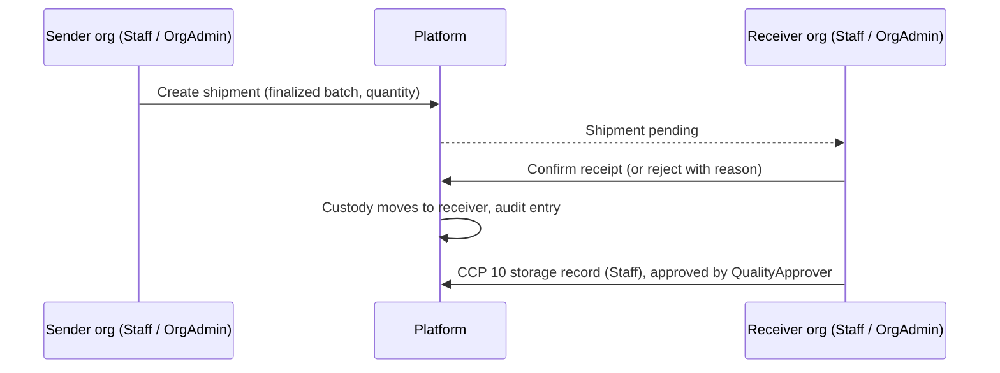
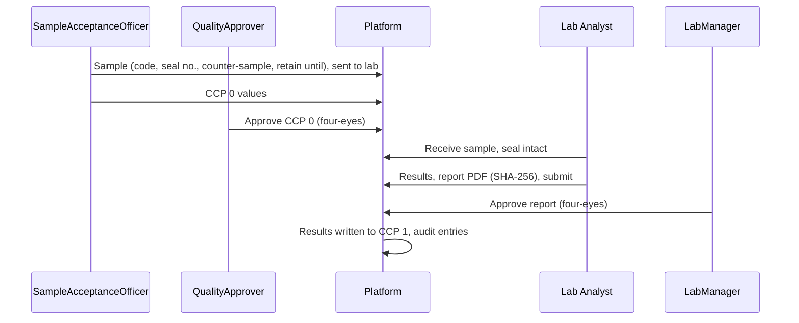
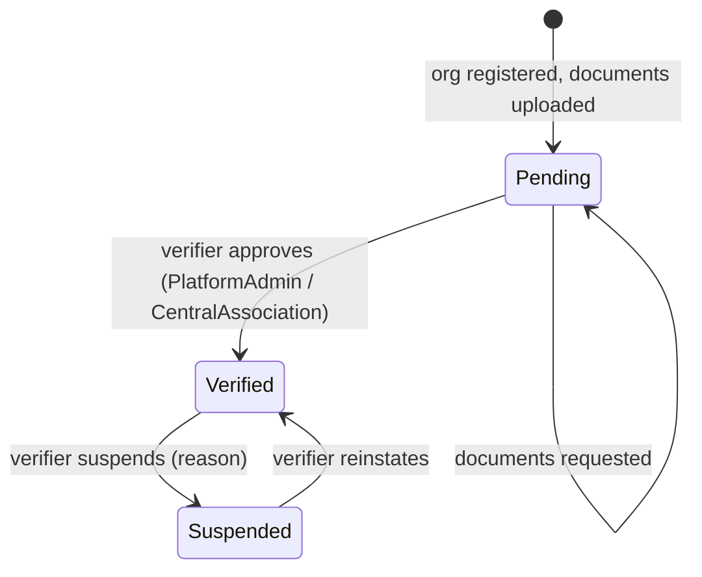
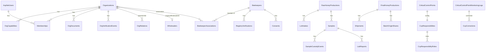

# Role and organization model

Status: designed 2026-10-03 on `feat/role-model`, updated 2026-10-09 to match the code. **P1 to P5 are implemented** behind the flag `Features:OrgRoleModel`: organizations, memberships, verification and audit (migration 004), CCP responsibility, owning organization and approvals (005), intake, custody, shipments and recall (006), samples and lab reports (007), registry, consents, storefront and origin shares (008), plus the editable role permissions (013) and the CCP 0 default (015). Main code: `Services/OrgModel/` and `IntakeController`, `SamplesController`, `LabReportsController`, `ShipmentsController`, `StorefrontController`, `StorefrontsController`, `RecallController`, `OrgWorkspaceController`, `MyWorkController`, `CCPMonitoringController`. Implementation choices and later changes are in [DECISIONS.md](DECISIONS.md) (D-22 to D-31 design assumptions; D-32, D-40 to D-43 implementation choices per phase; D-56 role permissions; D-61, D-63 CCP 0; D-73, D-75 holders and four-eyes). Open points are PQ-04 to PQ-12 in [PARTNER-QUESTIONS.md](PARTNER-QUESTIONS.md).
Paths are relative to `TOP4HONEYCHAINS/TOP4HoneyChains.Web/`. This document describes the behaviour with `Features:OrgRoleModel = true`, the live setting.

**Ground rule:** with the flag off the app falls back to v1.0: admin-only web panel (D-01), beekeeper logins locked (D-09). All schema changes are additive numbered scripts (CLAUDE.md).

---

## 1. Goals and constraints

| # | Goal / constraint | Source |
|---|---|---|
| G1 | Only licensed or platform-approved actors take part: AKS-registered beekeepers, beekeeper associations, the central association, packers, accredited labs. Wholesalers and retailers need no licence but must be approved by the platform. | Partner meeting (owner, 2026-10-03) |
| G2 | Beekeepers never enter data and never log in. They are records kept by the platform and linked to their association. | Partner meeting, D-23 |
| G3 | Beekeepers get value from a public storefront page, built only from verified data and published only after recorded consent (KVKK). Province and district only, never an exact location. | Partner meeting, KVKK, D-30, D-72 |
| G4 | No AKS access today. A registry verification interface with a manual implementation now (document + approval) and an AKS implementation later. Enterprise number format `TR` + 2-digit province + 10 digits. | Partner meeting |
| G5 | CCP responsibility follows WP4 Table 1 (Association CCP 1–6, BALMER CCP 7–9, TUMA CCP 10), mapped to **capabilities** (Processing, Packing, Wholesale/Retail), never to named records. CCP 0 (primary audit) is done at reception by the lot owner: its SampleAcceptanceOfficer enters it, its QualityApprover approves it (migration 015, D-63). | WP4 report, Table 1; `CCP-CURRENT.md` §6 |
| G6 | Responsibility is configuration, not code. Write rights follow ownership and custody; read rights flow along the chain; the public sees Honey Story and the storefront only. | Partner meeting |
| G7 | Four-eyes for CCP values, lab results and finalize. After finalize, corrections only through a correction record, never an unlock. | Partner meeting, D-14, D-27 |
| G8 | Append-only audit log for every create, update, approve and delete. | Partner meeting |
| G9 | Blends show country-of-origin percentages. | Directive (EU) 2024/1438 (amends 2001/110) |
| G10 | No personal or company names in code or seeds. Platform admin is the project team now, possibly the central union later. | Owner |
| G11 | v1.0 unchanged while the flag is off; additive schema; SQL Server 2019. | CLAUDE.md, D-01 |

---

## 2. Current state (inventory, 2026-10-03)

> **Historical.** This is the inventory taken before P1; it no longer describes the app. The live model is in §3 to §14.

### 2.1 Identity
- `ApplicationUser : IdentityUser` with no extra fields. Standard `AspNet*` tables (EF migrations cover Identity only).
- Roles in `AspNetRoles` (LocalDB copy of production; counts only):

| Role | Users | Used in code |
|---|---|---|
| Administrator | 2 (one is the local-only test admin) | yes: every business controller is `[Authorize(Roles = "Administrator")]`; `AccountController` lets only this role into the panel (D-01) |
| Beekeeper | 62 | only assigned when a beekeeper is created (`BeekeepersController.Create`); logins are locked (D-09) |
| Wholesaler | 0 | no |
| Consumer | 0 | no |
| SampleAcceptanceOfficer | 0 | no (a DB row only; GO-LIVE step 6 asks who created it) |

- `RoleManagementController` and `UserManagementController` manage global roles. There are no policies, no resource-based handlers and no org scoping.
- Update (D-78 P3, D-87): beside staff accounts there are two account kinds without roles or memberships: beekeeper accounts (`BeekeeperAccounts`, portal `/Me`) and consumer accounts (`ConsumerAccounts`, area `/Consumer`: saved honeys and feedback to the producer, pseudonym only towards organizations). Both are kept in their own area by the account-kind boundary (§14). The unused global role `Consumer` above is not used by them.

### 2.2 Domain tables

| Table | What it is | Gaps for the new model |
|---|---|---|
| `Beekeepers` | Person. `BeekeeperId` is also the `AspNetUsers.Id` of the beekeeper's (locked) login. `BeekeeperBusinessNumber` = internal `BEE-yyyy-nnnn`. | No AKS number, no province/district, no association link, no consent |
| `Apiaries` | Apiary with exact latitude/longitude (public only rounded, D-12) and a QR GUID | No province/district |
| `Wholesalers` | Companies (title, tax no, contact, city, country, active). Raw lots and batches belong to one wholesaler; a DB trigger keeps a batch's lots on the same wholesaler. | Not an organization model: no capabilities, members, verification or documents |
| `RawHoneyProductions` | Raw honey lot: apiary, period, honey type, amount, date, wholesaler | No intake record, custodian, origin country or sample |
| `FinalHoneyProductions`, `…Details` | Batch, composition (`UsedAmount` per lot), QR, finalize | No owner/custodian org, no shipments, no origin shares |
| `CriticalControlPoints`, `…Parameters`, `…ParameterLimits`, `…Categories`, `…Contents` | CCP definitions, metadata and limits (D-17 to D-21) | No responsibility matrix |
| `RawHoneyCCPAssignments`, `FinalHoneyCCPAssignments`, `CriticalControlPointMonitoringLogs`, `AssignmentStatuses` | CCP work and values; "Not applicable" stores the user **name** (D-15) | No recorded-by user/org, no approval, no correction |
| `ApiaryPhotos` | Photos (blob) | — |

- Not present anywhere in the live app: associations, organizations, memberships, samples, seals, labs, lab reports, shipments, custody, audit log, consents, registry verification.
- Legacy app (not live): a beekeeper "Association Membership" text field, an "Apiary Barcode" label and `HoneyTests` tables. Draft script `TOP4HONEYCHAINS/SQLQuery1.sql` (never applied): `PackingCompanies`, `PackingCompanyTanks`, `HoneySellingCompanies`, `RawHoneyLots`, `FinalProductBatches`, `BatchCompositions`. Neither is reused; both confirm that packers and sellers were meant to be separate actors.

### 2.3 Mapping to the new model

| Existing | New model | How |
|---|---|---|
| Role `Administrator` | Membership `OrgAdmin` in the platform organization (capability `PlatformAdmin`) | Migration P1; the Identity role stays as a fallback while the flag is off |
| Role `Beekeeper` + 62 locked logins | Beekeepers are **not users** (D-23) | Logins stay locked; whether to delete them is PQ-05 |
| Role `SampleAcceptanceOfficer` | Org role `SampleAcceptanceOfficer` in a membership | Global role retired |
| Roles `Wholesaler`, `Consumer` | Not used (Wholesale is a capability; the public needs no login) | Global roles retired |
| `Wholesalers` rows | `Organizations` with `LegacyWholesalerId`, capabilities Processing + Packing + Wholesale (**assumption** D-24), status Pending | One org per wholesaler; existing FKs stay |
| `RawHoneyProductions.RawHoneyProductionWholesalerId` | `DefinedByOrgId` and `CustodianOrgId` = the mapped org | Backfill; the old column stays |
| `FinalHoneyProductions.FinalHoneyProductionWholesalerId` | `OwnerOrgId` and `CustodianOrgId` | Backfill |
| CCP assignments / logs | Unchanged tables, plus recorded-by, approval and org columns | Legacy rows get `RecordedByOrgId = NULL` and are shown as "recorded before approvals" |
| `Beekeepers.BeekeeperBusinessNumber` | Kept as an internal id; the AKS number is a new field | No conversion: the formats differ |
| `Apiaries` lat/lng | Stay private; province/district are new fields | Manual entry (or reverse geocoding, PQ-12) |
| `CriticalControlPoints.AppliesTo` | Still used; the responsibility matrix adds who enters and approves | — |
| "Not applicable" by user name | Recorded-by user id + org | New columns; the name stays for legacy rows |

---

## 3. Actors and capabilities

An **organization** has one or more **capabilities**. Capabilities decide what an org may do; memberships decide what a person in it may do. Capabilities are set by a platform administrator.

| Capability | Meaning | Login | Licence / approval | Typical CCPs |
|---|---|---|---|---|
| `Beekeeping` | A beekeeper's enterprise (one person or a company) | **no** | AKS registry number, verified (G4) | — |
| `Association` | Beekeeper association: member beekeepers are linked to it; it records their storefront consents | yes | Verified by PlatformAdmin or CentralAssociation (configurable) | none by default; CCP 0 only if an administrator gives it to the association on the CCP responsibilities page; CCP 1–6 when it also has `Processing` |
| `CentralAssociation` | Central beekeepers' union | yes | Verified by PlatformAdmin | May verify associations (`OrgModel:AssociationVerifier`) |
| `Processing` | Reception and processing. An association **or** a packer. | yes | Verified | lot CCP 0–3, batch CCP 4–6 |
| `Packing` | Filling, labelling, packaging | yes | Verified (licence document) | CCP 7–9; CCP 10 |
| `Laboratory` | Analyses. Flags: `IsAccredited`, `AccreditationNumber`, validity. "In-house" when owned by the producing org (shown on Honey Story). | yes | Accreditation document | CCP 1 lab results (through lab reports) |
| `Wholesale` | Sells to retail; holder while it has the goods | yes | Approved (no licence) | CCP 10 (batch owner, or storage record as holder) |
| `Retail` | Sells to consumers; holder at CCP 10 | yes | Approved | CCP 10 (batch owner, or storage record as holder) |
| `PublicAuthority` | Inspection body | yes | Verified | read-only everywhere |
| `PlatformAdmin` | Runs the platform (project team now) | yes | — | configuration, verification |

Combinations are normal: Wholesale + Retail; Association + Processing + Packing (an association that packs itself); Processing + Packing + Wholesale (a plant that fills and stores its own honey, D-24).

---

## 4. Org roles (memberships)

A user joins an org through a **membership** with one org role. One user can hold several memberships (several orgs, or several roles in one org). The user picks the **active membership** in the UI; every write is attributed to user + org. Memberships are added and revoked by platform administrators only.

| Org role | Does (defaults) | Typical capability |
|---|---|---|
| `OrgAdmin` | Uploads documents for its own org (also while Pending), requests finalizing, ships and confirms or rejects receipts, records beekeeper consents (associations), reads intake and samples. Members, capabilities and the four-eyes exemption are **platform-admin only**. | any |
| `Staff` | Enters CCP values (CCP 2–10, and CCP 1 parameters the lab report does not cover), requests finalizing, ships and confirms receipts, enters CCP 10 storage records as holder | Processing, Packing, Wholesale, Retail |
| `FieldInspector` | Reads. No default write right; enters CCP 0 only if an administrator gives CCP 0 to the association on the CCP responsibilities page | Association |
| `SampleAcceptanceOfficer` | Records deliveries (intake), takes and seals samples and sends them to a lab, enters CCP 0 | Processing |
| `QualityApprover` | Approves CCP records and CCP 10 storage records of its org, confirms finalizing (four-eyes) | Processing, Packing, Wholesale, Retail |
| `Analyst` | Receives samples at the lab, enters lab results, submits the report | Laboratory |
| `LabManager` | Receives samples, approves or returns lab reports | Laboratory |

Platform administrators are users in the Identity role `Administrator` with an `OrgAdmin` membership in the platform org (D-32). With the flag on they are **read-only on business data** (D-35): they manage organizations, members, verification, configuration and the registry (§5); they take no part in the honey's journey (D-88). A PublicAuthority member gets read access through the capability, not through a role.

---

## 5. Permission matrix

The defaults come from two editable tables plus a few fixed rules. Both tables are edited by platform administrators (Organizations → Roles and permissions, and CCP responsibilities); changes act at once.

**Write needs, everywhere:** the org is Verified, has the required capability, owns (or holds) the item, and the user's active role has the right. The approver must not be the person who entered (four-eyes, §5.4). Platform administrators never enter or approve business data.

### 5.1 CCP responsibilities (`CcpResponsibilities`, seeded by 005, CCP 0 changed by 015)

| CCP | Side | Owner rule | Required capability | Enter | Approve |
|---|---|---|---|---|---|
| CCP 0 primary audit | lot | Owner | Processing | SampleAcceptanceOfficer | QualityApprover |
| CCP 1 sampling and lab | lot | Owner | Processing | SampleAcceptanceOfficer, Staff (lab values are written from the approved lab report, §7) | QualityApprover |
| CCP 2–3 | lot | Owner | Processing | Staff | QualityApprover |
| CCP 4–6 | batch | Owner | Processing | Staff | QualityApprover |
| CCP 7–9 | batch | Owner | Packing | Staff | QualityApprover |
| CCP 10 storage | batch | Owner | Wholesale, Retail or Packing | Staff | QualityApprover |

"Owner" is the owning organization of the lot or batch (`OwnerOrgId`, D-36; or the organization linked to its wholesaler while none is set). All batch CCPs belong to the batch owner. The owner rule `BeekeeperAssociation` still exists and can be chosen for a CCP. CCP 10 storage records of later holders use the same CCP 10 row (§6).

### 5.2 Other rights (`RolePermissions`, seeded by 013, defaults in `Services/OrgModel/Permissions.cs`)

| Area | Enter | Approve | Read | Further checks |
|---|---|---|---|---|
| Intake (delivery) | SampleAcceptanceOfficer | – | SampleAcceptanceOfficer, OrgAdmin | Processing org |
| Samples | SampleAcceptanceOfficer (take, seal, send) | Analyst, LabManager (receive at the lab, seal check) | SampleAcceptanceOfficer, OrgAdmin, Analyst, LabManager | lot owner; the lab the sample was sent to (Laboratory) |
| Lab results | Analyst | LabManager | all roles | Laboratory org that received the sample; lot's CCP 0 done (§7) |
| Shipments | Staff, OrgAdmin (send) | Staff, OrgAdmin (confirm or reject receipt) | Staff, OrgAdmin, QualityApprover | holder of the quantity; receiver Verified; no capability check |
| Storefront (consents) | OrgAdmin | – | OrgAdmin | Association, beekeeper linked to it |
| Recall report | – | – | all roles | own lots and batches, or the association's beekeepers |
| Batch (D-88, 030) | Staff, OrgAdmin (create a batch: "New batch" in My organization) | – | – | Verified org with Processing or Packing; only own lots whose CCPs are all done and approved and that have honey left |
| Finalize | Staff, OrgAdmin (request) | QualityApprover (confirm) | – | batch owner |
| Consumer feedback (D-87, 029) | OrgAdmin, QualityApprover, ComplianceOfficer (mark read, answer, close) | – | OrgAdmin, QualityApprover, ComplianceOfficer | the batch owner; the consumer's pseudonym only; suspected fakes also read-only for the platform administrator |
| CCP read (per CCP) | – | – | all roles | the read rule in §5.3 |

### 5.3 Read along the chain

An org reads: the CCPs it is responsible for; the earlier CCPs of the same lot or batch; every CCP of the lots in batches it owns; and, as a **holder** (it received a shipment of the batch or keeps a storage record of it), that batch's CCPs and its lots' CCPs, read-only, without beekeeper and apiary names (D-73, D-75). A verified PublicAuthority reads everything. Upstream orgs do not see downstream records (PQ-06). A refused CCP read answers the branded 403 page; other pages answer 404 for records of other orgs (D-47, D-73).

### 5.4 Fixed rules (not configurable)

- **Batches (D-88):** the owning organization creates its batch ("New batch" in My organization, right "Batch" Enter): it chooses its own eligible lots and the kilograms of each; the batch belongs to it, gets its legacy wholesaler record (created automatically for an organization with Processing, Packing or Wholesale) and every batch CCP that has a row in the CCP responsibility matrix. The administrator's old batch screens (`FinalHoneyProductionsController`) are no longer in the menu; the routes stay for corrections. Lots are created by intake (all lot CCPs are assigned automatically).
- **Four-eyes:** the approver of a CCP record must not be a person who recorded its values or who marked it "Not applicable" (D-75); approving a control sheet (D-88) applies this to each record and leaves the approver's own records for another person; the person who requested finalizing cannot confirm it; the approver of a lab report must not be its analyst. A platform administrator can give a one-person org a four-eyes exemption (flagged on the record and in the audit log); lab results never get it. My work offers only the approvals the four-eyes rule allows.
- **Corrections after approval or finalize:** only a platform administrator requests one; a second platform administrator decides it (`CCPMonitoringController.RequestCorrection` / `DecideCorrection`). There is no "corrected" note on Honey Story.
- **Order:** lot CCP 0–3, batch CCP 4–10 (`CriticalControlPoints.AppliesTo`). A lot joins a batch only when all its CCPs are done and approved. Every batch CCP, **including CCP 10 storage at the plant**, must be completed (or not applicable) and approved before finalizing (`CcpIntegrityService.GetFinalizeBlockersAsync`). Only finalized batches ship. Finalized batches and their lots are locked; there is no unfinalize (D-14).
- **Registry, org verification, members, capabilities, four-eyes exemption, CCP responsibilities, role permissions, audit log:** platform-admin only (associations may be verified by a central association if configured). The beekeeper's association is chosen by the registration officer at registration (D-88); the registry page keeps the administrator's link for corrections.

---

## 6. Custody, lots and shipments

- **Intake.** The SampleAcceptanceOfficer of a Processing org records the delivery from the beekeeper: quantity, province/district, origin country, a photo or PDF of the signed delivery form (stored with SHA-256), optionally an SMS. The lot is created with that org as owner and every lot CCP (0–3) is assigned.
- **Lot CCPs.** CCP 0 by the SampleAcceptanceOfficer, then the lab (§7) fills CCP 1, then Staff enter CCP 2–3 on the lot's control sheet (D-88); each approved by a QualityApprover (the sheet in one action, four-eyes per record).
- **Batches** are created by the processing or packing organization from its own approved lots ("New batch", D-88): the batch is its own and CCP 4–10 are assigned at once; its Staff enter them and its QualityApprover approves them. Finalize: Staff or OrgAdmin request, a QualityApprover (another person) confirms; origin shares are stored at that moment.
- **Shipments** move a quantity of a finalized batch. Custody of that quantity moves only when the receiver confirms receipt. Each later holder records its own **CCP 10 storage record** (`HolderStorageRecords`) after receipt, approved by its QualityApprover.
- **Recall report**: from a batch to all upstream lots, apiaries and beekeepers, and to every downstream shipment.

```mermaid
flowchart LR
    BK[Beekeeper<br/>no login] -- delivers honey --> IN[Intake<br/>SampleAcceptanceOfficer]
    IN --> LOT[Raw lot<br/>owner: Processing org]
    LOT -- CCP 0 --> C0[CCP 0 approved]
    LOT -- sample --> LAB[Laboratory]
    C0 --> LAB
    LAB -- approved report --> C1[CCP 1]
    C1 --> C23[CCP 2-3]
    C23 --> BATCH[Batch<br/>New batch by the plant]
    BATCH -- CCP 4-10 incl. storage at plant --> FIN[Finalize<br/>request + four-eyes confirm]
    FIN --> SHP{Receipt confirmed?}
    SHP -- yes, custody moves --> HOLD[Wholesale / Retail<br/>own CCP 10 storage record]
    SHP -- rejected --> FIN
    HOLD -- shipment --> HOLD2[Next holder<br/>own CCP 10 storage record]
```





---

## 7. Samples and lab

- The SampleAcceptanceOfficer of the lot owner takes the sample: sample code, **seal number**, a **retained counter-sample** (seal number, storage place, retain-until date), and sends it to a lab. Each hand-over is a custody event (seal intact yes/no).
- The lab (Analyst or LabManager) receives the sample and checks the seal. The Analyst enters results, uploads the report PDF (stored with **SHA-256**, report number and issue date) and submits; the LabManager (another person) approves or returns it. Approval writes the results into the lot's CCP 1.
- **CCP 0 first (D-61):** lab results are saved, submitted and approved only after the lot's CCP 0 is completed and approved (or not applicable); a report can still be returned meanwhile (`Services/OrgModel/Lab.cs`).
- Lab rights come from `RolePermissions` (areas Samples and LabResults), not from `CcpResponsibilities`.
- Honey Story shows: tested by an accredited lab (yes/no), accreditation number, and "in-house lab" when the lab belongs to the producing org. A public page (`/verify-report`) compares a report PDF with its stored hash.



---

## 8. Organization verification

Statuses `Pending` → `Verified` → `Suspended` (and back to `Verified`). Documents (licence, accreditation certificate, tax certificate, registry proof) are uploaded by the org's OrgAdmin (or a platform administrator). A platform administrator verifies; for `Association` the verifier can be configured to be the CentralAssociation (`OrgModel:AssociationVerifier`). Only Verified orgs can write. Suspension keeps all data and blocks new writes.



---

## 9. Registry interface (AKS)

```csharp
public interface IRegistryVerifier
{
    // "TR" + 2-digit province code + 10 digits, e.g. TR34xxxxxxxxxx
    bool IsWellFormed(string enterpriseNumber);
    Task<RegistryCheckResult> VerifyAsync(RegistryCheckRequest request, CancellationToken ct);
}
```

- The registry page (`RegistryController`) is **platform-admin only**: an administrator links a beekeeper to its association, uploads the proof and approves or rejects the registry number; one administrator is enough (D-37). The result, document hash and decider are stored.
- `ManualRegistryVerifier` (now); `AksRegistryVerifier` (later, when access exists, PQ-10) with the same result record.
- Format check: `^TR\d{2}\d{10}$`, and the two province digits must be 01–81.

---

## 10. Audit

- Table `AuditEntries` (append-only): time (UTC), user, active org, action, entity, key, old and new values (JSON), client IP.
- Written by an EF Core interceptor for every insert, update and delete of the business context, in the same transaction, plus explicit entries for approvals, logins and Identity changes. On regardless of the flag (D-34).
- Append-only: triggers reject `UPDATE` and `DELETE`; the app's DB login is denied both (D-39). Each row stores the hash of the previous row (hash chain); the audit page can check the chain.
- Corrections are their own records (`CcpCorrections`: target, old value, new value, reason, requested by, decided by), never in-place edits without a trace (§5.4).

---

## 11. Storefront and privacy

- A beekeeper storefront (`/storefront/{code}`) is generated **only** from verified data: verified registry number, verified association, finalized batches with that beekeeper's lots, approved lab results.
- Published only after **recorded consent**, entered by the OrgAdmin of the beekeeper's verified association (purpose, consent text version and hash, given on, recorded by, signed document, withdrawn at). Withdrawal unpublishes at once.
- Shows province and district only. Never coordinates, phone, birth date or personal photos.
- Personal data stays with the association that records it (KVKK roles: PQ-09).
- Honey Story shows provinces only (D-72) and keeps D-20; the beekeeper's name appears only with consent.

---

## 12. Data model

> **Historical.** This is the schema proposal of 2026-10-03. The implemented tables and columns are in migrations 004–008 and 013–015 and in `Data/TOP4HoneyChainsContext.cs`; names and details differ (for example `HolderStorageRecords` instead of `HolderCcpAssignments`, `BeekeeperRegistry` instead of new `Beekeepers` columns, ownership through `OwnerOrgId`).



| New table | Key columns | Relates to |
|---|---|---|
| `Organizations` | OrgId, DisplayName, LegalName, TaxNo, Province, District, Status, VerifiedAt, VerifiedByUserId, `LegacyWholesalerId` (unique, nullable) | `Wholesalers` |
| `Capabilities` (lookup) | Code (`Beekeeping` … `PlatformAdmin`) | — |
| `OrgCapabilities` | OrgId, Capability, IsAccredited, AccreditationNumber, AccreditationValidUntil | `Organizations` |
| `OrgRelations` | ParentOrgId, ChildOrgId, Kind (`MemberOf`, `OwnsLab`) | in-house labs, association ↔ central |
| `OrgDocuments` | DocumentId, OrgId, Kind, StoredFileName, Sha256, UploadedBy, UploadedAt | `Organizations` |
| `OrgVerificationEvents` | OrgId, FromStatus, ToStatus, Reason, ByUserId, At | `Organizations` |
| `OrgRoles` (lookup) | Code (`OrgAdmin` … `LabManager`) | — |
| `Memberships` | MembershipId, UserId, OrgId, OrgRole, Status, GrantedBy, GrantedAt, RevokedAt | `AspNetUsers`, `Organizations` |
| `BeekeeperAssociations` | BeekeeperId, AssociationOrgId, ValidFrom, ValidTo | `Beekeepers` |
| `RegistryVerifications` | Id, BeekeeperId, EnterpriseNumber, Method, Status, DocumentId, DecidedBy, DecidedAt | `Beekeepers` |
| `Consents` | ConsentId, BeekeeperId, Purpose, TextVersion, TextSha256, GivenAt, RecordedByUserId, EvidenceDocumentId, WithdrawnAt | `Beekeepers` |
| `LotIntakes` | IntakeId, RawHoneyProductionId, ReceivingOrgId, ReceivedByUserId, ReceivedAt, Quantity, Containers, DeliveryFormDocumentId, SmsSentAt, SmsStatus | `RawHoneyProductions` |
| `Samples` | SampleId, RawHoneyProductionId / FinalHoneyProductionId, SampleCode, SealNumber, CounterSealNumber, CounterLocation, RetainUntil, TakenByUserId, TakenAt, OrgId | lots, batches |
| `SampleCustodyEvents` | SampleId, Event, FromOrgId, ToOrgId, UserId, At, SealIntact, Note | `Samples` |
| `LabReports` | ReportId, SampleId, LabOrgId, ReportNumber, IssuedAt, StoredFileName, Sha256, Status, ApprovedBy, ApprovedAt | `Samples`, `Organizations` |
| `Shipments` | ShipmentId, FinalHoneyProductionId, FromOrgId, ToOrgId, Quantity, ShippedAt/By, ReceivedAt/By, Status | `FinalHoneyProductions` |
| `HolderCcpAssignments` | Id, FinalHoneyProductionId, CcpId, HolderOrgId, ShipmentId, Status | CCP 10 per holder; keeps the existing unique (batch, CCP) index untouched |
| `CcpResponsibilities` | CcpId, RequiredCapability, OwnerRule (`BeekeeperAssociation`, `Custodian`, `LabOfSample`), RequiresApproval | `CriticalControlPoints` |
| `CcpResponsibilityRoles` | CcpId, Action (`Enter`, `Approve`), OrgRole | `CcpResponsibilities` |
| `CcpCorrections` | CorrectionId, LogId / target, OldValue, NewValue, Reason, RequestedBy, ApprovedBy, At | logs |
| `BatchOriginShares` | FinalHoneyProductionId, CountryCode, Percentage (snapshot at finalize) | batches |
| `AuditEntries` | see §10 | all |

New columns on existing tables (all nullable or with defaults):
- `Beekeepers`: `RegistryNumber`, `RegistryStatus`, `Province`, `District`, `StorefrontSlug`
- `Apiaries`: `Province`, `District`
- `RawHoneyProductions`: `DefinedByOrgId`, `CustodianOrgId`, `OriginCountry` (ISO 3166-1 alpha-2, default `TR` for AKS-verified beekeepers)
- `FinalHoneyProductions`: `OwnerOrgId`, `CustodianOrgId`, `FinalizeRequestedBy`, `FinalizeApprovedBy`
- `RawHoneyCCPAssignments`, `FinalHoneyCCPAssignments`: `SubmittedBy`, `SubmittedAt`, `ApprovedBy`, `ApprovedAt`, `ResponsibleOrgId`
- `CriticalControlPointMonitoringLogs`: `RecordedByUserId`, `RecordedByOrgId`, `SampleId`, `LabReportId`, `HolderCcpAssignmentId`
- `AssignmentStatuses`: new row 6 `Submitted` (waiting for approval)

**Origin percentages (EU 2024/1438).** Each lot has an `OriginCountry`. At finalize, `BatchOriginShares` = sum of `UsedAmount` per country ÷ batch total, stored as a snapshot and shown in descending order on the label data and Honey Story. Rounding and the exact label rule are open (PQ-11). A batch of Turkish lots only shows "Türkiye 100 %".

---

## 13. Configuration tables

CCP responsibility is data (`CcpResponsibilities`, `CcpResponsibilityCapabilities`, `CcpResponsibilityRoles`), seeded by 005 (CCP 0 changed by 015) and editable by platform administrators on the CCP responsibilities page:

| CCP | Required capability | Owner rule | Enter | Approve |
|---|---|---|---|---|
| CCP 0 | Processing | lot owner | SampleAcceptanceOfficer | QualityApprover |
| CCP 1 | Processing | lot owner | SampleAcceptanceOfficer, Staff (lab values come from the approved lab report) | QualityApprover |
| CCP 2–3 | Processing | lot owner | Staff | QualityApprover |
| CCP 4–6 | Processing | batch owner | Staff | QualityApprover |
| CCP 7–9 | Packing | batch owner | Staff | QualityApprover |
| CCP 10 | Wholesale, Retail or Packing | batch owner (holders: their own storage record) | Staff | QualityApprover |

Lab rights (receive samples, enter, approve) are not in this table: they come from `RolePermissions` (areas Samples and LabResults, §5.2), edited on Organizations → Roles and permissions (D-56).

Other settings: `Features:OrgRoleModel`; `OrgModel:AssociationVerifier` (`PlatformAdmin` / `CentralAssociation`); the four-eyes exemption per organization (set by a platform administrator, default off, PQ-07). A registry grace period and an SMS provider switch from the design are not settings in the code.

---

## 14. Authorization approach (ASP.NET Core)

- **Feature flag.** `Features:OrgRoleModel = false`: only users in the Identity role `Administrator` use the panel (v1.0). `true`: the org model applies.
- **Active membership.** The chosen membership id is kept in a cookie (`T4H.Membership`), not in a claim. Every request re-reads it from the database and checks that it belongs to the user and is active, so a revoked membership or a suspended org takes effect at once (`Services/OrgModel/CurrentOrg.cs`, D-32).
- **Policies** (`Program.cs`, `Services/OrgModel/Authorization.cs`): `PanelUser` (an administrator, or a user with an active membership while the flag is on), `PlatformAdmin` (Identity role `Administrator`), `SignedIn`. Admin-only screens (organization create/edit, capabilities, members, four-eyes exemption, registry, CCP responsibilities, permissions, audit, corrections) use `PlatformAdmin`; business data controllers that are not yet opened to members (beekeepers, apiaries, lots, batches, wholesalers) keep `[Authorize(Roles = "Administrator")]`.
- **Resource-based handlers:** `OrganizationAuthorizationHandler` (read, manage documents, verify) and `CcpAuthorizationHandler` (read, enter, approve a CCP of a lot or batch, built on `CcpResponsibilityService` in `Services/OrgModel/Responsibility.cs`, plus four-eyes through `CcpRecorders`).
- **Inline checks** for everything else: intake, samples, lab reports, shipments and receipt, storage records, finalize request/confirm, storefront consents and recall check the active membership, the org status and capability, ownership or custody, and `Permissions` (RolePermissions) in the controller or in `Services/OrgModel/` (`Lab.cs`, `Custody.cs`). There are no `ShipmentReceiveRequirement` or `BatchFinalizeRequirement` handlers.
- **Org scoping of queries.** `OrgScope` (in `Authorization.cs`) gives the lots and batches an org may list; administrators and verified public authorities read all.
- **Account-kind boundary** (D-78 P3, D-87). Beekeeper and consumer accounts reach only their own area (`/Me`, `/Consumer`), a few account actions and the public pages; everything else answers 403 (`BeekeeperBoundaryMiddleware`). They can never be given a role or a membership.
- **Tests.** `TOP4HoneyChains.Web.Tests` (unit and `Category=E2E`, the app hosted with the flag on against a throw-away database, D-46).

---

## 15. Migration from current roles

1. Add the schema (P1 script), flag off.
2. Create the platform org (generic name, no personal or company names) with capability `PlatformAdmin`; give every current Administrator an `OrgAdmin` membership in it.
3. Create one org per `Wholesalers` row (`LegacyWholesalerId`), capabilities Processing + Packing + Wholesale (D-24), status Pending. Backfill `DefinedByOrgId`, `CustodianOrgId`, `OwnerOrgId`.
4. Beekeepers: no user accounts in the new model. Logins stay locked (D-09); deletion is PQ-05. Association links and registry numbers are entered by platform administrators (§9).
5. Global roles `Wholesaler`, `Consumer`, `SampleAcceptanceOfficer`, `Beekeeper`: kept but unused once the flag is on (no deletes; GO-LIVE step 6 still applies).
6. Legacy CCP data: unchanged, labelled "recorded before approvals" where approval data is missing. The five finalized batches stay as they are (D-16).
7. Switch the flag on in a test environment, run the matrix tests, then switch on in production.

---

## 16. Phased plan

> **Historical.** The plan as written on 2026-10-03. All five phases are implemented (migrations 004–008); the deviations are in D-32 and D-40 to D-43, later changes in §5 and DECISIONS.md.

| Phase | Scope | Acceptance criteria |
|---|---|---|
| **P1** | Organizations, capabilities, memberships, org verification with documents, audit log, authorization framework (claims, policies, `IOrgScope`), feature flag, migration steps 1–5 | Flag off: all v1.0 smoke tests pass unchanged. Flag on: PlatformAdmin can create orgs, add capabilities, upload/verify documents, add members; a Pending or Suspended org cannot write; every create/update/delete/verify has an audit row; audit rows cannot be updated or deleted (DB test); one user with two memberships can switch and acts only within the active one |
| **P2** | Owning organization on lots and batches (set by admin or at intake, D-36); platform administrators read-only on business data with corrections only through correction records (D-35); CCP responsibility config, enter/approve with four-eyes, Submitted status, recorded-by user/org, org-scoped views of lots/batches/CCPs, finalize request + approval | The matrix tests (§5) pass for CCP 0–9; the same user cannot enter and approve; finalize needs a second person; an org sees only lots/batches in its custody chain; config changes take effect without a deploy |
| **P3** | Lot intake (delivery form photo, optional SMS), custody, shipments with receipt, CCP 10 per holder, recall report, correction records | Custody moves only on receipt; only the holder can enter CCP 10; the recall report of a test batch lists all upstream beekeepers and downstream shipments; a correction after finalize needs a reason and an approver and shows on Honey Story; no unlock exists |
| **P4** | Samples, seals, counter-samples, chain of custody, lab orgs with accreditation, lab results with LabManager approval, report PDF with SHA-256, Honey Story lab badges (accredited, in-house) | A CCP 1 lab result cannot be completed without an approved report; the stored hash matches the file; a broken seal is flagged; Honey Story shows the badges only for approved, verified data |
| **P5** | Registry verification (manual now, AKS adapter later), consents, beekeeper storefront, origin percentages | A storefront appears only after registry verification + recorded consent and disappears on withdrawal; no coordinates, phone or birth date on it; origin shares are computed at finalize and add up to 100 %; the AKS adapter can replace the manual one without code changes elsewhere |

---

## 17. Risks

| Risk | Mitigation |
|---|---|
| Associations lack staff or devices to record on behalf of beekeepers | Simple mobile-friendly forms, offline-tolerant intake later, training material |
| One-person orgs cannot do four-eyes | Exemption per org, set by a platform administrator, flagged in the audit log (PQ-07) |
| No AKS access: manual verification can be faked | Document + hash + named decider; periodic re-verification; AKS adapter when possible |
| KVKK: associations process beekeeper data; consent quality | Clear controller/processor roles and agreements (PQ-09); consent text versioned and hashed |
| "Wholesaler" assumption wrong (D-24) | Capabilities are data: re-assign without schema change |
| Org scoping bugs leak data between competitors | `OrgScope` and `CcpResponsibilityService` as the query and access path; E2E tests; code review rule |
| Audit table growth | Partitioning by month, archive after the retention period (PQ-09) |
| Legacy demo-like data (PQ-02) on public pages | Clean up before the flag is switched on |
| Origin rule details unclear in Turkish law | Snapshot at finalize; display rule configurable (PQ-11) |
| Feature flag drift (two code paths) | Flag-off tests until v1.0 mode is retired |

---

## 18. Open questions

See [PARTNER-QUESTIONS.md](PARTNER-QUESTIONS.md):
- PQ-04: meaning of "wholesaler"
- PQ-05: platform admin and verifiers; the 62 locked beekeeper logins
- PQ-06: read visibility along the chain
- PQ-07: four-eyes waiver for small orgs
- PQ-08: SMS to beekeepers
- PQ-09: KVKK roles and retention
- PQ-10: AKS access and number format
- PQ-11: origin percentages
- PQ-12: CCP 0 frequency, province/district source

Assumptions D-22 to D-31 are listed in [DECISIONS.md](DECISIONS.md).
