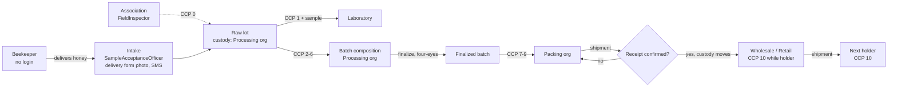
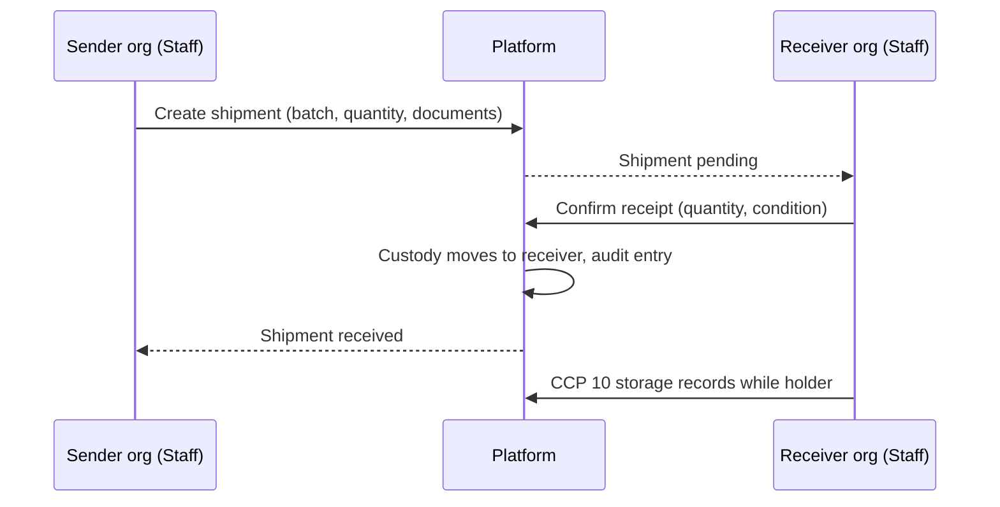
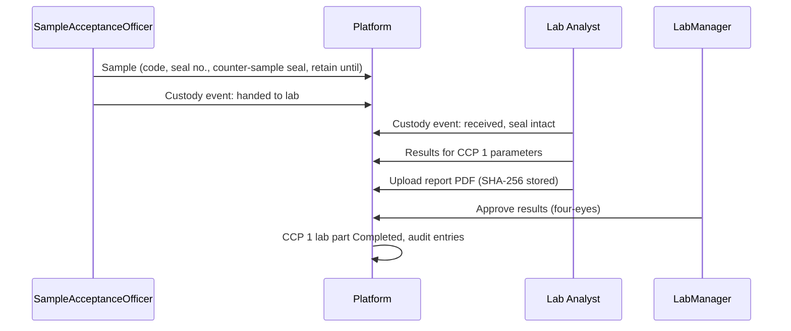
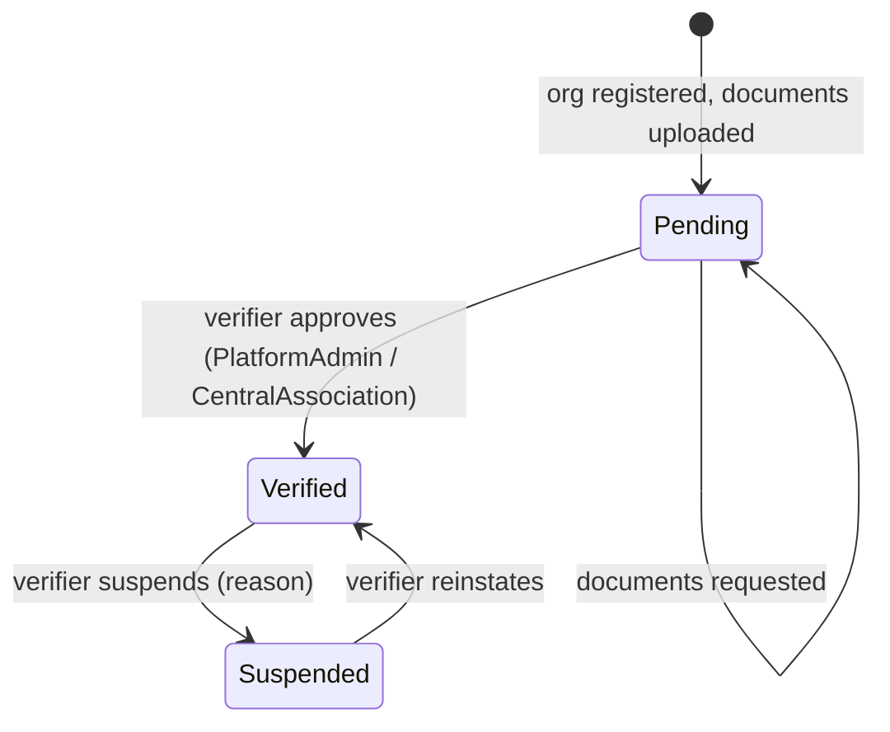
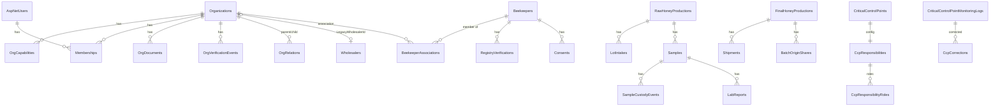

# Role and organization model (design)

Status: written 2026-10-03 on `feat/role-model`. **P1 is implemented** (`feat/role-model-p1`, flag `Features:OrgRoleModel`, default off); P2–P5 are design. Implementation choices and deviations from this text: D-32 (active membership as a re-checked cookie choice instead of a claim; lot/batch ownership through `Organizations.LegacyWholesalerId` until the P3 custody columns; registry data in `BeekeeperRegistry` instead of new `Beekeepers` columns; fixed enter/approve roles until the P2 configuration). Decisions D-22 to D-31 in [DECISIONS.md](DECISIONS.md) are **assumptions, revisable**; open points are PQ-04 to PQ-12 in [PARTNER-QUESTIONS.md](PARTNER-QUESTIONS.md).
Paths are relative to `TOP4HONEYCHAINS/TOP4HoneyChains.Web/`.

**Ground rule:** v1.0 behaviour stays as it is: admin-only web panel (D-01), beekeeper logins locked (D-09). Everything below is switched on by one feature flag, `Features:OrgRoleModel` (default `false`). All schema changes are additive numbered scripts (CLAUDE.md).

---

## 1. Goals and constraints

| # | Goal / constraint | Source |
|---|---|---|
| G1 | Only licensed or platform-approved actors take part: AKS-registered beekeepers, beekeeper associations, the central association, packers, accredited labs. Wholesalers and retailers need no licence but must be approved by the platform. | Partner meeting (owner, 2026-10-03) |
| G2 | Beekeepers never enter data and never log in. Their association records on their behalf. | Partner meeting |
| G3 | Beekeepers get value from a public storefront page, built only from verified data and published only after recorded consent (KVKK). Province and district only, never an exact location. | Partner meeting, KVKK, D-12 |
| G4 | No AKS access today. A registry verification interface with a manual implementation now (document + approval) and an AKS implementation later. Enterprise number format `TR` + 2-digit province + 10 digits. | Partner meeting |
| G5 | CCP responsibility follows WP4 Table 1 (Association CCP 1–6, BALMER CCP 7–9, TUMA CCP 10). Association, BALMER and TUMA are **role types**, never records. CCP 0 is the field audit at the beekeeper. | WP4 report, Table 1; `CCP-CURRENT.md` §6 |
| G6 | Responsibility is configuration, not code. Write rights follow custody; read rights flow along the chain; the public sees Honey Story only. | Partner meeting |
| G7 | Four-eyes for CCP values, lab results and finalize. After finalize, corrections only through a correction record, never an unlock. | Partner meeting, D-14 |
| G8 | Append-only audit log for every create, update, approve and delete. | Partner meeting |
| G9 | Blends show country-of-origin percentages. | Directive (EU) 2024/1438 (amends 2001/110) |
| G10 | No personal or company names in code or seeds. Platform admin is the project team now, possibly the central union later. | Owner |
| G11 | v1.0 unchanged until the flag is on; additive schema; SQL Server 2019. | CLAUDE.md, D-01 |

---

## 2. Current state (inventory, 2026-10-03)

### 2.1 Identity
- `ApplicationUser : IdentityUser` with no extra fields. Standard `AspNet*` tables (EF migrations cover Identity only).
- Roles in `AspNetRoles` (LocalDB copy of production; counts only):

| Role | Users | Used in code |
|---|---|---|
| Administrator | 2 (one is the local-only test admin) | yes: every business controller is `[Authorize(Roles = "Administrator")]`; `AccountController` lets only this role into the panel (D-01) |
| Beekeeper | 62 | only assigned when a beekeeper is created (`BeekeepersController.Create`); logins are locked (D-09) |
| Wholesaler | 0 | no |
| Consumer | 0 | no |
| SampleAcceptanceOfficer | 0 | no (a DB row only; GO-LIVE step 6 asks who created it) |

- `RoleManagementController` and `UserManagementController` manage global roles. There are no policies, no resource-based handlers and no org scoping.

### 2.2 Domain tables

| Table | What it is | Gaps for the new model |
|---|---|---|
| `Beekeepers` | Person. `BeekeeperId` is also the `AspNetUsers.Id` of the beekeeper's (locked) login. `BeekeeperBusinessNumber` = internal `BEE-yyyy-nnnn`. | No AKS number, no province/district, no association link, no consent |
| `Apiaries` | Apiary with exact latitude/longitude (public only rounded, D-12) and a QR GUID | No province/district |
| `Wholesalers` | Companies (title, tax no, contact, city, country, active). Raw lots and batches belong to one wholesaler; a DB trigger keeps a batch's lots on the same wholesaler. | Not an organization model: no capabilities, members, verification or documents |
| `RawHoneyProductions` | Raw honey lot: apiary, period, honey type, amount, date, wholesaler | No intake record, custodian, origin country or sample |
| `FinalHoneyProductions`, `…Details` | Batch, composition (`UsedAmount` per lot), QR, finalize | No owner/custodian org, no shipments, no origin shares |
| `CriticalControlPoints`, `…Parameters`, `…ParameterLimits`, `…Categories`, `…Contents` | CCP definitions, metadata and limits (D-17 to D-21) | No responsibility matrix |
| `RawHoneyCCPAssignments`, `FinalHoneyCCPAssignments`, `CriticalControlPointMonitoringLogs`, `AssignmentStatuses` | CCP work and values; "Not applicable" stores the user **name** (D-15) | No recorded-by user/org, no approval, no correction |
| `ApiaryPhotos` | Photos (blob) | — |

- Not present anywhere in the live app: associations, organizations, memberships, samples, seals, labs, lab reports, shipments, custody, audit log, consents, registry verification.
- Legacy app (not live): a beekeeper "Association Membership" text field, an "Apiary Barcode" label and `HoneyTests` tables. Draft script `TOP4HONEYCHAINS/SQLQuery1.sql` (never applied): `PackingCompanies`, `PackingCompanyTanks`, `HoneySellingCompanies`, `RawHoneyLots`, `FinalProductBatches`, `BatchCompositions`. Neither is reused; both confirm that packers and sellers were meant to be separate actors.

### 2.3 Mapping to the new model

| Existing | New model | How |
|---|---|---|
| Role `Administrator` | Membership `OrgAdmin` in the platform organization (capability `PlatformAdmin`) | Migration P1; the Identity role stays as a fallback while the flag is off |
| Role `Beekeeper` + 62 locked logins | Beekeepers are **not users** (D-23) | Logins stay locked; whether to delete them is PQ-05 |
| Role `SampleAcceptanceOfficer` | Org role `SampleAcceptanceOfficer` in a membership | Global role retired |
| Roles `Wholesaler`, `Consumer` | Not used (Wholesale is a capability; the public needs no login) | Global roles retired |
| `Wholesalers` rows | `Organizations` with `LegacyWholesalerId`, capabilities Processing + Packing + Wholesale (**assumption** D-24), status Pending | One org per wholesaler; existing FKs stay |
| `RawHoneyProductions.RawHoneyProductionWholesalerId` | `DefinedByOrgId` and `CustodianOrgId` = the mapped org | Backfill; the old column stays |
| `FinalHoneyProductions.FinalHoneyProductionWholesalerId` | `OwnerOrgId` and `CustodianOrgId` | Backfill |
| CCP assignments / logs | Unchanged tables, plus recorded-by, approval and org columns | Legacy rows get `RecordedByOrgId = NULL` and are shown as "recorded before approvals" |
| `Beekeepers.BeekeeperBusinessNumber` | Kept as an internal id; the AKS number is a new field | No conversion: the formats differ |
| `Apiaries` lat/lng | Stay private; province/district are new fields | Manual entry (or reverse geocoding, PQ-12) |
| `CriticalControlPoints.AppliesTo` | Still used; the responsibility matrix adds who enters and approves | — |
| "Not applicable" by user name | Recorded-by user id + org | New columns; the name stays for legacy rows |

---

## 3. Actors and capabilities

An **organization** has one or more **capabilities**. Capabilities decide what an org may do; memberships decide what a person in it may do.

| Capability | Meaning | Login | Licence / approval | Typical CCPs |
|---|---|---|---|---|
| `Beekeeping` | A beekeeper's enterprise (one person or a company) | **no** | AKS registry number, verified (G4) | — (subject of CCP 0) |
| `Association` | Beekeeper association | yes | Verified by PlatformAdmin or CentralAssociation (configurable) | CCP 0; CCP 1–6 when it also has `Processing` |
| `CentralAssociation` | Central beekeepers' union | yes | Verified by PlatformAdmin | May verify associations; read-only on member associations |
| `Processing` | Reception and processing (CCP 1–6). An association **or** a packer. | yes | Verified | CCP 1–6 |
| `Packing` | Filling, labelling, packaging (CCP 7–9) | yes | Verified (licence document) | CCP 7–9 |
| `Laboratory` | Analyses. Flags: `IsAccredited`, `AccreditationNumber`, validity. "In-house" when owned by the producing org (shown on Honey Story). | yes | Accreditation document | CCP 1 lab results |
| `Wholesale` | Sells to retail; holder while it has the goods | yes | Approved (no licence) | CCP 10 while holder |
| `Retail` | Sells to consumers (e.g. a honey-selling company); holder at CCP 10 | yes | Approved | CCP 10 while holder |
| `PublicAuthority` | Inspection body | yes | Verified | read-only everywhere |
| `PlatformAdmin` | Runs the platform (project team now) | yes | — | configuration, verification |

Combinations are normal: Wholesale + Retail; Association + Processing + Packing (an association that packs itself); Processing + Packing + Wholesale (today's "wholesaler", D-24).

---

## 4. Org roles (memberships)

A user joins an org through a **membership** with one org role. One user can hold several memberships (several orgs, or several roles in one org). The user picks the **active membership** in the UI; every write is attributed to user + org.

| Org role | Does | Typical capability |
|---|---|---|
| `OrgAdmin` | Manages the org's members, documents and settings | any |
| `Staff` | Enters CCP values and operational records | Processing, Packing, Wholesale, Retail |
| `FieldInspector` | Enters CCP 0 (field audit at the beekeeper) | Association |
| `SampleAcceptanceOfficer` | Lot intake, sampling, seals (CCP 1 reception) | Processing |
| `QualityApprover` | Approves CCP records of their org (four-eyes) | Processing, Packing |
| `Analyst` | Enters lab results | Laboratory |
| `LabManager` | Approves lab results and the lab report | Laboratory |

PlatformAdmin users are `OrgAdmin` of the platform org. A PublicAuthority member gets read access through the capability, not through a role.

---

## 5. Permission matrix

Defaults of the responsibility configuration (§13). **E** = enter, **A** = approve, **R** = read, **–** = none. "Holder" is the org with custody of the product at that moment (§6). Write needs: the org has the capability, it is Verified, it has custody, and the user has the role. The approver must not be the person who entered (four-eyes).

| Activity | Assoc. FieldInspector | Proc. SampleAcceptanceOfficer | Proc. Staff | Proc. QualityApprover | Lab Analyst | Lab LabManager | Packing Staff | Packing QualityApprover | Holder Staff (Wholesale/Retail) | OrgAdmin | PublicAuthority | PlatformAdmin | Public |
|---|---|---|---|---|---|---|---|---|---|---|---|---|---|
| CCP 0 field audit (beekeeper's association) | E | R | R | R | – | – | R | R | R | R (own org) | R | R | status + yes/no only (D-20) |
| Lot intake, sampling, seals | – | E | R | R | R (sample) | R (sample) | R | R | R | R | R | R | – |
| CCP 1 reception tests (non-lab) | – | E | E | A | – | – | R | R | R | R | R | R | Honey Story |
| CCP 1 lab results | – | R | R | R | E | A | R | R | R | R | R | R | Honey Story (+ lab, in-house badge) |
| CCP 2–6 processing | – | R | E | A | – | – | R | R | R | R | R | R | Honey Story |
| Define batch / composition | – | – | E | A | – | – | E (if it also processes) | A | – | R | R | R | – |
| Finalize batch | – | – | E (request) | A (four-eyes) | – | – | E (request) | A | – | R | R | R | Honey Story |
| CCP 7–9 filling, labelling, packaging | – | – | R | R | – | – | E | A | R | R | R | R | Honey Story |
| Shipment send / receive | – | – | E (send) | – | – | – | E (send) | – | E (receive) | R | R | R | – |
| CCP 10 storage | – | – | E (while holder) | A | – | – | E (while holder) | A | E (while holder) | R | R | R | Honey Story |
| Correction after finalize | – | – | E (request) | A | E (lab data) | A (lab data) | E | A | – | R | R | R | "corrected" note |
| Recall report | – | – | R | R | – | – | R | R | R | E | E | E | – |
| Org verification | – | – | – | – | – | – | – | – | – | E (documents) | R | A (or CentralAssociation for associations) | – |

"Read flows along the chain": an org reads the full CCP history of everything it holds or held and of everything upstream of it (contributing lots, earlier holders). Upstream orgs see only the receipt status of their own shipments, not the downstream CCP records (default; PQ-06).

---

## 6. Custody, lots and shipments

- **Intake.** The SampleAcceptanceOfficer of a Processing org records the delivery from the beekeeper: lot, quantity, containers, a photo of the signed delivery form (stored with SHA-256), and optionally an SMS to the beekeeper's phone. Custody of the lot starts with that org.
- **Lots** are defined by the Processing or Packing org (today: the wholesaler). The beekeeper's association records CCP 0 on its members' lots.
- **Batches** are composed by the org that holds the lots. Finalize needs four-eyes and all CCP rules (D-16).
- **Shipments** move a finalized batch (or part of it) after packaging. Custody moves only when the receiver confirms receipt. CCP 10 is recorded by whoever holds the goods, once per holder.
- **Recall report**: from a batch to all upstream lots, apiaries and beekeepers, and to every downstream shipment (recursively).





---

## 7. Samples and lab

- A sample is taken at intake (CCP 1) by the SampleAcceptanceOfficer: sample code, **seal number**, a **retained counter-sample** (seal number, storage place, retain-until date), and a **chain of custody** (each hand-over: from, to, who, when, seal intact yes/no).
- The lab (Analyst) enters results against the sample; the LabManager approves. The lab report PDF is stored with its **SHA-256** hash, report number and issue date.
- Honey Story shows: tested by an accredited lab (yes/no), accreditation number, and "in-house lab" when the lab belongs to the producing org.



---

## 8. Organization verification

Statuses `Pending` → `Verified` → `Suspended` (and back to `Verified`). Documents (licence, accreditation certificate, tax certificate, registry proof) are uploaded by the OrgAdmin. PlatformAdmin verifies; for `Association` the verifier can be configured to be the CentralAssociation. Only Verified orgs can write. Suspension keeps all data and blocks new writes.



---

## 9. Registry interface (AKS)

```csharp
public interface IRegistryVerifier
{
    // "TR" + 2-digit province code + 10 digits, e.g. TR34xxxxxxxxxx
    bool IsWellFormed(string enterpriseNumber);
    Task<RegistryCheckResult> VerifyAsync(RegistryCheckRequest request, CancellationToken ct);
}
```

- `ManualRegistryVerifier` (now): the association uploads proof (registry printout, photo), a PlatformAdmin (or a delegated association OrgAdmin, configurable) approves or rejects. The result, document hash and decider are stored.
- `AksRegistryVerifier` (later): calls the ministry service when access exists (PQ-10). The same result record, `Method = Aks`.
- Format check: `^TR\d{2}\d{10}$`, and the two province digits must be 01–81.
- A beekeeper can appear on a storefront and in lots for new batches only when verified (configurable grace period for existing data).

---

## 10. Audit

- Table `AuditEntries` (append-only): id, time (UTC), user id, active org id, action (`Create`, `Update`, `Delete`, `Approve`, `Reject`, `Finalize`, `Correct`, `Verify`, `CustodyTransfer`, `Login`), entity, key, old values (JSON), new values (JSON), correlation id, client IP.
- Written by an EF Core `SaveChangesInterceptor` for every tracked change, plus explicit entries for approvals and logins.
- Append-only: the app's DB user gets `INSERT`/`SELECT` only on the table (`DENY UPDATE, DELETE`), plus an `INSTEAD OF UPDATE, DELETE` trigger that raises an error. Each row stores the hash of the previous row (hash chain) so tampering is detectable.
- Corrections after finalize are their own records (`CcpCorrections`: target, old value, new value, reason, requested by, approved by), never in-place edits without a trace. Honey Story shows "corrected on date".

---

## 11. Storefront and privacy

- A beekeeper storefront (`/beekeeper/{slug}`) is generated **only** from verified data: AKS-verified registry, Verified association, finalized batches with that beekeeper's lots, approved lab results.
- Published only after **recorded consent** (`Consents`: purpose, consent text version and its hash, given at, recorded by, evidence document, withdrawn at). Withdrawal unpublishes at once.
- Shows province and district only. Never exact coordinates, phone, birth date or photos without a separate consent.
- Personal data stays with the association that records it (KVKK roles: platform as processor or joint controller, PQ-09).
- Honey Story keeps D-12 and D-20.

---

## 12. Data model

All new tables and columns are additive. Existing FKs stay. Names are proposals.



| New table | Key columns | Relates to |
|---|---|---|
| `Organizations` | OrgId, DisplayName, LegalName, TaxNo, Province, District, Status, VerifiedAt, VerifiedByUserId, `LegacyWholesalerId` (unique, nullable) | `Wholesalers` |
| `Capabilities` (lookup) | Code (`Beekeeping` … `PlatformAdmin`) | — |
| `OrgCapabilities` | OrgId, Capability, IsAccredited, AccreditationNumber, AccreditationValidUntil | `Organizations` |
| `OrgRelations` | ParentOrgId, ChildOrgId, Kind (`MemberOf`, `OwnsLab`) | in-house labs, association ↔ central |
| `OrgDocuments` | DocumentId, OrgId, Kind, StoredFileName, Sha256, UploadedBy, UploadedAt | `Organizations` |
| `OrgVerificationEvents` | OrgId, FromStatus, ToStatus, Reason, ByUserId, At | `Organizations` |
| `OrgRoles` (lookup) | Code (`OrgAdmin` … `LabManager`) | — |
| `Memberships` | MembershipId, UserId, OrgId, OrgRole, Status, GrantedBy, GrantedAt, RevokedAt | `AspNetUsers`, `Organizations` |
| `BeekeeperAssociations` | BeekeeperId, AssociationOrgId, ValidFrom, ValidTo | `Beekeepers` |
| `RegistryVerifications` | Id, BeekeeperId, EnterpriseNumber, Method, Status, DocumentId, DecidedBy, DecidedAt | `Beekeepers` |
| `Consents` | ConsentId, BeekeeperId, Purpose, TextVersion, TextSha256, GivenAt, RecordedByUserId, EvidenceDocumentId, WithdrawnAt | `Beekeepers` |
| `LotIntakes` | IntakeId, RawHoneyProductionId, ReceivingOrgId, ReceivedByUserId, ReceivedAt, Quantity, Containers, DeliveryFormDocumentId, SmsSentAt, SmsStatus | `RawHoneyProductions` |
| `Samples` | SampleId, RawHoneyProductionId / FinalHoneyProductionId, SampleCode, SealNumber, CounterSealNumber, CounterLocation, RetainUntil, TakenByUserId, TakenAt, OrgId | lots, batches |
| `SampleCustodyEvents` | SampleId, Event, FromOrgId, ToOrgId, UserId, At, SealIntact, Note | `Samples` |
| `LabReports` | ReportId, SampleId, LabOrgId, ReportNumber, IssuedAt, StoredFileName, Sha256, Status, ApprovedBy, ApprovedAt | `Samples`, `Organizations` |
| `Shipments` | ShipmentId, FinalHoneyProductionId, FromOrgId, ToOrgId, Quantity, ShippedAt/By, ReceivedAt/By, Status | `FinalHoneyProductions` |
| `HolderCcpAssignments` | Id, FinalHoneyProductionId, CcpId, HolderOrgId, ShipmentId, Status | CCP 10 per holder; keeps the existing unique (batch, CCP) index untouched |
| `CcpResponsibilities` | CcpId, RequiredCapability, OwnerRule (`BeekeeperAssociation`, `Custodian`, `LabOfSample`), RequiresApproval | `CriticalControlPoints` |
| `CcpResponsibilityRoles` | CcpId, Action (`Enter`, `Approve`), OrgRole | `CcpResponsibilities` |
| `CcpCorrections` | CorrectionId, LogId / target, OldValue, NewValue, Reason, RequestedBy, ApprovedBy, At | logs |
| `BatchOriginShares` | FinalHoneyProductionId, CountryCode, Percentage (snapshot at finalize) | batches |
| `AuditEntries` | see §10 | all |

New columns on existing tables (all nullable or with defaults):
- `Beekeepers`: `RegistryNumber`, `RegistryStatus`, `Province`, `District`, `StorefrontSlug`
- `Apiaries`: `Province`, `District`
- `RawHoneyProductions`: `DefinedByOrgId`, `CustodianOrgId`, `OriginCountry` (ISO 3166-1 alpha-2, default `TR` for AKS-verified beekeepers)
- `FinalHoneyProductions`: `OwnerOrgId`, `CustodianOrgId`, `FinalizeRequestedBy`, `FinalizeApprovedBy`
- `RawHoneyCCPAssignments`, `FinalHoneyCCPAssignments`: `SubmittedBy`, `SubmittedAt`, `ApprovedBy`, `ApprovedAt`, `ResponsibleOrgId`
- `CriticalControlPointMonitoringLogs`: `RecordedByUserId`, `RecordedByOrgId`, `SampleId`, `LabReportId`, `HolderCcpAssignmentId`
- `AssignmentStatuses`: new row 6 `Submitted` (waiting for approval)

**Origin percentages (EU 2024/1438).** Each lot has an `OriginCountry`. At finalize, `BatchOriginShares` = sum of `UsedAmount` per country ÷ batch total, stored as a snapshot and shown in descending order on the label data and Honey Story. Rounding and the exact label rule are open (PQ-11). A batch of Turkish lots only shows "Türkiye 100 %".

---

## 13. Configuration tables

Responsibility is data (`CcpResponsibilities`, `CcpResponsibilityRoles`), seeded with these defaults and editable by PlatformAdmin:

| CCP | Required capability | Owner rule | Enter | Approve |
|---|---|---|---|---|
| CCP 0 | Association | beekeeper's association | FieldInspector | – (or QualityApprover, configurable) |
| CCP 1 (reception) | Processing | custodian | SampleAcceptanceOfficer, Staff | QualityApprover |
| CCP 1 (lab) | Laboratory | lab of the sample | Analyst | LabManager |
| CCP 2–6 | Processing | custodian | Staff | QualityApprover |
| CCP 7–9 | Packing | custodian | Staff | QualityApprover |
| CCP 10 | Wholesale or Retail (or the packer while it holds) | current holder | Staff | – (configurable) |

Other settings: `Features:OrgRoleModel`, verifier of associations (`PlatformAdmin` / `CentralAssociation`), four-eyes waiver for one-person orgs (default off, PQ-07), registry grace period, SMS provider on/off.

---

## 14. Authorization approach (ASP.NET Core)

- **Feature flag.** `Features:OrgRoleModel = false`: every policy below resolves to "is in role Administrator", so v1.0 behaves exactly as today. `true`: the org model applies.
- **Claims.** A custom `IUserClaimsPrincipalFactory` adds the active membership (`org`, `org_role`, `org_caps`, `org_status`). Switching membership re-issues the cookie. Membership changes rotate the security stamp, so old cookies stop working.
- **Policies** (attribute level): `PlatformAdmin`, `OrgMember`, `OrgAdmin`, `CanVerifyOrgs`, `ReadOnlyAuthority`. Controllers move from `[Authorize(Roles = "Administrator")]` to policies one by one.
- **Resource-based handlers** (per record): `IAuthorizationService.AuthorizeAsync(User, resource, requirement)` with:
  - `CcpEnterRequirement` / `CcpApproveRequirement`: resource = (CCP, lot or batch). The handler checks the responsibility config, the org's capability and status, custody (or association of the beekeeper for CCP 0), the user's role, the D-14 lock and four-eyes (approver ≠ recorder).
  - `ShipmentReceiveRequirement`, `BatchFinalizeRequirement`, `CorrectionApproveRequirement`, `OrgVerifyRequirement`.
- **Org scoping of queries.** A scoped service (`IOrgScope`) exposes `VisibleLots()`, `VisibleBatches()`, `VisibleBeekeepers()`, built from custody history and association membership. Controllers query through it, never `_context.X` directly. EF global query filters only on strictly owned tables (memberships, documents).
- **Tests.** One integration test per matrix cell (enter / approve / read / denied), and one test that the flag-off mode equals v1.0.

---

## 15. Migration from current roles

1. Add the schema (P1 script), flag off.
2. Create the platform org (generic name, no personal or company names) with capability `PlatformAdmin`; give every current Administrator an `OrgAdmin` membership in it.
3. Create one org per `Wholesalers` row (`LegacyWholesalerId`), capabilities Processing + Packing + Wholesale (D-24), status Pending. Backfill `DefinedByOrgId`, `CustodianOrgId`, `OwnerOrgId`.
4. Beekeepers: no user accounts in the new model. Logins stay locked (D-09); deletion is PQ-05. Association links and registry numbers are entered by associations (P1/P2).
5. Global roles `Wholesaler`, `Consumer`, `SampleAcceptanceOfficer`, `Beekeeper`: kept but unused once the flag is on (no deletes; GO-LIVE step 6 still applies).
6. Legacy CCP data: unchanged, labelled "recorded before approvals" where approval data is missing. The five finalized batches stay as they are (D-16).
7. Switch the flag on in a test environment, run the matrix tests, then switch on in production.

---

## 16. Phased plan

| Phase | Scope | Acceptance criteria |
|---|---|---|
| **P1** | Organizations, capabilities, memberships, org verification with documents, audit log, authorization framework (claims, policies, `IOrgScope`), feature flag, migration steps 1–5 | Flag off: all v1.0 smoke tests pass unchanged. Flag on: PlatformAdmin can create orgs, add capabilities, upload/verify documents, add members; a Pending or Suspended org cannot write; every create/update/delete/verify has an audit row; audit rows cannot be updated or deleted (DB test); one user with two memberships can switch and acts only within the active one |
| **P2** | Owning organization on lots and batches (set by admin or at intake, D-36); platform administrators read-only on business data with corrections only through correction records (D-35); CCP responsibility config, enter/approve with four-eyes, Submitted status, recorded-by user/org, org-scoped views of lots/batches/CCPs, finalize request + approval | The matrix tests (§5) pass for CCP 0–9; the same user cannot enter and approve; finalize needs a second person; an org sees only lots/batches in its custody chain; config changes take effect without a deploy |
| **P3** | Lot intake (delivery form photo, optional SMS), custody, shipments with receipt, CCP 10 per holder, recall report, correction records | Custody moves only on receipt; only the holder can enter CCP 10; the recall report of a test batch lists all upstream beekeepers and downstream shipments; a correction after finalize needs a reason and an approver and shows on Honey Story; no unlock exists |
| **P4** | Samples, seals, counter-samples, chain of custody, lab orgs with accreditation, lab results with LabManager approval, report PDF with SHA-256, Honey Story lab badges (accredited, in-house) | A CCP 1 lab result cannot be completed without an approved report; the stored hash matches the file; a broken seal is flagged; Honey Story shows the badges only for approved, verified data |
| **P5** | Registry verification (manual now, AKS adapter later), consents, beekeeper storefront, origin percentages | A storefront appears only after registry verification + recorded consent and disappears on withdrawal; no coordinates, phone or birth date on it; origin shares are computed at finalize and add up to 100 %; the AKS adapter can replace the manual one without code changes elsewhere |

---

## 17. Risks

| Risk | Mitigation |
|---|---|
| Associations lack staff or devices to record on behalf of beekeepers | Simple mobile-friendly forms, offline-tolerant intake later, training material |
| One-person orgs cannot do four-eyes | Configurable waiver with an audit flag (PQ-07) |
| No AKS access: manual verification can be faked | Document + hash + named decider; periodic re-verification; AKS adapter when possible |
| KVKK: associations process beekeeper data; consent quality | Clear controller/processor roles and agreements (PQ-09); consent text versioned and hashed |
| "Wholesaler" assumption wrong (D-24) | Capabilities are data: re-assign without schema change |
| Org scoping bugs leak data between competitors | `IOrgScope` as the only query path; matrix tests; code review rule |
| Audit table growth | Partitioning by month, archive after the retention period (PQ-09) |
| Legacy demo-like data (PQ-02) on public pages | Clean up before the flag is switched on |
| Origin rule details unclear in Turkish law | Snapshot at finalize; display rule configurable (PQ-11) |
| Feature flag drift (two code paths) | Flag-off tests in CI until v1.0 mode is retired |

---

## 18. Open questions

See [PARTNER-QUESTIONS.md](PARTNER-QUESTIONS.md):
- PQ-04: meaning of "wholesaler"
- PQ-05: platform admin and verifiers; the 62 locked beekeeper logins
- PQ-06: read visibility along the chain
- PQ-07: four-eyes waiver for small orgs
- PQ-08: SMS to beekeepers
- PQ-09: KVKK roles and retention
- PQ-10: AKS access and number format
- PQ-11: origin percentages
- PQ-12: CCP 0 frequency, province/district source

Assumptions D-22 to D-31 are listed in [DECISIONS.md](DECISIONS.md).
