# About this manual {-}

This manual is for everyone who works with the TOP4HoneyChains platform: the staff of directorates and beekeepers' associations, plants that process and pack honey, laboratories, wholesalers and retailers, the platform administrators, beekeepers who use their own portal, and consumers who read the story of a jar.

The chapters follow the journey of the honey. [The platform at a glance](#ch-glance) explains the platform in a few pages and [Capabilities, organisations and roles](#ch-roles) explains who may do what. [Getting started](#ch-start) shows the first steps that everybody takes. The role chapters follow in the order in which the honey passes through people's hands: registration, delivery, laboratory, processing and packing, approval, wholesalers and retailers, the organisation's administration and the Compliance Officer. Then come the chapters for beekeepers and consumers, [Platform administration](#ch-admin) and [Trust and privacy](#ch-trust). [Problems and questions](#ch-problems) answers common problems, and a glossary closes the manual.

Read [Getting started](#ch-start) first, then the chapter of your role.

### Conventions

- Names of buttons, menus and fields are written in **bold**, exactly as they appear on the screen.
- A path through a menu is written as **Menu > Item**.
- Steps are numbered. When a picture has a numbered mark, the number is the number of the step that uses that control.
- Text that you type is written like this: `TR-BEE-2026-000002`.
- Figures and tables are numbered. A reference such as "Table 3" is a link to that table.

The people, organisations, beekeepers and values in the pictures are sample data: every name of a person or an organisation is invented. Only the villages and districts of the apiaries are real places.

# The platform at a glance {#ch-glance}

TOP4HoneyChains is a web platform that follows honey from the beekeeper's apiary to the shelf of the retailer. It keeps one shared record of every step: who did the work, what was measured, and who checked it. At the end, a QR code on the jar opens the public **Honey Story** of the batch, so that anyone can read where the honey comes from and what the laboratory found.

## What the platform is for {#sec-purpose}

The platform was built in the international research project TOP4HoneyChains ("Trustable and Sustainable Open Platform for Smart Honey Value Chains"). The project is carried out within the ICT-AGRI-FOOD ERA-NET Cofund (2022 joint call) by universities, research institutes and companies in four countries: Türkiye, Poland, Latvia and Argentina. It is funded by the European Union's Horizon 2020 research and innovation programme (grant agreement No 862665) together with the national funding agencies of the partner countries. The partners and the funders are shown at the bottom of the start page.

The platform has three aims:

- **Traceability.** For any jar you can answer three questions. Where does the honey come from? Was it checked? Where did it go?
- **Trust.** Every record is entered by one person and checked by a second person ([The four-eyes principle](#four-eyes)). Every change is written to an audit log that can only be added to.
- **Transparency for the consumer.** The public Honey Story shows the journey and the quality checks of the honey in plain language, without publishing personal data.

The interface is available in English, Turkish, Spanish, Polish and Latvian. Each person chooses the language on the page.

In this manual, **data** means what people record on the platform: measured values (for example moisture in %) and answers to questions (for example Yes or No).

## The journey of the honey {#sec-journey}

The honey passes through five stations: **Apiary**, **Delivery**, **Lab**, **Processing** and **Shelf**. The same five names appear on the start page and on every Honey Story.

Two things happen at every station, and this manual keeps them apart:

- **Activities**: what people do with the honey (harvest it, deliver it, analyse it, process it, sell it).
- **Records**: what the platform stores about it, and who may create, read, update or approve those records. The data rights of each role are listed in [Table](#tbl-crud).

[Table](#tbl-journey-activities) shows the activities, [Table](#tbl-journey-records) the records.

Table: The journey of the honey: what people do {#tbl-journey-activities}

| Station | What people do with the honey |
| --- | --- |
| Apiary | The beekeeper keeps bees in one or more apiaries and harvests the honey. |
| Delivery | The beekeeper brings the honey to a plant in containers (tins, drums or barrels). At the plant, each container is weighed and opened. A sample jar and a counter-sample jar are filled from it and sealed, and the container is sealed again. |
| Lab | The sample jars travel to a food-analysis laboratory. The laboratory checks each jar on arrival, mixes a composite sample and analyses it. |
| Processing | The plant heats, filters, mixes, settles, fills, labels and packs the honey. Honey from one or more lots becomes one batch. |
| Shelf | The batch is shipped to a wholesaler or a retailer, who stores it and sells it. The consumer buys a jar and scans its QR code. |

Table: The journey of the honey: what the platform records {#tbl-journey-records}

| Station | What the platform records | Who records it (first person) | Who confirms or approves it (second person) |
| --- | --- | --- | --- |
| Apiary | The beekeeper, the national registry number, the mobile phone, the apiaries with their hives and place, the association (optional), the beekeeper's consents. | **Beekeeper registration officer** | The beekeeper, with a 6-digit code sent by SMS. Without a phone: the beekeeper signs a printed form and the **Compliance Officer** reviews its photo. |
| Delivery | A delivery with one row per container: weight, seals on arrival, the sample jar and the counter-sample jar with their seal numbers, and the new seal. The delivery becomes a raw honey lot. Then the primary audit, CCP 0. | **Sample acceptance officer** | The delivery: the beekeeper, with the SMS code (or a signed form that the **Compliance Officer** reviews). CCP 0: a **Quality Assurance Officer**. |
| Lab | The receipt check of every jar, the composite sample, the results, the signed report (PDF) and its fingerprint. The approved results become CCP 1 of the lot. | **Analyst** | **Lab manager** |
| Processing | The control sheet of each lot (CCP 2 and 3), the batch with its lots and kilograms, the control sheet of the batch (CCP 4 to 10), the request to finalize. | **Staff** (also **Organization admin** for the batch and the request) | **Quality Assurance Officer** approves the sheets and confirms finalizing. |
| Shelf | The shipment, its receipt and the storage conditions at each holder (CCP 10). The Honey Story goes public when the batch is finalized. | Staff or Organization admin of the holder; Staff for the storage record | The receiver confirms the shipment. A Quality Assurance Officer of the receiver approves the storage record. |

A step can start only when the step before it is approved where it needs to be:

- The laboratory enters and approves results only after CCP 0 of the lot is approved.
- A lot can go into a batch only when all its control points are completed (or not applicable) and approved, and it still has honey left.
- A batch can be finalized only when every control point of the batch and of its lots is approved and no signed delivery photo waits for review.
- Only a finalized batch can be shipped, and only up to the quantity you hold.

Finalizing locks the batch and its lots. After that, a wrong value is corrected only by two platform administrators.

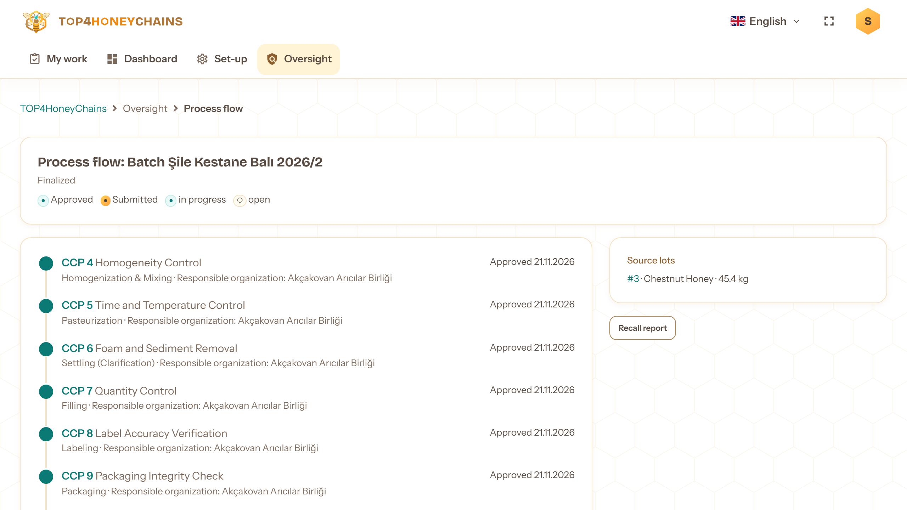

## Who the platform is for {#sec-audience}

The platform has three kinds of accounts. **Members** work for an organisation in a role. A **beekeeper** can have a personal account for the beekeeper portal. A **consumer** can create a free consumer account. Visitors need no account at all.

An organisation takes part in the chain through its capabilities, for example "Able to receive and process honey" ([Table](#tbl-capabilities)). A person works for an organisation in a role ([Table](#tbl-roles)). One account in one organisation in one role is called a membership ([Memberships](#memberships)).

Table: Who the platform is for {#tbl-audience}

| Who | Account | Activity in the value chain | On the platform |
| --- | --- | --- | --- |
| Beekeeper | Represented by a Beekeeper record. A beekeeper registered with a mobile phone also gets a beekeeper portal account. | Produces the honey and delivers it to a plant. | Confirms the registration and each delivery with an SMS code. In the portal: reads their apiaries, deliveries, lab results, batches and Honey Story pages, enters the asking price, gives or withdraws consents ([Beekeeper portal](#ch-portal)). |
| Beekeeper registration body (for example a district directorate of agriculture) | Members | Knows the beekeepers of its area. | Registers beekeepers and their apiaries, links their association, sends their portal sign-in details. |
| Beekeepers' association | Members | Groups beekeepers; can also run a plant. | Publishes a public beekeeper page with the beekeeper's consent. With the Processing capability it works as a plant. |
| Processing and packing plant | Members | Receives, processes, fills and packs honey. | Records deliveries and samples, CCP 0 and CCP 2 to 10, creates batches, finalizes them, ships them, answers consumer feedback. |
| Food-analysis laboratory (accredited or in-house) | Members | Analyses the honey samples. | Receives the sample jars, enters the results with the signed report, approves the report. |
| Wholesaler | Members | Buys batches, stores them and sells them on. | Confirms shipments, records and approves storage (CCP 10), ships on, reads the producer's control points. |
| Retailer | Members | Sells jars to consumers. | Confirms shipments, records and approves storage (CCP 10), reads the producer's control points. |
| Public authority | Members | Inspects the chain. | Reads all records, enters nothing. |
| Platform administrator | A platform administration account | Runs the platform; takes no part in the honey chain. | Creates and verifies organisations, adds members, sets roles, permissions and control-point responsibilities, publishes notice texts, oversees the records and decides corrections. Enters no business data. |
| Consumer | A free consumer account | Buys and eats the honey. | Everything a visitor can do, and also saves honeys in **My honeys**, sends feedback to the producer and reads the answer ([Consumer account](#ch-consumer)). |
| Visitor | None | Reads about the honey before or after buying it. | Reads the public pages: the Honey Story from the QR code, the public beekeeper pages, **Verify a lab report** and the privacy notices. |

Every organisation also has a **Compliance Officer** who reviews evidence (signed photos), sampling quality and approvals and handles data-protection requests ([Compliance Officer](#ch-compliance)).

## Control points {#sec-control-points}

The quality and safety of the honey are checked at eleven critical control points (CCP), CCP 0 to CCP 10. The method comes from HACCP, the food-safety system of hazard analysis and critical control points. Each control point has parameters (for example temperature or moisture). A parameter can have a critical limit.

Control points 0 to 3 belong to the raw honey lot, control points 4 to 10 to the batch. [Table](#tbl-ccps) shows who enters and who approves each control point by default. The organisation must have the capability in the column **Organisation needs**. A platform administrator can change these defaults ([Decide who enters and approves each control point](#sec-ccp-responsibilities)).

Table: The critical control points and who is responsible by default {#tbl-ccps}

| CCP | Name on screen | Stage | Belongs to | Organisation needs | Entered by | Approved by |
| --- | --- | --- | --- | --- | --- | --- |
| CCP 0 | Primary Audit | Pre-Production | Lot | Processing | **Sample acceptance officer** of the lot owner | **Quality Assurance Officer** of the lot owner |
| CCP 1 | Sampling and Preliminary Acceptance Tests | Raw Honey Reception | Lot | Laboratory | Written from the approved lab report (**Analyst**) | **Lab manager** (approving the report) |
| CCP 2 | Temperature Monitoring | Heating | Lot | Processing | **Staff** | **Quality Assurance Officer** |
| CCP 3 | Filter Condition Control | Filtration | Lot | Processing | **Staff** | **Quality Assurance Officer** |
| CCP 4 | Homogeneity Control | Homogenization & Mixing | Batch | Processing | **Staff** | **Quality Assurance Officer** |
| CCP 5 | Time and Temperature Control | Pasteurization | Batch | Processing | **Staff** | **Quality Assurance Officer** |
| CCP 6 | Foam and Sediment Removal | Settling (Clarification) | Batch | Processing | **Staff** | **Quality Assurance Officer** |
| CCP 7 | Quantity Control | Filling | Batch | Packing | **Staff** | **Quality Assurance Officer** |
| CCP 8 | Label Accuracy Verification | Labeling | Batch | Packing | **Staff** | **Quality Assurance Officer** |
| CCP 9 | Packaging Integrity Check | Packaging | Batch | Packing | **Staff** | **Quality Assurance Officer** |
| CCP 10 | Temperature and Humidity Monitoring | Storage | Batch | Wholesale, Retail or Packing | **Staff** of the holder | **Quality Assurance Officer** of the holder |

CCP 1 is complete when the lab manager approves the report. If the plant also recorded its own values on CCP 1, a Quality Assurance Officer of the plant approves it.

CCP 10 appears twice. First on the batch, at the plant: it must be approved before the batch is finalized. Later, each wholesaler or retailer that receives the batch keeps its own storage record.

A control point that does not apply to this honey can be marked **Not applicable** with a reason. It still needs approval. Changing any value removes an existing approval, so the record needs a new one.

## The four-eyes principle {#four-eyes}

Every record on the platform passes through two pairs of eyes. The **first person** does the work and enters the data. A **second, different person** checks it and approves or confirms it. Nobody approves what they entered themselves. Two people make mistakes and manipulation much less likely. [Table](#tbl-four-eyes) shows the first and the second person in each case.

Table: The first and the second person of each record {#tbl-four-eyes}

| Record | First person (enters) | Second person (approves or confirms) |
| --- | --- | --- |
| Beekeeper registration | **Beekeeper registration officer** | The beekeeper confirms with the SMS code. Without a phone: the **Compliance Officer** of the registering organisation reviews the photo of the signed form. |
| Delivery | **Sample acceptance officer** | The beekeeper confirms with the SMS code. Without a code: the **Compliance Officer** of the plant reviews the photo of the signed delivery form. |
| CCP 0, the lot sheet (CCP 2 and 3), the batch sheet (CCP 4 to 10) | **Sample acceptance officer** (CCP 0) or **Staff** | **Quality Assurance Officer** of the same organisation |
| Lab results (CCP 1) | **Analyst** | **Lab manager** |
| Finalizing a batch | **Staff** or **Organization admin** requests it (**Request finalizing**) | **Quality Assurance Officer** confirms it (**Confirm and finalize**) |
| Shipment | Staff or Organization admin of the sender | Staff or Organization admin of the receiver confirms the receipt |
| Storage record at a holder (CCP 10) | **Staff** of the holder | **Quality Assurance Officer** of the holder |
| Correction of a confirmed delivery or of an approved value | A platform administrator requests it, with a reason | A second platform administrator decides it |

The rule "Nobody approves a record they entered themselves" and the rule "Lab results are always approved by a second person" are ground rules ([Ground rules](#ground-rules)). They are shown on **Roles and permissions** and no role setting can change them.

One exception exists for very small organisations, for example an association with a single quality person. A platform administrator can give such an organisation the **Four-eyes exemption**. Its members may then approve their own control-point records and confirm their own finalize request. Each such approval is marked as self-approved and written to the audit log. The exemption never applies to lab results. A platform administrator can also decide that a control point needs no approval at all; by default, every control point needs one.

## What the consumer reads {#sec-consumer-reads}

The consumer scans the QR code on the jar, or opens the link, and reads the **Honey Story** of the batch without signing in. The page is the same for everyone and shows, in the language the reader chooses:

- the batch: name, amount and production date;
- badges: **Tested by an accredited lab** (or **In-house lab**), **All control points approved**, **Within verified limits** and the **Origin** with the share of each country;
- **The journey of this honey**: the five stations with the real dates and numbers of this batch;
- **Honey Origins**: the share of the honey by province on a map, the beekeepers by name (only with their consent, otherwise by a neutral code) and a link to their public beekeeper page when there is one;
- **Quality at a glance** and **Full lab report**: the laboratory results with their limits and a link to verify the report;
- **Process checks**: the control points of processing and packing;
- **What is this?** next to a value: what the parameter means and why it matters.

A within or out-of-limit verdict is shown only for limits that are verified. For the other values the page says that the limits are still being checked by a partner laboratory.

The Honey Story never shows a phone number, a photo of a person, the exact location of an apiary, an asking price or a free-text note. The map shows provinces only.

At the bottom, under **Bought this honey?**, a consumer with a free account can **Save to My honeys** and **Send feedback to the producer**. The feedback goes to the organisation that owns the batch; it reads the consumer's code only, never the user name or the phone number. The [Honey Story](#ch-story) and [Consumer account](#ch-consumer) chapters describe the page and the account.

# Capabilities, organisations and roles {#ch-roles}

On TOP4HoneyChains you always work **for an organisation, in a role**. Three things decide what you may do:

1. the **capabilities** of your organisation: what the organisation is able to do in the honey chain ([Capabilities](#capabilities));
2. your **role** in that organisation: what you do inside it ([Roles](#role-list));
3. the **status** of your organisation: only a **Verified** organisation enters data. A platform administrator verifies organisations; beekeepers' associations can instead be verified by a central association when the platform is set up for it ([Organisation status](#org-status)).

You hold a role through a **membership**: one user account in one organisation in one role ([Memberships](#memberships)). Three kinds of account have no membership: the beekeeper's account for the beekeeper portal, the consumer's account, and the platform administrator's global role. Some rules are built into the platform and no setting switches them off ([Ground rules](#ground-rules)).

This chapter keeps two things apart:

- the **value-chain activities**: the work that people do with the honey, away from the computer, such as registering, delivering, sampling, analysing, processing, packing, storing and shipping ([Table](#tbl-activities));
- the **data rights**: what each role may do with the records on the platform: create, read, update, delete and approve ([Table](#tbl-crud)).

## Capabilities {#capabilities}

A capability is an ability of an organisation. It says what the organisation is **able to do** in the honey chain; the roles of its members say which person does the work. An organisation has one or more capabilities. A platform administrator gives and removes them; the list of capabilities itself is fixed. [Table](#tbl-capabilities) lists them with their name on the screen.

Table: Capabilities: what an organisation is able to do {#tbl-capabilities}

| Capability (on screen) | Ability | Control points (default) |
|---|---|---|
| **Association** | Able to link its member beekeepers, record their consent for a public beekeeper page and, with a beekeeper's consent, read that beekeeper's asking prices. | None. CCP 0 only if an administrator gives CCP 0 to the beekeeper's association. |
| **Processing** | Able to receive and process honey: deliveries, samples, lot CCP 0 to 3, batch CCP 4 to 6, new batches, finalizing and shipments. | Lot CCP 0 to 3 (CCP 1 is filled from the lab report); batch CCP 4 to 6 |
| **Packing** | Able to fill, label and pack honey, create batches, finalize them and ship them; records batch CCP 7 to 9 and the CCP 10 storage at the plant. | Batch CCP 7 to 9, CCP 10 |
| **Laboratory** | Able to analyse honey samples and issue lab reports, as an accredited or an in-house food-analysis laboratory. The accreditation number and its validity date are kept with this capability. | None. Its approved report fills lot CCP 1. |
| **Wholesale** | Able to hold batches in wholesale, record their storage (CCP 10) and ship them on. | CCP 10 |
| **Retail** | Able to hold batches for sale to consumers, record their storage (CCP 10) and ship them on. | CCP 10 |
| **Beekeeper registration** | Able to register beekeepers and their apiaries in its area, attest their identity and registry number, link them to their association, record their consent and issue their sign-in. | None |
| **Central association** | Able to verify beekeepers' associations, when the platform is set up for it. | None |
| **Public authority** | Able to read all lots, batches and their control points, as a ministry or an inspection body. It enters nothing. | None (reads all) |
| **Beekeeping enterprise** | Able to produce honey. | None |

Some actions check the capability as well as the role:

- recording a delivery and taking samples need **Processing**;
- creating a batch (**New batch**), requesting finalizing and confirming it need **Processing** or **Packing**;
- shipping and confirming a received shipment need **Processing**, **Packing**, **Wholesale** or **Retail**;
- receiving sample jars and entering lab results need **Laboratory**;
- **Beekeeper pages** need **Association**;
- **Beekeeper registration** and the role **Beekeeper registration officer** need the capability **Beekeeper registration**.

A plant that processes, fills and stores its own honey therefore needs **Processing** and **Packing**; CCP 10 at the plant is covered by **Packing**.

**Beekeepers are people, not organisations.** On the platform a beekeeper is represented by a **Beekeeper record** with one or more apiaries. The beekeeper does not hold a membership. With the beekeeper portal switched on, the beekeeper can have a personal account that is linked to that record ([Beekeeper portal](#ch-portal)).

**The platform.** Platform administrator is not a capability that you can give to an organisation. It is a global role of a user account, for the people who run the platform ([Platform administration](#ch-admin)). The platform's own organisation carries the reserved capability **Platform administration**; no other organisation can get it, and it cannot be removed.

## Value-chain activities and platform records {#activities}

People do the value-chain activities with the honey, away from the computer. The platform records the result of each activity as data. [Table](#tbl-activities) shows, for each capability, what its people do and what the platform records.

Table: Value-chain activities (people) and what the platform records (computer) {#tbl-activities}

| Capability | Value-chain activities (people, away from the computer) | Recorded on the platform (computer) |
|---|---|---|
| Beekeeping enterprise (the beekeeper) | Keeps bees, harvests honey, delivers it in containers, reads the SMS code to the officer, decides on an asking price | Beekeeper and apiary records; the confirmation of the registration and of each delivery (SMS code); in the portal: the asking price and the beekeeper's own consents |
| Beekeeper registration | Meets the beekeeper, checks the identity document and the registry record, visits or lists the apiaries, reads the information notice | Beekeeper record, one or more apiaries, the link to the association, the registration (SMS code or signed photo), the consents given at registration, the beekeeper's sign-in details |
| Association | Informs member beekeepers, reads the consent text to them, collects signatures | Consent for a beekeeper page with the signed document; the published beekeeper page |
| Processing | Receives deliveries in sealed containers, checks or applies seals, fills a sample jar and a counter-sample jar from every container, heats, filters, mixes and settles honey, puts lots together into a batch | Delivery with containers and seal history, sample jars, CCP 0 and CCP 2 to 6, the batch with its lots and amounts, the finalizing request and its confirmation, shipments |
| Packing | Fills, labels and packs honey, stores it at the plant | CCP 7 to 10, batches, finalizing, shipments |
| Laboratory | Receives the sealed jars and checks seal, label and cap, makes the composite sample, analyses it, signs the report | Reception checks, composite sample, lab report (PDF) and results, which complete CCP 1 |
| Wholesale, Retail | Receives goods, stores them, sells them or ships them on | Confirmation of the received shipment, storage record (CCP 10), new shipments, answers to consumer feedback |
| Central association | Checks beekeepers' associations | Verification of associations (when set up) |
| Public authority | Inspects | Nothing; reads records |

Two more groups use the platform without an organisation. **Consumers** buy honey and scan the QR code on the jar; with an account the platform records the honeys they save and the feedback they send. **Visitors** only read public pages; nothing is recorded about them.

Every organisation, whatever its capabilities, also needs a **Compliance Officer**: the person who supervises approvals, evidence and data protection ([Compliance Officer](#ch-compliance)).

## Organisation types {#org-types}

The platform has no separate list of organisation types: the type of an organisation is the set of capabilities it has. [Table](#tbl-org-types) shows typical organisations.

Table: Typical organisations, their capabilities and the roles of their members {#tbl-org-types}

| Organisation | Capabilities | Typical roles of its members |
|---|---|---|
| Beekeeper registration office (for example a district directorate of agriculture) | **Beekeeper registration** | Organization admin, Beekeeper registration officer, Compliance Officer |
| Beekeepers' association | **Association** | Organization admin, Field inspector, Compliance Officer |
| Processing plant or packer | **Processing**, **Packing** | Organization admin, Sample acceptance officer, Staff, Quality Assurance Officer, Compliance Officer |
| Food-analysis laboratory (accredited or in-house) | **Laboratory** | Organization admin, Analyst, Lab manager, Compliance Officer |
| Wholesaler | **Wholesale** | Organization admin, Staff, Quality Assurance Officer, Compliance Officer |
| Retailer | **Retail** | Organization admin, Staff, Quality Assurance Officer, Compliance Officer |
| Central beekeepers' association | **Central association** | Organization admin, Compliance Officer |
| Ministry or inspection body | **Public authority** | Organization admin, Compliance Officer (both read only) |
| Platform operator | **Platform administration** (reserved) | Platform administrators |

An association that runs its own plant also has **Processing** and **Packing**, and then the roles of a plant as well. In a small organisation the Organization admin can also be the Compliance Officer through a second membership; the four-eyes rules still apply ([The four-eyes principle](#four-eyes)).

### Organisation status {#org-status}

A new organisation starts as **Pending**. A platform administrator checks it and verifies it on its organisation page under **Verification**:

- **Verify** needs at least one uploaded document (for example a licence, an accreditation or a registry proof).
- An organisation verified for the first time also needs an active **Compliance Officer**. An organisation that was verified earlier without one shows a warning with the date by which it must name one; it is not blocked.
- **Request documents** keeps the organisation **Pending** and needs a text that says which documents are missing.
- **Suspend** needs a reason. **Reinstate** makes a suspended organisation **Verified** again.

The **Organization admin** and the **Compliance Officer** upload the documents, also while the organisation is **Pending**, but not while it is **Suspended**.

**Central association.** When the platform is set up for it, the **Organization admin** of a verified organisation with **Central association** verifies, suspends and reinstates beekeepers' associations. Platform administrators then no longer verify associations.

[Table](#tbl-org-status) lists the statuses.

Table: Organisation status and who changes it {#tbl-org-status}

| Status (on screen) | Meaning | Who sets it |
|---|---|---|
| **Pending** | New organisation, waiting for verification. Members read the records of their organisation; the Organization admin and the Compliance Officer upload documents. Nobody enters workflow data. | Set when a platform administrator creates the organisation, or kept with **Request documents** |
| **Verified** | Checked. Members work according to their roles. Only a verified organisation can receive a shipment. | A platform administrator with **Verify** or **Reinstate**; for associations, the central association when set up |
| **Suspended** | Verification withdrawn, with a reason. Works like **Pending** until reinstated; documents cannot be uploaded. | A platform administrator with **Suspend**; for associations, the central association when set up |

## Roles {#role-list}

[Table](#tbl-roles) is the reference list of roles. Every other table in this manual uses the same roles, with the same short names, in the same order.

Table: Roles {#tbl-roles}

| No. | Role (on screen) | Short | Account | Typical person | Main work |
|---|---|---|---|---|---|
| 1 | **Beekeeper registration officer** | RO | Membership | Registration officer | Registers beekeepers with one or more apiaries and their association, checks the registry number, sends the beekeeper's SMS code, records the notice and consents, sends the beekeeper's sign-in details |
| 2 | **Sample acceptance officer** | SAO | Membership (members: their own) | Reception officer at the plant | Records deliveries with their sealed containers, sends the beekeeper's SMS code, takes a sample from every container, enters CCP 0 |
| 3 | **Analyst** | An | Membership (members: their own) | Laboratory analyst | Receives the sample jars (seal, label and cap), makes the composite sample, enters lab results and submits the report (the first person at the laboratory) |
| 4 | **Lab manager** | LM | Membership (members: their own) | Head of the laboratory | Receives sample jars, approves or returns lab reports (the second person at the laboratory) |
| 5 | **Staff** | St | Membership (members: their own) | Production, filling, wholesale or retail staff | Fills in the control sheets (CCP 1 to 10), creates batches, requests finalizing, ships and confirms shipments, records storage |
| 6 | **Field inspector** | FI | Membership (members: their own) | Field technician of an association | Reads the lots and batches of the organisation; enters CCP 0 only if an administrator gives CCP 0 to the association |
| 7 | **Quality Assurance Officer** | QAO | Membership (members: their own) | Quality manager, food engineer | Approves CCP records, control sheets and storage records, confirms finalizing, answers consumer feedback |
| 8 | **Organization admin** | OA | Membership (members: their own) | Manager of the organisation | Keeps the organisation's documents, creates batches, requests finalizing, ships and confirms shipments, publishes beekeeper pages (association), reads deliveries, samples and asking prices of its own lots, answers consumer feedback |
| 9 | **Compliance Officer** | CO | Membership (members: their own) | Quality or data-protection lead | Accepts or rejects signed-photo evidence, reviews sampling quality and approvals, keeps the data controller details, records data-subject requests and consent withdrawals, reads the organisation's audit entries, answers consumer feedback |
| 10 | **Platform administrator** | PA | Global role | Platform operator | Sets up organisations, members, capabilities, rights and CCP responsibilities; reads every record; requests and decides corrections. Enters and approves no workflow data |
| 11 | **Beekeeper** | Bk | Portal account | The beekeeper | Reads their own apiaries, deliveries, samples, lab results, batches and Honey Story pages; enters the asking price; gives and withdraws their own consents ([Beekeeper portal](#ch-portal)) |
| 12 | **Consumer** | Con | Consumer account | A buyer of honey | Saves honeys, sends feedback to the producer and reads the answer ([Consumer account](#ch-consumer)) |
| 13 | **Visitor** | Vis | No account | Anyone | Reads the Honey Story, a published beekeeper page and the **Verify a lab report** page ([The Honey Story page](#ch-story)) |

A platform administrator does not take part in the workflow of a business organisation. Administrators read every record but **do not enter or approve workflow data** (deliveries, CCP data, lab results, batches, finalizing, shipments, consents). When approved data is wrong, one administrator requests a correction and a second administrator decides it. The data-entry screens for beekeepers, lots and batches are no longer in the administrator's menu; their pages are kept for corrections only.

## Data rights (CRUD) {#crud}

[Table](#tbl-crud) shows the default data rights of each role on each kind of record, in the CRUD model: **C** create, **R** read, **U** update, **D** delete, and **A** approve (a separate right). "·" means no right. Letters stand together: "CRU" means create, read and update. The rights of the beekeeper (Bk) and of the consumer (Con) always concern their own records only. Rights of members (roles 1 to 9) apply only to the records of their own organisation's work: its own lots and batches, batches it holds, its association's beekeepers, its office's registrations. Except for reading, they apply only while the organisation is **Verified**. [Table](#tbl-admin-changeable) lists which of these rights an administrator can change.

Table: Default data rights per role and record (CRUD + Approve) {#tbl-crud}

| Record | RO | SAO | An | LM | St | FI | QAO | OA | CO | PA | Bk | Con | Vis |
|---|---|---|---|---|---|---|---|---|---|---|---|---|---|
| Beekeeper record | CRU ¹ | R ² | · | · | R ² | R ² | R ² | R ² | R ² | RU ³ | RU ⁴ | · | R ⁵ |
| Apiary | CRU ¹ | R ² | · | · | R ² | R ² | R ² | R ² | R ² | RU ³ | R | · | R ⁵ |
| Beekeeper registration (with the association link) | CR ¹ | · | · | · | · | · | · | · | RA ⁶ | RA ⁶ | A ⁷ | · | · |
| Sign-in details of a user account (members: their own) | C ⁸ | U | U | U | U | U | U | U | U | CRUD ⁸ | U | CUD ⁹ | · |
| Raw honey lot (delivery) | · | CR ¹⁰ | · | · | R | R | R | R | R | RUD ¹¹ | R | R ⁵ | R ⁵ |
| Delivery confirmation (SMS code or signed photo) | · | CR | · | · | · | · | · | R | RA ⁶ | R | A ⁷ | · | · |
| Container and its seals | · | CR | R | R | R ¹² | R ¹² | R ¹² | R | R | R | R | · | · |
| Sample jar | · | CR | RA ¹³ | RA ¹³ | · | · | · | R | R | R | R | · | · |
| Lab report and results | · | R | CRU ¹⁴ | RA ¹⁴ | R | R | R | R | R | R | R ¹⁵ | R ¹⁵ | R ¹⁵ |
| CCP record (values, "Not applicable") | · | CRUD ¹⁶ | R | R | CRUD ¹⁶ | R ¹⁶ | RA | R | R | R ¹⁷ | · | R ¹⁵ | R ¹⁵ |
| Batch | · | R | R | R | CR ¹⁸ | R | R ¹⁸ | CR ¹⁸ | R | RUD ¹¹ | R ¹⁹ | R ¹⁵ | R ¹⁵ |
| Finalizing (request, confirmation) | · | · | · | · | C | · | A | C | · | R | · | · | · |
| Shipment | · | R ¹² | R ¹² | R ¹² | CRA ²⁰ | R ¹² | R | CRA ²⁰ | R | R | · | · | · |
| Storage record at the holder (CCP 10) | · | R | R | R | CRUD ¹⁶ | R | RA | R | R | R | · | · | · |
| Asking price of a lot | · | · | · | · | · | · | · | R ²¹ | R ²¹ | R | CR ²¹ | · ²² | · ²² |
| Beekeeper consent | CR ²³ | · | · | · | · | · | · | CRU ²⁴ | U ²³ | R | CRU ²³ | · | R ²⁵ |
| Information notice (text, version) | R | R | R | R | R | R | R | R | R | CR ²⁶ | R | R | R |
| Notice acceptance (members: their own) | C | C | C | C | C | C | C | C | C | R ²⁷ | CR | C | · |
| Data controller details | R | R | R | R | R | R | R | R | CRU | CRU | R | R ²⁸ | R ²⁸ |
| Sampling-quality and approval review | · | · | · | · | · | · | · | · | CR ²⁹ | · | · | · | · |
| Data-subject request | · | · | · | · | · | · | · | · | CRU ²⁹ | · | · | · | · |
| Organisation (data, documents, capabilities) | R | R | R | R | R | R | R | RC ³⁰ | RC ³⁰ | CRU A ³¹ | · | · | · |
| Membership (members: their own) | R | R | R | R | R | R | R | R | R | CRU ³² | · | · | · |
| Audit entry | · | · | · | · | · | · | · | · | R ³³ | R ³⁴ | · | · | · |
| Consumer account and saved honeys | · | · | · | · | · | · | · | · | · | RUD ³⁵ | · | CRUD ⁹ | · |
| Consumer feedback | · | · | · | · | · | · | RU ³⁶ | RU ³⁶ | RU ³⁶ | R ³⁷ | · | CR ³⁶ | · |

Notes:

1. A Beekeeper registration officer registers beekeepers for their own office and reads only that office's registrations. One registration can add several apiaries (**Add apiary**) and choose the beekeeper's association (**Beekeepers' association (optional)**); the beekeeper's SMS code covers all of it. Attested facts (identity, registry number, phone) change only with a new registration of the same beekeeper, which is confirmed again.
2. Read only through the records the organisation works on (deliveries, control sheets, the recall report). A later holder of a batch reads its data without beekeeper and apiary names. The Organization admin of an association reads the list of its member beekeepers under **Beekeeper pages**.
3. Administrators check registry numbers and association links under **Set-up > Beekeeper registry and associations**, and correct beekeeper and apiary data. Beekeepers and apiaries are never deleted, only deactivated.
4. The beekeeper changes their own mobile phone, language and password under **Account** in the portal.
5. Only on public pages (the Honey Story of a finalized batch and a published beekeeper page): the beekeeper's name only with consent, otherwise a neutral code; the province of the apiary; never coordinates or contact data ([Trust and privacy](#ch-trust)).
6. **A** = accept or reject evidence recorded with a signed photo instead of an SMS code (a registration or a delivery). The Compliance Officer of the recording organisation decides, never the person who recorded it. A platform administrator decides for registrations recorded by platform administrators.
7. The beekeeper's **A** is the SMS code that they read out to the officer. It confirms the registration (with every apiary and the association) or the delivery (with its containers, weights and seal numbers).
8. The registration officer sends a beekeeper's sign-in details by SMS (with the beekeeper portal switched on). Platform administrators create members' accounts with sign-in details by SMS or an initial password, send new sign-in details, unlock accounts and delete accounts (never their own). Nobody reads a password after it was sent.
9. The consumer creates the account, changes the password, language and mobile phone, downloads their data, saves and removes honeys, and deletes the account. Deleting removes the saved list and anonymises the account; the feedback stays with the organisation under the pseudonym only.
10. Recording a delivery creates the lot. It needs a verified organisation with **Processing**.
11. Lots and batches are created by the plant (delivery, **New batch**). Administrators keep their master data for corrections. The delivery facts (date, containers, weights, seal numbers) change only through a delivery correction decided by a second administrator, and the beekeeper is informed by SMS. Nothing changes once a lot is in a finalized batch. A lot or batch can be deleted only before finalizing, and a lot in use cannot be deleted. Administrators cannot finalize.
12. Only in the recall report.
13. **A** = receive the sample jar after checking seal, label and cap, or reject it with a reason.
14. The analyst creates the report, saves and changes it while it is a draft, and submits it. The lab manager approves or returns it. An approved report cannot be changed.
15. Only approved lab results and the control points of a finalized batch, on the Honey Story and on the **Verify a lab report** page; for the beekeeper, the approved results of their own samples.
16. Enter values (C), change or clear them (U, D) and mark "Not applicable", until the record is approved or locked. Default entering roles: Sample acceptance officer for CCP 0, Staff for CCP 1 to 10 (CCP 1 is filled from the approved lab report). The Field inspector enters CCP 0 only if an administrator gives CCP 0 to the association.
17. Administrators change approved or locked data only through a correction requested by one administrator and decided by a second.
18. **New batch**: Staff and Organization admin of an organisation with **Processing** or **Packing** create a batch from their own lots whose control points are all done and approved. The batch gets its control points at once. The Quality Assurance Officer's approval of the batch is the finalizing confirmation (see the row Finalizing).
19. Batches that contain the beekeeper's own honey: the name, the beekeeper's share, the status and the Honey Story link. Never other beekeepers' names or prices.
20. **C** = ship a finalized batch that the organisation holds; **A** = confirm or reject a shipment that the organisation receives.
21. The beekeeper enters an asking price for each delivered lot and changes it (a new entry; the history stays) until the lot is in a finalized batch. The lot owner's Organization admin and Compliance Officer and the platform administrators read it. An association's Organization admin reads it only when the beekeeper gave the consent for it. Staff, laboratories and later holders never read it.
22. Public pages and the recall report show no price.
23. The registration officer records the consents given at registration. The beekeeper gives or withdraws an optional consent in the portal (name on public pages, messages, prices for the association) and can withdraw the beekeeper-page consent there. The Compliance Officer records a withdrawal received on paper or by phone. A withdrawal takes effect at once.
24. Associations only: record (C) and withdraw (U) the consent for a public beekeeper page, with the signed consent document.
25. The published beekeeper page.
26. Notice texts are versioned and never edited: publishing a new version replaces the old one.
27. The number of acceptances for each notice version.
28. As named in the privacy notice.
29. In the Compliance Officer's own section, **Compliance** ([Compliance Officer](#ch-compliance)).
30. **C** = upload documents. Capabilities, members and the four-eyes exemption are set by platform administrators only.
31. Create, change and verify organisations, request documents, suspend and reinstate ([Organisation status](#org-status)); give and remove capabilities (at least one remains); set the four-eyes exemption. Organisations and documents are never deleted.
32. Add a membership and revoke it (U); memberships are never deleted.
33. The audit entries of the Compliance Officer's own organisation.
34. The whole audit log. It can only be added to; nobody changes or deletes an entry.
35. Lock and unlock a consumer account, delete it (anonymised).
36. One feedback per batch and day, at most five a day. It goes to the organisation that owns the batch, which reads only the consumer's pseudonym. Its Organization admin, Quality Assurance Officer and Compliance Officer mark it read, answer it and close it (U). The consumer reads the answer. Feedback is never public.
37. Only reports of a suspected fake or opened jar, in **My work**, read only.

**Who downloads evidence files.** Signed delivery forms, registration photos, consent documents and organisation documents are downloaded only by the role that records them (Sample acceptance officer, Beekeeper registration officer, or the association's Organization admin for consents), by the organisation's Organization admin and Compliance Officer, and by platform administrators. Another role of the same organisation gets "You can't open this page" (403); another organisation gets "This page isn't here" (404). Every download is written to the audit log.

**What can be deleted.** Members only clear their own data before it is approved: CCP values and storage values. Lab reports are never deleted; a draft is changed or returned. Consumers delete their own account and remove saved honeys. Administrators delete lots and batches before finalizing, apiary photos, reference data and user accounts (never their own; a consumer account is anonymised). Beekeepers, apiaries, organisations, documents, memberships, consents, registrations, containers, seal events, sample jars, lab reports, shipments, price entries, notices, acceptances and audit entries are never deleted.

## Permission matrix {#permission-matrix}

[Table](#tbl-permissions) shows the default rights for each **activity on the platform** (a function such as "record a delivery"). It complements the data rights in [Table](#tbl-crud) and uses the same roles in the same order. Legend: **R** read, **C** create or enter, **A** approve (or receive, accept, confirm), **F** finalize (request or confirm), **·** no right. The column "Capability needed" names the capability that the organisation needs as well.

Table: Default rights per platform activity and role {#tbl-permissions}

| Activity on the platform | Capability needed | RO | SAO | An | LM | St | FI | QAO | OA | CO | PA | Bk | Con | Vis |
|---|---|---|---|---|---|---|---|---|---|---|---|---|---|---|
| Register a beekeeper with apiaries and association | Beekeeper registration | C | · | · | · | · | · | · | · | R | R ¹ | A | · | · |
| Send a beekeeper's sign-in details by SMS | Beekeeper registration | C | · | · | · | · | · | · | · | · | C | · | · | · |
| Record a delivery with containers, send the SMS code | Processing | · | C | · | · | · | · | · | R | R | R | A | · | · |
| Take samples (one from every container) | Processing (lot owner) | · | C | R | R | · | · | · | R | R | R | R | · | · |
| Accept or reject a signed photo (registration, delivery) | Own organisation | · | · | · | · | · | · | · | · | A | A ² | · | · | · |
| Enter CCP 0 (primary audit) | Processing (lot owner) | · | C | R | R | R | R | A | R | R | R | · | · | · |
| Receive sample jars (seal, label, cap), make the composite | Laboratory | · | · | A | A | · | · | · | · | R | R | · | · | · |
| Enter lab results, submit the report | Laboratory | · | R | C | R | R | R | R | R | R | R | R | R | R |
| Approve or return a lab report | Laboratory | · | R | R | A | R | R | R | R | R | R | R | R | R |
| Lot control sheet (CCP 2 and 3) | Processing (lot owner) | · | R | R | R | C | R | A | R | R | R | · | R | R |
| Create a batch (**New batch**) | Processing or Packing | · | · | · | · | C | · | · | C | · | · | · | · | · |
| Batch control sheet, CCP 4 to 6 | Processing (batch owner) | · | R | R | R | C | R | A | R | R | R | · | R | R |
| Batch control sheet, CCP 7 to 9 | Packing (batch owner) | · | R | R | R | C | R | A | R | R | R | · | R | R |
| CCP 10 storage at the plant | Wholesale, Retail or Packing (batch owner) | · | R | R | R | C | R | A | R | R | R | · | R | R |
| Request finalizing | Processing or Packing (owner) | · | · | · | · | F | · | · | F | · | · | · | · | · |
| Confirm finalizing | Processing or Packing (owner) | · | · | · | · | · | · | F | · | · | · | · | · | · |
| Ship a batch | Processing, Packing, Wholesale or Retail (holder) | · | · | · | · | C | · | R | C | R | R | · | · | · |
| Confirm or reject a received shipment | Processing, Packing, Wholesale or Retail (receiver) | · | · | · | · | A | · | R | A | R | R | · | · | · |
| CCP 10 storage record at the receiver | Wholesale, Retail or Packing (holder) | · | R | R | R | C | R | A | R | R | R | · | · | · |
| Recall report (own scope) | None | · | R | R | R | R | R | R | R | R | R (all) | · | · | · |
| Enter or change the asking price | None | · | · | · | · | · | · | · | · | · | · | C | · | · |
| Read the asking prices of own lots | Processing (lot owner) | · | · | · | · | · | · | · | R | R | R | R | · | · |
| Record or withdraw a beekeeper-page consent | Association | · | · | · | · | · | · | · | C | · | R | U ³ | · | · |
| Read a member's asking prices (with consent) | Association | · | · | · | · | · | · | · | R | · | · | C ³ | · | · |
| Read and answer consumer feedback | Owner of the batch | · | · | · | · | · | · | C | C | C | R ⁴ | · | · | · |
| Save a honey, send feedback | None | · | · | · | · | · | · | · | · | · | · | · | C | · |
| Read the Honey Story, verify a lab report | None | R | R | R | R | R | R | R | R | R | R | R | R | R |
| Compliance: reviews, data-subject requests, approval checks | Own organisation | · | · | · | · | · | · | · | · | C | · | · | · | · |
| Keep the data controller details | Own organisation | R | R | R | R | R | R | R | R | C | C | R | R | R |
| Read the organisation's audit entries | Own organisation | · | · | · | · | · | · | · | · | R | R (all) | · | · | · |
| Upload organisation documents | Own organisation | · | · | · | · | · | · | · | C | C | C | · | · | · |
| Publish notice texts | None | · | · | · | · | · | · | · | · | · | C | · | · | · |
| Verify organisations, manage members, capabilities and the exemption | None | · | · | · | · | · | · | · | A ⁵ | · | CA ⁵ | · | · | · |
| Verify beekeeper registry numbers | None | · | · | · | · | · | · | · | · | · | A | · | · | · |
| Change role permissions, CCP responsibilities, limits, translations | None | · | · | · | · | · | · | · | · | · | C | · | · | · |
| Request or decide a correction (CCP data, delivery facts) | None | · | · | · | · | · | · | · | · | · | CA ⁶ | · | · | · |
| Lock, unlock or delete user and consumer accounts | None | · | · | · | · | · | · | · | · | · | C | · | · | · |
| Read the audit log and the data retention report | None | · | · | · | · | · | · | · | · | · | R | · | · | · |

1. Registrations are recorded by the registration office. Administrators read every registration; the registration page is no longer in their menu.
2. For registrations recorded by platform administrators.
3. The beekeeper's part: the beekeeper signs the consent document and can withdraw the consent in the portal; the beekeeper gives the consent for the association to read prices in the portal.
4. Only reports of a suspected fake or opened jar.
5. Only the Organization admin of a verified central association, and only for beekeepers' associations, when the platform is set up for it. Platform administrators then do not verify associations.
6. Two different administrators: one requests, the other decides.

Notes:

- **Reading control points (R)**: a role reads the control points of the lots and batches that its organisation takes part in: as the owner or the responsible organisation, as the owner of a later control point of the same lot or batch, as the owner or a later holder of a batch that contains the lot, or as a verified public authority. A holder reads the batch's control points and those of its lots **read only**. Any other organisation gets "You can't open this page" (403).
- **CCP 1** is filled from the approved lab report. Its entering roles are used only for CCP 1 parameters that the report does not cover.
- **Pages check the read right, not only the menu.** A role without the read right of a page (for example **Shipments and stock** or **Beekeeper pages**) is sent back with a message that names the roles that may open it.
- The administrator can give **CCP 0** to the beekeeper's association instead of the plant (**Set-up > CCP responsibilities**, CCP 0, **The association of the lot's beekeeper**, capability **Association**, role **Field inspector**). This is not the default.

### What an administrator can change {#admin-changeable}

[Table](#tbl-admin-changeable) lists every setting that a platform administrator can change on the platform's pages. Everything else is fixed: the list of roles, the list of capabilities and the [Ground rules](#ground-rules). A few switches are set in the server configuration instead (for example the central association as verifier of associations).

Table: What a platform administrator can change {#tbl-admin-changeable}

| Setting | Where | What exactly can be changed |
|---|---|---|
| Role permissions | **Set-up > Roles and permissions**, tab **Role permissions** | For each role: **Enter**, **Approve** and **Read** for each control point; and these functions: **Lot intake** (Enter, Read), **Samples (take / receive at the lab)** (Enter, Approve, Read), **Lab results** (Enter, Approve, Read), **Shipments (send / confirm receipt)** (Enter, Approve, Read), **Beekeeper pages (consent)** (Enter, Read), **Recall report** (Read), **Create batches (New batch)** (Enter), **Finalize batches (request / confirm)** (Enter, Approve), **Beekeeper registration** (Enter, Read), **Signed-photo evidence (accept or reject)** (Approve), **Beekeepers' asking prices** (Read), **Audit entries of the organization** (Read), **Consumer feedback** (Enter, Read). Every right keeps at least one role. |
| CCP responsibilities | **Set-up > CCP responsibilities** | For each control point: the **Responsible organization** (**The organization that owns the lot / batch** or, for lots, **The association of the lot's beekeeper**), the capabilities it needs, the **Roles that enter values**, the **Roles that approve**, and whether **Values need approval by another person (four-eyes)**. Changes apply at once. |
| Capabilities | **Set-up > Organizations** (when creating an organisation, and on its page); **Set-up > Capabilities** | Give or remove capabilities (at least one remains; **Platform administration** is reserved). For a laboratory: accredited or not, accreditation number and validity date. |
| Four-eyes exemption | Organisation page, **Four-eyes exemption** | For one organisation: its members may approve their own CCP records and storage records and confirm their own finalizing request. Every such approval is flagged in the audit log. Never for lab results or evidence. |
| Organisation status | Organisation page, **Verification** | **Verify**, **Request documents**, **Suspend**, **Reinstate** ([Organisation status](#org-status)). |
| Data controller details | Organisation page, **Data controller** | Name, address and contact of the organisation as data controller (also kept by its Compliance Officer). |
| Memberships and users | Organisation page, **Members**; **Set-up > Roles and permissions**, tab **Members**; **Oversight > Users** | Add and revoke memberships; create users with sign-in details by SMS or an initial password; send new sign-in details; unlock and delete accounts; lock, unlock and delete consumer accounts. |
| Notices and consent texts | **Oversight > Notices and consent texts** | Publish a new version of a notice or consent text. |
| Control points, parameters, limits | **Set-up > Reference data** | Parameters, data types, required questions, limits, "Limits verified". |
| Reference data and translations | **Set-up > Reference data**; **Set-up > Translations of reference data** | Honey types, periods and the other lists that the forms offer, and their names in each language. |
| Beekeeper registry | **Set-up > Beekeeper registry and associations** | Verify registry numbers; correct a beekeeper's association link. |

## Ground rules {#ground-rules}

These rules are built into the platform. No setting switches them off.

- **Only verified organisations enter data.** An organisation verified for the first time needs a Compliance Officer.
- **Four-eyes on CCP records** ([The four-eyes principle](#four-eyes)): nobody approves a CCP record in which they entered values or that they marked "Not applicable". On a control sheet, the Quality Assurance Officer approves every record that this rule allows; records with their own values are listed and left for another person. Exception: a platform administrator can give an organisation the **Four-eyes exemption**; every approval under it is flagged in the audit log.
- **Four-eyes on lab results, always**: the analyst who entered the results cannot approve them. There is no exemption.
- **Four-eyes on evidence, always**: a signed photo that replaces an SMS code is accepted or rejected by the organisation's Compliance Officer, never by the person who recorded it.
- **Four-eyes on finalizing and on storage records**: the person who requested finalizing cannot confirm it, and the person who recorded a storage record cannot approve it (unless the organisation has the exemption).
- **Four-eyes on corrections**: the administrator who requested a correction cannot decide it.
- **A code confirms exactly what it was sent for**: the beekeeper's SMS code binds the registration (with every apiary and the association) or the delivery (containers, weights, honey type, samples, every seal number). Any change after sending voids the code.
- **Delivery facts do not change**: containers and seal events can only be added to. The delivery facts of a confirmed delivery change only through a correction of two administrators, and the beekeeper is informed by SMS.
- **A sample from every container**: each container gets its own sealed sample jar and counter-sample with a tamper-evident cap. The laboratory checks seal, label and cap and rejects a jar if any check fails.
- **Any change removes the approval**: changing data clears an existing approval. Values outside their limits must be confirmed explicitly when they are approved.
- **Lab results follow the sample**: results are entered only for a received sample and only after the lot's CCP 0 is done. An approved report cannot be changed.
- **The plant builds its own batches**: only from its own lots whose control points are all done and approved, and only with honey left in them.
- **Finalized means locked**: a batch is finalized only when every control point of the batch and of its lots is done. A finalized batch and its lots can no longer be changed, except through a correction. There is no "un-finalize".
- **Shipments**: only finalized batches, only to another verified organisation, at most the quantity held.
- **Platform administrators are read only** on workflow data and change it only through the two-administrator correction.
- **Organisations are configured by administrators only**: capabilities, memberships and the exemption.
- **Every right keeps at least one role.**
- **One membership at a time**: rights of two memberships are never combined.
- **The audit log can only be added to**; nothing in it is changed or deleted, and every change on the permission pages is itself logged.
- **Prices are the beekeeper's**: only the beekeeper enters the asking price, and no public page shows it.
- **Accounts without membership stay in their own area**: a beekeeper account opens only the beekeeper portal and reads only its own beekeeper's data; a consumer account opens only the consumer pages and the public pages, and can never get a role or a membership.
- **Public names need consent**: public pages name a beekeeper only with an active name consent; otherwise they show a neutral code.
- **Beekeeper pages** are public only with an active consent, a verified registry number and a verified association.
- **Consumer feedback is private**: it goes only to the organisation that owns the batch, which sees a pseudonym, never a name.

## Memberships {#memberships}

A **membership** is one user account in one organisation in one role. It is what gives you a role: without an active membership a staff account cannot open the panel. One person can hold several memberships:

- in different organisations, for example **Staff** at a plant and **Field inspector** at an association;
- several roles in the same organisation, for example **Organization admin** and **Compliance Officer** in a small organisation.

A platform administrator adds and revokes memberships ([Add a member](#sec-add-member)). A membership is revoked, never deleted. The role **Beekeeper registration officer** can be given only in an organisation with **Beekeeper registration**. A consumer account cannot get a membership.

You always work in **one** membership at a time. The menu, the tasks in **My work**, the records you can read and the actions you may take all follow the active membership. Rights are never combined: holding two roles never lets you approve data that you entered yourself.

To switch to another membership:

1. Select the role chip in the top bar: it shows the organisation and the role, for example "Akçakovan Arıcılar Birliği · Staff" ([Find your way on the screen](#sec-screen)). A list headed **Your roles** shows every active membership; the current one is marked.
2. Select another membership. The platform opens **My organization** in the new membership.

With two or more memberships, **My organization** also has an **Act as** list with a **Switch** button. The choice lasts until you close the browser. After that you start again in your first membership: the first organisation in alphabetical order.

A beekeeper's portal account and a consumer account have no membership and no role chip.

# Getting started {#ch-start}

This chapter is for everybody who signs in to the platform. At the end of it you can sign in, confirm the privacy notice, find your way on the screen and sign out.

## Open the platform and choose the language

Open https://top4honeychains.intalalab.net in your browser. The start page explains the platform and has the buttons **Sign in** and **Verify a lab report**.

1. Choose your language with the language codes **TR**, **EN**, **ES**, **PL** and **LV** at the top of the page. The platform remembers your choice in this browser.

After you sign in, the language menu with a flag is in the top bar.

## Sign in

1. On the start page, select **Sign in**.
2. Enter your user name in **Username**.
3. Enter your password in **Password**.
4. Select **Log In**.

You see **My work**, your list of tasks. Beekeepers see their portal ([Beekeeper portal](#ch-portal)) and consumers see **My honeys** ([Consumer account](#ch-consumer)).

> [!NOTE]
> Staff accounts are created by the organisations and the platform administrators. Consumers create their own account with **Create a free consumer account** below the sign-in form.

## Sign in for the first time {#sec-first-sign-in}

Your sign-in details arrive by SMS: your user name and a temporary password of 10 characters, with the address of the platform. The temporary password is valid for 72 hours.

1. Sign in with the user name and the temporary password from the SMS.
2. The page **Choose your password** opens. Enter your new password in **New Password** and again in **Confirm password**. Use at least 10 characters, not your user name and not a common password.
3. Select **Update Password**.

## Confirm the privacy notice {#sec-notice}

Before you work with personal data, you confirm that you have read the privacy notice. A yellow bar reminds you until you do.

1. Select **Read and confirm** in the yellow bar.

   

2. Read the notice and tick **I have read the notice above.**
3. Select **Confirm**.

> [!NOTE]
> Roles that sign records (Organization admin, Compliance Officer, Beekeeper registration officer, Quality Assurance Officer, Lab manager) confirm the notice with a code. The page shows your **Mobile phone**: select **Send code**, then type the code from the SMS in **Code from the SMS (6 digits)** before you select **Confirm**.

## Find your way on the screen {#sec-screen}

**My work** is your start page and your list of tasks. Everything waiting for you appears there in groups, for example **Values to enter**, **Values to approve**, **Samples to receive** or **Lab results to enter**. Select an item to open the page where you do the work. When nothing is waiting, the page says **Nothing is waiting for you.** and shows the pages you can open.

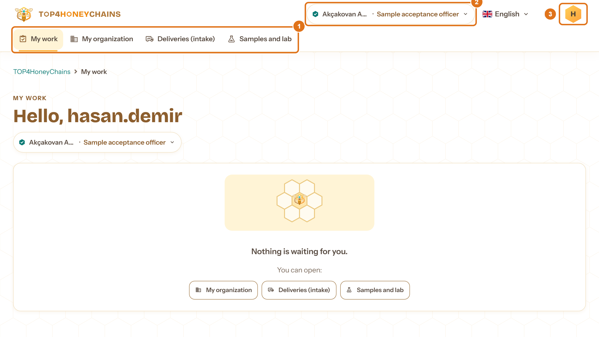

The marks in the picture show:

1. The menu with the pages of your role. **My work** and **My organization** are always there; the other items depend on your role and your organisation.
2. Your organisation and role. If you have more than one role, select it to switch to another role.
3. The user menu, under the round button with your initial.

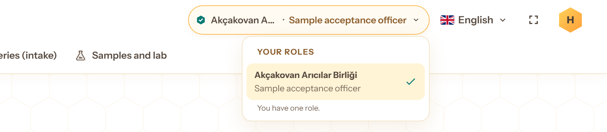 

The user menu has these items:

Table: The parts of the screen {#tbl-screen}

| Item | What it does |
| --- | --- |
| **Profile** | Shows your user name and lets you verify your mobile phone and change your password. |
| **Show the tour** | Opens the short tour of the screen again. |
| **Show animations** | Switches the short scenes that show what a button does on or off. |
| **Logout** | Signs you out. |

## Sign out

Open the user menu and select **Logout**. On a shared computer, always sign out when you leave.

## Take the tour

When you open the platform for the first time in a role, a short tour shows the most important parts of the screen. Select **Next** to go on or **Skip the tour** to close it. You can open it again with **Show the tour** in the user menu.

## Verify your mobile phone

With a verified mobile phone you can reset a forgotten password by SMS.

1. Open the user menu and select **Profile**.
2. Enter your number in **Phone Number** and select **Send code**.
3. Type the code in **Code from the SMS (6 digits)** and select **Confirm**. A new number is used only after you enter the code sent to it.

## Reset a forgotten password

1. On the sign-in page, select **Forgot your password?**.
2. Enter your user name in **User Name** and select **Send code**.

   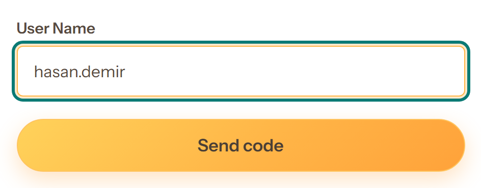

3. On the page **Create New Password**, type the code from the SMS in **Code from the SMS (6 digits)**. The code is valid for 5 minutes.
4. Enter your new password in **New Password** and **Confirm password** and save it.

> [!NOTE]
> The code is sent only to a verified mobile phone. Without one, ask the person who gave you your sign-in details to send new ones.

# Beekeeper registration officer {#ch-ro}

The Beekeeper registration officer of a district directorate registers beekeepers on the platform. A registration confirms three things: the national registry number, the beekeeper's mobile phone (by a code sent to it) and your attestation that you have seen the identity document and the registry record.

Table: Tasks of the beekeeper registration officer {#tbl-tasks-ro}

| Task | Where |
| --- | --- |
| Find a beekeeper or start a registration | **Beekeeper registration** |
| Register a new beekeeper | **Beekeeper registration > Find or register** |
| Add another apiary | the registration form, or the registration page |
| Send the sign-in details | the registration page |

## Find a beekeeper or start a registration {#sec-find-beekeeper}

The page **Beekeeper registration** lists the beekeepers your organisation registered.

1. Select **Beekeeper registration** in the menu.
2. Enter the registry number in **Registry number (AKS) or business number**.
3. Select **Find or register**.

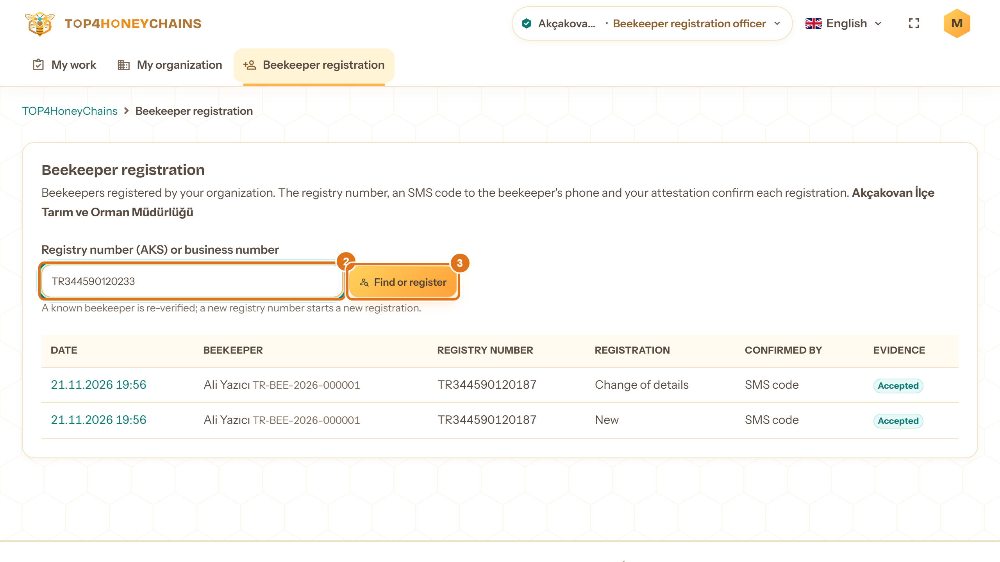

A known beekeeper is re-verified: the form opens with the stored details. A new registry number starts a new registration.

## Register a new beekeeper

Do this with the beekeeper in front of you, with their identity document and mobile phone.

1. Find the registry number as described in [Find a beekeeper or start a registration](#sec-find-beekeeper). The form **Register a beekeeper** opens.
2. Fill in the sections 1 and 2.

   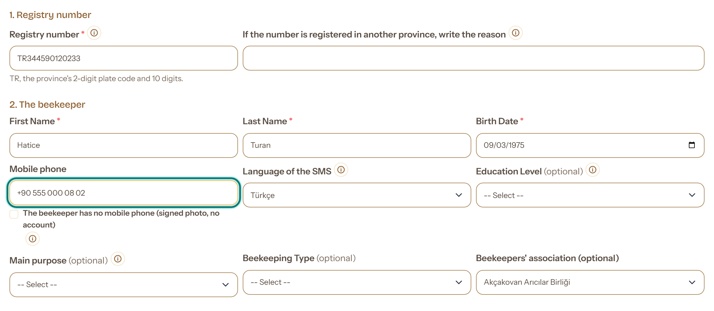

3. In section **3. Apiary**, set the position of the apiary: click the map or drag the pin, select **Use my location**, or type **Location Latitude** and **Location Longitude**. Enter **Beehives Count**, then **Province**, **District** and **Locality (village, plateau, field)**. The title of the apiary is made from these three, for example `İstanbul – Şile – Sofular`.

   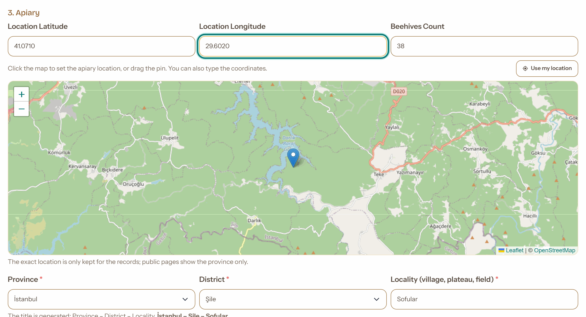

4. Let the beekeeper read the notice in section 4, or read it aloud. Tick the consents the beekeeper gives: the name on public pages and SMS notifications. Both are optional.
5. In section **5. Your attestation**, tick the attestation. Tick **Also send the beekeeper the sign-in details by SMS** if the beekeeper should use the portal.

The fields of sections 1 and 2:

Table: The fields of the registration form {#tbl-reg-fields}

| Field | What to enter | Required |
| --- | --- | --- |
| **Registry number** | TR, the province's 2-digit plate code and 10 digits | yes |
| **If the number is registered in another province, write the reason** | only when the registry province differs from your directorate's | no |
| **First Name**, **Last Name**, **Birth Date** | as in the identity document | yes |
| **Mobile phone** | the beekeeper's own number; it receives the code and the sign-in details | yes, unless the beekeeper has no mobile phone |
| **Language of the SMS** | the language of the beekeeper's messages and portal | yes |
| **Education Level**, **Main purpose**, **Beekeeping Type** | the beekeeper's answers | no |
| **Beekeepers' association (optional)** | the association the beekeeper belongs to | no |

> [!NOTE]
> The exact position of the apiary is kept only in the records. Public pages show the province.

### Confirm with the code

1. Select **Send code**. The beekeeper receives an SMS with your organisation's name, a link to the notice, their name choice and a code.
2. Type the code the beekeeper reads out in **Code from the SMS (6 digits)**.
3. Select **Confirm the registration**.

The registration page opens with the message **The beekeeper is registered and verified**. The beekeeper has a business number (for example `TR-BEE-2026-000002`); the evidence is **Accepted** and the registry number **Verified**.

> [!IMPORTANT]
> Changing any field after you sent the code makes the code invalid. Send a new code with **Send a new code**.

## Add another apiary

A beekeeper can have several apiaries. On the form, add them before you send the code:

1. Select **Add apiary** below the first apiary. A new block **Apiary 2** appears.
2. Fill in its coordinates, hives and place. The map sets only the first apiary; type the coordinates of the others. Select **Remove** to delete a block you do not need.

For a registered beekeeper, open the registration page and use **Add an apiary** below **Apiaries**.

## Send the beekeeper the sign-in details {#sec-send-signin}

If you ticked **Also send the beekeeper the sign-in details by SMS**, the details are sent with the registration. Otherwise, open the registration page and select **Send sign-in details by SMS**. The beekeeper's user name is the business number.

To send new details, tick **Send new details: the temporary password in the earlier SMS stops working.** and select **Send new sign-in details**.

## Register a beekeeper without a mobile phone {#sec-register-no-phone}

If the beekeeper has no mobile phone, tick **The beekeeper has no mobile phone (signed photo, no account)**. In section 6, open **No SMS possible: signed photo**, write the reason in **Why no SMS code**, use **Print the form**, let the beekeeper sign it, and upload its photo in **Photo of the signed form**. Select **Save with the signed photo**. The registration waits until the Compliance Officer of your organisation accepts or rejects the photo; you cannot decide on your own registration.

# Sample acceptance officer: honey delivery {#ch-sao}

The Sample acceptance officer of a plant records each honey delivery. Every container is recorded with its seals, a sample jar and a counter-sample jar are filled from it and sealed, and the beekeeper confirms the whole delivery with a code sent by SMS. Each delivery becomes a raw honey lot of your organisation.

Table: Tasks of the sample acceptance officer {#tbl-tasks-sao}

| Task | Where |
| --- | --- |
| See the deliveries | **Deliveries (intake)** |
| Record a honey delivery | **Deliveries (intake) > Record a delivery** |
| Print the labels | the delivery page |
| Enter CCP 0 | **My work > Values to enter** |

## See the deliveries

Select **Deliveries (intake)** in the menu. The list shows each lot with its date, apiary, honey type, amount, origin and how the beekeeper confirmed it. **Delivery** opens a delivery, **Recall** its recall report.

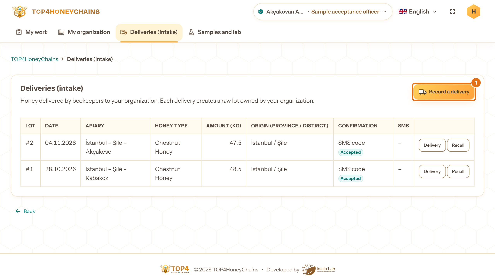

## Record a honey delivery {#sec-record-delivery}

1. Select **Record a delivery**.
2. Enter the beekeeper's number in **Beekeeper business or registry number**.
3. Select **Find**.

   

4. Fill in section **1. The delivery**. The apiary list shows every apiary of the beekeeper with its hives; with more than one apiary, choose the right one.

   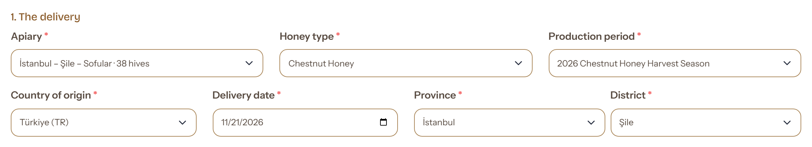

5. In section **2. Containers and samples**, fill in one row per container. Select **Add a container** for each further container and **Remove the row** for a row you do not need.

   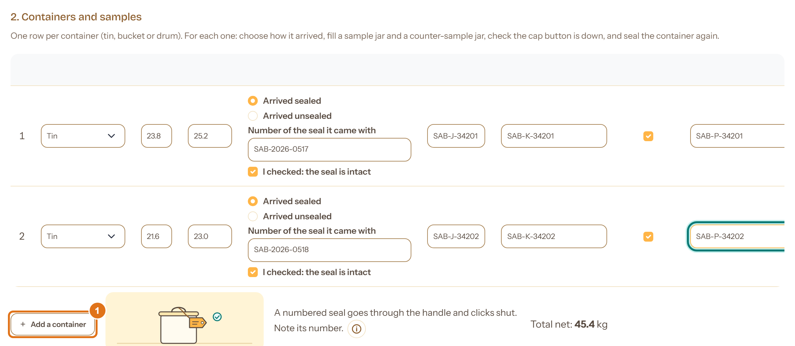

   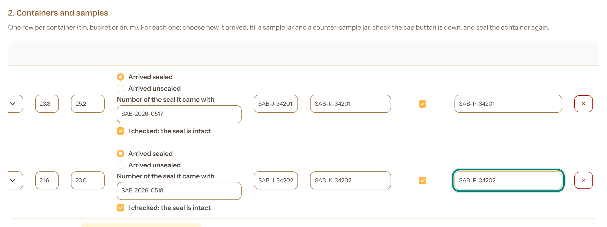

6. In section **3. Laboratory and counter-samples**, choose the **Laboratory**, write **Where the counter-samples are kept** and the date in **Keep until**.

The fields of section 1:

Table: The fields of a delivery {#tbl-delivery-fields}

| Field | What to enter | Required |
| --- | --- | --- |
| **Apiary** | where the honey comes from | yes |
| **Honey type**, **Production period** | as delivered | yes |
| **Country of origin** | the country of the honey | yes |
| **Delivery date** | the day of the delivery | yes |
| **Province**, **District** | the origin of the honey | yes |

The columns of section 2, one row per container:

Table: The columns of the table Containers and samples {#tbl-containers}

| Column | What to enter |
| --- | --- |
| **Type** | tin, bucket or drum |
| **Net kg**, **Gross kg** | the weights of the container |
| **On arrival** | **Arrived sealed**: the **Number of the seal it came with**, and tick **I checked: the seal is intact**. **Arrived unsealed**: the number of the **New seal, put on now in front of the beekeeper**. |
| **Jar seal** | the seal of the sample jar filled from this container |
| **Counter-sample seal** | the seal of the counter-sample jar |
| **Cap intact** | tick when the button of the jar's cap is down |
| **New seal after sampling** | the seal you put on the container after taking the samples |

> [!IMPORTANT]
> Every seal number of the delivery must be different.

### Confirm the delivery with the beekeeper's code

1. Select **Send code**. The beekeeper receives an SMS with the date, the containers, the kilograms, the honey type, the number of samples and a code.

   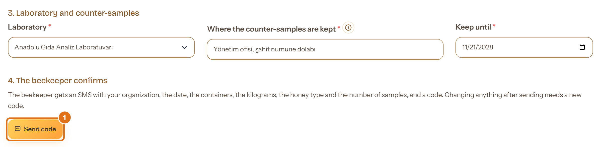

2. Type the code in **Code from the SMS (6 digits)**. If the beekeeper is not present, call them: they read the code from their phone.
3. Select **Confirm the delivery**.

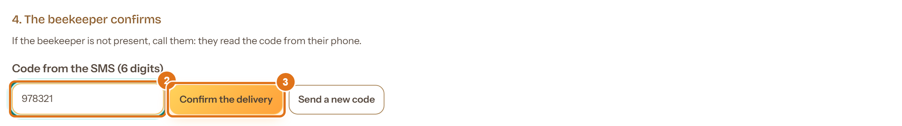

The delivery page opens with the message **Delivery confirmed by the beekeeper and recorded as lot #3.** The lot now appears in **My organization** and its control points in **My work**.

If no SMS is possible, open **No SMS possible: signed photo**, give the reason, take or upload the photo of the signed delivery form and select **Record with the signed photo**. The Compliance Officer reviews it.

## Print the labels

The delivery page shows each container with its seal history and its sample jars.

1. Select **Labels (A4 sheet)**, or **Labels (100 × 50 mm)** for a label printer.

   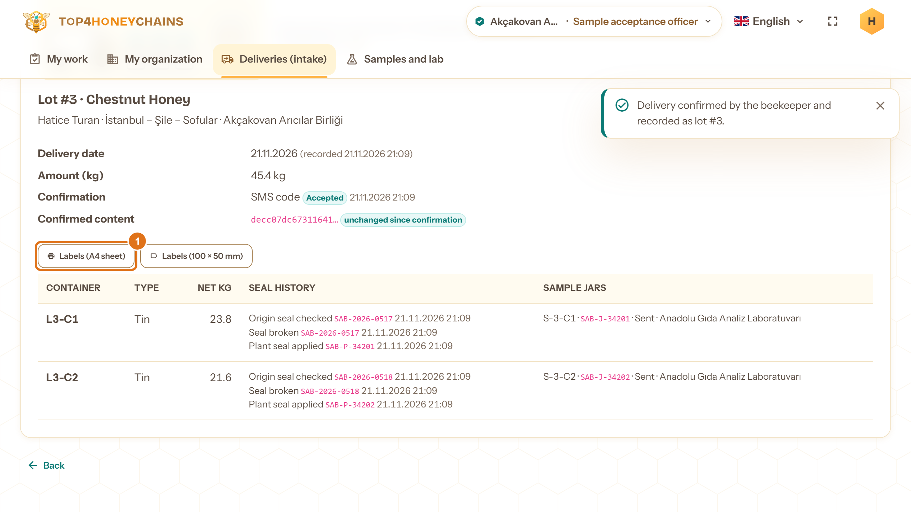

2. Select **Print the form** and stick each label on its container, sample jar and counter-sample jar.

## Enter CCP 0 (primary audit)

CCP 0 records the primary audit of the delivery: hygiene, water, pest control and storage at the beekeeper's.

1. Open **My work** and select **CCP 0** under **Values to enter**.

   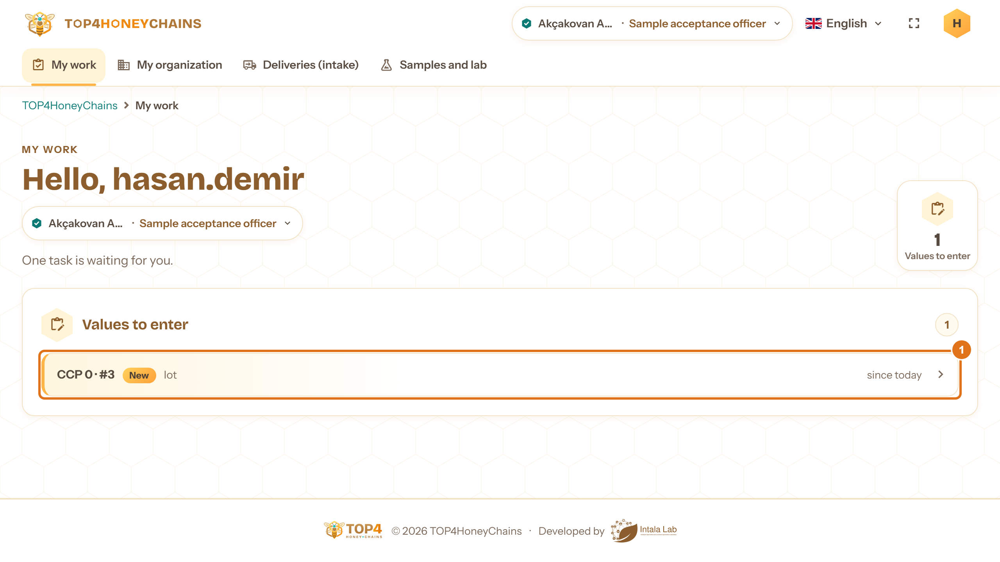

2. Answer each question and add notes where useful.

   

3. Select **Save Monitoring Logs**.

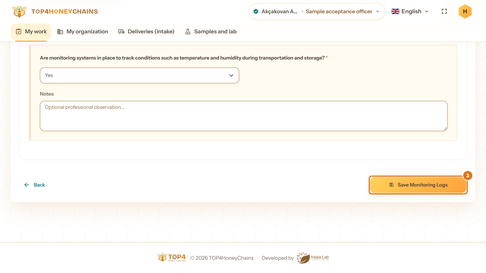

The Quality Assurance Officer approves it next ([Approve CCP 0](#sec-approve-ccp0)). **CCP 1** is filled in by the laboratory's approved report; you do not enter it.

> [!TIP]
> If a control point does not apply, open **This CCP does not apply here (mark as "Not applicable")** and give the reason.

# Laboratory: analyst and lab manager {#ch-lab}

The laboratory checks the seal of each sample jar on arrival, makes a composite sample of each lot, enters the results with the signed report and lets the Lab manager approve them. The approved report becomes CCP 1 of the lot.

Table: Tasks in the laboratory {#tbl-tasks-lab}

| Task | Who | Where |
| --- | --- | --- |
| Receive the sample jars | Analyst | **Samples and lab** |
| Make the composite sample | Analyst | **Samples and lab** |
| Enter and submit the results | Analyst | the lab report |
| Approve or return a report | Lab manager | **My work** |

## Receive the sample jars

My work lists the jars waiting under **Samples to receive**.

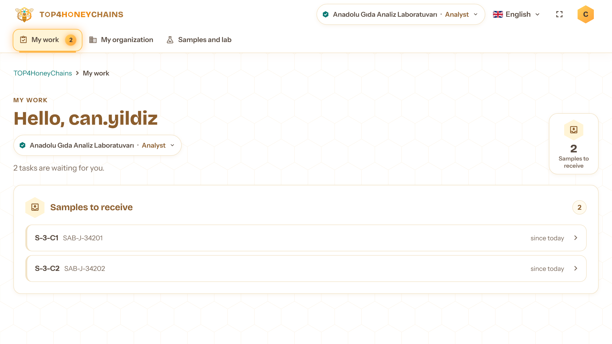

1. Select **Samples and lab** in the menu. The jars are listed under **Samples sent to your laboratory**.
2. For each jar, answer **The seal number matches the record**, **The label is intact** and **The cap is intact (button down)**. If a check fails, write the reason in **Reason if a check fails**.
3. Select **Record the reception**.

A broken seal rejects the sample; the plant then takes a new sample from the counter-sample.

## Make the composite sample

When all jars of a lot have arrived in good order, the lot is listed under **Lots ready for the composite sample**.

1. Select **Make the composite** for the lot. Mix equal parts of the jars into one composite sample; the jars stay retained for single analyses.

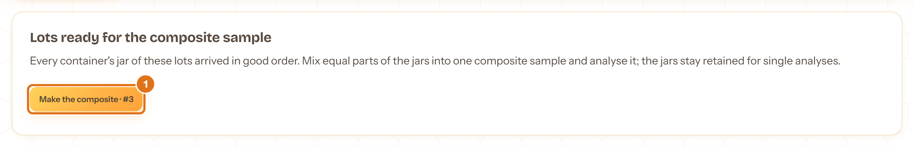

The lab report of the composite sample opens.

## Enter the results

1. Enter the **Report number** and the **Issue date**.
2. Select **Choose PDF** and attach the signed report.
3. Enter the value of every parameter. The **Limit** column shows the limit of each value.
4. Select **Save**.

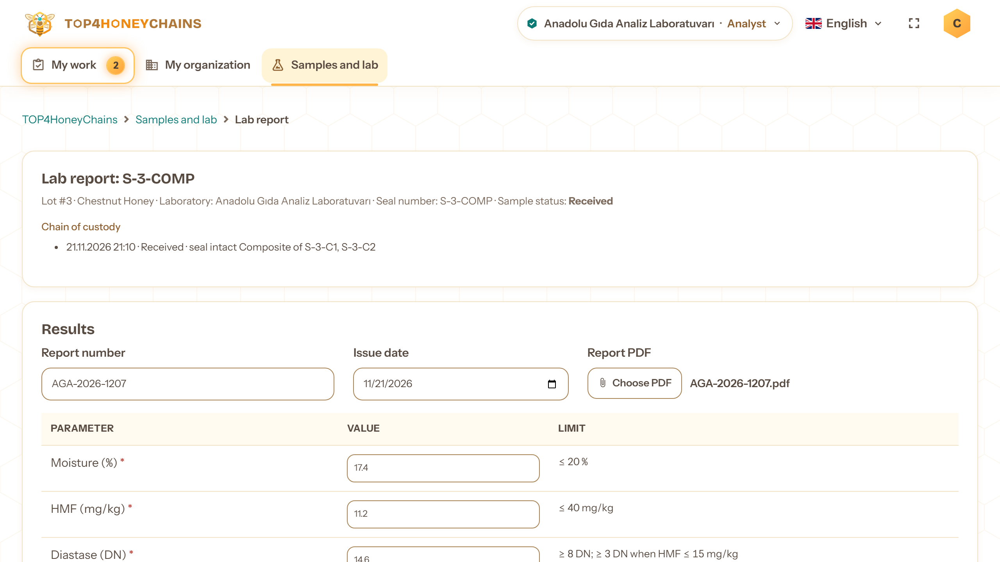

The line **Required values entered** shows how many values are still missing.

## Submit the report

When every required value is saved, select **Submit for approval**.

1. Select **Submit for approval**.

The Lab manager finds the report in **My work**.

## Approve or return a report

The Lab manager checks the report and its PDF.

1. Select **Approve**. To send it back, write the reason in **reason (to return)** and select **Return**.

Approving confirms that the report is recorded correctly, not that the honey complies. Values outside their limits stay flagged on the lot. The approved results fill in CCP 1 of the lot, and the report gets a code that anyone can check.

## Verify a lab report {#sec-verify-report}

Anyone can check a report without signing in: open **Verify a lab report** on the start page, enter the **Report code** and select **Check**. The page shows the status, the laboratory, its accreditation, the report number, the issue date and the SHA-256 fingerprint of the report file.

# Staff: processing and packing {#ch-staff}

Staff of a plant fill in the control sheets of the lots and the batches, put approved lots together into batches, request the finalizing of a batch and ship honey to other organisations.

Table: Tasks of the staff {#tbl-tasks-staff}

| Task | Where |
| --- | --- |
| See your lots and batches | **My organization** |
| Fill in the control sheet of a lot | **My organization > Control sheet** |
| Create a batch | **My organization > New batch** |
| Fill in the control sheet of a batch | **My work** or the batch page |
| Request finalizing | the batch page |
| Ship honey | **Shipments and stock** |

## See your lots and batches

**My organization** shows your organisation, the **Raw honey lots** it works on and its **Batches**. Each control point is a chip: green with ✓ is approved, yellow is submitted and waiting for approval, grey is open, outlined is not applicable.

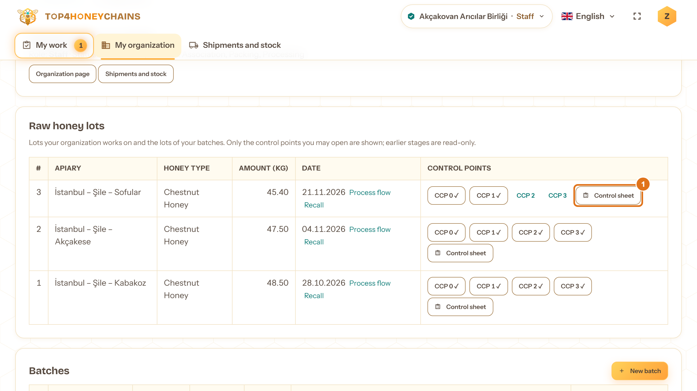

## Fill in the control sheet of a lot (CCP 2 and 3)

The control sheet shows all control points of a lot on one page. Each one keeps its own record, status and approval.

1. Select **Control sheet** in the row of the lot, or the item in **My work**.
2. Enter the values of **CCP 2** (heating) and **CCP 3** (filtration).

   

3. Select **Save the sheet**.

The Quality Assurance Officer approves the sheet ([Approve a control sheet](#sec-approve-sheet)).

> [!TIP]
> **Open this control point alone** opens one control point on its own page, for example to attach a file.

## Create a batch {#sec-new-batch}

A lot is ready for a batch when all its control points are completed and approved.

1. In **My organization**, select **New batch**.
2. Enter the **Batch name**, for example `Şile Kestane Balı 2026/2`, and check the **Production Date**.
3. Tick **Use** for each lot that goes into the batch and check the **Kilograms for this batch**.
4. Select **Create batch**.

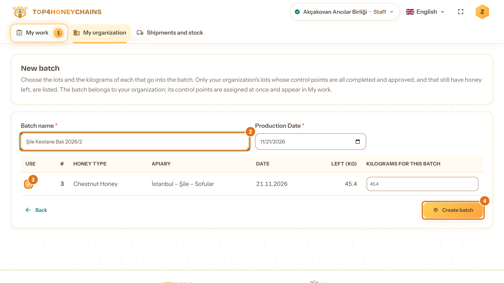

The batch belongs to your organisation. Its control points CCP 4 to CCP 10 appear in My work at once.

## Fill in the control sheet of a batch (CCP 4 to 10)

Open the control sheet of the batch from **My work** or with **Open the control sheet** on the batch page. Enter the values of homogenization, pasteurization, settling, filling, labelling, packaging and storage, then select **Save the sheet**.

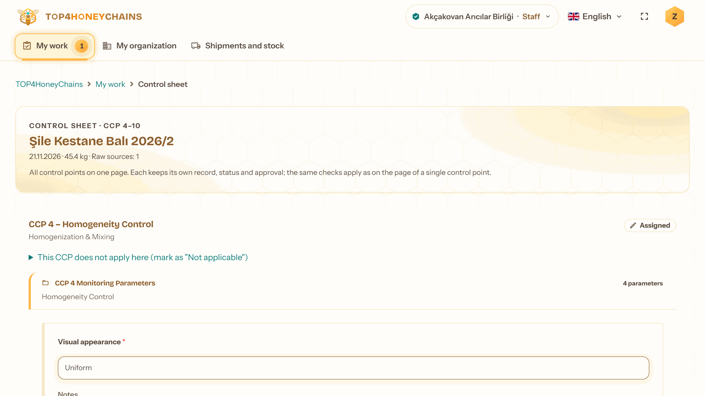

## Request finalizing {#sec-request-finalizing}

When every control point of the batch and its lots is approved, ask for the batch to be finalized.

1. On the batch page, select **Request finalizing**.

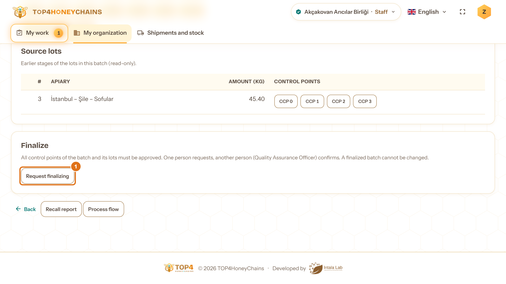

If something is missing, the page lists it under **Missing before finalizing:**. The Quality Assurance Officer confirms the request ([Finalize a batch](#sec-finalize)).

## Ship honey to another organisation

1. Select **Shipments and stock** in the menu and select **Ship** in the row of the batch.

   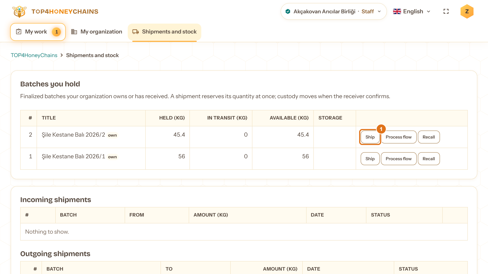

2. Choose the receiving organisation in **To**.
3. Enter the **Amount (kg)** and, if useful, a **Note**.
4. Select **Ship**.

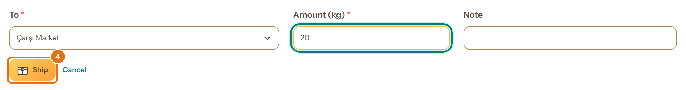

A shipment reserves its quantity at once; custody moves when the receiver confirms it.

# Quality Assurance Officer {#ch-qao}

The Quality Assurance Officer approves what others entered: CCP 0 of each delivery, the control sheets of lots and batches, the finalizing of batches and, at a wholesaler or a retailer, the storage records. The officer also answers consumer feedback. You never approve a record you entered yourself.

Table: Tasks of the Quality Assurance Officer {#tbl-tasks-qao}

| Task | Where |
| --- | --- |
| Approve CCP 0 | **My work > Values to approve** |
| Approve a control sheet | **My work > Values to approve** |
| Finalize a batch | **My work**, the batch page |
| Answer consumer feedback | **Consumer feedback** |

## Approve CCP 0 {#sec-approve-ccp0}

1. Open **My work** and select the item under **Values to approve**.

   

2. Check the values and select **Approve**.

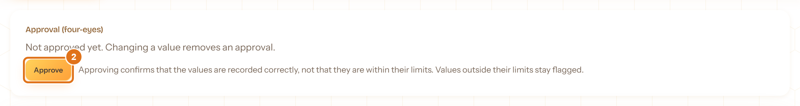

Approving confirms that the values are recorded correctly, not that they are within their limits. If a value is outside its limit, the page asks you to confirm it before approving.

## Approve a control sheet {#sec-approve-sheet}

1. Open the control sheet from **My work**.
2. Check the values. Under **Approve the sheet**, the page lists the control points you approve; select **Approve all listed**.

Every control point listed is approved as its own record. Entries you made yourself are listed under **Not approved by you:** and need another officer.

## Finalize a batch {#sec-finalize}

After Staff requested finalizing, the batch appears in your My work.

1. Open the batch page from **My work**.
2. Select **Confirm and finalize**.

The batch is finalized and sealed. **Open the Honey Story** shows its public page and **Download QR** gives the QR code for the labels of the jars.

> [!WARNING]
> A finalized batch cannot be changed. Its data, composition and control points are locked. A value can then be changed only through a correction approved by two platform administrators.

## Answer consumer feedback {#sec-answer-feedback}

Consumers can send feedback about a honey to the organisation that produced it. You read only the consumer's code, never their user name or phone, and the feedback is never public.

1. Select **Consumer feedback** in the menu and open the feedback.
2. Write your answer in **Your answer to the consumer**.
3. Select **Send answer**.

The consumer reads the answer on their **My honeys** page. Use **Mark as read** and **Close** to keep the list in order.

# Wholesaler and retailer: receiving and storing honey {#ch-shop}

The staff of a wholesaler or a retailer confirm the honey that arrives and record its storage conditions (CCP 10). The Quality Assurance Officer of the same organisation approves the storage record. The pictures show a retailer; a wholesaler works the same way.

Table: Tasks at a wholesaler or a retailer {#tbl-tasks-shop}

| Task | Who | Where |
| --- | --- | --- |
| Confirm a shipment | Staff | **Shipments and stock** |
| Record the storage conditions | Staff | **Shipments and stock > CCP 10** |
| Approve the storage record | Quality Assurance Officer | **My work** |

## Confirm a shipment

1. Select **Shipments and stock** in the menu. The shipment is listed under **Incoming shipments** as **Pending**.
2. Check the honey and select **Confirm receipt**. If something is wrong, write the reason in **reason (to reject)** and select **Reject**.

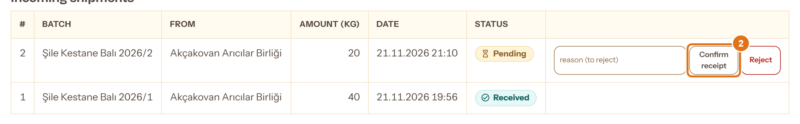

The batch is now listed under **Batches you hold**.

## Record the storage conditions (CCP 10)

1. In **Shipments and stock**, select **CCP 10** in the **Storage** column of the batch.
2. Enter the **Temperature (°C)** and the **Relative Humidity**.
3. Select **Save**.

## Approve the storage record

1. Open the storage record from **My work**.
2. Select **Approve**.

The Honey Story of the batch now shows that the retailer received it.

# Organization admin {#ch-orgadmin}

The Organization admin looks after the organisation's page and documents and, in a beekeepers' association, publishes the beekeeper pages. In a plant the Organization admin can also create batches, request finalizing and ship honey, as Staff do ([Staff: processing and packing](#ch-staff)). The Compliance Officer has a chapter of its own ([Compliance Officer](#ch-compliance)).

## See your organisation's page and documents {#sec-org-page}

Select **My organization** and then **Organization page**. The page shows the status of the organisation (**Verification**), its **Documents**, **Capabilities**, the **Four-eyes exemption** and the **Data controller** details.

To add a document, choose the file under **Documents** and select **Upload**. PDF files up to 10 MB and JPG, PNG or WEBP pictures up to 8 MB are accepted. Members and capabilities are managed by the platform administrators ([Platform administration](#ch-admin)).

## Publish a beekeeper page (association) {#sec-beekeeper-page}

An association can publish a public page for each member beekeeper. The page is published only with a recorded consent and a verified registry number; withdrawing the consent unpublishes it at once.

1. Select **Beekeeper pages** in the menu.
2. Select **Record consent** in the row of the beekeeper.
3. Read the consent text to the beekeeper. Tick **The consent text was read to the beekeeper and signed.** and, if the beekeeper agrees, **The beekeeper agrees to show the name (otherwise a neutral code is shown)**.
4. Enter the **Date of consent**, attach the **Signed consent document** (or take it with **Camera**) and save.

Once published, **Printable card** gives a card with the QR code of the page, and **Withdraw consent** takes the page down.

# Compliance Officer {#ch-compliance}

Every organisation on the platform names at least one **Compliance Officer**. The Compliance Officer supervises how the organisation works with the platform and with personal data. You do not enter deliveries, control point values or lab results; you review them. A platform administrator verifies an organisation for the first time only when it has an active Compliance Officer. In a small organisation the **Organization admin** can also be the Compliance Officer, with a second membership (see [Memberships](#memberships)).

As Compliance Officer you are able to:

- accept or reject the signed photos that replace the beekeeper's SMS code, for registrations and deliveries of your organisation;
- review the sampling quality: deliveries confirmed by a signed photo, samples the laboratory rejected and seals found broken;
- record requests about personal data and consent withdrawals that arrive on paper, by phone or in person;
- watch the approval mechanism: records that wait too long for approval and approvals made under the four-eyes exemption;
- keep the organisation's agreements and its data controller details;
- read the audit entries of your organisation.

Your data rights follow from the role (see [Table](#tbl-crud)). By default you approve signed-photo evidence, read the beekeepers' asking prices for your organisation's lots, read the organisation's audit entries, and read and answer consumer feedback about your organisation's batches. You create and update the documents and the data controller details of your organisation. You create sampling-quality reviews and data-subject requests; a review cannot be changed or deleted afterwards. A platform administrator can change these rights under **Set-up > Roles and permissions**.

Two ground rules always apply (see [Ground rules](#ground-rules)). You never decide on an item you recorded yourself: the page says **You recorded this item; another person reviews it.** And the four-eyes exemption of an organisation never applies to your reviews of signed photos.

Your menu shows **Compliance**. Your tasks appear in **My work** under **Review signed photos**, **Reviews**, **Data-subject requests** and **Consumer feedback**.

Table: The Compliance Officer's tasks and where to find them {#tbl-co-tasks}

| Task | Where to find it |
| --- | --- |
| Review a signed photo of a registration or a delivery | **My work > Review signed photos**; the count is also under **Compliance > Signed photos** |
| Review the sampling quality | **Compliance > Sampling quality**; open items under **My work > Reviews** |
| Record and answer a data-subject request | **Compliance > Data-subject requests**; open requests under **My work > Data-subject requests** |
| Record a consent withdrawal received on paper or by phone | **Compliance > Data-subject requests > Record a request** |
| Check the approval mechanism | **Compliance > Approval mechanism** |
| Keep agreements and documents | **Compliance > Agreements**, **Documents of the organization** |
| Keep the data controller details | **Compliance > Data controller**, **Edit on the organization page** |
| Read the organisation's audit entries | **Compliance > Audit entries** |
| Answer consumer feedback | **My work > Consumer feedback** (see [Answer consumer feedback](#sec-answer-feedback)) |

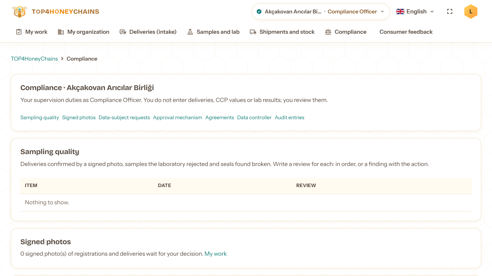

## Review a signed photo {#co-evidence}

A beekeeper normally confirms a registration and a delivery with a 6-digit code from an SMS. When that is not possible (no mobile phone, no signal), the officer who records it attaches a photo of the form the beekeeper signed. The **Beekeeper registration officer** does this at registration (see [Register a beekeeper without a mobile phone](#sec-register-no-phone)); the **Sample acceptance officer** does it at delivery (see [Record a honey delivery](#sec-record-delivery)). The photo then waits for you.

1. In **My work**, open an item under **Review signed photos**. It opens the registration or the delivery.
2. Open the photo and check it against the record:
   - for a registration: the identity, the registry number, the beekeeper's choices and the signature;
   - for a delivery: the containers, the weights and the seal numbers.
3. Select **Accept**, or write a **Note (required for a rejection)** and select **Reject**.

What follows depends on the record.

Table: What accepting or rejecting a signed photo does {#tbl-co-evidence}

| Record | Accept | Reject |
| --- | --- | --- |
| Registration | The registry number is verified and the beekeeper can deliver honey. | The registry number is rejected. The consents given on this signed form are withdrawn. The beekeeper cannot deliver until registered again. |
| Delivery | The lot can be finalized when its control points are done. The beekeeper can enter the asking price. | The lot cannot be finalized. |

If you recorded the item yourself, it does not appear in your **My work**, and the page says that another person decides. For registrations recorded by the platform itself, a platform administrator reviews the photo.

> [!NOTE]
> You can open and download the photo because you are the Compliance Officer of the organisation that holds it. Every download is written to the audit log (see [Codes and file fingerprints](#trust-codes)).

## Review the sampling quality {#co-quality}

**Compliance > Sampling quality** lists three kinds of items for your organisation:

- **delivery by photo**: a delivery confirmed by a signed photo instead of the SMS code;
- **rejected sample**: a sample jar the laboratory rejected at reception;
- **broken seal**: a container seal found broken.

Items without a review come first. Select the item's link to open the delivery or the sample.

1. Select **Write a review** in the row.
2. Choose **in order** or **finding**.
3. Write **What you checked and found**.
4. For a finding, write the **Action taken or requested**. It is required for a finding.
5. Select **Save**.

Each text can hold at most 1000 characters. A saved review cannot be changed or deleted. If you checked the item again later, write a new review; the row then shows every review with its date.

## Handle a data-subject request {#co-requests}

People can ask about their personal data. The page offers five kinds of request: **access**, **correction**, **deletion**, **objection** and **consent withdrawal**. A beekeeper with a portal account withdraws or gives a consent there at once (see [Manage your consents and your account](#sec-portal-consents)). You record here the requests that reach the organisation in another way: a letter, a phone call or a visit.

1. Select **Compliance**, go to **Data-subject requests** and select **Record a request**.
2. Fill in the form (see [Table](#tbl-co-request)).
3. Select **Save**. The message says **Request recorded; the answer is due within 30 days.**

Table: The fields of a data-subject request {#tbl-co-request}

| Field | What to enter | Required |
| --- | --- | --- |
| **Data subject** | The name of the person who asks (at most 200 characters) | Yes |
| **Beekeeper's number (if a beekeeper)** | The beekeeper's business number. It must exist on the platform. | Only for a consent withdrawal |
| **Request** | **access**, **correction**, **deletion**, **objection** or **consent withdrawal** | Yes |
| **Consent to withdraw** | The consent the beekeeper withdraws | Only for a consent withdrawal |
| **Received by** | How the request arrived, for example "letter" or "phone" (at most 50 characters) | Yes |
| **Received** | The date the request arrived. It cannot be in the future. | Yes |
| **What is asked** | The request in your words (at most 1000 characters) | Yes |

The list shows open requests first, with the date **Received** and the date to **Answer by**. The answer date is 30 days after the date received, the period of the Turkish data protection law (KVKK) that the screen names. An overdue date is shown in red. In other partner countries, check the period of your national law; under the GDPR it is one month.

When you have answered the person, write the **Answer given** in the row and select **answered** or **refused**. A closed request cannot be opened again.

> [!NOTE]
> The platform records the request and its deadline. You carry out the request itself: for example, you collect the data for an access request, or you ask a platform administrator for a correction or a deletion (see [What happens next](#co-next)).

## Record a consent withdrawal received on paper or by phone {#co-withdrawal}

A beekeeper may withdraw a consent by letter, by phone or in person, for example a beekeeper without a portal account. The withdrawal takes effect as soon as you record it.

1. Select **Record a request**.
2. Choose the **Request** **consent withdrawal**.
3. Enter the **Beekeeper's number (if a beekeeper)**. It is required here.
4. Choose the **Consent to withdraw**: **My name on public pages**, **Messages about my deliveries and results**, **My association may see my prices** or **My public beekeeper page**.
5. Fill in **Data subject**, **Received by**, **Received** and **What is asked**, and select **Save**.

The platform withdraws the active consent at once and closes the request as **answered**, with the note that the consent was withdrawn (or that there was no active consent). The effect is immediate: the Honey Story shows the neutral code instead of the name, the association stops reading the prices, or the beekeeper page is taken down (see [Notices, consents and the data controller](#trust-notices)).

## Check the approval mechanism {#co-approvals}

The four-eyes principle means that one person enters a record and a second person approves it (see [Four-eyes](#four-eyes)). A platform administrator can exempt a small organisation, so that its members may approve their own control point records and finalize their own batches. The exemption never applies to lab results. The platform marks every approval made under the exemption.

**Compliance > Approval mechanism** lists, for the lots and batches of your organisation:

- control point records of lots and batches, storage records (CCP 10) and finalize requests that have waited for approval longer than 7 days ("waiting since …");
- approvals and finalizing done under the four-eyes exemption ("approved by the same person (four-eyes exemption)").

Each line names the lot or batch, the control point (or **Finalize**) and the reason it is listed. Select the line to open the record. Self-approvals are listed first.

Under **Who enters and approves what**, the page shows, for each area of work, which roles enter, approve and read records. This is the configuration of the whole platform. The platform administrator keeps it; ask them for a change (see [Decide who enters and approves each control point](#sec-ccp-responsibilities)).

> [!TIP]
> A record that waits too long usually means that nobody in the approving role is available. Speak to your **Organization admin**, or ask a platform administrator to add a member in that role.

## Keep agreements and documents {#co-agreements}

**Compliance > Agreements** lists the organisation's data processing agreements and supply agreements, newest first, with the date of upload. Select a file name to open it.

To add an agreement:

1. Select **Documents of the organization**. The organisation page opens at **Documents**.
2. Choose the kind **Data processing agreement** or **Supply agreement**.
3. Choose the file and select **Upload**.

The same place takes the other documents of the organisation (**Licence**, **Accreditation**, **Tax certificate**, **Registry proof**, **Other**), as the **Organization admin** does (see [See your organisation's page and documents](#sec-org-page)). Documents are kept with their SHA-256 fingerprint. A suspended organisation cannot upload documents.

## Keep the data controller details {#co-controller}

Each organisation is the data controller for the personal data it records. Its details are named in the privacy notice that people read. **Compliance > Data controller** shows the legal name and the contact.

1. Select **Edit on the organization page**.
2. Under **Data controller**, enter the **Legal name**, the **Contact (e-mail or phone)**, the **Address** and, where it applies, the **VERBİS** registration number.
3. Select **Save**.

Only you and the platform administrators can change these details. The organisation page marks them **missing** until a legal name is entered. **Privacy notice** opens the public privacy notice that names your organisation as data controller. Beekeepers find these details in their portal under **Who holds your data**.

## Read the organisation's audit entries {#co-audit}

**Compliance > Audit entries** shows the latest 200 entries written by the members of your organisation while they worked for it: **Date**, **User** and **Change** (the action and the record it concerns). The list is read-only. For the full audit log with old and new values, ask a platform administrator (see [The audit log and its hash chain](#trust-audit)).

## What happens next {#co-next}

Your reviews hand the work on to others:

- After you accept a registration, the **Sample acceptance officer** can record the beekeeper's deliveries. After you accept a delivery photo, the **Quality Assurance Officer** can finalize a batch with that lot ([Finalize a batch](#sec-finalize)).
- After a rejection, the **Beekeeper registration officer** registers the beekeeper again, or the lot stays out of every finalized batch.
- A finding with an action goes to the **Organization admin**, or to a platform administrator, who corrects locked records ([Records that do not change](#trust-locked)) and changes members, roles, rights and the four-eyes exemption.

# Beekeeper portal {#ch-portal}

The beekeeper portal is made for the phone. With it, beekeepers follow their deliveries, enter their asking price, read their lab results and manage their consents. The registration officer sends the sign-in details by SMS ([Send the beekeeper the sign-in details](#sec-send-signin)); the first sign-in works as described in [Sign in for the first time](#sec-first-sign-in).

## Read the start page

After signing in, the beekeeper sees **Home**: the deliveries, the batches with their honey, the last delivery and the last lab result. **To do** lists the deliveries without a price. The menu has **Home**, **My deliveries**, **Samples and lab**, **Batches with my honey**, **My Honey Story pages**, **My apiaries**, **Privacy and consents** and **Account**. The language links and **Logout** are at the top.

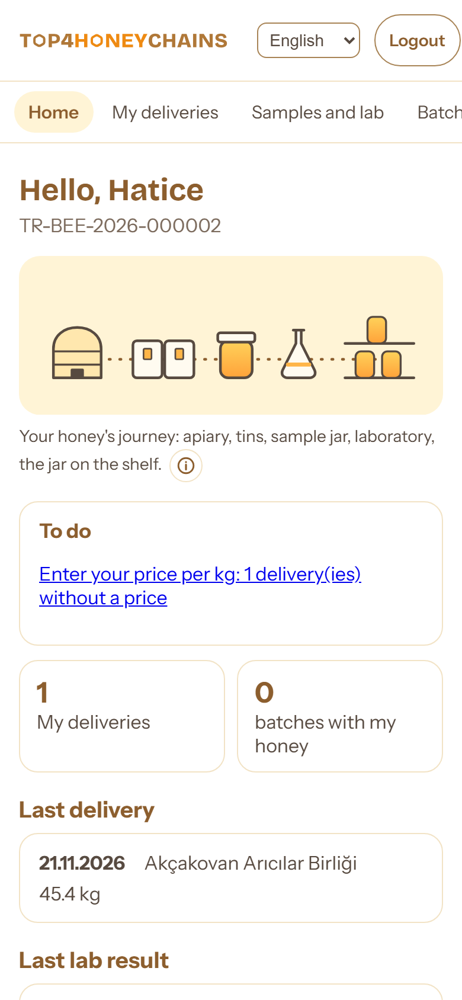

## Enter your price

1. Select **My deliveries**. Each delivery shows the honey type, the amount, the confirmation and every container with its seal history.
2. Under **Asking price**, enter your **Price per kg** and the **Currency**, and a **Note (optional)**.
3. Select **Enter price** and confirm the total.

 

You can change the price with **Change price** until the lot is in a finalized batch. **Price history** shows your earlier prices.

## See lab results, batches and Honey Story pages

**Samples and lab** shows every sample jar of your deliveries. Lab values appear once the laboratory approved its report. **Batches with my honey** shows your share in each batch, and **My Honey Story pages** opens their public pages.

## Manage your consents and your account {#sec-portal-consents}

**Privacy and consents** lists your consents: your name on public pages, messages about deliveries and results, and whether your association may read your prices. Select **Withdraw** or **Give**; a change takes effect at once.

**Account** lets you change your mobile phone (**New number**, **Send a code**), your **Language** and your password (**Current password**, **New password**, **New password again**, **Change password**).

 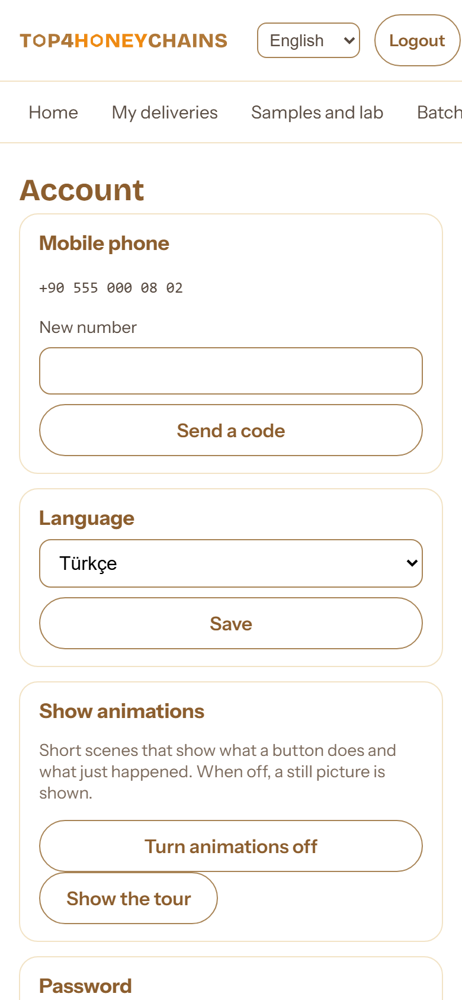

# The Honey Story page {#ch-story}

The Honey Story is the public page of a finalized batch. The consumer opens it by scanning the QR code on the jar with a phone; no account is needed.

## The top of the page

The top shows the name of the batch, the organisation that produced it, the amount of honey, the number of beekeepers and the production date. The badges below say whether the honey was **Tested by an accredited lab** and whether **All control points approved**, the origin, and the code of the lab report.

## The journey of this honey

Five steps show the path of the honey: **Apiary**, **Delivery**, **Lab**, **Processing** and **Shelf**, each with its date. **See the details** opens the part of the page that belongs to the step.

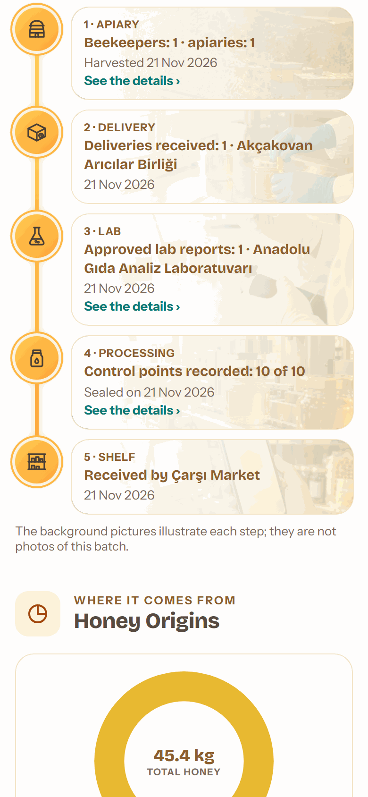 

## Where it comes from

**Honey Origins** shows how much honey came from each source, and the map shows the provinces. Exact apiary locations are never published. **Source Composition** lists the beekeepers, with their names only if they agreed to it.

## Lab results and process checks

**Quality at a glance** shows the most important values. **Full lab report** groups all values: **Freshness**, **Maturity & authenticity**, **Sugar profile & purity** and residues. **Verify report** checks the report on the verification page. **Process checks** lists every control point recorded for the honey.

 

> [!NOTE]
> While the limits of the values are still being checked by a partner laboratory, the values are shown without a within or outside verdict.

## Save the honey or write to the producer

At the bottom, **Save to My honeys** and **Send feedback to the producer** are for consumers with a free account ([Consumer account](#ch-consumer)). **Verify a report** opens the verification page.

# Consumer account {#ch-consumer}

A free consumer account lets you keep the honeys you bought, send feedback to the producer and read the answers. The Honey Story stays open to everyone without an account.

## Create an account

1. On the Honey Story or the sign-in page, select **Create a free consumer account**.
2. Choose a **Username** of 3 to 40 letters, digits, dots, dashes or underscores. Do not use your real name or e-mail address.
3. Enter your **Password** twice, choose your **Language** and, if you wish, a **Mobile phone (optional)**.
4. Tick **I am 18 or older.** and **I have read and accept the Privacy notice for consumers**.
5. Select **Create account**.

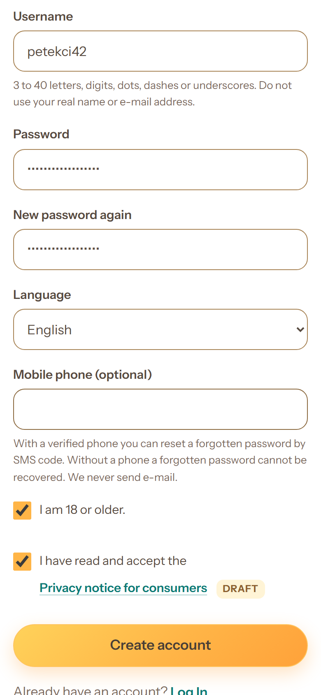

> [!NOTE]
> With a verified phone you can reset a forgotten password by SMS code. Without a phone a forgotten password cannot be recovered. The platform never sends e-mail.

## Save a honey

1. On the Honey Story, select **Save to My honeys**.
2. Select **Save to My honeys** again to confirm.

Only you see your saved honeys. The platform does not record which stories you open.

## Send feedback to the producer

1. On the Honey Story, select **Send feedback to the producer**.
2. Choose what it is about, for example **Taste or smell** or **Suspected fake or opened jar**.
3. Write your message, at most 1000 characters, without personal data.
4. Select **Send feedback**.

 

The producer sees only your code, never your user name or phone.

## Read the answer and manage your account

**My honeys** lists your **Saved honeys** and **My feedback** with the **Answer from the producer**. **Account** shows your code and lets you change your phone, language and password. **Download my data** gives everything the platform keeps about your account, and **Delete my account for good** deletes it after you enter your password.

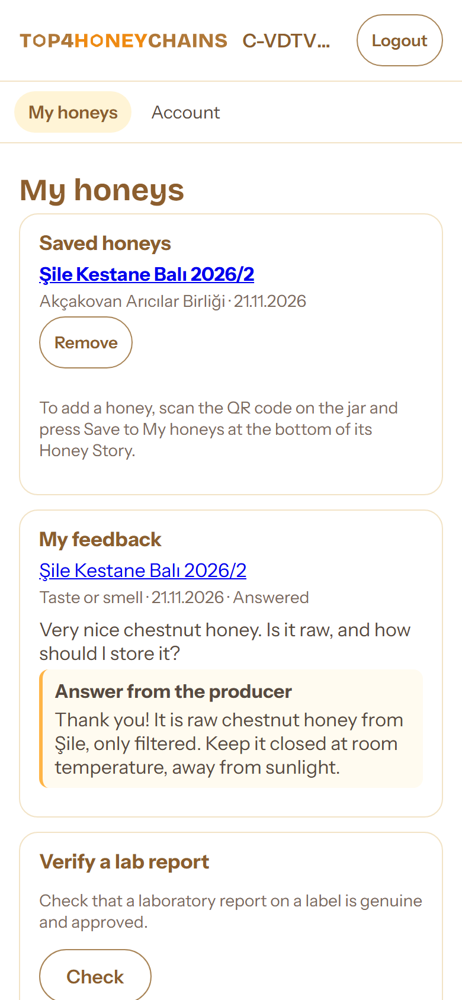 

# Platform administration {#ch-admin}

Platform administrators set up the organisations and their members, decide who enters and approves each control point, and oversee the records. They do not enter business data. Their menu has **My work**, **Dashboard**, **Set-up** and **Oversight**.

Table: Tasks of the platform administrator {#tbl-tasks-admin}

| Task | Where |
| --- | --- |
| Follow the chain | **Dashboard** |
| Create and verify an organisation, add members | **Set-up > Organizations** |
| Roles and rights | **Set-up > Roles and permissions** |
| Who enters and approves each control point | **Set-up > CCP responsibilities** |
| Users and sign-in details | **Oversight > Users** |
| Records, audit log, corrections | **Oversight** |
| Notices, translations, reference data | **Oversight > Notices and consent texts**, **Set-up** |

## Follow the chain on the dashboard

The **Dashboard** shows the figures of the chain and what is waiting at each step. Select a step to see its list. The figures refresh every 5 minutes.

## Create and verify an organisation

1. Select **Set-up > Organizations** and then **New organization**.

   

2. Enter the **Display name** and, if known, the **Legal name**, **Tax number**, **Province** and **District**. Tick the **Capabilities**; for a laboratory, enter its accreditation.
3. Select **Create**. The organisation starts as **Pending** and can enter data only after it is verified with documents.

   

4. Open the organisation with **Open**. Upload its documents and add a Compliance Officer, then select **Verify** under **Verification**. With a reason, **Request documents** and **Suspend** are also possible.

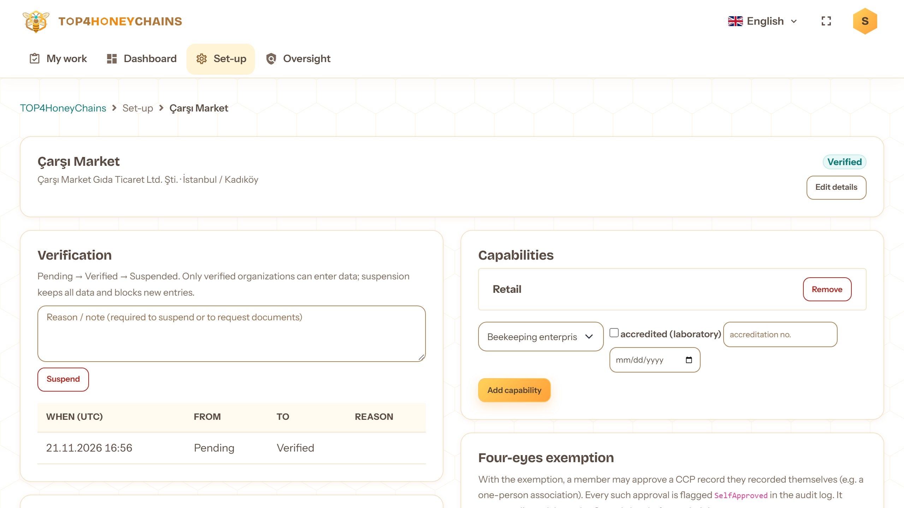

## Add a member {#sec-add-member}

On the page of the organisation, under **Members**, enter an **Existing user name** or create a new user (**user name**, **Mobile phone**, **E-mail (optional)**). Choose the **Org role** and select **Add member**. **Set-up > Roles and permissions** shows all members of all organisations, the rights of each role and the capabilities of each organisation.

> [!NOTE]
> Every change on these pages is recorded in the audit log.

## Decide who enters and approves each control point {#sec-ccp-responsibilities}

**Set-up > CCP responsibilities** shows, for each control point, the responsible organisation, the capabilities, the roles that enter values and the roles that approve. Select **Edit** to change them. Changes apply at once.

## Manage users and sign-in details

**Oversight > Users** lists all accounts: staff, beekeepers and consumers. **Add New User** creates an account; **Send sign-in by SMS** sends new sign-in details; **Reset Password** sets a new password; **Delete** removes an account.

## Oversee the records {#sec-oversee}

**Oversight > Records** shows the lots and batches of every organisation, read-only. **Oversight > Audit log** shows every change; it can only be added to, and **Verify hash chain** checks that no entry was changed or removed. **Oversight > Corrections** lists the corrections of values: a value is changed only when a second administrator approves the correction.

## Notices, translations and reference data {#sec-notices}

**Oversight > Notices and consent texts** lists the versions of the privacy notices and consent texts. Texts are never changed after publishing: select **Publish a new version** instead. **Set-up > Reference data** holds the lists the forms offer (honey types, periods, control points and their parameters), and **Set-up > Translations of reference data** their names in the five languages.

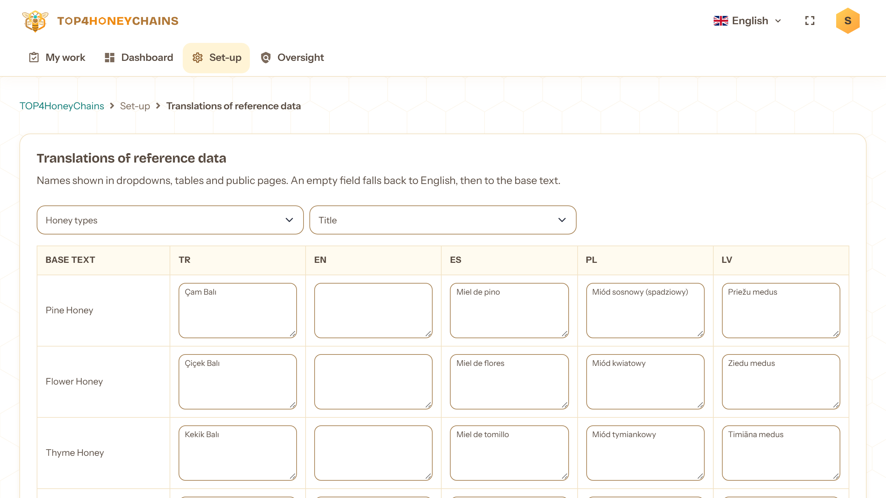

## More administration tasks {#sec-admin-more}

The sections below describe the remaining tasks of a platform administrator. [Table](#tbl-admin-more) shows where each one starts.

Table: Where the administration tasks start {#tbl-admin-more}

| Task | Where |
| --- | --- |
| Change the status of an organisation, its capabilities, exemption, data controller and members | **Set-up > Organizations**, then **Open** |
| Change the rights of a role | **Set-up > Roles and permissions**, tab **Role permissions** |
| Change who enters and approves a control point | **Set-up > CCP responsibilities** |
| Control points, parameters and limits | **Set-up > Reference data** |
| Honey types, production periods and the beekeeper lists | **Set-up > Reference data** |
| Names in the five languages | **Set-up > Translations of reference data** |
| Registry numbers and associations of beekeepers | **Set-up > Beekeeper registry and associations** |
| Corrections | **Oversight > Corrections**, and **My work** |
| Recall report | **Oversight > Records**, then **Process flow** |
| Notices and consent texts | **Oversight > Notices and consent texts** |
| Data retention | **Oversight > Data retention** |
| Audit log | **Oversight > Audit log** |

## Change the status of an organisation {#sec-admin-org-status}

Change the status when an organisation is ready to work, when its documents are incomplete, or when it must stop entering data. [Table](#tbl-admin-status-actions) lists the buttons; the statuses themselves are explained in [Table](#tbl-org-status).

Table: Status buttons on the page of an organisation {#tbl-admin-status-actions}

| Button | Shown when the status is | Needs | New status |
| --- | --- | --- | --- |
| **Verify** | Pending | At least one uploaded document. An organisation verified for the first time also needs an active Compliance Officer. | Verified |
| **Request documents** | Pending | A note that says which documents are missing | Pending (the request is recorded) |
| **Suspend** | Verified | A reason | Suspended |
| **Reinstate** | Suspended | Nothing more | Verified |

1. Select **Set-up > Organizations**.
2. Select **Open** next to the organisation.
3. Under **Verification**, write the reason or note in the text box. A reason is required to suspend and to request documents; it can be at most 500 characters.
4. Select **Verify**, **Request documents**, **Suspend** or **Reinstate**.

The page shows "Organization is now Verified." (or Suspended), or "Documents requested.". The change appears in the history under **Verification** with the date, the old and new status and the reason, and in the audit log.

A suspended organisation keeps all its data, but its members cannot enter new data until you reinstate it.

> [!NOTE]
> The server configuration can make the central association, not the platform administrator, the verifier of beekeepers' associations (see [Settings in the server configuration](#sec-admin-settings)). Associations then do not appear in your **My work**, and their page refuses your status changes.

## Add or remove a capability {#sec-admin-capability}

Add a capability when an organisation takes on new work in the chain, for example a beekeeping enterprise that starts to pack and sell its own honey. Capabilities are explained in [Table](#tbl-capabilities).

1. Open the organisation (**Set-up > Organizations**, then **Open**).
2. Under **Capabilities**, choose the capability in the list.
3. For a laboratory, tick **accredited (laboratory)** if it is accredited, and enter the **accreditation no.** and the date until which the accreditation is valid. An accredited laboratory needs a number.
4. Select **Add capability**.

The page shows "Capability … added.". To remove a capability, select **Remove** next to it. An organisation keeps at least one capability. Before you remove Beekeeper registration, revoke the memberships of its beekeeper registration officers.

To change the capabilities of many organisations at once, use the tab **Organization capabilities** under **Set-up > Roles and permissions**: tick the capabilities in the row of the organisation and select **Save** in that row. **Set-up > Capabilities** shows, for each capability, what it enables, which control points need it and which organisations have it. The list of capabilities itself is fixed.

## Grant or remove the four-eyes exemption {#sec-admin-four-eyes-exemption}

Grant the exemption only to a very small organisation that has one quality person, for example a one-person association. Normally the [four-eyes principle](#four-eyes) applies: nobody approves a record they entered themselves.

1. Open the organisation.
2. Under **Four-eyes exemption**, read the current setting (**exempt** or **not exempt**).
3. Select **Grant exemption** (or **Remove exemption**).

With the exemption, a member may approve a control point record they recorded themselves. Every such approval is marked `SelfApproved` in the audit log, and the organisation's Compliance Officer reads it in the approval checks. The exemption never applies to lab results. Only a platform administrator can set it.

## Revoke a membership {#sec-admin-revoke}

Revoke a membership when a person leaves the organisation or changes role. A membership is one user account in one organisation in one role (see [Memberships](#memberships)); revoking it does not delete the account or the person's other memberships.

1. Open the organisation.
2. Under **Members**, find the person and the role.
3. Select **Revoke** and confirm.

The page shows "Membership revoked.". The person is signed out on every device and can no longer act for the organisation in that role. Their earlier records keep their name. You cannot revoke your own membership of the platform organisation.

The tab **Members** under **Set-up > Roles and permissions** lists the memberships of all organisations and has the same **Revoke** button. Its **Add** form adds a membership for an existing user.

## Record the data controller of an organisation {#sec-admin-data-controller}

Each organisation is the data controller for the personal data it records, and its privacy notice names it. Fill in these details before the organisation starts work; the box shows **missing** while they are empty.

1. Open the organisation.
2. Under **Data controller**, enter the **Legal name**, the **Contact (e-mail or phone)** and the **Address**.
3. Select **Save**.

The page shows "Data controller details saved.". The organisation's Compliance Officer can also keep these details up to date.

## Change the rights of a role {#sec-admin-role-rights}

Change the rights of a role when the organisations need a different division of work, for example when the Staff of a plant should also read lab results. The rights apply to that role in every organisation. [Table](#tbl-permissions) shows the rights the platform starts with.

1. Select **Set-up > Roles and permissions**.
2. Select the tab **Role permissions**.
3. Choose the role in **Role**. The page shows its rights.
4. Tick or untick the boxes in the columns **Enter**, **Approve** and **Read**. A dash means the right does not exist for that function.
5. Select **Save**.

The page shows "Permissions of … saved; they apply at once.". The members of that role get the new rights at their next page.

The rows are the control points (one row each) and the functions in [Table](#tbl-admin-functions).

Table: Functions on the Role permissions tab {#tbl-admin-functions}

| Function | Rights on the tab | What the right covers |
| --- | --- | --- |
| **Lot intake** | Enter, Read | Record deliveries of honey |
| **Samples (take / receive at the lab)** | Enter, Approve, Read | Take sample jars and receive them at the laboratory |
| **Lab results** | Enter, Approve, Read | Enter and approve the results of a lab report |
| **Shipments (send / confirm receipt)** | Enter, Approve, Read | Send honey to another organisation and confirm its receipt |
| **Beekeeper pages (consent)** | Enter, Read | Publish beekeeper pages with the beekeeper's consent |
| **Recall report** | Read | Read the recall report |
| **Create batches (New batch)** | Enter | Create batches from the organisation's own lots |
| **Finalize batches (request / confirm)** | Enter, Approve | Request (enter) and confirm (approve) the finalizing of a batch |
| **Beekeeper registration** | Enter, Read | Register beekeepers |
| **Signed-photo evidence (accept or reject)** | Approve | Accept or reject a signed photo used instead of an SMS code |
| **Beekeepers' asking prices** | Read | Read the prices that beekeepers ask |
| **Audit entries of the organization** | Read | Read the audit entries of the own organisation |
| **Consumer feedback** | Enter, Read | Read consumer feedback and answer it |

Some rules hold whatever you tick:

- Every right keeps at least one role. If a change would leave a right without a role, nothing is saved and the page names the right ("Every right needs at least one role; …").
- The enter and approve rights of a control point are the same setting as in **CCP responsibilities** (see [Change who enters and approves a control point](#sec-admin-ccp-resp)). The organisation also needs the capability the control point requires.
- The box **Ground rules (cannot be switched off):** at the top of the page lists the rules no setting changes (see [Ground rules](#ground-rules)).

## Change who enters and approves a control point {#sec-admin-ccp-resp}

Change the responsibility of a control point when another organisation or role should do the work, for example when the beekeeper's association, not the plant, carries out the primary audit (CCP 0). The overview is described in [Decide who enters and approves each control point](#sec-ccp-responsibilities).

1. Select **Set-up > CCP responsibilities**.
2. Select **Edit** in the row of the control point.
3. In **Responsible organization**, choose **The organization that owns the lot / batch** or **The association of the lot's beekeeper**.
4. Under **Capabilities**, tick the capabilities the responsible organisation must have.
5. Under **Roles that enter values**, tick at least one role.
6. Tick **Values need approval by another person (four-eyes)** if the values must be approved, and tick at least one role under **Roles that approve**.
7. Select **Save**.

The page shows "Saved; the change applies at once.". If a choice is missing, the page says which one, for example "Choose at least one approving role, or turn approval off.".

Example: to give CCP 0 to the associations, choose **The association of the lot's beekeeper**, tick the capability of an association and tick **Field inspector** under **Roles that enter values**.

## Edit a control point {#sec-admin-ccp-edit}

Edit a control point when its description changes or when its free-text answers should (or should no longer) appear on the Honey Story. The control points are listed in [Table](#tbl-ccps).

1. Select **Set-up > Reference data**, then **Critical Control Points**.
2. Select **Edit** next to the control point.
3. Change the fields in [Table](#tbl-admin-ccp-fields).
4. Select **Update**.

Table: Fields of a control point {#tbl-admin-ccp-fields}

| Field | What to enter |
| --- | --- |
| **Processing Step** | The step of the process, for example "Extraction" |
| **CCP Code** | The code, for example CCP 4 |
| **Applies To** | **Raw honey lot** or **Final batch**: only lots or only batches are offered this control point |
| **Show free-text values on the public Honey Story page** | Leave off when answers may contain personal data or places, for example a field audit at the beekeeper. Yes/No answers and numbers are always shown; files never. |
| **Title** | The name of the control point |
| **Criticality Justification** | Why this step is critical |

> [!IMPORTANT]
> A new control point (**Add New CCP**) also needs a row in **CCP responsibilities**; until then nobody can enter it.

## Edit a parameter {#sec-admin-parameter}

A parameter is one value or question of a control point, for example moisture at CCP 1. Edit a parameter when its unit, type or default limits change.

1. Select **Set-up > Reference data**, then **Parameters**.
2. Select **Edit** next to the parameter.
3. Change the fields in [Table](#tbl-admin-parameter-fields).
4. Select **Update**.

Table: Fields of a parameter {#tbl-admin-parameter-fields}

| Field | What to enter | Required |
| --- | --- | --- |
| **Critical Control Point** | The control point the parameter belongs to | Yes |
| **Parameter Name** | The name shown on the forms | Yes |
| **Parameter Category** | The group the parameter belongs to | No |
| **Unit** | For example °C, %, ppm | No |
| **Data Type** | **Number**, **Yes / No**, **Text** or **File (e.g. lab report)** | Yes |
| **Minimum**, **Maximum** | The default limits for every honey type; leave empty for no limit | No |
| **Required for the CCP to be completed** | Tick if the control point cannot be completed without this value | No |
| **Required only when this question…** / **…is answered** | Makes the parameter required only when another Yes / No question has the given answer | No |
| **Limit Note**, **Limit Source** | A note on the limit and where it comes from, for example a food codex | No |
| **Limits verified (shown publicly)** | See [Mark the limits of a parameter as verified](#sec-admin-limits-verified) | No |

The list of parameters shows, for each one, its type and limits, the mark **to verify** for limits not yet verified, and the buttons **Content** (the explanation and video shown with the parameter) and **Limits**.

## Set the limits of a parameter {#sec-admin-limits}

Set specific limits when a value has other limits for some honeys, for example a different moisture limit for honeydew or pine honey.

1. Select **Set-up > Reference data**, then **Parameters**.
2. Select **Limits** next to the parameter. The page shows the default limits and the specific limits already set.
3. Under **Add a limit**, choose a **Honey Class** or a honey type (**or honey type**). Leave both empty for a limit that applies to every class.
4. If the limit applies only under a condition, choose the other parameter in **Only if this parameter** and enter the value in **is <=**.
5. If the limit applies to the sum of two values, choose the other parameter in **Sum with**. For an extra check of the ratio of two values, choose it in **Ratio to (extra check)**. A limit uses a sum or a ratio, not both.
6. Enter the **Min**, the **Max** or both, and a **Note** if useful.
7. Select **Add limit**.

The page shows "Limit added.". **Remove** next to a row removes it ("Limit removed.").

Which limit applies:

- A row for the lot's honey type wins over a row for its honey class, which wins over a row for every class.
- A row whose condition is met wins over a row without a condition.
- Ratio rows are extra checks that must also pass.

A lab report, a control point page and the Honey Story show only the main limit that applies to the honey. The list of parameters shows every row with its scope.

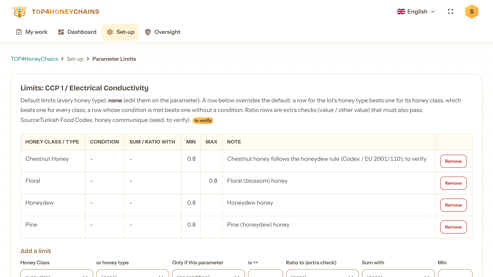

> [!IMPORTANT]
> Results already stored are not recalculated when you change a limit.

## Mark the limits of a parameter as verified {#sec-admin-limits-verified}

Mark the limits as verified once a partner laboratory or the competent authority has confirmed them. Until then, the public pages do not say whether a value is within its limits.

1. Open the parameter with **Edit** (see [Edit a parameter](#sec-admin-parameter)).
2. Tick **Limits verified (shown publicly)**.
3. Select **Update**.

From then on, the Honey Story and the beekeeper page show for each value of this parameter whether it is within or outside its limits. For a parameter whose limits are not verified:

- the panel marks the limit **to verify**;
- the Honey Story shows the value without a verdict and says: "The limits for these values are still being checked by a partner laboratory, so the values are shown without a within/outside verdict."

## Maintain the lists of the forms {#sec-admin-reference}

The forms offer fixed lists, such as the honey types. Add a value when the forms need a new one, and correct a value when its name is wrong. **Set-up > Reference data** groups the lists ([Table](#tbl-admin-reference)).

Table: Lists under Reference data {#tbl-admin-reference}

| Group | List | What it holds |
| --- | --- | --- |
| **Honey** | **Honey Types** | Title, description and the honey class used for the limits |
| **Honey** | **Raw Honey Production Periods** | Title, start date and end date of a production period |
| **Beekeepers** | **Education Levels** | The choices of the beekeeper's education level |
| **Beekeepers** | **Main purposes** | The choices of the beekeeper's main purpose |
| **Beekeepers** | **Beekeeping Types** | The choices of the beekeeping type |
| **Critical Control Points** | **Critical Control Points**, **Parameter Categories**, **Parameters** | See [Edit a control point](#sec-admin-ccp-edit) and [Edit a parameter](#sec-admin-parameter) |

To add a honey type:

1. Select **Set-up > Reference data**, then **Honey Types**.
2. Select **Add new**.
3. Enter the **Honey Type Title** and, if useful, the **Description**.
4. Choose the **Honey class for CCP limits**: **Floral (blossom)**, **Honeydew** or **Pine (honeydew)**. Without a class, only the limits for every class apply.
5. Select **Save**.

The other lists work the same way: **Add new**, **Edit** and **Delete**. A value that a record uses cannot be deleted; the page then says "This record is in use and cannot be deleted.". Correct its name instead.

Provinces, districts and units are not lists you maintain: provinces and districts are built in, and the unit is a field of each parameter.

After you add a value, enter its names in the other languages (see [Translate the lists](#sec-admin-translations)).

## Translate the lists {#sec-admin-translations}

The lists and the control points are stored in one base language. Enter their names in the five languages so that every user and every visitor of the Honey Story reads them in their own language.

1. Select **Set-up > Translations of reference data**.
2. Choose what to translate in the first list, for example **Honey types**, **Critical control points**, **Parameters**, **Parameter limits**, **Parameter explanations**, **Organization roles**, **Organization capabilities** or **Countries**.
3. Choose the field in the second list, for example **Title**, **Name**, **Description** or **Limit note**.
4. Fill in the empty fields next to the **Base text**, one column per language.
5. Select **Save**.

The page shows "… translations saved.". An empty field falls back to English, then to the base text.

## Verify a beekeeper's registry number {#sec-admin-registry}

Every beekeeper has a number in the national beekeeping registry. The registration officer enters it at registration. When the beekeeper confirms the registration with the SMS code, the number counts as verified at once. When a signed photo is used instead, the number stays pending until the registering organisation's Compliance Officer accepts the photo.

Use this task when a registry number must be entered or changed later, with a proof document, or when **My work** shows **Registry numbers to verify**.

To enter a number:

1. Select **Set-up > Beekeeper registry and associations**.
2. Select **Open** next to the beekeeper.
3. Under **Registry verification**, enter the **Number**: TR, a province code from 01 to 81 and 10 digits, for example TR061234567890.
4. Attach the proof document (a printout or a photo of the registry entry).
5. Select **Submit**.

The page shows "Submitted; waiting for a platform administrator.". The request appears in **My work** under **Registry numbers to verify**.

To decide a request:

1. Select the item under **Registry numbers to verify** in **My work** (or open the beekeeper as above).
2. Open the **Proof** and compare it with the **Number**.
3. Select **Verify**, or write the reason in **reason (to reject)** and select **Reject**.

The page shows "Registry number verified." or "Request rejected.". Each decision is written to the audit log.

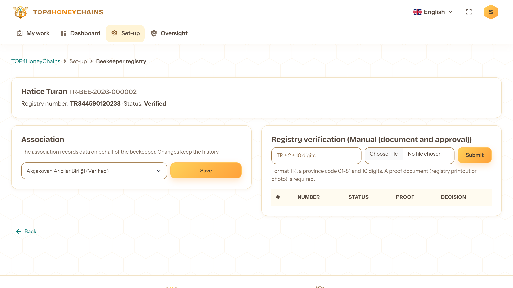

## Change a beekeeper's association {#sec-admin-association}

The registration officer chooses the beekeeper's association on the registration form. Change it here only when the beekeeper moves to another association or when the choice was wrong.

1. Select **Set-up > Beekeeper registry and associations**.
2. Select **Open** next to the beekeeper.
3. In **Association**, choose a verified organisation with the capability of an association, or **(none)**.
4. Select **Save**.

The page shows "Association saved.". The earlier association stays in the history. The association records data on behalf of the beekeeper, for example the primary audit when it is responsible for CCP 0.

## Request a correction of a control point value {#sec-admin-correction-request}

Request a correction when an approved, locked or finalized value is wrong and the organisation can no longer change it. Platform administrators do not edit business data; a value changes only when a second administrator approves the correction (see [The four-eyes principle](#four-eyes)).

1. Select **Oversight > Records** and find the lot or batch (tab **Batches** or **Raw honey lots**).
2. Select **Process flow**, then the code of the control point. From a **Control sheet**, use **Open this control point alone**.
3. In the box **Corrections**, choose the parameter.
4. Enter the new value: a **number**, or text in **or text**.
5. Enter the **Reason**.
6. Select **Request**.

The page shows "Correction requested; another platform administrator must approve it.". The request appears under **Oversight > Corrections** and in the **My work** of the other administrators under **Corrections to decide**. File values cannot be corrected this way. A finalized record is corrected without being unlocked.

## Decide a correction {#sec-admin-correction-decide}

Decide a correction that another administrator requested. You cannot decide your own request.

1. Select **Oversight > Corrections** (or the item under **Corrections to decide** in **My work**).
2. Read the **Record**, **Parameter**, **Old value**, **New value**, **Reason** and **Requested by**.
3. Select **Approve and apply**, or write a note in **note (required to reject)** and select **Reject**.

The page shows "Correction applied." or "Correction rejected.". Both the request and the decision are written to the audit log.

## Correct the facts of a delivery {#sec-admin-delivery-correction}

Correct the facts of a confirmed delivery only for a mistake in the record, for example a wrong seal number or weight. The beekeeper confirmed these facts with a code, so the original stays readable and the beekeeper is informed by SMS.

1. Select **Oversight > Records**, tab **Raw honey lots**, and select **Process flow** next to the lot.
2. Select **Recall report**, then **Delivery** next to the lot.
3. Under **Corrections of this delivery**, select **Request a correction**.
4. Change the fields that are wrong: **Delivery date**, and for each container its **Type**, **Net kg**, **Gross kg** and the seals (**On arrival**, **Jar seal**, **Counter-sample seal**, **New seal after sampling**).
5. Write the **Reason**.
6. Select **Send the request**.

The page shows "Correction requested; another platform administrator must confirm it.". You then read "You requested this correction; another platform administrator confirms it.". Containers are never added or removed by a correction.

To decide it, a second administrator:

1. Selects the item under **Corrections to decide** in **My work**.
2. Compares **Original** and **Corrected**.
3. Selects **Confirm and apply**, or writes a **Note (required to reject)** and selects **Reject**.

The page shows "Correction applied; the beekeeper was informed by SMS." or "Correction rejected.". If the delivery changed after the request, the correction is refused and must be requested again. The audit log records every changed row.

## Open the recall report {#sec-admin-recall}

Open the recall report when a batch or lot must be traced, for example after a laboratory finding or a consumer's report of a suspected fake.

1. Select **Oversight > Records** and find the batch or lot.
2. Select **Process flow**.
3. Select **Recall report**.

The report has three parts:

- **Upstream: lots, beekeepers and delivery forms**: the lots, apiaries, beekeepers and deliveries; for deliveries with containers, every container with its seal history, its sample jars, the **Lab values per container** and whether the **Confirmed content** is **unchanged since confirmation**.
- **Batches**: the batches that used the honey, with owner and amount.
- **Downstream: shipments**: the shipments and the **Current holders** with the amount each holds.

As a platform administrator you read every part. A member of an organisation reads only what the organisation may read, and the report counts the hidden rows. Prices are never in the report. Select **Print** to print it, or **CSV** to download it as a spreadsheet file.

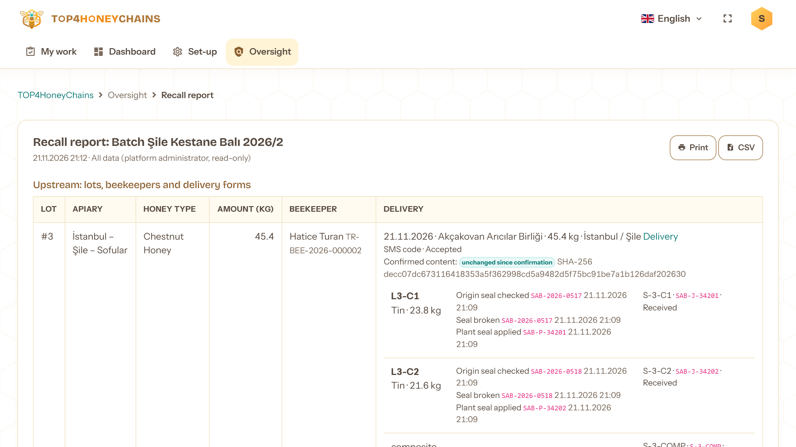

## Publish a new version of a notice or consent text {#sec-admin-notice}

Publish a new version when a privacy notice, a consent text, the terms of use or the officer's attestation changes, or when the data-protection office approves a draft. Texts are never changed after publishing.

1. Select **Oversight > Notices and consent texts**. The list shows each text with its **Kind**, **For**, **Organization**, **Version**, **Language**, the date **Published** and how many people **Accepted** it.
2. Select **New version** next to the text (the form starts with that text), or **Publish a new version** for a new one.
3. Fill in the fields in [Table](#tbl-admin-notice-fields).
4. Tick **Draft (not yet approved by the data-protection office)** while the text is not approved. Untick it for the approved text.
5. Select **Publish**.

Table: Fields of a notice {#tbl-admin-notice-fields}

| Field | What to enter | Required |
| --- | --- | --- |
| **Kind** | **Privacy notice**, **Consent text**, **Terms of use** or **Officer's attestation** | Yes |
| **For** | **Beekeepers**, **Users**, **Everyone** or **Consumers** | Yes |
| **Organization** | TOP4HoneyChains for the platform's own text, or the organisation whose text it is | Yes |
| **Consent purpose** | For a consent text: **Name on public pages** or **SMS notifications** | For a consent text |
| **Version** | A name for the version, at most 40 characters, for example 2026-12 | Yes |
| **Language** | The language of this text; publish one version per language | Yes |
| **Text** | The full text | Yes |

The page shows "Notice published; the previous version of this text is retired.". Publishing retires the current text of the same kind, audience, organisation, purpose and language. People who accepted an earlier version are asked to accept the new one. A draft shows the mark **DRAFT** wherever people read it. The public page `/privacy` shows the current notices.

> [!TIP]
> The same version name cannot be published twice in one language. Choose a new version name for every change.

## Check the data retention report {#sec-admin-retention}

Check the report before the first retention run is decided, and from time to time afterwards. It shows how long the platform keeps each kind of data and how many rows are past their period.

1. Select **Oversight > Data retention**.
2. Read the status: **Off: the first run is the owner's decision** or **Retention run switched on**, and the **Last run:**.
3. Read the rows in [Table](#tbl-retention): **Data**, **Kept**, **Then**, **Older than**, **Rows** and **The run** (**changes these rows** or **counts only (decision O-14)**).
4. Select **Dry-run report (CSV)** to download the counts for the owner.

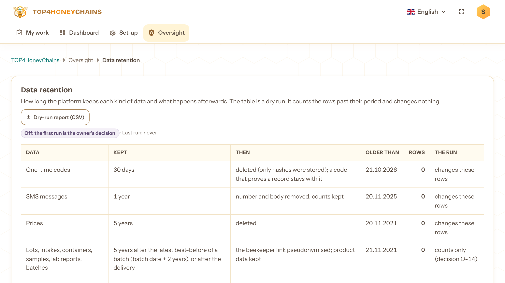

The report is a dry run: it counts and changes nothing. When the owner has approved the first run and the server's operator has switched it on, the page shows **Run retention now**:

1. Tick **The owner approved this run (it deletes and clears data and cannot be undone).**
2. Select **Run retention now**.

The page shows how many codes were deleted, SMS messages cleared and prices deleted, and the run is written to the audit log. A monthly run can be switched on only after a first run by hand.

> [!WARNING]
> A retention run cannot be undone. Run it only with the owner's written approval.

## Search the audit log {#sec-admin-audit}

Search the audit log to find out who changed what and when, for example before you decide a correction or when an organisation asks about an approval. The log can only be added to: nothing in it is changed or deleted.

1. Select **Oversight > Audit log**.
2. Narrow the list: choose the kind of record (or **all entities**), and enter an **Action**, a **user name** or a mark such as `SelfApproved`.
3. Select **Filter**.
4. Read the rows: **When**, **Who**, **Action**, **Record** and **Changes**. Select **Show raw** to read the **Old** and **New** values as stored.
5. Use **Older** and **Newer** to move between pages of 50 entries.

Marks you can search for include `SelfApproved` (an approval under the four-eyes exemption) and `ControlSheet` (an approval given on a control sheet).

## Check that the audit log is complete {#sec-admin-audit-verify}

Check the audit log before an inspection or an audit, or whenever you doubt that it is intact. Every entry holds the fingerprint (hash) of the entry before it, so a changed or removed entry breaks the chain.

1. Select **Oversight > Audit log**.
2. Select **Verify hash chain**.

The page shows "Hash chain: All … rows verify.". If an entry was changed or removed, it names the first broken row instead, for example "Hash chain: Row … was changed after it was written.". Report a broken chain at once to the platform's operator and the owner.

More on the audit log is in [Trust and privacy](#ch-trust).

## Settings in the server configuration {#sec-admin-settings}

Some behaviour is set in the server configuration, not in the panel. You cannot change it yourself; the server's operator changes it at the owner's request. [Table](#tbl-admin-settings) lists what an administrator should know. This manual describes the platform with the four features at the top switched on.

Table: Settings in the server configuration {#tbl-admin-settings}

| Setting (name) | What it decides | Default |
| --- | --- | --- |
| Organisation model (`Features:OrgRoleModel`) | Organisations, memberships, roles and the **Set-up** and **Oversight** menus | Off |
| Deliveries with containers (`Features:CustodyIntake`) | Deliveries in sealed containers with a sample jar from each container | Off |
| Beekeeper portal (`Features:BeekeeperAccounts`) | Beekeepers can receive sign-in details and use the portal | Off |
| Consumer accounts (`Features:ConsumerAccounts`) | Consumers can create an account, save honeys and send feedback | Off |
| Verifier of associations (`OrgModel:AssociationVerifier`) | Whether the platform administrator (`PlatformAdmin`) or the central association (`CentralAssociation`) verifies beekeepers' associations | Platform administrator |
| Notice confirmation required (`Notices:Enforce`) | Off: a banner asks users to confirm the notice. On: the panel stays closed until they confirm it. | Off |
| Roles that confirm by SMS code (`Notices:SmsConfirmRoles`) | Which roles confirm a notice with an SMS code instead of a click | Organization admin, Compliance Officer, Beekeeper registration officer, Quality Assurance Officer, Lab manager |
| Public names of older beekeepers (`PublicNames:LegacyMode`) | Whether the Honey Story shows a neutral code until a beekeeper registered before the registration procedure gives a name consent | Neutral code until consent |
| Laboratory analysis (`Lab:AnalysisMode`) | Whether the laboratory analyses a composite of the containers' jars or each jar | Composite |
| Retention run (`Retention:ApplyEnabled`, `Retention:Schedule`) | Whether **Run retention now** appears, and whether a monthly run follows the first one | Off, off |
| Compliance Officer grace period (`Compliance:GraceStart`, `Compliance:GraceDays`) | How many days organisations verified before the go-live have to name a Compliance Officer | 60 days |
| Password reset (`Account:PasswordResetChannel`) | Whether a forgotten password is reset by SMS code or by e-mail | SMS |
| SMS provider and daily limit (`Sms:Provider`, `Sms:DailyLimit`, `Sms:AllowedCountries`) | Which provider sends the SMS, how many message parts may go out per day and to which countries. After the limit only password resets and delivery confirmations are still sent. | Messages only logged, not sent |

The sign-in details of the SMS provider and other secrets are kept by the operator and never appear in the panel.

# Trust and privacy {#ch-trust}

This chapter explains how the platform protects its records against change and how it handles personal data. It is for everyone who works with the platform, and for anyone who wants to know why the public pages can be trusted.

## The audit log and its hash chain {#trust-audit}

Every change of a business record is written to the audit log in the same step as the change itself: every save, approval, finalizing, shipment and correction. The platform also writes entries for sign-ins, user and permission changes, verifications, downloads of evidence files and runs of the retention job. Consumer accounts are the exception: for feedback the log keeps only numbers, never the consumer's data (see [Consumer accounts and pseudonyms](#trust-consumers)).

Platform administrators read the log under **Oversight > Audit log**. A Compliance Officer reads the latest entries of the own organisation on the **Compliance** page (see [Read the organisation's audit entries](#co-audit)).

Table: What each row of the audit log shows {#tbl-audit-columns}

| Column | What it shows |
| --- | --- |
| **When** | Local time; point at it to read the time in UTC |
| **Who** | The user name and the organisation |
| **Action** | For example Create, Update, Approve, Finalize, Verify, Login, Download, with markers such as `SelfApproved` |
| **Record** | Which record changed, with a link where a page exists |
| **Changes** | Each changed field as old and new value, with the field name in your language |
| **Hash** | The first characters of the row's fingerprint |

**Show raw** opens the stored values exactly as they were written. To narrow the list, choose a record type, an action, a user name or a marker (**flag, e.g. SelfApproved**) and select **Filter**.

### The hash chain

The audit log can only be added to. The platform refuses every attempt to change or delete a row, even by an administrator. Each row holds a SHA-256 fingerprint calculated from its own content and from the fingerprint of the previous row. The rows therefore form a chain: changing one row breaks the fingerprint of every row after it.

**Verify hash chain** recalculates the whole chain from the first row.

- "Hash chain: All … rows verify." means that no row has been changed or removed.
- Otherwise the message names the first row that does not fit: "Row … was changed after it was written." or "Row … does not point to the previous row."

The audit log is kept for 10 years and is never changed by the retention job (see [How long data is kept](#trust-retention)).

## Records that do not change {#trust-locked}

Some records are never edited. A change is written as a new record, so the history stays readable.

Table: Records that are locked or can only be added to {#tbl-locked}

| Record | Rule |
| --- | --- |
| Audit log, seal history of containers, sampling-quality reviews, registrations, asking prices, sign-in details issued, SMS messages, notices and their acceptances | Can only be added to. A new price, a new seal event or a new notice version is a new row. |
| Containers and the facts of a confirmed delivery (date, weights, seal numbers) | Locked once recorded. Only a correction by two platform administrators changes them; the old and the new content and their fingerprints are kept, and the beekeeper gets an information SMS. |
| An approved control point record | Keeps its approval only while its values stay the same. A changed record needs a new approval. |
| Lab results from an approved report | Become the CCP 1 values of the lot and cannot be edited. |
| A finalized batch and its lots | Locked. A value changes only through a correction that a second platform administrator approves; a correction never unlocks the batch. |

Platform administrators list the corrections under **Oversight > Corrections** (see [Oversee the records](#sec-oversee)). The person who requests a correction never approves it.

## Codes and file fingerprints {#trust-codes}

### SMS codes

The beekeeper confirms a registration and a delivery with a 6-digit code received by SMS. Users in the signing roles (**Organization admin**, **Compliance Officer**, **Beekeeper registration officer**, **Quality Assurance Officer**, **Lab manager**) confirm the privacy notice the same way (see [Confirm the privacy notice](#sec-notice)). The same codes confirm a new mobile phone number and a password reset.

- A code is valid for 5 minutes and can be tried 3 times.
- The platform stores only a keyed fingerprint of the code, never the code itself. Codes in stored SMS texts are masked.
- Each code is bound to a fingerprint (content hash) of exactly the content it confirms: for a delivery, the organisation, date, containers, weights, honey type, samples and every seal number. Changing anything after the code was sent makes the code invalid.
- Where no SMS is possible, a signed photo replaces the code, and the organisation's Compliance Officer accepts or rejects it (see [Review a signed photo](#co-evidence)).

### Files and their fingerprints

Delivery forms, registration photos, lab report PDFs, organisation documents, registry proofs and consent documents are stored outside the public part of the web server, under a random name and with their SHA-256 fingerprint. Uploads are checked by their content, not only by the file name: PDF up to 10 MB, or JPG, PNG or WEBP up to 8 MB.

Evidence files are downloaded only by the role that records them, the organisation's **Compliance Officer** and **Organization admin**, and platform administrators. Another role of the same organisation is refused; another organisation does not even learn that the file exists. Every download is written to the audit log with the file name.

### Verify a lab report by its code

When a **Lab manager** approves a report, the platform first checks that the stored PDF still matches its fingerprint. Anyone can then check the report on the public page **Verify a lab report**: enter the **Report code** printed on the label or the report, and select **Check**. Only approved reports are found. The page shows the laboratory and its accreditation, the report number, the date and the SHA-256 fingerprint, never the lot or the beekeeper. Under **Compare a PDF with this fingerprint (the file stays on your device)** you can choose a PDF: the browser calculates its fingerprint and says **The file matches the approved report.** or **The file does NOT match this report.** The file is never uploaded (see [Verify a lab report](#sec-verify-report)).

## Notices, consents and the data controller {#trust-notices}

### Privacy notices

The platform publishes privacy notices for users, for beekeepers and for consumers. A notice says how personal data is processed, for which purpose, how long it is kept and who the data controller is.

- Users confirm the notice of the platform and the notice of each organisation they work for (see [Confirm the privacy notice](#sec-notice)). A yellow bar reminds them until they do. At present the reminder does not block the work; the platform can be set to require the confirmation first.
- Beekeepers read their notice at registration and confirm it with their SMS code or on the signed form.
- Consumers accept the consumer notice when they create an account.

Notices are versioned and never changed after publishing. A new version asks everyone again, and the earlier acceptances stay as proof. A text that the data-protection office has not yet approved carries the mark **DRAFT**. Platform administrators publish new versions under **Oversight > Notices and consent texts** (see [Notices, translations and reference data](#sec-notices)). The public page **Privacy and consent** shows the current notices to everyone, without signing in.

### The data controller

Each organisation is the data controller for the data it records. Its legal name, contact and address are named in its notice. The organisation's Compliance Officer or a platform administrator keeps them on the organisation page (see [Keep the data controller details](#co-controller)). A beekeeper reads in the portal which organisations hold their data, under **Who holds your data**.

### Consents

Everything beyond what the work needs is optional and asked separately.

Table: The beekeeper's optional consents {#tbl-consents}

| Consent (as the portal names it) | What it allows | Without it |
| --- | --- | --- |
| **My name on public pages** | The Honey Story shows the beekeeper's name. | A neutral code is shown. |
| **Messages about my deliveries and results** | Information SMS besides the confirmation codes. | Only the codes are sent. |
| **My association may see my prices** | The beekeeper's association reads the asking prices. | The association reads no prices. |
| **My public beekeeper page** | The association publishes a public page for the beekeeper. | No page is published. |

A consent is given at registration (confirmed with the SMS code or the signed form), in the portal, or, for the beekeeper page, by the association with a signed document (see [Publish a beekeeper page (association)](#sec-beekeeper-page)). A withdrawal takes effect at once: in the portal, by the association for the beekeeper page, or by the Compliance Officer when it arrives by letter or phone (see [Record a consent withdrawal received on paper or by phone](#co-withdrawal)).

### Requests about personal data

Requests for access, correction, deletion or objection go to the organisation's Compliance Officer, who records them and answers within 30 days (see [Handle a data-subject request](#co-requests)).

## What the public can read {#trust-public}

Three kinds of public pages exist: the Honey Story of a batch (see [The Honey Story page](#ch-story)), the beekeeper page published by an association, and **Verify a lab report**. They show only approved and verified information.

Table: What the public pages show and what they never show {#tbl-public}

| Topic | What the public reads | What is never shown |
| --- | --- | --- |
| Place | The province of each source, calculated on the server from the apiary's position; the beekeeper page also names the district. The map colours provinces, never points. | Apiary coordinates, exact locations |
| People | The beekeeper's name only with an active name consent, otherwise a neutral code. Apiary titles and photo descriptions typed by hand only where the name may be shown, otherwise "Apiary in …" with the province. | Phone numbers, birth dates, photos of people, user names of the platform, contact data (contact goes through the association) |
| Data | Lab and control point values; a within or outside the limit verdict only for verified limits. Free-text answers and files only where an administrator allowed it for a control point whose answers hold no personal data. | Unapproved values, documents |
| Reports | Approved reports only: code, laboratory, accreditation, date, fingerprint | The lot and the beekeeper of a report |
| Prices | Nothing | Asking prices, at any time |
| Photos | Only photos of the apiaries that supplied the batch, without their stored metadata | GPS position, camera data |

A Honey Story exists only for a finalized batch. A beekeeper page exists only while the beekeeper is active, the registry number and the association are verified, and the consent of that association is active.

Beekeepers registered before the consent procedure are shown by their code until they give the name consent. The platform can instead be set to keep their name until they are registered again.

## How long data is kept {#trust-retention}

Every kind of data has a retention period. Platform administrators read the periods under **Oversight > Data retention** (see [Platform administration](#ch-admin)).

Table: Retention periods and what happens afterwards {#tbl-retention}

| Data | Kept | Then | The run today |
| --- | --- | --- | --- |
| One-time codes | 30 days | Deleted (only fingerprints were stored); a code that proves a record stays with it | Changes these rows |
| SMS messages | 1 year | Number and text removed, counts kept | Changes these rows |
| Asking prices | 5 years | Deleted | Changes these rows |
| Lots, deliveries, containers, samples, lab reports, batches | 5 years after the latest best-before date of a batch with the lot (batch date + 2 years), or after the delivery | The link to the beekeeper made pseudonymous; product data kept | Counts only |
| Beekeeper identity (inactive beekeepers) | While active, then the period of their lots | Made pseudonymous | Counts only |
| Evidence photos (signed delivery forms) | As long as the record they prove | Deleted, the fingerprint kept | Counts only |
| Consents and notice acceptances | As long as the related data, plus 3 years as proof | Deleted | Counts only |
| User accounts of former members | 2 years after the last membership ends | Anonymised; audit entries keep the user's number only | Counts only |
| Consumer accounts and their saved honeys | 2 years after the last sign-in | Deleted as if by the consumer: account anonymised, feedback kept under the pseudonym | Counts only |
| Closed consumer feedback | 3 years after it was closed | Deleted | Counts only |
| Audit log | 10 years | Not changed (can only be added to) | Counts only |

Batches carry no best-before date, so the batch date plus 2 years stands in for it; the producer confirms the real shelf life.

The page **Data retention** is a dry run: it counts the rows past their period and changes nothing. **Dry-run report (CSV)** downloads the counts. The retention run is switched off: the page shows **Off: the first run is the owner's decision**. When the owner switches it on, a platform administrator starts the run with **Run retention now** after confirming that the owner approved it. A monthly run can follow only after a first run by hand. The run then changes only the first three kinds of data in [Table](#tbl-retention). The other rules are counted only, until the owner decides how pseudonyms are formed. Each run is written to the audit log.

## Consumer accounts and pseudonyms {#trust-consumers}

A consumer can create a free account to save honeys, send feedback to the producer and read the answers (see [Consumer account](#ch-consumer)). The Honey Story stays the same for everyone: no sign-in is needed to read it, and the page does not change for a signed-in consumer.

The account is built for data minimisation:

- **No name, no e-mail.** A user name, a password and the confirmation of being 18 or older are enough. A mobile phone is optional; it is checked with an SMS code and allows a password reset.
- **A pseudonym.** Each account gets a code such as `C-7F3K2Q`, shown under **Your code**. Producers read only this code, never the user name or the phone.
- **Feedback is private.** It goes only to the organisation that owns the batch, never to a public page. The audit log keeps only numbers for it.
- **Saving is explicit.** The platform keeps only the honeys the consumer saves; it does not record which stories were opened.
- **My data.** **Download my data** gives the account, the saved honeys and the feedback with the answers as a JSON file.
- **Deletion.** **Delete my account** deletes the account and the saved honeys and removes the user name and phone. Feedback stays with the producer under the code only.

Consumers have no role and no membership: a consumer account can never be added to an organisation, and it reaches only its own pages and the public pages.

# Problems and questions {#ch-problems}

### My account is locked

After 5 wrong passwords the account is locked for 15 minutes. Wait and try again, or ask your platform administrator.

### The temporary password does not work

It is valid for 72 hours. The page says **The temporary password has expired. Ask for new sign-in details.** Ask the person who sent your sign-in details to send new ones.

### I signed in but see This account has no access to the panel yet

Your account is not a member of an organisation yet. Ask a platform administrator to add you.

### The code from the SMS is refused

A code is valid for 5 minutes and only for the details it was sent for. If you changed a field after sending the code, the page says **The details changed after the code was sent. Send a new code.** Between two codes you wait one minute (**Wait a minute before sending a new code.**). After too many wrong codes you wait 15 minutes.

### A menu item or a task is missing

The menu depends on your role, on the capabilities of your organisation and on its verification. Switch to the right role with the role chip at the top. If your organisation is not verified yet, nothing waits in My work.

### A value is outside its limit

You can save it. When approving, the page asks the Quality Assurance Officer to confirm the values outside their limits; they stay flagged on the record.

### My lot does not appear in New batch

A lot is listed only when all its control points are completed and approved and it still has honey left.

### The delivery is refused because of the seals

Every seal number of the delivery must be different.

### I need to change a finalized batch

A finalized batch is locked. A wrong value is corrected only through a correction requested and approved by two platform administrators.

### A file is refused

Documents of an organisation can be PDF files up to 10 MB or JPG, PNG or WEBP pictures up to 8 MB.

### I forgot my password and have no verified phone

Ask the person who gave you your sign-in details to send new ones. Consumers without a phone cannot recover their account.

### I cannot sign in: the page says Invalid user name or password

Enter your user name in **Username**, not your e-mail address, and check the password. After 5 wrong passwords the account is locked for 15 minutes. A platform administrator can unlock it earlier. If you forgot the password, select **Forgot your password?**.

### I see You can't open this page

Your role or your organisation may not open this page or this record. For a control point of another organisation this is expected, unless your organisation holds that batch: then you read it, but cannot change it. Switch to the right role with the role chip at the top, or ask your organization admin.

### I see This page isn't here

The address is wrong or the record does not exist. A Honey Story exists only once the batch is finalized.

### The page says Read only

Read the reason after **Read only**. Typical reasons: your organisation is not verified yet, another organisation or role is responsible for this control point, you no longer hold any of this batch, or the batch is finalized and locked.

### My organisation is not verified

The **Organization admin** or the **Compliance Officer** uploads a document (licence, accreditation, registry proof) on the organisation page. A platform administrator then verifies the organisation. The first verification also needs an active member in the role **Compliance Officer**. Until then, nobody in the organisation can enter data.

### The laboratory cannot enter results: CCP 0 is not completed

The page says **CCP 0 (primary audit) of this lot is not completed yet; lab results are entered and approved only after it.** The sample acceptance officer of the plant enters CCP 0, and a Quality Assurance Officer of the plant approves it.

### I cannot approve: the page names four-eyes

You entered values of this record, or you marked it **Not applicable**, so another person must approve it. Lab results: the person who entered them never approves them. If your organisation has only one quality person, ask a platform administrator about the **Four-eyes exemption** ([The four-eyes principle](#four-eyes)).

### Request finalizing is greyed out

Read the list under **Missing before finalizing:**. It names every control point of the batch and of its lots that is not yet approved, including CCP 10 at the plant. It also names a delivery whose signed photo waits for the Compliance Officer or was rejected. A delivery confirmed by a signed photo can be finalized only after the Compliance Officer of the plant accepts the photo.

### I changed a value and the approval disappeared

That is intended. A changed record needs a new approval by a second person.

### An approved value is wrong

As long as the batch is not finalized, the person who entered the value changes it, and a Quality Assurance Officer approves it again. Lab results cannot be changed this way: they come from the approved report. After finalizing, or for lab results, ask a platform administrator: one administrator requests the correction with a reason, a second one decides it.

### The beekeeper page is not public

All of these must be true: the beekeeper is active, the registry number is verified, the beekeeper's association is verified, and the association has recorded the beekeeper's consent to a public page. A withdrawn consent takes the page off at once.

### I work for two organisations

Switch with the role chip in the top bar. It shows the organisation and the role you work in now. Your choice is kept until you close the browser.

### The beekeeper did not get the SMS code

Check the phone number, wait a minute and select **Send a new code**. If no SMS is possible, use the signed form ([Register a beekeeper without a mobile phone](#sec-register-no-phone)). The record then waits for the Compliance Officer.

### The delivery says No active beekeeper with this number.

The beekeeper is not registered yet, or was registered with a signed form whose photo the Compliance Officer has not accepted yet. Ask the beekeeper registration officer.

### The laboratory rejected a jar

Take a new jar from the same container. On the delivery page select **Open, sample and seal again**. The container is opened, sampled and sealed again, and both seals stay in its seal history.

### Verify a lab report says No report with this code.

Check the 12-character report code. Only approved reports can be verified. Ask the laboratory whether the report is approved.

### The Honey Story shows a code instead of the beekeeper's name

The beekeeper has not given the consent to show the name on public pages. The beekeeper can give it in the beekeeper portal, under consents, at any time.

### The animations disturb me

Turn off **Show animations** in the avatar menu at the top right. In the beekeeper portal and in the consumer account, the switch is on the account page.

# Glossary {-}

Table: Terms used in this manual {#tbl-glossary}

| Term | Meaning |
| --- | --- |
| Accredited laboratory | A laboratory whose accreditation number and validity date are recorded on the platform. The Honey Story then shows **Tested by an accredited lab**. |
| Asking price | The price per kg that a beekeeper asks for a delivered lot. It is read by the lot owner's Organization admin and Compliance Officer, the platform administrators and, with the beekeeper's consent, the beekeeper's association. It is never public. |
| Audit log | The record of every change, sign-in and approval. It can only be added to; each entry is chained to the one before it, so a change would show. |
| Batch | Honey from one or more lots, processed and packed together. It is finalized and gets a Honey Story and a QR code. |
| Beekeeper (record) | Each beekeeper is represented on the platform by a Beekeeper record. A beekeeper can also have a beekeeper portal account, which holds no membership. |
| Beekeeper page | The public page of a beekeeper, published by the association with the beekeeper's consent. |
| Beekeeper portal | The beekeeper's own area (**My beekeeper area**): apiaries, deliveries, lab results, batches, Honey Story pages, asking prices and consents. |
| Beekeeper registration | The registration of a beekeeper and their apiaries by a Beekeeper registration officer, confirmed by the beekeeper's SMS code or by a signed form. |
| Business number | The beekeeper's number on the platform, for example TR-BEE-2026-000002. It is also the beekeeper's user name. |
| Capability | The kind of work an organisation may do in the chain, for example processing, laboratory or retail. |
| CCP | Critical control point: a check of the honey's quality at one stage, CCP 0 to CCP 10. |
| Composite sample | One sample mixed from the sample jars of a lot, analysed by the laboratory. |
| Consent | The beekeeper's or consumer's agreement to an optional use of their data, for example their name on public pages. It can be withdrawn at any time. |
| Container | A tin, drum or barrel of a delivery. Each container is recorded with its net weight and seals and gives its own sample jar. |
| Content fingerprint | A code calculated from a confirmed registration or delivery. It shows whether the record is unchanged since the confirmation. |
| Control sheet | All control points of a lot or a batch on one page. |
| Counter-sample | A second sealed jar of each container, kept at the plant for a later check. |
| Critical limit | The minimum, the maximum or both allowed for a parameter. |
| Custody | Who holds the goods. Custody moves when the receiver confirms a shipment. |
| Data | What people record on the platform: measured values and answers to questions. |
| Data controller | The organisation responsible for the personal data it records, named in its privacy notice. |
| Data rights | What a role may do with a kind of record on the platform: create, read, update, delete and approve ([Table](#tbl-crud)). |
| Data-subject request | A request of a person about their personal data (access, correction, deletion, objection, consent withdrawal). It is answered within 30 days. |
| Delivery correction | A change of the facts of a confirmed delivery. One platform administrator requests it, a second one decides it, and the beekeeper is informed by SMS. |
| Finalize | Lock a batch once all its control points are approved. A finalized batch cannot be changed. |
| Food-analysis laboratory | The laboratory that analyses the honey samples, accredited or in-house. Its Analyst enters the results and its Lab manager approves them. |
| Four-eyes exemption | A setting for a very small organisation that lets its members approve their own control-point records. Each such approval is marked in the audit log. Never for lab results. |
| Four-eyes principle | Every record is entered by one person and approved or confirmed by a second, different person ([The four-eyes principle](#four-eyes)). |
| Ground rules | The rules that no role setting can switch off, shown on **Roles and permissions**. |
| HACCP | Hazard Analysis and Critical Control Points: the food-safety method that the control points come from. |
| Holder | An organisation that holds a quantity of a batch after a confirmed shipment. |
| Honey Story | The public page of a finalized batch, opened with the QR code on the jar. |
| In-house laboratory | A laboratory that belongs to the organisation that owns the lot. |
| Lab report | The laboratory's signed report (PDF and values) with its public 12-character report code. |
| Lot | The raw honey of one delivery. |
| Membership | One user account in one organisation in one role. One person can have several memberships, also several in the same organisation. |
| My work | Your start page and list of tasks. |
| Neutral code | The code shown on public pages instead of a beekeeper's name when there is no consent to show the name. |
| Not applicable | The mark of a control point that does not apply to this honey, with a reason. It still needs approval. |
| Organisation | A directorate, association, plant, laboratory, wholesaler, retailer or the platform itself, taking part through its capabilities. |
| Parameter | One item of data recorded at a control point, for example moisture or temperature. |
| Privacy notice | The text that says how personal data is processed and who the data controller is. It has versions; a published version is never changed. |
| Read | The right to open and read records without changing them. |
| Recall report | The list of everything upstream (lots, deliveries, reports) and downstream (shipments, holders) of a batch or a lot. |
| Registry number (AKS) | The beekeeper's number in the national registry. |
| Retention | How long each kind of data is kept. The deletion run is off until the platform owner approves it. |
| Role | What a person does for an organisation, for example Analyst or Quality Assurance Officer. |
| Seal | A numbered seal on a container or a jar. Each seal number is used once. |
| Seal event | One step in the seal history of a container or a jar: checked on arrival, plant seal applied, opened for sampling, sealed again. Seal events can only be added. |
| Signed photo | The photo of a form signed by the beekeeper, used when no SMS code is possible. The Compliance Officer accepts or rejects it. |
| SMS code | A 6-digit code sent by SMS that confirms exactly the content it was sent for. It is valid for 5 minutes. |
| Tamper-evident cap | The cap of a sample jar with a button that pops up when the jar is opened. It must be down when the jar is sealed and when it is received. |
| Verified limit | A limit confirmed by the project. Only verified limits give a within or out-of-limit verdict on the Honey Story. |
| Within limit / Out of limit | The comparison of a value with its critical limit. Out-of-limit values can be saved; the Quality Assurance Officer confirms them when approving and they stay marked. |
| Worst value | When jars are analysed one by one, the lot's value of each parameter: the container value furthest outside, or closest to, its limit. |
