# About this manual {-}

This manual is for everyone who works with the TOP4HoneyChains platform: the staff of directorates and beekeepers' associations, plants that process and pack honey, laboratories and shops, the platform administrators, beekeepers who use their own portal, and consumers who read the story of a jar.

The chapters follow the journey of the honey. Chapter 1 explains the platform in a few pages and chapter 2 shows the first steps that everybody takes. Chapters 3 to 9 describe the work of each role in the order in which the honey passes through their hands: registration, delivery, laboratory, processing and packing, approval, the shop, and supervision. Chapters 10 to 12 are for beekeepers and consumers, chapter 13 for the platform administrators. Chapter 14 answers common problems, and a glossary closes the manual.

Read chapter 2 first, then the chapter of your role.

### Conventions

- Names of buttons, menus and fields are written in **bold**, exactly as they appear on the screen.
- A path through a menu is written as **Menu > Item**.
- Steps are numbered. When a picture has a numbered mark, the number is the number of the step that uses that control.
- Text that you type is written like this: `TR-BEE-2026-000002`.

The people, organisations, beekeepers and values in the pictures are sample data: every name of a person or an organisation is invented. Only the villages and districts of the apiaries are real places.

# The platform at a glance

TOP4HoneyChains keeps one shared record of every step that a jar of honey takes, from the apiary to the shelf. Each step is recorded by the person who does the work and checked by a second person. At the end, a QR code on the jar opens the public **Honey Story** of the batch, so that anyone can see where the honey comes from and what the laboratory found.

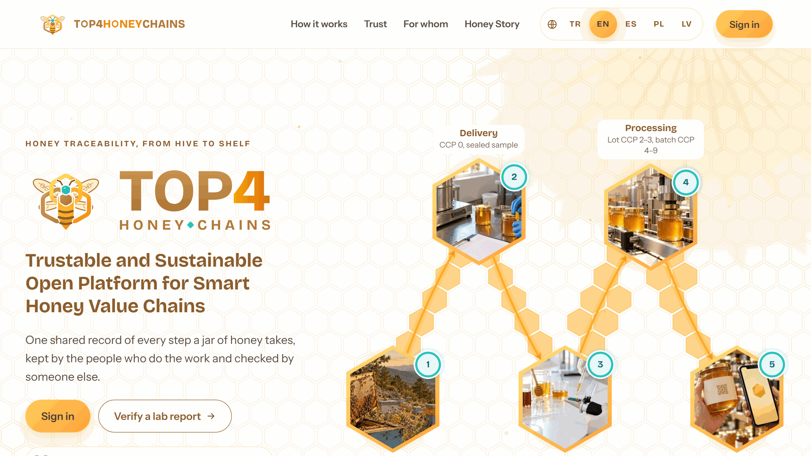

## The journey of the honey

The honey passes through five steps. Each step adds its part to the same record, and the next step starts only when the step before it is approved.

| Step | What happens | Who does it |
| --- | --- | --- |
| 1. Apiary | The beekeeper is registered with the national registry number, the mobile phone and the apiaries. | Beekeeper registration officer |
| 2. Delivery | The beekeeper delivers honey in sealed containers. Every container is recorded with its seals, a sample jar and a counter-sample jar are filled and sealed, and the beekeeper confirms with a code sent by SMS. | Sample acceptance officer |
| 3. Laboratory | The laboratory checks the seals of the sample jars, makes a composite sample, enters the results with the signed report, and a second person approves them. | Analyst, Lab manager |
| 4. Processing and packing | The plant records the control points of each lot, puts lots together into a batch, records the control points of the batch and finalizes it. | Staff, Quality Assurance Officer |
| 5. Shelf | The shop confirms what arrives and records the storage conditions. The QR code on the jar opens the Honey Story. | Shop staff, Quality Assurance Officer |

## Roles

People work on the platform for an organisation, in a role. An organisation takes part in the chain through its capabilities (for example processing, laboratory or retail). Your role decides which menu items and pages you see.

| Role | What the role does |
| --- | --- |
| Beekeeper registration officer | Registers beekeepers and their apiaries, sends them their sign-in details. |
| Sample acceptance officer | Records honey deliveries with their containers and seals, takes the samples, enters control point 0. |
| Analyst | Receives the sample jars in the laboratory, makes the composite sample, enters the lab results. |
| Lab manager | Approves or returns the lab reports. |
| Staff | Fills in the control sheets of lots and batches, creates batches, requests finalizing, ships honey; in a shop, confirms shipments and records the storage. |
| Field inspector | Sees the lots and batches of the organisation. |
| Quality Assurance Officer | Approves control points and control sheets, finalizes batches, approves storage records, answers consumer feedback. |
| Organization admin | Looks after the organisation's page and documents; in an association, publishes beekeeper pages. |
| Compliance Officer | Supervises sampling quality, signed photos, data-subject requests and approvals. |
| Platform administrator | Sets up organisations, members and responsibilities, and oversees the records. Does not enter business data. |
| Beekeeper | Uses the beekeeper portal: deliveries, prices, lab results, consents. |
| Consumer | Reads the Honey Story without an account; with a free account saves honeys and sends feedback. |

The default rights of each role are described here. The platform administrator can change them (chapter 13).

## Control points

The quality of the honey is checked at eleven critical control points (CCP). Control points 0 to 3 belong to a raw honey lot, control points 4 to 10 to a batch.

| Control point | Stage | Entered by | Approved by |
| --- | --- | --- | --- |
| CCP 0 Primary Audit | Pre-Production | Sample acceptance officer | Quality Assurance Officer |
| CCP 1 Sampling and Preliminary Acceptance Tests | Laboratory | written by the approved lab report | Analyst and Lab manager |
| CCP 2 Temperature Monitoring | Heating | Staff | Quality Assurance Officer |
| CCP 3 Filter Condition Control | Filtration | Staff | Quality Assurance Officer |
| CCP 4 Homogeneity Control | Homogenization & Mixing | Staff | Quality Assurance Officer |
| CCP 5 Time and Temperature Control | Pasteurization | Staff | Quality Assurance Officer |
| CCP 6 Foam and Sediment Removal | Settling (Clarification) | Staff | Quality Assurance Officer |
| CCP 7 Quantity Control | Filling | Staff | Quality Assurance Officer |
| CCP 8 Label Accuracy Verification | Labeling | Staff | Quality Assurance Officer |
| CCP 9 Packaging Integrity Check | Packaging | Staff | Quality Assurance Officer |
| CCP 10 Temperature and Humidity Monitoring | Storage | Staff of the holder (for example the shop) | Quality Assurance Officer of the holder |

> [!IMPORTANT]
> Nobody approves a record they entered themselves. Lab results are always approved by a second person. This four-eyes rule cannot be switched off.

## What the consumer sees

The consumer scans the QR code on the jar. The Honey Story shows the batch, the journey of the honey in five steps, the province of each apiary, the beekeepers who agreed to be named, the laboratory results and the control points. Exact apiary locations and phone numbers are never published. Chapter 11 describes the page.

# Getting started

This chapter is for everybody who signs in to the platform. At the end of it you can sign in, confirm the privacy notice, find your way on the screen and sign out.

## Open the platform and choose the language

Open https://top4honeychains.intalalab.net in your browser. The start page explains the platform and has the buttons **Sign in** and **Verify a lab report**.

1. Choose your language with the language codes **TR**, **EN**, **ES**, **PL** and **LV** at the top of the page. The platform remembers your choice in this browser.

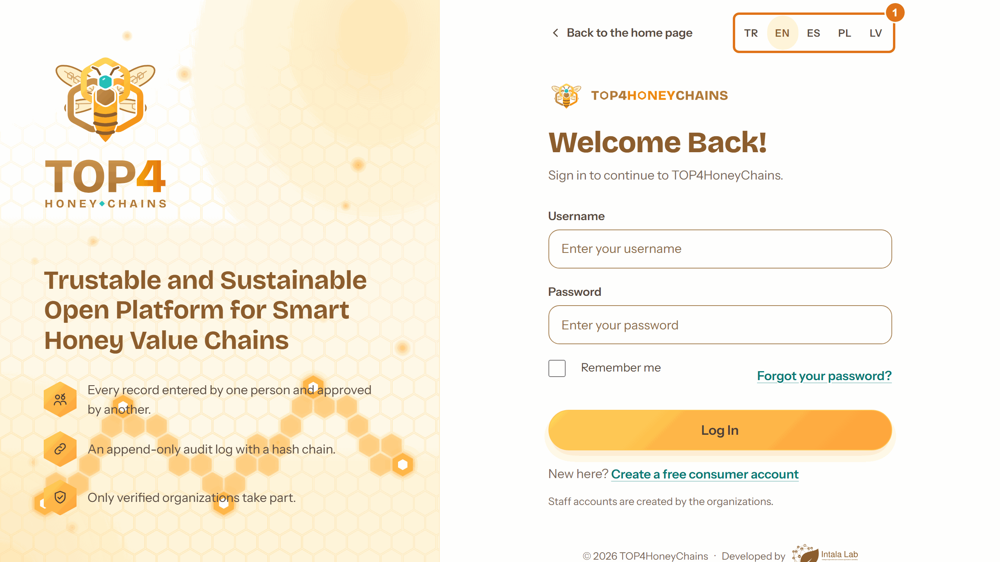

After you sign in, the language menu with a flag is in the top bar.

## Sign in

1. On the start page, select **Sign in**.
2. Enter your user name in **Username**.
3. Enter your password in **Password**.
4. Select **Log In**.

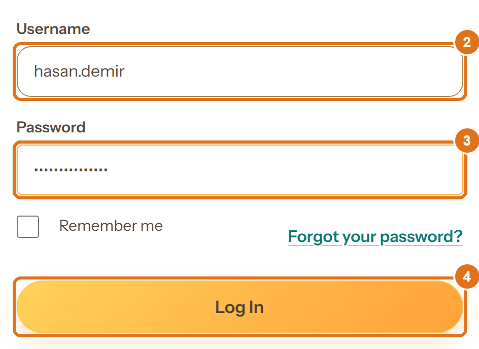

You see **My work**, your list of tasks. Beekeepers see their portal (chapter 10) and consumers see **My honeys** (chapter 12).

> [!NOTE]
> Staff accounts are created by the organisations and the platform administrators. Consumers create their own account with **Create a free consumer account** below the sign-in form.

## Sign in for the first time

Your sign-in details arrive by SMS: your user name and a temporary password of 10 characters, with the address of the platform. The temporary password is valid for 72 hours.

1. Sign in with the user name and the temporary password from the SMS.
2. The page **Choose your password** opens. Enter your new password in **New Password** and again in **Confirm password**. Use at least 10 characters, not your user name and not a common password.
3. Select **Update Password**.

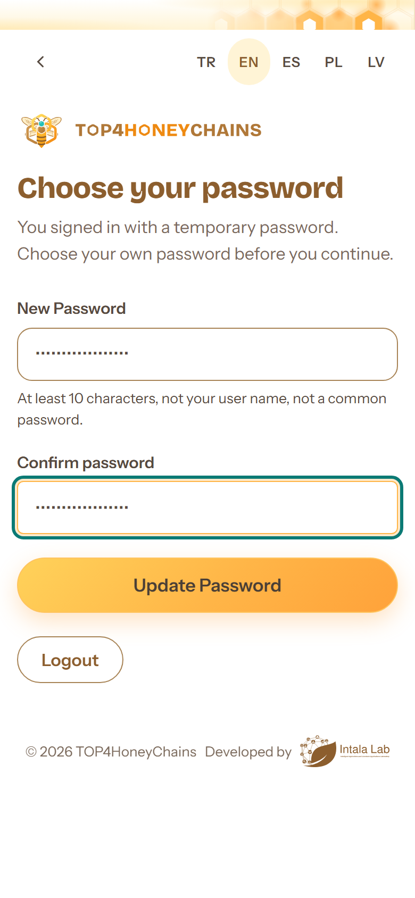

## Confirm the privacy notice

Before you work with personal data, you confirm that you have read the privacy notice. A yellow bar reminds you until you do.

1. Select **Read and confirm** in the yellow bar.

   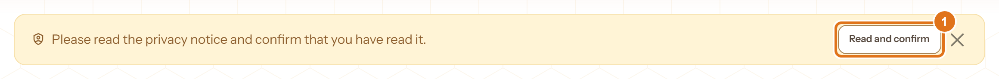

2. Read the notice and tick **I have read the notice above.**
3. Select **Confirm**.

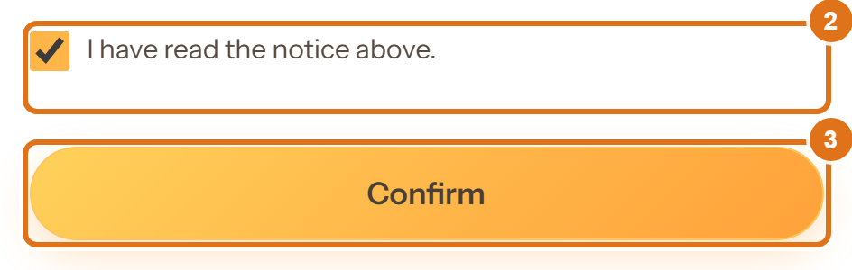

> [!NOTE]
> Roles that sign records (Organization admin, Compliance Officer, Beekeeper registration officer, Quality Assurance Officer, Lab manager) confirm the notice with a code. The page shows your **Mobile phone**: select **Send code**, then type the code from the SMS in **Code from the SMS (6 digits)** before you select **Confirm**.

## Find your way on the screen

**My work** is your start page and your list of tasks. Everything waiting for you appears there in groups, for example **Values to enter**, **Values to approve**, **Samples to receive** or **Lab results to enter**. Select an item to open the page where you do the work. When nothing is waiting, the page says **Nothing is waiting for you.** and shows the pages you can open.

The marks in the picture show:

1. The menu with the pages of your role. **My work** and **My organization** are always there; the other items depend on your role and your organisation.
2. Your organisation and role. If you have more than one role, select it to switch to another role.
3. The user menu, under the round button with your initial.

 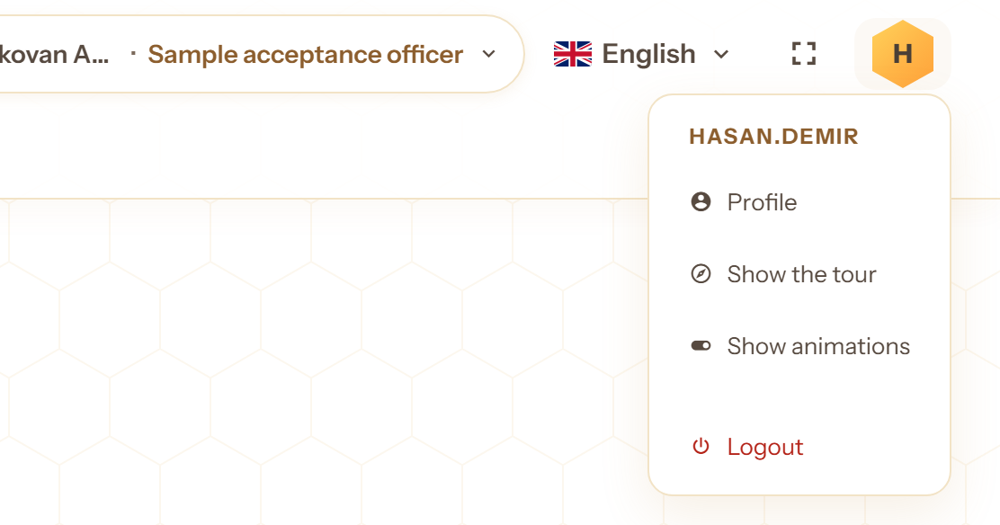

The user menu has these items:

Table: The parts of the screen {#tbl-screen}

| Item | What it does |
| --- | --- |
| **Profile** | Shows your user name and lets you verify your mobile phone and change your password. |
| **Show the tour** | Opens the short tour of the screen again. |
| **Show animations** | Switches the short scenes that show what a button does on or off. |
| **Logout** | Signs you out. |

## Take the tour

When you open the platform for the first time in a role, a short tour shows the most important parts of the screen. Select **Next** to go on or **Skip the tour** to close it. You can open it again with **Show the tour** in the user menu.

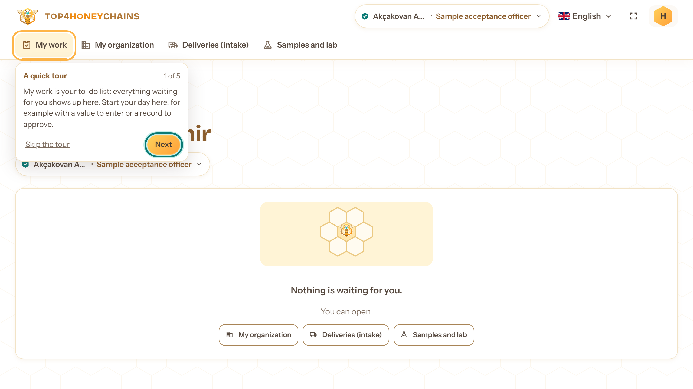

## Verify your mobile phone

With a verified mobile phone you can reset a forgotten password by SMS.

1. Open the user menu and select **Profile**.
2. Enter your number in **Phone Number** and select **Send code**.
3. Type the code in **Code from the SMS (6 digits)** and select **Confirm**. A new number is used only after you enter the code sent to it.

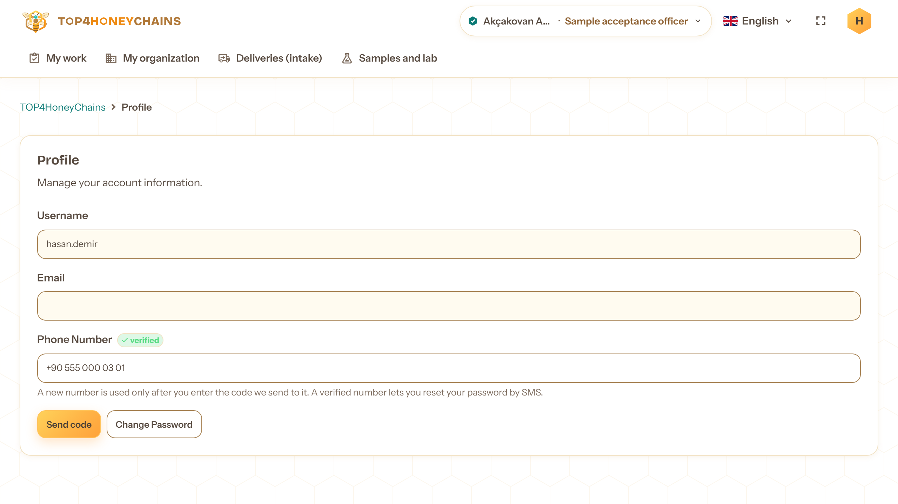

## Reset a forgotten password

1. On the sign-in page, select **Forgot your password?**.
2. Enter your user name in **User Name** and select **Send code**.

   

3. On the page **Create New Password**, type the code from the SMS in **Code from the SMS (6 digits)**. The code is valid for 5 minutes.
4. Enter your new password in **New Password** and **Confirm password** and save it.

> [!NOTE]
> The code is sent only to a verified mobile phone. Without one, ask the person who gave you your sign-in details to send new ones.

## Sign out

Open the user menu and select **Logout**. On a shared computer, always sign out when you leave.

# Beekeeper registration officer

The Beekeeper registration officer of a district directorate registers beekeepers on the platform. A registration confirms three things: the national registry number, the beekeeper's mobile phone (by a code sent to it) and your attestation that you have seen the identity document and the registry record.

Table: Tasks of the beekeeper registration officer {#tbl-tasks-ro}

| Task | Where |
| --- | --- |
| Find a beekeeper or start a registration | **Beekeeper registration** |
| Register a new beekeeper | **Beekeeper registration > Find or register** |
| Add another apiary | the registration form, or the registration page |
| Send the sign-in details | the registration page |

## Find a beekeeper or start a registration

The page **Beekeeper registration** lists the beekeepers your organisation registered.

1. Select **Beekeeper registration** in the menu.
2. Enter the registry number in **Registry number (AKS) or business number**.
3. Select **Find or register**.

A known beekeeper is re-verified: the form opens with the stored details. A new registry number starts a new registration.

## Register a new beekeeper

Do this with the beekeeper in front of you, with their identity document and mobile phone.

1. Find the registry number as described above. The form **Register a beekeeper** opens.
2. Fill in the sections 1 and 2.

   

3. In section **3. Apiary**, set the position of the apiary: click the map or drag the pin, select **Use my location**, or type **Location Latitude** and **Location Longitude**. Enter **Beehives Count**, then **Province**, **District** and **Locality (village, plateau, field)**. The title of the apiary is made from these three, for example `İstanbul – Şile – Sofular`.

   

4. Let the beekeeper read the notice in section 4, or read it aloud. Tick the consents the beekeeper gives: the name on public pages and SMS notifications. Both are optional.
5. In section **5. Your attestation**, tick the attestation. Tick **Also send the beekeeper the sign-in details by SMS** if the beekeeper should use the portal.

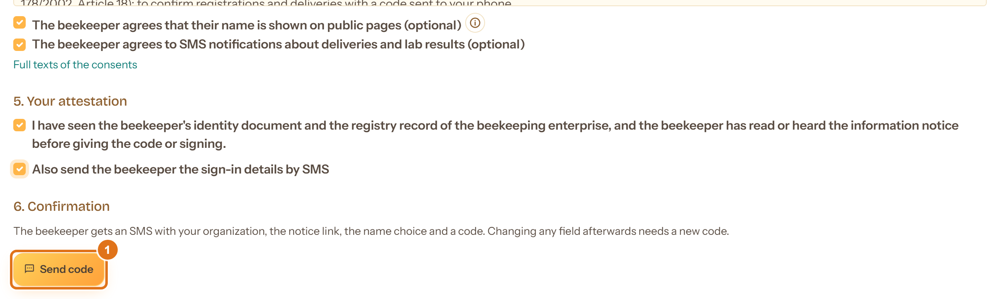

The fields of sections 1 and 2:

Table: The fields of the registration form {#tbl-reg-fields}

| Field | What to enter | Required |
| --- | --- | --- |
| **Registry number** | TR, the province's 2-digit plate code and 10 digits | yes |
| **If the number is registered in another province, write the reason** | only when the registry province differs from your directorate's | no |
| **First Name**, **Last Name**, **Birth Date** | as in the identity document | yes |
| **Mobile phone** | the beekeeper's own number; it receives the code and the sign-in details | yes, unless the beekeeper has no mobile phone |
| **Language of the SMS** | the language of the beekeeper's messages and portal | yes |
| **Education Level**, **Main purpose**, **Beekeeping Type** | the beekeeper's answers | no |
| **Beekeepers' association (optional)** | the association the beekeeper belongs to | no |

> [!NOTE]
> The exact position of the apiary is kept only in the records. Public pages show the province.

### Confirm with the code

1. Select **Send code**. The beekeeper receives an SMS with your organisation's name, a link to the notice, their name choice and a code.
2. Type the code the beekeeper reads out in **Code from the SMS (6 digits)**.
3. Select **Confirm the registration**.

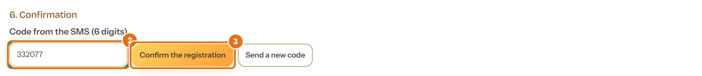

The registration page opens with the message **The beekeeper is registered and verified**. The beekeeper has a business number (for example `TR-BEE-2026-000002`); the evidence is **Accepted** and the registry number **Verified**.

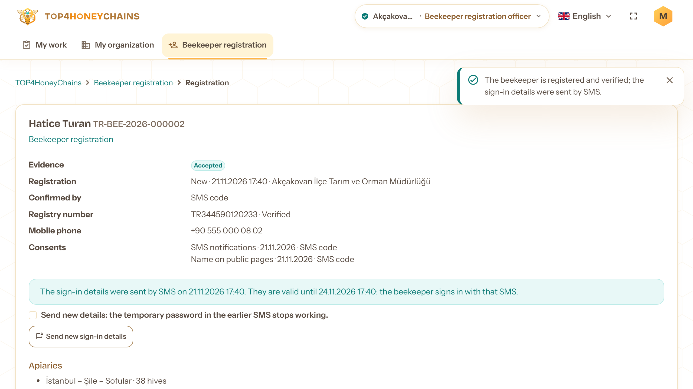

> [!IMPORTANT]
> Changing any field after you sent the code makes the code invalid. Send a new code with **Send a new code**.

## Add another apiary

A beekeeper can have several apiaries. On the form, add them before you send the code:

1. Select **Add apiary** below the first apiary. A new block **Apiary 2** appears.
2. Fill in its coordinates, hives and place. The map sets only the first apiary; type the coordinates of the others. Select **Remove** to delete a block you do not need.

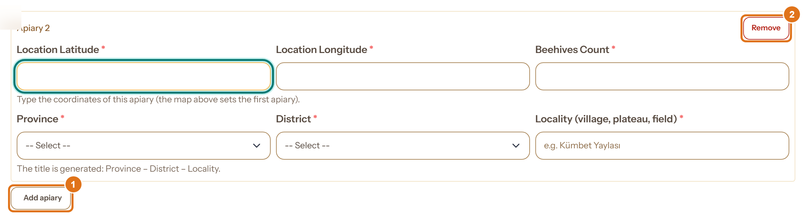

For a registered beekeeper, open the registration page and use **Add an apiary** below **Apiaries**.

## Send the beekeeper the sign-in details

If you ticked **Also send the beekeeper the sign-in details by SMS**, the details are sent with the registration. Otherwise, open the registration page and select **Send sign-in details by SMS**. The beekeeper's user name is the business number.

To send new details, tick **Send new details: the temporary password in the earlier SMS stops working.** and select **Send new sign-in details**.

## Register a beekeeper without a mobile phone

If the beekeeper has no mobile phone, tick **The beekeeper has no mobile phone (signed photo, no account)**. In section 6, open **No SMS possible: signed photo**, write the reason in **Why no SMS code**, use **Print the form**, let the beekeeper sign it, and upload its photo in **Photo of the signed form**. Select **Save with the signed photo**. The registration waits until the Compliance Officer of your organisation accepts or rejects the photo; you cannot decide on your own registration.

# Sample acceptance officer: honey delivery

The Sample acceptance officer of a plant records each honey delivery. Every container is recorded with its seals, a sample jar and a counter-sample jar are filled from it and sealed, and the beekeeper confirms the whole delivery with a code sent by SMS. Each delivery becomes a raw honey lot of your organisation.

Table: Tasks of the sample acceptance officer {#tbl-tasks-sao}

| Task | Where |
| --- | --- |
| See the deliveries | **Deliveries (intake)** |
| Record a honey delivery | **Deliveries (intake) > Record a delivery** |
| Print the labels | the delivery page |
| Enter CCP 0 | **My work > Values to enter** |

## See the deliveries

Select **Deliveries (intake)** in the menu. The list shows each lot with its date, apiary, honey type, amount, origin and how the beekeeper confirmed it. **Delivery** opens a delivery, **Recall** its recall report.

## Record a honey delivery

1. Select **Record a delivery**.
2. Enter the beekeeper's number in **Beekeeper business or registry number**.
3. Select **Find**.

   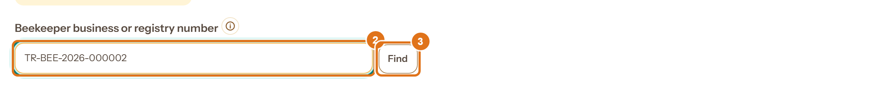

4. Fill in section **1. The delivery**. The apiary list shows every apiary of the beekeeper with its hives; with more than one apiary, choose the right one.

   

5. In section **2. Containers and samples**, fill in one row per container. Select **Add a container** for each further container and **Remove the row** for a row you do not need.

   

   

6. In section **3. Laboratory and counter-samples**, choose the **Laboratory**, write **Where the counter-samples are kept** and the date in **Keep until**.

The fields of section 1:

Table: The fields of a delivery {#tbl-delivery-fields}

| Field | What to enter | Required |
| --- | --- | --- |
| **Apiary** | where the honey comes from | yes |
| **Honey type**, **Production period** | as delivered | yes |
| **Country of origin** | the country of the honey | yes |
| **Delivery date** | the day of the delivery | yes |
| **Province**, **District** | the origin of the honey | yes |

The columns of section 2, one row per container:

Table: The columns of the table Containers and samples {#tbl-containers}

| Column | What to enter |
| --- | --- |
| **Type** | tin, bucket or drum |
| **Net kg**, **Gross kg** | the weights of the container |
| **On arrival** | **Arrived sealed**: the **Number of the seal it came with**, and tick **I checked: the seal is intact**. **Arrived unsealed**: the number of the **New seal, put on now in front of the beekeeper**. |
| **Jar seal** | the seal of the sample jar filled from this container |
| **Counter-sample seal** | the seal of the counter-sample jar |
| **Cap intact** | tick when the button of the jar's cap is down |
| **New seal after sampling** | the seal you put on the container after taking the samples |

> [!IMPORTANT]
> Every seal number of the delivery must be different.

### Confirm the delivery with the beekeeper's code

1. Select **Send code**. The beekeeper receives an SMS with the date, the containers, the kilograms, the honey type, the number of samples and a code.

   

2. Type the code in **Code from the SMS (6 digits)**. If the beekeeper is not present, call them: they read the code from their phone.
3. Select **Confirm the delivery**.

The delivery page opens with the message **Delivery confirmed by the beekeeper and recorded as lot #3.** The lot now appears in **My organization** and its control points in **My work**.

If no SMS is possible, open **No SMS possible: signed photo**, give the reason, take or upload the photo of the signed delivery form and select **Record with the signed photo**. The Compliance Officer reviews it.

## Print the labels

The delivery page shows each container with its seal history and its sample jars.

1. Select **Labels (A4 sheet)**, or **Labels (100 × 50 mm)** for a label printer.

   

2. Select **Print the form** and stick each label on its container, sample jar and counter-sample jar.

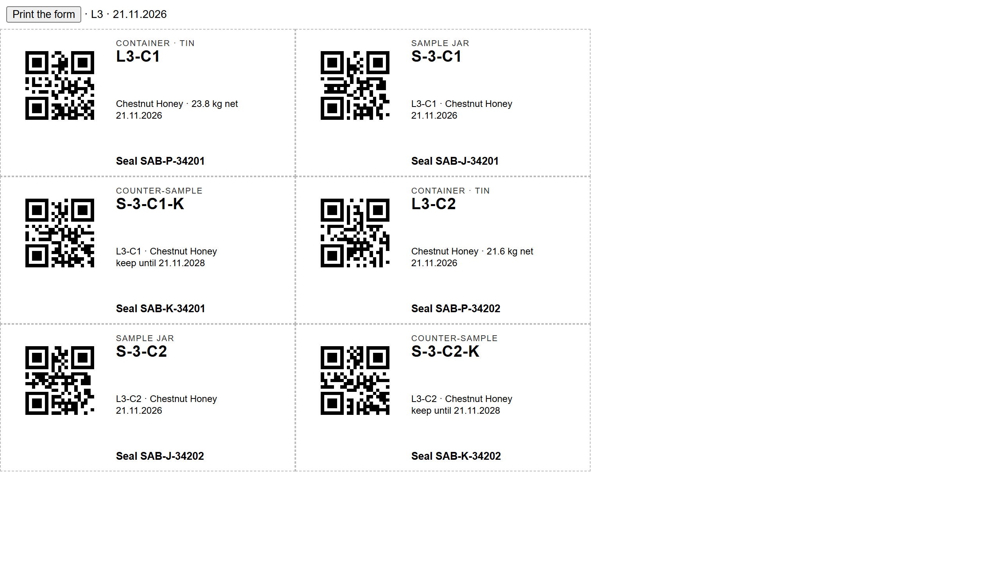

## Enter CCP 0 (primary audit)

CCP 0 records the primary audit of the delivery: hygiene, water, pest control and storage at the beekeeper's.

1. Open **My work** and select **CCP 0** under **Values to enter**.

   

2. Answer each question and add notes where useful.

   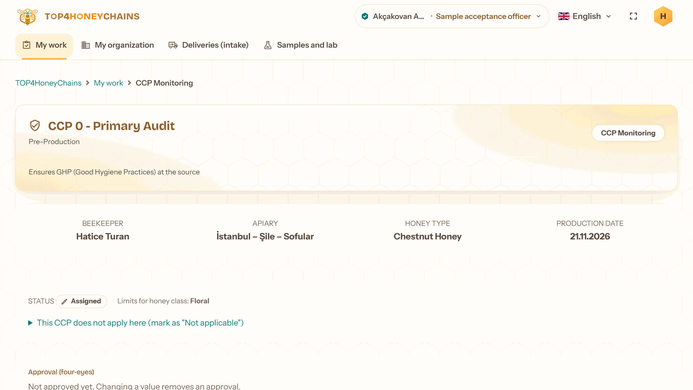

3. Select **Save Monitoring Logs**.

The Quality Assurance Officer approves it next (chapter 7). **CCP 1** also appears in your list: it is filled in by the laboratory's approved report, you do not enter it.

> [!TIP]
> If a control point does not apply, open **This CCP does not apply here (mark as "Not applicable")** and give the reason.

# Laboratory: analyst and lab manager

The laboratory checks the seal of each sample jar on arrival, makes a composite sample of each lot, enters the results with the signed report and lets the Lab manager approve them. The approved report becomes CCP 1 of the lot.

Table: Tasks in the laboratory {#tbl-tasks-lab}

| Task | Who | Where |
| --- | --- | --- |
| Receive the sample jars | Analyst | **Samples and lab** |
| Make the composite sample | Analyst | **Samples and lab** |
| Enter and submit the results | Analyst | the lab report |
| Approve or return a report | Lab manager | **My work** |

## Receive the sample jars

My work lists the jars waiting under **Samples to receive**.

1. Select **Samples and lab** in the menu. The jars are listed under **Samples sent to your laboratory**.
2. For each jar, answer **The seal number matches the record**, **The label is intact** and **The cap is intact (button down)**. If a check fails, write the reason in **Reason if a check fails**.
3. Select **Record the reception**.

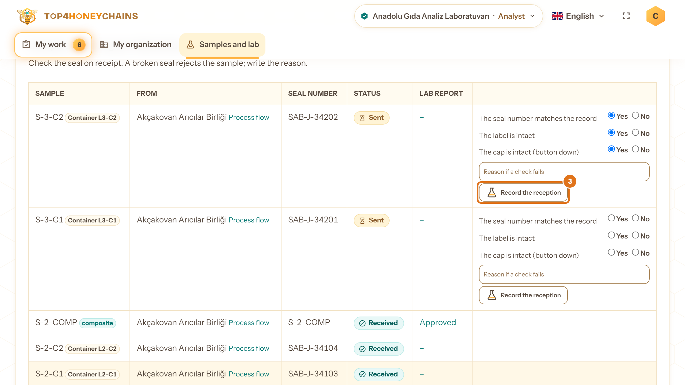

A broken seal rejects the sample; the plant then takes a new sample from the counter-sample.

## Make the composite sample

When all jars of a lot have arrived in good order, the lot is listed under **Lots ready for the composite sample**.

1. Select **Make the composite** for the lot. Mix equal parts of the jars into one composite sample; the jars stay retained for single analyses.

The lab report of the composite sample opens.

## Enter the results

1. Enter the **Report number** and the **Issue date**.
2. Select **Choose PDF** and attach the signed report.
3. Enter the value of every parameter. The **Limit** column shows the limit of each value.
4. Select **Save**.

The line **Required values entered** shows how many values are still missing.

## Submit the report

When every required value is saved, select **Submit for approval**.

1. Select **Submit for approval**.

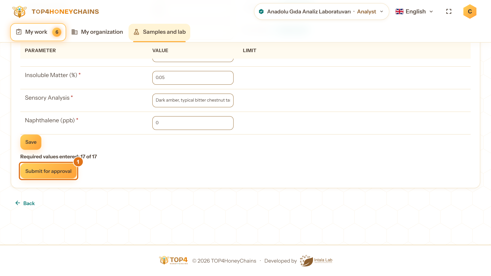

The Lab manager finds the report in **My work**.

## Approve or return a report

The Lab manager checks the report and its PDF.

1. Select **Approve**. To send it back, write the reason in **reason (to return)** and select **Return**.

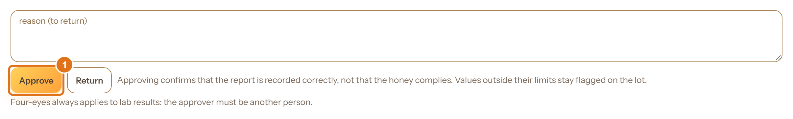

Approving confirms that the report is recorded correctly, not that the honey complies. Values outside their limits stay flagged on the lot. The approved results fill in CCP 1 of the lot, and the report gets a code that anyone can check.

## Verify a lab report

Anyone can check a report without signing in: open **Verify a lab report** on the start page, enter the **Report code** and select **Check**. The page shows the status, the laboratory, its accreditation, the report number, the issue date and the SHA-256 fingerprint of the report file.

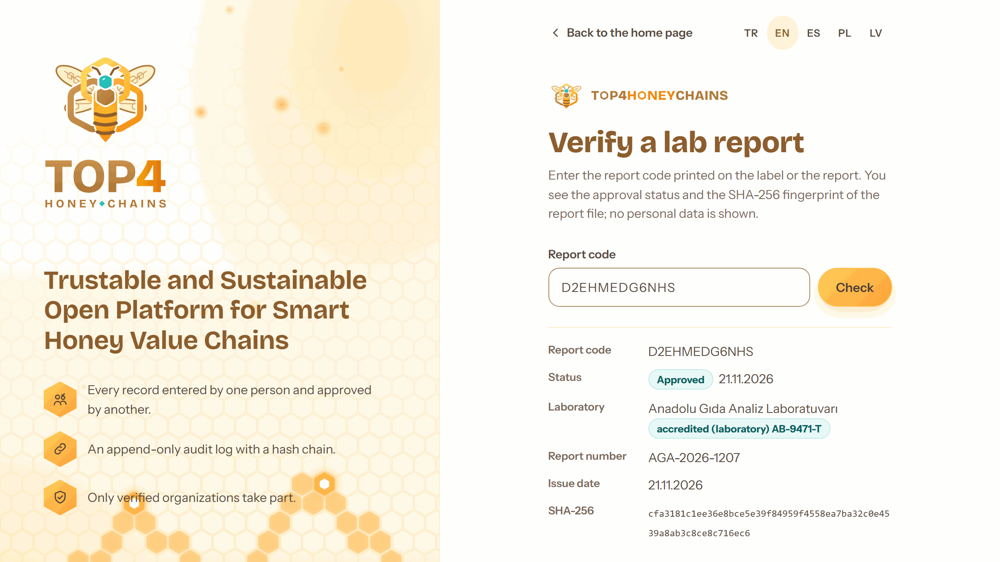

# Staff: processing and packing

Staff of a plant fill in the control sheets of the lots and the batches, put approved lots together into batches, request the finalizing of a batch and ship honey to other organisations.

Table: Tasks of the staff {#tbl-tasks-staff}

| Task | Where |
| --- | --- |
| See your lots and batches | **My organization** |
| Fill in the control sheet of a lot | **My organization > Control sheet** |
| Create a batch | **My organization > New batch** |
| Fill in the control sheet of a batch | **My work** or the batch page |
| Request finalizing | the batch page |
| Ship honey | **Shipments and stock** |

## See your lots and batches

**My organization** shows your organisation, the **Raw honey lots** it works on and its **Batches**. Each control point is a chip: green with ✓ is approved, yellow is submitted and waiting for approval, grey is open, outlined is not applicable.

## Fill in the control sheet of a lot (CCP 2 and 3)

The control sheet shows all control points of a lot on one page. Each one keeps its own record, status and approval.

1. Select **Control sheet** in the row of the lot, or the item in **My work**.
2. Enter the values of **CCP 2** (heating) and **CCP 3** (filtration).

   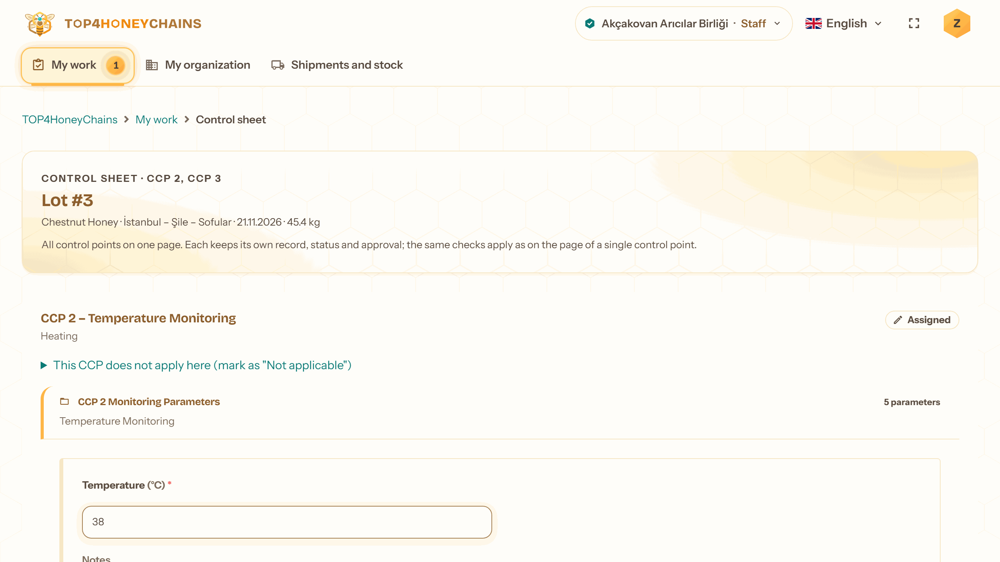

3. Select **Save the sheet**.

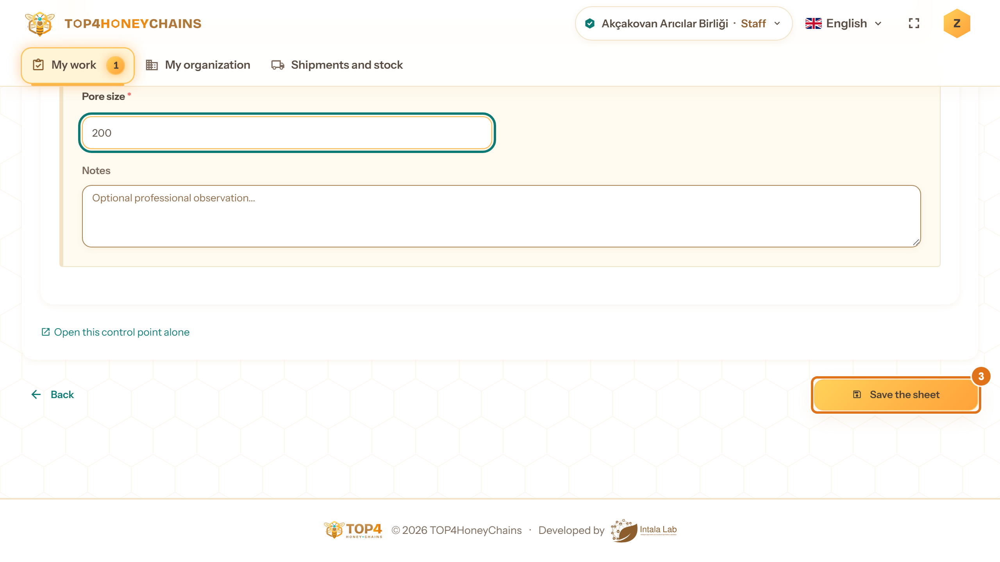

The Quality Assurance Officer approves the sheet (chapter 7).

> [!TIP]
> **Open this control point alone** opens one control point on its own page, for example to attach a file.

## Create a batch

A lot is ready for a batch when all its control points are completed and approved.

1. In **My organization**, select **New batch**.
2. Enter the **Batch name**, for example `Şile Kestane Balı 2026/2`, and check the **Production Date**.
3. Tick **Use** for each lot that goes into the batch and check the **Kilograms for this batch**.
4. Select **Create batch**.

The batch belongs to your organisation. Its control points CCP 4 to CCP 10 appear in My work at once.

## Fill in the control sheet of a batch (CCP 4 to 10)

Open the control sheet of the batch from **My work** or with **Open the control sheet** on the batch page. Enter the values of homogenization, pasteurization, settling, filling, labelling, packaging and storage, then select **Save the sheet**.

## Request finalizing

When every control point of the batch and its lots is approved, ask for the batch to be finalized.

1. On the batch page, select **Request finalizing**.

If something is missing, the page lists it under **Missing before finalizing:**. The Quality Assurance Officer confirms the request (chapter 7).

## Ship honey to another organisation

1. Select **Shipments and stock** in the menu and select **Ship** in the row of the batch.

   

2. Choose the receiving organisation in **To**.
3. Enter the **Amount (kg)** and, if useful, a **Note**.
4. Select **Ship**.

A shipment reserves its quantity at once; custody moves when the receiver confirms it.

# Quality Assurance Officer

The Quality Assurance Officer approves what others entered: CCP 0 of each delivery, the control sheets of lots and batches, the finalizing of batches and, in a shop, the storage records. The officer also answers consumer feedback. You never approve a record you entered yourself.

Table: Tasks of the Quality Assurance Officer {#tbl-tasks-qao}

| Task | Where |
| --- | --- |
| Approve CCP 0 | **My work > Values to approve** |
| Approve a control sheet | **My work > Values to approve** |
| Finalize a batch | **My work**, the batch page |
| Answer consumer feedback | **Consumer feedback** |

## Approve CCP 0

1. Open **My work** and select the item under **Values to approve**.

   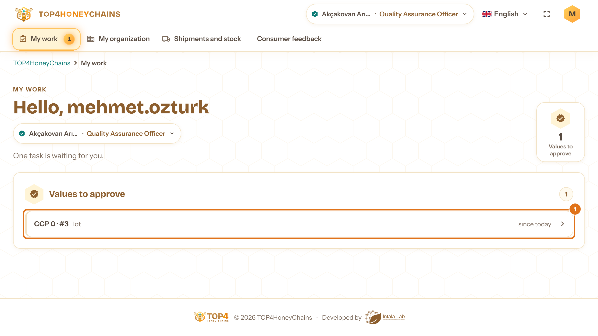

2. Check the values and select **Approve**.

Approving confirms that the values are recorded correctly, not that they are within their limits. If a value is outside its limit, the page asks you to confirm it before approving.

## Approve a control sheet

1. Open the control sheet from **My work**.
2. Check the values. Under **Approve the sheet**, the page lists the control points you approve; select **Approve all listed**.

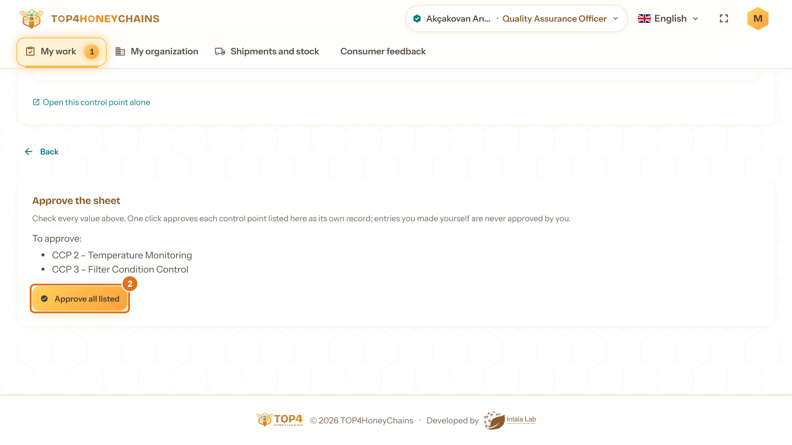

Every control point listed is approved as its own record. Entries you made yourself are listed under **Not approved by you:** and need another officer.

## Finalize a batch

After Staff requested finalizing, the batch appears in your My work.

1. Open the batch page from **My work**.
2. Select **Confirm and finalize**.

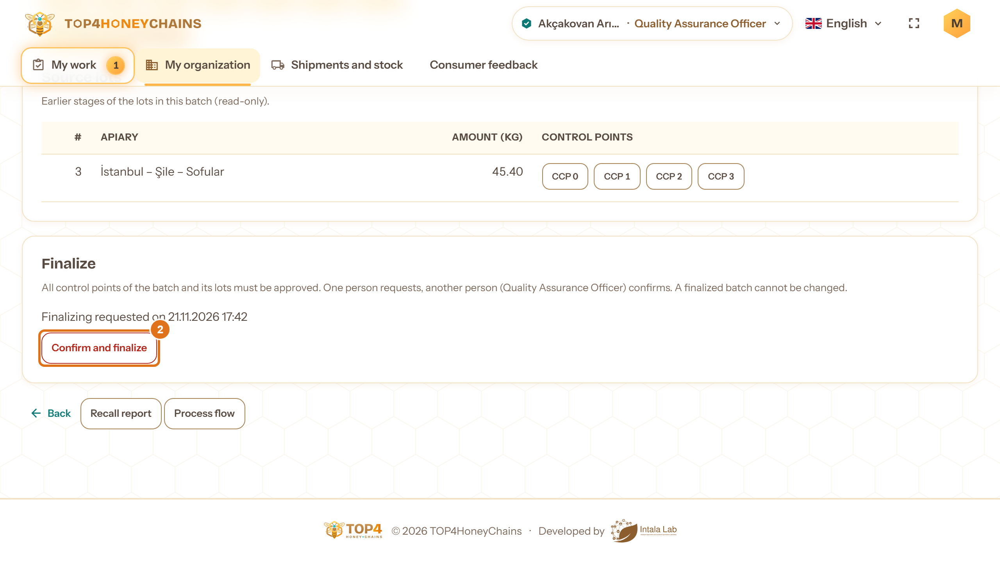

The batch is finalized and sealed. **Open the Honey Story** shows its public page and **Download QR** gives the QR code for the labels of the jars.

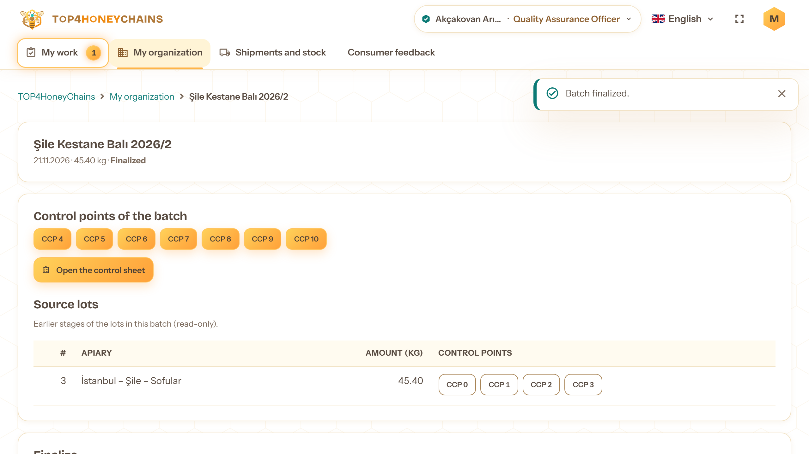

> [!WARNING]
> A finalized batch cannot be changed. Its data, composition and control points are locked. A value can then be changed only through a correction approved by two platform administrators.

## Answer consumer feedback

Consumers can send feedback about a honey to the organisation that produced it. You see only the consumer's code, never their user name or phone, and the feedback is never public.

1. Select **Consumer feedback** in the menu and open the feedback.
2. Write your answer in **Your answer to the consumer**.
3. Select **Send answer**.

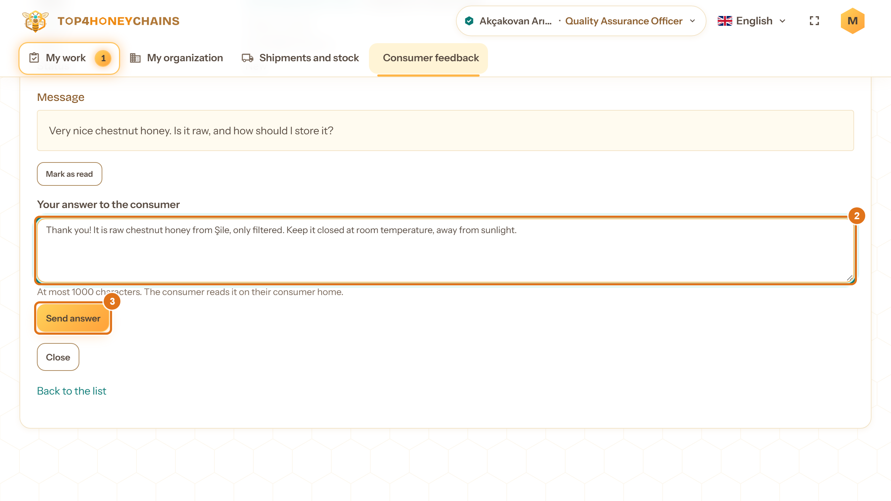

The consumer reads the answer on their **My honeys** page. Use **Mark as read** and **Close** to keep the list in order.

# Shop: receiving and storing honey

The staff of a shop confirm the honey that arrives and record its storage conditions (CCP 10). The shop's Quality Assurance Officer approves the storage record.

Table: Tasks in the shop {#tbl-tasks-shop}

| Task | Who | Where |
| --- | --- | --- |
| Confirm a shipment | Staff | **Shipments and stock** |
| Record the storage conditions | Staff | **Shipments and stock > CCP 10** |
| Approve the storage record | Quality Assurance Officer | **My work** |

## Confirm a shipment

1. Select **Shipments and stock** in the menu. The shipment is listed under **Incoming shipments** as **Pending**.
2. Check the honey and select **Confirm receipt**. If something is wrong, write the reason in **reason (to reject)** and select **Reject**.

The batch is now listed under **Batches you hold**.

## Record the storage conditions (CCP 10)

1. In **Shipments and stock**, select **CCP 10** in the **Storage** column of the batch.
2. Enter the **Temperature (°C)** and the **Relative Humidity**.
3. Select **Save**.

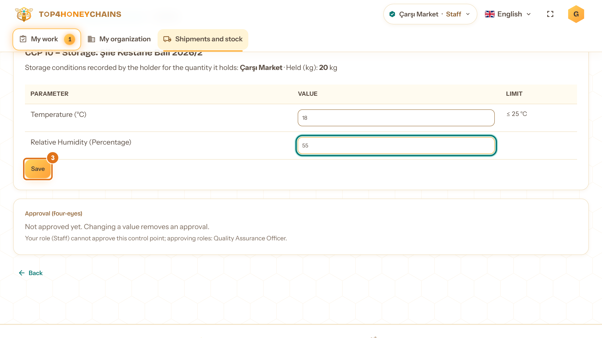

## Approve the storage record

1. Open the storage record from **My work**.
2. Select **Approve**.

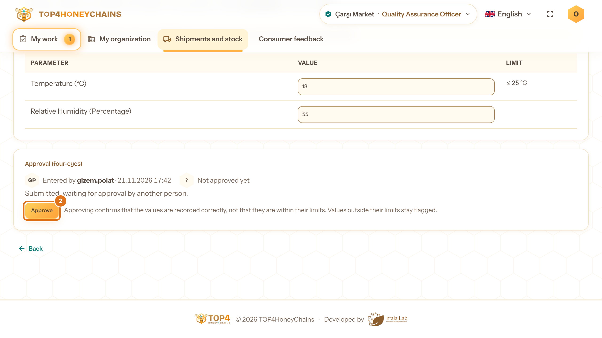

The Honey Story of the batch now shows that the shop received it.

# Organization admin and Compliance Officer

## See your organisation's page and documents

The Organization admin looks after the page of the organisation. Select **My organization** and then **Organization page**. The page shows the status of the organisation (**Verification**), its **Documents**, **Capabilities**, the **Four-eyes exemption** and the **Data controller** details.

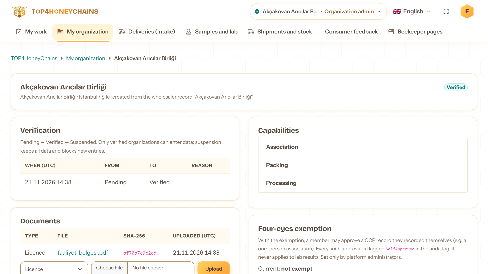

To add a document, choose the file under **Documents** and select **Upload**. PDF files up to 10 MB and JPG, PNG or WEBP pictures up to 8 MB are accepted. Members and capabilities are managed by the platform administrators (chapter 13).

## Publish a beekeeper page (association)

An association can publish a public page for each member beekeeper. The page is published only with a recorded consent and a verified registry number; withdrawing the consent unpublishes it at once.

1. Select **Beekeeper pages** in the menu.
2. Select **Record consent** in the row of the beekeeper.
3. Read the consent text to the beekeeper. Tick **The consent text was read to the beekeeper and signed.** and, if the beekeeper agrees, **The beekeeper agrees to show the name (otherwise a neutral code is shown)**.
4. Enter the **Date of consent**, attach the **Signed consent document** (or take it with **Camera**) and save.

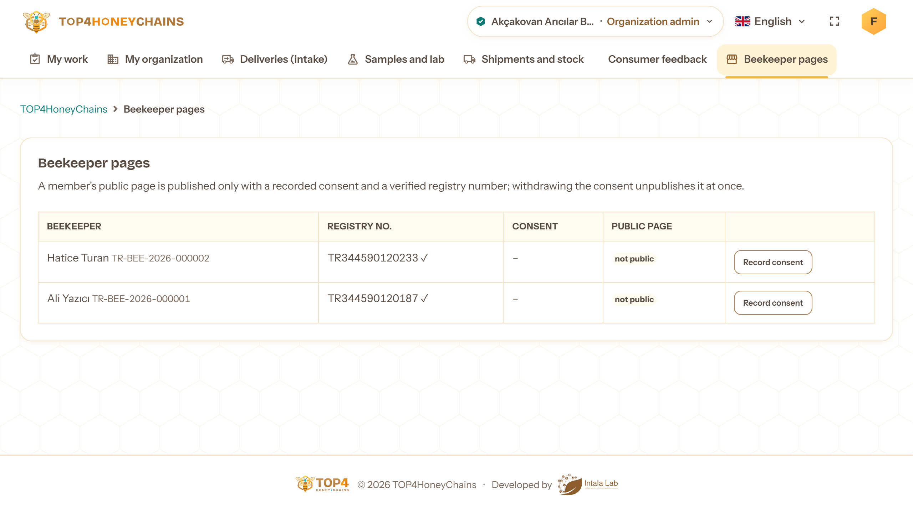

Once published, **Printable card** gives a card with the QR code of the page, and **Withdraw consent** takes the page down.

## Supervise as Compliance Officer

The Compliance Officer does not enter deliveries, control point values or lab results, but reviews them. Select **Compliance** in the menu.

| Section | What you do there |
| --- | --- |
| **Sampling quality** | Review deliveries confirmed by a signed photo, samples the laboratory rejected and seals found broken. |
| **Signed photos** | Accept or reject the signed photos of registrations and deliveries. |
| **Data-subject requests** | Record access, correction, deletion, objection and consent withdrawal requests received outside the portal (**Record a request**). Answer within 30 days. |
| **Approval mechanism** | See records waiting for approval longer than 7 days and approvals made under the four-eyes exemption. |
| **Data controller** | Check the controller details of your organisation. |

# Beekeeper portal

The beekeeper portal is made for the phone. With it, beekeepers follow their deliveries, enter their asking price, read their lab results and manage their consents. The registration officer sends the sign-in details by SMS (chapter 3); the first sign-in works as described in chapter 2.

## Read the start page

After signing in, the beekeeper sees **Home**: the deliveries, the batches with their honey, the last delivery and the last lab result. **To do** lists the deliveries without a price. The menu has **Home**, **My deliveries**, **Samples and lab**, **Batches with my honey**, **My Honey Story pages**, **My apiaries**, **Privacy and consents** and **Account**. The language links and **Logout** are at the top.

## Enter your price

1. Select **My deliveries**. Each delivery shows the honey type, the amount, the confirmation and every container with its seal history.
2. Under **Asking price**, enter your **Price per kg** and the **Currency**, and a **Note (optional)**.
3. Select **Enter price** and confirm the total.

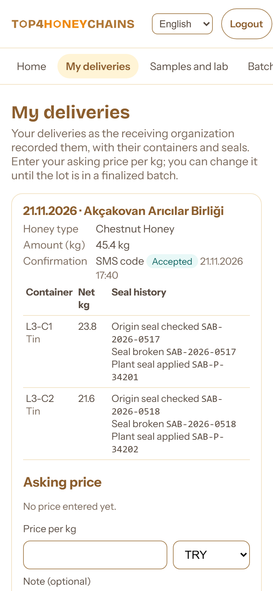 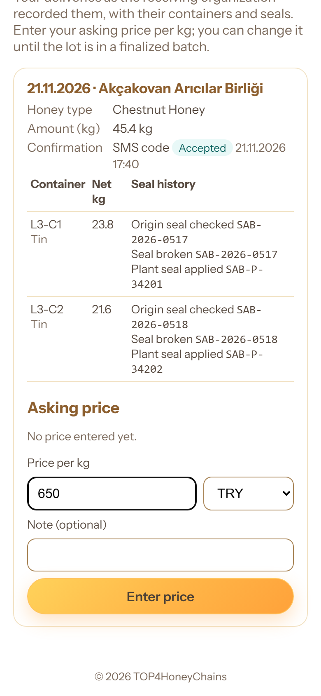

You can change the price with **Change price** until the lot is in a finalized batch. **Price history** shows your earlier prices.

## See lab results, batches and Honey Story pages

**Samples and lab** shows every sample jar of your deliveries. Lab values appear once the laboratory approved its report. **Batches with my honey** shows your share in each batch, and **My Honey Story pages** opens their public pages.

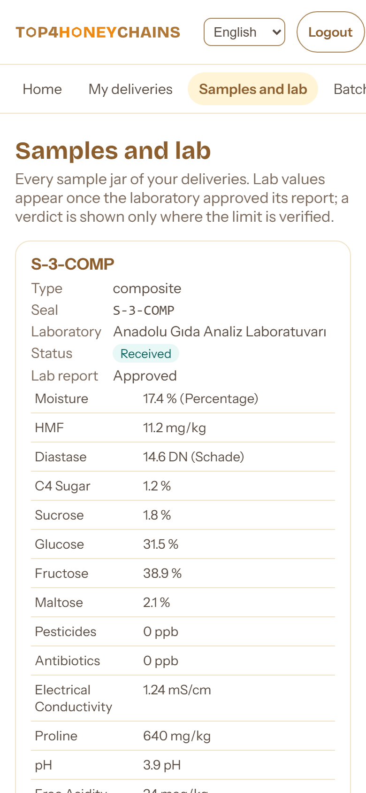

## Manage your consents and your account

**Privacy and consents** lists your consents: your name on public pages, messages about deliveries and results, and whether your association may see your prices. Select **Withdraw** or **Give**; a change takes effect at once.

**Account** lets you change your mobile phone (**New number**, **Send a code**), your **Language** and your password (**Current password**, **New password**, **New password again**, **Change password**).

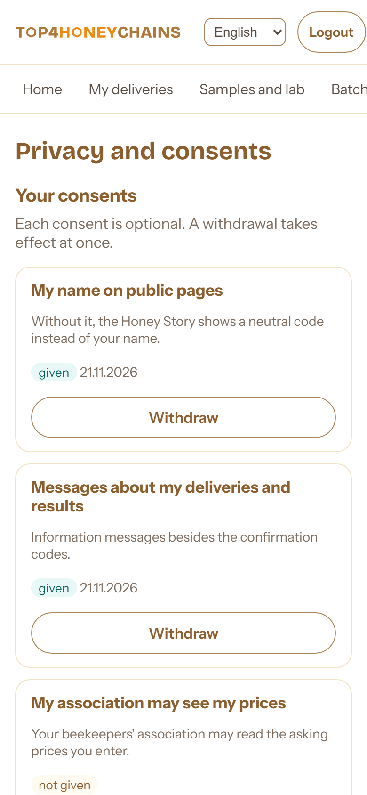 

# The Honey Story page

The Honey Story is the public page of a finalized batch. The consumer opens it by scanning the QR code on the jar with a phone; no account is needed.

## The top of the page

The top shows the name of the batch, the organisation that produced it, the amount of honey, the number of beekeepers and the production date. The badges below say whether the honey was **Tested by an accredited lab** and whether **All control points approved**, the origin, and the code of the lab report.

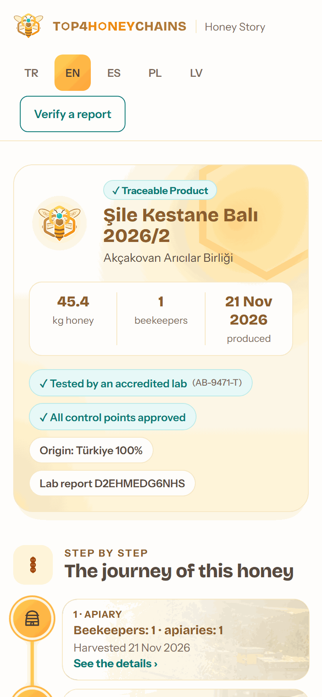

## The journey of this honey

Five steps show the path of the honey: **Apiary**, **Delivery**, **Lab**, **Processing** and **Shelf**, each with its date. **See the details** opens the part of the page that belongs to the step.

 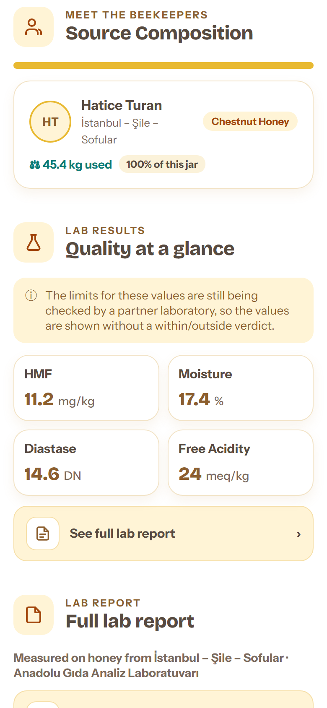

## Where it comes from

**Honey Origins** shows how much honey came from each source, and the map shows the provinces. Exact apiary locations are never published. **Source Composition** lists the beekeepers, with their names only if they agreed to it.

## Lab results and process checks

**Quality at a glance** shows the most important values. **Full lab report** groups all values: **Freshness**, **Maturity & authenticity**, **Sugar profile & purity** and residues. **Verify report** checks the report on the verification page. **Process checks** lists every control point recorded for the honey.

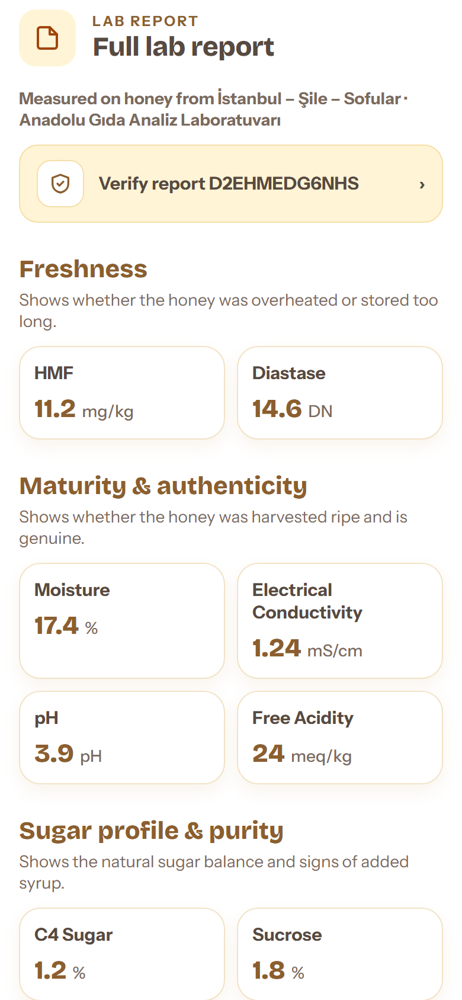 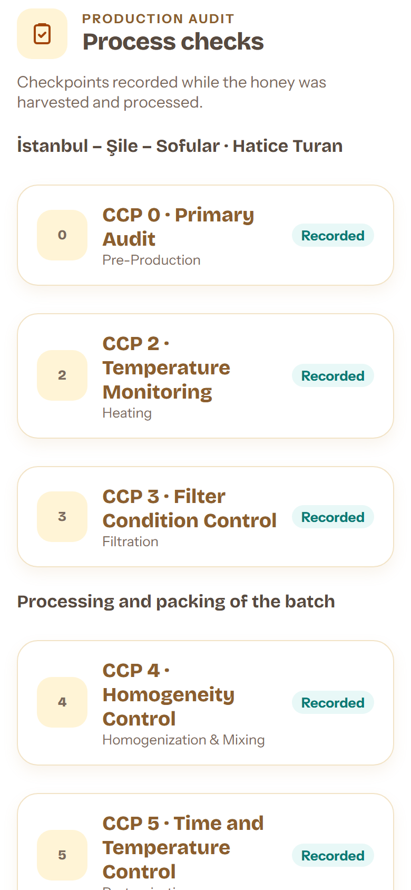

> [!NOTE]
> While the limits of the values are still being checked by a partner laboratory, the values are shown without a within or outside verdict.

## Save the honey or write to the producer

At the bottom, **Save to My honeys** and **Send feedback to the producer** are for consumers with a free account (chapter 12). **Verify a report** opens the verification page.

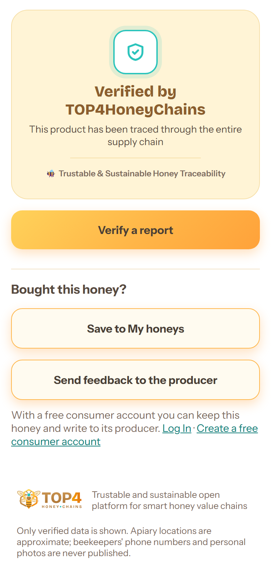

# Consumer account

A free consumer account lets you keep the honeys you bought, send feedback to the producer and read the answers. The Honey Story stays open to everyone without an account.

## Create an account

1. On the Honey Story or the sign-in page, select **Create a free consumer account**.
2. Choose a **Username** of 3 to 40 letters, digits, dots, dashes or underscores. Do not use your real name or e-mail address.
3. Enter your **Password** twice, choose your **Language** and, if you wish, a **Mobile phone (optional)**.
4. Tick **I am 18 or older.** and **I have read and accept the Privacy notice for consumers**.
5. Select **Create account**.

> [!NOTE]
> With a verified phone you can reset a forgotten password by SMS code. Without a phone a forgotten password cannot be recovered. The platform never sends e-mail.

## Save a honey

1. On the Honey Story, select **Save to My honeys**.
2. Select **Save to My honeys** again to confirm.

Only you see your saved honeys. The platform does not record which stories you open.

## Send feedback to the producer

1. On the Honey Story, select **Send feedback to the producer**.
2. Choose what it is about, for example **Taste or smell** or **Suspected fake or opened jar**.
3. Write your message, at most 1000 characters, without personal data.
4. Select **Send feedback**.

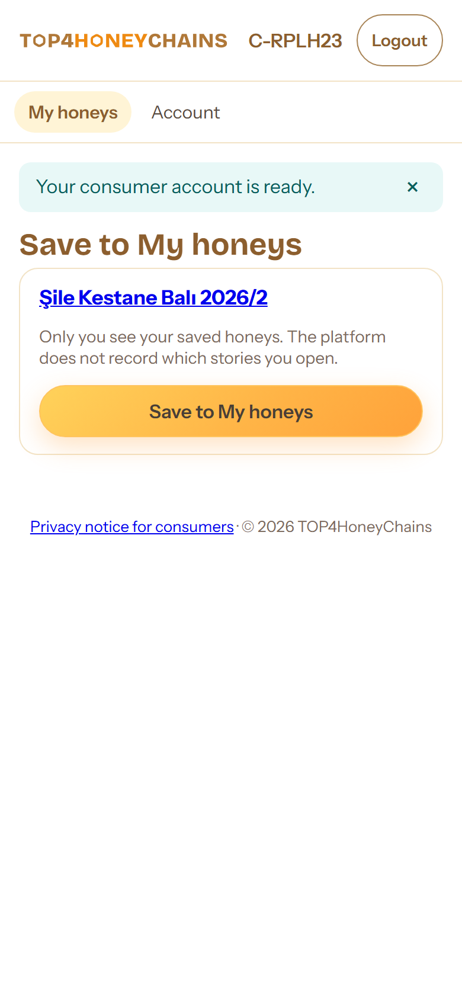 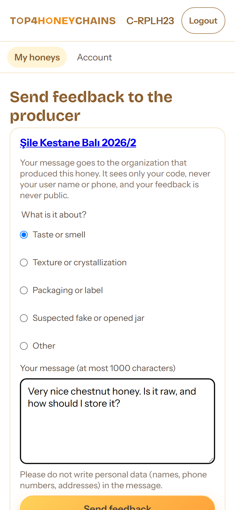

The producer sees only your code, never your user name or phone.

## Read the answer and manage your account

**My honeys** lists your **Saved honeys** and **My feedback** with the **Answer from the producer**. **Account** shows your code and lets you change your phone, language and password. **Download my data** gives everything the platform keeps about your account, and **Delete my account for good** deletes it after you enter your password.

 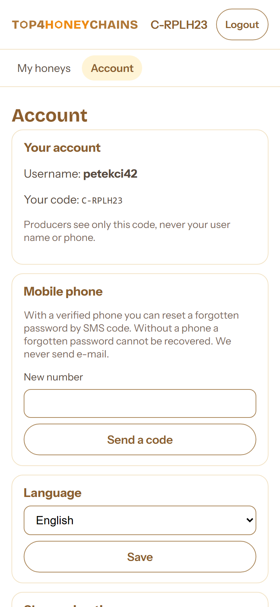

# Platform administration

Platform administrators set up the organisations and their members, decide who enters and approves each control point, and oversee the records. They do not enter business data. Their menu has **My work**, **Dashboard**, **Set-up** and **Oversight**.

Table: Tasks of the platform administrator {#tbl-tasks-admin}

| Task | Where |
| --- | --- |
| Follow the chain | **Dashboard** |
| Create and verify an organisation, add members | **Set-up > Organizations** |
| Roles and rights | **Set-up > Roles and permissions** |
| Who enters and approves each control point | **Set-up > CCP responsibilities** |
| Users and sign-in details | **Oversight > Users** |
| Records, audit log, corrections | **Oversight** |
| Notices, translations, reference data | **Oversight > Notices and consent texts**, **Set-up** |

## Follow the chain on the dashboard

The **Dashboard** shows the figures of the chain and what is waiting at each step. Select a step to see its list. The figures refresh every 5 minutes.

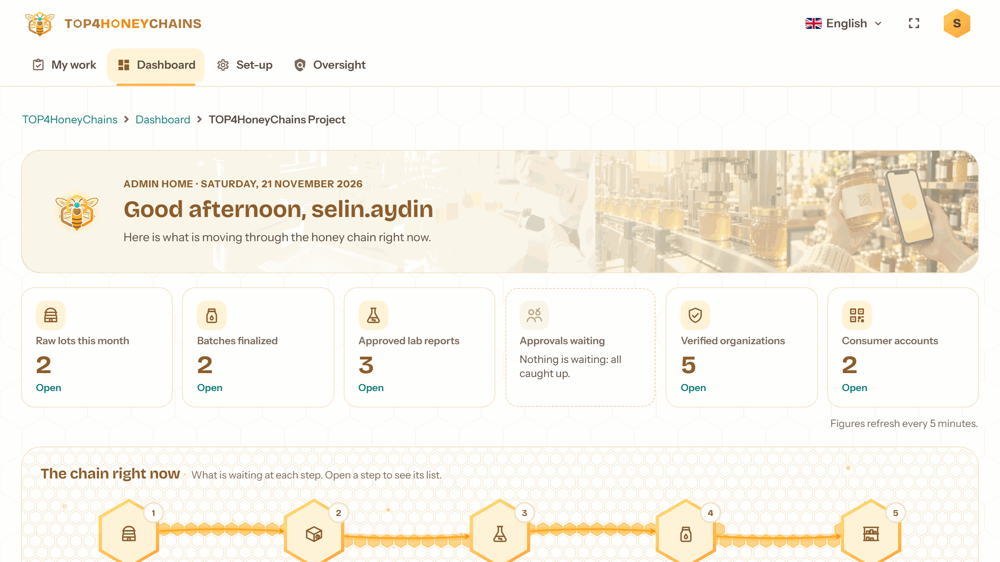

## Create and verify an organisation

1. Select **Set-up > Organizations** and then **New organization**.

   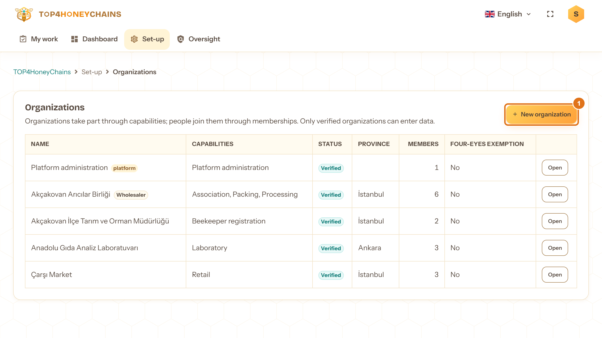

2. Enter the **Display name** and, if known, the **Legal name**, **Tax number**, **Province** and **District**. Tick the **Capabilities**; for a laboratory, enter its accreditation.
3. Select **Create**. The organisation starts as **Pending** and can enter data only after it is verified with documents.

   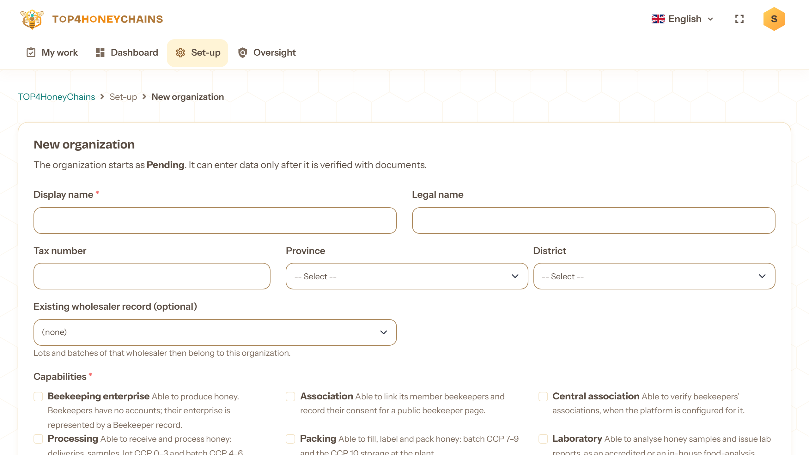

4. Open the organisation with **Open**. Upload its documents and add a Compliance Officer, then select **Verify** under **Verification**. With a reason, **Request documents** and **Suspend** are also possible.

## Add a member

On the page of the organisation, under **Members**, enter an **Existing user name** or create a new user (**user name**, **Mobile phone**, **E-mail (optional)**). Choose the **Org role** and select **Add member**. **Set-up > Roles and permissions** shows all members of all organisations, the rights of each role and the capabilities of each organisation.

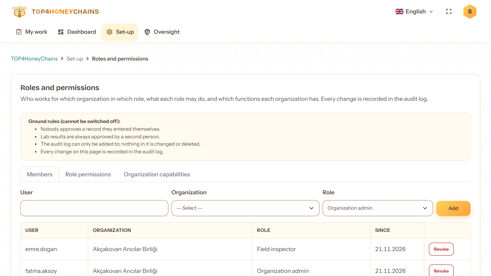

> [!NOTE]
> Every change on these pages is recorded in the audit log.

## Decide who enters and approves each control point

**Set-up > CCP responsibilities** shows, for each control point, the responsible organisation, the capabilities, the roles that enter values and the roles that approve. Select **Edit** to change them. Changes apply at once.

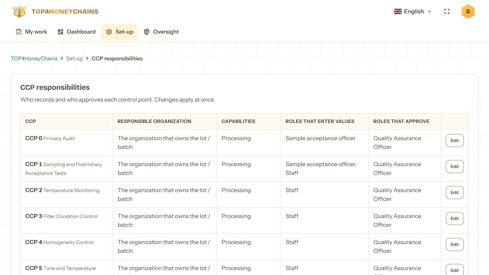

## Manage users and sign-in details

**Oversight > Users** lists all accounts: staff, beekeepers and consumers. **Add New User** creates an account; **Send sign-in by SMS** sends new sign-in details; **Reset Password** sets a new password; **Delete** removes an account.

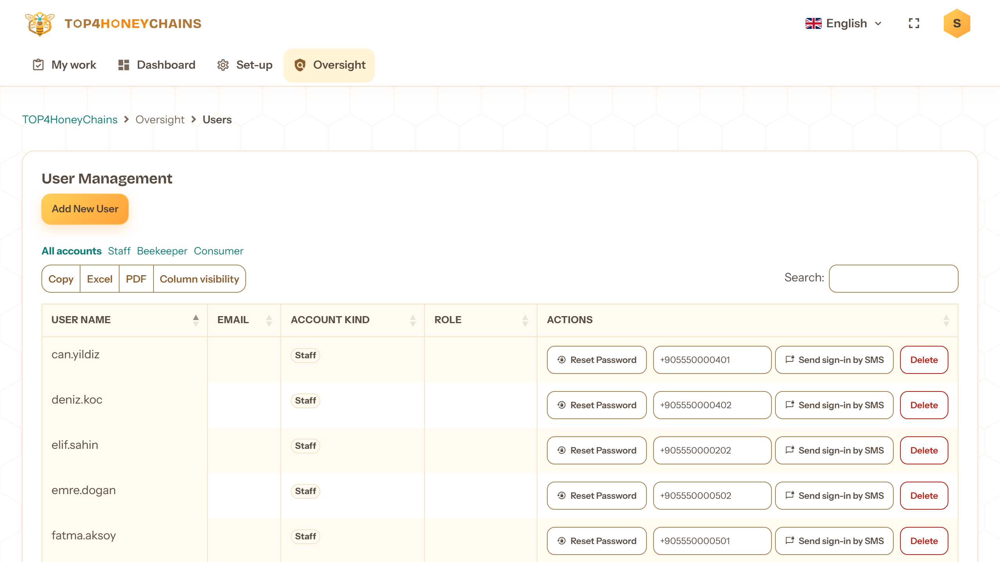

## Oversee the records

**Oversight > Records** shows the lots and batches of every organisation, read-only. **Oversight > Audit log** shows every change; it can only be added to, and **Verify hash chain** checks that no entry was changed or removed. **Oversight > Corrections** lists the corrections of values: a value is changed only when a second administrator approves the correction.

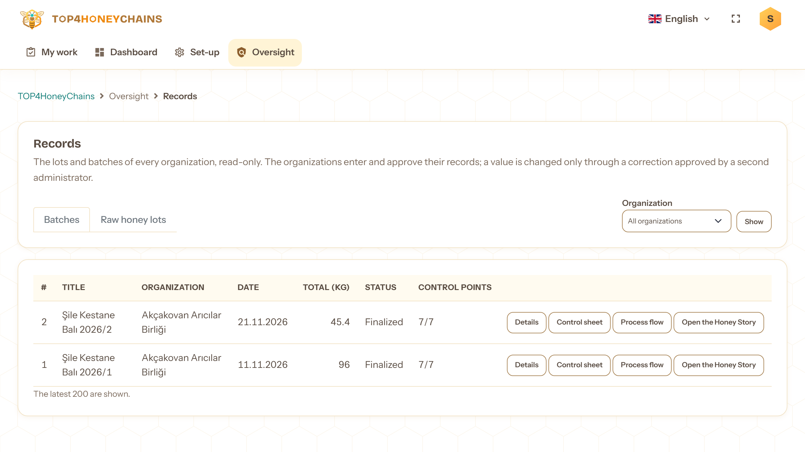

## Notices, translations and reference data

**Oversight > Notices and consent texts** lists the versions of the privacy notices and consent texts. Texts are never changed after publishing: select **Publish a new version** instead. **Set-up > Reference data** holds the lists the forms offer (honey types, periods, control points and their parameters), and **Set-up > Translations of reference data** their names in the five languages.

# Problems and questions

### My account is locked

After 5 wrong passwords the account is locked for 15 minutes. Wait and try again, or ask your platform administrator.

### The temporary password does not work

It is valid for 72 hours. The page says **The temporary password has expired. Ask for new sign-in details.** Ask the person who sent your sign-in details to send new ones.

### I signed in but see This account has no access to the panel yet

Your account is not a member of an organisation yet. Ask a platform administrator to add you.

### The code from the SMS is refused

A code is valid for 5 minutes and only for the details it was sent for. If you changed a field after sending the code, the page says **The details changed after the code was sent. Send a new code.** Between two codes you wait one minute (**Wait a minute before sending a new code.**). After too many wrong codes you wait 15 minutes.

### A menu item or a task is missing

The menu depends on your role, on the capabilities of your organisation and on its verification. Switch to the right role with the role chip at the top. If your organisation is not verified yet, nothing waits in My work.

### A value is outside its limit

You can save it. When approving, the page asks the approver to confirm the values outside their limits; they stay flagged on the record.

### My lot does not appear in New batch

A lot is listed only when all its control points are completed and approved and it still has honey left.

### The delivery is refused because of the seals

Every seal number of the delivery must be different.

### I need to change a finalized batch

A finalized batch is locked. A wrong value is corrected only through a correction requested and approved by two platform administrators.

### A file is refused

Documents of an organisation can be PDF files up to 10 MB or JPG, PNG or WEBP pictures up to 8 MB.

### I forgot my password and have no verified phone

Ask the person who gave you your sign-in details to send new ones. Consumers without a phone cannot recover their account.

# Glossary {-}

Table: Terms used in this manual {#tbl-glossary}

| Term | Meaning |
| --- | --- |
| Batch | Honey from one or more lots, processed and packed together. It is finalized and gets a Honey Story and a QR code. |
| Business number | The beekeeper's number on the platform, for example TR-BEE-2026-000002. It is also the beekeeper's user name. |
| Capability | The kind of work an organisation may do in the chain, for example processing, laboratory or retail. |
| CCP | Critical control point: a check of the honey's quality at one stage, CCP 0 to CCP 10. |
| Composite sample | One sample mixed from the sample jars of a lot, analysed by the laboratory. |
| Consent | The beekeeper's or consumer's agreement to an optional use of their data, for example their name on public pages. It can be withdrawn at any time. |
| Control sheet | All control points of a lot or a batch on one page. |
| Counter-sample | A second sealed jar of each container, kept at the plant for a later check. |
| Finalize | Lock a batch once all its control points are approved. A finalized batch cannot be changed. |
| Four-eyes rule | Every record is entered by one person and approved by another. |
| Honey Story | The public page of a finalized batch, opened with the QR code on the jar. |
| Lot | The raw honey of one delivery. |
| My work | Your start page and list of tasks. |
| Organisation | A directorate, association, plant, laboratory, shop or the platform itself, taking part through its capabilities. |
| Registry number (AKS) | The beekeeper's number in the national registry. |
| Role | What a person does for an organisation, for example Analyst or Quality Assurance Officer. |
| Seal | A numbered seal on a container or a jar. Each seal number is used once. |
