# Acerca de este manual {-}

Este manual es para todas las personas que trabajan con la plataforma TOP4HoneyChains: el personal de las direcciones y de las asociaciones de apicultores, las plantas que procesan y envasan miel, los laboratorios, los mayoristas y minoristas, los administradores de la plataforma, los apicultores que usan su propio portal y los consumidores que leen la historia de un frasco.

Los capítulos siguen el viaje de la miel. [La plataforma de un vistazo](#ch-glance) explica la plataforma en pocas páginas y [Capacidades, organizaciones y roles](#ch-roles) explica quién puede hacer qué. [Primeros pasos](#ch-start) muestra los primeros pasos que todos dan. Los capítulos de cada rol siguen el orden en que la miel pasa de mano en mano: registro, entrega, laboratorio, procesamiento y envasado, aprobación, mayoristas y minoristas, la administración de la organización y el Responsable de cumplimiento. Después vienen los capítulos para apicultores y consumidores, [Administración de la plataforma](#ch-admin) y [Confianza y privacidad](#ch-trust). [Problemas y preguntas](#ch-problems) responde a problemas frecuentes, y un glosario cierra el manual.

Lea primero [Primeros pasos](#ch-start) y después el capítulo de su rol.

### Convenciones

- Los nombres de botones, menús y campos se escriben en **negrita**, exactamente como aparecen en la pantalla.
- Un recorrido por un menú se escribe así: **Menú > Elemento**.
- Los pasos están numerados. Cuando una imagen tiene una marca numerada, el número es el del paso que usa ese control.
- El texto que usted escribe se muestra así: `TR-BEE-2026-000002`.
- Las figuras y las tablas están numeradas. Una referencia como "Tabla 3" es un enlace a esa tabla.

Las personas, organizaciones, apicultores y valores de las imágenes son datos de ejemplo: todos los nombres de personas y de organizaciones son inventados. Solo los pueblos y distritos de los colmenares son lugares reales.

# La plataforma de un vistazo {#ch-glance}

TOP4HoneyChains es una plataforma web que sigue la miel desde el colmenar del apicultor hasta la góndola del minorista. Guarda un registro común de cada paso: quién hizo el trabajo, qué se midió y quién lo controló. Al final, un código QR en el frasco abre la **Historia de la miel** pública de la partida, para que cualquier persona pueda leer de dónde viene la miel y qué encontró el laboratorio.

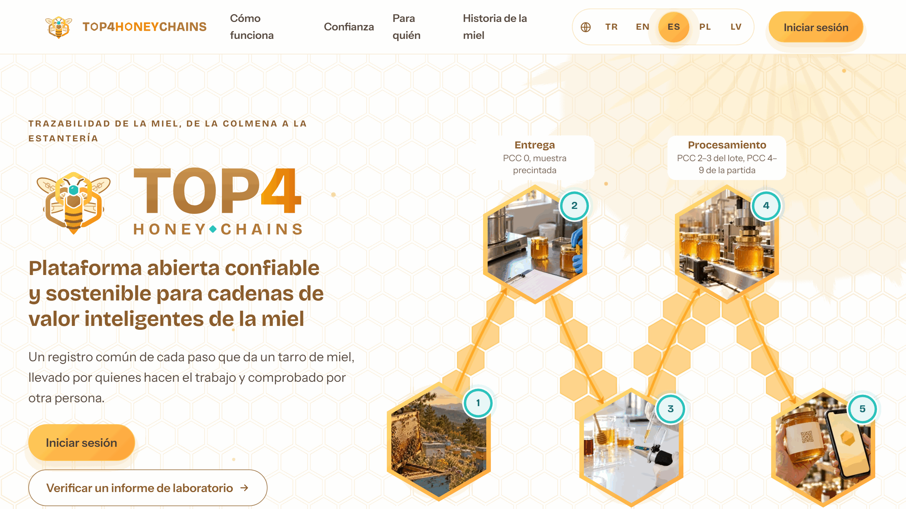

## Para qué sirve la plataforma {#sec-purpose}

La plataforma se desarrolló en el proyecto internacional de investigación TOP4HoneyChains ("Trustable and Sustainable Open Platform for Smart Honey Value Chains"). El proyecto se lleva a cabo dentro del ICT-AGRI-FOOD ERA-NET Cofund (convocatoria conjunta 2022) por universidades, institutos de investigación y empresas de cuatro países: Türkiye, Polonia, Letonia y Argentina. Está financiado por el programa de investigación e innovación Horizonte 2020 de la Unión Europea (acuerdo de subvención n.º 862665) junto con las agencias nacionales de financiamiento de los países socios. Los socios y los financiadores aparecen al pie de la página de inicio.

La plataforma tiene tres objetivos:

- **Trazabilidad.** Para cualquier frasco se pueden responder tres preguntas. ¿De dónde viene la miel? ¿Se controló? ¿Adónde fue?
- **Confianza.** Cada registro lo ingresa una persona y lo controla una segunda persona ([El principio de los cuatro ojos](#four-eyes)). Cada cambio se escribe en un registro de auditoría al que solo se pueden agregar entradas.
- **Transparencia para el consumidor.** La Historia de la miel pública muestra el viaje y los controles de calidad de la miel en un lenguaje sencillo, sin publicar datos personales.

La interfaz está disponible en inglés, turco, español, polaco y letón. Cada persona elige el idioma en la página.

En este manual, **datos** significa lo que las personas registran en la plataforma: valores medidos (por ejemplo, la humedad en %) y respuestas a preguntas (por ejemplo, Sí o No).

## El viaje de la miel {#sec-journey}

La miel pasa por cinco estaciones: **Colmenar**, **Entrega**, **Laboratorio**, **Procesamiento** y **Estantería**. Los mismos cinco nombres aparecen en la página de inicio y en cada Historia de la miel.

En cada estación ocurren dos cosas, y este manual las mantiene separadas:

- **Actividades**: lo que las personas hacen con la miel (cosecharla, entregarla, analizarla, procesarla, venderla).
- **Registros**: lo que la plataforma guarda sobre ello, y quién puede crear, leer, actualizar o aprobar esos registros. Los derechos sobre los datos de cada rol figuran en la [Tabla](#tbl-crud).

La [Tabla](#tbl-journey-activities) muestra las actividades y la [Tabla](#tbl-journey-records), los registros.

Table: El viaje de la miel: lo que hacen las personas {#tbl-journey-activities}

| Estación | Lo que hacen las personas con la miel |
| --- | --- |
| Colmenar | El apicultor cría abejas en uno o más colmenares y cosecha la miel. |
| Entrega | El apicultor lleva la miel a una planta en envases (latas, tambores o barriles). En la planta, cada envase se pesa y se abre. Con su contenido se llenan un frasco de muestra y un frasco de contramuestra, que se precintan, y el envase se vuelve a precintar. |
| Laboratorio | Los frascos de muestra viajan a un laboratorio de análisis de alimentos. El laboratorio controla cada frasco a la llegada, prepara una muestra compuesta y la analiza. |
| Procesamiento | La planta calienta, filtra, mezcla, decanta, llena, etiqueta y envasa la miel. La miel de uno o más lotes forma una partida. |
| Estantería | La partida se envía a un mayorista o a un minorista, que la almacena y la vende. El consumidor compra un frasco y escanea su código QR. |

Table: El viaje de la miel: lo que registra la plataforma {#tbl-journey-records}

| Estación | Lo que registra la plataforma | Quién lo registra (primera persona) | Quién lo confirma o aprueba (segunda persona) |
| --- | --- | --- | --- |
| Colmenar | El apicultor, el número del registro nacional, el teléfono móvil, los colmenares con sus colmenas y su ubicación, la asociación (opcional), los consentimientos del apicultor. | **Responsable de registro de apicultores** | El apicultor, con un código de 6 dígitos enviado por SMS. Sin teléfono: el apicultor firma un formulario impreso y el **Responsable de cumplimiento** revisa su foto. |
| Entrega | Una entrega con una fila por envase: peso, precintos a la llegada, el frasco de muestra y el frasco de contramuestra con sus números de precinto, y el precinto nuevo. La entrega se convierte en un lote de miel cruda. Después, la auditoría primaria, PCC 0. | **Responsable de recepción de muestras** | La entrega: el apicultor, con el código SMS (o un formulario firmado que revisa el **Responsable de cumplimiento**). PCC 0: un **Responsable de aseguramiento de la calidad**. |
| Laboratorio | El control de recepción de cada frasco, la muestra compuesta, los resultados, el informe firmado (PDF) y su huella. Los resultados aprobados pasan a ser el PCC 1 del lote. | **Analista** | **Responsable de laboratorio** |
| Procesamiento | La hoja de control de cada lote (PCC 2 y 3), la partida con sus lotes y kilogramos, la hoja de control de la partida (PCC 4 a 10), la solicitud de finalización. | **Personal** (también **Administrador de la organización** para la partida y la solicitud) | El **Responsable de aseguramiento de la calidad** aprueba las hojas y confirma la finalización. |
| Estantería | El envío, su recepción y las condiciones de almacenamiento en cada poseedor (PCC 10). La Historia de la miel se hace pública cuando se finaliza la partida. | Personal o Administrador de la organización del poseedor; Personal para el registro de almacenamiento | El receptor confirma el envío. Un Responsable de aseguramiento de la calidad del receptor aprueba el registro de almacenamiento. |

Un paso solo puede empezar cuando el paso anterior está aprobado, donde corresponde:

- El laboratorio ingresa y aprueba resultados solo después de que se aprueba el PCC 0 del lote.
- Un lote puede entrar en una partida solo cuando todos sus puntos de control están completos (o no aplican) y aprobados, y todavía le queda miel.
- Una partida puede finalizarse solo cuando todos los puntos de control de la partida y de sus lotes están aprobados y ninguna foto firmada de una entrega espera revisión.
- Solo se puede enviar una partida finalizada, y solo hasta la cantidad que usted tiene.

La finalización bloquea la partida y sus lotes. Después, un valor incorrecto solo lo corrigen dos administradores de la plataforma.

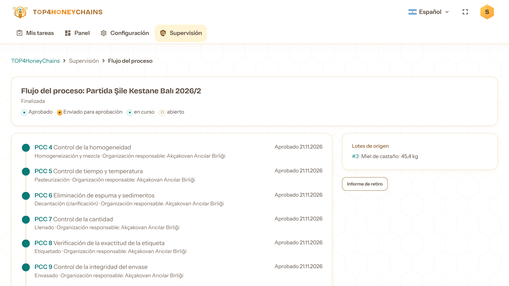

## Para quién es la plataforma {#sec-audience}

La plataforma tiene tres tipos de cuentas. Los **miembros** trabajan para una organización en un rol. Un **apicultor** puede tener una cuenta personal para el portal del apicultor. Un **consumidor** puede crear una cuenta de consumidor gratuita. Los visitantes no necesitan ninguna cuenta.

Una organización participa en la cadena a través de sus capacidades, por ejemplo "Capaz de recibir y procesar miel" ([Tabla](#tbl-capabilities)). Una persona trabaja para una organización en un rol ([Tabla](#tbl-roles)). Una cuenta en una organización con un rol se llama membresía ([Membresías](#memberships)).

Table: Para quién es la plataforma {#tbl-audience}

| Quién | Cuenta | Actividad en la cadena de valor | En la plataforma |
| --- | --- | --- | --- |
| Apicultor | Representado por un registro de apicultor. Un apicultor inscrito con un teléfono móvil también recibe una cuenta del portal del apicultor. | Produce la miel y la entrega a una planta. | Confirma la inscripción y cada entrega con un código SMS. En el portal: lee sus colmenares, entregas, resultados de laboratorio, partidas y páginas de la Historia de la miel, ingresa el precio solicitado, otorga o retira consentimientos ([Portal del apicultor](#ch-portal)). |
| Organismo de registro de apicultores (por ejemplo, una dirección distrital de agricultura) | Miembros | Conoce a los apicultores de su zona. | Inscribe apicultores y sus colmenares, vincula su asociación, envía sus datos de acceso al portal. |
| Asociación de apicultores | Miembros | Agrupa a apicultores; también puede tener una planta. | Publica una página pública del apicultor con su consentimiento. Con la capacidad Procesamiento trabaja como planta. |
| Planta de procesamiento y envasado | Miembros | Recibe, procesa, llena y envasa miel. | Registra entregas y muestras, el PCC 0 y los PCC 2 a 10, crea partidas, las finaliza, las envía, responde los comentarios de los consumidores. |
| Laboratorio de análisis de alimentos (acreditado o propio) | Miembros | Analiza las muestras de miel. | Recibe los frascos de muestra, ingresa los resultados con el informe firmado, aprueba el informe. |
| Mayorista | Miembros | Compra partidas, las almacena y las revende. | Confirma envíos, registra y aprueba el almacenamiento (PCC 10), reenvía, lee los puntos de control del productor. |
| Minorista | Miembros | Vende frascos a los consumidores. | Confirma envíos, registra y aprueba el almacenamiento (PCC 10), lee los puntos de control del productor. |
| Autoridad pública | Miembros | Inspecciona la cadena. | Lee todos los registros, no ingresa nada. |
| Administrador de la plataforma | Una cuenta de administración de la plataforma | Opera la plataforma; no participa en la cadena de la miel. | Crea y verifica organizaciones, agrega miembros, define roles, permisos y responsabilidades de los puntos de control, publica los textos de los avisos, supervisa los registros y decide las correcciones. No ingresa datos del negocio. |
| Consumidor | Una cuenta de consumidor gratuita | Compra y consume la miel. | Todo lo que puede hacer un visitante y, además, guarda mieles en **Mis mieles**, envía comentarios al productor y lee la respuesta ([Cuenta de consumidor](#ch-consumer)). |
| Visitante | Ninguna | Se informa sobre la miel antes o después de comprarla. | Lee las páginas públicas: la Historia de la miel desde el código QR, las páginas públicas de apicultores, **Verificar un informe de laboratorio** y los avisos de privacidad. |

Cada organización también tiene un **Responsable de cumplimiento**, que revisa las pruebas (fotos firmadas), la calidad del muestreo y las aprobaciones, y atiende las solicitudes de protección de datos ([Responsable de cumplimiento](#ch-compliance)).

## Puntos de control {#sec-control-points}

La calidad y la inocuidad de la miel se controlan en once puntos críticos de control (PCC), del PCC 0 al PCC 10. El método proviene de HACCP, el sistema de inocuidad alimentaria basado en el análisis de peligros y puntos críticos de control. Cada punto de control tiene parámetros (por ejemplo, la temperatura o la humedad). Un parámetro puede tener un límite crítico.

Los puntos de control 0 a 3 pertenecen al lote de miel cruda; los puntos de control 4 a 10, a la partida. La [Tabla](#tbl-ccps) muestra quién ingresa y quién aprueba cada punto de control de forma predeterminada. La organización debe tener la capacidad de la columna **La organización necesita**. Un administrador de la plataforma puede cambiar estos valores predeterminados ([Decidir quién ingresa y aprueba cada punto de control](#sec-ccp-responsibilities)).

Table: Los puntos críticos de control y quién es responsable de forma predeterminada {#tbl-ccps}

| PCC | Nombre en pantalla | Etapa | Pertenece a | La organización necesita | Ingresado por | Aprobado por |
| --- | --- | --- | --- | --- | --- | --- |
| PCC 0 | Auditoría primaria | Preproducción | Lote | Procesamiento | **Responsable de recepción de muestras** del propietario del lote | **Responsable de aseguramiento de la calidad** del propietario del lote |
| PCC 1 | Muestreo y pruebas preliminares de aceptación | Recepción de miel cruda | Lote | Laboratorio | Se completa con el informe de laboratorio aprobado (**Analista**) | **Responsable de laboratorio** (al aprobar el informe) |
| PCC 2 | Monitoreo de la temperatura | Calentamiento | Lote | Procesamiento | **Personal** | **Responsable de aseguramiento de la calidad** |
| PCC 3 | Control del estado del filtro | Filtración | Lote | Procesamiento | **Personal** | **Responsable de aseguramiento de la calidad** |
| PCC 4 | Control de la homogeneidad | Homogeneización y mezcla | Partida | Procesamiento | **Personal** | **Responsable de aseguramiento de la calidad** |
| PCC 5 | Control de tiempo y temperatura | Pasteurización | Partida | Procesamiento | **Personal** | **Responsable de aseguramiento de la calidad** |
| PCC 6 | Eliminación de espuma y sedimentos | Decantación (clarificación) | Partida | Procesamiento | **Personal** | **Responsable de aseguramiento de la calidad** |
| PCC 7 | Control de la cantidad | Llenado | Partida | Envasado | **Personal** | **Responsable de aseguramiento de la calidad** |
| PCC 8 | Verificación de la exactitud de la etiqueta | Etiquetado | Partida | Envasado | **Personal** | **Responsable de aseguramiento de la calidad** |
| PCC 9 | Control de la integridad del envase | Envasado | Partida | Envasado | **Personal** | **Responsable de aseguramiento de la calidad** |
| PCC 10 | Monitoreo de temperatura y humedad | Almacenamiento | Partida | Comercio mayorista, Comercio minorista o Envasado | **Personal** del poseedor | **Responsable de aseguramiento de la calidad** del poseedor |

El PCC 1 está completo cuando el responsable de laboratorio aprueba el informe. Si la planta también registró sus propios valores en el PCC 1, un Responsable de aseguramiento de la calidad de la planta lo aprueba.

El PCC 10 aparece dos veces. Primero en la partida, en la planta: debe aprobarse antes de finalizar la partida. Más tarde, cada mayorista o minorista que recibe la partida lleva su propio registro de almacenamiento.

Un punto de control que no se aplica a esta miel puede marcarse como **No aplicable** con un motivo. Igual necesita aprobación. Cambiar cualquier valor elimina una aprobación existente, por lo que el registro necesita una nueva.

## El principio de los cuatro ojos {#four-eyes}

Cada registro de la plataforma pasa por dos pares de ojos. La **primera persona** hace el trabajo e ingresa los datos. Una **segunda persona, distinta**, lo controla y lo aprueba o confirma. Nadie aprueba lo que ingresó personalmente. Con dos personas, los errores y la manipulación son mucho menos probables. La [Tabla](#tbl-four-eyes) muestra la primera y la segunda persona en cada caso.

Table: La primera y la segunda persona de cada registro {#tbl-four-eyes}

| Registro | Primera persona (ingresa) | Segunda persona (aprueba o confirma) |
| --- | --- | --- |
| Inscripción de un apicultor | **Responsable de registro de apicultores** | El apicultor confirma con el código SMS. Sin teléfono: el **Responsable de cumplimiento** de la organización que inscribe revisa la foto del formulario firmado. |
| Entrega | **Responsable de recepción de muestras** | El apicultor confirma con el código SMS. Sin código: el **Responsable de cumplimiento** de la planta revisa la foto del formulario de entrega firmado. |
| PCC 0, la hoja del lote (PCC 2 y 3), la hoja de la partida (PCC 4 a 10) | **Responsable de recepción de muestras** (PCC 0) o **Personal** | **Responsable de aseguramiento de la calidad** de la misma organización |
| Resultados de laboratorio (PCC 1) | **Analista** | **Responsable de laboratorio** |
| Finalización de una partida | **Personal** o **Administrador de la organización** la solicita (**Solicitar la finalización**) | **Responsable de aseguramiento de la calidad** la confirma (**Confirmar y finalizar**) |
| Envío | Personal o Administrador de la organización del remitente | Personal o Administrador de la organización del receptor confirma la recepción |
| Registro de almacenamiento en un poseedor (PCC 10) | **Personal** del poseedor | **Responsable de aseguramiento de la calidad** del poseedor |
| Corrección de una entrega confirmada o de un valor aprobado | Un administrador de la plataforma la solicita, con un motivo | Un segundo administrador de la plataforma la decide |

La regla "Nadie aprueba un registro que ingresó personalmente" y la regla "Los resultados de laboratorio siempre los aprueba una segunda persona" son reglas básicas ([Reglas básicas](#ground-rules)). Se muestran en **Roles y permisos** y ninguna configuración de roles puede cambiarlas.

Existe una excepción para organizaciones muy pequeñas, por ejemplo una asociación con una sola persona de calidad. Un administrador de la plataforma puede otorgar a esa organización la **Exención de la doble verificación (cuatro ojos)**. Sus miembros pueden entonces aprobar sus propios registros de puntos de control y confirmar su propia solicitud de finalización. Cada una de esas aprobaciones se marca como autoaprobada y se escribe en el registro de auditoría. La exención nunca se aplica a los resultados de laboratorio. Un administrador de la plataforma también puede decidir que un punto de control no necesita ninguna aprobación; de forma predeterminada, todos los puntos de control la necesitan.

## Lo que lee el consumidor {#sec-consumer-reads}

El consumidor escanea el código QR del frasco, o abre el enlace, y lee la **Historia de la miel** de la partida sin iniciar sesión. La página es igual para todos y muestra, en el idioma que elige el lector:

- la partida: nombre, cantidad y fecha de producción;
- distintivos: **Analizado por un laboratorio acreditado** (o **Laboratorio propio**), **Todos los puntos de control aprobados**, **Dentro de los límites verificados** y el **Origen** con la participación de cada país;
- **El viaje de esta miel**: las cinco estaciones con las fechas y los números reales de esta partida;
- **Orígenes de la miel**: la participación de la miel por provincia en un mapa, los apicultores por su nombre (solo con su consentimiento; si no, con un código neutro) y un enlace a su página pública de apicultor cuando existe;
- **La calidad de un vistazo** e **Informe de laboratorio completo**: los resultados del laboratorio con sus límites y un enlace para verificar el informe;
- **Controles de proceso**: los puntos de control del procesamiento y del envasado;
- **¿Qué es esto?** junto a un valor: qué significa el parámetro y por qué importa.

Un veredicto dentro o fuera del límite se muestra solo para los límites verificados. Para los demás valores, la página indica que un laboratorio socio todavía está revisando los límites.

La Historia de la miel nunca muestra un número de teléfono, una foto de una persona, la ubicación exacta de un colmenar, un precio solicitado ni una nota de texto libre. El mapa muestra solo provincias.

Al pie, en **¿Compró esta miel?**, un consumidor con una cuenta gratuita puede **Guardar en Mis mieles** y **Enviar un comentario al productor**. El comentario llega a la organización propietaria de la partida; esta lee solo el código del consumidor, nunca el nombre de usuario ni el número de teléfono. Los capítulos [La página Historia de la miel](#ch-story) y [Cuenta de consumidor](#ch-consumer) describen la página y la cuenta.

# Capacidades, organizaciones y roles {#ch-roles}

En TOP4HoneyChains usted siempre trabaja **para una organización, en un rol**. Tres cosas deciden lo que puede hacer:

1. las **capacidades** de su organización: lo que la organización es capaz de hacer en la cadena de la miel ([Capacidades](#capabilities));
2. su **rol** en esa organización: lo que usted hace dentro de ella ([Roles](#role-list));
3. el **estado** de su organización: solo una organización **Verificada** ingresa datos. Un administrador de la plataforma verifica las organizaciones; en cambio, las asociaciones de apicultores pueden ser verificadas por una asociación central cuando la plataforma está configurada para ello ([Estado de la organización](#org-status)).

Usted tiene un rol a través de una **membresía**: una cuenta de usuario en una organización con un rol ([Membresías](#memberships)). Tres tipos de cuenta no tienen membresía: la cuenta del apicultor para el portal del apicultor, la cuenta del consumidor y el rol global del administrador de la plataforma. Algunas reglas están incorporadas en la plataforma y ninguna configuración las desactiva ([Reglas básicas](#ground-rules)).

Este capítulo mantiene separadas dos cosas:

- las **actividades de la cadena de valor**: el trabajo que las personas hacen con la miel, lejos de la computadora, como registrar, entregar, muestrear, analizar, procesar, envasar, almacenar y enviar ([Tabla](#tbl-activities));
- los **derechos sobre los datos**: lo que cada rol puede hacer con los registros de la plataforma: crear, leer, actualizar, eliminar y aprobar ([Tabla](#tbl-crud)).

## Capacidades {#capabilities}

Una capacidad es una aptitud de una organización. Indica lo que la organización es **capaz de hacer** en la cadena de la miel; los roles de sus miembros indican qué persona hace el trabajo. Una organización tiene una o más capacidades. Un administrador de la plataforma las otorga y las quita; la lista de capacidades en sí es fija. La [Tabla](#tbl-capabilities) las enumera con su nombre en pantalla.

Table: Capacidades: lo que una organización es capaz de hacer {#tbl-capabilities}

| Capacidad (en pantalla) | Aptitud | Puntos de control (predeterminados) |
|---|---|---|
| **Asociación** | Capaz de vincular a sus apicultores miembros, registrar su consentimiento para una página pública de apicultor y, con el consentimiento de un apicultor, leer los precios solicitados por ese apicultor. | Ninguno. PCC 0 solo si un administrador asigna el PCC 0 a la asociación del apicultor. |
| **Procesamiento** | Capaz de recibir y procesar miel: entregas, muestras, PCC 0 a 3 del lote, PCC 4 a 6 de la partida, partidas nuevas, finalización y envíos. | PCC 0 a 3 del lote (el PCC 1 se completa con el informe de laboratorio); PCC 4 a 6 de la partida |
| **Envasado** | Capaz de llenar, etiquetar y envasar miel, crear partidas, finalizarlas y enviarlas; registra los PCC 7 a 9 de la partida y el almacenamiento del PCC 10 en la planta. | PCC 7 a 9 de la partida, PCC 10 |
| **Laboratorio** | Capaz de analizar muestras de miel y emitir informes de laboratorio, como laboratorio de análisis de alimentos acreditado o propio. El número de acreditación y su fecha de validez se guardan con esta capacidad. | Ninguno. Su informe aprobado completa el PCC 1 del lote. |
| **Comercio mayorista** | Capaz de tener partidas en el comercio mayorista, registrar su almacenamiento (PCC 10) y reenviarlas. | PCC 10 |
| **Comercio minorista** | Capaz de tener partidas para la venta a consumidores, registrar su almacenamiento (PCC 10) y reenviarlas. | PCC 10 |
| **Registro de apicultores** | Capaz de registrar a los apicultores y sus colmenares en su zona, dar fe de su identidad y de su número de registro, vincularlos con su asociación, registrar su consentimiento y emitir sus datos de acceso. | Ninguno |
| **Asociación central** | Capaz de verificar asociaciones de apicultores, cuando la plataforma está configurada para ello. | Ninguno |
| **Autoridad pública** | Capaz de leer todos los lotes, las partidas y sus puntos de control, como un ministerio o un organismo de inspección. No ingresa nada. | Ninguno (lee todo) |
| **Explotación apícola** | Capaz de producir miel. | Ninguno |

Algunas acciones controlan la capacidad además del rol:

- registrar una entrega y tomar muestras requieren **Procesamiento**;
- crear una partida (**Nueva partida**), solicitar la finalización y confirmarla requieren **Procesamiento** o **Envasado**;
- enviar y confirmar un envío recibido requieren **Procesamiento**, **Envasado**, **Comercio mayorista** o **Comercio minorista**;
- recibir frascos de muestra e ingresar resultados de laboratorio requieren **Laboratorio**;
- **Páginas de apicultores** requiere **Asociación**;
- **Registro de apicultores** y el rol **Responsable de registro de apicultores** requieren la capacidad **Registro de apicultores**.

Por eso, una planta que procesa, llena y almacena su propia miel necesita **Procesamiento** y **Envasado**; el PCC 10 en la planta queda cubierto por **Envasado**.

**Los apicultores son personas, no organizaciones.** En la plataforma, un apicultor está representado por un **registro de apicultor** con uno o más colmenares. El apicultor no tiene membresía. Con el portal del apicultor activado, el apicultor puede tener una cuenta personal vinculada a ese registro ([Portal del apicultor](#ch-portal)).

**La plataforma.** Administrador de la plataforma no es una capacidad que se pueda otorgar a una organización. Es un rol global de una cuenta de usuario, para las personas que operan la plataforma ([Administración de la plataforma](#ch-admin)). La organización propia de la plataforma tiene la capacidad reservada **Administrador de la plataforma**; ninguna otra organización puede obtenerla y no se puede quitar.

## Actividades de la cadena de valor y registros de la plataforma {#activities}

Las personas realizan las actividades de la cadena de valor con la miel, lejos de la computadora. La plataforma registra el resultado de cada actividad como datos. La [Tabla](#tbl-activities) muestra, para cada capacidad, lo que hacen sus personas y lo que registra la plataforma.

Table: Actividades de la cadena de valor (personas) y lo que registra la plataforma (computadora) {#tbl-activities}

| Capacidad | Actividades de la cadena de valor (personas, lejos de la computadora) | Registrado en la plataforma (computadora) |
|---|---|---|
| Explotación apícola (el apicultor) | Cría abejas, cosecha miel, la entrega en envases, le lee el código SMS al responsable, decide un precio solicitado | Registros del apicultor y de los colmenares; la confirmación del registro y de cada entrega (código SMS); en el portal: el precio solicitado y los propios consentimientos del apicultor |
| Registro de apicultores | Se reúne con el apicultor, controla el documento de identidad y el registro, visita o enumera los colmenares, lee el aviso informativo | Registro del apicultor, uno o más colmenares, el vínculo con la asociación, el registro (código SMS o foto firmada), los consentimientos otorgados en el registro, los datos de acceso del apicultor |
| Asociación | Informa a los apicultores miembros, les lee el texto de consentimiento, reúne firmas | Consentimiento para una página de apicultor con el documento firmado; la página de apicultor publicada |
| Procesamiento | Recibe entregas en envases precintados, controla o coloca precintos, llena un frasco de muestra y un frasco de contramuestra de cada envase, calienta, filtra, mezcla y decanta la miel, reúne lotes en una partida | Entrega con envases e historial de precintos, frascos de muestra, PCC 0 y PCC 2 a 6, la partida con sus lotes y cantidades, la solicitud de finalización y su confirmación, envíos |
| Envasado | Llena, etiqueta y envasa la miel, la almacena en la planta | PCC 7 a 10, partidas, finalización, envíos |
| Laboratorio | Recibe los frascos precintados y controla precinto, etiqueta y tapa, prepara la muestra compuesta, la analiza, firma el informe | Controles de recepción, muestra compuesta, informe de laboratorio (PDF) y resultados, que completan el PCC 1 |
| Comercio mayorista, Comercio minorista | Recibe la mercadería, la almacena, la vende o la reenvía | Confirmación del envío recibido, registro de almacenamiento (PCC 10), envíos nuevos, respuestas a comentarios de consumidores |
| Asociación central | Controla asociaciones de apicultores | Verificación de asociaciones (cuando está configurada) |
| Autoridad pública | Inspecciona | Nada; lee registros |

Otros dos grupos usan la plataforma sin una organización. Los **consumidores** compran miel y escanean el código QR del frasco; con una cuenta, la plataforma registra las mieles que guardan y los comentarios que envían. Los **visitantes** solo leen páginas públicas; no se registra nada sobre ellos.

Cada organización, sean cuales sean sus capacidades, también necesita un **Responsable de cumplimiento**: la persona que supervisa las aprobaciones, las pruebas y la protección de datos ([Responsable de cumplimiento](#ch-compliance)).

## Tipos de organización {#org-types}

La plataforma no tiene una lista aparte de tipos de organización: el tipo de una organización es el conjunto de capacidades que tiene. La [Tabla](#tbl-org-types) muestra organizaciones típicas.

Table: Organizaciones típicas, sus capacidades y los roles de sus miembros {#tbl-org-types}

| Organización | Capacidades | Roles típicos de sus miembros |
|---|---|---|
| Oficina de registro de apicultores (por ejemplo, una dirección distrital de agricultura) | **Registro de apicultores** | Administrador de la organización, Responsable de registro de apicultores, Responsable de cumplimiento |
| Asociación de apicultores | **Asociación** | Administrador de la organización, Inspector de campo, Responsable de cumplimiento |
| Planta de procesamiento o envasador | **Procesamiento**, **Envasado** | Administrador de la organización, Responsable de recepción de muestras, Personal, Responsable de aseguramiento de la calidad, Responsable de cumplimiento |
| Laboratorio de análisis de alimentos (acreditado o propio) | **Laboratorio** | Administrador de la organización, Analista, Responsable de laboratorio, Responsable de cumplimiento |
| Mayorista | **Comercio mayorista** | Administrador de la organización, Personal, Responsable de aseguramiento de la calidad, Responsable de cumplimiento |
| Minorista | **Comercio minorista** | Administrador de la organización, Personal, Responsable de aseguramiento de la calidad, Responsable de cumplimiento |
| Asociación central de apicultores | **Asociación central** | Administrador de la organización, Responsable de cumplimiento |
| Ministerio u organismo de inspección | **Autoridad pública** | Administrador de la organización, Responsable de cumplimiento (ambos de solo lectura) |
| Operador de la plataforma | **Administrador de la plataforma** (reservada) | Administradores de la plataforma |

Una asociación que tiene su propia planta también tiene **Procesamiento** y **Envasado**, y entonces también los roles de una planta. En una organización pequeña, el Administrador de la organización también puede ser el Responsable de cumplimiento mediante una segunda membresía; las reglas de los cuatro ojos se siguen aplicando ([El principio de los cuatro ojos](#four-eyes)).

### Estado de la organización {#org-status}

Una organización nueva empieza como **Pendiente**. Un administrador de la plataforma la controla y la verifica en su página de organización, en **Verificación**:

- **Verificar** requiere al menos un documento subido (por ejemplo, una licencia, una acreditación o un comprobante de registro).
- Una organización que se verifica por primera vez también necesita un **Responsable de cumplimiento** activo. Una organización verificada antes sin él muestra un aviso con la fecha límite para designarlo; no queda bloqueada.
- **Solicitar documentos** mantiene la organización como **Pendiente** y requiere un texto que indique qué documentos faltan.
- **Suspender** requiere un motivo. **Restablecer** vuelve a dejar **Verificada** una organización suspendida.

El **Administrador de la organización** y el **Responsable de cumplimiento** suben los documentos, también mientras la organización está **Pendiente**, pero no mientras está **Suspendida**.

**Asociación central.** Cuando la plataforma está configurada para ello, el **Administrador de la organización** de una organización verificada con **Asociación central** verifica, suspende y restablece asociaciones de apicultores. Los administradores de la plataforma ya no verifican asociaciones.

La [Tabla](#tbl-org-status) enumera los estados.

Table: Estado de la organización y quién lo cambia {#tbl-org-status}

| Estado (en pantalla) | Significado | Quién lo define |
|---|---|---|
| **Pendiente** | Organización nueva, a la espera de verificación. Los miembros leen los registros de su organización; el Administrador de la organización y el Responsable de cumplimiento suben documentos. Nadie ingresa datos del flujo de trabajo. | Se define cuando un administrador de la plataforma crea la organización, o se mantiene con **Solicitar documentos** |
| **Verificada** | Controlada. Los miembros trabajan según sus roles. Solo una organización verificada puede recibir un envío. | Un administrador de la plataforma con **Verificar** o **Restablecer**; para las asociaciones, la asociación central cuando está configurada |
| **Suspendida** | Verificación retirada, con un motivo. Funciona como **Pendiente** hasta que se restablece; no se pueden subir documentos. | Un administrador de la plataforma con **Suspender**; para las asociaciones, la asociación central cuando está configurada |

## Roles {#role-list}

La [Tabla](#tbl-roles) es la lista de referencia de los roles. Todas las demás tablas de este manual usan los mismos roles, con las mismas abreviaturas, en el mismo orden.

Table: Roles {#tbl-roles}

| N.º | Rol (en pantalla) | Abrev. | Cuenta | Persona típica | Trabajo principal |
|---|---|---|---|---|---|
| 1 | **Responsable de registro de apicultores** | RO | Membresía | Responsable de registro | Registra apicultores con uno o más colmenares y su asociación, controla el número de registro, envía el código SMS al apicultor, registra el aviso y los consentimientos, envía los datos de acceso del apicultor |
| 2 | **Responsable de recepción de muestras** | SAO | Membresía (miembros: la propia) | Responsable de recepción en la planta | Registra entregas con sus envases precintados, envía el código SMS al apicultor, toma una muestra de cada envase, ingresa el PCC 0 |
| 3 | **Analista** | An | Membresía (miembros: la propia) | Analista de laboratorio | Recibe los frascos de muestra (precinto, etiqueta y tapa), prepara la muestra compuesta, ingresa los resultados de laboratorio y envía el informe (la primera persona en el laboratorio) |
| 4 | **Responsable de laboratorio** | LM | Membresía (miembros: la propia) | Jefe del laboratorio | Recibe frascos de muestra, aprueba o devuelve informes de laboratorio (la segunda persona en el laboratorio) |
| 5 | **Personal** | St | Membresía (miembros: la propia) | Personal de producción, de llenado, mayorista o minorista | Completa las hojas de control (PCC 1 a 10), crea partidas, solicita la finalización, envía y confirma envíos, registra el almacenamiento |
| 6 | **Inspector de campo** | FI | Membresía (miembros: la propia) | Técnico de campo de una asociación | Lee los lotes y partidas de la organización; ingresa el PCC 0 solo si un administrador asigna el PCC 0 a la asociación |
| 7 | **Responsable de aseguramiento de la calidad** | QAO | Membresía (miembros: la propia) | Responsable de calidad, ingeniero en alimentos | Aprueba registros de PCC, hojas de control y registros de almacenamiento, confirma la finalización, responde comentarios de consumidores |
| 8 | **Administrador de la organización** | OA | Membresía (miembros: la propia) | Director de la organización | Mantiene los documentos de la organización, crea partidas, solicita la finalización, envía y confirma envíos, publica páginas de apicultores (asociación), lee entregas, muestras y precios solicitados de sus propios lotes, responde comentarios de consumidores |
| 9 | **Responsable de cumplimiento** | CO | Membresía (miembros: la propia) | Responsable de calidad o de protección de datos | Acepta o rechaza pruebas con foto firmada, revisa la calidad del muestreo y las aprobaciones, mantiene los datos del responsable del tratamiento, registra solicitudes de los interesados y retiros de consentimiento, lee las entradas de auditoría de la organización, responde comentarios de consumidores |
| 10 | **Administrador de la plataforma** | PA | Rol global | Operador de la plataforma | Configura organizaciones, miembros, capacidades, derechos y responsabilidades de PCC; lee todos los registros; solicita y decide correcciones. No ingresa ni aprueba datos del flujo de trabajo |
| 11 | **Apicultor** | Bk | Cuenta del portal | El apicultor | Lee sus propios colmenares, entregas, muestras, resultados de laboratorio, partidas y páginas de la Historia de la miel; ingresa el precio solicitado; otorga y retira sus propios consentimientos ([Portal del apicultor](#ch-portal)) |
| 12 | **Consumidor** | Con | Cuenta de consumidor | Un comprador de miel | Guarda mieles, envía comentarios al productor y lee la respuesta ([Cuenta de consumidor](#ch-consumer)) |
| 13 | **Visitante** | Vis | Sin cuenta | Cualquier persona | Lee la Historia de la miel, una página de apicultor publicada y la página **Verificar un informe de laboratorio** ([La página Historia de la miel](#ch-story)) |

Un administrador de la plataforma no participa en el flujo de trabajo de una organización del negocio. Los administradores leen todos los registros, pero **no ingresan ni aprueban datos del flujo de trabajo** (entregas, datos de PCC, resultados de laboratorio, partidas, finalización, envíos, consentimientos). Cuando un dato aprobado es incorrecto, un administrador solicita una corrección y un segundo administrador la decide. Las pantallas de carga de datos de apicultores, lotes y partidas ya no están en el menú del administrador; sus páginas se conservan solo para correcciones.

## Derechos sobre los datos (CRUD) {#crud}

La [Tabla](#tbl-crud) muestra los derechos predeterminados de cada rol sobre cada tipo de registro, según el modelo CRUD: **C** crear, **R** leer, **U** actualizar, **D** eliminar, y **A** aprobar (un derecho aparte). "·" significa sin derecho. Las letras van juntas: "CRU" significa crear, leer y actualizar. Los derechos del apicultor (Bk) y del consumidor (Con) se refieren siempre solo a sus propios registros. Los derechos de los miembros (roles 1 a 9) se aplican solo a los registros del trabajo de su propia organización: sus propios lotes y partidas, las partidas que tiene, los apicultores de su asociación, los registros de su oficina. Salvo la lectura, se aplican solo mientras la organización está **Verificada**. La [Tabla](#tbl-admin-changeable) indica cuáles de estos derechos puede cambiar un administrador.

Table: Derechos predeterminados por rol y registro (CRUD + Aprobar) {#tbl-crud}

| Registro | RO | SAO | An | LM | St | FI | QAO | OA | CO | PA | Bk | Con | Vis |
|---|---|---|---|---|---|---|---|---|---|---|---|---|---|
| Registro de apicultor | CRU ¹ | R ² | · | · | R ² | R ² | R ² | R ² | R ² | RU ³ | RU ⁴ | · | R ⁵ |
| Colmenar | CRU ¹ | R ² | · | · | R ² | R ² | R ² | R ² | R ² | RU ³ | R | · | R ⁵ |
| Inscripción del apicultor (con el vínculo a la asociación) | CR ¹ | · | · | · | · | · | · | · | RA ⁶ | RA ⁶ | A ⁷ | · | · |
| Datos de acceso de una cuenta de usuario (miembros: la propia) | C ⁸ | U | U | U | U | U | U | U | U | CRUD ⁸ | U | CUD ⁹ | · |
| Lote de miel cruda (entrega) | · | CR ¹⁰ | · | · | R | R | R | R | R | RUD ¹¹ | R | R ⁵ | R ⁵ |
| Confirmación de la entrega (código SMS o foto firmada) | · | CR | · | · | · | · | · | R | RA ⁶ | R | A ⁷ | · | · |
| Envase y sus precintos | · | CR | R | R | R ¹² | R ¹² | R ¹² | R | R | R | R | · | · |
| Frasco de muestra | · | CR | RA ¹³ | RA ¹³ | · | · | · | R | R | R | R | · | · |
| Informe y resultados de laboratorio | · | R | CRU ¹⁴ | RA ¹⁴ | R | R | R | R | R | R | R ¹⁵ | R ¹⁵ | R ¹⁵ |
| Registro de PCC (valores, "No aplicable") | · | CRUD ¹⁶ | R | R | CRUD ¹⁶ | R ¹⁶ | RA | R | R | R ¹⁷ | · | R ¹⁵ | R ¹⁵ |
| Partida | · | R | R | R | CR ¹⁸ | R | R ¹⁸ | CR ¹⁸ | R | RUD ¹¹ | R ¹⁹ | R ¹⁵ | R ¹⁵ |
| Finalización (solicitud, confirmación) | · | · | · | · | C | · | A | C | · | R | · | · | · |
| Envío | · | R ¹² | R ¹² | R ¹² | CRA ²⁰ | R ¹² | R | CRA ²⁰ | R | R | · | · | · |
| Registro de almacenamiento en el poseedor (PCC 10) | · | R | R | R | CRUD ¹⁶ | R | RA | R | R | R | · | · | · |
| Precio solicitado de un lote | · | · | · | · | · | · | · | R ²¹ | R ²¹ | R | CR ²¹ | · ²² | · ²² |
| Consentimiento del apicultor | CR ²³ | · | · | · | · | · | · | CRU ²⁴ | U ²³ | R | CRU ²³ | · | R ²⁵ |
| Aviso informativo (texto, versión) | R | R | R | R | R | R | R | R | R | CR ²⁶ | R | R | R |
| Aceptación del aviso (miembros: la propia) | C | C | C | C | C | C | C | C | C | R ²⁷ | CR | C | · |
| Datos del responsable del tratamiento | R | R | R | R | R | R | R | R | CRU | CRU | R | R ²⁸ | R ²⁸ |
| Revisión de la calidad del muestreo y de las aprobaciones | · | · | · | · | · | · | · | · | CR ²⁹ | · | · | · | · |
| Solicitud del interesado | · | · | · | · | · | · | · | · | CRU ²⁹ | · | · | · | · |
| Organización (datos, documentos, capacidades) | R | R | R | R | R | R | R | RC ³⁰ | RC ³⁰ | CRU A ³¹ | · | · | · |
| Membresía (miembros: la propia) | R | R | R | R | R | R | R | R | R | CRU ³² | · | · | · |
| Entrada de auditoría | · | · | · | · | · | · | · | · | R ³³ | R ³⁴ | · | · | · |
| Cuenta de consumidor y mieles guardadas | · | · | · | · | · | · | · | · | · | RUD ³⁵ | · | CRUD ⁹ | · |
| Comentarios de consumidores | · | · | · | · | · | · | RU ³⁶ | RU ³⁶ | RU ³⁶ | R ³⁷ | · | CR ³⁶ | · |

Notas:

1. Un Responsable de registro de apicultores inscribe apicultores para su propia oficina y lee solo las inscripciones de esa oficina. Una inscripción puede agregar varios colmenares (**Añadir colmenar**) y elegir la asociación del apicultor (**Asociación de apicultores (opcional)**); el código SMS del apicultor cubre todo eso. Los datos acreditados (identidad, número de registro, teléfono) cambian solo con una nueva inscripción del mismo apicultor, que se confirma otra vez.
2. Solo lectura a través de los registros con los que trabaja la organización (entregas, hojas de control, el informe de retiro). Un poseedor posterior de una partida lee sus datos sin los nombres de apicultores ni de colmenares. El Administrador de la organización de una asociación lee la lista de sus apicultores miembros en **Páginas de apicultores**.
3. Los administradores controlan los números de registro y los vínculos con asociaciones en **Configuración > Registro de apicultores y asociaciones**, y corrigen datos de apicultores y colmenares. Los apicultores y los colmenares nunca se eliminan, solo se desactivan.
4. El apicultor cambia su propio teléfono móvil, idioma y contraseña en **Cuenta**, en el portal.
5. Solo en páginas públicas (la Historia de la miel de una partida finalizada y una página de apicultor publicada): el nombre del apicultor solo con consentimiento; si no, un código neutro; la provincia del colmenar; nunca coordenadas ni datos de contacto ([Confianza y privacidad](#ch-trust)).
6. **A** = aceptar o rechazar una prueba registrada con una foto firmada en lugar de un código SMS (una inscripción o una entrega). Decide el Responsable de cumplimiento de la organización que la registró, nunca la persona que la registró. Un administrador de la plataforma decide en las inscripciones hechas por administradores de la plataforma.
7. La **A** del apicultor es el código SMS que le lee en voz alta al responsable. Confirma la inscripción (con cada colmenar y la asociación) o la entrega (con sus envases, pesos y números de precinto).
8. El responsable de registro envía por SMS los datos de acceso de un apicultor (con el portal del apicultor activado). Los administradores de la plataforma crean las cuentas de los miembros con datos de acceso por SMS o con una contraseña inicial, envían nuevos datos de acceso, desbloquean cuentas y eliminan cuentas (nunca la propia). Nadie lee una contraseña después de enviarla.
9. El consumidor crea la cuenta, cambia la contraseña, el idioma y el teléfono móvil, descarga sus datos, guarda y quita mieles, y elimina la cuenta. Eliminarla borra la lista guardada y anonimiza la cuenta; los comentarios quedan en la organización solo con el seudónimo.
10. Registrar una entrega crea el lote. Requiere una organización verificada con **Procesamiento**.
11. La planta crea los lotes y las partidas (entrega, **Nueva partida**). Los administradores mantienen sus datos maestros para correcciones. Los datos de la entrega (fecha, envases, pesos, números de precinto) cambian solo mediante una corrección de la entrega decidida por un segundo administrador, y se informa al apicultor por SMS. Nada cambia una vez que un lote está en una partida finalizada. Un lote o una partida solo pueden eliminarse antes de la finalización, y un lote en uso no puede eliminarse. Los administradores no pueden finalizar.
12. Solo en el informe de retiro.
13. **A** = recibir el frasco de muestra después de controlar precinto, etiqueta y tapa, o rechazarlo con un motivo.
14. El analista crea el informe, lo guarda y lo modifica mientras es un borrador, y lo envía. El responsable de laboratorio lo aprueba o lo devuelve. Un informe aprobado no puede modificarse.
15. Solo resultados de laboratorio aprobados y los puntos de control de una partida finalizada, en la Historia de la miel y en la página **Verificar un informe de laboratorio**; para el apicultor, los resultados aprobados de sus propias muestras.
16. Ingresar valores (C), cambiarlos o borrarlos (U, D) y marcar "No aplicable", hasta que el registro se aprueba o se bloquea. Roles que ingresan de forma predeterminada: Responsable de recepción de muestras para el PCC 0, Personal para los PCC 1 a 10 (el PCC 1 se completa con el informe de laboratorio aprobado). El Inspector de campo ingresa el PCC 0 solo si un administrador asigna el PCC 0 a la asociación.
17. Los administradores cambian datos aprobados o bloqueados solo mediante una corrección solicitada por un administrador y decidida por un segundo.
18. **Nueva partida**: el Personal y el Administrador de la organización de una organización con **Procesamiento** o **Envasado** crean una partida a partir de sus propios lotes cuyos puntos de control están todos completos y aprobados. La partida recibe sus puntos de control de inmediato. La aprobación de la partida por el Responsable de aseguramiento de la calidad es la confirmación de la finalización (vea la fila Finalización).
19. Partidas que contienen la miel del propio apicultor: el nombre, la participación del apicultor, el estado y el enlace a la Historia de la miel. Nunca nombres ni precios de otros apicultores.
20. **C** = enviar una partida finalizada que tiene la organización; **A** = confirmar o rechazar un envío que recibe la organización.
21. El apicultor ingresa un precio solicitado para cada lote entregado y lo cambia (una entrada nueva; el historial se conserva) hasta que el lote está en una partida finalizada. Lo leen el Administrador de la organización y el Responsable de cumplimiento del propietario del lote y los administradores de la plataforma. El Administrador de la organización de una asociación lo lee solo cuando el apicultor dio su consentimiento para ello. El Personal, los laboratorios y los poseedores posteriores nunca lo leen.
22. Las páginas públicas y el informe de retiro no muestran ningún precio.
23. El responsable de registro registra los consentimientos otorgados en la inscripción. El apicultor otorga o retira un consentimiento opcional en el portal (nombre en páginas públicas, mensajes, precios para la asociación) y allí puede retirar el consentimiento para la página de apicultor. El Responsable de cumplimiento registra un retiro recibido en papel o por teléfono. Un retiro tiene efecto de inmediato.
24. Solo asociaciones: registrar (C) y retirar (U) el consentimiento para una página pública de apicultor, con el documento de consentimiento firmado.
25. La página de apicultor publicada.
26. Los textos de los avisos tienen versiones y nunca se editan: publicar una versión nueva reemplaza a la anterior.
27. La cantidad de aceptaciones de cada versión del aviso.
28. Tal como figuran en el aviso de privacidad.
29. En la sección propia del Responsable de cumplimiento, **Cumplimiento** ([Responsable de cumplimiento](#ch-compliance)).
30. **C** = subir documentos. Las capacidades, los miembros y la exención de los cuatro ojos los definen solo los administradores de la plataforma.
31. Crear, modificar y verificar organizaciones, solicitar documentos, suspender y restablecer ([Estado de la organización](#org-status)); otorgar y quitar capacidades (queda al menos una); definir la exención de los cuatro ojos. Las organizaciones y los documentos nunca se eliminan.
32. Agregar una membresía y revocarla (U); las membresías nunca se eliminan.
33. Las entradas de auditoría de la propia organización del Responsable de cumplimiento.
34. Todo el registro de auditoría. Solo se le pueden agregar entradas; nadie modifica ni elimina una entrada.
35. Bloquear y desbloquear una cuenta de consumidor, eliminarla (anonimizada).
36. Un comentario por partida y por día, cinco por día como máximo. Llega a la organización propietaria de la partida, que lee solo el seudónimo del consumidor. Su Administrador de la organización, su Responsable de aseguramiento de la calidad y su Responsable de cumplimiento lo marcan como leído, lo responden y lo cierran (U). El consumidor lee la respuesta. Los comentarios nunca son públicos.
37. Solo avisos de posible falsificación o frasco abierto, en **Mis tareas**, de solo lectura.

**Quién descarga los archivos de prueba.** Los formularios de entrega firmados, las fotos de inscripción, los documentos de consentimiento y los documentos de la organización los descargan solo el rol que los registra (Responsable de recepción de muestras, Responsable de registro de apicultores o, para los consentimientos, el Administrador de la organización de la asociación), el Administrador de la organización y el Responsable de cumplimiento de la organización, y los administradores de la plataforma. Otro rol de la misma organización recibe "No puede abrir esta página" (403); otra organización recibe "Esta página no existe" (404). Cada descarga se escribe en el registro de auditoría.

**Qué se puede eliminar.** Los miembros solo borran sus propios datos antes de que se aprueben: valores de PCC y valores de almacenamiento. Los informes de laboratorio nunca se eliminan; un borrador se modifica o se devuelve. Los consumidores eliminan su propia cuenta y quitan mieles guardadas. Los administradores eliminan lotes y partidas antes de la finalización, fotos de colmenares, datos de referencia y cuentas de usuario (nunca la propia; una cuenta de consumidor se anonimiza). Los apicultores, colmenares, organizaciones, documentos, membresías, consentimientos, inscripciones, envases, eventos de precinto, frascos de muestra, informes de laboratorio, envíos, entradas de precios, avisos, aceptaciones y entradas de auditoría nunca se eliminan.

## Matriz de permisos {#permission-matrix}

La [Tabla](#tbl-permissions) muestra los derechos predeterminados para cada **actividad en la plataforma** (una función como "registrar una entrega"). Complementa los derechos sobre los datos de la [Tabla](#tbl-crud) y usa los mismos roles en el mismo orden. Leyenda: **R** leer, **C** crear o ingresar, **A** aprobar (o recibir, aceptar, confirmar), **F** finalizar (solicitar o confirmar), **·** sin derecho. La columna "Capacidad necesaria" indica la capacidad que también necesita la organización.

Table: Derechos predeterminados por actividad de la plataforma y rol {#tbl-permissions}

| Actividad en la plataforma | Capacidad necesaria | RO | SAO | An | LM | St | FI | QAO | OA | CO | PA | Bk | Con | Vis |
|---|---|---|---|---|---|---|---|---|---|---|---|---|---|---|
| Inscribir un apicultor con colmenares y asociación | Registro de apicultores | C | · | · | · | · | · | · | · | R | R ¹ | A | · | · |
| Enviar por SMS los datos de acceso de un apicultor | Registro de apicultores | C | · | · | · | · | · | · | · | · | C | · | · | · |
| Registrar una entrega con envases, enviar el código SMS | Procesamiento | · | C | · | · | · | · | · | R | R | R | A | · | · |
| Tomar muestras (una de cada envase) | Procesamiento (propietario del lote) | · | C | R | R | · | · | · | R | R | R | R | · | · |
| Aceptar o rechazar una foto firmada (inscripción, entrega) | Organización propia | · | · | · | · | · | · | · | · | A | A ² | · | · | · |
| Ingresar el PCC 0 (auditoría primaria) | Procesamiento (propietario del lote) | · | C | R | R | R | R | A | R | R | R | · | · | · |
| Recibir frascos de muestra (precinto, etiqueta, tapa), preparar la muestra compuesta | Laboratorio | · | · | A | A | · | · | · | · | R | R | · | · | · |
| Ingresar resultados de laboratorio, enviar el informe | Laboratorio | · | R | C | R | R | R | R | R | R | R | R | R | R |
| Aprobar o devolver un informe de laboratorio | Laboratorio | · | R | R | A | R | R | R | R | R | R | R | R | R |
| Hoja de control del lote (PCC 2 y 3) | Procesamiento (propietario del lote) | · | R | R | R | C | R | A | R | R | R | · | R | R |
| Crear una partida (**Nueva partida**) | Procesamiento o Envasado | · | · | · | · | C | · | · | C | · | · | · | · | · |
| Hoja de control de la partida, PCC 4 a 6 | Procesamiento (propietario de la partida) | · | R | R | R | C | R | A | R | R | R | · | R | R |
| Hoja de control de la partida, PCC 7 a 9 | Envasado (propietario de la partida) | · | R | R | R | C | R | A | R | R | R | · | R | R |
| Almacenamiento del PCC 10 en la planta | Comercio mayorista, Comercio minorista o Envasado (propietario de la partida) | · | R | R | R | C | R | A | R | R | R | · | R | R |
| Solicitar la finalización | Procesamiento o Envasado (propietario) | · | · | · | · | F | · | · | F | · | · | · | · | · |
| Confirmar la finalización | Procesamiento o Envasado (propietario) | · | · | · | · | · | · | F | · | · | · | · | · | · |
| Enviar una partida | Procesamiento, Envasado, Comercio mayorista o Comercio minorista (poseedor) | · | · | · | · | C | · | R | C | R | R | · | · | · |
| Confirmar o rechazar un envío recibido | Procesamiento, Envasado, Comercio mayorista o Comercio minorista (receptor) | · | · | · | · | A | · | R | A | R | R | · | · | · |
| Registro de almacenamiento del PCC 10 en el receptor | Comercio mayorista, Comercio minorista o Envasado (poseedor) | · | R | R | R | C | R | A | R | R | R | · | · | · |
| Informe de retiro (ámbito propio) | Ninguna | · | R | R | R | R | R | R | R | R | R (todo) | · | · | · |
| Ingresar o cambiar el precio solicitado | Ninguna | · | · | · | · | · | · | · | · | · | · | C | · | · |
| Leer los precios solicitados de los lotes propios | Procesamiento (propietario del lote) | · | · | · | · | · | · | · | R | R | R | R | · | · |
| Registrar o retirar un consentimiento para la página de apicultor | Asociación | · | · | · | · | · | · | · | C | · | R | U ³ | · | · |
| Leer los precios solicitados de un miembro (con consentimiento) | Asociación | · | · | · | · | · | · | · | R | · | · | C ³ | · | · |
| Leer y responder comentarios de consumidores | Propietario de la partida | · | · | · | · | · | · | C | C | C | R ⁴ | · | · | · |
| Guardar una miel, enviar un comentario | Ninguna | · | · | · | · | · | · | · | · | · | · | · | C | · |
| Leer la Historia de la miel, verificar un informe de laboratorio | Ninguna | R | R | R | R | R | R | R | R | R | R | R | R | R |
| Cumplimiento: revisiones, solicitudes de los interesados, controles de aprobaciones | Organización propia | · | · | · | · | · | · | · | · | C | · | · | · | · |
| Mantener los datos del responsable del tratamiento | Organización propia | R | R | R | R | R | R | R | R | C | C | R | R | R |
| Leer las entradas de auditoría de la organización | Organización propia | · | · | · | · | · | · | · | · | R | R (todo) | · | · | · |
| Subir documentos de la organización | Organización propia | · | · | · | · | · | · | · | C | C | C | · | · | · |
| Publicar textos de avisos | Ninguna | · | · | · | · | · | · | · | · | · | C | · | · | · |
| Verificar organizaciones, gestionar miembros, capacidades y la exención | Ninguna | · | · | · | · | · | · | · | A ⁵ | · | CA ⁵ | · | · | · |
| Verificar números de registro de apicultores | Ninguna | · | · | · | · | · | · | · | · | · | A | · | · | · |
| Cambiar permisos de roles, responsabilidades de PCC, límites, traducciones | Ninguna | · | · | · | · | · | · | · | · | · | C | · | · | · |
| Solicitar o decidir una corrección (datos de PCC, datos de la entrega) | Ninguna | · | · | · | · | · | · | · | · | · | CA ⁶ | · | · | · |
| Bloquear, desbloquear o eliminar cuentas de usuario y de consumidor | Ninguna | · | · | · | · | · | · | · | · | · | C | · | · | · |
| Leer el registro de auditoría y el informe de conservación de datos | Ninguna | · | · | · | · | · | · | · | · | · | R | · | · | · |

1. La oficina de registro registra las inscripciones. Los administradores leen todas las inscripciones; la página de inscripción ya no está en su menú.
2. Para inscripciones hechas por administradores de la plataforma.
3. La parte del apicultor: el apicultor firma el documento de consentimiento y puede retirar el consentimiento en el portal; el apicultor otorga en el portal el consentimiento para que la asociación lea los precios.
4. Solo avisos de posible falsificación o frasco abierto.
5. Solo el Administrador de la organización de una asociación central verificada, y solo para asociaciones de apicultores, cuando la plataforma está configurada para ello. Los administradores de la plataforma ya no verifican asociaciones.
6. Dos administradores distintos: uno solicita y el otro decide.

Notas:

- **Lectura de los puntos de control (R)**: un rol lee los puntos de control de los lotes y partidas en los que participa su organización: como propietaria u organización responsable, como propietaria de un punto de control posterior del mismo lote o partida, como propietaria o poseedora posterior de una partida que contiene el lote, o como autoridad pública verificada. Un poseedor lee los puntos de control de la partida y los de sus lotes en **solo lectura**. Cualquier otra organización recibe "No puede abrir esta página" (403).
- El **PCC 1** se completa con el informe de laboratorio aprobado. Sus roles de ingreso se usan solo para los parámetros del PCC 1 que el informe no cubre.
- **Las páginas controlan el derecho de lectura, no solo el menú.** Un rol sin el derecho de lectura de una página (por ejemplo, **Envíos y existencias** o **Páginas de apicultores**) es redirigido con un mensaje que nombra los roles que pueden abrirla.
- El administrador puede asignar el **PCC 0** a la asociación del apicultor en lugar de a la planta (**Configuración > Responsabilidades de PCC**, PCC 0, **La asociación del apicultor del lote**, capacidad **Asociación**, rol **Inspector de campo**). No es lo predeterminado.

### Lo que puede cambiar un administrador {#admin-changeable}

La [Tabla](#tbl-admin-changeable) enumera cada configuración que un administrador de la plataforma puede cambiar en las páginas de la plataforma. Todo lo demás es fijo: la lista de roles, la lista de capacidades y las [Reglas básicas](#ground-rules). Algunos interruptores se definen, en cambio, en la configuración del servidor (por ejemplo, la asociación central como verificadora de asociaciones).

Table: Lo que puede cambiar un administrador de la plataforma {#tbl-admin-changeable}

| Configuración | Dónde | Qué se puede cambiar exactamente |
|---|---|---|
| Permisos de los roles | **Configuración > Roles y permisos**, pestaña **Permisos por rol** | Para cada rol: **Introducir**, **Aprobar** y **Leer** para cada punto de control; y estas funciones: **Recepción de lotes** (Introducir, Leer), **Muestras (tomar / recibir en el laboratorio)** (Introducir, Aprobar, Leer), **Resultados de laboratorio** (Introducir, Aprobar, Leer), **Envíos (enviar / confirmar recepción)** (Introducir, Aprobar, Leer), **Páginas de apicultores (consentimiento)** (Introducir, Leer), **Informe de retiro** (Leer), **Crear partidas (Nueva partida)** (Introducir), **Finalizar partidas (solicitar / confirmar)** (Introducir, Aprobar), **Registro de apicultores** (Introducir, Leer), **Prueba con foto firmada (aceptar o rechazar)** (Aprobar), **Precios solicitados por los apicultores** (Leer), **Registros de auditoría de la organización** (Leer), **Comentarios de consumidores** (Introducir, Leer). Cada derecho conserva al menos un rol. |
| Responsabilidades de PCC | **Configuración > Responsabilidades de PCC** | Para cada punto de control: la **Organización responsable** (**La organización propietaria del lote / de la partida** o, para los lotes, **La asociación del apicultor del lote**), las capacidades que necesita, los **Roles que ingresan valores**, los **Roles que aprueban** y si **Los valores requieren la aprobación de otra persona (doble verificación, cuatro ojos)**. Los cambios se aplican de inmediato. |
| Capacidades | **Configuración > Organizaciones** (al crear una organización y en su página); **Configuración > Capacidades** | Otorgar o quitar capacidades (queda al menos una; **Administrador de la plataforma** está reservada). Para un laboratorio: acreditado o no, número de acreditación y fecha de validez. |
| Exención de los cuatro ojos | Página de la organización, **Exención de la doble verificación (cuatro ojos)** | Para una organización: sus miembros pueden aprobar sus propios registros de PCC y de almacenamiento y confirmar su propia solicitud de finalización. Cada una de esas aprobaciones queda marcada en el registro de auditoría. Nunca para resultados de laboratorio ni pruebas. |
| Estado de la organización | Página de la organización, **Verificación** | **Verificar**, **Solicitar documentos**, **Suspender**, **Restablecer** ([Estado de la organización](#org-status)). |
| Datos del responsable del tratamiento | Página de la organización, **Responsable del tratamiento** | Nombre, dirección y contacto de la organización como responsable del tratamiento (también los mantiene su Responsable de cumplimiento). |
| Membresías y usuarios | Página de la organización, **Miembros**; **Configuración > Roles y permisos**, pestaña **Miembros**; **Supervisión > Usuarios** | Agregar y revocar membresías; crear usuarios con datos de acceso por SMS o con una contraseña inicial; enviar nuevos datos de acceso; desbloquear y eliminar cuentas; bloquear, desbloquear y eliminar cuentas de consumidor. |
| Avisos y textos de consentimiento | **Supervisión > Avisos y textos de consentimiento** | Publicar una versión nueva de un aviso o de un texto de consentimiento. |
| Puntos de control, parámetros, límites | **Configuración > Datos de referencia** | Parámetros, tipos de dato, preguntas obligatorias, límites, "Límites verificados". |
| Datos de referencia y traducciones | **Configuración > Datos de referencia**; **Configuración > Traducciones de datos de referencia** | Tipos de miel, períodos y las demás listas que ofrecen los formularios, y sus nombres en cada idioma. |
| Registro de apicultores | **Configuración > Registro de apicultores y asociaciones** | Verificar números de registro; corregir el vínculo de un apicultor con su asociación. |

## Reglas básicas {#ground-rules}

Estas reglas están incorporadas en la plataforma. Ninguna configuración las desactiva.

- **Solo las organizaciones verificadas ingresan datos.** Una organización que se verifica por primera vez necesita un Responsable de cumplimiento.
- **Cuatro ojos en los registros de PCC** ([El principio de los cuatro ojos](#four-eyes)): nadie aprueba un registro de PCC en el que ingresó valores o que marcó como "No aplicable". En una hoja de control, el Responsable de aseguramiento de la calidad aprueba todos los registros que esta regla permite; los registros con sus propios valores se enumeran y quedan para otra persona. Excepción: un administrador de la plataforma puede otorgar a una organización la **Exención de la doble verificación (cuatro ojos)**; cada aprobación bajo esa exención queda marcada en el registro de auditoría.
- **Cuatro ojos en los resultados de laboratorio, siempre**: el analista que ingresó los resultados no puede aprobarlos. No hay exención.
- **Cuatro ojos en las pruebas, siempre**: una foto firmada que reemplaza un código SMS la acepta o la rechaza el Responsable de cumplimiento de la organización, nunca la persona que la registró.
- **Cuatro ojos en la finalización y en los registros de almacenamiento**: la persona que solicitó la finalización no puede confirmarla, y la persona que hizo un registro de almacenamiento no puede aprobarlo (salvo que la organización tenga la exención).
- **Cuatro ojos en las correcciones**: el administrador que solicitó una corrección no puede decidirla.
- **Un código confirma exactamente aquello para lo que se envió**: el código SMS del apicultor vincula la inscripción (con cada colmenar y la asociación) o la entrega (envases, pesos, tipo de miel, muestras, cada número de precinto). Cualquier cambio posterior al envío anula el código.
- **Los datos de la entrega no cambian**: a los envases y a los eventos de precinto solo se les pueden agregar entradas. Los datos de una entrega confirmada cambian solo mediante una corrección de dos administradores, y se informa al apicultor por SMS.
- **Una muestra de cada envase**: cada envase recibe su propio frasco de muestra precintado y su contramuestra con una tapa de seguridad inviolable. El laboratorio controla precinto, etiqueta y tapa, y rechaza un frasco si falla algún control.
- **Cualquier cambio elimina la aprobación**: cambiar datos borra una aprobación existente. Los valores fuera de sus límites deben confirmarse expresamente al aprobarlos.
- **Los resultados de laboratorio siguen a la muestra**: los resultados se ingresan solo para una muestra recibida y solo después de que el PCC 0 del lote está completo. Un informe aprobado no puede modificarse.
- **La planta arma sus propias partidas**: solo con sus propios lotes cuyos puntos de control están todos completos y aprobados, y solo si todavía les queda miel.
- **Finalizado significa bloqueado**: una partida se finaliza solo cuando todos los puntos de control de la partida y de sus lotes están completos. Una partida finalizada y sus lotes ya no pueden modificarse, salvo mediante una corrección. No existe la opción de "desfinalizar".
- **Envíos**: solo partidas finalizadas, solo a otra organización verificada, como máximo la cantidad que se tiene.
- **Los administradores de la plataforma son de solo lectura** en los datos del flujo de trabajo y solo los cambian mediante la corrección de dos administradores.
- **Solo los administradores configuran las organizaciones**: capacidades, membresías y la exención.
- **Cada derecho conserva al menos un rol.**
- **Una membresía a la vez**: los derechos de dos membresías nunca se combinan.
- **Al registro de auditoría solo se le pueden agregar entradas**; nada de lo que contiene se modifica ni se elimina, y cada cambio en las páginas de permisos también queda registrado.
- **Los precios son del apicultor**: solo el apicultor ingresa el precio solicitado, y ninguna página pública lo muestra.
- **Las cuentas sin membresía se quedan en su propia área**: una cuenta de apicultor abre solo el portal del apicultor y lee solo los datos de su propio apicultor; una cuenta de consumidor abre solo las páginas del consumidor y las páginas públicas, y nunca puede obtener un rol ni una membresía.
- **Los nombres públicos requieren consentimiento**: las páginas públicas nombran a un apicultor solo con un consentimiento de nombre activo; si no, muestran un código neutro.
- **Páginas de apicultores**: son públicas solo con un consentimiento activo, un número de registro verificado y una asociación verificada.
- **Los comentarios de los consumidores son privados**: llegan solo a la organización propietaria de la partida, que ve un seudónimo, nunca un nombre.

## Membresías {#memberships}

Una **membresía** es una cuenta de usuario en una organización con un rol. Es lo que le da un rol: sin una membresía activa, una cuenta de personal no puede abrir el panel. Una persona puede tener varias membresías:

- en distintas organizaciones, por ejemplo **Personal** en una planta e **Inspector de campo** en una asociación;
- varios roles en la misma organización, por ejemplo **Administrador de la organización** y **Responsable de cumplimiento** en una organización pequeña.

Un administrador de la plataforma agrega y revoca membresías ([Agregar un miembro](#sec-add-member)). Una membresía se revoca, nunca se elimina. El rol **Responsable de registro de apicultores** solo puede otorgarse en una organización con **Registro de apicultores**. Una cuenta de consumidor no puede obtener una membresía.

Usted siempre trabaja con **una** membresía a la vez. El menú, las tareas de **Mis tareas**, los registros que puede leer y las acciones que puede realizar siguen la membresía activa. Los derechos nunca se combinan: tener dos roles nunca le permite aprobar datos que usted mismo ingresó.

<!-- pagebreak -->

Para cambiar a otra membresía:

1. Seleccione el indicador de rol en la barra superior: muestra la organización y el rol, por ejemplo "Akçakovan Arıcılar Birliği · Personal" ([Orientarse en la pantalla](#sec-screen)). Una lista con el título **Sus roles** muestra todas las membresías activas; la actual está marcada.
2. Seleccione otra membresía. La plataforma abre **Mi organización** con la nueva membresía.

Con dos o más membresías, **Mi organización** también tiene la lista **Actuar como** con el botón **Cambiar**. La elección dura hasta que cierre el navegador; luego vuelve a empezar con la primera organización en orden alfabético. Las cuentas de apicultor y de consumidor no tienen membresía ni indicador de rol.

# Primeros pasos {#ch-start}

Este capítulo es para todas las personas que inician sesión en la plataforma. Al terminarlo, usted podrá iniciar sesión, confirmar el aviso de privacidad, orientarse en la pantalla y cerrar sesión.

## Abrir la plataforma y elegir el idioma

Abra https://top4honeychains.intalalab.net en su navegador. La página de inicio explica la plataforma y tiene los botones **Iniciar sesión** y **Verificar un informe de laboratorio**.

1. Elija su idioma con los códigos de idioma **TR**, **EN**, **ES**, **PL** y **LV** en la parte superior de la página. La plataforma recuerda su elección en este navegador.

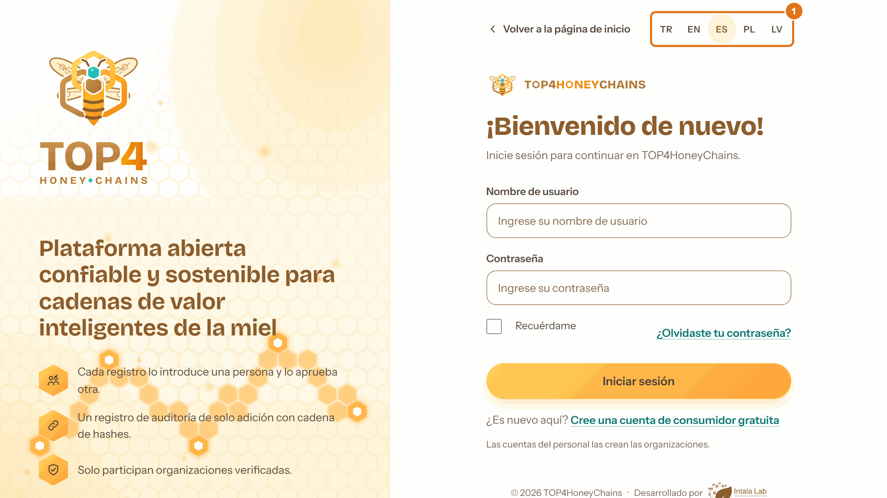

Después de iniciar sesión, el menú de idioma con una bandera está en la barra superior.

## Iniciar sesión

1. En la página de inicio, seleccione **Iniciar sesión**.
2. Ingrese su nombre de usuario en **Nombre de usuario**.
3. Ingrese su contraseña en **Contraseña**.
4. Seleccione **Iniciar sesión**.

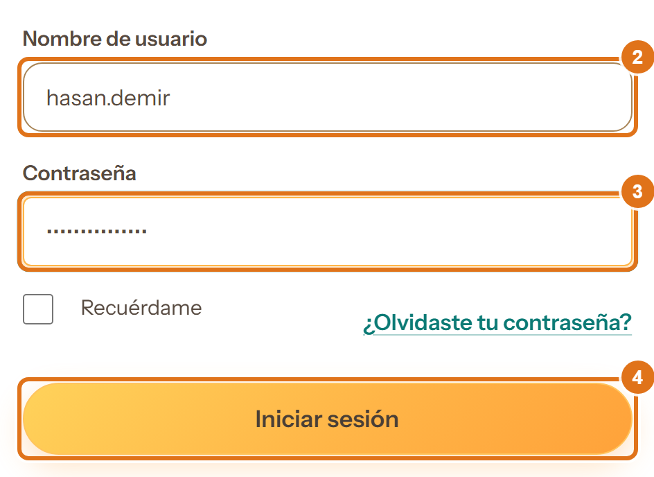

Usted ve **Mis tareas**, su lista de tareas. Los apicultores ven su portal ([Portal del apicultor](#ch-portal)) y los consumidores ven **Mis mieles** ([Cuenta de consumidor](#ch-consumer)).

> [!NOTE]
> Las cuentas del personal las crean las organizaciones y los administradores de la plataforma. Los consumidores crean su propia cuenta con **Cree una cuenta de consumidor gratuita**, debajo del formulario de inicio de sesión.

## Iniciar sesión por primera vez {#sec-first-sign-in}

Sus datos de acceso llegan por SMS: su nombre de usuario y una contraseña temporal de 10 caracteres, con la dirección de la plataforma. La contraseña temporal es válida durante 72 horas.

1. Inicie sesión con el nombre de usuario y la contraseña temporal del SMS.
2. Se abre la página **Elija su contraseña**. Ingrese su contraseña nueva en **Nueva contraseña** y otra vez en **Confirme la contraseña**. Use al menos 10 caracteres, no use su nombre de usuario ni una contraseña común.
3. Seleccione **Actualizar contraseña**.

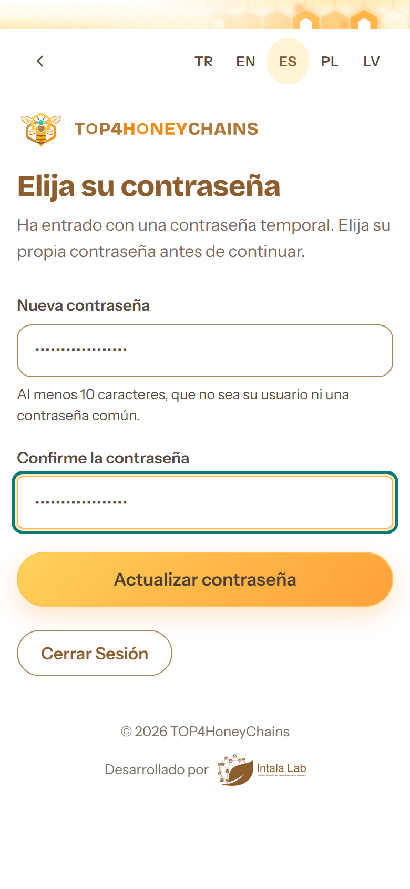

## Confirmar el aviso de privacidad {#sec-notice}

Antes de trabajar con datos personales, usted confirma que leyó el aviso de privacidad. Una barra amarilla se lo recuerda hasta que lo hace.

1. Seleccione **Leer y confirmar** en la barra amarilla.

   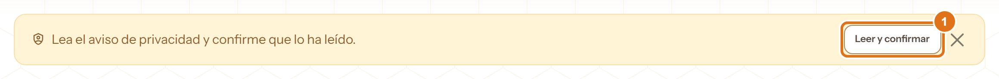

2. Lea el aviso y marque **He leído el aviso anterior.**
3. Seleccione **Confirmar**.

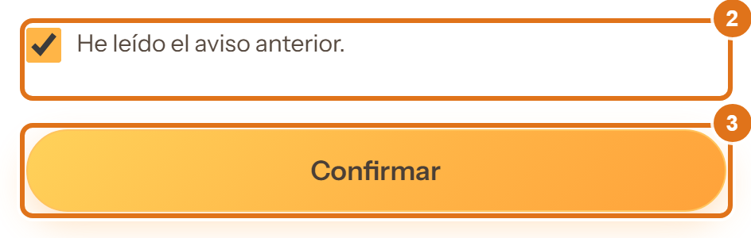

> [!NOTE]
> Los roles que firman registros (Administrador de la organización, Responsable de cumplimiento, Responsable de registro de apicultores, Responsable de aseguramiento de la calidad, Responsable de laboratorio) confirman el aviso con un código. La página muestra su **Teléfono móvil**: seleccione **Enviar código** y escriba el código del SMS en **Código del SMS (6 dígitos)** antes de seleccionar **Confirmar**.

## Orientarse en la pantalla {#sec-screen}

**Mis tareas** es su página de inicio y su lista de tareas. Todo lo que espera por usted aparece allí en grupos, por ejemplo **Valores por ingresar**, **Valores por aprobar**, **Muestras por recibir** o **Resultados de laboratorio por ingresar**. Seleccione un elemento para abrir la página donde se hace el trabajo. Cuando no hay nada pendiente, la página dice **No hay nada pendiente para usted.** y muestra las páginas que puede abrir.

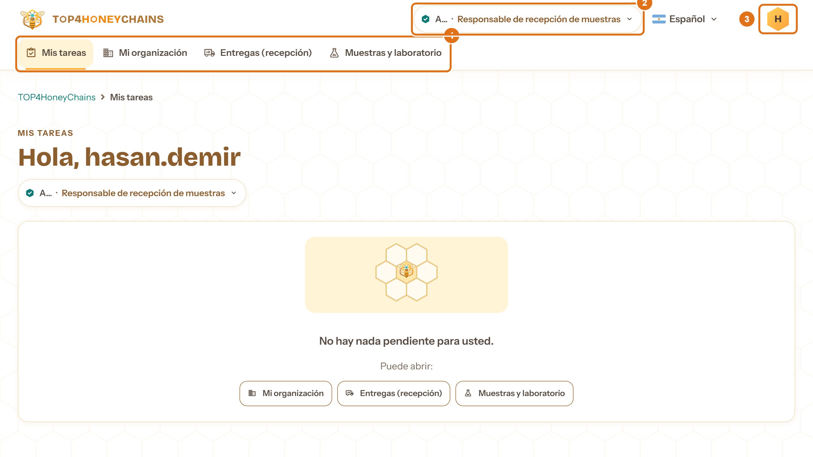

Las marcas de la imagen muestran:

1. El menú con las páginas de su rol. **Mis tareas** y **Mi organización** están siempre; los demás elementos dependen de su rol y de su organización.
2. Su organización y su rol. Si tiene más de un rol, selecciónelo para cambiar a otro rol.
3. El menú de usuario, en el botón redondo con su inicial.

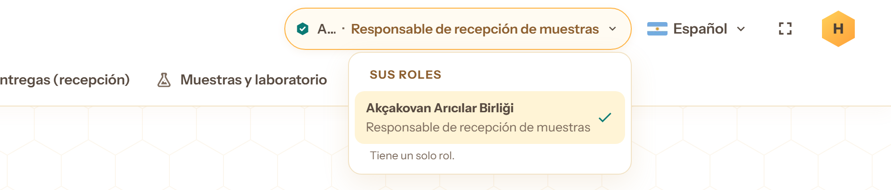 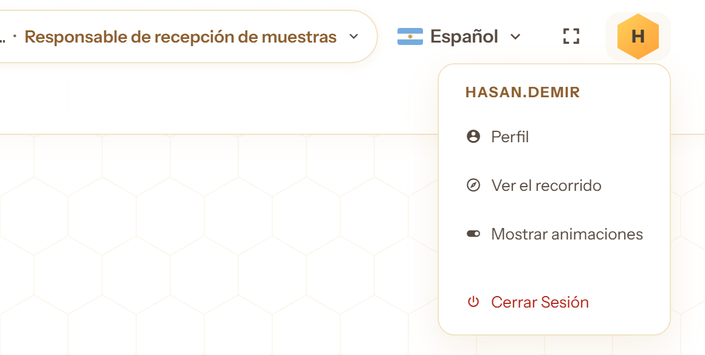

El menú de usuario tiene estos elementos:

Table: Las partes de la pantalla {#tbl-screen}

| Elemento | Qué hace |
| --- | --- |
| **Perfil** | Muestra su nombre de usuario y le permite verificar su teléfono móvil y cambiar su contraseña. |
| **Ver el recorrido** | Vuelve a abrir el breve recorrido por la pantalla. |
| **Mostrar animaciones** | Activa o desactiva las escenas breves que muestran lo que hace un botón. |
| **Cerrar Sesión** | Cierra su sesión. |

## Cerrar sesión

Abra el menú de usuario y seleccione **Cerrar Sesión**. En una computadora compartida, cierre siempre la sesión al irse.

## Hacer el recorrido

Cuando usted abre la plataforma por primera vez con un rol, un breve recorrido muestra las partes más importantes de la pantalla. Seleccione **Siguiente** para continuar o **Saltar el recorrido** para cerrarlo. Puede volver a abrirlo con **Ver el recorrido** en el menú de usuario.

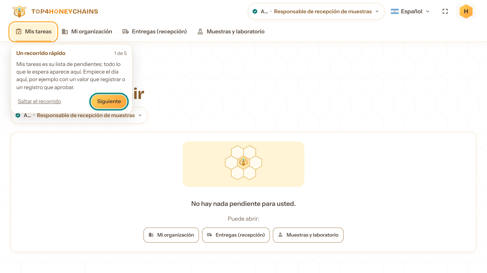

## Verificar su teléfono móvil

Con un teléfono móvil verificado puede restablecer por SMS una contraseña olvidada.

1. Abra el menú de usuario y seleccione **Perfil**.
2. Ingrese su número en **Número de teléfono** y seleccione **Enviar código**.
3. Escriba el código en **Código del SMS (6 dígitos)** y seleccione **Confirmar**. Un número nuevo se usa solo después de que usted ingresa el código enviado a ese número.

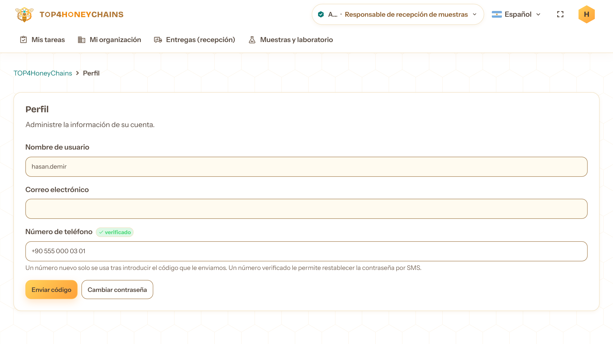

## Restablecer una contraseña olvidada

1. En la página de inicio de sesión, seleccione **¿Olvidaste tu contraseña?**.
2. Ingrese su nombre de usuario en **Nombre de usuario** y seleccione **Enviar código**.

   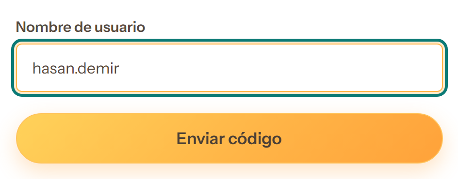

3. En la página **Crear nueva contraseña**, escriba el código del SMS en **Código del SMS (6 dígitos)**. El código es válido durante 5 minutos.
4. Ingrese su contraseña nueva en **Nueva contraseña** y **Confirme la contraseña**, y guárdela.

> [!NOTE]
> El código se envía solo a un teléfono móvil verificado. Si no tiene uno, pida a la persona que le dio sus datos de acceso que le envíe datos nuevos.

# Responsable de registro de apicultores {#ch-ro}

El Responsable de registro de apicultores de una dirección distrital inscribe a los apicultores en la plataforma. Una inscripción confirma tres cosas: el número del registro nacional, el teléfono móvil del apicultor (con un código enviado a ese teléfono) y su declaración de que usted vio el documento de identidad y la constancia del registro.

Table: Tareas del responsable de registro de apicultores {#tbl-tasks-ro}

| Tarea | Dónde |
| --- | --- |
| Buscar un apicultor o iniciar una inscripción | **Registro de apicultores** |
| Inscribir a un apicultor nuevo | **Registro de apicultores > Buscar o registrar** |
| Agregar otro colmenar | el formulario de inscripción o la página de la inscripción |
| Enviar los datos de acceso | la página de la inscripción |

## Buscar un apicultor o iniciar una inscripción {#sec-find-beekeeper}

La página **Registro de apicultores** enumera los apicultores que inscribió su organización.

1. Seleccione **Registro de apicultores** en el menú.
2. Ingrese el número de registro en **Número de registro (AKS) o número de explotación**.
3. Seleccione **Buscar o registrar**.

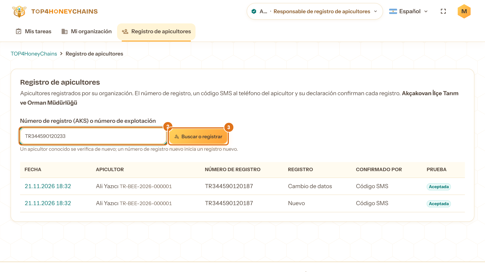

Un apicultor conocido se vuelve a verificar: el formulario se abre con los datos guardados. Un número de registro nuevo inicia una inscripción nueva.

## Inscribir a un apicultor nuevo

Haga esto con el apicultor delante de usted, con su documento de identidad y su teléfono móvil.

1. Busque el número de registro como se describe en [Buscar un apicultor o iniciar una inscripción](#sec-find-beekeeper). Se abre el formulario **Registrar un apicultor**.
2. Complete las secciones 1 y 2.

   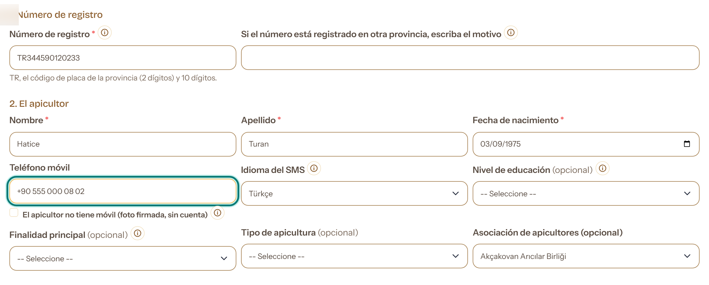

3. En la sección **3. Colmenar**, defina la posición del colmenar: haga clic en el mapa o arrastre el marcador, seleccione **Usar mi ubicación**, o escriba **Latitud de la ubicación** y **Longitud de la ubicación**. Ingrese **Número de colmenas** y después **Provincia**, **Distrito** y **Localidad (pueblo, meseta, paraje)**. El título del colmenar se forma con estos tres datos, por ejemplo `İstanbul – Şile – Sofular`.

   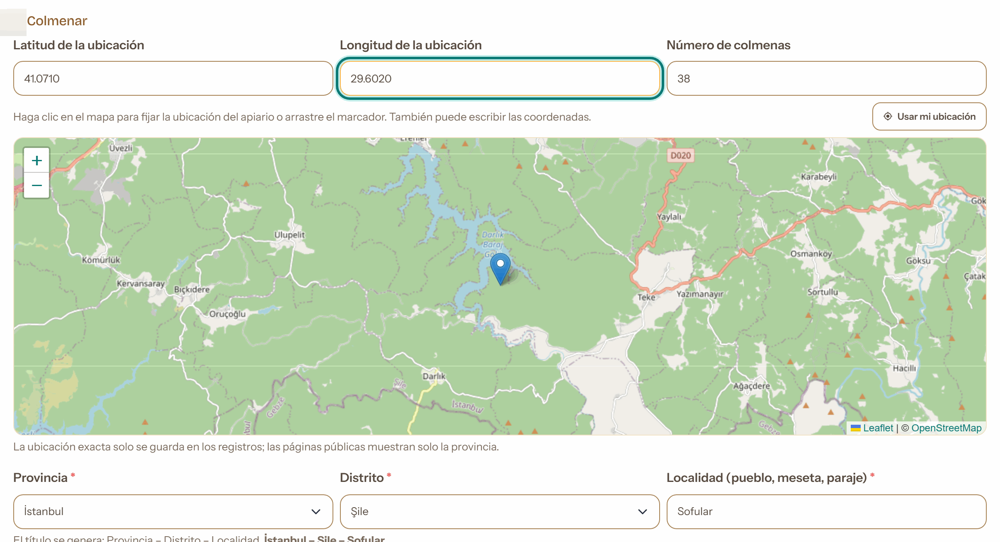

4. Deje que el apicultor lea el aviso de la sección 4, o léalo en voz alta. Marque los consentimientos que otorga el apicultor: el nombre en páginas públicas y los avisos por SMS. Ambos son opcionales.
5. En la sección **5. Su declaración**, marque la declaración. Marque **Enviar también al apicultor los datos de acceso por SMS** si el apicultor va a usar el portal.

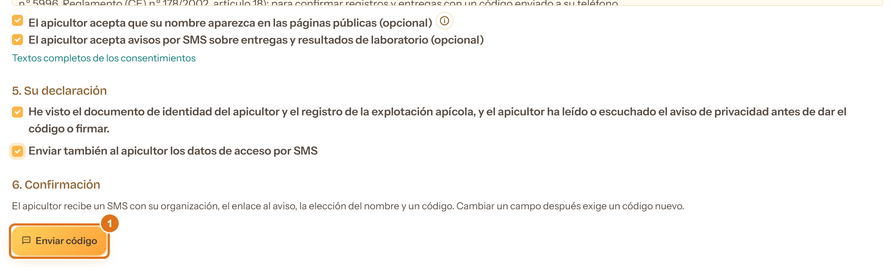

Los campos de las secciones 1 y 2:

Table: Los campos del formulario de inscripción {#tbl-reg-fields}

| Campo | Qué ingresar | Obligatorio |
| --- | --- | --- |
| **Número de registro** | TR, el código de patente de 2 dígitos de la provincia y 10 dígitos | sí |
| **Si el número está registrado en otra provincia, escriba el motivo** | solo cuando la provincia del registro es distinta de la de su dirección | no |
| **Nombre**, **Apellido**, **Fecha de nacimiento** | como en el documento de identidad | sí |
| **Teléfono móvil** | el número propio del apicultor; recibe el código y los datos de acceso | sí, salvo que el apicultor no tenga teléfono móvil |
| **Idioma del SMS** | el idioma de los mensajes y del portal del apicultor | sí |
| **Nivel de educación**, **Finalidad principal**, **Tipo de apicultura** | las respuestas del apicultor | no |
| **Asociación de apicultores (opcional)** | la asociación a la que pertenece el apicultor | no |

> [!NOTE]
> La posición exacta del colmenar se guarda solo en los registros. Las páginas públicas muestran la provincia.

### Confirmar con el código

1. Seleccione **Enviar código**. El apicultor recibe un SMS con el nombre de su organización, un enlace al aviso, la elección sobre su nombre y un código.
2. Escriba en **Código del SMS (6 dígitos)** el código que le lee el apicultor.
3. Seleccione **Confirmar el registro**.

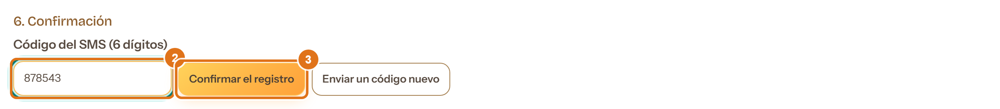

Se abre la página de la inscripción con el mensaje **El apicultor está registrado y verificado**. El apicultor tiene un número de explotación (por ejemplo, `TR-BEE-2026-000002`); la prueba figura como **Aceptada** y el número de registro como **Verificada**.

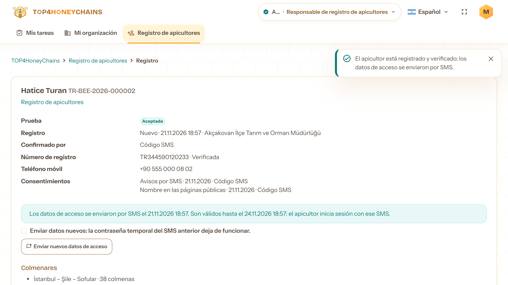

> [!IMPORTANT]
> Cambiar cualquier campo después de enviar el código invalida el código. Envíe un código nuevo con **Enviar un código nuevo**.

## Agregar otro colmenar

Un apicultor puede tener varios colmenares. En el formulario, agréguelos antes de enviar el código:

1. Seleccione **Añadir colmenar** debajo del primer colmenar. Aparece un bloque nuevo **Colmenar 2**.
2. Complete sus coordenadas, colmenas y lugar. El mapa define solo el primer colmenar; escriba las coordenadas de los demás. Seleccione **Quitar** para borrar un bloque que no necesita.

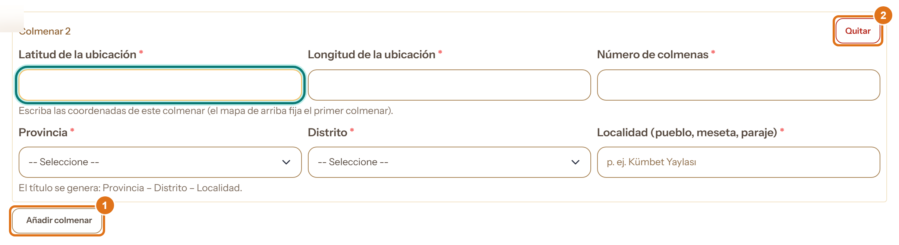

Para un apicultor ya inscrito, abra la página de la inscripción y use **Añadir un colmenar** debajo de **Apiarios**.

## Enviar al apicultor los datos de acceso {#sec-send-signin}

Si marcó **Enviar también al apicultor los datos de acceso por SMS**, los datos se envían con la inscripción. Si no, abra la página de la inscripción y seleccione **Enviar datos de acceso por SMS**. El nombre de usuario del apicultor es el número de explotación.

Para enviar datos nuevos, marque **Enviar datos nuevos: la contraseña temporal del SMS anterior deja de funcionar.** y seleccione **Enviar nuevos datos de acceso**.

## Inscribir a un apicultor sin teléfono móvil {#sec-register-no-phone}

Si el apicultor no tiene teléfono móvil, marque **El apicultor no tiene móvil (foto firmada, sin cuenta)**. En la sección 6, abra **Sin SMS posible: foto firmada**, escriba el motivo en **Por qué no hay código SMS**, use **Imprimir el formulario**, haga que el apicultor lo firme y suba su foto en **Foto del formulario firmado**. Seleccione **Guardar con la foto firmada**. La inscripción queda en espera hasta que el Responsable de cumplimiento de su organización acepta o rechaza la foto; usted no puede decidir sobre su propia inscripción.

# Responsable de recepción de muestras: entrega de miel {#ch-sao}

El Responsable de recepción de muestras de una planta registra cada entrega de miel. Cada envase se registra con sus precintos; con su contenido se llenan y se precintan un frasco de muestra y un frasco de contramuestra, y el apicultor confirma toda la entrega con un código enviado por SMS. Cada entrega se convierte en un lote de miel cruda de su organización.

Table: Tareas del responsable de recepción de muestras {#tbl-tasks-sao}

| Tarea | Dónde |
| --- | --- |
| Ver las entregas | **Entregas (recepción)** |
| Registrar una entrega de miel | **Entregas (recepción) > Registrar una entrega** |
| Imprimir las etiquetas | la página de la entrega |
| Ingresar el PCC 0 | **Mis tareas > Valores por ingresar** |

## Ver las entregas

Seleccione **Entregas (recepción)** en el menú. La lista muestra cada lote con su fecha, colmenar, tipo de miel, cantidad, origen y la forma en que lo confirmó el apicultor. **Entrega** abre una entrega; **Retiro**, su informe de retiro.

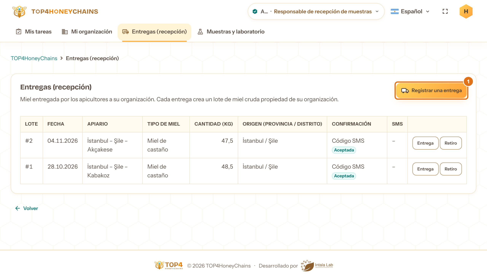

## Registrar una entrega de miel {#sec-record-delivery}

1. Seleccione **Registrar una entrega**.
2. Ingrese el número del apicultor en **Número de explotación o de registro del apicultor**.
3. Seleccione **Buscar**.

   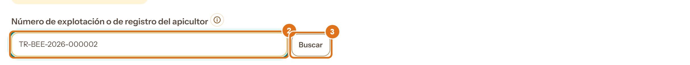

4. Complete la sección **1. La entrega**. La lista de colmenares muestra cada colmenar del apicultor con sus colmenas; si hay más de uno, elija el correcto.

   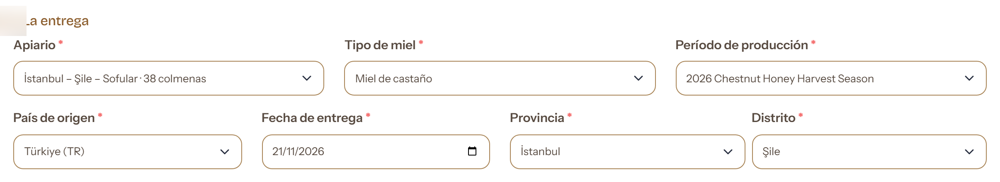

5. En la sección **2. Envases y muestras**, complete una fila por envase. Seleccione **Añadir un envase** para cada envase adicional y **Quitar la fila** para una fila que no necesita.

   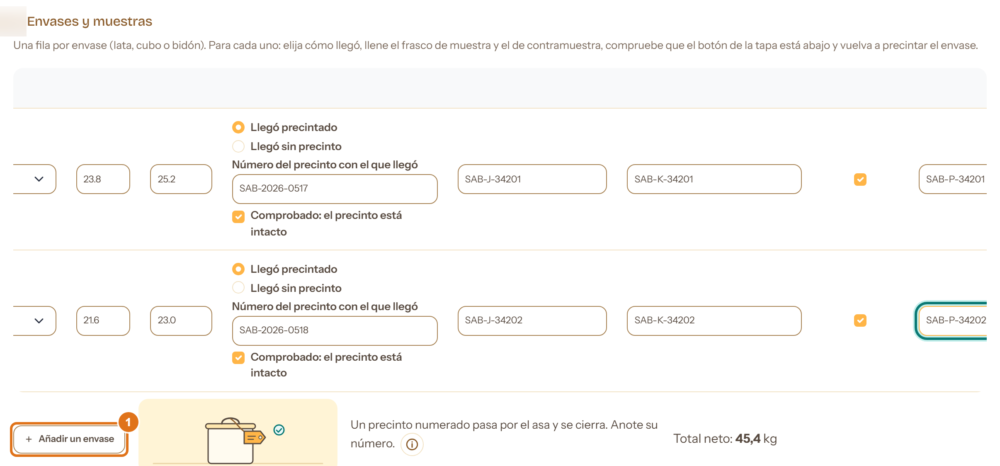

   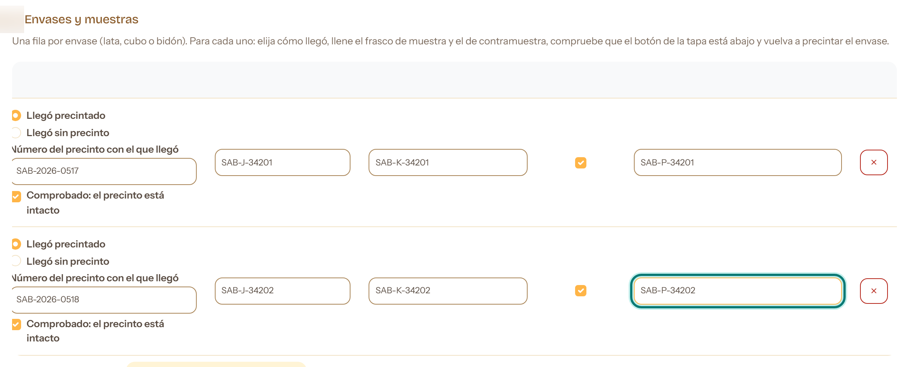

6. En la sección **3. Laboratorio y contramuestras**, elija el **Laboratorio**, escriba **Dónde se guardan las contramuestras** y la fecha en **Conservar hasta**.

Los campos de la sección 1:

Table: Los campos de una entrega {#tbl-delivery-fields}

| Campo | Qué ingresar | Obligatorio |
| --- | --- | --- |
| **Apiario** | de dónde viene la miel | sí |
| **Tipo de miel**, **Período de producción** | según lo entregado | sí |
| **País de origen** | el país de la miel | sí |
| **Fecha de entrega** | el día de la entrega | sí |
| **Provincia**, **Distrito** | el origen de la miel | sí |

Las columnas de la sección 2, una fila por envase:

Table: Las columnas de la tabla Envases y muestras {#tbl-containers}

| Columna | Qué ingresar |
| --- | --- |
| **Tipo** | lata, balde o tambor |
| **Kg netos**, **Kg brutos** | los pesos del envase |
| **A la llegada** | **Llegó precintado**: el **Número del precinto con el que llegó**, y marque **Comprobado: el precinto está intacto**. **Llegó sin precinto**: el número del **Precinto nuevo, puesto ahora delante del apicultor**. |
| **Precinto del frasco** | el precinto del frasco de muestra llenado con este envase |
| **Precinto de contramuestra** | el precinto del frasco de contramuestra |
| **Tapa intacta** | márquelo cuando el botón de la tapa del frasco está abajo |
| **Precinto nuevo tras el muestreo** | el precinto que usted coloca en el envase después de tomar las muestras |

> [!IMPORTANT]
> Cada número de precinto de la entrega debe ser distinto.

### Confirmar la entrega con el código del apicultor

1. Seleccione **Enviar código**. El apicultor recibe un SMS con la fecha, los envases, los kilogramos, el tipo de miel, la cantidad de muestras y un código.

   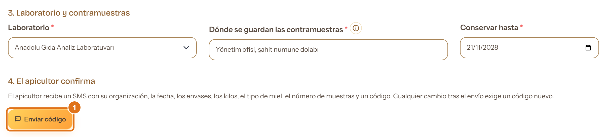

2. Escriba el código en **Código del SMS (6 dígitos)**. Si el apicultor no está presente, llámelo: él lee el código en su teléfono.
3. Seleccione **Confirmar la entrega**.

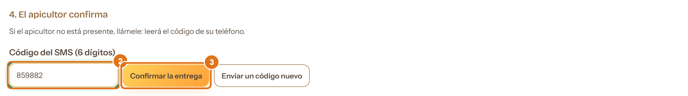

Se abre la página de la entrega con el mensaje **Entrega confirmada por el apicultor y registrada como lote #3.** El lote aparece ahora en **Mi organización** y sus puntos de control, en **Mis tareas**.

Si no es posible enviar un SMS, abra **Sin SMS posible: foto firmada**, indique el motivo, tome o suba la foto del formulario de entrega firmado y seleccione **Registrar con la foto firmada**. El Responsable de cumplimiento la revisa.

## Imprimir las etiquetas

La página de la entrega muestra cada envase con su historial de precintos y sus frascos de muestra.

1. Seleccione **Etiquetas (hoja A4)**, o **Etiquetas (100 × 50 mm)** para una impresora de etiquetas.

   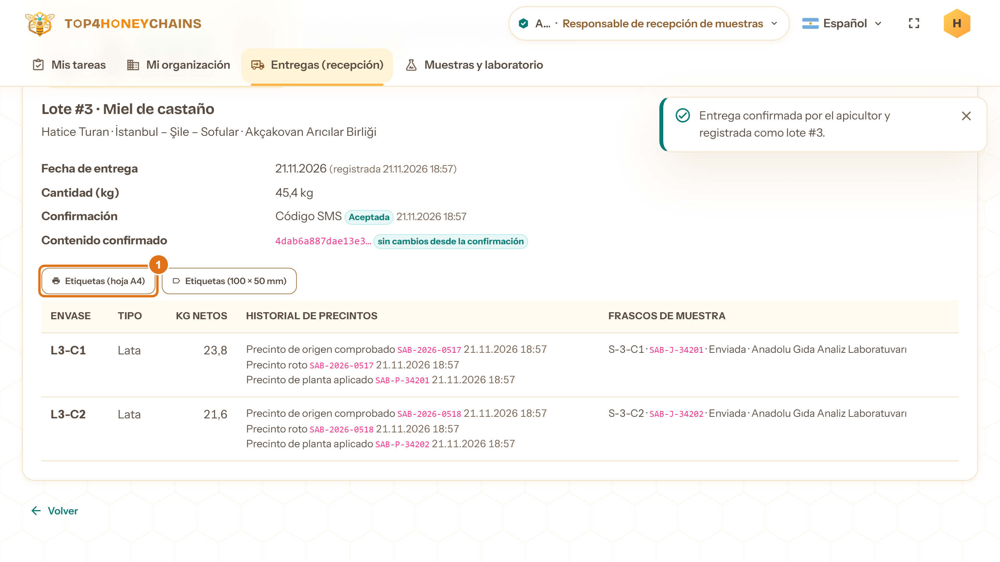

2. Seleccione **Imprimir el formulario** y pegue cada etiqueta en su envase, su frasco de muestra y su frasco de contramuestra.

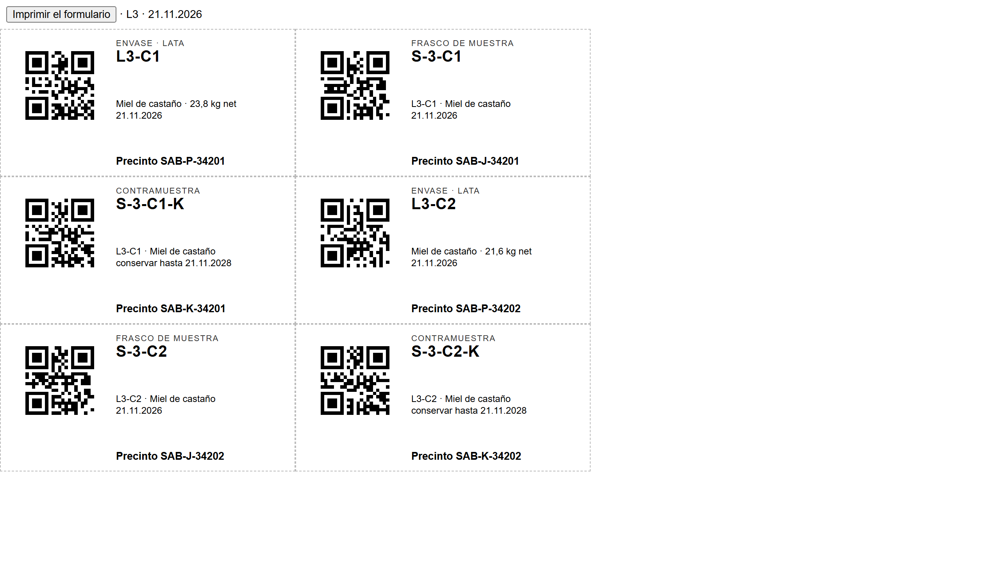

## Ingresar el PCC 0 (auditoría primaria)

El PCC 0 registra la auditoría primaria de la entrega: higiene, agua, control de plagas y almacenamiento en el lugar del apicultor.

1. Abra **Mis tareas** y seleccione **PCC 0** en **Valores por ingresar**.

   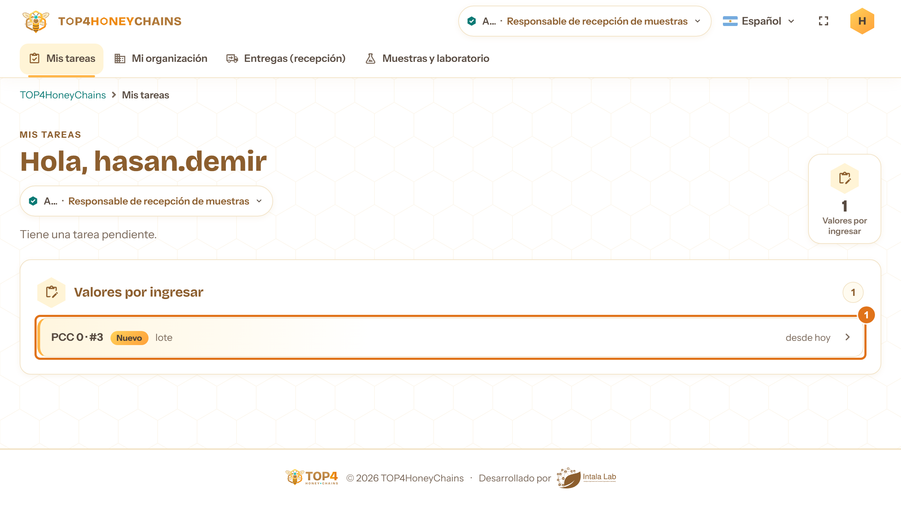

2. Responda cada pregunta y agregue notas donde sea útil.

   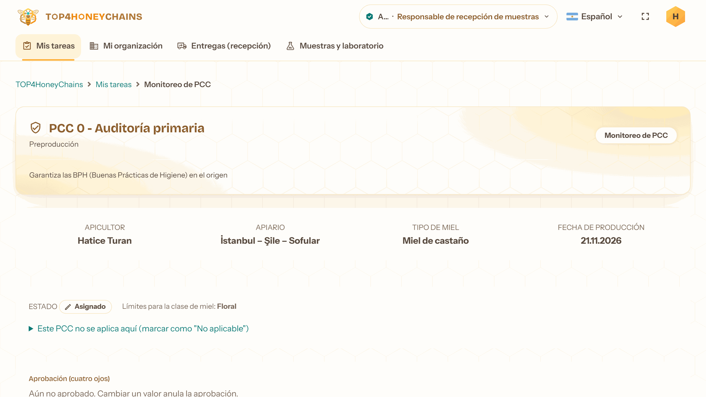

3. Seleccione **Guardar registros de monitoreo**.

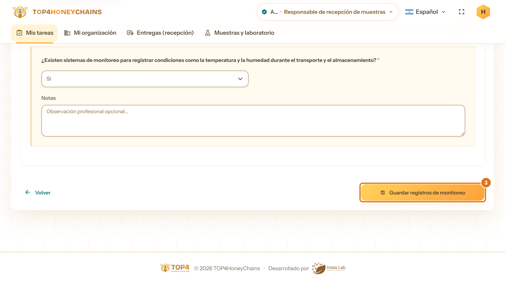

Después lo aprueba el Responsable de aseguramiento de la calidad ([Aprobar el PCC 0](#sec-approve-ccp0)). El **PCC 1** se completa con el informe aprobado del laboratorio; usted no lo ingresa.

> [!TIP]
> Si un punto de control no se aplica, abra **Este PCC no se aplica aquí (marcar como "No aplicable")** e indique el motivo.

# Laboratorio: analista y responsable de laboratorio {#ch-lab}

El laboratorio controla el precinto de cada frasco de muestra a la llegada, prepara una muestra compuesta de cada lote, ingresa los resultados con el informe firmado y deja que el Responsable de laboratorio los apruebe. El informe aprobado pasa a ser el PCC 1 del lote.

Table: Tareas en el laboratorio {#tbl-tasks-lab}

| Tarea | Quién | Dónde |
| --- | --- | --- |
| Recibir los frascos de muestra | Analista | **Muestras y laboratorio** |
| Preparar la muestra compuesta | Analista | **Muestras y laboratorio** |
| Ingresar y enviar los resultados | Analista | el informe de laboratorio |
| Aprobar o devolver un informe | Responsable de laboratorio | **Mis tareas** |

## Recibir los frascos de muestra

Mis tareas enumera los frascos en espera en **Muestras por recibir**.

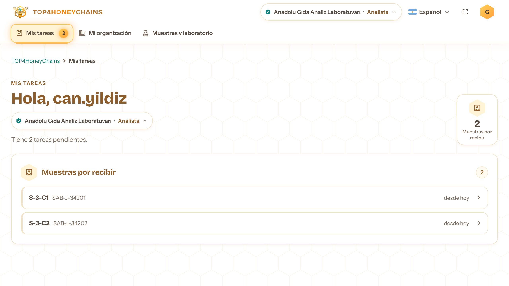

1. Seleccione **Muestras y laboratorio** en el menú. Los frascos se enumeran en **Muestras enviadas a su laboratorio**.
2. Para cada frasco, responda **El número de precinto coincide con el registro**, **La etiqueta está intacta** y **La tapa está intacta (botón abajo)**. Si falla un control, escriba el motivo en **Motivo si falla una comprobación**.
3. Seleccione **Registrar la recepción**.

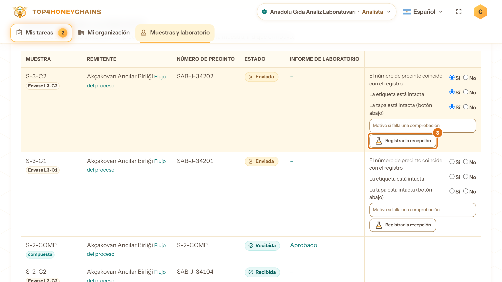

Un precinto roto rechaza la muestra; la planta toma entonces una muestra nueva de la contramuestra.

## Preparar la muestra compuesta

Cuando todos los frascos de un lote llegaron en buen estado, el lote aparece en **Lotes listos para la muestra compuesta**.

1. Seleccione **Hacer la muestra compuesta** para el lote. Mezcle partes iguales de los frascos en una muestra compuesta; los frascos se conservan para análisis individuales.

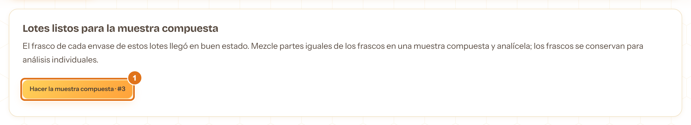

Se abre el informe de laboratorio de la muestra compuesta.

## Ingresar los resultados

1. Ingrese el **Número del informe** y la **Fecha de emisión**.
2. Seleccione **Elegir PDF** y adjunte el informe firmado.
3. Ingrese el valor de cada parámetro. La columna **Límite** muestra el límite de cada valor.
4. Seleccione **Guardar**.

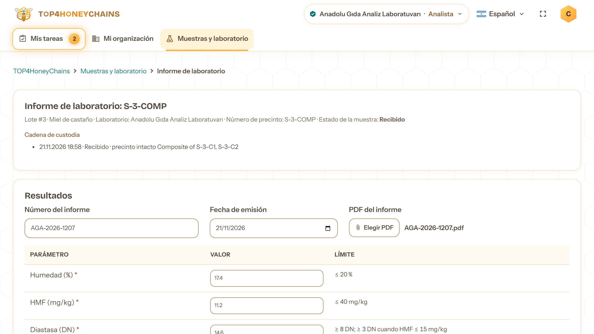

La línea **Valores obligatorios introducidos** muestra cuántos valores faltan todavía.

## Enviar el informe

Cuando todos los valores obligatorios están guardados, seleccione **Enviar para aprobación**.

1. Seleccione **Enviar para aprobación**.

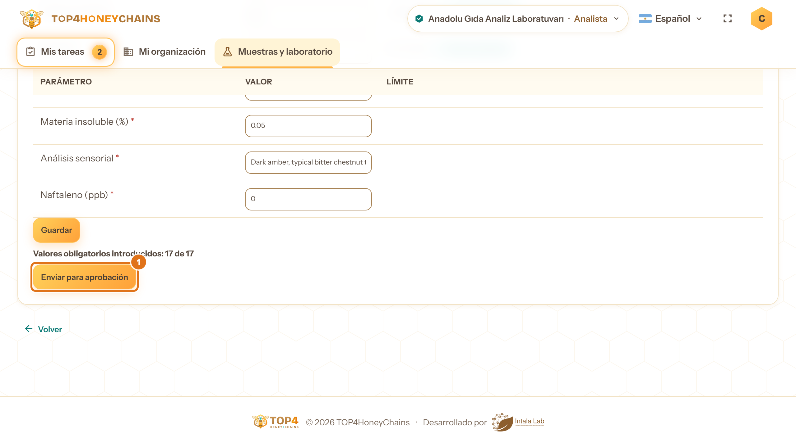

El Responsable de laboratorio encuentra el informe en **Mis tareas**.

## Aprobar o devolver un informe

El Responsable de laboratorio controla el informe y su PDF.

1. Seleccione **Aprobar**. Para devolverlo, escriba el motivo en **motivo (para devolver)** y seleccione **Devolver**.

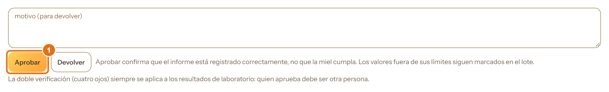

Aprobar confirma que el informe está registrado correctamente, no que la miel cumple los requisitos. Los valores fuera de sus límites siguen marcados en el lote. Los resultados aprobados completan el PCC 1 del lote, y el informe recibe un código que cualquier persona puede consultar.

## Verificar un informe de laboratorio {#sec-verify-report}

Cualquier persona puede consultar un informe sin iniciar sesión: abra **Verificar un informe de laboratorio** en la página de inicio, ingrese el **Código del informe** y seleccione **Consultar**. La página muestra el estado, el laboratorio, su acreditación, el número del informe, la fecha de emisión y la huella SHA-256 del archivo del informe.

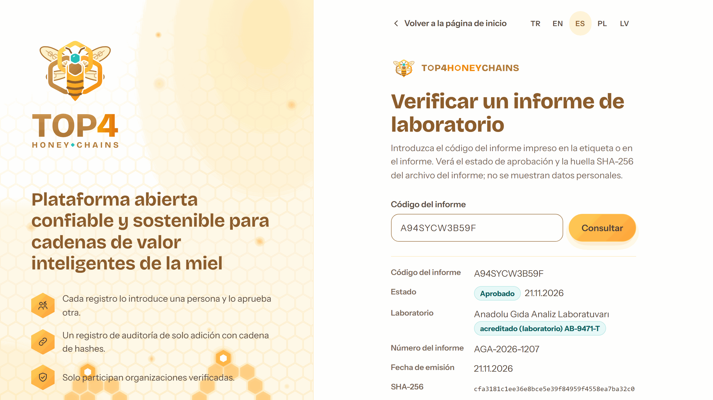

# Personal: procesamiento y envasado {#ch-staff}

El Personal de una planta completa las hojas de control de los lotes y de las partidas, reúne lotes aprobados en partidas, solicita la finalización de una partida y envía miel a otras organizaciones.

Table: Tareas del personal {#tbl-tasks-staff}

| Tarea | Dónde |
| --- | --- |
| Ver sus lotes y partidas | **Mi organización** |
| Completar la hoja de control de un lote | **Mi organización > Hoja de control** |
| Crear una partida | **Mi organización > Nueva partida** |
| Completar la hoja de control de una partida | **Mis tareas** o la página de la partida |
| Solicitar la finalización | la página de la partida |
| Enviar miel | **Envíos y existencias** |

## Ver sus lotes y partidas

**Mi organización** muestra su organización, los **Lotes de miel cruda** con los que trabaja y sus **Partidas**. Cada punto de control es una etiqueta: verde con ✓ está aprobado, amarillo está enviado y espera aprobación, gris está abierto, solo con contorno no se aplica.

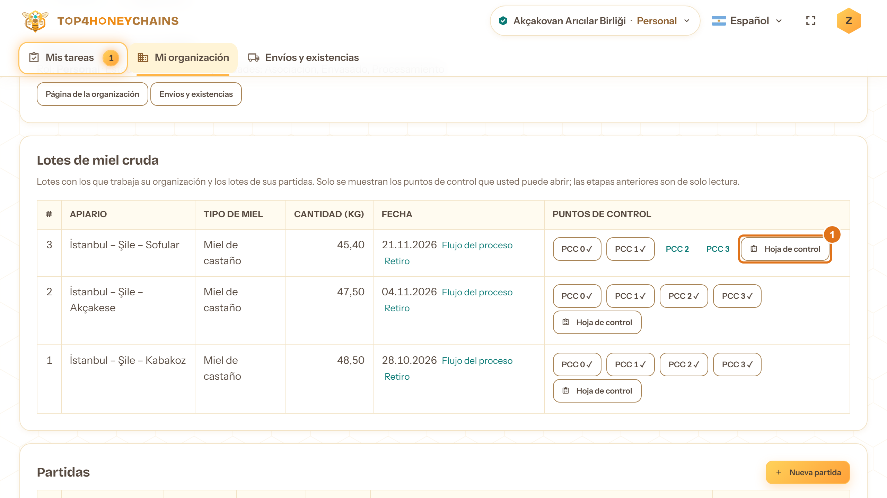

## Completar la hoja de control de un lote (PCC 2 y 3)

La hoja de control muestra todos los puntos de control de un lote en una página. Cada uno conserva su propio registro, su estado y su aprobación.

1. Seleccione **Hoja de control** en la fila del lote, o el elemento en **Mis tareas**.
2. Ingrese los valores del **PCC 2** (calentamiento) y del **PCC 3** (filtración).

   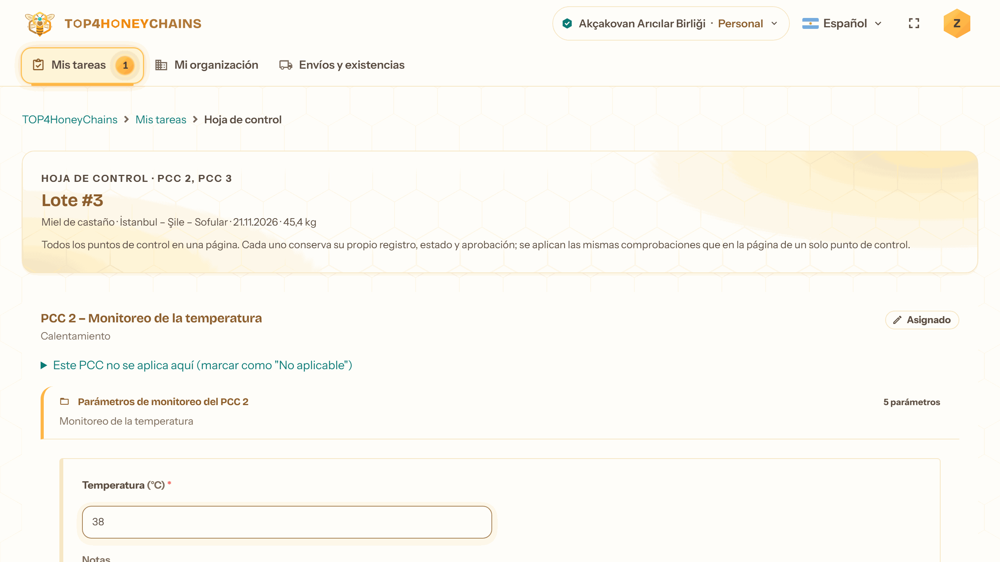

3. Seleccione **Guardar la hoja**.

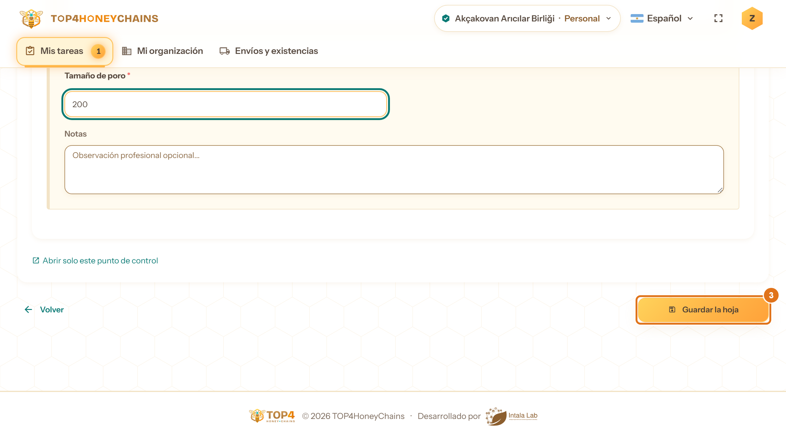

El Responsable de aseguramiento de la calidad aprueba la hoja ([Aprobar una hoja de control](#sec-approve-sheet)).

> [!TIP]
> **Abrir solo este punto de control** abre un punto de control en su propia página, por ejemplo para adjuntar un archivo.

## Crear una partida {#sec-new-batch}

Un lote está listo para una partida cuando todos sus puntos de control están completos y aprobados.

1. En **Mi organización**, seleccione **Nueva partida**.
2. Ingrese el **Nombre de la partida**, por ejemplo `Şile Kestane Balı 2026/2`, y controle la **Fecha de producción**.
3. Marque **Usar** para cada lote que entra en la partida y controle los **Kilogramos para esta partida**.
4. Seleccione **Crear partida**.

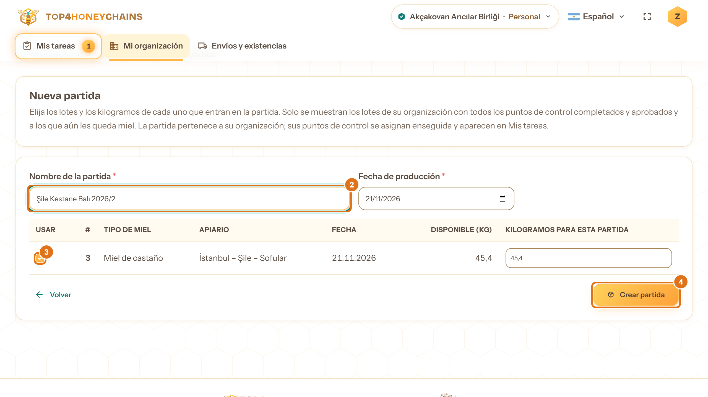

La partida pertenece a su organización. Sus puntos de control PCC 4 a PCC 10 aparecen de inmediato en Mis tareas.

## Completar la hoja de control de una partida (PCC 4 a 10)

Abra la hoja de control de la partida desde **Mis tareas** o con **Abrir la hoja de control** en la página de la partida. Ingrese los valores de homogeneización, pasteurización, decantación, llenado, etiquetado, envasado y almacenamiento, y después seleccione **Guardar la hoja**.

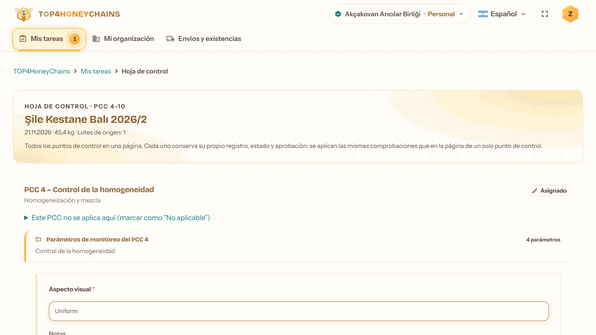

## Solicitar la finalización {#sec-request-finalizing}

Cuando todos los puntos de control de la partida y de sus lotes están aprobados, pida que se finalice la partida.

1. En la página de la partida, seleccione **Solicitar la finalización**.

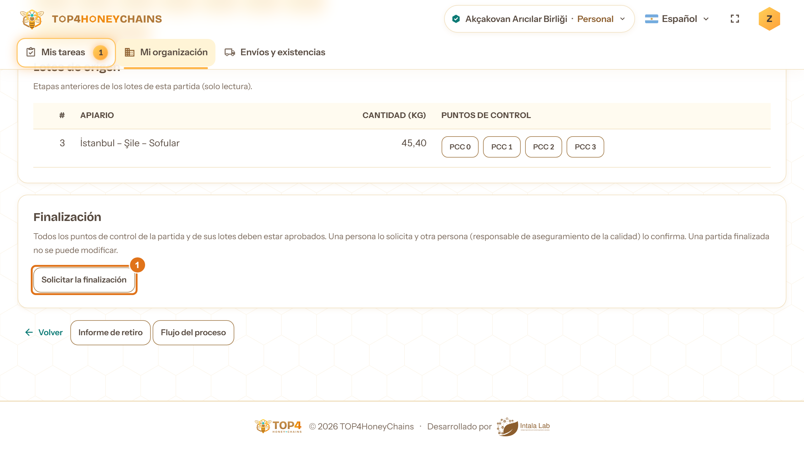

Si falta algo, la página lo enumera en **Falta antes de finalizar:**. El Responsable de aseguramiento de la calidad confirma la solicitud ([Finalizar una partida](#sec-finalize)).

## Enviar miel a otra organización

1. Seleccione **Envíos y existencias** en el menú y seleccione **Enviar** en la fila de la partida.

   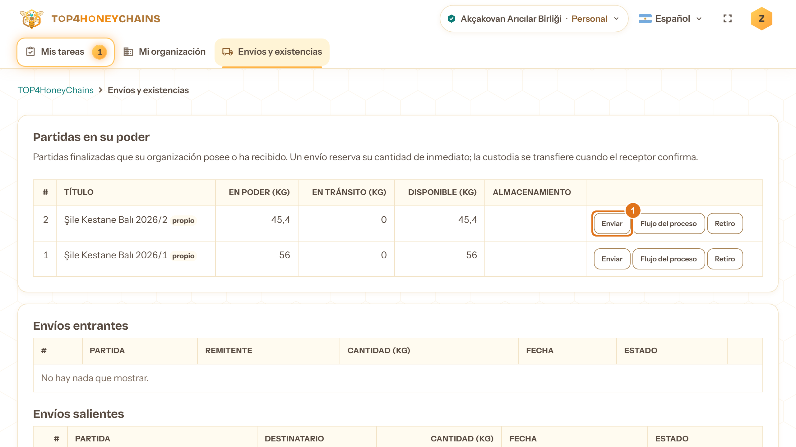

2. Elija la organización receptora en **Destinatario**.
3. Ingrese la **Cantidad (kg)** y, si es útil, una **Nota**.
4. Seleccione **Enviar**.

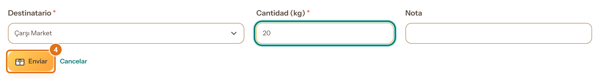

Un envío reserva su cantidad de inmediato; la custodia pasa al receptor cuando este lo confirma.

# Responsable de aseguramiento de la calidad {#ch-qao}

El Responsable de aseguramiento de la calidad aprueba lo que otros ingresaron: el PCC 0 de cada entrega, las hojas de control de lotes y partidas, la finalización de las partidas y, en un mayorista o un minorista, los registros de almacenamiento. También responde los comentarios de los consumidores. Usted nunca aprueba un registro que ingresó personalmente.

Table: Tareas del Responsable de aseguramiento de la calidad {#tbl-tasks-qao}

| Tarea | Dónde |
| --- | --- |
| Aprobar el PCC 0 | **Mis tareas > Valores por aprobar** |
| Aprobar una hoja de control | **Mis tareas > Valores por aprobar** |
| Finalizar una partida | **Mis tareas**, la página de la partida |
| Responder comentarios de consumidores | **Comentarios de consumidores** |

## Aprobar el PCC 0 {#sec-approve-ccp0}

1. Abra **Mis tareas** y seleccione el elemento en **Valores por aprobar**.

   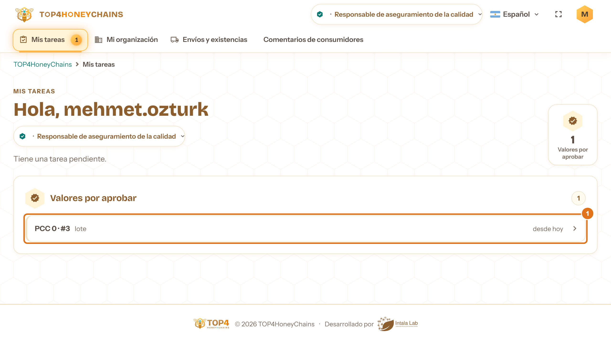

2. Controle los valores y seleccione **Aprobar**.

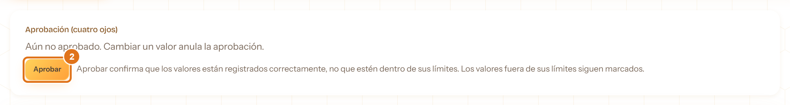

Aprobar confirma que los valores están registrados correctamente, no que están dentro de sus límites. Si un valor está fuera de su límite, la página le pide que lo confirme antes de aprobar.

## Aprobar una hoja de control {#sec-approve-sheet}

1. Abra la hoja de control desde **Mis tareas**.
2. Controle los valores. En **Aprobar la hoja**, la página enumera los puntos de control que usted aprueba; seleccione **Aprobar todo lo de la lista**.

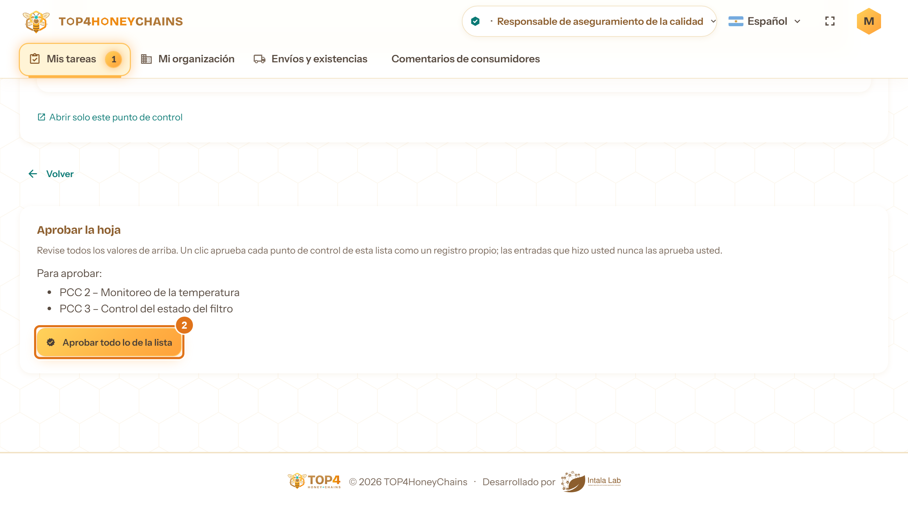

Cada punto de control de la lista se aprueba como un registro propio. Las entradas que usted hizo personalmente se enumeran en **No los aprueba usted:** y necesitan a otro responsable.

## Finalizar una partida {#sec-finalize}

Después de que el Personal solicitó la finalización, la partida aparece en sus Mis tareas.

1. Abra la página de la partida desde **Mis tareas**.
2. Seleccione **Confirmar y finalizar**.

La partida queda finalizada y sellada. **Abrir la Historia de la miel** muestra su página pública y **Descargar QR** entrega el código QR para las etiquetas de los frascos.

> [!WARNING]
> Una partida finalizada no puede modificarse. Sus datos, su composición y sus puntos de control quedan bloqueados. Un valor solo puede cambiarse entonces mediante una corrección aprobada por dos administradores de la plataforma.

## Responder comentarios de consumidores {#sec-answer-feedback}

Los consumidores pueden enviar comentarios sobre una miel a la organización que la produjo. Usted lee solo el código del consumidor, nunca su nombre de usuario ni su teléfono, y los comentarios nunca son públicos.

1. Seleccione **Comentarios de consumidores** en el menú y abra el comentario.
2. Escriba su respuesta en **Su respuesta al consumidor**.
3. Seleccione **Enviar respuesta**.

El consumidor lee la respuesta en su página **Mis mieles**. Use **Marcar como leído** y **Cerrar** para mantener la lista en orden.

# Mayorista y minorista: recibir y almacenar miel {#ch-shop}

El personal de un mayorista o de un minorista confirma la miel que llega y registra sus condiciones de almacenamiento (PCC 10). El Responsable de aseguramiento de la calidad de la misma organización aprueba el registro de almacenamiento. Las imágenes muestran un minorista; un mayorista trabaja de la misma manera.

Table: Tareas en un mayorista o un minorista {#tbl-tasks-shop}

| Tarea | Quién | Dónde |
| --- | --- | --- |
| Confirmar un envío | Personal | **Envíos y existencias** |
| Registrar las condiciones de almacenamiento | Personal | **Envíos y existencias > PCC 10** |
| Aprobar el registro de almacenamiento | Responsable de aseguramiento de la calidad | **Mis tareas** |

## Confirmar un envío

1. Seleccione **Envíos y existencias** en el menú. El envío aparece en **Envíos entrantes** como **Pendiente**.
2. Controle la miel y seleccione **Confirmar recepción**. Si algo está mal, escriba el motivo en **motivo (para rechazar)** y seleccione **Rechazar**.

La partida aparece ahora en **Partidas en su poder**.

## Registrar las condiciones de almacenamiento (PCC 10)

1. En **Envíos y existencias**, seleccione **PCC 10** en la columna **Almacenamiento** de la partida.
2. Ingrese la **Temperatura (°C)** y la **Humedad relativa**.
3. Seleccione **Guardar**.

## Aprobar el registro de almacenamiento

1. Abra el registro de almacenamiento desde **Mis tareas**.
2. Seleccione **Aprobar**.

La Historia de la miel de la partida muestra ahora que el minorista la recibió.

# Administrador de la organización {#ch-orgadmin}

El Administrador de la organización se ocupa de la página y de los documentos de la organización y, en una asociación de apicultores, publica las páginas de apicultores. En una planta, el Administrador de la organización también puede crear partidas, solicitar la finalización y enviar miel, como lo hace el Personal ([Personal: procesamiento y envasado](#ch-staff)). El Responsable de cumplimiento tiene un capítulo propio ([Responsable de cumplimiento](#ch-compliance)).

## Ver la página y los documentos de su organización {#sec-org-page}

Seleccione **Mi organización** y después **Página de la organización**. La página muestra el estado de la organización (**Verificación**), sus **Documentos**, **Capacidades**, la **Exención de la doble verificación (cuatro ojos)** y los datos del **Responsable del tratamiento**.

Para agregar un documento, elija el archivo en **Documentos** y seleccione **Subir**. Se aceptan archivos PDF de hasta 10 MB e imágenes JPG, PNG o WEBP de hasta 8 MB. Los miembros y las capacidades los gestionan los administradores de la plataforma ([Administración de la plataforma](#ch-admin)).

## Publicar una página de apicultor (asociación) {#sec-beekeeper-page}

Una asociación puede publicar una página pública para cada apicultor miembro. La página se publica solo con un consentimiento registrado y un número de registro verificado; retirar el consentimiento despublica la página de inmediato.

1. Seleccione **Páginas de apicultores** en el menú.
2. Seleccione **Registrar consentimiento** en la fila del apicultor.
3. Lea el texto de consentimiento al apicultor. Marque **El texto de consentimiento se leyó al apicultor y fue firmado.** y, si el apicultor está de acuerdo, **El apicultor acepta que se muestre su nombre (de lo contrario, se muestra un código neutro)**.
4. Ingrese la **Fecha del consentimiento**, adjunte el **Documento de consentimiento firmado** (o tómelo con **Cámara**) y guarde.

Una vez publicada la página, **Tarjeta imprimible** entrega una tarjeta con el código QR de la página, y **Retirar consentimiento** da de baja la página.

# Responsable de cumplimiento {#ch-compliance}

Cada organización de la plataforma designa al menos un **Responsable de cumplimiento**. El Responsable de cumplimiento supervisa cómo trabaja la organización con la plataforma y con los datos personales. Usted no ingresa entregas, valores de puntos de control ni resultados de laboratorio; los revisa. Un administrador de la plataforma verifica una organización por primera vez solo cuando tiene un Responsable de cumplimiento activo. En una organización pequeña, el **Administrador de la organización** también puede ser el Responsable de cumplimiento, con una segunda membresía (vea [Membresías](#memberships)).

Como Responsable de cumplimiento, usted es capaz de:

- aceptar o rechazar las fotos firmadas que reemplazan el código SMS del apicultor, en las inscripciones y entregas de su organización;
- revisar la calidad del muestreo: entregas confirmadas con una foto firmada, muestras que rechazó el laboratorio y precintos que se encontraron rotos;
- registrar solicitudes sobre datos personales y retiros de consentimiento que llegan en papel, por teléfono o en persona;
- vigilar el mecanismo de aprobación: registros que esperan demasiado su aprobación y aprobaciones hechas bajo la exención de los cuatro ojos;
- mantener los acuerdos de la organización y sus datos como responsable del tratamiento;
- leer las entradas de auditoría de su organización.

Sus derechos sobre los datos se derivan del rol (vea la [Tabla](#tbl-crud)). De forma predeterminada, usted aprueba las pruebas con foto firmada, lee los precios solicitados por los apicultores para los lotes de su organización, lee las entradas de auditoría de la organización, y lee y responde los comentarios de consumidores sobre las partidas de su organización. Usted crea y actualiza los documentos y los datos del responsable del tratamiento de su organización. Crea revisiones de la calidad del muestreo y solicitudes de los interesados; una revisión no puede modificarse ni eliminarse después. Un administrador de la plataforma puede cambiar estos derechos en **Configuración > Roles y permisos**.

Siempre se aplican dos reglas básicas (vea [Reglas básicas](#ground-rules)). Usted nunca decide sobre un elemento que registró personalmente: la página dice **Usted registró este elemento; lo revisa otra persona.** Y la exención de los cuatro ojos de una organización nunca se aplica a sus revisiones de fotos firmadas.

Su menú muestra **Cumplimiento**. Sus tareas aparecen en **Mis tareas**, en **Revisar fotos firmadas**, **Revisiones**, **Solicitudes de los interesados** y **Comentarios de consumidores**.

Table: Las tareas del Responsable de cumplimiento y dónde encontrarlas {#tbl-co-tasks}

| Tarea | Dónde encontrarla |
| --- | --- |
| Revisar una foto firmada de una inscripción o de una entrega | **Mis tareas > Revisar fotos firmadas**; el recuento también está en **Cumplimiento > Fotos firmadas** |
| Revisar la calidad del muestreo | **Cumplimiento > Calidad del muestreo**; los elementos abiertos, en **Mis tareas > Revisiones** |
| Registrar y responder una solicitud del interesado | **Cumplimiento > Solicitudes de los interesados**; las solicitudes abiertas, en **Mis tareas > Solicitudes de los interesados** |
| Registrar un retiro de consentimiento recibido en papel o por teléfono | **Cumplimiento > Solicitudes de los interesados > Registrar una solicitud** |
| Controlar el mecanismo de aprobación | **Cumplimiento > Mecanismo de aprobación** |
| Mantener acuerdos y documentos | **Cumplimiento > Acuerdos**, **Documentos de la organización** |
| Mantener los datos del responsable del tratamiento | **Cumplimiento > Responsable del tratamiento**, **Editar en la página de la organización** |
| Leer las entradas de auditoría de la organización | **Cumplimiento > Registros de auditoría** |
| Responder comentarios de consumidores | **Mis tareas > Comentarios de consumidores** (vea [Responder comentarios de consumidores](#sec-answer-feedback)) |

## Revisar una foto firmada {#co-evidence}

Normalmente, un apicultor confirma una inscripción y una entrega con un código de 6 dígitos recibido por SMS. Cuando eso no es posible (sin teléfono móvil, sin señal), el responsable que la registra adjunta una foto del formulario que firmó el apicultor. El **Responsable de registro de apicultores** lo hace en la inscripción (vea [Inscribir a un apicultor sin teléfono móvil](#sec-register-no-phone)); el **Responsable de recepción de muestras** lo hace en la entrega (vea [Registrar una entrega de miel](#sec-record-delivery)). La foto queda entonces a la espera de usted.

1. En **Mis tareas**, abra un elemento en **Revisar fotos firmadas**. Se abre la inscripción o la entrega.
2. Abra la foto y contrólela con el registro:
   - en una inscripción: la identidad, el número de registro, las elecciones del apicultor y la firma;
   - en una entrega: los envases, los pesos y los números de precinto.
3. Seleccione **Aceptar**, o escriba una **Nota (obligatoria para rechazar)** y seleccione **Rechazar**.

Lo que sigue depende del registro.

Table: Lo que produce aceptar o rechazar una foto firmada {#tbl-co-evidence}

| Registro | Aceptar | Rechazar |
| --- | --- | --- |
| Inscripción | El número de registro queda verificado y el apicultor puede entregar miel. | El número de registro queda rechazado. Los consentimientos otorgados en este formulario firmado se retiran. El apicultor no puede entregar hasta que se lo inscriba de nuevo. |
| Entrega | El lote puede finalizarse cuando sus puntos de control están completos. El apicultor puede ingresar el precio solicitado. | El lote no puede finalizarse. |

Si usted registró el elemento personalmente, no aparece en sus **Mis tareas**, y la página indica que decide otra persona. En las inscripciones registradas por la propia plataforma, un administrador de la plataforma revisa la foto.

> [!NOTE]
> Usted puede abrir y descargar la foto porque es el Responsable de cumplimiento de la organización que la tiene. Cada descarga se escribe en el registro de auditoría (vea [Códigos y huellas de archivos](#trust-codes)).

## Revisar la calidad del muestreo {#co-quality}

**Cumplimiento > Calidad del muestreo** enumera tres tipos de elementos de su organización:

- **entrega con foto**: una entrega confirmada con una foto firmada en lugar del código SMS;
- **muestra rechazada**: un frasco de muestra que el laboratorio rechazó en la recepción;
- **precinto roto**: un precinto de envase que se encontró roto.

Los elementos sin revisión aparecen primero. Seleccione el enlace del elemento para abrir la entrega o la muestra.

1. Seleccione **Escribir una revisión** en la fila.
2. Elija **en orden** o **hallazgo**.
3. Escriba **Qué comprobó y qué encontró**.
4. Para un hallazgo, escriba la **Acción tomada o solicitada**. Es obligatoria para un hallazgo.
5. Seleccione **Guardar**.

Cada texto admite como máximo 1000 caracteres. Una revisión guardada no puede modificarse ni eliminarse. Si más tarde volvió a controlar el elemento, escriba una revisión nueva; la fila muestra entonces cada revisión con su fecha.

## Atender una solicitud del interesado {#co-requests}

Las personas pueden hacer consultas sobre sus datos personales. La página ofrece cinco tipos de solicitud: **acceso**, **rectificación**, **supresión**, **oposición** y **retirada del consentimiento**. Un apicultor con cuenta del portal retira u otorga un consentimiento allí mismo, de inmediato (vea [Gestionar sus consentimientos y su cuenta](#sec-portal-consents)). Aquí usted registra las solicitudes que llegan a la organización de otra manera: una carta, una llamada telefónica o una visita.

1. Seleccione **Cumplimiento**, vaya a **Solicitudes de los interesados** y seleccione **Registrar una solicitud**.
2. Complete el formulario (vea la [Tabla](#tbl-co-request)).
3. Seleccione **Guardar**. El mensaje dice **Solicitud registrada; la respuesta vence en 30 días.**

Table: Los campos de una solicitud del interesado {#tbl-co-request}

| Campo | Qué ingresar | Obligatorio |
| --- | --- | --- |
| **Interesado** | El nombre de la persona que solicita (como máximo 200 caracteres) | Sí |
| **Número del apicultor (si lo es)** | El número de explotación del apicultor. Debe existir en la plataforma. | Solo para una retirada del consentimiento |
| **Solicitud** | **acceso**, **rectificación**, **supresión**, **oposición** o **retirada del consentimiento** | Sí |
| **Consentimiento a retirar** | El consentimiento que retira el apicultor | Solo para una retirada del consentimiento |
| **Recibida por** | Cómo llegó la solicitud, por ejemplo "carta" o "teléfono" (como máximo 50 caracteres) | Sí |
| **Recibida** | La fecha en que llegó la solicitud. No puede ser futura. | Sí |
| **Qué se pide** | La solicitud con sus palabras (como máximo 1000 caracteres) | Sí |

La lista muestra primero las solicitudes abiertas, con la fecha **Recibida** y la fecha **Responder antes del**. La fecha de respuesta es 30 días después de la fecha de recepción, el plazo de la ley turca de protección de datos (KVKK) que indica la pantalla. Una fecha vencida se muestra en rojo. En otros países socios, consulte el plazo de su ley nacional; según el RGPD es de un mes.

Cuando haya respondido a la persona, escriba la **Respuesta dada** en la fila y seleccione **respondida** o **denegada**. Una solicitud cerrada no puede volver a abrirse.

> [!NOTE]
> La plataforma registra la solicitud y su plazo. Usted ejecuta la solicitud en sí: por ejemplo, reúne los datos para una solicitud de acceso, o pide a un administrador de la plataforma una rectificación o una supresión (vea [Qué sucede después](#co-next)).

## Registrar un retiro de consentimiento recibido en papel o por teléfono {#co-withdrawal}

Un apicultor puede retirar un consentimiento por carta, por teléfono o en persona, por ejemplo un apicultor sin cuenta del portal. El retiro tiene efecto en cuanto usted lo registra.

1. Seleccione **Registrar una solicitud**.
2. Elija en **Solicitud** la opción **retirada del consentimiento**.
3. Ingrese el **Número del apicultor (si lo es)**. Aquí es obligatorio.
4. Elija el **Consentimiento a retirar**: **Mi nombre en páginas públicas**, **Mensajes sobre mis entregas y resultados**, **Mi asociación puede ver mis precios** o **Mi página pública de apicultor**.
5. Complete **Interesado**, **Recibida por**, **Recibida** y **Qué se pide**, y seleccione **Guardar**.

La plataforma retira de inmediato el consentimiento activo y cierra la solicitud como **respondida**, con la nota de que el consentimiento se retiró (o de que no había ningún consentimiento activo). El efecto es inmediato: la Historia de la miel muestra el código neutro en lugar del nombre, la asociación deja de leer los precios, o se da de baja la página de apicultor (vea [Avisos, consentimientos y el responsable del tratamiento](#trust-notices)).

## Controlar el mecanismo de aprobación {#co-approvals}

El principio de los cuatro ojos significa que una persona ingresa un registro y una segunda persona lo aprueba (vea [Cuatro ojos](#four-eyes)). Un administrador de la plataforma puede eximir a una organización pequeña, de modo que sus miembros puedan aprobar sus propios registros de puntos de control y finalizar sus propias partidas. La exención nunca se aplica a los resultados de laboratorio. La plataforma marca cada aprobación hecha bajo la exención.

**Cumplimiento > Mecanismo de aprobación** enumera, para los lotes y partidas de su organización:

- registros de puntos de control de lotes y partidas, registros de almacenamiento (PCC 10) y solicitudes de finalización que esperan su aprobación desde hace más de 7 días ("esperando desde el …");
- aprobaciones y finalizaciones hechas bajo la exención de los cuatro ojos ("aprobado por la misma persona (exención de cuatro ojos)").

Cada línea nombra el lote o la partida, el punto de control (o **Finalizar**) y el motivo por el que figura. Seleccione la línea para abrir el registro. Las autoaprobaciones aparecen primero.

En **Quién registra y aprueba qué**, la página muestra, para cada área de trabajo, qué roles ingresan, aprueban y leen registros. Es la configuración de toda la plataforma. La mantiene el administrador de la plataforma; pídale a él un cambio (vea [Decidir quién ingresa y aprueba cada punto de control](#sec-ccp-responsibilities)).

> [!TIP]
> Un registro que espera demasiado suele significar que no hay nadie disponible en el rol que aprueba. Hable con su **Administrador de la organización**, o pida a un administrador de la plataforma que agregue un miembro con ese rol.

## Mantener acuerdos y documentos {#co-agreements}

**Cumplimiento > Acuerdos** enumera los acuerdos de tratamiento de datos y los acuerdos de suministro de la organización, los más recientes primero, con la fecha de carga. Seleccione el nombre de un archivo para abrirlo.

Para agregar un acuerdo:

1. Seleccione **Documentos de la organización**. Se abre la página de la organización en **Documentos**.
2. Elija el tipo **Acuerdo de tratamiento de datos** o **Acuerdo de suministro**.
3. Elija el archivo y seleccione **Subir**.

En el mismo lugar se cargan los demás documentos de la organización (**Licencia**, **Acreditación**, **Certificado fiscal**, **Comprobante de registro**, **Otro**), como lo hace el **Administrador de la organización** (vea [Ver la página y los documentos de su organización](#sec-org-page)). Los documentos se guardan con su huella SHA-256. Una organización suspendida no puede subir documentos.

## Mantener los datos del responsable del tratamiento {#co-controller}

Cada organización es responsable del tratamiento de los datos personales que registra. Sus datos figuran en el aviso de privacidad que leen las personas. **Cumplimiento > Responsable del tratamiento** muestra la razón social y el contacto.

1. Seleccione **Editar en la página de la organización**.
2. En **Responsable del tratamiento**, ingrese la **Razón social**, el **Contacto (correo o teléfono)**, la **Dirección** y, cuando corresponda, el número de inscripción **VERBİS**.
3. Seleccione **Guardar**.

Solo usted y los administradores de la plataforma pueden cambiar estos datos. La página de la organización los marca como **falta** hasta que se ingresa una razón social. **Aviso de privacidad** abre el aviso de privacidad público que nombra a su organización como responsable del tratamiento. Los apicultores encuentran estos datos en su portal, en **Quién tiene sus datos**.

## Leer las entradas de auditoría de la organización {#co-audit}

**Cumplimiento > Registros de auditoría** muestra las últimas 200 entradas escritas por los miembros de su organización mientras trabajaban para ella: **Fecha**, **Usuario** y **Cambio** (la acción y el registro al que se refiere). La lista es de solo lectura. Para el registro de auditoría completo con los valores anteriores y nuevos, consulte a un administrador de la plataforma (vea [El registro de auditoría y su cadena de hash](#trust-audit)).

## Qué sucede después {#co-next}

Sus revisiones pasan el trabajo a otras personas:

- Después de que usted acepta una inscripción, el **Responsable de recepción de muestras** puede registrar las entregas del apicultor. Después de que acepta la foto de una entrega, el **Responsable de aseguramiento de la calidad** puede finalizar una partida con ese lote ([Finalizar una partida](#sec-finalize)).
- Después de un rechazo, el **Responsable de registro de apicultores** vuelve a inscribir al apicultor, o el lote queda fuera de toda partida finalizada.
- Un hallazgo con una acción pasa al **Administrador de la organización**, o a un administrador de la plataforma, que corrige registros bloqueados ([Registros que no cambian](#trust-locked)) y cambia miembros, roles, derechos y la exención de los cuatro ojos.

# Portal del apicultor {#ch-portal}

El portal del apicultor está pensado para el celular. Con él, los apicultores siguen sus entregas, ingresan su precio solicitado, leen sus resultados de laboratorio y gestionan sus consentimientos. El responsable de registro envía los datos de acceso por SMS ([Enviar al apicultor los datos de acceso](#sec-send-signin)); el primer inicio de sesión funciona como se describe en [Iniciar sesión por primera vez](#sec-first-sign-in).

## Leer la página de inicio

Después de iniciar sesión, el apicultor ve **Inicio**: las entregas, las partidas con su miel, la última entrega y el último resultado de laboratorio. **Pendiente** enumera las entregas sin precio. El menú tiene **Inicio**, **Mis entregas**, **Muestras y laboratorio**, **Lotes con mi miel**, **Mis páginas Honey Story**, **Mis colmenares**, **Privacidad y consentimientos** y **Cuenta**. Los enlaces de idioma y **Cerrar Sesión** están arriba.

## Ingresar su precio

1. Seleccione **Mis entregas**. Cada entrega muestra el tipo de miel, la cantidad, la confirmación y cada envase con su historial de precintos.
2. En **Precio solicitado**, ingrese su **Precio por kg** y la **Moneda**, y una **Nota (opcional)**.
3. Seleccione **Indicar precio** y confirme el total.

 

Puede cambiar el precio con **Cambiar precio** hasta que el lote está en una partida finalizada. **Historial de precios** muestra sus precios anteriores.

## Ver resultados de laboratorio, partidas y páginas de la Historia de la miel

**Muestras y laboratorio** muestra cada frasco de muestra de sus entregas. Los valores de laboratorio aparecen una vez que el laboratorio aprobó su informe. **Lotes con mi miel** muestra su participación en cada partida, y **Mis páginas Honey Story** abre sus páginas públicas.

## Gestionar sus consentimientos y su cuenta {#sec-portal-consents}

**Privacidad y consentimientos** enumera sus consentimientos: su nombre en páginas públicas, mensajes sobre entregas y resultados, y si su asociación puede leer sus precios. Seleccione **Retirar** u **Otorgar**; un cambio tiene efecto de inmediato.

**Cuenta** le permite cambiar su teléfono móvil (**Número nuevo**, **Enviar un código**), su **Idioma** y su contraseña (**Contraseña actual**, **Contraseña nueva**, **Repita la contraseña nueva**, **Cambiar contraseña**).

 

# La página Historia de la miel {#ch-story}

La Historia de la miel es la página pública de una partida finalizada. El consumidor la abre escaneando con el celular el código QR del frasco; no necesita ninguna cuenta.

## La parte superior de la página

La parte superior muestra el nombre de la partida, la organización que la produjo, la cantidad de miel, la cantidad de apicultores y la fecha de producción. Los distintivos de abajo indican si corresponden **Analizado por un laboratorio acreditado** y **Todos los puntos de control aprobados**, y muestran el origen y el código del informe de laboratorio.

## El viaje de esta miel

Cinco pasos muestran el recorrido de la miel: **Colmenar**, **Entrega**, **Laboratorio**, **Procesamiento** y **Estantería**, cada uno con su fecha. **Ver los detalles** abre la parte de la página que corresponde al paso.

 

## De dónde viene

**Orígenes de la miel** muestra cuánta miel vino de cada fuente, y el mapa muestra las provincias. Las ubicaciones exactas de los colmenares nunca se publican. **Composición de origen** enumera a los apicultores, con su nombre solo si lo aceptaron.

## Resultados de laboratorio y controles de proceso

**La calidad de un vistazo** muestra los valores más importantes. **Informe de laboratorio completo** agrupa todos los valores: **Frescura**, **Madurez y autenticidad**, **Perfil de azúcares y pureza** y residuos. **Verificar el informe** consulta el informe en la página de verificación. **Controles de proceso** enumera cada punto de control registrado para la miel.

 

> [!NOTE]
> Mientras un laboratorio socio todavía revisa los límites de los valores, los valores se muestran sin un veredicto de dentro o fuera del límite.

## Guardar la miel o escribir al productor

Al pie, **Guardar en Mis mieles** y **Enviar un comentario al productor** son para consumidores con una cuenta gratuita ([Cuenta de consumidor](#ch-consumer)). **Verificar un informe** abre la página de verificación.

# Cuenta de consumidor {#ch-consumer}

Una cuenta de consumidor gratuita le permite guardar las mieles que compró, enviar comentarios al productor y leer las respuestas. La Historia de la miel sigue abierta para todos, sin cuenta.

## Crear una cuenta

1. En la Historia de la miel o en la página de inicio de sesión, seleccione **Cree una cuenta de consumidor gratuita**.
2. Elija un **Nombre de usuario** de 3 a 40 letras, dígitos, puntos, guiones o guiones bajos. No use su nombre real ni su dirección de correo electrónico.
3. Ingrese su **Contraseña** dos veces, elija su **Idioma** y, si lo desea, un **Teléfono móvil (opcional)**.
4. Marque **Tengo 18 años o más.** y **He leído y acepto el Aviso de privacidad para consumidores**.
5. Seleccione **Crear cuenta**.

> [!NOTE]
> Con un teléfono verificado puede restablecer una contraseña olvidada con un código SMS. Sin teléfono, una contraseña olvidada no se puede recuperar. La plataforma nunca envía correos electrónicos.

## Guardar una miel

1. En la Historia de la miel, seleccione **Guardar en Mis mieles**.
2. Seleccione otra vez **Guardar en Mis mieles** para confirmar.

Solo usted ve sus mieles guardadas. La plataforma no registra qué historias abre usted.

## Enviar un comentario al productor

1. En la Historia de la miel, seleccione **Enviar un comentario al productor**.
2. Elija el tema, por ejemplo **Sabor u olor** o **Posible falsificación o frasco abierto**.
3. Escriba su mensaje, de 1000 caracteres como máximo, sin datos personales.
4. Seleccione **Enviar comentario**.

 

El productor ve solo su código, nunca su nombre de usuario ni su teléfono.

## Leer la respuesta y gestionar su cuenta

**Mis mieles** enumera sus **Mieles guardadas** y **Mis comentarios** con la **Respuesta del productor**. **Cuenta** muestra su código y le permite cambiar su teléfono, su idioma y su contraseña. **Descargar mis datos** entrega todo lo que la plataforma guarda sobre su cuenta, y **Eliminar mi cuenta definitivamente** la elimina después de que usted ingresa su contraseña.

 

# Administración de la plataforma {#ch-admin}

Los administradores de la plataforma configuran las organizaciones y sus miembros, deciden quién ingresa y aprueba cada punto de control y supervisan los registros. No ingresan datos del negocio. Su menú tiene **Mis tareas**, **Panel**, **Configuración** y **Supervisión**.

Table: Tareas del administrador de la plataforma {#tbl-tasks-admin}

| Tarea | Dónde |
| --- | --- |
| Seguir la cadena | **Panel** |
| Crear y verificar una organización, agregar miembros | **Configuración > Organizaciones** |
| Roles y derechos | **Configuración > Roles y permisos** |
| Quién ingresa y aprueba cada punto de control | **Configuración > Responsabilidades de PCC** |
| Usuarios y datos de acceso | **Supervisión > Usuarios** |
| Registros, registro de auditoría, correcciones | **Supervisión** |
| Avisos, traducciones, datos de referencia | **Supervisión > Avisos y textos de consentimiento**, **Configuración** |

## Seguir la cadena en el panel

El **Panel** muestra las cifras de la cadena y lo que espera en cada paso. Seleccione un paso para ver su lista. Las cifras se actualizan cada 5 minutos.

## Crear y verificar una organización

1. Seleccione **Configuración > Organizaciones** y después **Nueva organización**.

   

2. Ingrese el **Nombre visible** y, si los conoce, la **Razón social**, el **Número de identificación fiscal**, la **Provincia** y el **Distrito**. Marque las **Capacidades**; para un laboratorio, ingrese su acreditación.
3. Seleccione **Crear**. La organización empieza como **Pendiente** y puede ingresar datos solo después de que se la verifica con documentos.

   

4. Abra la organización con **Abrir**. Suba sus documentos y agregue un Responsable de cumplimiento; después seleccione **Verificar** en **Verificación**. Con un motivo, también son posibles **Solicitar documentos** y **Suspender**.

## Agregar un miembro {#sec-add-member}

En la página de la organización, en **Miembros**, ingrese un **Nombre de usuario existente** o cree un usuario nuevo (**nombre de usuario**, **Teléfono móvil**, **Correo (opcional)**). Elija el **Rol en la organización** y seleccione **Agregar miembro**. **Configuración > Roles y permisos** muestra todos los miembros de todas las organizaciones, los derechos de cada rol y las capacidades de cada organización.

> [!NOTE]
> Cada cambio en estas páginas se registra en el registro de auditoría.

## Decidir quién ingresa y aprueba cada punto de control {#sec-ccp-responsibilities}

**Configuración > Responsabilidades de PCC** muestra, para cada punto de control, la organización responsable, las capacidades, los roles que ingresan valores y los roles que aprueban. Seleccione **Editar** para cambiarlos. Los cambios se aplican de inmediato.

## Gestionar usuarios y datos de acceso

**Supervisión > Usuarios** enumera todas las cuentas: personal, apicultores y consumidores. **Agregar nuevo usuario** crea una cuenta; **Enviar acceso por SMS** envía nuevos datos de acceso; **Restablecer contraseña** define una contraseña nueva; **Eliminar** borra una cuenta.

## Supervisar los registros {#sec-oversee}

**Supervisión > Registros** muestra los lotes y las partidas de todas las organizaciones, en solo lectura. **Supervisión > Registro de auditoría** muestra cada cambio; solo se le pueden agregar entradas, y **Verificar la cadena de hash** controla que ninguna entrada se haya modificado ni eliminado. **Supervisión > Correcciones** enumera las correcciones de valores: un valor cambia solo cuando un segundo administrador aprueba la corrección.

## Avisos, traducciones y datos de referencia {#sec-notices}

**Supervisión > Avisos y textos de consentimiento** enumera las versiones de los avisos de privacidad y de los textos de consentimiento. Los textos nunca se modifican después de publicarlos: en su lugar, seleccione **Publicar una versión nueva**. **Configuración > Datos de referencia** contiene las listas que ofrecen los formularios (tipos de miel, períodos, puntos de control y sus parámetros), y **Configuración > Traducciones de datos de referencia**, sus nombres en los cinco idiomas.

## Más tareas de administración {#sec-admin-more}

Las secciones siguientes describen las demás tareas de un administrador de la plataforma. La [Tabla](#tbl-admin-more) muestra dónde empieza cada una.

Table: Dónde empiezan las tareas de administración {#tbl-admin-more}

| Tarea | Dónde |
| --- | --- |
| Cambiar el estado de una organización, sus capacidades, su exención, su responsable del tratamiento y sus miembros | **Configuración > Organizaciones**, después **Abrir** |
| Cambiar los derechos de un rol | **Configuración > Roles y permisos**, pestaña **Permisos por rol** |
| Cambiar quién ingresa y aprueba un punto de control | **Configuración > Responsabilidades de PCC** |
| Puntos de control, parámetros y límites | **Configuración > Datos de referencia** |
| Tipos de miel, períodos de producción y las listas de apicultores | **Configuración > Datos de referencia** |
| Nombres en los cinco idiomas | **Configuración > Traducciones de datos de referencia** |
| Números de registro y asociaciones de los apicultores | **Configuración > Registro de apicultores y asociaciones** |
| Correcciones | **Supervisión > Correcciones**, y **Mis tareas** |
| Informe de retiro | **Supervisión > Registros**, después **Flujo del proceso** |
| Avisos y textos de consentimiento | **Supervisión > Avisos y textos de consentimiento** |
| Conservación de datos | **Supervisión > Conservación de datos** |
| Registro de auditoría | **Supervisión > Registro de auditoría** |

## Cambiar el estado de una organización {#sec-admin-org-status}

Cambie el estado cuando una organización está lista para trabajar, cuando sus documentos están incompletos o cuando debe dejar de ingresar datos. La [Tabla](#tbl-admin-status-actions) enumera los botones; los estados en sí se explican en la [Tabla](#tbl-org-status).

Table: Botones de estado en la página de una organización {#tbl-admin-status-actions}

| Botón | Se muestra cuando el estado es | Requiere | Estado nuevo |
| --- | --- | --- | --- |
| **Verificar** | Pendiente | Al menos un documento subido. Una organización que se verifica por primera vez también necesita un Responsable de cumplimiento activo. | Verificada |
| **Solicitar documentos** | Pendiente | Una nota que indique qué documentos faltan | Pendiente (la solicitud queda registrada) |
| **Suspender** | Verificada | Un motivo | Suspendida |
| **Restablecer** | Suspendida | Nada más | Verificada |

1. Seleccione **Configuración > Organizaciones**.
2. Seleccione **Abrir** junto a la organización.
3. En **Verificación**, escriba el motivo o la nota en el cuadro de texto. Se requiere un motivo para suspender y para solicitar documentos; puede tener como máximo 500 caracteres.
4. Seleccione **Verificar**, **Solicitar documentos**, **Suspender** o **Restablecer**.

La página muestra "La organización ahora está en estado Verificada." (o Suspendida), o "Documentos solicitados.". El cambio aparece en el historial de **Verificación** con la fecha, el estado anterior y el nuevo, y el motivo, y también en el registro de auditoría.

Una organización suspendida conserva todos sus datos, pero sus miembros no pueden ingresar datos nuevos hasta que usted la restablece.

> [!NOTE]
> La configuración del servidor puede hacer que la asociación central, y no el administrador de la plataforma, sea quien verifica las asociaciones de apicultores (vea [Ajustes de la configuración del servidor](#sec-admin-settings)). Entonces las asociaciones no aparecen en sus **Mis tareas**, y su página rechaza los cambios de estado que usted intente.

## Agregar o quitar una capacidad {#sec-admin-capability}

Agregue una capacidad cuando una organización asume un trabajo nuevo en la cadena, por ejemplo una explotación apícola que empieza a envasar y vender su propia miel. Las capacidades se explican en la [Tabla](#tbl-capabilities).

1. Abra la organización (**Configuración > Organizaciones**, después **Abrir**).
2. En **Capacidades**, elija la capacidad de la lista.
3. Para un laboratorio, marque **acreditado (laboratorio)** si está acreditado, e ingrese el **n.º de acreditación** y la fecha hasta la que la acreditación es válida. Un laboratorio acreditado necesita un número.
4. Seleccione **Agregar capacidad**.

La página muestra "Capacidad … agregada.". Para quitar una capacidad, seleccione **Quitar** junto a ella. Una organización conserva al menos una capacidad. Antes de quitar Registro de apicultores, revoque las membresías de sus responsables de registro de apicultores.

Para cambiar las capacidades de muchas organizaciones a la vez, use la pestaña **Capacidades de la organización** en **Configuración > Roles y permisos**: marque las capacidades en la fila de la organización y seleccione **Guardar** en esa fila. **Configuración > Capacidades** muestra, para cada capacidad, lo que habilita, qué puntos de control la necesitan y qué organizaciones la tienen. La lista de capacidades en sí es fija.

## Otorgar o quitar la exención de los cuatro ojos {#sec-admin-four-eyes-exemption}

Otorgue la exención solo a una organización muy pequeña que tiene una sola persona de calidad, por ejemplo una asociación de una sola persona. Normalmente se aplica el [principio de los cuatro ojos](#four-eyes): nadie aprueba un registro que ingresó personalmente.

1. Abra la organización.
2. En **Exención de la doble verificación (cuatro ojos)**, lea la configuración actual (**exenta** o **no exenta**).
3. Seleccione **Conceder exención** (o **Quitar exención**).

Con la exención, un miembro puede aprobar un registro de punto de control que registró personalmente. Cada una de esas aprobaciones se marca como `SelfApproved` en el registro de auditoría, y el Responsable de cumplimiento de la organización la lee en los controles de aprobación. La exención nunca se aplica a los resultados de laboratorio. Solo un administrador de la plataforma puede definirla.

## Revocar una membresía {#sec-admin-revoke}

Revoque una membresía cuando una persona deja la organización o cambia de rol. Una membresía es una cuenta de usuario en una organización con un rol (vea [Membresías](#memberships)); revocarla no elimina la cuenta ni las demás membresías de la persona.

1. Abra la organización.
2. En **Miembros**, busque a la persona y el rol.
3. Seleccione **Revocar** y confirme.

La página muestra "Membresía revocada.". La sesión de la persona se cierra en todos los dispositivos y ya no puede actuar para la organización con ese rol. Sus registros anteriores conservan su nombre. Usted no puede revocar su propia membresía en la organización de la plataforma.

La pestaña **Miembros** en **Configuración > Roles y permisos** enumera las membresías de todas las organizaciones y tiene el mismo botón **Revocar**. Su formulario **Añadir** agrega una membresía para un usuario existente.

## Registrar el responsable del tratamiento de una organización {#sec-admin-data-controller}

Cada organización es responsable del tratamiento de los datos personales que registra, y su aviso de privacidad la nombra. Complete estos datos antes de que la organización empiece a trabajar; el cuadro muestra **falta** mientras están vacíos.

1. Abra la organización.
2. En **Responsable del tratamiento**, ingrese la **Razón social**, el **Contacto (correo o teléfono)** y la **Dirección**.
3. Seleccione **Guardar**.

La página muestra "Datos del responsable guardados.". El Responsable de cumplimiento de la organización también puede mantener estos datos actualizados.

## Cambiar los derechos de un rol {#sec-admin-role-rights}

Cambie los derechos de un rol cuando las organizaciones necesitan otra división del trabajo, por ejemplo cuando el Personal de una planta también debe leer los resultados de laboratorio. Los derechos se aplican a ese rol en todas las organizaciones. La [Tabla](#tbl-permissions) muestra los derechos con los que arranca la plataforma.

1. Seleccione **Configuración > Roles y permisos**.
2. Seleccione la pestaña **Permisos por rol**.
3. Elija el rol en **Rol**. La página muestra sus derechos.
4. Marque o desmarque las casillas de las columnas **Introducir**, **Aprobar** y **Leer**. Un guion significa que ese derecho no existe para esa función.
5. Seleccione **Guardar**.

La página muestra "Permisos de … guardados; se aplican de inmediato.". Los miembros de ese rol reciben los nuevos derechos en su próxima página.

Las filas son los puntos de control (una fila cada uno) y las funciones de la [Tabla](#tbl-admin-functions).

Table: Funciones de la pestaña Permisos por rol {#tbl-admin-functions}

| Función | Derechos en la pestaña | Qué cubre el derecho |
| --- | --- | --- |
| **Recepción de lotes** | Introducir, Leer | Registrar entregas de miel |
| **Muestras (tomar / recibir en el laboratorio)** | Introducir, Aprobar, Leer | Tomar frascos de muestra y recibirlos en el laboratorio |
| **Resultados de laboratorio** | Introducir, Aprobar, Leer | Ingresar y aprobar los resultados de un informe de laboratorio |
| **Envíos (enviar / confirmar recepción)** | Introducir, Aprobar, Leer | Enviar miel a otra organización y confirmar su recepción |
| **Páginas de apicultores (consentimiento)** | Introducir, Leer | Publicar páginas de apicultores con el consentimiento del apicultor |
| **Informe de retiro** | Leer | Leer el informe de retiro |
| **Crear partidas (Nueva partida)** | Introducir | Crear partidas a partir de los lotes propios de la organización |
| **Finalizar partidas (solicitar / confirmar)** | Introducir, Aprobar | Solicitar (introducir) y confirmar (aprobar) la finalización de una partida |
| **Registro de apicultores** | Introducir, Leer | Inscribir apicultores |
| **Prueba con foto firmada (aceptar o rechazar)** | Aprobar | Aceptar o rechazar una foto firmada usada en lugar de un código SMS |
| **Precios solicitados por los apicultores** | Leer | Leer los precios que solicitan los apicultores |
| **Registros de auditoría de la organización** | Leer | Leer las entradas de auditoría de la propia organización |
| **Comentarios de consumidores** | Introducir, Leer | Leer y responder comentarios de consumidores |

Algunas reglas se cumplen sea lo que sea que usted marque:

- Cada derecho conserva al menos un rol. Si un cambio dejara un derecho sin rol, no se guarda nada y la página nombra el derecho ("Cada derecho necesita al menos un rol; …").
- Los derechos de ingresar y aprobar de un punto de control son la misma configuración que en **Responsabilidades de PCC** (vea [Cambiar quién ingresa y aprueba un punto de control](#sec-admin-ccp-resp)). La organización también necesita la capacidad que exige el punto de control.
- El cuadro **Reglas básicas (no se pueden desactivar):** en la parte superior de la página enumera las reglas que ninguna configuración cambia (vea [Reglas básicas](#ground-rules)).

## Cambiar quién ingresa y aprueba un punto de control {#sec-admin-ccp-resp}

Cambie la responsabilidad de un punto de control cuando otra organización u otro rol debe hacer el trabajo, por ejemplo cuando la asociación del apicultor, y no la planta, realiza la auditoría primaria (PCC 0). La vista general se describe en [Decidir quién ingresa y aprueba cada punto de control](#sec-ccp-responsibilities).

1. Seleccione **Configuración > Responsabilidades de PCC**.
2. Seleccione **Editar** en la fila del punto de control.
3. En **Organización responsable**, elija **La organización propietaria del lote / de la partida** o **La asociación del apicultor del lote**.
4. En **Capacidades**, marque las capacidades que debe tener la organización responsable.
5. En **Roles que ingresan valores**, marque al menos un rol.
6. Marque **Los valores requieren la aprobación de otra persona (doble verificación, cuatro ojos)** si los valores deben aprobarse, y marque al menos un rol en **Roles que aprueban**.
7. Seleccione **Guardar**.

La página muestra "Guardado; el cambio se aplica de inmediato.". Si falta una elección, la página indica cuál, por ejemplo "Elija al menos un rol que apruebe, o desactive la aprobación.".

Ejemplo: para asignar el PCC 0 a las asociaciones, elija **La asociación del apicultor del lote**, marque la capacidad de una asociación y marque **Inspector de campo** en **Roles que ingresan valores**.

## Editar un punto de control {#sec-admin-ccp-edit}

Edite un punto de control cuando cambia su descripción o cuando sus respuestas de texto libre deben (o ya no deben) aparecer en la Historia de la miel. Los puntos de control figuran en la [Tabla](#tbl-ccps).

1. Seleccione **Configuración > Datos de referencia** y después **Puntos Críticos de Control**.
2. Seleccione **Editar** junto al punto de control.
3. Cambie los campos de la [Tabla](#tbl-admin-ccp-fields).
4. Seleccione **Actualizar**.

Table: Campos de un punto de control {#tbl-admin-ccp-fields}

| Campo | Qué ingresar |
| --- | --- |
| **Etapa del proceso** | La etapa del proceso, por ejemplo "Extracción" |
| **Código del PCC** | El código, por ejemplo PCC 4 |
| **Se aplica a** | **Lote de miel cruda** o **Partida final**: este punto de control se ofrece solo para lotes o solo para partidas |
| **Mostrar los valores de texto libre en la página pública Historia de la miel** | Déjelo desactivado cuando las respuestas pueden contener datos personales o lugares, por ejemplo una auditoría de campo en el lugar del apicultor. Las respuestas Sí/No y los números se muestran siempre; los archivos, nunca. |
| **Título** | El nombre del punto de control |
| **Justificación de la criticidad** | Por qué esta etapa es crítica |

> [!IMPORTANT]
> Un punto de control nuevo (**Agregar nuevo PCC**) también necesita una fila en **Responsabilidades de PCC**; hasta entonces nadie puede ingresarlo.

## Editar un parámetro {#sec-admin-parameter}

Un parámetro es un valor o una pregunta de un punto de control, por ejemplo la humedad en el PCC 1. Edite un parámetro cuando cambian su unidad, su tipo o sus límites predeterminados.

1. Seleccione **Configuración > Datos de referencia** y después **Parámetros**.
2. Seleccione **Editar** junto al parámetro.
3. Cambie los campos de la [Tabla](#tbl-admin-parameter-fields).
4. Seleccione **Actualizar**.

Table: Campos de un parámetro {#tbl-admin-parameter-fields}

| Campo | Qué ingresar | Obligatorio |
| --- | --- | --- |
| **Punto crítico de control** | El punto de control al que pertenece el parámetro | Sí |
| **Nombre del parámetro** | El nombre que se muestra en los formularios | Sí |
| **Categoría del parámetro** | El grupo al que pertenece el parámetro | No |
| **Unidad** | Por ejemplo °C, %, ppm | No |
| **Tipo de dato** | **Número**, **Sí / No**, **Texto** o **Archivo (p. ej. informe de laboratorio)** | Sí |
| **Mínimo**, **Máximo** | Los límites predeterminados para todos los tipos de miel; déjelos vacíos si no hay límite | No |
| **Obligatorio para completar el PCC** | Márquelo si el punto de control no puede completarse sin este valor | No |
| **Obligatorio solo cuando esta pregunta…** / **…se responde** | Hace que el parámetro sea obligatorio solo cuando otra pregunta Sí / No tiene la respuesta indicada | No |
| **Nota sobre el límite**, **Fuente del límite** | Una nota sobre el límite y de dónde proviene, por ejemplo un códex alimentario | No |
| **Límites verificados (se muestran públicamente)** | Vea [Marcar los límites de un parámetro como verificados](#sec-admin-limits-verified) | No |

La lista de parámetros muestra, para cada uno, su tipo y sus límites, la marca **por verificar** para los límites todavía no verificados, y los botones **Contenido** (la explicación y el video que se muestran con el parámetro) y **Límites**.

## Definir los límites de un parámetro {#sec-admin-limits}

Defina límites específicos cuando un valor tiene otros límites para algunas mieles, por ejemplo un límite de humedad distinto para la miel de mielada o de pino.

1. Seleccione **Configuración > Datos de referencia** y después **Parámetros**.
2. Seleccione **Límites** junto al parámetro. La página muestra los límites predeterminados y los límites específicos ya definidos.
3. En **Agregar un límite**, elija una **Clase de miel** o un tipo de miel (**o tipo de miel**). Deje ambos vacíos para un límite que se aplica a todas las clases.
4. Si el límite se aplica solo bajo una condición, elija el otro parámetro en **Solo si este parámetro** e ingrese el valor en **es <=**.
5. Si el límite se aplica a la suma de dos valores, elija el otro parámetro en **Suma con**. Para una comprobación adicional de la relación entre dos valores, elíjalo en **Relación con (comprobación adicional)**. Un límite usa una suma o una relación, no ambas.
6. Ingrese el **Mín.**, el **Máx.** o ambos, y una **Nota** si es útil.
7. Seleccione **Agregar límite**.

La página muestra "Límite agregado.". **Quitar** junto a una fila la elimina ("Límite eliminado.").

Qué límite se aplica:

- Una fila para el tipo de miel del lote prevalece sobre una fila para su clase de miel, que prevalece sobre una fila para todas las clases.
- Una fila cuya condición se cumple prevalece sobre una fila sin condición.
- Las filas de relación son comprobaciones adicionales que también deben cumplirse.

Un informe de laboratorio, la página de un punto de control y la Historia de la miel muestran solo el límite principal que se aplica a la miel. La lista de parámetros muestra cada fila con su alcance.

> [!IMPORTANT]
> Los resultados ya guardados no se recalculan cuando usted cambia un límite.

## Marcar los límites de un parámetro como verificados {#sec-admin-limits-verified}

Marque los límites como verificados una vez que un laboratorio socio o la autoridad competente los confirmó. Hasta entonces, las páginas públicas no indican si un valor está dentro de sus límites.

1. Abra el parámetro con **Editar** (vea [Editar un parámetro](#sec-admin-parameter)).
2. Marque **Límites verificados (se muestran públicamente)**.
3. Seleccione **Actualizar**.

A partir de ese momento, la Historia de la miel y la página de apicultor muestran para cada valor de este parámetro si está dentro o fuera de sus límites. Para un parámetro cuyos límites no están verificados:

- el panel marca el límite como **por verificar**;
- la Historia de la miel muestra el valor sin veredicto e indica: "Un laboratorio asociado todavía está verificando los límites de estos valores; por eso se muestran sin veredicto dentro/fuera."

## Mantener las listas de los formularios {#sec-admin-reference}

Los formularios ofrecen listas fijas, como los tipos de miel. Agregue un valor cuando los formularios necesitan uno nuevo, y corrija un valor cuando su nombre es incorrecto. **Configuración > Datos de referencia** agrupa las listas ([Tabla](#tbl-admin-reference)).

Table: Listas de Datos de referencia {#tbl-admin-reference}

| Grupo | Lista | Qué contiene |
| --- | --- | --- |
| **Miel** | **Tipos de Miel** | Título, descripción y la clase de miel que se usa para los límites |
| **Miel** | **Períodos de Producción de Miel Cruda** | Título, fecha de inicio y fecha de fin de un período de producción |
| **Apicultores** | **Niveles de Educación** | Las opciones del nivel de educación del apicultor |
| **Apicultores** | **Finalidades principales** | Las opciones de la finalidad principal del apicultor |
| **Apicultores** | **Tipos de Apicultura** | Las opciones del tipo de apicultura |
| **Puntos Críticos de Control** | **Puntos Críticos de Control**, **Categorías de Parámetros**, **Parámetros** | Vea [Editar un punto de control](#sec-admin-ccp-edit) y [Editar un parámetro](#sec-admin-parameter) |

Para agregar un tipo de miel:

1. Seleccione **Configuración > Datos de referencia** y después **Tipos de Miel**.
2. Seleccione **Agregar nuevo**.
3. Ingrese el **Título del tipo de miel** y, si es útil, la **Descripción**.
4. Elija la **Clase de miel para los límites de PCC**: **Floral (de flores)**, **Mielada** o **Pino (mielada)**. Sin una clase, se aplican solo los límites para todas las clases.
5. Seleccione **Guardar**.

Las demás listas funcionan de la misma manera: **Agregar nuevo**, **Editar** y **Eliminar**. Un valor que usa un registro no puede eliminarse; la página indica entonces "Este registro está en uso y no se puede eliminar.". En su lugar, corrija su nombre.

Las provincias, los distritos y las unidades no son listas que usted mantiene: las provincias y los distritos vienen incorporados, y la unidad es un campo de cada parámetro.

Después de agregar un valor, ingrese sus nombres en los demás idiomas (vea [Traducir las listas](#sec-admin-translations)).

## Traducir las listas {#sec-admin-translations}

Las listas y los puntos de control se guardan en un idioma base. Ingrese sus nombres en los cinco idiomas para que cada usuario y cada visitante de la Historia de la miel los lea en su propio idioma.

1. Seleccione **Configuración > Traducciones de datos de referencia**.
2. Elija qué traducir en la primera lista, por ejemplo **Tipos de miel**, **Puntos críticos de control**, **Parámetros**, **Límites de parámetros**, **Explicaciones de parámetros**, **Roles de la organización**, **Capacidades de la organización** o **Países**.
3. Elija el campo en la segunda lista, por ejemplo **Título**, **Nombre**, **Descripción** o **Nota del límite**.
4. Complete los campos vacíos junto al **Texto base**, una columna por idioma.
5. Seleccione **Guardar**.

La página muestra "Se guardaron … traducciones.". Un campo vacío recurre al inglés y después al texto base.

## Verificar el número de registro de un apicultor {#sec-admin-registry}

Cada apicultor tiene un número en el registro apícola nacional. El responsable de registro lo ingresa en la inscripción. Cuando el apicultor confirma la inscripción con el código SMS, el número cuenta de inmediato como verificado. Cuando se usa una foto firmada en su lugar, el número queda pendiente hasta que el Responsable de cumplimiento de la organización que inscribió acepta la foto.

Use esta tarea cuando un número de registro debe ingresarse o cambiarse más tarde, con un documento comprobatorio, o cuando **Mis tareas** muestra **Números de registro por verificar**.

Para ingresar un número:

1. Seleccione **Configuración > Registro de apicultores y asociaciones**.
2. Seleccione **Abrir** junto al apicultor.
3. En **Verificación del registro**, ingrese el **Número**: TR, un código de provincia de 01 a 81 y 10 dígitos, por ejemplo TR061234567890.
4. Adjunte el documento comprobatorio (una impresión o una foto de la inscripción en el registro).
5. Seleccione **Enviar**.

La página muestra "Enviado; en espera de un administrador de la plataforma.". La solicitud aparece en **Mis tareas**, en **Números de registro por verificar**.

Para decidir una solicitud:

1. Seleccione el elemento en **Números de registro por verificar**, en **Mis tareas** (o abra el apicultor como se indicó antes).
2. Abra el **Comprobante** y compárelo con el **Número**.
3. Seleccione **Verificar**, o escriba el motivo en **motivo (para rechazar)** y seleccione **Rechazar**.

La página muestra "Número de registro verificado." o "Solicitud rechazada.". Cada decisión se escribe en el registro de auditoría.

## Cambiar la asociación de un apicultor {#sec-admin-association}

El responsable de registro elige la asociación del apicultor en el formulario de inscripción. Cámbiela aquí solo cuando el apicultor se pasa a otra asociación o cuando la elección fue incorrecta.

1. Seleccione **Configuración > Registro de apicultores y asociaciones**.
2. Seleccione **Abrir** junto al apicultor.
3. En **Asociación**, elija una organización verificada con la capacidad de una asociación, o **(ninguno)**.
4. Seleccione **Guardar**.

La página muestra "Asociación guardada.". La asociación anterior queda en el historial. La asociación registra datos en nombre del apicultor, por ejemplo la auditoría primaria cuando es responsable del PCC 0.

## Solicitar la corrección de un valor de un punto de control {#sec-admin-correction-request}

Solicite una corrección cuando un valor aprobado, bloqueado o finalizado es incorrecto y la organización ya no puede cambiarlo. Los administradores de la plataforma no editan datos del negocio; un valor cambia solo cuando un segundo administrador aprueba la corrección (vea [El principio de los cuatro ojos](#four-eyes)).

1. Seleccione **Supervisión > Registros** y busque el lote o la partida (pestaña **Partidas** o **Lotes de miel cruda**).
2. Seleccione **Flujo del proceso** y después el código del punto de control. Desde una **Hoja de control**, use **Abrir solo este punto de control**.
3. En el cuadro **Correcciones**, elija el parámetro.
4. Ingrese el valor nuevo: un **número**, o un texto en **o texto**.
5. Ingrese el **Motivo**.
6. Seleccione **Solicitar**.

La página muestra "Corrección solicitada; otro administrador de la plataforma debe aprobarla.". La solicitud aparece en **Supervisión > Correcciones** y en **Mis tareas** de los demás administradores, en **Correcciones por decidir**. Los valores de tipo archivo no pueden corregirse de esta manera. Un registro finalizado se corrige sin desbloquearlo.

## Decidir una corrección {#sec-admin-correction-decide}

Decida una corrección que solicitó otro administrador. Usted no puede decidir su propia solicitud.

1. Seleccione **Supervisión > Correcciones** (o el elemento en **Correcciones por decidir**, en **Mis tareas**).
2. Lea **Registro**, **Parámetro**, **Valor anterior**, **Valor nuevo**, **Motivo** y **Solicitado por**.
3. Seleccione **Aprobar y aplicar**, o escriba una nota en **nota (obligatoria para rechazar)** y seleccione **Rechazar**.

La página muestra "Corrección aplicada." o "Corrección rechazada.". Tanto la solicitud como la decisión se escriben en el registro de auditoría.

## Corregir los datos de una entrega {#sec-admin-delivery-correction}

Corrija los datos de una entrega confirmada solo por un error en el registro, por ejemplo un número de precinto o un peso incorrecto. El apicultor confirmó estos datos con un código, por eso el original sigue legible y se informa al apicultor por SMS.

1. Seleccione **Supervisión > Registros**, pestaña **Lotes de miel cruda**, y seleccione **Flujo del proceso** junto al lote.
2. Seleccione **Informe de retiro** y después **Entrega** junto al lote.
3. En **Correcciones de esta entrega**, seleccione **Pedir una corrección**.
4. Cambie los campos incorrectos: **Fecha de entrega** y, para cada envase, su **Tipo**, **Kg netos**, **Kg brutos** y los precintos (**A la llegada**, **Precinto del frasco**, **Precinto de contramuestra**, **Precinto nuevo tras el muestreo**).
5. Escriba el **Motivo**.
6. Seleccione **Enviar la solicitud**.

La página muestra "Corrección solicitada; otro administrador de la plataforma debe confirmarla.". Después usted lee "Usted pidió esta corrección; la confirma otro administrador de la plataforma.". Una corrección nunca agrega ni quita envases.

Para decidirla, un segundo administrador:

1. Selecciona el elemento en **Correcciones por decidir**, en **Mis tareas**.
2. Compara **Original** y **Corregido**.
3. Selecciona **Confirmar y aplicar**, o escribe una **Nota (necesaria para rechazar)** y selecciona **Rechazar**.

La página muestra "Corrección aplicada; se informó al apicultor por SMS." o "Corrección rechazada.". Si la entrega cambió después de la solicitud, la corrección se rechaza y debe solicitarse de nuevo. El registro de auditoría registra cada fila cambiada.

## Abrir el informe de retiro {#sec-admin-recall}

Abra el informe de retiro cuando hay que rastrear una partida o un lote, por ejemplo después de un hallazgo del laboratorio o del aviso de un consumidor sobre una posible falsificación.

1. Seleccione **Supervisión > Registros** y busque la partida o el lote.
2. Seleccione **Flujo del proceso**.
3. Seleccione **Informe de retiro**.

El informe tiene tres partes:

- **Aguas arriba: lotes, apicultores y formularios de entrega**: los lotes, colmenares, apicultores y entregas; para las entregas con envases, cada envase con su historial de precintos, sus frascos de muestra, los **Valores de laboratorio por envase** y si el **Contenido confirmado** está **sin cambios desde la confirmación**.
- **Partidas**: las partidas que usaron la miel, con propietario y cantidad.
- **Aguas abajo: envíos**: los envíos y los **Poseedores actuales** con la cantidad que tiene cada uno.

Como administrador de la plataforma, usted lee todas las partes. Un miembro de una organización lee solo lo que la organización puede leer, y el informe cuenta las filas ocultas. Los precios nunca figuran en el informe. Seleccione **Imprimir** para imprimirlo, o **CSV** para descargarlo como archivo de planilla de cálculo.

## Publicar una versión nueva de un aviso o de un texto de consentimiento {#sec-admin-notice}

Publique una versión nueva cuando cambia un aviso de privacidad, un texto de consentimiento, las condiciones de uso o la declaración del responsable, o cuando la oficina de protección de datos aprueba un borrador. Los textos nunca se modifican después de publicarlos.

1. Seleccione **Supervisión > Avisos y textos de consentimiento**. La lista muestra cada texto con su **Tipo**, **Para**, **Organización**, **Versión**, **Idioma**, la fecha **Publicado** y, en **Aceptado**, cuántas personas lo aceptaron.
2. Seleccione **Nueva versión** junto al texto (el formulario empieza con ese texto), o **Publicar una versión nueva** para uno nuevo.
3. Complete los campos de la [Tabla](#tbl-admin-notice-fields).
4. Marque **Borrador (aún no aprobado por la oficina de protección de datos)** mientras el texto no esté aprobado. Desmárquelo para el texto aprobado.
5. Seleccione **Publicar**.

Table: Campos de un aviso {#tbl-admin-notice-fields}

| Campo | Qué ingresar | Obligatorio |
| --- | --- | --- |
| **Tipo** | **Aviso de privacidad**, **Texto de consentimiento**, **Condiciones de uso** o **Declaración del responsable** | Sí |
| **Para** | **Apicultores**, **Usuarios**, **Todos** o **Consumidores** | Sí |
| **Organización** | TOP4HoneyChains para el texto propio de la plataforma, o la organización a la que pertenece el texto | Sí |
| **Finalidad del consentimiento** | Para un texto de consentimiento: **Nombre en las páginas públicas** o **Avisos por SMS** | Para un texto de consentimiento |
| **Versión** | Un nombre para la versión, de 40 caracteres como máximo, por ejemplo 2026-12 | Sí |
| **Idioma** | El idioma de este texto; publique una versión por idioma | Sí |
| **Texto** | El texto completo | Sí |

La página muestra "Aviso publicado; la versión anterior de este texto se ha retirado.". Publicar retira el texto vigente del mismo tipo, público, organización, finalidad e idioma. A las personas que aceptaron una versión anterior se les pide que acepten la nueva. Un borrador muestra la marca **BORRADOR** dondequiera que se lea. La página pública `/privacy` muestra los avisos vigentes.

> [!TIP]
> El mismo nombre de versión no puede publicarse dos veces en un idioma. Elija un nombre de versión nuevo para cada cambio.

## Consultar el informe de conservación de datos {#sec-admin-retention}

Consulte el informe antes de que se decida la primera ejecución de conservación, y de vez en cuando después. Muestra cuánto tiempo guarda la plataforma cada tipo de dato y cuántas filas superaron su plazo.

1. Seleccione **Supervisión > Conservación de datos**.
2. Lea el estado: **Desactivada: la primera ejecución la decide el propietario** o **Ejecución de conservación activada**, y la **Última ejecución:**.
3. Lea las filas de la [Tabla](#tbl-retention): **Datos**, **Se conserva**, **Después**, **Anterior a**, **Filas** y **La ejecución** (**cambia estas filas** o **solo cuenta (decisión O-14)**).
4. Seleccione **Informe de simulación (CSV)** para descargar los recuentos para el propietario.

El informe es una simulación: cuenta y no cambia nada. Cuando el propietario aprobó la primera ejecución y el operador del servidor la activó, la página muestra **Ejecutar la conservación ahora**:

1. Marque **El propietario aprobó esta ejecución (borra y vacía datos y no se puede deshacer).**
2. Seleccione **Ejecutar la conservación ahora**.

La página muestra cuántos códigos se eliminaron, cuántos mensajes SMS se vaciaron y cuántos precios se eliminaron, y la ejecución se escribe en el registro de auditoría. Una ejecución mensual solo puede activarse después de una primera ejecución manual.

> [!WARNING]
> Una ejecución de conservación no se puede deshacer. Ejecútela solo con la aprobación por escrito del propietario.

## Buscar en el registro de auditoría {#sec-admin-audit}

Busque en el registro de auditoría para averiguar quién cambió qué y cuándo, por ejemplo antes de decidir una corrección o cuando una organización pregunta por una aprobación. Al registro solo se le pueden agregar entradas: nada de lo que contiene se modifica ni se elimina.

1. Seleccione **Supervisión > Registro de auditoría**.
2. Acote la lista: elija el tipo de registro (o **todas las entidades**) e ingrese una **Acción**, un **nombre de usuario** o una marca como `SelfApproved`.
3. Seleccione **Filtrar**.
4. Lea las filas: **Cuándo**, **Quién**, **Acción**, **Registro** y **Cambios**. Seleccione **Mostrar datos sin procesar** para leer los valores **Anterior** y **Nuevo** tal como están guardados.
5. Use **Más antiguos** y **Más recientes** para moverse entre páginas de 50 entradas.

Entre las marcas que puede buscar están `SelfApproved` (una aprobación bajo la exención de los cuatro ojos) y `ControlSheet` (una aprobación dada en una hoja de control).

## Comprobar que el registro de auditoría está completo {#sec-admin-audit-verify}

Compruebe el registro de auditoría antes de una inspección o una auditoría, o cada vez que dude de que esté intacto. Cada entrada contiene la huella (hash) de la entrada anterior, de modo que una entrada modificada o eliminada rompe la cadena.

1. Seleccione **Supervisión > Registro de auditoría**.
2. Seleccione **Verificar la cadena de hash**.

La página muestra "Cadena de hash: Las … filas se verificaron correctamente.". Si una entrada se modificó o se eliminó, nombra en cambio la primera fila rota, por ejemplo "Cadena de hash: La fila … se modificó después de haberse escrito.". Informe de inmediato una cadena rota al operador de la plataforma y al propietario.

Encontrará más información sobre el registro de auditoría en [Confianza y privacidad](#ch-trust).

## Ajustes de la configuración del servidor {#sec-admin-settings}

Algunos comportamientos se definen en la configuración del servidor, no en el panel. Usted no puede cambiarlos; los cambia el operador del servidor a pedido del propietario. La [Tabla](#tbl-admin-settings) enumera lo que un administrador debe saber. Este manual describe la plataforma con las cuatro funciones de la parte superior activadas.

Table: Ajustes de la configuración del servidor {#tbl-admin-settings}

| Ajuste (nombre) | Qué decide | Valor predeterminado |
| --- | --- | --- |
| Modelo de organizaciones (`Features:OrgRoleModel`) | Organizaciones, membresías, roles y los menús **Configuración** y **Supervisión** | Desactivado |
| Entregas con envases (`Features:CustodyIntake`) | Entregas en envases precintados con un frasco de muestra de cada envase | Desactivado |
| Portal del apicultor (`Features:BeekeeperAccounts`) | Los apicultores pueden recibir datos de acceso y usar el portal | Desactivado |
| Cuentas de consumidor (`Features:ConsumerAccounts`) | Los consumidores pueden crear una cuenta, guardar mieles y enviar comentarios | Desactivado |
| Verificador de asociaciones (`OrgModel:AssociationVerifier`) | Si el administrador de la plataforma (`PlatformAdmin`) o la asociación central (`CentralAssociation`) verifica las asociaciones de apicultores | Administrador de la plataforma |
| Confirmación del aviso obligatoria (`Notices:Enforce`) | Desactivado: una barra pide a los usuarios que confirmen el aviso. Activado: el panel permanece cerrado hasta que lo confirman. | Desactivado |
| Roles que confirman con código SMS (`Notices:SmsConfirmRoles`) | Qué roles confirman un aviso con un código SMS en lugar de un clic | Administrador de la organización, Responsable de cumplimiento, Responsable de registro de apicultores, Responsable de aseguramiento de la calidad, Responsable de laboratorio |
| Nombres públicos de apicultores anteriores (`PublicNames:LegacyMode`) | Si la Historia de la miel muestra un código neutro hasta que un apicultor inscrito antes del procedimiento de inscripción otorgue un consentimiento de nombre | Código neutro hasta el consentimiento |
| Análisis de laboratorio (`Lab:AnalysisMode`) | Si el laboratorio analiza una muestra compuesta de los frascos de los envases o cada frasco | Muestra compuesta |
| Ejecución de conservación (`Retention:ApplyEnabled`, `Retention:Schedule`) | Si aparece **Ejecutar la conservación ahora**, y si a la primera ejecución le sigue una ejecución mensual | Desactivado, desactivado |
| Plazo de gracia para el Responsable de cumplimiento (`Compliance:GraceStart`, `Compliance:GraceDays`) | Cuántos días tienen las organizaciones verificadas antes de la puesta en marcha para designar un Responsable de cumplimiento | 60 días |
| Restablecimiento de contraseña (`Account:PasswordResetChannel`) | Si una contraseña olvidada se restablece con un código SMS o por correo electrónico | SMS |
| Proveedor de SMS y límite diario (`Sms:Provider`, `Sms:DailyLimit`, `Sms:AllowedCountries`) | Qué proveedor envía los SMS, cuántas partes de mensaje pueden salir por día y a qué países. Después del límite, solo se siguen enviando los restablecimientos de contraseña y las confirmaciones de entrega. | Mensajes solo registrados, no enviados |

Los datos de acceso del proveedor de SMS y otros secretos los guarda el operador y nunca aparecen en el panel.

# Confianza y privacidad {#ch-trust}

Este capítulo explica cómo la plataforma protege sus registros contra los cambios y cómo trata los datos personales. Es para todas las personas que trabajan con la plataforma y para cualquiera que quiera saber por qué se puede confiar en las páginas públicas.

## El registro de auditoría y su cadena de hash {#trust-audit}

Cada cambio de un registro del negocio se escribe en el registro de auditoría en el mismo paso que el cambio en sí: cada guardado, aprobación, finalización, envío y corrección. La plataforma también escribe entradas para los inicios de sesión, los cambios de usuarios y permisos, las verificaciones, las descargas de archivos de prueba y las ejecuciones de la tarea de conservación. Las cuentas de consumidor son la excepción: para los comentarios, el registro guarda solo números, nunca los datos del consumidor (vea [Cuentas de consumidor y seudónimos](#trust-consumers)).

Los administradores de la plataforma leen el registro en **Supervisión > Registro de auditoría**. Un Responsable de cumplimiento lee las últimas entradas de su propia organización en la página **Cumplimiento** (vea [Leer las entradas de auditoría de la organización](#co-audit)).

Table: Lo que muestra cada fila del registro de auditoría {#tbl-audit-columns}

| Columna | Qué muestra |
| --- | --- |
| **Cuándo** | La hora local; apunte el cursor para leer la hora en UTC |
| **Quién** | El nombre de usuario y la organización |
| **Acción** | Por ejemplo Crear, Actualizar, Aprobar, Finalizar, Verificar, Iniciar sesión, Descarga, con marcas como `SelfApproved` |
| **Registro** | Qué registro cambió, con un enlace cuando existe una página |
| **Cambios** | Cada campo cambiado con su valor anterior y su valor nuevo, con el nombre del campo en su idioma |
| **Hash** | Los primeros caracteres de la huella de la fila |

**Mostrar datos sin procesar** abre los valores guardados exactamente como se escribieron. Para acotar la lista, elija un tipo de registro, una acción, un nombre de usuario o una marca (**indicador, p. ej. SelfApproved**) y seleccione **Filtrar**.

### La cadena de hash

Al registro de auditoría solo se le pueden agregar entradas. La plataforma rechaza todo intento de modificar o eliminar una fila, incluso de un administrador. Cada fila contiene una huella SHA-256 calculada a partir de su propio contenido y de la huella de la fila anterior. Por eso las filas forman una cadena: cambiar una fila rompe la huella de todas las filas siguientes.

**Verificar la cadena de hash** vuelve a calcular toda la cadena desde la primera fila.

- "Cadena de hash: Las … filas se verificaron correctamente." significa que ninguna fila se modificó ni se eliminó.
- Si no, el mensaje nombra la primera fila que no encaja: "La fila … se modificó después de haberse escrito." o "La fila … no apunta a la fila anterior."

El registro de auditoría se conserva durante 10 años y la tarea de conservación nunca lo modifica (vea [Cuánto tiempo se conservan los datos](#trust-retention)).

## Registros que no cambian {#trust-locked}

Algunos registros nunca se editan. Un cambio se escribe como un registro nuevo, de modo que el historial sigue legible.

Table: Registros bloqueados o a los que solo se pueden agregar entradas {#tbl-locked}

| Registro | Regla |
| --- | --- |
| Registro de auditoría, historial de precintos de los envases, revisiones de la calidad del muestreo, inscripciones, precios solicitados, datos de acceso emitidos, mensajes SMS, avisos y sus aceptaciones | Solo se pueden agregar entradas. Un precio nuevo, un evento de precinto nuevo o una versión nueva de un aviso es una fila nueva. |
| Los envases y los datos de una entrega confirmada (fecha, pesos, números de precinto) | Bloqueados una vez registrados. Solo una corrección de dos administradores de la plataforma los cambia; se conservan el contenido anterior y el nuevo con sus huellas, y el apicultor recibe un SMS informativo. |
| Un registro de punto de control aprobado | Conserva su aprobación solo mientras sus valores no cambian. Un registro cambiado necesita una aprobación nueva. |
| Resultados de laboratorio de un informe aprobado | Pasan a ser los valores del PCC 1 del lote y no pueden editarse. |
| Una partida finalizada y sus lotes | Bloqueados. Un valor cambia solo mediante una corrección que aprueba un segundo administrador de la plataforma; una corrección nunca desbloquea la partida. |

Los administradores de la plataforma enumeran las correcciones en **Supervisión > Correcciones** (vea [Supervisar los registros](#sec-oversee)). La persona que solicita una corrección nunca la aprueba.

## Códigos y huellas de archivos {#trust-codes}

### Códigos SMS

El apicultor confirma una inscripción y una entrega con un código de 6 dígitos recibido por SMS. Los usuarios de los roles que firman (**Administrador de la organización**, **Responsable de cumplimiento**, **Responsable de registro de apicultores**, **Responsable de aseguramiento de la calidad**, **Responsable de laboratorio**) confirman el aviso de privacidad de la misma manera (vea [Confirmar el aviso de privacidad](#sec-notice)). Los mismos códigos confirman un número de teléfono móvil nuevo y el restablecimiento de una contraseña.

- Un código es válido durante 5 minutos y se puede intentar 3 veces.
- La plataforma guarda solo una huella con clave del código, nunca el código en sí. Los códigos de los textos SMS guardados están enmascarados.
- Cada código está vinculado a una huella (hash del contenido) exactamente del contenido que confirma: en una entrega, la organización, la fecha, los envases, los pesos, el tipo de miel, las muestras y cada número de precinto. Cambiar cualquier cosa después de enviar el código invalida el código.
- Cuando no es posible enviar un SMS, una foto firmada reemplaza el código, y el Responsable de cumplimiento de la organización la acepta o la rechaza (vea [Revisar una foto firmada](#co-evidence)).

### Archivos y sus huellas

Los formularios de entrega, las fotos de inscripción, los PDF de los informes de laboratorio, los documentos de las organizaciones, los comprobantes de registro y los documentos de consentimiento se guardan fuera de la parte pública del servidor web, con un nombre aleatorio y con su huella SHA-256. Los archivos subidos se controlan por su contenido, no solo por el nombre del archivo: PDF de hasta 10 MB, o JPG, PNG o WEBP de hasta 8 MB.

Los archivos de prueba los descargan solo el rol que los registra, el **Responsable de cumplimiento** y el **Administrador de la organización** de la organización, y los administradores de la plataforma. A otro rol de la misma organización se le niega el acceso; otra organización ni siquiera se entera de que el archivo existe. Cada descarga se escribe en el registro de auditoría con el nombre del archivo.

### Verificar un informe de laboratorio por su código

Cuando un **Responsable de laboratorio** aprueba un informe, la plataforma primero controla que el PDF guardado siga coincidiendo con su huella. Después, cualquier persona puede consultar el informe en la página pública **Verificar un informe de laboratorio**: ingrese el **Código del informe** impreso en la etiqueta o en el informe y seleccione **Consultar**. Solo se encuentran los informes aprobados. La página muestra el laboratorio y su acreditación, el número del informe, la fecha y la huella SHA-256, nunca el lote ni el apicultor. En **Comparar un PDF con esta huella (el archivo permanece en su dispositivo)** puede elegir un PDF: el navegador calcula su huella e indica **El archivo coincide con el informe aprobado.** o **El archivo NO coincide con este informe.** El archivo nunca se sube (vea [Verificar un informe de laboratorio](#sec-verify-report)).

## Avisos, consentimientos y el responsable del tratamiento {#trust-notices}

### Avisos de privacidad

La plataforma publica avisos de privacidad para usuarios, para apicultores y para consumidores. Un aviso indica cómo se tratan los datos personales, con qué finalidad, cuánto tiempo se conservan y quién es el responsable del tratamiento.

- Los usuarios confirman el aviso de la plataforma y el aviso de cada organización para la que trabajan (vea [Confirmar el aviso de privacidad](#sec-notice)). Una barra amarilla se lo recuerda hasta que lo hacen. Por ahora, el recordatorio no bloquea el trabajo; la plataforma puede configurarse para exigir antes la confirmación.
- Los apicultores leen su aviso en la inscripción y lo confirman con su código SMS o en el formulario firmado.
- Los consumidores aceptan el aviso para consumidores al crear una cuenta.

Los avisos tienen versiones y nunca se modifican después de publicarlos. Una versión nueva se vuelve a pedir a todos, y las aceptaciones anteriores quedan como prueba. Un texto que la oficina de protección de datos todavía no aprobó lleva la marca **BORRADOR**. Los administradores de la plataforma publican versiones nuevas en **Supervisión > Avisos y textos de consentimiento** (vea [Avisos, traducciones y datos de referencia](#sec-notices)). La página pública **Privacidad y consentimiento** muestra los avisos vigentes a todos, sin iniciar sesión.

### El responsable del tratamiento

Cada organización es responsable del tratamiento de los datos que registra. Su razón social, su contacto y su dirección figuran en su aviso. El Responsable de cumplimiento de la organización o un administrador de la plataforma los mantienen en la página de la organización (vea [Mantener los datos del responsable del tratamiento](#co-controller)). Un apicultor lee en el portal qué organizaciones tienen sus datos, en **Quién tiene sus datos**.

### Consentimientos

Todo lo que va más allá de lo que necesita el trabajo es opcional y se pide por separado.

Table: Los consentimientos opcionales del apicultor {#tbl-consents}

| Consentimiento (como lo nombra el portal) | Qué permite | Sin él |
| --- | --- | --- |
| **Mi nombre en páginas públicas** | La Historia de la miel muestra el nombre del apicultor. | Se muestra un código neutro. |
| **Mensajes sobre mis entregas y resultados** | SMS informativos además de los códigos de confirmación. | Solo se envían los códigos. |
| **Mi asociación puede ver mis precios** | La asociación del apicultor lee los precios solicitados. | La asociación no lee ningún precio. |
| **Mi página pública de apicultor** | La asociación publica una página pública para el apicultor. | No se publica ninguna página. |

Un consentimiento se otorga en la inscripción (confirmado con el código SMS o con el formulario firmado), en el portal o, para la página de apicultor, por la asociación con un documento firmado (vea [Publicar una página de apicultor (asociación)](#sec-beekeeper-page)). Un retiro tiene efecto de inmediato: en el portal, por la asociación para la página de apicultor, o por el Responsable de cumplimiento cuando llega por carta o por teléfono (vea [Registrar un retiro de consentimiento recibido en papel o por teléfono](#co-withdrawal)).

### Solicitudes sobre datos personales

Las solicitudes de acceso, rectificación, supresión u oposición van al Responsable de cumplimiento de la organización, que las registra y las responde en un plazo de 30 días (vea [Atender una solicitud del interesado](#co-requests)).

## Lo que puede leer el público {#trust-public}

Existen tres tipos de páginas públicas: la Historia de la miel de una partida (vea [La página Historia de la miel](#ch-story)), la página de apicultor publicada por una asociación y **Verificar un informe de laboratorio**. Muestran solo información aprobada y verificada.

Table: Lo que muestran las páginas públicas y lo que nunca muestran {#tbl-public}

| Tema | Lo que lee el público | Lo que nunca se muestra |
| --- | --- | --- |
| Lugar | La provincia de cada fuente, calculada en el servidor a partir de la posición del colmenar; la página de apicultor también nombra el distrito. El mapa colorea provincias, nunca puntos. | Coordenadas de los colmenares, ubicaciones exactas |
| Personas | El nombre del apicultor solo con un consentimiento de nombre activo; si no, un código neutro. Los títulos de colmenares y las descripciones de fotos escritos a mano solo donde puede mostrarse el nombre; si no, "Colmenar en …" con la provincia. | Números de teléfono, fechas de nacimiento, fotos de personas, nombres de usuario de la plataforma, datos de contacto (el contacto pasa por la asociación) |
| Datos | Valores de laboratorio y de puntos de control; un veredicto dentro o fuera del límite solo para límites verificados. Respuestas de texto libre y archivos solo donde un administrador lo permitió para un punto de control cuyas respuestas no contienen datos personales. | Valores no aprobados, documentos |
| Informes | Solo informes aprobados: código, laboratorio, acreditación, fecha, huella | El lote y el apicultor de un informe |
| Precios | Nada | Los precios solicitados, en ningún momento |
| Fotos | Solo fotos de los colmenares que aportaron a la partida, sin sus metadatos guardados | Posición GPS, datos de la cámara |

Una Historia de la miel existe solo para una partida finalizada. Una página de apicultor existe solo mientras el apicultor está activo, el número de registro y la asociación están verificados, y el consentimiento de esa asociación está activo.

Los apicultores inscritos antes del procedimiento de consentimiento se muestran con su código hasta que otorgan el consentimiento de nombre. En cambio, la plataforma puede configurarse para mantener su nombre hasta que se los inscriba de nuevo.

## Cuánto tiempo se conservan los datos {#trust-retention}

Cada tipo de dato tiene un plazo de conservación. Los administradores de la plataforma leen los plazos en **Supervisión > Conservación de datos** (vea [Administración de la plataforma](#ch-admin)).

Table: Plazos de conservación y lo que sucede después {#tbl-retention}

| Datos | Se conservan | Después | La ejecución hoy |
| --- | --- | --- | --- |
| Códigos de un solo uso | 30 días | Se eliminan (solo se guardaron huellas); un código que prueba un registro queda con él | Cambia estas filas |
| Mensajes SMS | 1 año | Se borran el número y el texto; se conservan los recuentos | Cambia estas filas |
| Precios solicitados | 5 años | Se eliminan | Cambia estas filas |
| Lotes, entregas, envases, muestras, informes de laboratorio, partidas | 5 años después de la última fecha de consumo preferente de una partida con el lote (fecha de la partida + 2 años), o después de la entrega | El vínculo con el apicultor se seudonimiza; se conservan los datos del producto | Solo cuenta |
| Identidad del apicultor (apicultores inactivos) | Mientras está activo, después el plazo de sus lotes | Se seudonimiza | Solo cuenta |
| Fotos de prueba (formularios de entrega firmados) | Mientras exista el registro que prueban | Se eliminan; se conserva la huella | Solo cuenta |
| Consentimientos y aceptaciones de avisos | Mientras existan los datos relacionados, más 3 años como prueba | Se eliminan | Solo cuenta |
| Cuentas de usuario de antiguos miembros | 2 años después de que termina la última membresía | Se anonimizan; las entradas de auditoría conservan solo el número del usuario | Solo cuenta |
| Cuentas de consumidor y sus mieles guardadas | 2 años después del último inicio de sesión | Se eliminan como si lo hiciera el consumidor: la cuenta se anonimiza y los comentarios se conservan con el seudónimo | Solo cuenta |
| Comentarios de consumidores cerrados | 3 años después de cerrarse | Se eliminan | Solo cuenta |
| Registro de auditoría | 10 años | No se modifica (solo se pueden agregar entradas) | Solo cuenta |

Las partidas no tienen fecha de consumo preferente, por eso la fecha de la partida más 2 años la reemplaza; el productor confirma la vida útil real.

La página **Conservación de datos** es una simulación: cuenta las filas que superaron su plazo y no cambia nada. **Informe de simulación (CSV)** descarga los recuentos. La ejecución de conservación está desactivada: la página muestra **Desactivada: la primera ejecución la decide el propietario**. Cuando el propietario la activa, un administrador de la plataforma inicia la ejecución con **Ejecutar la conservación ahora** después de confirmar que el propietario la aprobó. Una ejecución mensual solo puede seguir después de una primera ejecución manual. La ejecución cambia entonces solo los tres primeros tipos de datos de la [Tabla](#tbl-retention). Las demás reglas solo se cuentan, hasta que el propietario decida cómo se forman los seudónimos. Cada ejecución se escribe en el registro de auditoría.

## Cuentas de consumidor y seudónimos {#trust-consumers}

Un consumidor puede crear una cuenta gratuita para guardar mieles, enviar comentarios al productor y leer las respuestas (vea [Cuenta de consumidor](#ch-consumer)). La Historia de la miel es igual para todos: no hace falta iniciar sesión para leerla, y la página no cambia para un consumidor que inició sesión.

La cuenta está pensada para minimizar los datos:

- **Sin nombre ni correo electrónico.** Alcanzan un nombre de usuario, una contraseña y la confirmación de tener 18 años o más. Un teléfono móvil es opcional; se controla con un código SMS y permite restablecer la contraseña.
- **Un seudónimo.** Cada cuenta recibe un código como `C-7F3K2Q`, que se muestra en **Su código**. Los productores leen solo este código, nunca el nombre de usuario ni el teléfono.
- **Los comentarios son privados.** Llegan solo a la organización propietaria de la partida, nunca a una página pública. El registro de auditoría guarda solo números para ellos.
- **Guardar es una acción explícita.** La plataforma guarda solo las mieles que guarda el consumidor; no registra qué historias se abrieron.
- **Mis datos.** **Descargar mis datos** entrega la cuenta, las mieles guardadas y los comentarios con las respuestas como un archivo JSON.
- **Eliminación.** **Eliminar mi cuenta** elimina la cuenta y las mieles guardadas y borra el nombre de usuario y el teléfono. Los comentarios quedan en el productor solo con el código.

Los consumidores no tienen rol ni membresía: una cuenta de consumidor nunca puede agregarse a una organización, y solo llega a sus propias páginas y a las páginas públicas.

# Problemas y preguntas {#ch-problems}

### Mi cuenta está bloqueada

Después de 5 contraseñas incorrectas, la cuenta se bloquea durante 15 minutos. Espere y vuelva a intentarlo, o consulte a su administrador de la plataforma.

### La contraseña temporal no funciona

Es válida durante 72 horas. La página dice **La contraseña temporal ha caducado. Pida nuevos datos de acceso.** Pida a la persona que le envió sus datos de acceso que le envíe datos nuevos.

### Inicié sesión pero veo Esta cuenta todavía no tiene acceso al panel

Su cuenta todavía no es miembro de una organización. Pida a un administrador de la plataforma que lo agregue.

### El código del SMS es rechazado

Un código es válido durante 5 minutos y solo para los datos para los que se envió. Si cambió un campo después de enviar el código, la página dice **Los datos cambiaron después de enviar el código. Envíe un código nuevo.** Entre dos códigos, espere un minuto (**Espere un minuto antes de enviar un código nuevo.**). Después de demasiados códigos incorrectos, espere 15 minutos.

### Falta un elemento del menú o una tarea

El menú depende de su rol, de las capacidades de su organización y de su verificación. Cambie al rol correcto con el indicador de rol de la parte superior. Si su organización todavía no está verificada, no hay nada pendiente en Mis tareas.

### Un valor está fuera de su límite

Puede guardarlo. Al aprobar, la página pide al Responsable de aseguramiento de la calidad que confirme los valores fuera de sus límites; quedan marcados en el registro.

### Mi lote no aparece en Nueva partida

Un lote aparece solo cuando todos sus puntos de control están completos y aprobados y todavía le queda miel.

### La entrega es rechazada por los precintos

Cada número de precinto de la entrega debe ser distinto.

### Necesito cambiar una partida finalizada

Una partida finalizada está bloqueada. Un valor incorrecto solo se corrige mediante una corrección solicitada y aprobada por dos administradores de la plataforma.

### Un archivo es rechazado

Los documentos de una organización pueden ser archivos PDF de hasta 10 MB o imágenes JPG, PNG o WEBP de hasta 8 MB.

### Olvidé mi contraseña y no tengo un teléfono verificado

Pida a la persona que le dio sus datos de acceso que le envíe datos nuevos. Los consumidores sin teléfono no pueden recuperar su cuenta.

### No puedo iniciar sesión: la página dice Nombre de usuario o contraseña no válidos

Ingrese su nombre de usuario en **Nombre de usuario**, no su dirección de correo electrónico, y controle la contraseña. Después de 5 contraseñas incorrectas, la cuenta se bloquea durante 15 minutos. Un administrador de la plataforma puede desbloquearla antes. Si olvidó la contraseña, seleccione **¿Olvidaste tu contraseña?**.

### Veo No puede abrir esta página

Su rol o su organización no pueden abrir esta página o este registro. Para un punto de control de otra organización esto es lo esperado, salvo que su organización tenga esa partida: entonces usted lo lee, pero no puede cambiarlo. Cambie al rol correcto con el indicador de rol de la parte superior, o consulte al administrador de su organización.

### Veo Esta página no existe

La dirección es incorrecta o el registro no existe. Una Historia de la miel existe solo una vez finalizada la partida.

### La página dice Solo lectura

Lea el motivo que sigue a **Solo lectura**. Motivos habituales: su organización todavía no está verificada, otra organización u otro rol es responsable de este punto de control, usted ya no tiene nada de esta partida, o la partida está finalizada y bloqueada.

### Mi organización no está verificada

El **Administrador de la organización** o el **Responsable de cumplimiento** sube un documento (licencia, acreditación, comprobante de registro) en la página de la organización. Después, un administrador de la plataforma verifica la organización. La primera verificación también necesita un miembro activo con el rol **Responsable de cumplimiento**. Hasta entonces, nadie de la organización puede ingresar datos.

### El laboratorio no puede ingresar resultados: el PCC 0 no está completo

La página dice **El PCC 0 (auditoría primaria) de este lote aún no está completo; los resultados de laboratorio se registran y aprueban solo después.** El responsable de recepción de muestras de la planta ingresa el PCC 0, y un Responsable de aseguramiento de la calidad de la planta lo aprueba.

### No puedo aprobar: la página menciona los cuatro ojos

Usted ingresó valores de este registro, o lo marcó como **No aplicable**, por eso debe aprobarlo otra persona. Resultados de laboratorio: la persona que los ingresó nunca los aprueba. Si su organización tiene una sola persona de calidad, consulte a un administrador de la plataforma por la **Exención de la doble verificación (cuatro ojos)** ([El principio de los cuatro ojos](#four-eyes)).

### Solicitar la finalización aparece en gris

Lea la lista en **Falta antes de finalizar:**. Nombra cada punto de control de la partida y de sus lotes que todavía no está aprobado, incluido el PCC 10 en la planta. También nombra una entrega cuya foto firmada espera al Responsable de cumplimiento o fue rechazada. Una entrega confirmada con una foto firmada solo puede finalizarse después de que el Responsable de cumplimiento de la planta acepta la foto.

### Cambié un valor y la aprobación desapareció

Es lo previsto. Un registro cambiado necesita una aprobación nueva de una segunda persona.

### Un valor aprobado es incorrecto

Mientras la partida no esté finalizada, la persona que ingresó el valor lo cambia y un Responsable de aseguramiento de la calidad lo vuelve a aprobar. Los resultados de laboratorio no pueden cambiarse de esta manera: provienen del informe aprobado. Después de la finalización, o para resultados de laboratorio, consulte a un administrador de la plataforma: un administrador solicita la corrección con un motivo y un segundo la decide.

### La página de apicultor no es pública

Todo esto debe cumplirse: el apicultor está activo, el número de registro está verificado, la asociación del apicultor está verificada y la asociación registró el consentimiento del apicultor para una página pública. Un consentimiento retirado da de baja la página de inmediato.

### Trabajo para dos organizaciones

Cambie con el indicador de rol de la barra superior. Muestra la organización y el rol con los que trabaja ahora. Su elección se mantiene hasta que cierra el navegador.

### El apicultor no recibió el código SMS

Controle el número de teléfono, espere un minuto y seleccione **Enviar un código nuevo**. Si no es posible enviar un SMS, use el formulario firmado ([Inscribir a un apicultor sin teléfono móvil](#sec-register-no-phone)). El registro queda entonces a la espera del Responsable de cumplimiento.

### La entrega dice No hay ningún apicultor activo con este número.

El apicultor todavía no está inscrito, o se lo inscribió con un formulario firmado cuya foto el Responsable de cumplimiento todavía no aceptó. Consulte al responsable de registro de apicultores.

### El laboratorio rechazó un frasco

Tome un frasco nuevo del mismo envase. En la página de la entrega, seleccione **Abrir, muestrear y precintar de nuevo**. El envase se abre, se muestrea y se vuelve a precintar, y ambos precintos quedan en su historial de precintos.

### Verificar un informe de laboratorio dice No existe ningún informe con este código.

Controle el código del informe de 12 caracteres. Solo pueden verificarse los informes aprobados. Pregunte al laboratorio si el informe está aprobado.

### La Historia de la miel muestra un código en lugar del nombre del apicultor

El apicultor no otorgó el consentimiento para mostrar su nombre en páginas públicas. El apicultor puede otorgarlo en cualquier momento en el portal del apicultor, en los consentimientos.

### Las animaciones me molestan

Desactive **Mostrar animaciones** en el menú del avatar, arriba a la derecha. En el portal del apicultor y en la cuenta de consumidor, el interruptor está en la página de la cuenta.

# Glosario {-}

Table: Términos usados en este manual {#tbl-glossary}

| Término | Significado |
| --- | --- |
| Laboratorio acreditado | Un laboratorio cuyo número de acreditación y cuya fecha de validez están registrados en la plataforma. La Historia de la miel muestra entonces **Analizado por un laboratorio acreditado**. |
| Precio solicitado | El precio por kg que un apicultor pide por un lote entregado. Lo leen el Administrador de la organización y el Responsable de cumplimiento del propietario del lote, los administradores de la plataforma y, con el consentimiento del apicultor, la asociación del apicultor. Nunca es público. |
| Registro de auditoría | El registro de cada cambio, inicio de sesión y aprobación. Solo se le pueden agregar entradas; cada entrada está encadenada con la anterior, de modo que un cambio se notaría. |
| Partida | Miel de uno o más lotes, procesada y envasada en conjunto. Se finaliza y recibe una Historia de la miel y un código QR. |
| Apicultor (registro) | Cada apicultor está representado en la plataforma por un registro de apicultor. Un apicultor también puede tener una cuenta del portal del apicultor, que no tiene membresía. |
| Página de apicultor | La página pública de un apicultor, publicada por la asociación con el consentimiento del apicultor. |
| Portal del apicultor | El área propia del apicultor (**Mi área de apicultor**): colmenares, entregas, resultados de laboratorio, partidas, páginas de la Historia de la miel, precios solicitados y consentimientos. |
| Inscripción del apicultor | El registro de un apicultor y de sus colmenares por un Responsable de registro de apicultores, confirmado con el código SMS del apicultor o con un formulario firmado. |
| Número de explotación | El número del apicultor en la plataforma, por ejemplo TR-BEE-2026-000002. También es el nombre de usuario del apicultor. |
| Capacidad | El tipo de trabajo que una organización puede hacer en la cadena, por ejemplo procesamiento, laboratorio o comercio minorista. |
| PCC | Punto crítico de control: un control de la calidad de la miel en una etapa, del PCC 0 al PCC 10. |
| Muestra compuesta | Una muestra mezclada a partir de los frascos de muestra de un lote, que analiza el laboratorio. |
| Consentimiento | La aceptación del apicultor o del consumidor de un uso opcional de sus datos, por ejemplo su nombre en páginas públicas. Puede retirarse en cualquier momento. |
| Envase | Una lata, un tambor o un barril de una entrega. Cada envase se registra con su peso neto y sus precintos, y da su propio frasco de muestra. |
| Huella del contenido | Un código calculado a partir de una inscripción o de una entrega confirmada. Muestra si el registro no cambió desde la confirmación. |
| Hoja de control | Todos los puntos de control de un lote o de una partida en una página. |
| Contramuestra | Un segundo frasco precintado de cada envase, que se guarda en la planta para un control posterior. |
| Límite crítico | El mínimo, el máximo o ambos permitidos para un parámetro. |
| Custodia | Quién tiene la mercadería. La custodia pasa al receptor cuando este confirma un envío. |
| Datos | Lo que las personas registran en la plataforma: valores medidos y respuestas a preguntas. |
| Responsable del tratamiento | La organización responsable de los datos personales que registra, nombrada en su aviso de privacidad. |
| Derechos sobre los datos | Lo que un rol puede hacer con un tipo de registro en la plataforma: crear, leer, actualizar, eliminar y aprobar ([Tabla](#tbl-crud)). |
| Solicitud del interesado | Una solicitud de una persona sobre sus datos personales (acceso, rectificación, supresión, oposición, retirada del consentimiento). Se responde en un plazo de 30 días. |
| Corrección de una entrega | Un cambio de los datos de una entrega confirmada. Un administrador de la plataforma la solicita, un segundo la decide, y se informa al apicultor por SMS. |
| Finalizar | Bloquear una partida una vez que todos sus puntos de control están aprobados. Una partida finalizada no puede modificarse. |
| Laboratorio de análisis de alimentos | El laboratorio que analiza las muestras de miel, acreditado o propio. Su Analista ingresa los resultados y su Responsable de laboratorio los aprueba. |
| Exención de los cuatro ojos | Una configuración para una organización muy pequeña que permite a sus miembros aprobar sus propios registros de puntos de control. Cada una de esas aprobaciones queda marcada en el registro de auditoría. Nunca para resultados de laboratorio. |
| Principio de los cuatro ojos | Cada registro lo ingresa una persona y lo aprueba o confirma una segunda persona, distinta ([El principio de los cuatro ojos](#four-eyes)). |
| Reglas básicas | Las reglas que ninguna configuración de roles puede desactivar, que se muestran en **Roles y permisos**. |
| HACCP | Análisis de peligros y puntos críticos de control: el método de inocuidad alimentaria del que provienen los puntos de control. |
| Poseedor | Una organización que tiene una cantidad de una partida después de un envío confirmado. |
| Historia de la miel | La página pública de una partida finalizada, que se abre con el código QR del frasco. |
| Laboratorio propio | Un laboratorio que pertenece a la organización propietaria del lote. |
| Informe de laboratorio | El informe firmado del laboratorio (PDF y valores) con su código de informe público de 12 caracteres. |
| Lote | La miel cruda de una entrega. |
| Membresía | Una cuenta de usuario en una organización con un rol. Una persona puede tener varias membresías, también varias en la misma organización. |
| Mis tareas | Su página de inicio y su lista de tareas. |
| Código neutro | El código que se muestra en las páginas públicas en lugar del nombre de un apicultor cuando no hay consentimiento para mostrar el nombre. |
| No aplicable | La marca de un punto de control que no se aplica a esta miel, con un motivo. Igual necesita aprobación. |
| Organización | Una dirección, una asociación, una planta, un laboratorio, un mayorista, un minorista o la propia plataforma, que participa a través de sus capacidades. |
| Parámetro | Un dato que se registra en un punto de control, por ejemplo la humedad o la temperatura. |
| Aviso de privacidad | El texto que indica cómo se tratan los datos personales y quién es el responsable del tratamiento. Tiene versiones; una versión publicada nunca se modifica. |
| Leer | El derecho a abrir y leer registros sin cambiarlos. |
| Informe de retiro | La lista de todo lo que está aguas arriba (lotes, entregas, informes) y aguas abajo (envíos, poseedores) de una partida o de un lote. |
| Número de registro (AKS) | El número del apicultor en el registro nacional. |
| Conservación | Cuánto tiempo se guarda cada tipo de dato. La ejecución de eliminación está desactivada hasta que la aprueba el propietario de la plataforma. |
| Rol | Lo que una persona hace para una organización, por ejemplo Analista o Responsable de aseguramiento de la calidad. |
| Precinto | Un precinto numerado en un envase o en un frasco. Cada número de precinto se usa una sola vez. |
| Evento de precinto | Un paso del historial de precintos de un envase o de un frasco: controlado a la llegada, precinto de la planta colocado, abierto para el muestreo, precintado de nuevo. A los eventos de precinto solo se les pueden agregar entradas. |
| Foto firmada | La foto de un formulario firmado por el apicultor, que se usa cuando no es posible un código SMS. El Responsable de cumplimiento la acepta o la rechaza. |
| Código SMS | Un código de 6 dígitos enviado por SMS que confirma exactamente el contenido para el que se envió. Es válido durante 5 minutos. |
| Tapa de seguridad inviolable | La tapa de un frasco de muestra con un botón que salta cuando se abre el frasco. Debe estar abajo cuando el frasco se precinta y cuando se recibe. |
| Límite verificado | Un límite confirmado por el proyecto. Solo los límites verificados dan un veredicto dentro o fuera del límite en la Historia de la miel. |
| Dentro del límite / Fuera del límite | La comparación de un valor con su límite crítico. Los valores fuera del límite pueden guardarse; el Responsable de aseguramiento de la calidad los confirma al aprobar y quedan marcados. |
| Peor valor | Cuando los frascos se analizan uno por uno, el valor del lote para cada parámetro: el valor del envase más alejado de su límite o más cercano a él. |
