# Par šo rokasgrāmatu {-}

Šī rokasgrāmata ir paredzēta visiem, kas strādā ar platformu TOP4HoneyChains: direkciju un biškopju biedrību darbiniekiem, uzņēmumiem, kas apstrādā un iepako medu, laboratorijām, vairumtirgotājiem un mazumtirgotājiem, platformas administratoriem, biškopjiem, kuri izmanto savu portālu, un patērētājiem, kuri lasa burkas stāstu.

Nodaļas seko medus ceļam. [Platforma īsumā](#ch-glance) dažās lappusēs izskaidro platformu, bet [Kompetences, organizācijas un lomas](#ch-roles) izskaidro, kas ko drīkst darīt. [Darba sākšana](#ch-start) parāda pirmos soļus, kas jāveic ikvienam. Lomu nodaļas seko tādā secībā, kādā medus iet caur cilvēku rokām: reģistrācija, piegāde, laboratorija, apstrāde un iepakošana, apstiprināšana, vairumtirgotāji un mazumtirgotāji, organizācijas administrēšana un atbilstības speciālists. Pēc tam seko nodaļas biškopjiem un patērētājiem, [Platformas administrēšana](#ch-admin) un [Uzticamība un privātums](#ch-trust). [Problēmas un jautājumi](#ch-problems) atbild uz biežākajām problēmām, un rokasgrāmatu noslēdz terminu skaidrojumi.

Vispirms izlasiet nodaļu [Darba sākšana](#ch-start), pēc tam savas lomas nodaļu.

### Apzīmējumi

- Pogu, izvēlņu un lauku nosaukumi ir rakstīti **treknrakstā** tieši tā, kā tie redzami ekrānā.
- Ceļš izvēlnē ir rakstīts šādi: **Izvēlne > Ieraksts**.
- Soļi ir numurēti. Ja attēlā ir numurēta atzīme, tās numurs ir tā soļa numurs, kurā izmanto šo vadīklu.
- Teksts, kas jāieraksta, ir rakstīts šādi: `TR-BEE-2026-000002`.
- Attēli un tabulas ir numurēti. Atsauce, piemēram, "3. tabula", ir saite uz šo tabulu.

Cilvēki, organizācijas, biškopji un vērtības attēlos ir parauga dati: visi personu un organizāciju vārdi ir izdomāti. Reālas vietas ir tikai dravu ciemi un rajoni.

# Platforma īsumā {#ch-glance}

TOP4HoneyChains ir tīmekļa platforma, kas izseko medu no biškopja dravas līdz mazumtirgotāja plauktam. Tā glabā vienu kopīgu ierakstu par katru soli: kas veica darbu, kas tika izmērīts un kas to pārbaudīja. Beigās QR kods uz burkas atver gala partijas publisko lapu **Medus stāsts**, lai ikviens varētu izlasīt, no kurienes medus nāk un ko konstatēja laboratorija.

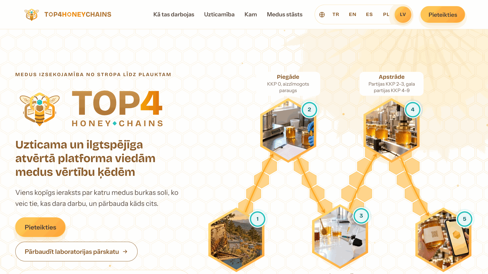

## Platformas mērķis {#sec-purpose}

Platforma tika izveidota starptautiskajā pētniecības projektā TOP4HoneyChains ("Trustable and Sustainable Open Platform for Smart Honey Value Chains"). Projektu ICT-AGRI-FOOD ERA-NET Cofund (2022. gada kopīgais konkurss) ietvaros īsteno universitātes, pētniecības institūti un uzņēmumi četrās valstīs: Turcijā, Polijā, Latvijā un Argentīnā. To finansē Eiropas Savienības pētniecības un inovāciju programma "Apvārsnis 2020" (dotācijas nolīgums Nr. 862665) kopā ar partnervalstu nacionālajām finansēšanas aģentūrām. Partneri un finansētāji ir parādīti sākumlapas apakšā.

Platformai ir trīs mērķi:

- **Izsekojamība.** Par jebkuru burku var atbildēt uz trim jautājumiem. No kurienes medus nāk? Vai tas tika pārbaudīts? Kur tas nonāca?
- **Uzticamība.** Katru ierakstu ievada viena persona un pārbauda otra persona ([Četru acu princips](#four-eyes)). Katra izmaiņa tiek ierakstīta audita žurnālā, ko var tikai papildināt.
- **Pārredzamība patērētājam.** Publiskais Medus stāsts vienkāršā valodā parāda medus ceļu un kvalitātes pārbaudes, nepublicējot personas datus.

Saskarne ir pieejama angļu, turku, spāņu, poļu un latviešu valodā. Katrs cilvēks izvēlas valodu lapā.

Šajā rokasgrāmatā **dati** nozīmē to, ko cilvēki reģistrē platformā: izmērītas vērtības (piemēram, mitrums %) un atbildes uz jautājumiem (piemēram, Jā vai Nē).

## Medus ceļš {#sec-journey}

Medus iet caur piecām stacijām: **Drava**, **Piegāde**, **Laboratorija**, **Apstrāde** un **Plaukts**. Tie paši pieci nosaukumi ir redzami sākumlapā un katrā Medus stāstā.

Katrā stacijā notiek divas lietas, un šī rokasgrāmata tās nošķir:

- **Darbības**: ko cilvēki dara ar medu (to ievāc, piegādā, analizē, apstrādā, pārdod).
- **Ieraksti**: ko platforma par to glabā un kas drīkst šos ierakstus izveidot, lasīt, atjaunināt vai apstiprināt. Katras lomas datu tiesības ir uzskaitītas [{n}. tabulā](#tbl-crud).

[{n}. tabula](#tbl-journey-activities) parāda darbības, [{n}. tabula](#tbl-journey-records) parāda ierakstus.

Table: Medus ceļš: ko dara cilvēki {#tbl-journey-activities}

| Stacija | Ko cilvēki dara ar medu |
| --- | --- |
| Drava | Biškopis tur bites vienā vai vairākās dravās un ievāc medu. |
| Piegāde | Biškopis atved medu uz uzņēmumu tvertnēs (kannās, mucās vai bučās). Uzņēmumā katru tvertni nosver un atver. No tās piepilda un noplombē parauga burku un kontrolparauga burku, un tvertni noplombē no jauna. |
| Laboratorija | Paraugu burkas nonāk pārtikas analīžu laboratorijā. Laboratorija pārbauda katru burku pēc saņemšanas, sajauc kopparaugu un to analizē. |
| Apstrāde | Uzņēmums medu karsē, filtrē, sajauc, nostādina, pilda, marķē un iepako. Medus no vienas vai vairākām partijām kļūst par vienu gala partiju. |
| Plaukts | Gala partiju nosūta vairumtirgotājam vai mazumtirgotājam, kas to uzglabā un pārdod. Patērētājs nopērk burku un noskenē tās QR kodu. |

Table: Medus ceļš: ko reģistrē platforma {#tbl-journey-records}

| Stacija | Ko reģistrē platforma | Kas to reģistrē (pirmā persona) | Kas to apstiprina (otrā persona) |
| --- | --- | --- | --- |
| Drava | Biškopis, valsts reģistra numurs, mobilais tālrunis, dravas ar to stropiem un atrašanās vietu, biedrība (nav obligāti), biškopja piekrišanas. | **Biškopju reģistrācijas speciālists** | Biškopis ar 6 ciparu kodu, kas nosūtīts pa SMS. Bez tālruņa: biškopis paraksta izdrukātu veidlapu, un **Atbilstības speciālists** pārbauda tās foto. |
| Piegāde | Piegāde ar vienu rindu katrai tvertnei: svars, plombas pēc atvešanas, parauga burka un kontrolparauga burka ar to plombu numuriem un jaunā plomba. Piegāde kļūst par neapstrādāta medus partiju. Pēc tam sākotnējais audits, KKP 0. | **Paraugu pieņemšanas speciālists** | Piegādi: biškopis ar SMS kodu (vai parakstīta veidlapa, ko pārbauda **Atbilstības speciālists**). KKP 0: **Kvalitātes nodrošināšanas speciālists**. |
| Laboratorija | Katras burkas pieņemšanas pārbaude, kopparaugs, rezultāti, parakstītais pārskats (PDF) un tā nospiedums. Apstiprinātie rezultāti kļūst par partijas KKP 1. | **Analītiķis** | **Laboratorijas vadītājs** |
| Apstrāde | Katras partijas kontroles lapa (KKP 2 un 3), gala partija ar tās partijām un kilogramiem, gala partijas kontroles lapa (KKP 4 līdz 10), pieprasījums pabeigt (fiksēt). | **Darbinieks** (gala partijai un pieprasījumam arī **Organizācijas administrators**) | **Kvalitātes nodrošināšanas speciālists** apstiprina lapas un apstiprina pabeigšanu (fiksēšanu). |
| Plaukts | Sūtījums, tā saņemšana un uzglabāšanas apstākļi pie katra turētāja (KKP 10). Medus stāsts kļūst publisks, kad gala partija ir pabeigta (fiksēta). | Turētāja darbinieks vai organizācijas administrators; uzglabāšanas ierakstu reģistrē darbinieks | Saņēmējs apstiprina sūtījumu. Saņēmēja kvalitātes nodrošināšanas speciālists apstiprina uzglabāšanas ierakstu. |

Solis var sākties tikai tad, kad iepriekšējais solis ir apstiprināts, ja tas ir vajadzīgs:

- Laboratorija ievada un apstiprina rezultātus tikai pēc tam, kad partijas KKP 0 ir apstiprināts.
- Partija var nonākt gala partijā tikai tad, kad visi tās kontroles punkti ir pabeigti (vai nav piemērojami) un apstiprināti un tajā vēl ir palicis medus.
- Gala partiju var pabeigt (fiksēt) tikai tad, kad katrs gala partijas un tās partiju kontroles punkts ir apstiprināts un neviens parakstīts piegādes foto negaida pārbaudi.
- Nosūtīt var tikai pabeigtu (fiksētu) gala partiju un tikai tādā daudzumā, kāds jums ir.

Pabeigšana (fiksēšana) bloķē gala partiju un tās partijas. Pēc tam nepareizu vērtību var labot tikai divi platformas administratori.

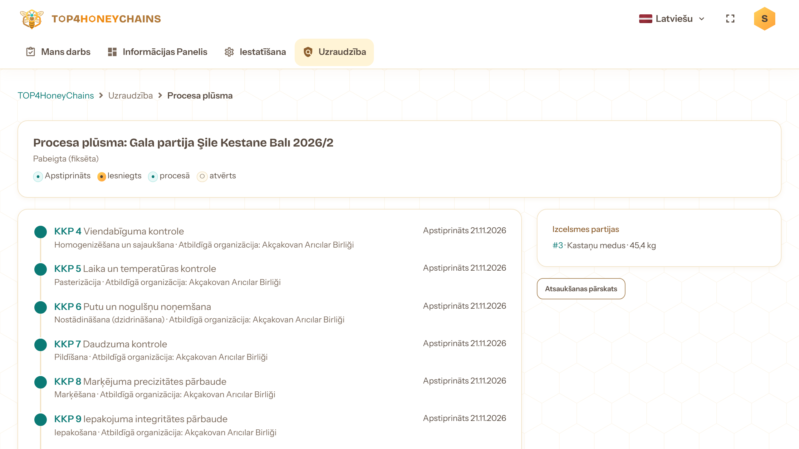

## Kam platforma paredzēta {#sec-audience}

Platformā ir trīs veidu konti. **Dalībnieki** strādā organizācijā kādā lomā. **Biškopim** var būt personīgs konts biškopja portālā. **Patērētājs** var izveidot bezmaksas patērētāja kontu. Apmeklētājiem konts nav vajadzīgs vispār.

Organizācija piedalās ķēdē ar savām kompetencēm, piemēram, "Spēj pieņemt un apstrādāt medu" ([{n}. tabula](#tbl-capabilities)). Cilvēks strādā organizācijā kādā lomā ([{n}. tabula](#tbl-roles)). Viens konts vienā organizācijā vienā lomā ir dalība ([Dalība organizācijās](#memberships)).

Table: Kam platforma paredzēta {#tbl-audience}

| Kas | Konts | Darbība vērtību ķēdē | Platformā |
| --- | --- | --- | --- |
| Biškopis | Pārstāvēts ar biškopja ierakstu. Biškopis, kas reģistrēts ar mobilo tālruni, saņem arī biškopja portāla kontu. | Ražo medu un piegādā to uzņēmumam. | Apstiprina reģistrāciju un katru piegādi ar SMS kodu. Portālā: lasa savas dravas, piegādes, laboratorijas rezultātus, gala partijas un Medus stāsta lapas, ievada prasīto cenu, dod vai atsauc piekrišanas ([Biškopja portāls](#ch-portal)). |
| Biškopju reģistrācijas iestāde (piemēram, rajona lauksaimniecības direkcija) | Dalībnieki | Pazīst sava apvidus biškopjus. | Reģistrē biškopjus un viņu dravas, piesaista viņu biedrību, nosūta viņu portāla pieteikšanās datus. |
| Biškopju biedrība | Dalībnieki | Apvieno biškopjus; var vadīt arī uzņēmumu. | Ar biškopja piekrišanu publicē publisku biškopja lapu. Ar kompetenci Apstrāde tā strādā kā uzņēmums. |
| Apstrādes un iepakošanas uzņēmums | Dalībnieki | Pieņem, apstrādā, pilda un iepako medu. | Reģistrē piegādes un paraugus, KKP 0 un KKP 2 līdz 10, izveido gala partijas, tās pabeidz (fiksē), nosūta, atbild uz patērētāju atsauksmēm. |
| Pārtikas analīžu laboratorija (akreditēta vai iekšējā) | Dalībnieki | Analizē medus paraugus. | Pieņem paraugu burkas, ievada rezultātus ar parakstīto pārskatu, apstiprina pārskatu. |
| Vairumtirgotājs | Dalībnieki | Pērk gala partijas, tās uzglabā un pārdod tālāk. | Apstiprina sūtījumus, reģistrē un apstiprina uzglabāšanu (KKP 10), nosūta tālāk, lasa ražotāja kontroles punktus. |
| Mazumtirgotājs | Dalībnieki | Pārdod burkas patērētājiem. | Apstiprina sūtījumus, reģistrē un apstiprina uzglabāšanu (KKP 10), lasa ražotāja kontroles punktus. |
| Valsts iestāde | Dalībnieki | Pārbauda ķēdi. | Lasa visus ierakstus, neko neievada. |
| Platformas administrators | Platformas administrēšanas konts | Uztur platformu; nepiedalās medus ķēdē. | Izveido un pārbauda organizācijas, pievieno dalībniekus, iestata lomas, atļaujas un atbildību par kontroles punktiem, publicē paziņojumu tekstus, uzrauga ierakstus un izlemj labojumus. Neievada uzņēmējdarbības datus. |
| Patērētājs | Bezmaksas patērētāja konts | Pērk un ēd medu. | Visu, ko var apmeklētājs, un turklāt saglabā medu sadaļā **Mans medus**, nosūta atsauksmi ražotājam un lasa atbildi ([Patērētāja konts](#ch-consumer)). |
| Apmeklētājs | Nav | Lasa par medu pirms vai pēc pirkšanas. | Lasa publiskās lapas: Medus stāstu no QR koda, publiskās biškopju lapas, **Pārbaudīt laboratorijas pārskatu** un privātuma paziņojumus. |

Katrā organizācijā ir arī **Atbilstības speciālists**, kas pārbauda pierādījumus (parakstītus foto), paraugu ņemšanas kvalitāti un apstiprinājumus un apstrādā datu aizsardzības pieprasījumus ([Atbilstības speciālists](#ch-compliance)).

## Kontroles punkti {#sec-control-points}

Medus kvalitāti un nekaitīgumu pārbauda vienpadsmit kritiskajos kontroles punktos (KKP), no KKP 0 līdz KKP 10. Metode nāk no HACCP, pārtikas nekaitīguma sistēmas, kas balstās uz apdraudējumu analīzi un kritiskajiem kontroles punktiem. Katram kontroles punktam ir parametri (piemēram, temperatūra vai mitrums). Parametram var būt kritiskā robežvērtība.

Kontroles punkti 0 līdz 3 pieder neapstrādāta medus partijai, kontroles punkti 4 līdz 10 pieder gala partijai. [{n}. tabula](#tbl-ccps) parāda, kas pēc noklusējuma ievada un kas apstiprina katru kontroles punktu. Organizācijai jābūt kompetencei, kas norādīta kolonnā **Organizācijai vajadzīgs**. Platformas administrators var mainīt šos noklusējumus ([Noteikt, kas ievada un apstiprina katru kontroles punktu](#sec-ccp-responsibilities)).

Table: Kritiskie kontroles punkti un noklusējuma atbildība {#tbl-ccps}

| KKP | Nosaukums ekrānā | Posms | Pieder | Organizācijai vajadzīgs | Ievada | Apstiprina |
| --- | --- | --- | --- | --- | --- | --- |
| KKP 0 | Sākotnējais audits | Pirmsražošana | Partija | Apstrāde | Partijas īpašnieka **Paraugu pieņemšanas speciālists** | Partijas īpašnieka **Kvalitātes nodrošināšanas speciālists** |
| KKP 1 | Paraugu ņemšana un sākotnējie pieņemšanas testi | Neapstrādāta medus pieņemšana | Partija | Laboratorija | Ierakstīts no apstiprinātā laboratorijas pārskata (**Analītiķis**) | **Laboratorijas vadītājs** (apstiprinot pārskatu) |
| KKP 2 | Temperatūras uzraudzība | Karsēšana | Partija | Apstrāde | **Darbinieks** | **Kvalitātes nodrošināšanas speciālists** |
| KKP 3 | Filtra stāvokļa kontrole | Filtrēšana | Partija | Apstrāde | **Darbinieks** | **Kvalitātes nodrošināšanas speciālists** |
| KKP 4 | Viendabīguma kontrole | Homogenizēšana un sajaukšana | Gala partija | Apstrāde | **Darbinieks** | **Kvalitātes nodrošināšanas speciālists** |
| KKP 5 | Laika un temperatūras kontrole | Pasterizācija | Gala partija | Apstrāde | **Darbinieks** | **Kvalitātes nodrošināšanas speciālists** |
| KKP 6 | Putu un nogulšņu noņemšana | Nostādināšana (dzidrināšana) | Gala partija | Apstrāde | **Darbinieks** | **Kvalitātes nodrošināšanas speciālists** |
| KKP 7 | Daudzuma kontrole | Pildīšana | Gala partija | Iepakošana | **Darbinieks** | **Kvalitātes nodrošināšanas speciālists** |
| KKP 8 | Marķējuma precizitātes pārbaude | Marķēšana | Gala partija | Iepakošana | **Darbinieks** | **Kvalitātes nodrošināšanas speciālists** |
| KKP 9 | Iepakojuma integritātes pārbaude | Iepakošana | Gala partija | Iepakošana | **Darbinieks** | **Kvalitātes nodrošināšanas speciālists** |
| KKP 10 | Temperatūras un mitruma uzraudzība | Uzglabāšana | Gala partija | Vairumtirdzniecība, Mazumtirdzniecība vai Iepakošana | Turētāja **Darbinieks** | Turētāja **Kvalitātes nodrošināšanas speciālists** |

KKP 1 ir pabeigts, kad laboratorijas vadītājs apstiprina pārskatu. Ja uzņēmums KKP 1 reģistrēja arī savas vērtības, tās apstiprina uzņēmuma kvalitātes nodrošināšanas speciālists.

KKP 10 parādās divreiz. Vispirms gala partijā uzņēmumā: tas jāapstiprina, pirms gala partiju pabeidz (fiksē). Vēlāk katrs vairumtirgotājs vai mazumtirgotājs, kas saņem gala partiju, uztur savu uzglabāšanas ierakstu.

Kontroles punktu, kas uz šo medu neattiecas, var atzīmēt kā **Nav piemērojams**, norādot iemeslu. Arī tam vajadzīgs apstiprinājums. Jebkuras vērtības maiņa noņem esošo apstiprinājumu, tāpēc ierakstam vajadzīgs jauns apstiprinājums.

## Četru acu princips {#four-eyes}

Katrs ieraksts platformā iet caur diviem acu pāriem. **Pirmā persona** veic darbu un ievada datus. **Otra, cita persona** to pārbauda un apstiprina. Neviens neapstiprina to, ko pats ievadījis. Divi cilvēki padara kļūdas un manipulācijas daudz mazāk iespējamas. [{n}. tabula](#tbl-four-eyes) parāda pirmo un otro personu katrā gadījumā.

Table: Katra ieraksta pirmā un otrā persona {#tbl-four-eyes}

| Ieraksts | Pirmā persona (ievada) | Otrā persona (apstiprina) |
| --- | --- | --- |
| Biškopja reģistrācija | **Biškopju reģistrācijas speciālists** | Biškopis apstiprina ar SMS kodu. Bez tālruņa: reģistrējošās organizācijas **Atbilstības speciālists** pārbauda parakstītās veidlapas foto. |
| Piegāde | **Paraugu pieņemšanas speciālists** | Biškopis apstiprina ar SMS kodu. Bez koda: uzņēmuma **Atbilstības speciālists** pārbauda parakstītās piegādes veidlapas foto. |
| KKP 0, partijas lapa (KKP 2 un 3), gala partijas lapa (KKP 4 līdz 10) | **Paraugu pieņemšanas speciālists** (KKP 0) vai **Darbinieks** | Tās pašas organizācijas **Kvalitātes nodrošināšanas speciālists** |
| Laboratorijas rezultāti (KKP 1) | **Analītiķis** | **Laboratorijas vadītājs** |
| Gala partijas pabeigšana (fiksēšana) | **Darbinieks** vai **Organizācijas administrators** to pieprasa (**Pieprasīt pabeigšanu (fiksēšanu)**) | **Kvalitātes nodrošināšanas speciālists** to apstiprina (**Apstiprināt un pabeigt (fiksēt)**) |
| Sūtījums | Sūtītāja darbinieks vai organizācijas administrators | Saņēmēja darbinieks vai organizācijas administrators apstiprina saņemšanu |
| Uzglabāšanas ieraksts pie turētāja (KKP 10) | Turētāja **Darbinieks** | Turētāja **Kvalitātes nodrošināšanas speciālists** |
| Apstiprinātas piegādes vai apstiprinātas vērtības labojums | Platformas administrators to pieprasa, norādot iemeslu | Otrs platformas administrators to izlemj |

Noteikums "Neviens neapstiprina ierakstu, ko pats ievadījis" un noteikums "Laboratorijas rezultātus vienmēr apstiprina otra persona" ir pamatnoteikumi ([Pamatnoteikumi](#ground-rules)). Tie ir parādīti lapā **Lomas un atļaujas**, un neviens lomas iestatījums tos nevar mainīt.

Pastāv viens izņēmums ļoti mazām organizācijām, piemēram, biedrībai ar vienu kvalitātes speciālistu. Platformas administrators šādai organizācijai var piešķirt izņēmumu (**Četru acu principa izņēmums**). Tad tās dalībnieki drīkst apstiprināt paši savus kontroles punktu ierakstus un apstiprināt paši savu pabeigšanas pieprasījumu. Katrs šāds apstiprinājums tiek atzīmēts kā pašapstiprināts un ierakstīts audita žurnālā. Izņēmums nekad neattiecas uz laboratorijas rezultātiem. Platformas administrators var arī noteikt, ka kontroles punktam apstiprinājums nav vajadzīgs vispār; pēc noklusējuma katram kontroles punktam tas ir vajadzīgs.

## Ko lasa patērētājs {#sec-consumer-reads}

Patērētājs noskenē QR kodu uz burkas vai atver saiti un bez pieteikšanās lasa gala partijas lapu **Medus stāsts**. Lapa visiem ir vienāda un lasītāja izvēlētajā valodā parāda:

- gala partiju: nosaukumu, daudzumu un ražošanas datumu;
- nozīmītes: **Testēts akreditētā laboratorijā** (vai **Iekšējā laboratorija**), **Visi kontroles punkti apstiprināti**, **Pārbaudīto robežvērtību robežās** un **Izcelsme** ar katras valsts daļu;
- **Šī medus ceļš**: piecas stacijas ar šīs gala partijas reālajiem datumiem un skaitļiem;
- **Medus izcelsme**: medus daļu pa provincēm kartē, biškopjus pēc vārda (tikai ar viņu piekrišanu, citādi ar neitrālu kodu) un saiti uz viņu publisko biškopja lapu, ja tāda ir;
- **Kvalitāte īsumā** un **Pilns laboratorijas pārskats**: laboratorijas rezultātus ar to robežvērtībām un saiti pārskata pārbaudei;
- **Procesa pārbaudes**: apstrādes un iepakošanas kontroles punktus;
- **Kas tas ir?** blakus vērtībai: ko parametrs nozīmē un kāpēc tas ir svarīgs.

Vērtējums "robežās" vai "ārpus robežām" tiek rādīts tikai robežvērtībām, kas ir pārbaudītas. Par pārējām vērtībām lapā teikts, ka partnerlaboratorija robežvērtības vēl pārbauda.

Medus stāsts nekad nerāda tālruņa numuru, cilvēka foto, precīzu dravas atrašanās vietu, prasīto cenu vai brīva teksta piezīmi. Karte rāda tikai provinces.

Apakšā, sadaļā **Nopirkāt šo medu?**, patērētājs ar bezmaksas kontu var izmantot **Saglabāt manā medū** un **Nosūtīt atsauksmi ražotājam**. Atsauksme nonāk organizācijā, kurai pieder gala partija; tā lasa tikai patērētāja kodu, nekad lietotājvārdu vai tālruņa numuru. Nodaļas [Medus stāsta lapa](#ch-story) un [Patērētāja konts](#ch-consumer) apraksta lapu un kontu.

# Kompetences, organizācijas un lomas {#ch-roles}

Platformā TOP4HoneyChains jūs vienmēr strādājat **organizācijas vārdā, kādā lomā**. To, ko jūs drīkstat darīt, nosaka trīs lietas:

1. jūsu organizācijas **kompetences**: ko organizācija spēj darīt medus ķēdē ([Kompetences](#capabilities));
2. jūsu **loma** šajā organizācijā: ko jūs tajā darāt ([Lomas](#role-list));
3. jūsu organizācijas **statuss**: datus ievada tikai organizācija ar statusu **Pārbaudīta**. Organizācijas pārbauda platformas administrators; biškopju biedrības tā vietā var pārbaudīt centrālā biedrība, ja platforma tam ir iestatīta ([Organizācijas statuss](#org-status)).

Lomu jūs ieņemat ar **dalību**: viens lietotāja konts vienā organizācijā vienā lomā ([Dalība organizācijās](#memberships)). Trīs veidu kontiem dalības nav: biškopja kontam biškopja portālā, patērētāja kontam un platformas administratora globālajai lomai. Daži noteikumi ir iebūvēti platformā, un neviens iestatījums tos neizslēdz ([Pamatnoteikumi](#ground-rules)).

Šī nodaļa nošķir divas lietas:

- **vērtību ķēdes darbības**: darbu, ko cilvēki veic ar medu prom no datora, piemēram, reģistrēšanu, piegādi, paraugu ņemšanu, analīzi, apstrādi, iepakošanu, uzglabāšanu un nosūtīšanu ([{n}. tabula](#tbl-activities));
- **datu tiesības**: ko katra loma drīkst darīt ar ierakstiem platformā: izveidot, lasīt, atjaunināt, dzēst un apstiprināt ([{n}. tabula](#tbl-crud)).

## Kompetences {#capabilities}

Kompetence ir organizācijas spēja. Tā norāda, ko organizācija **spēj darīt** medus ķēdē; tās dalībnieku lomas norāda, kura persona veic darbu. Organizācijai ir viena vai vairākas kompetences. Platformas administrators tās piešķir un noņem; pats kompetenču saraksts ir nemainīgs. [{n}. tabula](#tbl-capabilities) tās uzskaita ar to nosaukumu ekrānā.

Table: Kompetences: ko organizācija spēj darīt {#tbl-capabilities}

| Kompetence (ekrānā) | Spēja | Kontroles punkti (pēc noklusējuma) |
|---|---|---|
| **Biedrība** | Spēj piesaistīt savus biedrus biškopjus, reģistrēt viņu piekrišanu publiskai biškopja lapai un ar biškopja piekrišanu lasīt šī biškopja prasītās cenas. | Nav. KKP 0 tikai tad, ja administrators piešķir KKP 0 biškopja biedrībai. |
| **Apstrāde** | Spēj pieņemt un apstrādāt medu: piegādes, paraugi, partijas KKP 0 līdz 3, gala partijas KKP 4 līdz 6, jaunas gala partijas, pabeigšana (fiksēšana) un sūtījumi. | Partijas KKP 0 līdz 3 (KKP 1 aizpilda no laboratorijas pārskata); gala partijas KKP 4 līdz 6 |
| **Iepakošana** | Spēj pildīt, marķēt un iepakot medu, izveidot gala partijas, tās pabeigt (fiksēt) un nosūtīt; reģistrē gala partijas KKP 7 līdz 9 un KKP 10 uzglabāšanu uzņēmumā. | Gala partijas KKP 7 līdz 9, KKP 10 |
| **Laboratorija** | Spēj analizēt medus paraugus un izsniegt laboratorijas pārskatus kā akreditēta vai iekšējā pārtikas analīžu laboratorija. Akreditācijas numurs un tā derīguma termiņš tiek glabāti pie šīs kompetences. | Nav. Tās apstiprinātais pārskats aizpilda partijas KKP 1. |
| **Vairumtirdzniecība** | Spēj turēt gala partijas vairumtirdzniecībā, reģistrēt to uzglabāšanu (KKP 10) un nosūtīt tās tālāk. | KKP 10 |
| **Mazumtirdzniecība** | Spēj turēt gala partijas pārdošanai patērētājiem, reģistrēt to uzglabāšanu (KKP 10) un nosūtīt tās tālāk. | KKP 10 |
| **Biškopju reģistrācija** | Spēj reģistrēt sava apvidus biškopjus un viņu dravas, apliecināt viņu identitāti un reģistra numuru, piesaistīt viņus biedrībai, reģistrēt viņu piekrišanu un izsniegt viņu pieteikšanās datus. | Nav |
| **Centrālā biedrība** | Spēj pārbaudīt biškopju biedrības, ja platforma tam ir iestatīta. | Nav |
| **Valsts iestāde** | Spēj lasīt visas partijas, gala partijas un to kontroles punktus kā ministrija vai inspekcijas iestāde. Neko neievada. | Nav (lasa visu) |
| **Biškopības saimniecība** | Spēj ražot medu. | Nav |

Dažas darbības pārbauda gan kompetenci, gan lomu:

- piegādes reģistrēšanai un paraugu ņemšanai vajadzīga **Apstrāde**;
- gala partijas izveidei (**Jauna gala partija**), pabeigšanas pieprasīšanai un apstiprināšanai vajadzīga **Apstrāde** vai **Iepakošana**;
- nosūtīšanai un saņemta sūtījuma apstiprināšanai vajadzīga **Apstrāde**, **Iepakošana**, **Vairumtirdzniecība** vai **Mazumtirdzniecība**;
- paraugu burku pieņemšanai un laboratorijas rezultātu ievadīšanai vajadzīga **Laboratorija**;
- sadaļai **Biškopju lapas** vajadzīga **Biedrība**;
- sadaļai **Biškopju reģistrācija** un lomai **Biškopju reģistrācijas speciālists** vajadzīga kompetence **Biškopju reģistrācija**.

Tāpēc uzņēmumam, kas pats apstrādā, pilda un uzglabā savu medu, vajadzīga **Apstrāde** un **Iepakošana**; KKP 10 uzņēmumā nodrošina **Iepakošana**.

**Biškopji ir cilvēki, nevis organizācijas.** Platformā biškopi pārstāv **biškopja ieraksts** ar vienu vai vairākām dravām. Biškopim nav dalības. Ja biškopja portāls ir ieslēgts, biškopim var būt personīgs konts, kas piesaistīts šim ierakstam ([Biškopja portāls](#ch-portal)).

**Platforma.** Platformas administrators nav kompetence, ko var piešķirt organizācijai. Tā ir lietotāja konta globāla loma cilvēkiem, kas uztur platformu ([Platformas administrēšana](#ch-admin)). Platformas organizācijai ir rezervētā kompetence **Platformas administrēšana**; neviena cita organizācija to nevar saņemt, un to nevar noņemt.

## Vērtību ķēdes darbības un platformas ieraksti {#activities}

Vērtību ķēdes darbības ar medu cilvēki veic prom no datora. Platforma reģistrē katras darbības rezultātu kā datus. [{n}. tabula](#tbl-activities) katrai kompetencei parāda, ko dara tās cilvēki un ko reģistrē platforma.

Table: Vērtību ķēdes darbības (cilvēki) un tas, ko reģistrē platforma (dators) {#tbl-activities}

| Kompetence | Vērtību ķēdes darbības (cilvēki, prom no datora) | Reģistrēts platformā (dators) |
|---|---|---|
| Biškopības saimniecība (biškopis) | Tur bites, ievāc medu, piegādā to tvertnēs, nolasa speciālistam SMS kodu, izlemj par prasīto cenu | Biškopja un dravas ieraksti; reģistrācijas un katras piegādes apstiprinājums (SMS kods); portālā: prasītā cena un paša biškopja piekrišanas |
| Biškopju reģistrācija | Tiekas ar biškopi, pārbauda personu apliecinošo dokumentu un reģistra ierakstu, apmeklē vai uzskaita dravas, nolasa informatīvo paziņojumu | Biškopja ieraksts, viena vai vairākas dravas, saite uz biedrību, reģistrācija (SMS kods vai parakstīts foto), reģistrācijā dotās piekrišanas, biškopja pieteikšanās dati |
| Biedrība | Informē biedrus biškopjus, nolasa viņiem piekrišanas tekstu, savāc parakstus | Piekrišana biškopja lapai ar parakstīto dokumentu; publicētā biškopja lapa |
| Apstrāde | Pieņem piegādes noplombētās tvertnēs, pārbauda vai uzliek plombas, no katras tvertnes piepilda parauga burku un kontrolparauga burku, karsē, filtrē, sajauc un nostādina medu, apvieno partijas gala partijā | Piegāde ar tvertnēm un plombu vēsturi, paraugu burkas, KKP 0 un KKP 2 līdz 6, gala partija ar tās partijām un daudzumiem, pabeigšanas pieprasījums un tā apstiprinājums, sūtījumi |
| Iepakošana | Pilda, marķē un iepako medu, uzglabā to uzņēmumā | KKP 7 līdz 10, gala partijas, pabeigšana (fiksēšana), sūtījumi |
| Laboratorija | Pieņem noplombētās burkas un pārbauda plombu, etiķeti un vāciņu, izveido kopparaugu, to analizē, paraksta pārskatu | Pieņemšanas pārbaudes, kopparaugs, laboratorijas pārskats (PDF) un rezultāti, kas pabeidz KKP 1 |
| Vairumtirdzniecība, Mazumtirdzniecība | Pieņem preces, tās uzglabā, pārdod vai nosūta tālāk | Saņemtā sūtījuma apstiprinājums, uzglabāšanas ieraksts (KKP 10), jauni sūtījumi, atbildes uz patērētāju atsauksmēm |
| Centrālā biedrība | Pārbauda biškopju biedrības | Biedrību pārbaude (ja iestatīta) |
| Valsts iestāde | Veic pārbaudes | Neko; lasa ierakstus |

Vēl divas grupas izmanto platformu bez organizācijas. **Patērētāji** pērk medu un skenē QR kodu uz burkas; ja ir konts, platforma reģistrē viņu saglabāto medu un nosūtītās atsauksmes. **Apmeklētāji** tikai lasa publiskās lapas; par viņiem nekas netiek reģistrēts.

Katrai organizācijai neatkarīgi no tās kompetencēm vajadzīgs arī **Atbilstības speciālists**: persona, kas uzrauga apstiprinājumus, pierādījumus un datu aizsardzību ([Atbilstības speciālists](#ch-compliance)).

## Organizāciju veidi {#org-types}

Platformā nav atsevišķa organizāciju veidu saraksta: organizācijas veidu nosaka tās kompetenču kopums. [{n}. tabula](#tbl-org-types) parāda tipiskas organizācijas.

Table: Tipiskas organizācijas, to kompetences un to dalībnieku lomas {#tbl-org-types}

| Organizācija | Kompetences | Tipiskas dalībnieku lomas |
|---|---|---|
| Biškopju reģistrācijas iestāde (piemēram, rajona lauksaimniecības direkcija) | **Biškopju reģistrācija** | Organizācijas administrators, Biškopju reģistrācijas speciālists, Atbilstības speciālists |
| Biškopju biedrība | **Biedrība** | Organizācijas administrators, Lauka inspektors, Atbilstības speciālists |
| Apstrādes uzņēmums vai iepakotājs | **Apstrāde**, **Iepakošana** | Organizācijas administrators, Paraugu pieņemšanas speciālists, Darbinieks, Kvalitātes nodrošināšanas speciālists, Atbilstības speciālists |
| Pārtikas analīžu laboratorija (akreditēta vai iekšējā) | **Laboratorija** | Organizācijas administrators, Analītiķis, Laboratorijas vadītājs, Atbilstības speciālists |
| Vairumtirgotājs | **Vairumtirdzniecība** | Organizācijas administrators, Darbinieks, Kvalitātes nodrošināšanas speciālists, Atbilstības speciālists |
| Mazumtirgotājs | **Mazumtirdzniecība** | Organizācijas administrators, Darbinieks, Kvalitātes nodrošināšanas speciālists, Atbilstības speciālists |
| Centrālā biškopju biedrība | **Centrālā biedrība** | Organizācijas administrators, Atbilstības speciālists |
| Ministrija vai inspekcijas iestāde | **Valsts iestāde** | Organizācijas administrators, Atbilstības speciālists (abi tikai lasa) |
| Platformas uzturētājs | **Platformas administrēšana** (rezervēta) | Platformas administratori |

Biedrībai, kas vada savu uzņēmumu, ir arī **Apstrāde** un **Iepakošana**, un tad arī uzņēmuma lomas. Mazā organizācijā organizācijas administrators ar otru dalību var būt arī atbilstības speciālists; četru acu noteikumi joprojām ir spēkā ([Četru acu princips](#four-eyes)).

### Organizācijas statuss {#org-status}

Jauna organizācija sākas ar statusu **Gaida**. Platformas administrators to pārbauda un apstiprina tās organizācijas lapā sadaļā **Pārbaude**:

- **Pārbaudīt** prasa vismaz vienu augšupielādētu dokumentu (piemēram, licenci, akreditāciju vai reģistrācijas apliecinājumu).
- Organizācijai, ko pārbauda pirmo reizi, vajadzīgs arī aktīvs **Atbilstības speciālists**. Organizācija, kas agrāk pārbaudīta bez tāda, rāda brīdinājumu ar datumu, līdz kuram tai tas jānorīko; tā netiek bloķēta.
- **Pieprasīt dokumentus** atstāj organizāciju statusā **Gaida** un prasa tekstu, kurā norādīts, kuru dokumentu trūkst.
- **Apturēt** prasa iemeslu. **Atjaunot** atkal piešķir apturētai organizācijai statusu **Pārbaudīta**.

**Organizācijas administrators** un **Atbilstības speciālists** augšupielādē dokumentus, arī tad, kad organizācijas statuss ir **Gaida**, bet ne tad, kad tas ir **Apturēta**.

**Centrālā biedrība.** Ja platforma tam ir iestatīta, pārbaudītas organizācijas ar kompetenci **Centrālā biedrība** **Organizācijas administrators** pārbauda, aptur un atjauno biškopju biedrības. Tad platformas administratori biedrības vairs nepārbauda.

[{n}. tabula](#tbl-org-status) uzskaita statusus.

Table: Organizācijas statuss un kas to maina {#tbl-org-status}

| Statuss (ekrānā) | Nozīme | Kas to iestata |
|---|---|---|
| **Gaida** | Jauna organizācija, gaida pārbaudi. Dalībnieki lasa savas organizācijas ierakstus; organizācijas administrators un atbilstības speciālists augšupielādē dokumentus. Neviens neievada darba plūsmas datus. | Iestatīts, kad platformas administrators izveido organizāciju, vai saglabāts ar **Pieprasīt dokumentus** |
| **Pārbaudīta** | Pārbaudīta. Dalībnieki strādā atbilstoši savām lomām. Sūtījumu var saņemt tikai pārbaudīta organizācija. | Platformas administrators ar **Pārbaudīt** vai **Atjaunot**; biedrībām centrālā biedrība, ja iestatīts |
| **Apturēta** | Pārbaude atsaukta, norādot iemeslu. Līdz atjaunošanai darbojas kā **Gaida**; dokumentus augšupielādēt nevar. | Platformas administrators ar **Apturēt**; biedrībām centrālā biedrība, ja iestatīts |

## Lomas {#role-list}

[{n}. tabula](#tbl-roles) ir lomu atsauces saraksts. Visas pārējās šīs rokasgrāmatas tabulas izmanto tās pašas lomas ar tiem pašiem saīsinājumiem tādā pašā secībā.

Table: Lomas {#tbl-roles}

| Nr. | Loma (ekrānā) | Saīs. | Konts | Tipiska persona | Galvenais darbs |
|---|---|---|---|---|---|
| 1 | **Biškopju reģistrācijas speciālists** | BRS | Dalība | Reģistrācijas speciālists | Reģistrē biškopjus ar vienu vai vairākām dravām un viņu biedrību, pārbauda reģistra numuru, nosūta biškopja SMS kodu, reģistrē paziņojumu un piekrišanas, nosūta biškopja pieteikšanās datus |
| 2 | **Paraugu pieņemšanas speciālists** | PPS | Dalība (dalībnieki: savus) | Pieņemšanas speciālists uzņēmumā | Reģistrē piegādes ar to noplombētajām tvertnēm, nosūta biškopja SMS kodu, ņem paraugu no katras tvertnes, ievada KKP 0 |
| 3 | **Analītiķis** | An | Dalība (dalībnieki: savus) | Laboratorijas analītiķis | Pieņem paraugu burkas (plomba, etiķete un vāciņš), izveido kopparaugu, ievada laboratorijas rezultātus un iesniedz pārskatu (pirmā persona laboratorijā) |
| 4 | **Laboratorijas vadītājs** | LabV | Dalība (dalībnieki: savus) | Laboratorijas vadītājs | Pieņem paraugu burkas, apstiprina vai atgriež laboratorijas pārskatus (otrā persona laboratorijā) |
| 5 | **Darbinieks** | Db | Dalība (dalībnieki: savus) | Ražošanas, pildīšanas, vairumtirdzniecības vai mazumtirdzniecības darbinieks | Aizpilda kontroles lapas (KKP 1 līdz 10), izveido gala partijas, pieprasa pabeigšanu (fiksēšanu), nosūta un apstiprina sūtījumus, reģistrē uzglabāšanu |
| 6 | **Lauka inspektors** | LI | Dalība (dalībnieki: savus) | Biedrības lauka tehniķis | Lasa organizācijas partijas un gala partijas; ievada KKP 0 tikai tad, ja administrators piešķir KKP 0 biedrībai |
| 7 | **Kvalitātes nodrošināšanas speciālists** | KNS | Dalība (dalībnieki: savus) | Kvalitātes vadītājs, pārtikas inženieris | Apstiprina KKP ierakstus, kontroles lapas un uzglabāšanas ierakstus, apstiprina pabeigšanu (fiksēšanu), atbild uz patērētāju atsauksmēm |
| 8 | **Organizācijas administrators** | OA | Dalība (dalībnieki: savus) | Organizācijas vadītājs | Uztur organizācijas dokumentus, izveido gala partijas, pieprasa pabeigšanu (fiksēšanu), nosūta un apstiprina sūtījumus, publicē biškopju lapas (biedrība), lasa savu partiju piegādes, paraugus un prasītās cenas, atbild uz patērētāju atsauksmēm |
| 9 | **Atbilstības speciālists** | AS | Dalība (dalībnieki: savus) | Kvalitātes vai datu aizsardzības vadītājs | Pieņem vai noraida parakstīta foto pierādījumus, pārbauda paraugu ņemšanas kvalitāti un apstiprinājumus, uztur datu pārziņa ziņas, reģistrē datu subjektu pieprasījumus un piekrišanu atsaukumus, lasa organizācijas audita ierakstus, atbild uz patērētāju atsauksmēm |
| 10 | **Platformas administrators** | PA | Globāla loma | Platformas uzturētājs | Iestata organizācijas, dalībniekus, kompetences, tiesības un atbildību par KKP; lasa katru ierakstu; pieprasa un izlemj labojumus. Neievada un neapstiprina darba plūsmas datus |
| 11 | **Biškopis** | Bk | Portāla konts | Biškopis | Lasa savas dravas, piegādes, paraugus, laboratorijas rezultātus, gala partijas un Medus stāsta lapas; ievada prasīto cenu; dod un atsauc savas piekrišanas ([Biškopja portāls](#ch-portal)) |
| 12 | **Patērētājs** | Pat | Patērētāja konts | Medus pircējs | Saglabā medu, nosūta atsauksmi ražotājam un lasa atbildi ([Patērētāja konts](#ch-consumer)) |
| 13 | **Apmeklētājs** | Apm | Nav konta | Ikviens | Lasa Medus stāstu, publicētu biškopja lapu un lapu **Pārbaudīt laboratorijas pārskatu** ([Medus stāsta lapa](#ch-story)) |

Platformas administrators nepiedalās uzņēmējdarbības organizācijas darba plūsmā. Administratori lasa katru ierakstu, bet **neievada un neapstiprina darba plūsmas datus** (piegādes, KKP datus, laboratorijas rezultātus, gala partijas, pabeigšanu, sūtījumus, piekrišanas). Ja apstiprināti dati ir nepareizi, viens administrators pieprasa labojumu un otrs administrators to izlemj. Biškopju, partiju un gala partiju datu ievades ekrāni administratora izvēlnē vairs nav; to lapas ir saglabātas tikai labojumiem.

## Datu tiesības (CRUD) {#crud}

[{n}. tabula](#tbl-crud) parāda katras lomas noklusējuma datu tiesības uz katru ierakstu veidu CRUD modelī: **C** izveidot, **R** lasīt, **U** atjaunināt, **D** dzēst un **A** apstiprināt (atsevišķa tiesība). "·" nozīmē, ka tiesību nav. Burti stāv kopā: "CRU" nozīmē izveidot, lasīt un atjaunināt. Biškopja (Bk) un patērētāja (Pat) tiesības vienmēr attiecas tikai uz viņu pašu ierakstiem. Dalībnieku (lomas 1 līdz 9) tiesības attiecas tikai uz viņu pašu organizācijas darba ierakstiem: tās partijām un gala partijām, gala partijām, kas ir tās turējumā, tās biedrības biškopjiem, tās iestādes reģistrācijām. Izņemot lasīšanu, tās ir spēkā tikai tad, kad organizācijas statuss ir **Pārbaudīta**. [{n}. tabula](#tbl-admin-changeable) uzskaita, kuras no šīm tiesībām administrators var mainīt.

Table: Noklusējuma datu tiesības pa lomām un ierakstiem (CRUD + apstiprināšana) {#tbl-crud}

| Ieraksts | BRS | PPS | An | LabV | Db | LI | KNS | OA | AS | PA | Bk | Pat | Apm |
|---|---|---|---|---|---|---|---|---|---|---|---|---|---|
| Biškopja ieraksts | CRU ¹ | R ² | · | · | R ² | R ² | R ² | R ² | R ² | RU ³ | RU ⁴ | · | R ⁵ |
| Drava | CRU ¹ | R ² | · | · | R ² | R ² | R ² | R ² | R ² | RU ³ | R | · | R ⁵ |
| Biškopja reģistrācija (ar saiti uz biedrību) | CR ¹ | · | · | · | · | · | · | · | RA ⁶ | RA ⁶ | A ⁷ | · | · |
| Lietotāja konta pieteikšanās dati (dalībnieki: savi) | C ⁸ | U | U | U | U | U | U | U | U | CRUD ⁸ | U | CUD ⁹ | · |
| Neapstrādāta medus partija (piegāde) | · | CR ¹⁰ | · | · | R | R | R | R | R | RUD ¹¹ | R | R ⁵ | R ⁵ |
| Piegādes apstiprinājums (SMS kods vai parakstīts foto) | · | CR | · | · | · | · | · | R | RA ⁶ | R | A ⁷ | · | · |
| Tvertne un tās plombas | · | CR | R | R | R ¹² | R ¹² | R ¹² | R | R | R | R | · | · |
| Parauga burka | · | CR | RA ¹³ | RA ¹³ | · | · | · | R | R | R | R | · | · |
| Laboratorijas pārskats un rezultāti | · | R | CRU ¹⁴ | RA ¹⁴ | R | R | R | R | R | R | R ¹⁵ | R ¹⁵ | R ¹⁵ |
| KKP ieraksts (vērtības, "Nav piemērojams") | · | CRUD ¹⁶ | R | R | CRUD ¹⁶ | R ¹⁶ | RA | R | R | R ¹⁷ | · | R ¹⁵ | R ¹⁵ |
| Gala partija | · | R | R | R | CR ¹⁸ | R | R ¹⁸ | CR ¹⁸ | R | RUD ¹¹ | R ¹⁹ | R ¹⁵ | R ¹⁵ |
| Pabeigšana (pieprasījums, apstiprinājums) | · | · | · | · | C | · | A | C | · | R | · | · | · |
| Sūtījums | · | R ¹² | R ¹² | R ¹² | CRA ²⁰ | R ¹² | R | CRA ²⁰ | R | R | · | · | · |
| Uzglabāšanas ieraksts pie turētāja (KKP 10) | · | R | R | R | CRUD ¹⁶ | R | RA | R | R | R | · | · | · |
| Partijas prasītā cena | · | · | · | · | · | · | · | R ²¹ | R ²¹ | R | CR ²¹ | · ²² | · ²² |
| Biškopja piekrišana | CR ²³ | · | · | · | · | · | · | CRU ²⁴ | U ²³ | R | CRU ²³ | · | R ²⁵ |
| Informatīvais paziņojums (teksts, versija) | R | R | R | R | R | R | R | R | R | CR ²⁶ | R | R | R |
| Paziņojuma pieņemšana (dalībnieki: savs) | C | C | C | C | C | C | C | C | C | R ²⁷ | CR | C | · |
| Datu pārziņa ziņas | R | R | R | R | R | R | R | R | CRU | CRU | R | R ²⁸ | R ²⁸ |
| Paraugu ņemšanas kvalitātes un apstiprinājumu pārbaude | · | · | · | · | · | · | · | · | CR ²⁹ | · | · | · | · |
| Datu subjekta pieprasījums | · | · | · | · | · | · | · | · | CRU ²⁹ | · | · | · | · |
| Organizācija (dati, dokumenti, kompetences) | R | R | R | R | R | R | R | RC ³⁰ | RC ³⁰ | CRU A ³¹ | · | · | · |
| Dalība (dalībnieki: sava) | R | R | R | R | R | R | R | R | R | CRU ³² | · | · | · |
| Audita ieraksts | · | · | · | · | · | · | · | · | R ³³ | R ³⁴ | · | · | · |
| Patērētāja konts un saglabātais medus | · | · | · | · | · | · | · | · | · | RUD ³⁵ | · | CRUD ⁹ | · |
| Patērētāju atsauksme | · | · | · | · | · | · | RU ³⁶ | RU ³⁶ | RU ³⁶ | R ³⁷ | · | CR ³⁶ | · |

Piezīmes:

1. Biškopju reģistrācijas speciālists reģistrē biškopjus savai iestādei un lasa tikai šīs iestādes reģistrācijas. Vienā reģistrācijā var pievienot vairākas dravas (**Pievienot dravu**) un izvēlēties biškopja biedrību (**Biškopju biedrība (nav obligāti)**); biškopja SMS kods aptver to visu. Apliecinātie fakti (identitāte, reģistra numurs, tālrunis) mainās tikai ar jaunu tā paša biškopja reģistrāciju, ko atkal apstiprina.
2. Lasa tikai caur ierakstiem, ar kuriem organizācija strādā (piegādes, kontroles lapas, atsaukšanas pārskats). Vēlāks gala partijas turētājs lasa tās datus bez biškopju un dravu nosaukumiem. Biedrības organizācijas administrators lasa savu biedru biškopju sarakstu sadaļā **Biškopju lapas**.
3. Administratori pārbauda reģistra numurus un saites uz biedrībām sadaļā **Iestatīšana > Biškopju reģistrs un biedrības** un labo biškopju un dravu datus. Biškopjus un dravas nekad nedzēš, tikai deaktivizē.
4. Biškopis portālā sadaļā **Konts** maina savu mobilo tālruni, valodu un paroli.
5. Tikai publiskajās lapās (pabeigtas (fiksētas) gala partijas Medus stāstā un publicētā biškopja lapā): biškopja vārds tikai ar piekrišanu, citādi neitrāls kods; dravas province; nekad koordinātas vai kontaktinformācija ([Uzticamība un privātums](#ch-trust)).
6. **A** = pieņemt vai noraidīt pierādījumu, kas reģistrēts ar parakstītu foto SMS koda vietā (reģistrācija vai piegāde). Lemj reģistrējošās organizācijas atbilstības speciālists, nekad tā persona, kas to reģistrēja. Par reģistrācijām, ko reģistrējuši platformas administratori, lemj platformas administrators.
7. Biškopja **A** ir SMS kods, ko viņš nolasa speciālistam. Tas apstiprina reģistrāciju (ar katru dravu un biedrību) vai piegādi (ar tās tvertnēm, svariem un plombu numuriem).
8. Reģistrācijas speciālists nosūta biškopja pieteikšanās datus pa SMS (ja biškopja portāls ir ieslēgts). Platformas administratori izveido dalībnieku kontus ar pieteikšanās datiem pa SMS vai ar sākotnējo paroli, nosūta jaunus pieteikšanās datus, atbloķē kontus un dzēš kontus (nekad savu). Neviens nelasa paroli pēc tās nosūtīšanas.
9. Patērētājs izveido kontu, maina paroli, valodu un mobilo tālruni, lejupielādē savus datus, saglabā un noņem medu un dzēš kontu. Dzēšana noņem saglabāto sarakstu un anonimizē kontu; atsauksmes paliek organizācijā tikai ar pseidonīmu.
10. Piegādes reģistrēšana izveido partiju. Tai vajadzīga pārbaudīta organizācija ar kompetenci **Apstrāde**.
11. Partijas un gala partijas izveido uzņēmums (piegāde, **Jauna gala partija**). Administratori uztur to pamatdatus labojumiem. Piegādes fakti (datums, tvertnes, svari, plombu numuri) mainās tikai ar piegādes labojumu, ko izlemj otrs administrators, un biškopis tiek informēts pa SMS. Kad partija ir pabeigtā (fiksētā) gala partijā, nekas vairs nemainās. Partiju vai gala partiju var dzēst tikai pirms pabeigšanas, un izmantotu partiju dzēst nevar. Administratori nevar pabeigt (fiksēt).
12. Tikai atsaukšanas pārskatā.
13. **A** = pieņemt parauga burku pēc plombas, etiķetes un vāciņa pārbaudes vai to noraidīt, norādot iemeslu.
14. Analītiķis izveido pārskatu, saglabā un maina to, kamēr tas ir melnraksts, un to iesniedz. Laboratorijas vadītājs to apstiprina vai atgriež. Apstiprinātu pārskatu mainīt nevar.
15. Tikai apstiprināti laboratorijas rezultāti un pabeigtas (fiksētas) gala partijas kontroles punkti Medus stāstā un lapā **Pārbaudīt laboratorijas pārskatu**; biškopim viņa paša paraugu apstiprinātie rezultāti.
16. Ievadīt vērtības (C), mainīt vai notīrīt tās (U, D) un atzīmēt "Nav piemērojams", līdz ieraksts ir apstiprināts vai bloķēts. Noklusējuma ievadītāju lomas: paraugu pieņemšanas speciālists KKP 0, darbinieks KKP 1 līdz 10 (KKP 1 aizpilda no apstiprinātā laboratorijas pārskata). Lauka inspektors ievada KKP 0 tikai tad, ja administrators piešķir KKP 0 biedrībai.
17. Apstiprinātus vai bloķētus datus administratori maina tikai ar labojumu, ko pieprasa viens administrators un izlemj otrs.
18. **Jauna gala partija**: organizācijas ar kompetenci **Apstrāde** vai **Iepakošana** darbinieks un organizācijas administrators izveido gala partiju no savām partijām, kuru kontroles punkti visi ir pabeigti un apstiprināti. Gala partija uzreiz saņem savus kontroles punktus. Kvalitātes nodrošināšanas speciālista gala partijas apstiprinājums ir pabeigšanas apstiprinājums (skatīt rindu Pabeigšana).
19. Gala partijas, kurās ir biškopja paša medus: nosaukums, biškopja daļa, statuss un saite uz Medus stāstu. Nekad citu biškopju vārdi vai cenas.
20. **C** = nosūtīt pabeigtu (fiksētu) gala partiju, kas ir organizācijas turējumā; **A** = apstiprināt vai noraidīt sūtījumu, ko organizācija saņem.
21. Biškopis ievada prasīto cenu katrai piegādātajai partijai un to maina (jauns ieraksts; vēsture paliek), līdz partija ir pabeigtā (fiksētā) gala partijā. To lasa partijas īpašnieka organizācijas administrators un atbilstības speciālists un platformas administratori. Biedrības organizācijas administrators to lasa tikai tad, ja biškopis tam devis piekrišanu. Darbinieki, laboratorijas un vēlākie turētāji to nekad nelasa.
22. Publiskās lapas un atsaukšanas pārskats cenu nerāda.
23. Reģistrācijas speciālists reģistrē reģistrācijā dotās piekrišanas. Biškopis portālā dod vai atsauc neobligātu piekrišanu (vārds publiskajās lapās, ziņas, cenas biedrībai) un tur var atsaukt piekrišanu biškopja lapai. Atbilstības speciālists reģistrē atsaukumu, kas saņemts papīrā vai pa tālruni. Atsaukums stājas spēkā nekavējoties.
24. Tikai biedrības: reģistrēt (C) un atsaukt (U) piekrišanu publiskai biškopja lapai ar parakstīto piekrišanas dokumentu.
25. Publicētā biškopja lapa.
26. Paziņojumu tekstiem ir versijas, un tos nekad nerediģē: jaunas versijas publicēšana aizstāj veco.
27. Pieņemšanu skaits katrai paziņojuma versijai.
28. Kā norādīts privātuma paziņojumā.
29. Atbilstības speciālista paša sadaļā **Atbilstība** ([Atbilstības speciālists](#ch-compliance)).
30. **C** = augšupielādēt dokumentus. Kompetences, dalībniekus un četru acu principa izņēmumu iestata tikai platformas administratori.
31. Izveidot, mainīt un pārbaudīt organizācijas, pieprasīt dokumentus, apturēt un atjaunot ([Organizācijas statuss](#org-status)); piešķirt un noņemt kompetences (vismaz viena paliek); iestatīt četru acu principa izņēmumu. Organizācijas un dokumentus nekad nedzēš.
32. Pievienot dalību un to atsaukt (U); dalības nekad nedzēš.
33. Atbilstības speciālista paša organizācijas audita ieraksti.
34. Viss audita žurnāls. To var tikai papildināt; neviens ierakstu nemaina un nedzēš.
35. Bloķēt un atbloķēt patērētāja kontu, to dzēst (anonimizēti).
36. Viena atsauksme par gala partiju dienā, ne vairāk kā piecas dienā. Tā nonāk organizācijā, kurai pieder gala partija un kura lasa tikai patērētāja pseidonīmu. Tās organizācijas administrators, kvalitātes nodrošināšanas speciālists un atbilstības speciālists atzīmē to kā izlasītu, uz to atbild un to slēdz (U). Patērētājs lasa atbildi. Atsauksmes nekad nav publiskas.
37. Tikai ziņojumi par aizdomām par viltojumu vai atvērtu burku, sadaļā **Mans darbs**, tikai lasīšanai.

**Kas lejupielādē pierādījumu failus.** Parakstītas piegādes veidlapas, reģistrācijas foto, piekrišanas dokumentus un organizācijas dokumentus lejupielādē tikai loma, kas tos reģistrē (paraugu pieņemšanas speciālists, biškopju reģistrācijas speciālists vai, piekrišanām, biedrības organizācijas administrators), organizācijas administrators un atbilstības speciālists, kā arī platformas administratori. Cita tās pašas organizācijas loma saņem paziņojumu "Jūs nevarat atvērt šo lapu" (403); cita organizācija saņem "Šīs lapas šeit nav" (404). Katra lejupielāde tiek ierakstīta audita žurnālā.

**Ko var dzēst.** Dalībnieki notīra tikai savus datus, pirms tie ir apstiprināti: KKP vērtības un uzglabāšanas vērtības. Laboratorijas pārskatus nekad nedzēš; melnrakstu maina vai atgriež. Patērētāji dzēš savu kontu un noņem saglabāto medu. Administratori dzēš partijas un gala partijas pirms pabeigšanas, dravu foto, atsauces datus un lietotāju kontus (nekad savu; patērētāja kontu anonimizē). Biškopjus, dravas, organizācijas, dokumentus, dalības, piekrišanas, reģistrācijas, tvertnes, plombu notikumus, paraugu burkas, laboratorijas pārskatus, sūtījumus, cenu ierakstus, paziņojumus, pieņemšanas un audita ierakstus nekad nedzēš.

## Atļauju matrica {#permission-matrix}

[{n}. tabula](#tbl-permissions) parāda noklusējuma tiesības katrai **darbībai platformā** (funkcijai, piemēram, "reģistrēt piegādi"). Tā papildina datu tiesības [{n}. tabulā](#tbl-crud) un izmanto tās pašas lomas tādā pašā secībā. Apzīmējumi: **R** lasīt, **C** izveidot vai ievadīt, **A** apstiprināt (vai pieņemt, saņemt, apliecināt), **F** pabeigt (fiksēt) (pieprasīt vai apstiprināt), **·** tiesību nav. Kolonnā "Vajadzīgā kompetence" ir norādīta kompetence, kas vajadzīga arī organizācijai.

Table: Noklusējuma tiesības pa darbībām platformā un lomām {#tbl-permissions}

| Darbība platformā | Vajadzīgā kompetence | BRS | PPS | An | LabV | Db | LI | KNS | OA | AS | PA | Bk | Pat | Apm |
|---|---|---|---|---|---|---|---|---|---|---|---|---|---|---|
| Reģistrēt biškopi ar dravām un biedrību | Biškopju reģistrācija | C | · | · | · | · | · | · | · | R | R ¹ | A | · | · |
| Nosūtīt biškopja pieteikšanās datus pa SMS | Biškopju reģistrācija | C | · | · | · | · | · | · | · | · | C | · | · | · |
| Reģistrēt piegādi ar tvertnēm, nosūtīt SMS kodu | Apstrāde | · | C | · | · | · | · | · | R | R | R | A | · | · |
| Ņemt paraugus (no katras tvertnes) | Apstrāde (partijas īpašnieks) | · | C | R | R | · | · | · | R | R | R | R | · | · |
| Pieņemt vai noraidīt parakstītu foto (reģistrācija, piegāde) | Sava organizācija | · | · | · | · | · | · | · | · | A | A ² | · | · | · |
| Ievadīt KKP 0 (sākotnējais audits) | Apstrāde (partijas īpašnieks) | · | C | R | R | R | R | A | R | R | R | · | · | · |
| Pieņemt paraugu burkas (plomba, etiķete, vāciņš), izveidot kopparaugu | Laboratorija | · | · | A | A | · | · | · | · | R | R | · | · | · |
| Ievadīt laboratorijas rezultātus, iesniegt pārskatu | Laboratorija | · | R | C | R | R | R | R | R | R | R | R | R | R |
| Apstiprināt vai atgriezt laboratorijas pārskatu | Laboratorija | · | R | R | A | R | R | R | R | R | R | R | R | R |
| Partijas kontroles lapa (KKP 2 un 3) | Apstrāde (partijas īpašnieks) | · | R | R | R | C | R | A | R | R | R | · | R | R |
| Izveidot gala partiju (**Jauna gala partija**) | Apstrāde vai Iepakošana | · | · | · | · | C | · | · | C | · | · | · | · | · |
| Gala partijas kontroles lapa, KKP 4 līdz 6 | Apstrāde (gala partijas īpašnieks) | · | R | R | R | C | R | A | R | R | R | · | R | R |
| Gala partijas kontroles lapa, KKP 7 līdz 9 | Iepakošana (gala partijas īpašnieks) | · | R | R | R | C | R | A | R | R | R | · | R | R |
| KKP 10 uzglabāšana uzņēmumā | Vairumtirdzniecība, Mazumtirdzniecība vai Iepakošana (gala partijas īpašnieks) | · | R | R | R | C | R | A | R | R | R | · | R | R |
| Pieprasīt pabeigšanu (fiksēšanu) | Apstrāde vai Iepakošana (īpašnieks) | · | · | · | · | F | · | · | F | · | · | · | · | · |
| Apstiprināt pabeigšanu (fiksēšanu) | Apstrāde vai Iepakošana (īpašnieks) | · | · | · | · | · | · | F | · | · | · | · | · | · |
| Nosūtīt gala partiju | Apstrāde, Iepakošana, Vairumtirdzniecība vai Mazumtirdzniecība (turētājs) | · | · | · | · | C | · | R | C | R | R | · | · | · |
| Apstiprināt vai noraidīt saņemtu sūtījumu | Apstrāde, Iepakošana, Vairumtirdzniecība vai Mazumtirdzniecība (saņēmējs) | · | · | · | · | A | · | R | A | R | R | · | · | · |
| KKP 10 uzglabāšanas ieraksts pie saņēmēja | Vairumtirdzniecība, Mazumtirdzniecība vai Iepakošana (turētājs) | · | R | R | R | C | R | A | R | R | R | · | · | · |
| Atsaukšanas pārskats (savā apjomā) | Nav | · | R | R | R | R | R | R | R | R | R (visu) | · | · | · |
| Ievadīt vai mainīt prasīto cenu | Nav | · | · | · | · | · | · | · | · | · | · | C | · | · |
| Lasīt savu partiju prasītās cenas | Apstrāde (partijas īpašnieks) | · | · | · | · | · | · | · | R | R | R | R | · | · |
| Reģistrēt vai atsaukt piekrišanu biškopja lapai | Biedrība | · | · | · | · | · | · | · | C | · | R | U ³ | · | · |
| Lasīt biedra prasītās cenas (ar piekrišanu) | Biedrība | · | · | · | · | · | · | · | R | · | · | C ³ | · | · |
| Lasīt patērētāju atsauksmes un atbildēt uz tām | Gala partijas īpašnieks | · | · | · | · | · | · | C | C | C | R ⁴ | · | · | · |
| Saglabāt medu, nosūtīt atsauksmi | Nav | · | · | · | · | · | · | · | · | · | · | · | C | · |
| Lasīt Medus stāstu, pārbaudīt laboratorijas pārskatu | Nav | R | R | R | R | R | R | R | R | R | R | R | R | R |
| Atbilstība: pārbaudes, datu subjektu pieprasījumi, apstiprinājumu pārbaudes | Sava organizācija | · | · | · | · | · | · | · | · | C | · | · | · | · |
| Uzturēt datu pārziņa ziņas | Sava organizācija | R | R | R | R | R | R | R | R | C | C | R | R | R |
| Lasīt organizācijas audita ierakstus | Sava organizācija | · | · | · | · | · | · | · | · | R | R (visu) | · | · | · |
| Augšupielādēt organizācijas dokumentus | Sava organizācija | · | · | · | · | · | · | · | C | C | C | · | · | · |
| Publicēt paziņojumu tekstus | Nav | · | · | · | · | · | · | · | · | · | C | · | · | · |
| Pārbaudīt organizācijas, pārvaldīt dalībniekus, kompetences un izņēmumu | Nav | · | · | · | · | · | · | · | A ⁵ | · | CA ⁵ | · | · | · |
| Pārbaudīt biškopju reģistra numurus | Nav | · | · | · | · | · | · | · | · | · | A | · | · | · |
| Mainīt lomu atļaujas, KKP atbildību, robežvērtības, tulkojumus | Nav | · | · | · | · | · | · | · | · | · | C | · | · | · |
| Pieprasīt vai izlemt labojumu (KKP dati, piegādes fakti) | Nav | · | · | · | · | · | · | · | · | · | CA ⁶ | · | · | · |
| Bloķēt, atbloķēt vai dzēst lietotāju un patērētāju kontus | Nav | · | · | · | · | · | · | · | · | · | C | · | · | · |
| Lasīt audita žurnālu un datu glabāšanas pārskatu | Nav | · | · | · | · | · | · | · | · | · | R | · | · | · |

1. Reģistrācijas reģistrē reģistrācijas iestāde. Administratori lasa katru reģistrāciju; reģistrācijas lapa viņu izvēlnē vairs nav.
2. Reģistrācijām, ko reģistrējuši platformas administratori.
3. Biškopja daļa: biškopis paraksta piekrišanas dokumentu un var atsaukt piekrišanu portālā; biškopis portālā dod piekrišanu, ka biedrība drīkst lasīt cenas.
4. Tikai ziņojumi par aizdomām par viltojumu vai atvērtu burku.
5. Tikai pārbaudītas centrālās biedrības organizācijas administrators un tikai biškopju biedrībām, ja platforma tam ir iestatīta. Tad platformas administratori biedrības nepārbauda.
6. Divi dažādi administratori: viens pieprasa, otrs izlemj.

Piezīmes:

- **Kontroles punktu lasīšana (R)**: loma lasa to partiju un gala partiju kontroles punktus, kurās piedalās tās organizācija: kā īpašnieks vai atbildīgā organizācija, kā tās pašas partijas vai gala partijas vēlāka kontroles punkta īpašnieks, kā gala partijas, kurā ir šī partija, īpašnieks vai vēlāks turētājs, vai kā pārbaudīta valsts iestāde. Turētājs gala partijas un tās partiju kontroles punktus lasa **tikai lasīšanai**. Jebkura cita organizācija saņem "Jūs nevarat atvērt šo lapu" (403).
- **KKP 1** aizpilda no apstiprinātā laboratorijas pārskata. Tā ievadītāju lomas izmanto tikai tiem KKP 1 parametriem, kurus pārskats neaptver.
- **Lapas pārbauda lasīšanas tiesības, ne tikai izvēlni.** Loma bez lapas lasīšanas tiesībām (piemēram, **Sūtījumi un krājumi** vai **Biškopju lapas**) tiek novirzīta atpakaļ ar ziņu, kurā nosauktas lomas, kas to drīkst atvērt.
- Administrators var piešķirt **KKP 0** biškopja biedrībai uzņēmuma vietā (**Iestatīšana > KKP atbildība**, KKP 0, **Partijas biškopja biedrība**, kompetence **Biedrība**, loma **Lauka inspektors**). Tas nav noklusējums.

### Ko administrators var mainīt {#admin-changeable}

[{n}. tabula](#tbl-admin-changeable) uzskaita katru iestatījumu, ko platformas administrators var mainīt platformas lapās. Viss pārējais ir nemainīgs: lomu saraksts, kompetenču saraksts un [Pamatnoteikumi](#ground-rules). Daži slēdži tā vietā ir iestatīti servera konfigurācijā (piemēram, centrālā biedrība kā biedrību pārbaudītāja).

Table: Ko platformas administrators var mainīt {#tbl-admin-changeable}

| Iestatījums | Kur | Ko tieši var mainīt |
|---|---|---|
| Lomu atļaujas | **Iestatīšana > Lomas un atļaujas**, cilne **Lomu atļaujas** | Katrai lomai: **Ievadīt**, **Apstiprināt** un **Lasīt** katram kontroles punktam; un šīs funkcijas: **Partiju pieņemšana** (Ievadīt, Lasīt), **Paraugi (ņemšana / pieņemšana laboratorijā)** (Ievadīt, Apstiprināt, Lasīt), **Laboratorijas rezultāti** (Ievadīt, Apstiprināt, Lasīt), **Sūtījumi (nosūtīt / apstiprināt saņemšanu)** (Ievadīt, Apstiprināt, Lasīt), **Biškopju lapas (piekrišana)** (Ievadīt, Lasīt), **Atsaukšanas pārskats** (Lasīt), **Gala partiju izveide (Jauna gala partija)** (Ievadīt), **Gala partiju pabeigšana (pieprasīt / apstiprināt)** (Ievadīt, Apstiprināt), **Biškopju reģistrācija** (Ievadīt, Lasīt), **Parakstīta foto pierādījums (pieņemt vai noraidīt)** (Apstiprināt), **Biškopju prasītās cenas** (Lasīt), **Organizācijas audita ieraksti** (Lasīt), **Patērētāju atsauksmes** (Ievadīt, Lasīt). Katrai tiesībai paliek vismaz viena loma. |
| KKP atbildība | **Iestatīšana > KKP atbildība** | Katram kontroles punktam: **Atbildīgā organizācija** (**Organizācija, kurai pieder partija / gala partija** vai, partijām, **Partijas biškopja biedrība**), tai vajadzīgās kompetences, **Lomas, kas ievada vērtības**, **Lomas, kas apstiprina** un vai **Vērtības jāapstiprina citai personai (četru acu princips)**. Izmaiņas stājas spēkā nekavējoties. |
| Kompetences | **Iestatīšana > Organizācijas** (veidojot organizāciju un tās lapā); **Iestatīšana > Kompetences** | Piešķirt vai noņemt kompetences (vismaz viena paliek; **Platformas administrēšana** ir rezervēta). Laboratorijai: akreditēta vai nav, akreditācijas numurs un derīguma termiņš. |
| Četru acu principa izņēmums | Organizācijas lapa, **Četru acu principa izņēmums** | Vienai organizācijai: tās dalībnieki drīkst apstiprināt savus KKP ierakstus un uzglabāšanas ierakstus un apstiprināt savu pabeigšanas pieprasījumu. Katrs šāds apstiprinājums tiek atzīmēts audita žurnālā. Nekad laboratorijas rezultātiem vai pierādījumiem. |
| Organizācijas statuss | Organizācijas lapa, **Pārbaude** | **Pārbaudīt**, **Pieprasīt dokumentus**, **Apturēt**, **Atjaunot** ([Organizācijas statuss](#org-status)). |
| Datu pārziņa ziņas | Organizācijas lapa, **Datu pārzinis** | Organizācijas kā datu pārziņa nosaukums, adrese un kontaktinformācija (to uztur arī tās atbilstības speciālists). |
| Dalības un lietotāji | Organizācijas lapa, **Dalībnieki**; **Iestatīšana > Lomas un atļaujas**, cilne **Dalībnieki**; **Uzraudzība > Lietotāji** | Pievienot un atsaukt dalības; izveidot lietotājus ar pieteikšanās datiem pa SMS vai sākotnējo paroli; nosūtīt jaunus pieteikšanās datus; atbloķēt un dzēst kontus; bloķēt, atbloķēt un dzēst patērētāju kontus. |
| Paziņojumi un piekrišanas teksti | **Uzraudzība > Paziņojumi un piekrišanas teksti** | Publicēt jaunu paziņojuma vai piekrišanas teksta versiju. |
| Kontroles punkti, parametri, robežvērtības | **Iestatīšana > Atsauces dati** | Parametri, datu tipi, obligātie jautājumi, robežvērtības, "Robežvērtības pārbaudītas". |
| Atsauces dati un tulkojumi | **Iestatīšana > Atsauces dati**; **Iestatīšana > Atsauces datu tulkojumi** | Medus veidi, periodi un citi saraksti, ko piedāvā veidlapas, un to nosaukumi katrā valodā. |
| Biškopju reģistrs | **Iestatīšana > Biškopju reģistrs un biedrības** | Pārbaudīt reģistra numurus; labot biškopja saiti uz biedrību. |

## Pamatnoteikumi {#ground-rules}

Šie noteikumi ir iebūvēti platformā. Neviens iestatījums tos neizslēdz.

- **Datus ievada tikai pārbaudītas organizācijas.** Organizācijai, ko pārbauda pirmo reizi, vajadzīgs atbilstības speciālists.
- **Četru acu princips KKP ierakstiem** ([Četru acu princips](#four-eyes)): neviens neapstiprina KKP ierakstu, kurā pats ievadījis vērtības vai kuru pats atzīmējis kā "Nav piemērojams". Kontroles lapā kvalitātes nodrošināšanas speciālists apstiprina katru ierakstu, ko šis noteikums atļauj; ieraksti ar viņa paša vērtībām tiek uzskaitīti un atstāti citai personai. Izņēmums: platformas administrators var piešķirt organizācijai **Četru acu principa izņēmums**; katrs apstiprinājums saskaņā ar to tiek atzīmēts audita žurnālā.
- **Četru acu princips laboratorijas rezultātiem, vienmēr**: analītiķis, kas ievadīja rezultātus, tos nevar apstiprināt. Izņēmuma nav.
- **Četru acu princips pierādījumiem, vienmēr**: parakstītu foto, kas aizstāj SMS kodu, pieņem vai noraida organizācijas atbilstības speciālists, nekad tā persona, kas to reģistrēja.
- **Četru acu princips pabeigšanai un uzglabāšanas ierakstiem**: persona, kas pieprasīja pabeigšanu, to nevar apstiprināt, un persona, kas reģistrēja uzglabāšanas ierakstu, to nevar apstiprināt (ja vien organizācijai nav izņēmuma).
- **Četru acu princips labojumiem**: administrators, kas pieprasīja labojumu, to nevar izlemt.
- **Kods apstiprina tieši to, kam tas nosūtīts**: biškopja SMS kods piesaista reģistrāciju (ar katru dravu un biedrību) vai piegādi (tvertnes, svari, medus veids, paraugi, katrs plombas numurs). Jebkura izmaiņa pēc nosūtīšanas padara kodu nederīgu.
- **Piegādes fakti nemainās**: tvertnes un plombu notikumus var tikai papildināt. Apstiprinātas piegādes fakti mainās tikai ar divu administratoru labojumu, un biškopis tiek informēts pa SMS.
- **Paraugs no katras tvertnes**: katra tvertne saņem savu noplombētu parauga burku un kontrolparaugu ar vāciņu ar atvēršanas kontroli. Laboratorija pārbauda plombu, etiķeti un vāciņu un noraida burku, ja kāda pārbaude neizdodas.
- **Jebkura izmaiņa noņem apstiprinājumu**: datu maiņa notīra esošo apstiprinājumu. Vērtības ārpus robežvērtībām apstiprinot ir skaidri jāapliecina.
- **Laboratorijas rezultāti seko paraugam**: rezultātus ievada tikai saņemtam paraugam un tikai pēc tam, kad partijas KKP 0 ir pabeigts. Apstiprinātu pārskatu mainīt nevar.
- **Uzņēmums veido savas gala partijas**: tikai no savām partijām, kuru kontroles punkti visi ir pabeigti un apstiprināti, un tikai tad, ja tajās vēl ir medus.
- **Pabeigta (fiksēta) nozīmē bloķēta**: gala partiju pabeidz tikai tad, kad katrs gala partijas un tās partiju kontroles punkts ir pabeigts. Pabeigtu gala partiju un tās partijas vairs nevar mainīt, izņemot ar labojumu. Pabeigšanu atcelt nevar.
- **Sūtījumi**: tikai pabeigtas gala partijas, tikai citai pārbaudītai organizācijai, ne vairāk par turējumā esošo daudzumu.
- **Platformas administratori darba plūsmas datus tikai lasa** un maina tos tikai ar divu administratoru labojumu.
- **Organizācijas konfigurē tikai administratori**: kompetences, dalības un izņēmumu.
- **Katrai tiesībai paliek vismaz viena loma.**
- **Viena dalība vienlaikus**: divu dalību tiesības nekad netiek apvienotas.
- **Audita žurnālu var tikai papildināt**; tajā nekas netiek mainīts vai dzēsts, un katra izmaiņa atļauju lapās arī pati tiek reģistrēta.
- **Cenas pieder biškopim**: prasīto cenu ievada tikai biškopis, un neviena publiska lapa to nerāda.
- **Konti bez dalības paliek savā sadaļā**: biškopja konts atver tikai biškopja portālu un lasa tikai sava biškopja datus; patērētāja konts atver tikai patērētāja lapas un publiskās lapas un nekad nevar saņemt lomu vai dalību.
- **Publiskiem vārdiem vajadzīga piekrišana**: publiskās lapas nosauc biškopi vārdā tikai ar aktīvu piekrišanu vārda rādīšanai; citādi tās rāda neitrālu kodu.
- **Biškopju lapas** ir publiskas tikai ar aktīvu piekrišanu, pārbaudītu reģistra numuru un pārbaudītu biedrību.
- **Patērētāju atsauksmes ir privātas**: tās nonāk tikai organizācijā, kurai pieder gala partija, un tā redz pseidonīmu, nekad vārdu.

## Dalība organizācijās {#memberships}

**Dalība** ir viens lietotāja konts vienā organizācijā vienā lomā. Tā jums piešķir lomu: bez aktīvas dalības darbinieka konts nevar atvērt paneli. Vienai personai var būt vairākas dalības:

- dažādās organizācijās, piemēram, **Darbinieks** uzņēmumā un **Lauka inspektors** biedrībā;
- vairākas lomas tajā pašā organizācijā, piemēram, **Organizācijas administrators** un **Atbilstības speciālists** mazā organizācijā.

Platformas administrators pievieno un atsauc dalības ([Pievienot dalībnieku](#sec-add-member)). Dalību atsauc, nekad nedzēš. Lomu **Biškopju reģistrācijas speciālists** var piešķirt tikai organizācijā ar kompetenci **Biškopju reģistrācija**. Patērētāja konts nevar saņemt dalību.

Jūs vienmēr strādājat **vienā** dalībā vienlaikus. Izvēlne, uzdevumi sadaļā **Mans darbs**, ieraksti, ko varat lasīt, un darbības, ko drīkstat veikt, visi atbilst aktīvajai dalībai. Tiesības nekad netiek apvienotas: divas lomas nekad neļauj apstiprināt datus, ko esat ievadījis pats.

Lai pārslēgtos uz citu dalību:

1. Augšējā joslā izvēlieties lomas žetonu: tas rāda organizāciju un lomu, piemēram, "Akçakovan Arıcılar Birliği · Darbinieks" ([Orientēties ekrānā](#sec-screen)). Saraksts ar virsrakstu **Jūsu lomas** rāda katru aktīvo dalību; pašreizējā ir atzīmēta.
2. Izvēlieties citu dalību. Platforma atver sadaļu **Mana organizācija** jaunajā dalībā.

Ja jums ir divas vai vairāk dalības, sadaļā **Mana organizācija** ir arī saraksts **Rīkoties kā** ar pogu **Pārslēgt**. Izvēle ir spēkā, līdz aizverat pārlūku. Pēc tam jūs atkal sākat savā pirmajā dalībā: pirmajā organizācijā alfabētiskā secībā.

Biškopja portāla kontam un patērētāja kontam nav dalības un nav lomas žetona.

# Darba sākšana {#ch-start}

Šī nodaļa ir paredzēta ikvienam, kas piesakās platformā. Tās beigās jūs varēsiet pieteikties, apstiprināt privātuma paziņojumu, orientēties ekrānā un izrakstīties.

## Atvērt platformu un izvēlēties valodu

Pārlūkā atveriet https://top4honeychains.intalalab.net. Sākumlapa izskaidro platformu, un tajā ir pogas **Pieteikties** un **Pārbaudīt laboratorijas pārskatu**.

1. Izvēlieties valodu ar valodu kodiem **TR**, **EN**, **ES**, **PL** un **LV** lapas augšdaļā. Platforma atceras jūsu izvēli šajā pārlūkā.

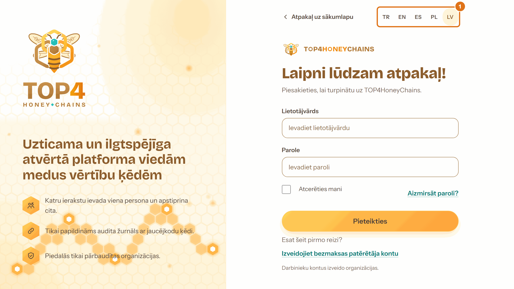

Pēc pieteikšanās valodu izvēlne ar karogu atrodas augšējā joslā.

## Pieteikties

1. Sākumlapā izvēlieties **Pieteikties**.
2. Laukā **Lietotājvārds** ievadiet savu lietotājvārdu.
3. Laukā **Parole** ievadiet savu paroli.
4. Izvēlieties **Pieteikties**.

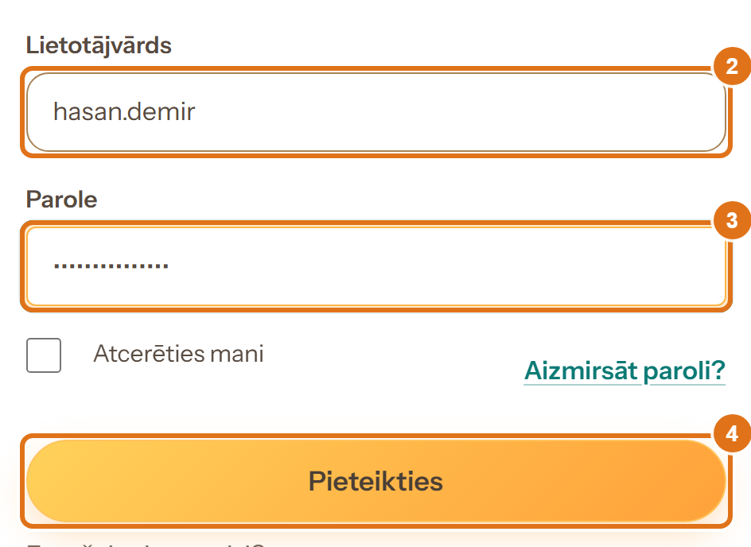

Jūs redzat sadaļu **Mans darbs**, savu uzdevumu sarakstu. Biškopji redz savu portālu ([Biškopja portāls](#ch-portal)), bet patērētāji redz sadaļu **Mans medus** ([Patērētāja konts](#ch-consumer)).

> [!NOTE]
> Darbinieku kontus izveido organizācijas un platformas administratori. Patērētāji paši izveido savu kontu ar saiti **Izveidojiet bezmaksas patērētāja kontu** zem pieteikšanās veidlapas.

## Pieteikties pirmo reizi {#sec-first-sign-in}

Jūsu pieteikšanās dati pienāk pa SMS: jūsu lietotājvārds un 10 rakstzīmju pagaidu parole kopā ar platformas adresi. Pagaidu parole ir derīga 72 stundas.

1. Piesakieties ar lietotājvārdu un pagaidu paroli no SMS.
2. Atveras lapa **Izvēlieties savu paroli**. Ievadiet jauno paroli laukā **Jaunā parole** un vēlreiz laukā **Apstipriniet paroli**. Izmantojiet vismaz 10 rakstzīmes, ne savu lietotājvārdu un ne bieži lietotu paroli.
3. Izvēlieties **Atjaunināt paroli**.

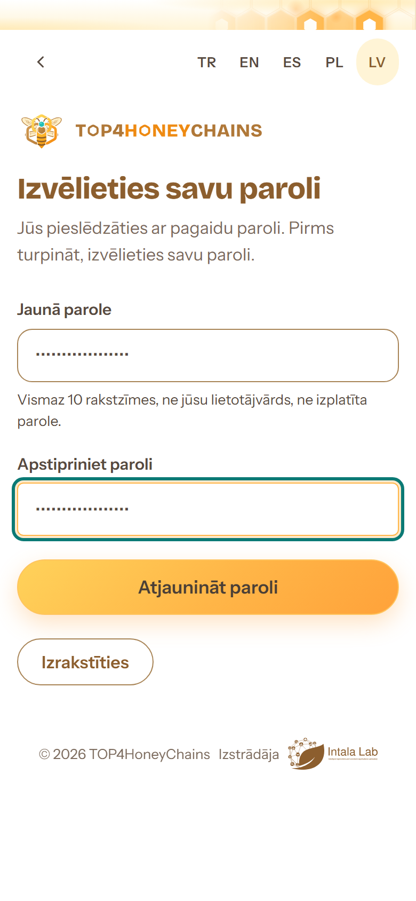

## Apstiprināt privātuma paziņojumu {#sec-notice}

Pirms strādājat ar personas datiem, jūs apstiprināt, ka esat izlasījis privātuma paziņojumu. Dzeltena josla jums to atgādina, līdz to izdarāt.

1. Dzeltenajā joslā izvēlieties **Izlasīt un apstiprināt**.

   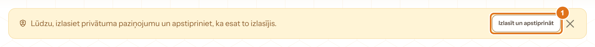

2. Izlasiet paziņojumu un atzīmējiet **Esmu izlasījis iepriekš minēto paziņojumu.**
3. Izvēlieties **Apstiprināt**.

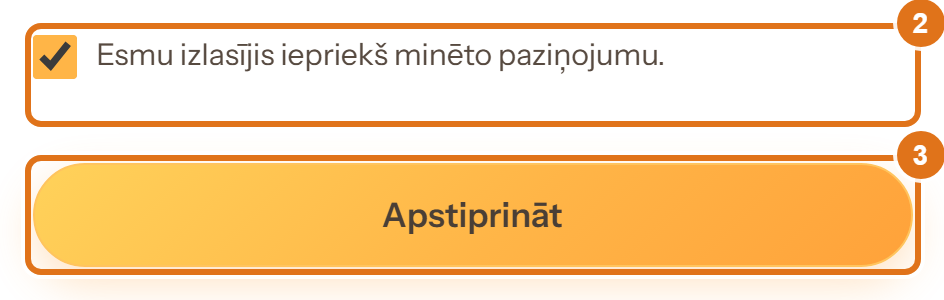

> [!NOTE]
> Lomas, kas paraksta ierakstus (Organizācijas administrators, Atbilstības speciālists, Biškopju reģistrācijas speciālists, Kvalitātes nodrošināšanas speciālists, Laboratorijas vadītājs), apstiprina paziņojumu ar kodu. Lapa rāda jūsu **Mobilais tālrunis**: izvēlieties **Sūtīt kodu**, pēc tam ierakstiet kodu no SMS laukā **Kods no SMS (6 cipari)** un tikai tad izvēlieties **Apstiprināt**.

## Orientēties ekrānā {#sec-screen}

**Mans darbs** ir jūsu sākumlapa un jūsu uzdevumu saraksts. Viss, kas jūs gaida, tur parādās grupās, piemēram, **Ievadāmās vērtības**, **Apstiprināmās vērtības**, **Saņemamie paraugi** vai **Ievadāmie laboratorijas rezultāti**. Izvēlieties ierakstu, lai atvērtu lapu, kurā veicat darbu. Kad nekas negaida, lapā ir rakstīts **Nekas jūs negaida.** un parādītas lapas, ko varat atvērt.

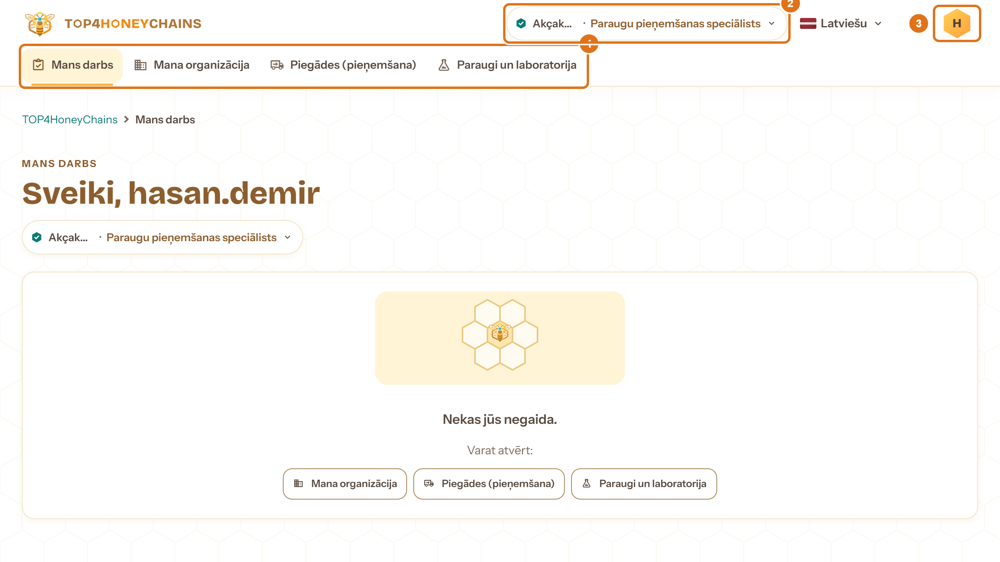

Atzīmes attēlā parāda:

1. Izvēlni ar jūsu lomas lapām. **Mans darbs** un **Mana organizācija** ir vienmēr; pārējie ieraksti ir atkarīgi no jūsu lomas un organizācijas.
2. Jūsu organizāciju un lomu. Ja jums ir vairāk nekā viena loma, izvēlieties to, lai pārslēgtos uz citu lomu.
3. Lietotāja izvēlni zem apaļās pogas ar jūsu iniciāli.

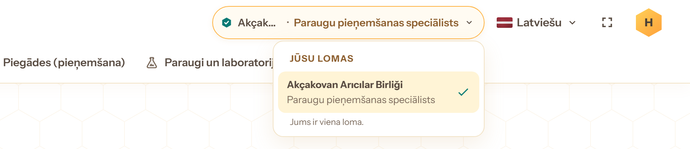 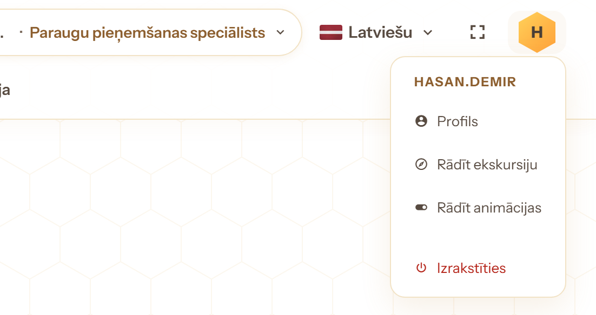

Lietotāja izvēlnē ir šādi ieraksti:

Table: Ekrāna daļas {#tbl-screen}

| Ieraksts | Ko tas dara |
| --- | --- |
| **Profils** | Parāda jūsu lietotājvārdu un ļauj apstiprināt mobilo tālruni un mainīt paroli. |
| **Rādīt ekskursiju** | Atkal atver īso ekrāna ekskursiju. |
| **Rādīt animācijas** | Ieslēdz vai izslēdz īsās ainas, kas parāda, ko dara poga. |
| **Izrakstīties** | Izraksta jūs no platformas. |

## Izrakstīties

Atveriet lietotāja izvēlni un izvēlieties **Izrakstīties**. Koplietošanas datorā vienmēr izrakstieties, kad aizejat.

## Apskatīt ekskursiju

Kad pirmo reizi atverat platformu kādā lomā, īsa ekskursija parāda svarīgākās ekrāna daļas. Izvēlieties **Nākamā**, lai turpinātu, vai **Izlaist**, lai to aizvērtu. To var atkal atvērt ar **Rādīt ekskursiju** lietotāja izvēlnē.

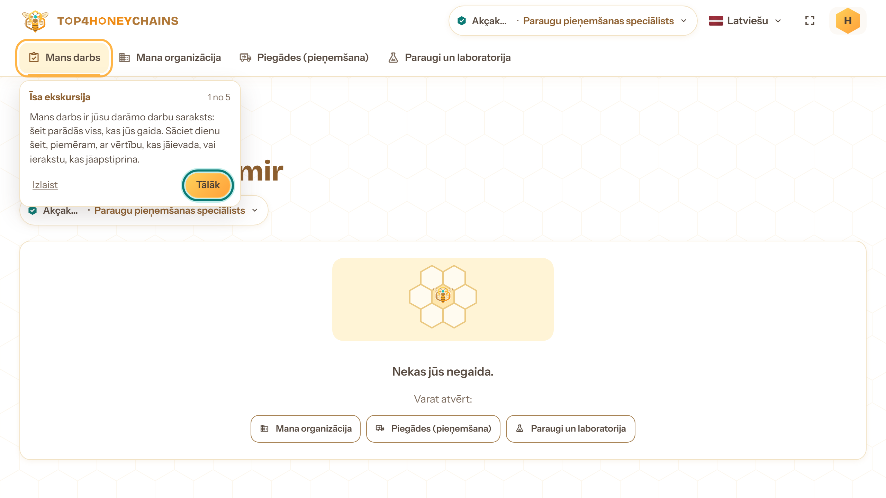

## Apstiprināt mobilo tālruni

Ar apstiprinātu mobilo tālruni jūs varat atiestatīt aizmirstu paroli pa SMS.

1. Atveriet lietotāja izvēlni un izvēlieties **Profils**.
2. Laukā **Tālruņa numurs** ievadiet savu numuru un izvēlieties **Sūtīt kodu**.
3. Ierakstiet kodu laukā **Kods no SMS (6 cipari)** un izvēlieties **Apstiprināt**. Jaunu numuru izmanto tikai pēc tam, kad ievadāt uz to nosūtīto kodu.

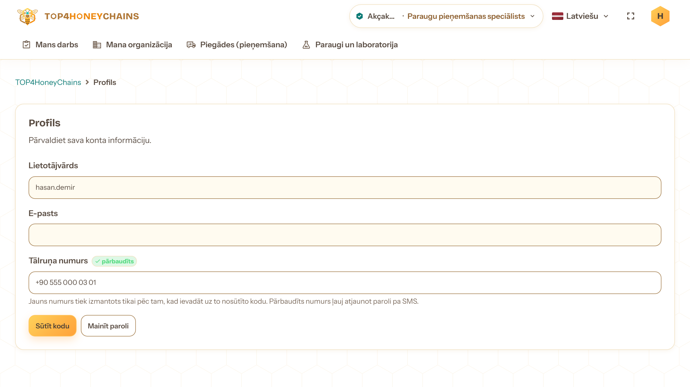

## Atiestatīt aizmirstu paroli

1. Pieteikšanās lapā izvēlieties **Aizmirsāt paroli?**.
2. Laukā **Lietotājvārds** ievadiet savu lietotājvārdu un izvēlieties **Sūtīt kodu**.

   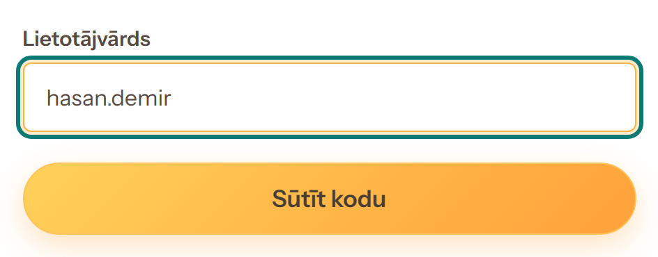

3. Lapā **Izveidot jaunu paroli** ierakstiet kodu no SMS laukā **Kods no SMS (6 cipari)**. Kods ir derīgs 5 minūtes.
4. Ievadiet jauno paroli laukos **Jaunā parole** un **Apstipriniet paroli** un saglabājiet to.

> [!NOTE]
> Kodu sūta tikai uz apstiprinātu mobilo tālruni. Ja tāda nav, lūdziet personu, kas jums deva pieteikšanās datus, nosūtīt jaunus.

# Biškopju reģistrācijas speciālists {#ch-ro}

Rajona direkcijas biškopju reģistrācijas speciālists reģistrē biškopjus platformā. Reģistrācija apstiprina trīs lietas: valsts reģistra numuru, biškopja mobilo tālruni (ar uz to nosūtītu kodu) un jūsu apliecinājumu, ka esat redzējis personu apliecinošo dokumentu un reģistra ierakstu.

Table: Biškopju reģistrācijas speciālista uzdevumi {#tbl-tasks-ro}

| Uzdevums | Kur |
| --- | --- |
| Atrast biškopi vai sākt reģistrāciju | **Biškopju reģistrācija** |
| Reģistrēt jaunu biškopi | **Biškopju reģistrācija > Atrast vai reģistrēt** |
| Pievienot vēl vienu dravu | reģistrācijas veidlapa vai reģistrācijas lapa |
| Nosūtīt pieteikšanās datus | reģistrācijas lapa |

## Atrast biškopi vai sākt reģistrāciju {#sec-find-beekeeper}

Lapā **Biškopju reģistrācija** ir uzskaitīti biškopji, ko reģistrējusi jūsu organizācija.

1. Izvēlnē izvēlieties **Biškopju reģistrācija**.
2. Laukā **Reģistra numurs (AKS) vai saimniecības numurs** ievadiet reģistra numuru.
3. Izvēlieties **Atrast vai reģistrēt**.

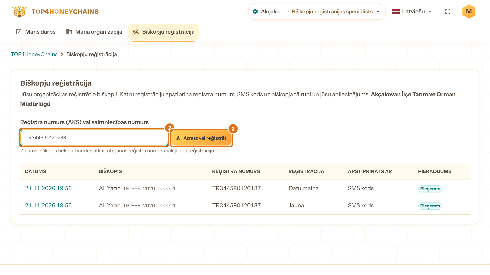

Zināmu biškopi pārbauda atkārtoti: veidlapa atveras ar saglabātajiem datiem. Jauns reģistra numurs sāk jaunu reģistrāciju.

## Reģistrēt jaunu biškopi

Dariet to, kad biškopis ir jūsu priekšā ar savu personu apliecinošo dokumentu un mobilo tālruni.

1. Atrodiet reģistra numuru, kā aprakstīts sadaļā [Atrast biškopi vai sākt reģistrāciju](#sec-find-beekeeper). Atveras veidlapa **Reģistrēt biškopi**.
2. Aizpildiet 1. un 2. sadaļu.

   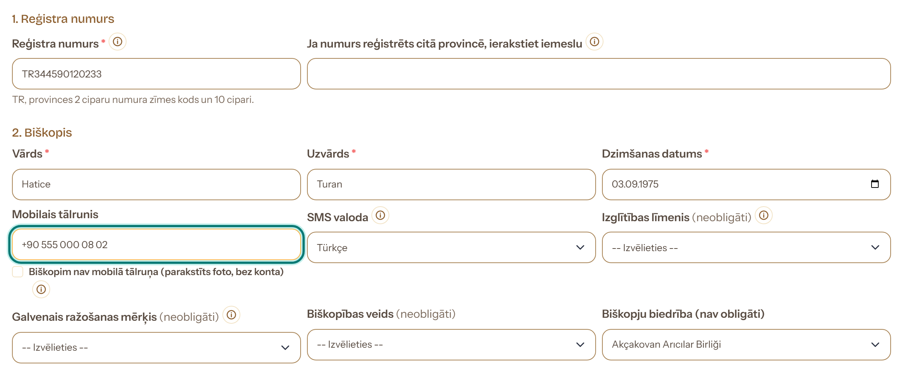

3. Sadaļā **3. Drava** iestatiet dravas atrašanās vietu: noklikšķiniet kartē vai velciet atzīmi, izvēlieties **Izmantot manu atrašanās vietu** vai ierakstiet **Atrašanās vietas platums** un **Atrašanās vietas garums**. Ievadiet **Stropu skaits**, pēc tam **Province**, **Rajons** un **Vieta (ciems, plato, lauks)**. Dravas nosaukumu veido no šiem trim, piemēram, `İstanbul – Şile – Sofular`.

   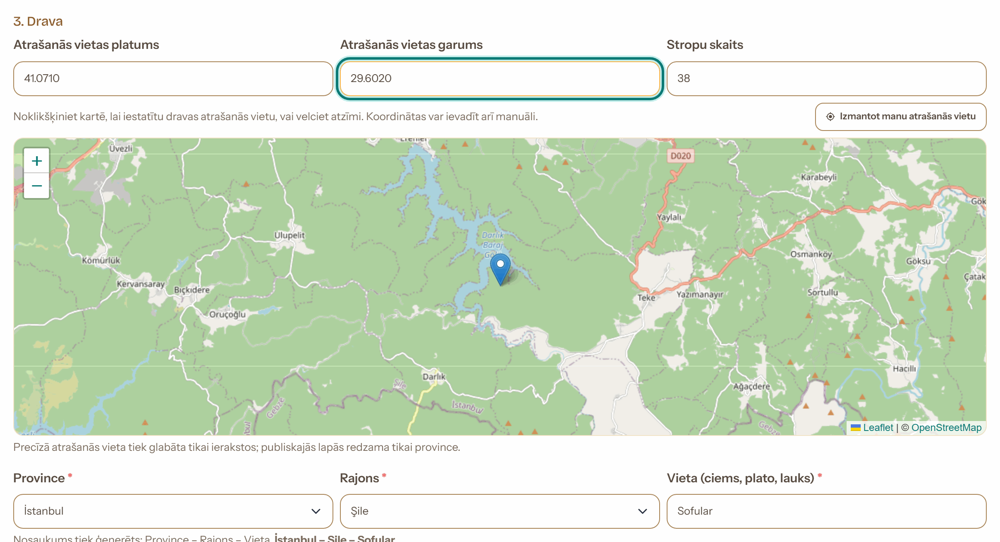

4. Ļaujiet biškopim izlasīt paziņojumu 4. sadaļā vai nolasiet to skaļi. Atzīmējiet piekrišanas, ko biškopis dod: vārds publiskajās lapās un SMS paziņojumi. Abas nav obligātas.
5. Sadaļā **5. Jūsu apliecinājums** atzīmējiet apliecinājumu. Atzīmējiet **Nosūtīt biškopim arī pieteikšanās datus pa SMS**, ja biškopim jāizmanto portāls.

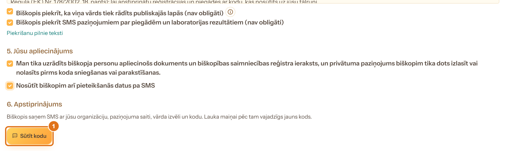

1. un 2. sadaļas lauki:

Table: Reģistrācijas veidlapas lauki {#tbl-reg-fields}

| Lauks | Ko ievadīt | Obligāts |
| --- | --- | --- |
| **Reģistra numurs** | TR, provinces 2 ciparu numurzīmes kods un 10 cipari | jā |
| **Ja numurs reģistrēts citā provincē, ierakstiet iemeslu** | tikai tad, ja reģistra province atšķiras no jūsu direkcijas provinces | nē |
| **Vārds**, **Uzvārds**, **Dzimšanas datums** | kā personu apliecinošajā dokumentā | jā |
| **Mobilais tālrunis** | biškopja paša numurs; uz to tiek nosūtīts kods un pieteikšanās dati | jā, ja vien biškopim ir mobilais tālrunis |
| **SMS valoda** | biškopja ziņu un portāla valoda | jā |
| **Izglītības līmenis**, **Galvenais ražošanas mērķis**, **Biškopības veids** | biškopja atbildes | nē |
| **Biškopju biedrība (nav obligāti)** | biedrība, kurai biškopis pieder | nē |

> [!NOTE]
> Precīza dravas atrašanās vieta tiek glabāta tikai ierakstos. Publiskās lapas rāda provinci.

### Apstiprināt ar kodu

1. Izvēlieties **Sūtīt kodu**. Biškopis saņem SMS ar jūsu organizācijas nosaukumu, saiti uz paziņojumu, savu izvēli par vārdu un kodu.
2. Ierakstiet kodu, ko biškopis nolasa, laukā **Kods no SMS (6 cipari)**.
3. Izvēlieties **Apstiprināt reģistrāciju**.

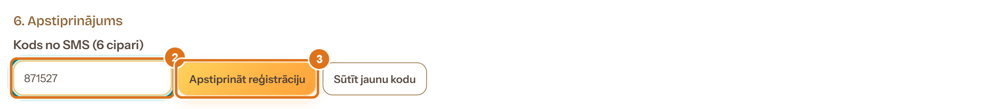

Atveras reģistrācijas lapa ar ziņu **Biškopis ir reģistrēts un pārbaudīts**. Biškopim ir saimniecības numurs (piemēram, `TR-BEE-2026-000002`); pierādījums ir **Pieņemts**, un reģistra numurs ir **Pārbaudīta**.

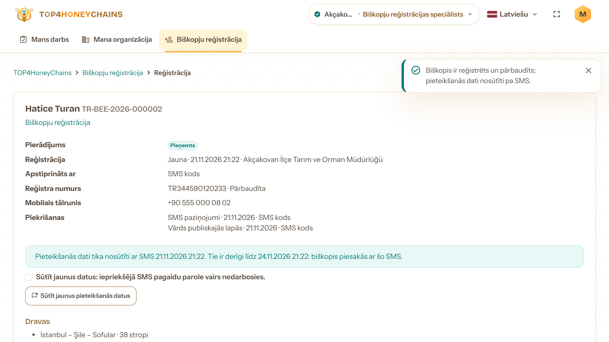

> [!IMPORTANT]
> Ja pēc koda nosūtīšanas maināt jebkuru lauku, kods kļūst nederīgs. Nosūtiet jaunu kodu ar **Sūtīt jaunu kodu**.

## Pievienot vēl vienu dravu

Biškopim var būt vairākas dravas. Veidlapā pievienojiet tās, pirms nosūtāt kodu:

1. Zem pirmās dravas izvēlieties **Pievienot dravu**. Parādās jauns bloks **Drava 2**.
2. Aizpildiet tā koordinātas, stropus un vietu. Karte iestata tikai pirmo dravu; pārējo koordinātas ierakstiet. Izvēlieties **Noņemt**, lai dzēstu bloku, kas nav vajadzīgs.

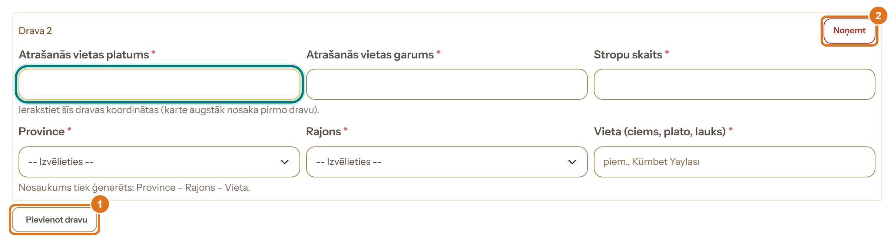

Reģistrētam biškopim atveriet reģistrācijas lapu un izmantojiet **Pievienot dravu** zem **Dravas**.

## Nosūtīt biškopim pieteikšanās datus {#sec-send-signin}

Ja atzīmējāt **Nosūtīt biškopim arī pieteikšanās datus pa SMS**, dati tiek nosūtīti kopā ar reģistrāciju. Citādi atveriet reģistrācijas lapu un izvēlieties **Nosūtīt pieteikšanās datus pa SMS**. Biškopja lietotājvārds ir saimniecības numurs.

Lai nosūtītu jaunus datus, atzīmējiet **Sūtīt jaunus datus: iepriekšējā SMS pagaidu parole vairs nedarbosies.** un izvēlieties **Sūtīt jaunus pieteikšanās datus**.

## Reģistrēt biškopi bez mobilā tālruņa {#sec-register-no-phone}

Ja biškopim nav mobilā tālruņa, atzīmējiet **Biškopim nav mobilā tālruņa (parakstīts foto, bez konta)**. 6. sadaļā atveriet **SMS nav iespējama: parakstīts foto**, ierakstiet iemeslu laukā **Kāpēc nav SMS koda**, izmantojiet **Drukāt veidlapu**, ļaujiet biškopim to parakstīt un augšupielādējiet tās foto laukā **Parakstītās veidlapas foto**. Izvēlieties **Saglabāt ar parakstītu foto**. Reģistrācija gaida, līdz jūsu organizācijas atbilstības speciālists pieņem vai noraida foto; par savu reģistrāciju jūs lemt nevarat.

# Paraugu pieņemšanas speciālists: medus piegāde {#ch-sao}

Uzņēmuma paraugu pieņemšanas speciālists reģistrē katru medus piegādi. Katru tvertni reģistrē ar tās plombām, no tās piepilda un noplombē parauga burku un kontrolparauga burku, un biškopis apstiprina visu piegādi ar kodu, kas nosūtīts pa SMS. Katra piegāde kļūst par jūsu organizācijas neapstrādāta medus partiju.

Table: Paraugu pieņemšanas speciālista uzdevumi {#tbl-tasks-sao}

| Uzdevums | Kur |
| --- | --- |
| Skatīt piegādes | **Piegādes (pieņemšana)** |
| Reģistrēt medus piegādi | **Piegādes (pieņemšana) > Reģistrēt piegādi** |
| Drukāt etiķetes | piegādes lapa |
| Ievadīt KKP 0 | **Mans darbs > Ievadāmās vērtības** |

## Skatīt piegādes

Izvēlnē izvēlieties **Piegādes (pieņemšana)**. Saraksts rāda katru partiju ar tās datumu, dravu, medus veidu, daudzumu, izcelsmi un to, kā biškopis to apstiprināja. **Piegāde** atver piegādi, **Atsaukšana** atver tās atsaukšanas pārskatu.

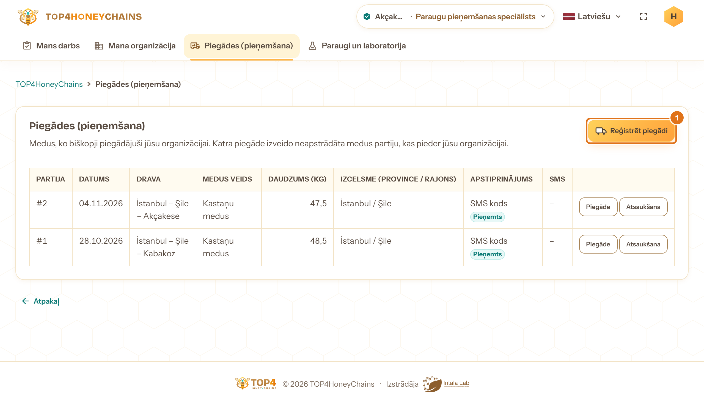

## Reģistrēt medus piegādi {#sec-record-delivery}

1. Izvēlieties **Reģistrēt piegādi**.
2. Laukā **Biškopja saimniecības vai reģistrācijas numurs** ievadiet biškopja numuru.
3. Izvēlieties **Atrast**.

   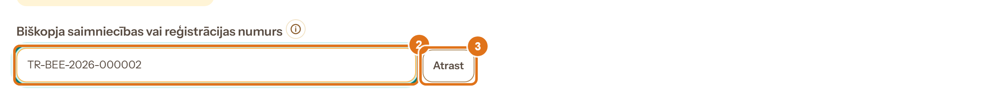

4. Aizpildiet sadaļu **1. Piegāde**. Dravu saraksts rāda katru biškopja dravu ar tās stropiem; ja dravu ir vairāk nekā viena, izvēlieties pareizo.

   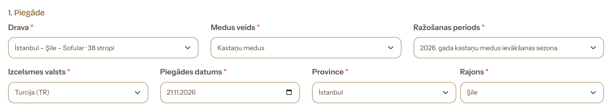

5. Sadaļā **2. Tvertnes un paraugi** aizpildiet vienu rindu katrai tvertnei. Katrai nākamajai tvertnei izvēlieties **Pievienot tvertni** un rindai, kas nav vajadzīga, **Noņemt rindu**.

   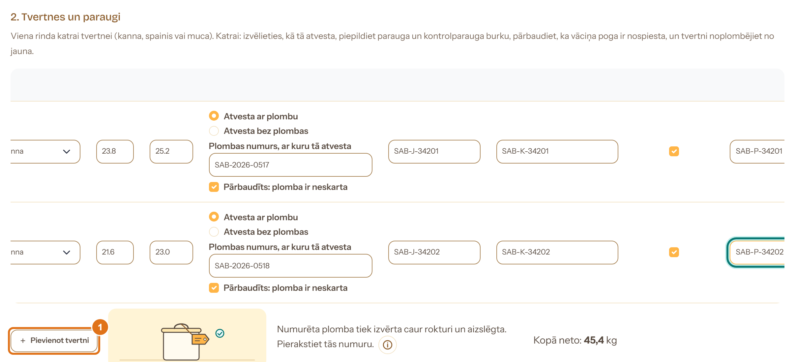

   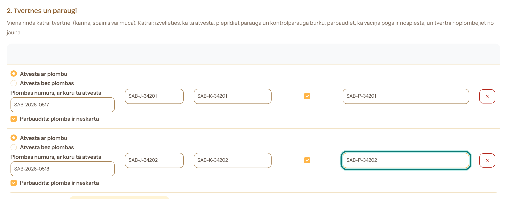

6. Sadaļā **3. Laboratorija un kontrolparaugi** izvēlieties **Laboratorija**, ierakstiet **Kur glabā kontrolparaugus** un datumu laukā **Glabāt līdz**.

1. sadaļas lauki:

Table: Piegādes lauki {#tbl-delivery-fields}

| Lauks | Ko ievadīt | Obligāts |
| --- | --- | --- |
| **Drava** | no kurienes medus nāk | jā |
| **Medus veids**, **Ražošanas periods** | kā piegādāts | jā |
| **Izcelsmes valsts** | medus valsts | jā |
| **Piegādes datums** | piegādes diena | jā |
| **Province**, **Rajons** | medus izcelsme | jā |

2. sadaļas kolonnas, viena rinda katrai tvertnei:

Table: Tabulas Tvertnes un paraugi kolonnas {#tbl-containers}

| Kolonna | Ko ievadīt |
| --- | --- |
| **Veids** | kanna, spainis vai muca |
| **Neto kg**, **Bruto kg** | tvertnes svars |
| **Pienākot** | **Atvesta ar plombu**: **Plombas numurs, ar kuru tā atvesta**, un atzīmējiet **Pārbaudīts: plomba ir neskarta**. **Atvesta bez plombas**: plombas numurs laukā **Jaunā plomba, uzlikta tagad biškopja klātbūtnē**. |
| **Burkas plomba** | no šīs tvertnes piepildītās parauga burkas plomba |
| **Kontrolparauga plomba** | kontrolparauga burkas plomba |
| **Vāciņš neskarts** | atzīmējiet, kad burkas vāciņa poga ir nospiesta |
| **Jaunā plomba pēc paraugu ņemšanas** | plomba, ko uzliekat tvertnei pēc paraugu paņemšanas |

> [!IMPORTANT]
> Katram piegādes plombas numuram jābūt atšķirīgam.

### Apstiprināt piegādi ar biškopja kodu

1. Izvēlieties **Sūtīt kodu**. Biškopis saņem SMS ar datumu, tvertnēm, kilogramiem, medus veidu, paraugu skaitu un kodu.

   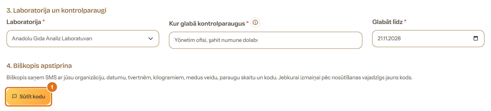

2. Ierakstiet kodu laukā **Kods no SMS (6 cipari)**. Ja biškopis nav klāt, piezvaniet viņam: viņš nolasa kodu no sava tālruņa.
3. Izvēlieties **Apstiprināt piegādi**.

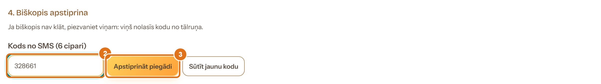

Atveras piegādes lapa ar ziņu **Piegādi apstiprināja biškopis, un tā reģistrēta kā partija #3.** Partija tagad parādās sadaļā **Mana organizācija**, un tās kontroles punkti parādās sadaļā **Mans darbs**.

Ja SMS nav iespējama, atveriet **SMS nav iespējama: parakstīts foto**, norādiet iemeslu, uzņemiet vai augšupielādējiet parakstītās piegādes veidlapas foto un izvēlieties **Reģistrēt ar parakstītu foto**. To pārbauda atbilstības speciālists.

## Drukāt etiķetes

Piegādes lapa rāda katru tvertni ar tās plombu vēsturi un tās paraugu burkām.

1. Izvēlieties **Etiķetes (A4 lapa)** vai, etiķešu printerim, **Etiķetes (100 × 50 mm)**.

   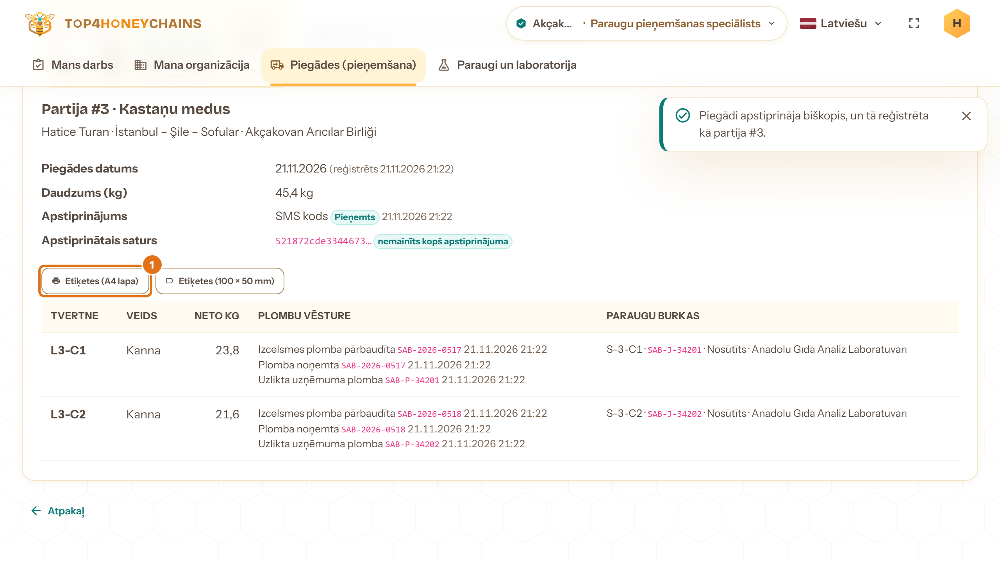

2. Izvēlieties **Drukāt veidlapu** un uzlīmējiet katru etiķeti uz tās tvertnes, parauga burkas un kontrolparauga burkas.

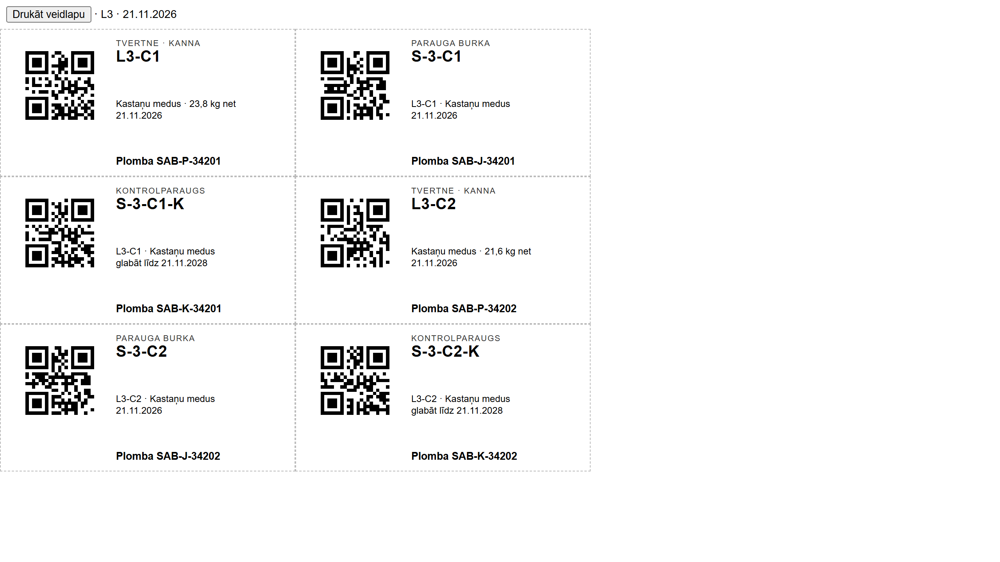

## Ievadīt KKP 0 (sākotnējais audits)

KKP 0 reģistrē piegādes sākotnējo auditu: higiēnu, ūdeni, kaitēkļu kontroli un uzglabāšanu pie biškopja.

1. Atveriet **Mans darbs** un sadaļā **Ievadāmās vērtības** izvēlieties **KKP 0**.

   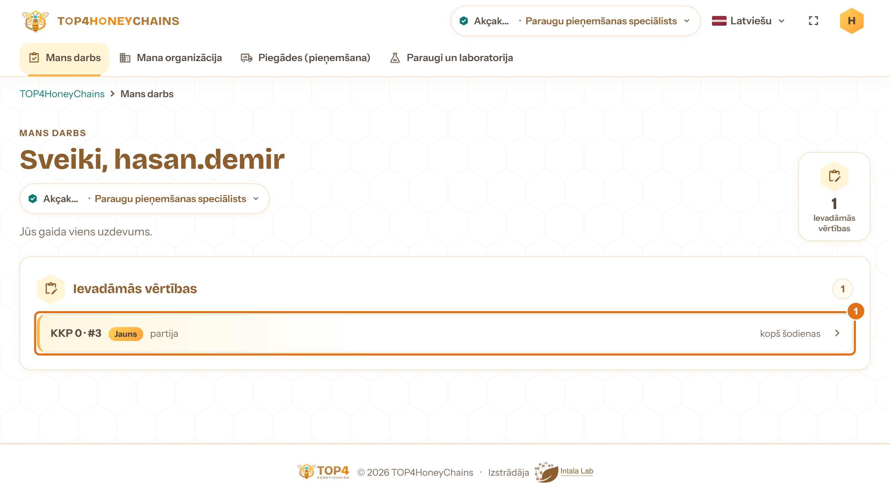

2. Atbildiet uz katru jautājumu un, ja noderīgi, pievienojiet piezīmes.

   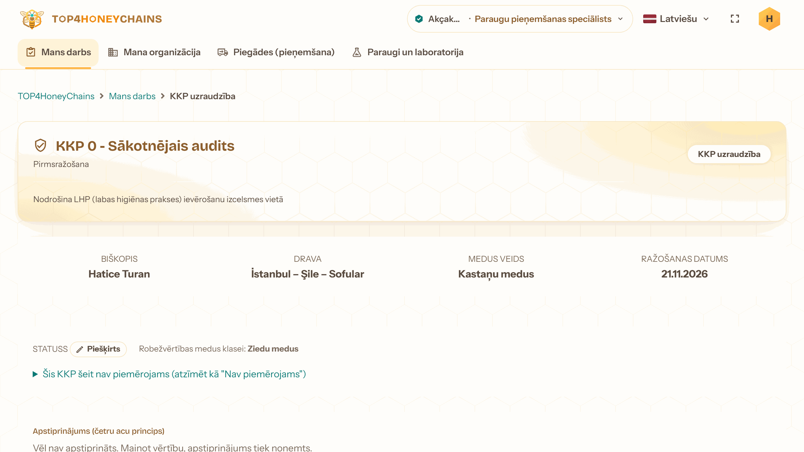

3. Izvēlieties **Saglabāt uzraudzības ierakstus**.

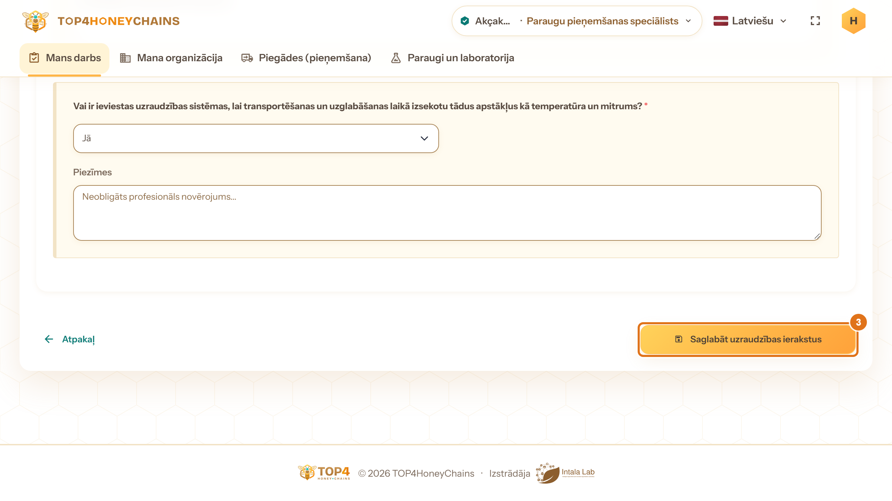

Pēc tam to apstiprina kvalitātes nodrošināšanas speciālists ([Apstiprināt KKP 0](#sec-approve-ccp0)). **KKP 1** aizpilda laboratorijas apstiprinātais pārskats; jūs to neievadāt.

> [!TIP]
> Ja kontroles punkts nav piemērojams, atveriet **Šis KKP šeit nav piemērojams (atzīmēt kā "Nav piemērojams")** un norādiet iemeslu.

# Laboratorija: analītiķis un laboratorijas vadītājs {#ch-lab}

Laboratorija pēc saņemšanas pārbauda katras parauga burkas plombu, izveido katras partijas kopparaugu, ievada rezultātus ar parakstīto pārskatu un ļauj laboratorijas vadītājam tos apstiprināt. Apstiprinātais pārskats kļūst par partijas KKP 1.

Table: Uzdevumi laboratorijā {#tbl-tasks-lab}

| Uzdevums | Kas | Kur |
| --- | --- | --- |
| Pieņemt paraugu burkas | Analītiķis | **Paraugi un laboratorija** |
| Izveidot kopparaugu | Analītiķis | **Paraugi un laboratorija** |
| Ievadīt un iesniegt rezultātus | Analītiķis | laboratorijas pārskats |
| Apstiprināt vai atgriezt pārskatu | Laboratorijas vadītājs | **Mans darbs** |

## Pieņemt paraugu burkas

Sadaļa Mans darbs uzskaita gaidošās burkas zem **Saņemamie paraugi**.

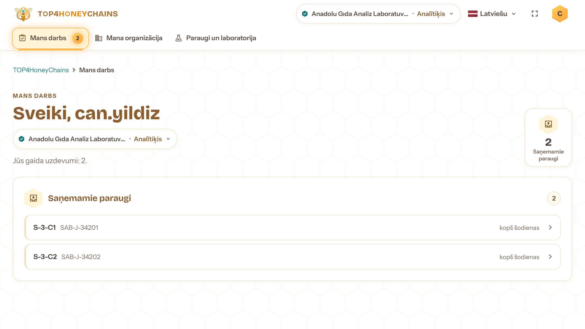

1. Izvēlnē izvēlieties **Paraugi un laboratorija**. Burkas ir uzskaitītas zem **Jūsu laboratorijai nosūtītie paraugi**.
2. Katrai burkai atbildiet uz **Plombas numurs atbilst ierakstam**, **Etiķete ir neskarta** un **Vāciņš neskarts (poga nospiesta)**. Ja pārbaude neizdodas, ierakstiet iemeslu laukā **Iemesls, ja pārbaude neizdodas**.
3. Izvēlieties **Reģistrēt pieņemšanu**.

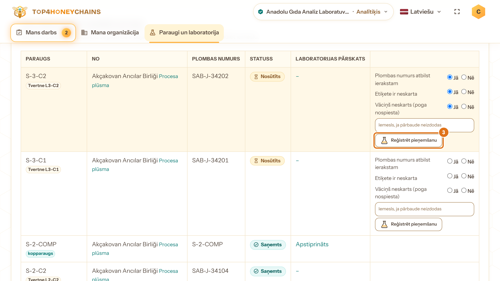

Bojāta plomba noraida paraugu; tad uzņēmums ņem jaunu paraugu no kontrolparauga.

## Izveidot kopparaugu

Kad visas partijas burkas ir saņemtas labā stāvoklī, partija ir uzskaitīta zem **Partijas, kas gatavas kopparaugam**.

1. Partijai izvēlieties **Izveidot kopparaugu**. Sajauciet vienādas burku daļas vienā kopparaugā; burkas tiek saglabātas atsevišķām analīzēm.

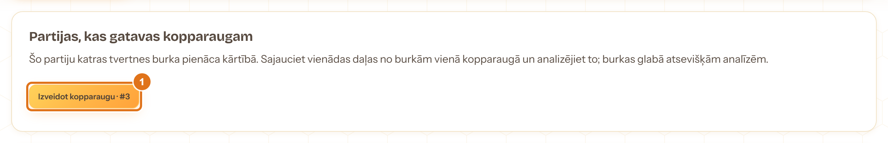

Atveras kopparauga laboratorijas pārskats.

## Ievadīt rezultātus

1. Ievadiet **Pārskata numurs** un **Izdošanas datums**.
2. Izvēlieties **Izvēlēties PDF** un pievienojiet parakstīto pārskatu.
3. Ievadiet katra parametra vērtību. Kolonna **Robežvērtība** rāda katras vērtības robežvērtību.
4. Izvēlieties **Saglabāt**.

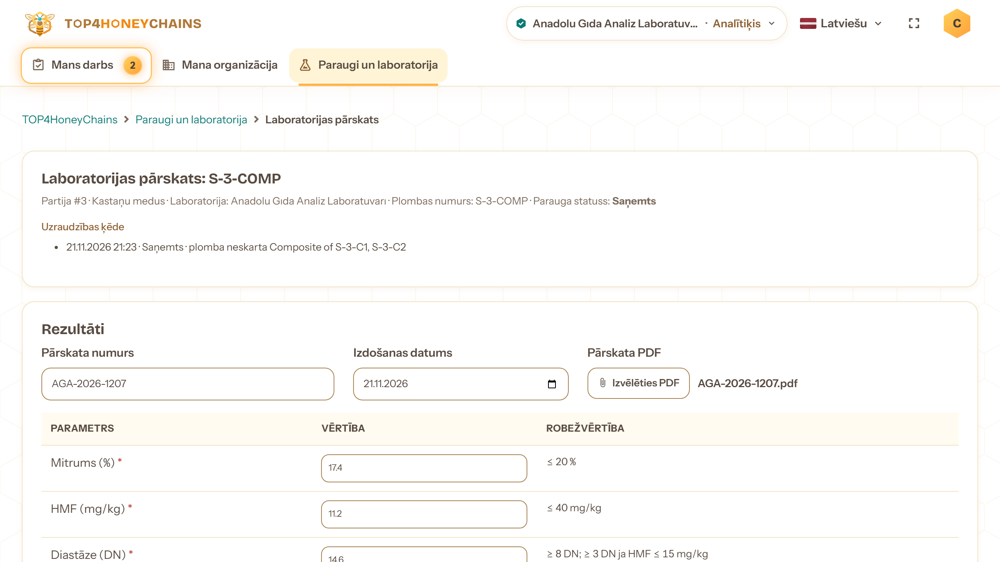

Rinda **Ievadītās obligātās vērtības** rāda, cik vērtību vēl trūkst.

## Iesniegt pārskatu

Kad katra obligātā vērtība ir saglabāta, izvēlieties **Iesniegt apstiprināšanai**.

1. Izvēlieties **Iesniegt apstiprināšanai**.

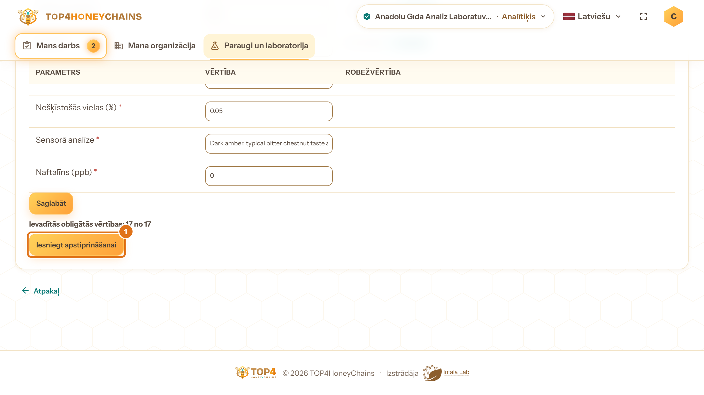

Laboratorijas vadītājs atrod pārskatu sadaļā **Mans darbs**.

## Apstiprināt vai atgriezt pārskatu

Laboratorijas vadītājs pārbauda pārskatu un tā PDF.

1. Izvēlieties **Apstiprināt**. Lai to nosūtītu atpakaļ, ierakstiet iemeslu laukā **iemesls (lai atgrieztu)** un izvēlieties **Atgriezt**.

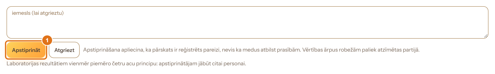

Apstiprināšana apliecina, ka pārskats ir reģistrēts pareizi, nevis to, ka medus atbilst prasībām. Vērtības ārpus robežvērtībām paliek atzīmētas partijā. Apstiprinātie rezultāti aizpilda partijas KKP 1, un pārskats saņem kodu, ko ikviens var pārbaudīt.

## Pārbaudīt laboratorijas pārskatu {#sec-verify-report}

Ikviens var pārbaudīt pārskatu bez pieteikšanās: sākumlapā atveriet **Pārbaudīt laboratorijas pārskatu**, ievadiet **Pārskata kods** un izvēlieties **Pārbaudīt**. Lapa rāda statusu, laboratoriju, tās akreditāciju, pārskata numuru, izdošanas datumu un pārskata faila SHA-256 nospiedumu.

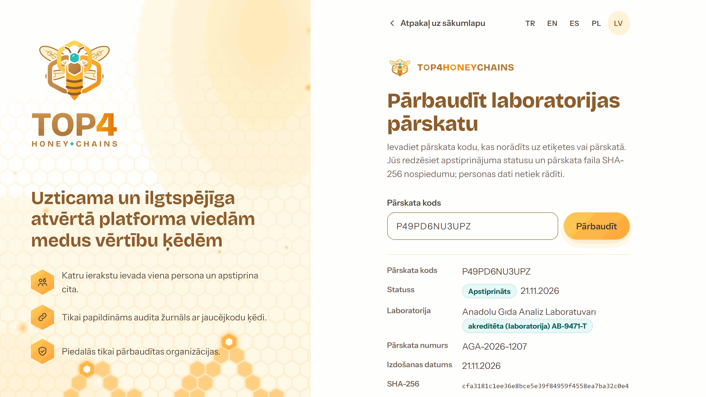

# Darbinieks: apstrāde un iepakošana {#ch-staff}

Uzņēmuma darbinieki aizpilda partiju un gala partiju kontroles lapas, apvieno apstiprinātās partijas gala partijās, pieprasa gala partijas pabeigšanu (fiksēšanu) un nosūta medu citām organizācijām.

Table: Darbinieka uzdevumi {#tbl-tasks-staff}

| Uzdevums | Kur |
| --- | --- |
| Skatīt savas partijas un gala partijas | **Mana organizācija** |
| Aizpildīt partijas kontroles lapu | **Mana organizācija > Kontroles lapa** |
| Izveidot gala partiju | **Mana organizācija > Jauna partija** |
| Aizpildīt gala partijas kontroles lapu | **Mans darbs** vai gala partijas lapa |
| Pieprasīt pabeigšanu (fiksēšanu) | gala partijas lapa |
| Nosūtīt medu | **Sūtījumi un krājumi** |

## Skatīt savas partijas un gala partijas

**Mana organizācija** rāda jūsu organizāciju, **Neapstrādāta medus partijas**, ar kurām tā strādā, un tās **Gala partijas**. Katrs kontroles punkts ir žetons: zaļš ar ✓ ir apstiprināts, dzeltens ir iesniegts un gaida apstiprinājumu, pelēks ir atvērts, ar kontūru nav piemērojams.

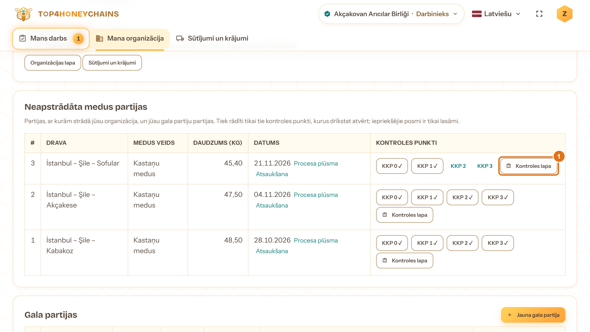

## Aizpildīt partijas kontroles lapu (KKP 2 un 3)

Kontroles lapa rāda visus partijas kontroles punktus vienā lapā. Katram no tiem ir savs ieraksts, statuss un apstiprinājums.

1. Partijas rindā izvēlieties **Kontroles lapa** vai ierakstu sadaļā **Mans darbs**.
2. Ievadiet **KKP 2** (karsēšana) un **KKP 3** (filtrēšana) vērtības.

   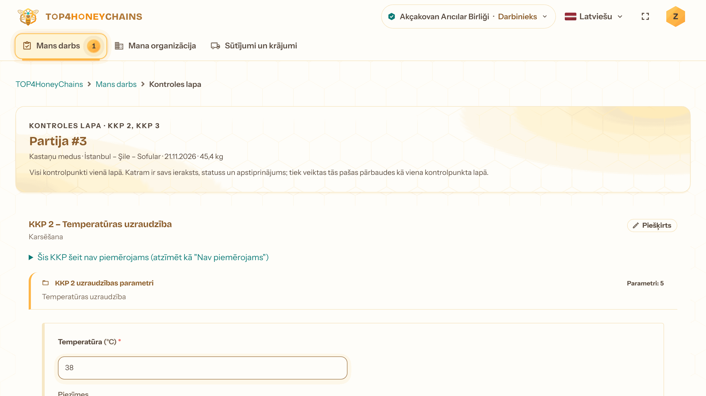

3. Izvēlieties **Saglabāt lapu**.

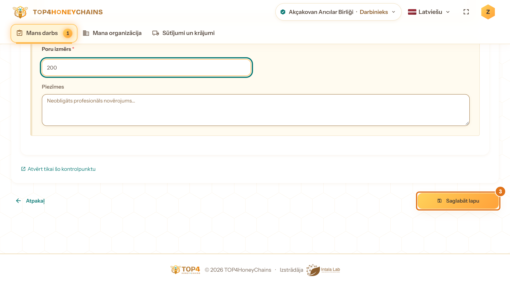

Kvalitātes nodrošināšanas speciālists apstiprina lapu ([Apstiprināt kontroles lapu](#sec-approve-sheet)).

> [!TIP]
> **Atvērt tikai šo kontrolpunktu** atver vienu kontroles punktu atsevišķā lapā, piemēram, lai pievienotu failu.

## Izveidot gala partiju {#sec-new-batch}

Partija ir gatava gala partijai, kad visi tās kontroles punkti ir pabeigti un apstiprināti.

1. Sadaļā **Mana organizācija** izvēlieties **Jauna gala partija**.
2. Ievadiet **Gala partijas nosaukums**, piemēram, `Şile Kestane Balı 2026/2`, un pārbaudiet **Ražošanas datums**.
3. Atzīmējiet **Izmantot** katrai partijai, kas nonāk gala partijā, un pārbaudiet **Kilogrami šai gala partijai**.
4. Izvēlieties **Izveidot gala partiju**.

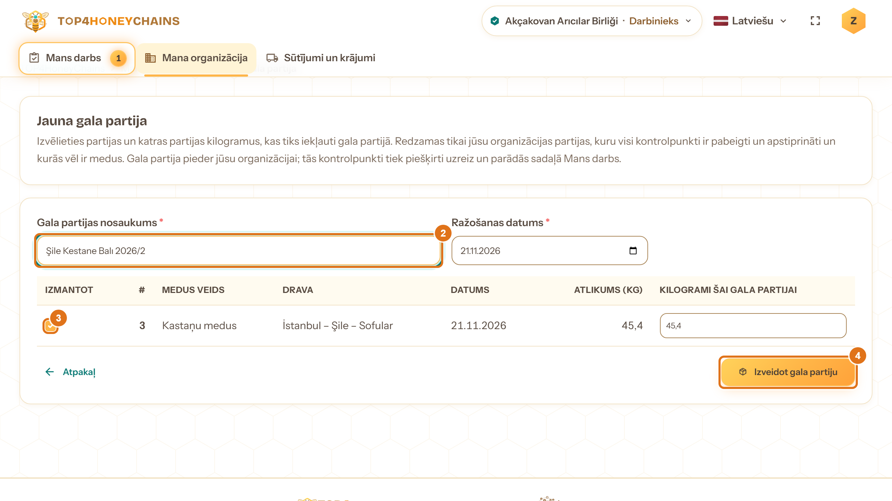

Gala partija pieder jūsu organizācijai. Tās kontroles punkti KKP 4 līdz KKP 10 uzreiz parādās sadaļā Mans darbs.

## Aizpildīt gala partijas kontroles lapu (KKP 4 līdz 10)

Atveriet gala partijas kontroles lapu no sadaļas **Mans darbs** vai ar **Atvērt kontroles lapu** gala partijas lapā. Ievadiet homogenizēšanas, pasterizācijas, nostādināšanas, pildīšanas, marķēšanas, iepakošanas un uzglabāšanas vērtības, pēc tam izvēlieties **Saglabāt lapu**.

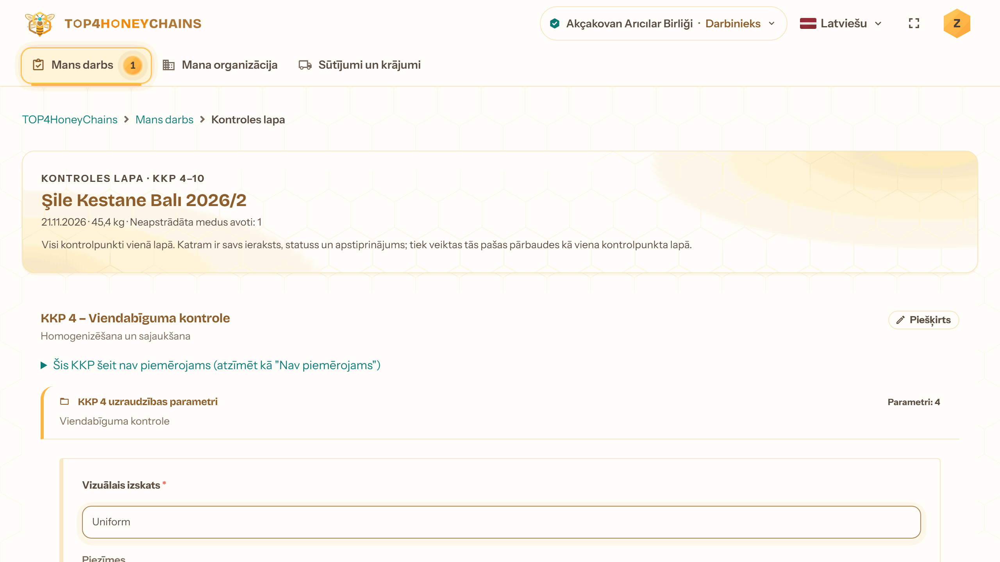

## Pieprasīt pabeigšanu (fiksēšanu) {#sec-request-finalizing}

Kad katrs gala partijas un tās partiju kontroles punkts ir apstiprināts, pieprasiet gala partijas pabeigšanu (fiksēšanu).

1. Gala partijas lapā izvēlieties **Pieprasīt pabeigšanu (fiksēšanu)**.

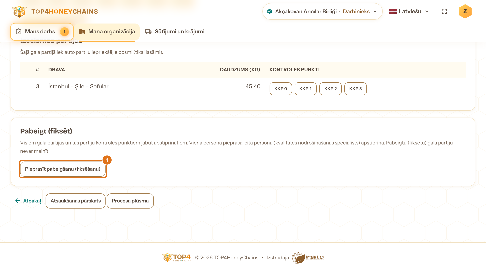

Ja kaut kā trūkst, lapa to uzskaita zem **Trūkst pirms pabeigšanas (fiksēšanas):**. Kvalitātes nodrošināšanas speciālists apstiprina pieprasījumu ([Pabeigt (fiksēt) gala partiju](#sec-finalize)).

## Nosūtīt medu citai organizācijai

1. Izvēlnē izvēlieties **Sūtījumi un krājumi** un gala partijas rindā izvēlieties **Nosūtīt**.

   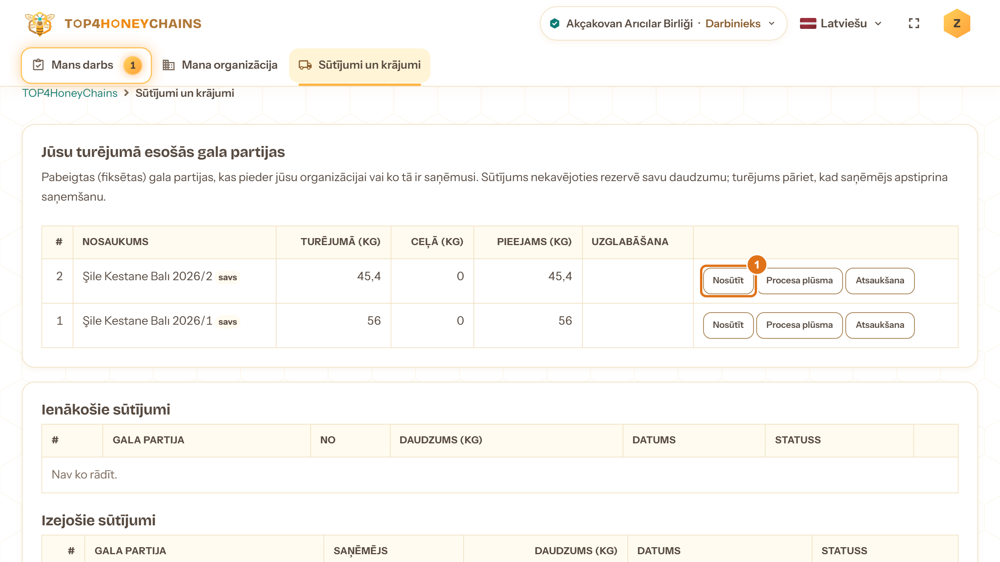

2. Laukā **Uz** izvēlieties saņēmēju organizāciju.
3. Ievadiet **Daudzums (kg)** un, ja noderīgi, **Piezīme**.
4. Izvēlieties **Nosūtīt**.

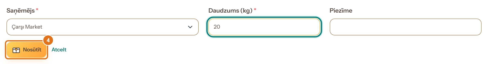

Sūtījums uzreiz rezervē savu daudzumu; turējums pāriet, kad saņēmējs to apstiprina.

# Kvalitātes nodrošināšanas speciālists {#ch-qao}

Kvalitātes nodrošināšanas speciālists apstiprina to, ko ievadījuši citi: katras piegādes KKP 0, partiju un gala partiju kontroles lapas, gala partiju pabeigšanu (fiksēšanu) un, vairumtirgotāja vai mazumtirgotāja organizācijā, uzglabāšanas ierakstus. Speciālists arī atbild uz patērētāju atsauksmēm. Jūs nekad neapstiprināt ierakstu, ko esat ievadījis pats.

Table: Kvalitātes nodrošināšanas speciālista uzdevumi {#tbl-tasks-qao}

| Uzdevums | Kur |
| --- | --- |
| Apstiprināt KKP 0 | **Mans darbs > Apstiprināmās vērtības** |
| Apstiprināt kontroles lapu | **Mans darbs > Apstiprināmās vērtības** |
| Pabeigt (fiksēt) gala partiju | **Mans darbs**, gala partijas lapa |
| Atbildēt uz patērētāju atsauksmēm | **Patērētāju atsauksmes** |

## Apstiprināt KKP 0 {#sec-approve-ccp0}

1. Atveriet **Mans darbs** un izvēlieties ierakstu zem **Apstiprināmās vērtības**.

   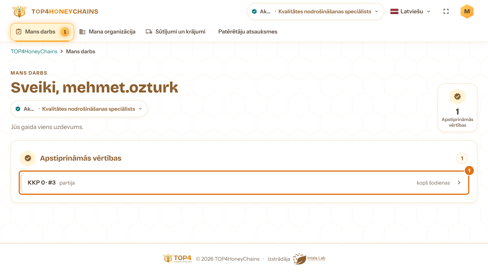

2. Pārbaudiet vērtības un izvēlieties **Apstiprināt**.

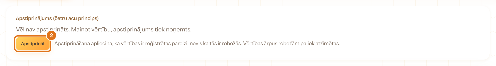

Apstiprināšana apliecina, ka vērtības ir reģistrētas pareizi, nevis to, ka tās ir robežvērtību robežās. Ja vērtība ir ārpus robežvērtības, lapa lūdz jūs to apliecināt pirms apstiprināšanas.

## Apstiprināt kontroles lapu {#sec-approve-sheet}

1. Atveriet kontroles lapu no sadaļas **Mans darbs**.
2. Pārbaudiet vērtības. Zem **Apstiprināt lapu** lapa uzskaita kontroles punktus, ko jūs apstiprināt; izvēlieties **Apstiprināt visus uzskaitītos**.

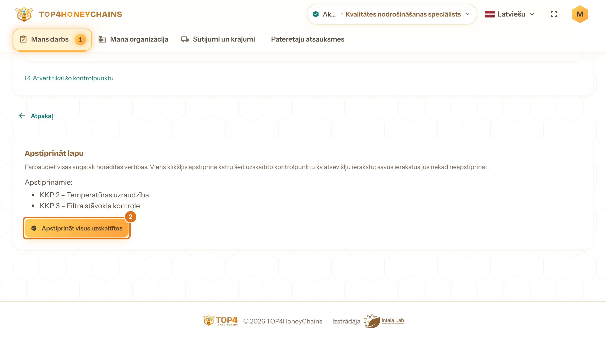

Katrs uzskaitītais kontroles punkts tiek apstiprināts kā atsevišķs ieraksts. Jūsu pašu ievadītie ieraksti ir uzskaitīti zem **Jūs neapstiprināt:**, un tiem vajadzīgs cits speciālists.

## Pabeigt (fiksēt) gala partiju {#sec-finalize}

Pēc tam, kad darbinieks ir pieprasījis pabeigšanu, gala partija parādās jūsu sadaļā Mans darbs.

1. Atveriet gala partijas lapu no sadaļas **Mans darbs**.
2. Izvēlieties **Apstiprināt un pabeigt (fiksēt)**.

Gala partija ir pabeigta (fiksēta) un noslēgta. **Atvērt medus stāstu** rāda tās publisko lapu, un **Lejupielādēt QR** dod QR kodu burku etiķetēm.

> [!WARNING]
> Pabeigtu (fiksētu) gala partiju nevar mainīt. Tās dati, sastāvs un kontroles punkti ir bloķēti. Vērtību pēc tam var mainīt tikai ar labojumu, ko apstiprinājuši divi platformas administratori.

## Atbildēt uz patērētāju atsauksmēm {#sec-answer-feedback}

Patērētāji var nosūtīt atsauksmi par medu organizācijai, kas to ražojusi. Jūs lasāt tikai patērētāja kodu, nekad viņa lietotājvārdu vai tālruni, un atsauksme nekad nav publiska.

1. Izvēlnē izvēlieties **Patērētāju atsauksmes** un atveriet atsauksmi.
2. Ierakstiet savu atbildi laukā **Jūsu atbilde patērētājam**.
3. Izvēlieties **Nosūtīt atbildi**.

Patērētājs lasa atbildi savā lapā **Mans medus**. Izmantojiet **Atzīmēt kā izlasītu** un **Aizvērt**, lai uzturētu sarakstu kārtībā.

# Vairumtirgotājs un mazumtirgotājs: medus saņemšana un uzglabāšana {#ch-shop}

Vairumtirgotāja vai mazumtirgotāja darbinieki apstiprina saņemto medu un reģistrē tā uzglabāšanas apstākļus (KKP 10). Tās pašas organizācijas kvalitātes nodrošināšanas speciālists apstiprina uzglabāšanas ierakstu. Attēlos redzams mazumtirgotājs; vairumtirgotājs strādā tāpat.

Table: Uzdevumi pie vairumtirgotāja vai mazumtirgotāja {#tbl-tasks-shop}

| Uzdevums | Kas | Kur |
| --- | --- | --- |
| Apstiprināt sūtījumu | Darbinieks | **Sūtījumi un krājumi** |
| Reģistrēt uzglabāšanas apstākļus | Darbinieks | **Sūtījumi un krājumi > KKP 10** |
| Apstiprināt uzglabāšanas ierakstu | Kvalitātes nodrošināšanas speciālists | **Mans darbs** |

## Apstiprināt sūtījumu

1. Izvēlnē izvēlieties **Sūtījumi un krājumi**. Sūtījums ir uzskaitīts zem **Ienākošie sūtījumi** ar statusu **Gaida**.
2. Pārbaudiet medu un izvēlieties **Apstiprināt saņemšanu**. Ja kaut kas nav kārtībā, ierakstiet iemeslu laukā **iemesls (lai noraidītu)** un izvēlieties **Noraidīt**.

Gala partija tagad ir uzskaitīta zem **Jūsu turējumā esošās gala partijas**.

## Reģistrēt uzglabāšanas apstākļus (KKP 10)

1. Sadaļā **Sūtījumi un krājumi** gala partijas kolonnā **Uzglabāšana** izvēlieties **KKP 10**.
2. Ievadiet **Temperatūra (°C)** un **Relatīvais mitrums**.
3. Izvēlieties **Saglabāt**.

## Apstiprināt uzglabāšanas ierakstu

1. Atveriet uzglabāšanas ierakstu no sadaļas **Mans darbs**.
2. Izvēlieties **Apstiprināt**.

Gala partijas Medus stāsts tagad rāda, ka mazumtirgotājs to ir saņēmis.

# Organizācijas administrators {#ch-orgadmin}

Organizācijas administrators rūpējas par organizācijas lapu un dokumentiem un biškopju biedrībā publicē biškopju lapas. Uzņēmumā organizācijas administrators var arī izveidot gala partijas, pieprasīt pabeigšanu (fiksēšanu) un nosūtīt medu, tāpat kā darbinieki ([Darbinieks: apstrāde un iepakošana](#ch-staff)). Atbilstības speciālistam ir sava nodaļa ([Atbilstības speciālists](#ch-compliance)).

## Skatīt savas organizācijas lapu un dokumentus {#sec-org-page}

Izvēlieties **Mana organizācija** un pēc tam **Organizācijas lapa**. Lapa rāda organizācijas statusu (**Pārbaude**), tās **Dokumenti**, **Kompetences**, **Četru acu principa izņēmums** un **Datu pārzinis** ziņas.

Lai pievienotu dokumentu, sadaļā **Dokumenti** izvēlieties failu un izvēlieties **Augšupielādēt**. Tiek pieņemti PDF faili līdz 10 MB un JPG, PNG vai WEBP attēli līdz 8 MB. Dalībniekus un kompetences pārvalda platformas administratori ([Platformas administrēšana](#ch-admin)).

## Publicēt biškopja lapu (biedrība) {#sec-beekeeper-page}

Biedrība var publicēt publisku lapu katram biedram biškopim. Lapu publicē tikai ar reģistrētu piekrišanu un pārbaudītu reģistra numuru; piekrišanas atsaukšana lapu nekavējoties noņem no publikācijas.

1. Izvēlnē izvēlieties **Biškopju lapas**.
2. Biškopja rindā izvēlieties **Reģistrēt piekrišanu**.
3. Nolasiet biškopim piekrišanas tekstu. Atzīmējiet **Piekrišanas teksts tika nolasīts biškopim un parakstīts.** un, ja biškopis piekrīt, **Biškopis piekrīt vārda rādīšanai (pretējā gadījumā tiek rādīts neitrāls kods)**.
4. Ievadiet **Piekrišanas datums**, pievienojiet **Parakstīts piekrišanas dokuments** (vai uzņemiet to ar **Kamera**) un saglabājiet.

Pēc publicēšanas **Drukājama kartīte** dod kartīti ar lapas QR kodu, un **Atsaukt piekrišanu** noņem lapu.

# Atbilstības speciālists {#ch-compliance}

Katra organizācija platformā norīko vismaz vienu **Atbilstības speciālists**. Atbilstības speciālists uzrauga, kā organizācija strādā ar platformu un ar personas datiem. Jūs neievadāt piegādes, kontroles punktu vērtības vai laboratorijas rezultātus; jūs tos pārbaudāt. Platformas administrators pirmo reizi pārbauda organizāciju tikai tad, ja tai ir aktīvs atbilstības speciālists. Mazā organizācijā **Organizācijas administrators** ar otru dalību var būt arī atbilstības speciālists (skatīt [Dalība organizācijās](#memberships)).

Kā atbilstības speciālists jūs varat:

- pieņemt vai noraidīt parakstītos foto, kas aizstāj biškopja SMS kodu, jūsu organizācijas reģistrācijām un piegādēm;
- pārbaudīt paraugu ņemšanas kvalitāti: piegādes, kas apstiprinātas ar parakstītu foto, laboratorijas noraidītos paraugus un bojātas plombas;
- reģistrēt pieprasījumus par personas datiem un piekrišanu atsaukumus, kas pienāk papīrā, pa tālruni vai klātienē;
- uzraudzīt apstiprināšanas mehānismu: ierakstus, kas pārāk ilgi gaida apstiprinājumu, un apstiprinājumus, kas veikti ar četru acu principa izņēmumu;
- uzturēt organizācijas līgumus un tās datu pārziņa ziņas;
- lasīt savas organizācijas audita ierakstus.

Jūsu datu tiesības izriet no lomas (skatīt [{n}. tabulu](#tbl-crud)). Pēc noklusējuma jūs apstiprināt parakstīta foto pierādījumus, lasāt biškopju prasītās cenas jūsu organizācijas partijām, lasāt organizācijas audita ierakstus un lasāt patērētāju atsauksmes par jūsu organizācijas gala partijām un atbildat uz tām. Jūs izveidojat un atjauninājat savas organizācijas dokumentus un datu pārziņa ziņas. Jūs izveidojat paraugu ņemšanas kvalitātes pārbaudes un datu subjektu pieprasījumus; pārbaudi pēc tam nevar mainīt vai dzēst. Platformas administrators var mainīt šīs tiesības sadaļā **Iestatīšana > Lomas un atļaujas**.

Vienmēr ir spēkā divi pamatnoteikumi (skatīt [Pamatnoteikumi](#ground-rules)). Jūs nekad nelemjat par ierakstu, ko reģistrējāt pats: lapā ir rakstīts **Jūs reģistrējāt šo ierakstu; to pārbauda cita persona.** Un organizācijas četru acu principa izņēmums nekad neattiecas uz jūsu parakstīto foto pārbaudēm.

Jūsu izvēlnē ir **Atbilstība**. Jūsu uzdevumi parādās sadaļā **Mans darbs** zem **Pārbaudīt parakstītos foto**, **Pārskati**, **Datu subjektu pieprasījumi** un **Patērētāju atsauksmes**.

Table: Atbilstības speciālista uzdevumi un kur tos atrast {#tbl-co-tasks}

| Uzdevums | Kur to atrast |
| --- | --- |
| Pārbaudīt reģistrācijas vai piegādes parakstītu foto | **Mans darbs > Pārbaudīt parakstītos foto**; skaits ir redzams arī sadaļā **Atbilstība > Parakstītie foto** |
| Pārbaudīt paraugu ņemšanas kvalitāti | **Atbilstība > Paraugu ņemšanas kvalitāte**; atvērtie ieraksti zem **Mans darbs > Pārskati** |
| Reģistrēt datu subjekta pieprasījumu un atbildēt uz to | **Atbilstība > Datu subjektu pieprasījumi**; atvērtie pieprasījumi zem **Mans darbs > Datu subjektu pieprasījumi** |
| Reģistrēt piekrišanas atsaukumu, kas saņemts papīrā vai pa tālruni | **Atbilstība > Datu subjektu pieprasījumi > Reģistrēt pieprasījumu** |
| Pārbaudīt apstiprināšanas mehānismu | **Atbilstība > Apstiprināšanas mehānisms** |
| Glabāt līgumus un dokumentus | **Atbilstība > Līgumi**, **Organizācijas dokumenti** |
| Uzturēt datu pārziņa ziņas | **Atbilstība > Datu pārzinis**, **Rediģēt organizācijas lapā** |
| Lasīt organizācijas audita ierakstus | **Atbilstība > Audita ieraksti** |
| Atbildēt uz patērētāju atsauksmēm | **Mans darbs > Patērētāju atsauksmes** (skatīt [Atbildēt uz patērētāju atsauksmēm](#sec-answer-feedback)) |

## Pārbaudīt parakstītu foto {#co-evidence}

Parasti biškopis apstiprina reģistrāciju un piegādi ar 6 ciparu kodu no SMS. Ja tas nav iespējams (nav mobilā tālruņa, nav signāla), speciālists, kas to reģistrē, pievieno biškopja parakstītās veidlapas foto. **Biškopju reģistrācijas speciālists** to dara reģistrācijā (skatīt [Reģistrēt biškopi bez mobilā tālruņa](#sec-register-no-phone)); **Paraugu pieņemšanas speciālists** to dara piegādē (skatīt [Reģistrēt medus piegādi](#sec-record-delivery)). Tad foto gaida jūs.

1. Sadaļā **Mans darbs** atveriet ierakstu zem **Pārbaudīt parakstītos foto**. Tas atver reģistrāciju vai piegādi.
2. Atveriet foto un salīdziniet to ar ierakstu:
   - reģistrācijai: identitāti, reģistra numuru, biškopja izvēles un parakstu;
   - piegādei: tvertnes, svarus un plombu numurus.
3. Izvēlieties **Pieņemt** vai ierakstiet **Piezīme (obligāta noraidīšanai)** un izvēlieties **Noraidīt**.

Tas, kas notiek tālāk, ir atkarīgs no ieraksta.

Table: Ko dara parakstīta foto pieņemšana vai noraidīšana {#tbl-co-evidence}

| Ieraksts | Pieņemt | Noraidīt |
| --- | --- | --- |
| Reģistrācija | Reģistra numurs ir pārbaudīts, un biškopis var piegādāt medu. | Reģistra numurs tiek noraidīts. Šajā parakstītajā veidlapā dotās piekrišanas tiek atsauktas. Biškopis nevar piegādāt, līdz tiek reģistrēts no jauna. |
| Piegāde | Partiju var pabeigt (fiksēt), kad tās kontroles punkti ir pabeigti. Biškopis var ievadīt prasīto cenu. | Partiju nevar pabeigt (fiksēt). |

Ja ierakstu reģistrējāt pats, tas neparādās jūsu sadaļā **Mans darbs**, un lapā ir rakstīts, ka lemj cita persona. Reģistrācijām, ko reģistrējusi pati platforma, foto pārbauda platformas administrators.

> [!NOTE]
> Jūs varat atvērt un lejupielādēt foto, jo esat tās organizācijas atbilstības speciālists, kurai tas pieder. Katra lejupielāde tiek ierakstīta audita žurnālā (skatīt [Kodi un failu nospiedumi](#trust-codes)).

## Pārbaudīt paraugu ņemšanas kvalitāti {#co-quality}

**Atbilstība > Paraugu ņemšanas kvalitāte** uzskaita jūsu organizācijai trīs veidu ierakstus:

- **piegāde ar foto**: piegāde, kas apstiprināta ar parakstītu foto SMS koda vietā;
- **noraidīts paraugs**: parauga burka, ko laboratorija noraidīja pieņemšanā;
- **bojāta plomba**: tvertnes plomba, kas atrasta bojāta.

Ieraksti bez pārbaudes ir pirmie. Izvēlieties ieraksta saiti, lai atvērtu piegādi vai paraugu.

1. Rindā izvēlieties **Rakstīt pārskatu**.
2. Izvēlieties **kārtībā** vai **konstatējums**.
3. Ierakstiet **Ko pārbaudījāt un konstatējāt**.
4. Konstatējumam ierakstiet **Veiktā vai pieprasītā rīcība**. Konstatējumam tā ir obligāta.
5. Izvēlieties **Saglabāt**.

Katrā tekstā var būt ne vairāk kā 1000 rakstzīmju. Saglabātu pārbaudi nevar mainīt vai dzēst. Ja vēlāk ierakstu pārbaudījāt vēlreiz, uzrakstiet jaunu pārbaudi; tad rinda rāda katru pārbaudi ar tās datumu.

## Apstrādāt datu subjekta pieprasījumu {#co-requests}

Cilvēki var jautāt par saviem personas datiem. Lapa piedāvā piecus pieprasījumu veidus: **piekļuve**, **labošana**, **dzēšana**, **iebildums** un **piekrišanas atsaukums**. Biškopis ar portāla kontu atsauc vai dod piekrišanu tur nekavējoties (skatīt [Pārvaldīt savas piekrišanas un kontu](#sec-portal-consents)). Šeit jūs reģistrējat pieprasījumus, kas organizāciju sasniedz citā veidā: vēstulē, tālruņa zvanā vai apmeklējumā.

1. Izvēlieties **Atbilstība**, dodieties uz **Datu subjektu pieprasījumi** un izvēlieties **Reģistrēt pieprasījumu**.
2. Aizpildiet veidlapu (skatīt [{n}. tabulu](#tbl-co-request)).
3. Izvēlieties **Saglabāt**. Ziņā ir rakstīts **Pieprasījums reģistrēts; atbilde jāsniedz 30 dienu laikā.**

Table: Datu subjekta pieprasījuma lauki {#tbl-co-request}

| Lauks | Ko ievadīt | Obligāts |
| --- | --- | --- |
| **Datu subjekts** | Tās personas vārds, kas jautā (ne vairāk kā 200 rakstzīmju) | Jā |
| **Biškopja numurs (ja biškopis)** | Biškopja saimniecības numurs. Tam jābūt platformā. | Tikai piekrišanas atsaukumam |
| **Pieprasījums** | **piekļuve**, **labošana**, **dzēšana**, **iebildums** vai **piekrišanas atsaukums** | Jā |
| **Atsaucamā piekrišana** | Piekrišana, ko biškopis atsauc | Tikai piekrišanas atsaukumam |
| **Saņemts pa** | Kā pieprasījums pienāca, piemēram, "vēstule" vai "tālrunis" (ne vairāk kā 50 rakstzīmju) | Jā |
| **Saņemts** | Datums, kad pieprasījums pienāca. Tas nevar būt nākotnē. | Jā |
| **Kas tiek prasīts** | Pieprasījums jūsu vārdiem (ne vairāk kā 1000 rakstzīmju) | Jā |

Saraksts vispirms rāda atvērtos pieprasījumus ar datumu **Saņemts** un datumu **Atbildēt līdz**. Atbildes datums ir 30 dienas pēc saņemšanas datuma, kas ir ekrānā minētā Turcijas datu aizsardzības likuma (KVKK) termiņš. Nokavēts datums ir parādīts sarkanā krāsā. Citās partnervalstīs pārbaudiet sava nacionālā likuma termiņu; saskaņā ar VDAR tas ir viens mēnesis.

Kad esat atbildējis personai, rindā ierakstiet **Sniegtā atbilde** un izvēlieties **atbildēts** vai **atteikts**. Slēgtu pieprasījumu nevar atvērt no jauna.

> [!NOTE]
> Platforma reģistrē pieprasījumu un tā termiņu. Pašu pieprasījumu izpildāt jūs: piemēram, savācat datus piekļuves pieprasījumam vai lūdzat platformas administratoram labojumu vai dzēšanu (skatīt [Kas notiek tālāk](#co-next)).

## Reģistrēt piekrišanas atsaukumu, kas saņemts papīrā vai pa tālruni {#co-withdrawal}

Biškopis var atsaukt piekrišanu vēstulē, pa tālruni vai klātienē, piemēram, biškopis bez portāla konta. Atsaukums stājas spēkā, tiklīdz jūs to reģistrējat.

1. Izvēlieties **Reģistrēt pieprasījumu**.
2. Laukā **Pieprasījums** izvēlieties **piekrišanas atsaukums**.
3. Ievadiet **Biškopja numurs (ja biškopis)**. Šeit tas ir obligāts.
4. Izvēlieties **Atsaucamā piekrišana**: **Mans vārds publiskajās lapās**, **Ziņas par manām piegādēm un rezultātiem**, **Mana biedrība drīkst redzēt manas cenas** vai **Mana publiskā biškopja lapa**.
5. Aizpildiet **Datu subjekts**, **Saņemts pa**, **Saņemts** un **Kas tiek prasīts** un izvēlieties **Saglabāt**.

Platforma nekavējoties atsauc aktīvo piekrišanu un slēdz pieprasījumu kā **atbildēts** ar piezīmi, ka piekrišana ir atsaukta (vai ka aktīvas piekrišanas nebija). Iedarbība ir tūlītēja: Medus stāsts vārda vietā rāda neitrālu kodu, biedrība vairs nelasa cenas vai biškopja lapa tiek noņemta (skatīt [Paziņojumi, piekrišanas un datu pārzinis](#trust-notices)).

## Pārbaudīt apstiprināšanas mehānismu {#co-approvals}

Četru acu princips nozīmē, ka viena persona ievada ierakstu un otra persona to apstiprina (skatīt [Četru acu princips](#four-eyes)). Platformas administrators var piešķirt izņēmumu mazai organizācijai, lai tās dalībnieki drīkstētu apstiprināt savus kontroles punktu ierakstus un pabeigt savas gala partijas. Izņēmums nekad neattiecas uz laboratorijas rezultātiem. Platforma atzīmē katru apstiprinājumu, kas veikts ar izņēmumu.

**Atbilstība > Apstiprināšanas mehānisms** jūsu organizācijas partijām un gala partijām uzskaita:

- partiju un gala partiju kontroles punktu ierakstus, uzglabāšanas ierakstus (KKP 10) un pabeigšanas pieprasījumus, kas gaida apstiprinājumu ilgāk par 7 dienām ("gaida kopš …");
- apstiprinājumus un pabeigšanu, kas veikti ar četru acu principa izņēmumu ("apstiprinājusi tā pati persona (četru acu izņēmums)").

Katra rinda nosauc partiju vai gala partiju, kontroles punktu (vai **Pabeigt (fiksēt)**) un iemeslu, kāpēc tā ir uzskaitīta. Izvēlieties rindu, lai atvērtu ierakstu. Pašapstiprinājumi ir uzskaitīti pirmie.

Zem **Kas ko ievada un apstiprina** lapa katrai darba jomai rāda, kuras lomas ievada, apstiprina un lasa ierakstus. Tā ir visas platformas konfigurācija. To uztur platformas administrators; lūdziet viņam izmaiņas (skatīt [Noteikt, kas ievada un apstiprina katru kontroles punktu](#sec-ccp-responsibilities)).

> [!TIP]
> Ieraksts, kas gaida pārāk ilgi, parasti nozīmē, ka neviens apstiprinātāja lomā nav pieejams. Runājiet ar savu **Organizācijas administrators** vai lūdziet platformas administratoru pievienot dalībnieku šajā lomā.

## Glabāt līgumus un dokumentus {#co-agreements}

**Atbilstība > Līgumi** uzskaita organizācijas datu apstrādes līgumus un piegādes līgumus, jaunākos vispirms, ar augšupielādes datumu. Izvēlieties faila nosaukumu, lai to atvērtu.

Lai pievienotu līgumu:

1. Izvēlieties **Organizācijas dokumenti**. Organizācijas lapa atveras pie **Dokumenti**.
2. Izvēlieties veidu **Datu apstrādes līgums** vai **Piegādes līgums**.
3. Izvēlieties failu un izvēlieties **Augšupielādēt**.

Tajā pašā vietā var pievienot arī citus organizācijas dokumentus (**Licence**, **Akreditācija**, **Nodokļu apliecība**, **Reģistrācijas apliecinājums**, **Cits**), tāpat kā to dara **Organizācijas administrators** (skatīt [Skatīt savas organizācijas lapu un dokumentus](#sec-org-page)). Dokumenti tiek glabāti ar to SHA-256 nospiedumu. Apturēta organizācija nevar augšupielādēt dokumentus.

## Uzturēt datu pārziņa ziņas {#co-controller}

Katra organizācija ir datu pārzinis personas datiem, ko tā reģistrē. Tās ziņas ir norādītas privātuma paziņojumā, ko cilvēki lasa. **Atbilstība > Datu pārzinis** rāda juridisko nosaukumu un kontaktinformāciju.

1. Izvēlieties **Rediģēt organizācijas lapā**.
2. Zem **Datu pārzinis** ievadiet **Juridiskais nosaukums**, **Kontakts (e-pasts vai tālrunis)**, **Adrese** un, ja piemērojams, **VERBİS** reģistrācijas numuru.
3. Izvēlieties **Saglabāt**.

Šīs ziņas varat mainīt tikai jūs un platformas administratori. Organizācijas lapa tās atzīmē kā **trūkst**, līdz ir ievadīts juridiskais nosaukums. **Privātuma paziņojums** atver publisko privātuma paziņojumu, kurā jūsu organizācija ir nosaukta par datu pārzini. Biškopji atrod šīs ziņas savā portālā sadaļā **Kam ir jūsu dati**.

## Lasīt organizācijas audita ierakstus {#co-audit}

**Atbilstība > Audita ieraksti** rāda pēdējos 200 ierakstus, ko jūsu organizācijas dalībnieki radījuši, strādājot tās labā: **Datums**, **Lietotājs** un **Izmaiņa** (darbība un ieraksts, uz ko tā attiecas). Saraksts ir tikai lasāms. Pilnu audita žurnālu ar vecajām un jaunajām vērtībām lūdziet platformas administratoram (skatīt [Audita žurnāls un tā jaucējvērtību ķēde](#trust-audit)).

<!-- pagebreak -->

## Kas notiek tālāk {#co-next}

Jūsu pārbaudes nodod darbu tālāk citiem:

- Pēc tam, kad pieņemat reģistrāciju, **Paraugu pieņemšanas speciālists** var reģistrēt biškopja piegādes. Pēc tam, kad pieņemat piegādes foto, **Kvalitātes nodrošināšanas speciālists** var pabeigt (fiksēt) gala partiju ar šo partiju ([Pabeigt (fiksēt) gala partiju](#sec-finalize)).
- Pēc noraidījuma **Biškopju reģistrācijas speciālists** reģistrē biškopi no jauna, vai arī partija paliek ārpus visām pabeigtajām gala partijām.
- Konstatējums ar rīcību nonāk pie **Organizācijas administrators** vai pie platformas administratora, kas labo bloķētus ierakstus ([Ieraksti, kas nemainās](#trust-locked)) un maina dalībniekus, lomas, tiesības un četru acu principa izņēmumu.

# Biškopja portāls {#ch-portal}

Biškopja portāls ir veidots tālrunim. Ar to biškopji seko savām piegādēm, ievada savu prasīto cenu, lasa savus laboratorijas rezultātus un pārvalda savas piekrišanas. Reģistrācijas speciālists nosūta pieteikšanās datus pa SMS ([Nosūtīt biškopim pieteikšanās datus](#sec-send-signin)); pirmā pieteikšanās notiek, kā aprakstīts sadaļā [Pieteikties pirmo reizi](#sec-first-sign-in).

## Lasīt sākumlapu

Pēc pieteikšanās biškopis redz lapu **Sākums**: piegādes, gala partijas ar viņa medu, pēdējo piegādi un pēdējo laboratorijas rezultātu. **Darāmais** uzskaita piegādes bez cenas. Izvēlnē ir **Sākums**, **Manas piegādes**, **Paraugi un laboratorija**, **Partijas ar manu medu**, **Manas Medus stāsta lapas**, **Manas dravas**, **Privātums un piekrišanas** un **Konts**. Valodu saites un **Izrakstīties** atrodas augšdaļā.

## Norādīt savu cenu

1. Izvēlieties **Manas piegādes**. Katra piegāde rāda medus veidu, daudzumu, apstiprinājumu un katru tvertni ar tās plombu vēsturi.
2. Zem **Prasītā cena** ievadiet savu **Cena par kg** un **Valūta**, kā arī **Piezīme (nav obligāta)**.
3. Izvēlieties **Norādīt cenu** un apstipriniet kopsummu.

 

Cenu var mainīt ar **Mainīt cenu**, līdz partija ir pabeigtā (fiksētā) gala partijā. **Cenu vēsture** rāda jūsu iepriekšējās cenas.

## Skatīt laboratorijas rezultātus, gala partijas un Medus stāsta lapas

**Paraugi un laboratorija** rāda katru jūsu piegāžu parauga burku. Laboratorijas vērtības parādās, kad laboratorija ir apstiprinājusi savu pārskatu. **Partijas ar manu medu** rāda jūsu daļu katrā gala partijā, un **Manas Medus stāsta lapas** atver to publiskās lapas.

## Pārvaldīt savas piekrišanas un kontu {#sec-portal-consents}

**Privātums un piekrišanas** uzskaita jūsu piekrišanas: jūsu vārds publiskajās lapās, ziņas par piegādēm un rezultātiem un tas, vai jūsu biedrība drīkst lasīt jūsu cenas. Izvēlieties **Atsaukt** vai **Dot**; izmaiņa stājas spēkā nekavējoties.

**Konts** ļauj mainīt jūsu mobilo tālruni (**Jauns numurs**, **Nosūtīt kodu**), jūsu **Valoda** un jūsu paroli (**Pašreizējā parole**, **Jaunā parole**, **Jaunā parole vēlreiz**, **Mainīt paroli**).

 

# Medus stāsta lapa {#ch-story}

Medus stāsts ir pabeigtas (fiksētas) gala partijas publiskā lapa. Patērētājs to atver, ar tālruni noskenējot QR kodu uz burkas; konts nav vajadzīgs.

## Lapas augšdaļa

Augšdaļā ir gala partijas nosaukums, organizācija, kas to ražojusi, medus daudzums, biškopju skaits un ražošanas datums. Nozīmītes zem tā norāda, vai medus ir **Testēts akreditētā laboratorijā** un vai **Visi kontroles punkti apstiprināti**, izcelsmi un laboratorijas pārskata kodu.

## Šī medus ceļš

Pieci soļi parāda medus ceļu: **Drava**, **Piegāde**, **Laboratorija**, **Apstrāde** un **Plaukts**, katrs ar savu datumu. **Skatīt sīkāk** atver to lapas daļu, kas pieder šim solim.

 

## No kurienes medus nāk

**Medus izcelsme** rāda, cik daudz medus nāca no katra avota, un karte rāda provinces. Precīzas dravu atrašanās vietas nekad netiek publicētas. **Izcelsmes sastāvs** uzskaita biškopjus, viņu vārdus rādot tikai tad, ja viņi tam piekrituši.

## Laboratorijas rezultāti un procesa pārbaudes

**Kvalitāte īsumā** rāda svarīgākās vērtības. **Pilns laboratorijas pārskats** grupē visas vērtības: **Svaigums**, **Briedums un autentiskums**, **Cukuru profils un tīrība** un atliekvielas. **Pārbaudīt pārskatu** pārbauda pārskatu pārbaudes lapā. **Procesa pārbaudes** uzskaita katru kontroles punktu, kas reģistrēts šim medum.

 

> [!NOTE]
> Kamēr partnerlaboratorija vēl pārbauda vērtību robežvērtības, vērtības tiek rādītas bez vērtējuma "robežās" vai "ārpus robežām".

## Saglabāt medu vai rakstīt ražotājam

Apakšā **Saglabāt manā medū** un **Nosūtīt atsauksmi ražotājam** ir paredzēti patērētājiem ar bezmaksas kontu ([Patērētāja konts](#ch-consumer)). **Pārbaudīt pārskatu** atver pārbaudes lapu.

# Patērētāja konts {#ch-consumer}

Bezmaksas patērētāja konts ļauj saglabāt nopirkto medu, nosūtīt atsauksmi ražotājam un lasīt atbildes. Medus stāsts paliek atvērts ikvienam bez konta.

## Izveidot kontu

1. Medus stāstā vai pieteikšanās lapā izvēlieties **Izveidojiet bezmaksas patērētāja kontu**.
2. Izvēlieties **Lietotājvārds** no 3 līdz 40 burtiem, cipariem, punktiem, defisēm vai pasvītrām. Neizmantojiet savu īsto vārdu vai e-pasta adresi.
3. Divreiz ievadiet **Parole**, izvēlieties **Valoda** un, ja vēlaties, **Mobilais tālrunis (nav obligāts)**.
4. Atzīmējiet **Man ir 18 gadi vai vairāk.** un **Esmu izlasījis(-usi) un pieņemu: Privātuma paziņojums patērētājiem**.
5. Izvēlieties **Izveidot kontu**.

> [!NOTE]
> Ar apstiprinātu tālruni aizmirstu paroli var atiestatīt ar SMS kodu. Bez tālruņa aizmirstu paroli atjaunot nevar. Platforma nekad nesūta e-pastu.

## Saglabāt medu

1. Medus stāstā izvēlieties **Saglabāt manā medū**.
2. Lai apstiprinātu, vēlreiz izvēlieties **Saglabāt manā medū**.

Jūsu saglabāto medu redzat tikai jūs. Platforma nereģistrē, kurus stāstus jūs atverat.

## Nosūtīt atsauksmi ražotājam

1. Medus stāstā izvēlieties **Nosūtīt atsauksmi ražotājam**.
2. Izvēlieties, par ko tā ir, piemēram, **Garša vai smarža** vai **Aizdomas par viltojumu vai atvērta burka**.
3. Uzrakstiet savu ziņu, ne vairāk kā 1000 rakstzīmju, bez personas datiem.
4. Izvēlieties **Nosūtīt atsauksmi**.

 

Ražotājs redz tikai jūsu kodu, nekad jūsu lietotājvārdu vai tālruni.

## Lasīt atbildi un pārvaldīt kontu

**Mans medus** uzskaita jūsu **Saglabātais medus** un **Manas atsauksmes** ar **Ražotāja atbilde**. **Konts** rāda jūsu kodu un ļauj mainīt tālruni, valodu un paroli. **Lejupielādēt manus datus** dod visu, ko platforma glabā par jūsu kontu, un **Dzēst manu kontu neatgriezeniski** to dzēš pēc tam, kad ievadāt savu paroli.

 

# Platformas administrēšana {#ch-admin}

Platformas administratori iestata organizācijas un to dalībniekus, nosaka, kas ievada un apstiprina katru kontroles punktu, un uzrauga ierakstus. Viņi neievada uzņēmējdarbības datus. Viņu izvēlnē ir **Mans darbs**, **Informācijas Panelis**, **Iestatīšana** un **Uzraudzība**.

Table: Platformas administratora uzdevumi {#tbl-tasks-admin}

| Uzdevums | Kur |
| --- | --- |
| Sekot ķēdei | **Informācijas Panelis** |
| Izveidot un pārbaudīt organizāciju, pievienot dalībniekus | **Iestatīšana > Organizācijas** |
| Lomas un tiesības | **Iestatīšana > Lomas un atļaujas** |
| Kas ievada un apstiprina katru kontroles punktu | **Iestatīšana > KKP atbildība** |
| Lietotāji un pieteikšanās dati | **Uzraudzība > Lietotāji** |
| Ieraksti, audita žurnāls, labojumi | **Uzraudzība** |
| Paziņojumi, tulkojumi, atsauces dati | **Uzraudzība > Paziņojumi un piekrišanas teksti**, **Iestatīšana** |

## Sekot ķēdei informācijas panelī

**Informācijas Panelis** rāda ķēdes skaitļus un to, kas gaida katrā solī. Izvēlieties soli, lai redzētu tā sarakstu. Skaitļi atjaunojas ik pēc 5 minūtēm.

## Izveidot un pārbaudīt organizāciju

1. Izvēlieties **Iestatīšana > Organizācijas** un pēc tam **Jauna organizācija**.

   

2. Ievadiet **Attēlojamais nosaukums** un, ja zināms, **Juridiskais nosaukums**, **Nodokļu maksātāja numurs**, **Province** un **Rajons**. Atzīmējiet **Kompetences**; laboratorijai ievadiet tās akreditāciju.
3. Izvēlieties **Izveidot**. Organizācija sākas ar statusu **Gaida** un var ievadīt datus tikai pēc tam, kad tā ir pārbaudīta ar dokumentiem.

   

4. Atveriet organizāciju ar **Atvērt**. Augšupielādējiet tās dokumentus un pievienojiet atbilstības speciālistu, pēc tam zem **Pārbaude** izvēlieties **Pārbaudīt**. Norādot iemeslu, iespējams arī **Pieprasīt dokumentus** un **Apturēt**.

## Pievienot dalībnieku {#sec-add-member}

Organizācijas lapā zem **Dalībnieki** ievadiet **Esoša lietotāja vārds** vai izveidojiet jaunu lietotāju (**lietotājvārds**, **Mobilais tālrunis**, **E-pasts (nav obligāts)**). Izvēlieties **Loma organizācijā** un izvēlieties **Pievienot dalībnieku**. **Iestatīšana > Lomas un atļaujas** rāda visus visu organizāciju dalībniekus, katras lomas tiesības un katras organizācijas kompetences.

> [!NOTE]
> Katra izmaiņa šajās lapās tiek reģistrēta audita žurnālā.

## Noteikt, kas ievada un apstiprina katru kontroles punktu {#sec-ccp-responsibilities}

**Iestatīšana > KKP atbildība** katram kontroles punktam rāda atbildīgo organizāciju, kompetences, lomas, kas ievada vērtības, un lomas, kas apstiprina. Izvēlieties **Rediģēt**, lai tās mainītu. Izmaiņas stājas spēkā nekavējoties.

## Pārvaldīt lietotājus un pieteikšanās datus

**Uzraudzība > Lietotāji** uzskaita visus kontus: darbiniekus, biškopjus un patērētājus. **Pievienot jaunu lietotāju** izveido kontu; **Sūtīt pieteikšanos pa SMS** nosūta jaunus pieteikšanās datus; **Atiestatīt paroli** iestata jaunu paroli; **Dzēst** noņem kontu.

## Uzraudzīt ierakstus {#sec-oversee}

**Uzraudzība > Ieraksti** rāda katras organizācijas partijas un gala partijas tikai lasīšanai. **Uzraudzība > Audita žurnāls** rāda katru izmaiņu; to var tikai papildināt, un **Pārbaudīt jaucējvērtību ķēdi** pārbauda, ka neviens ieraksts nav mainīts vai noņemts. **Uzraudzība > Labojumi** uzskaita vērtību labojumus: vērtību maina tikai tad, kad otrs administrators apstiprina labojumu.

## Paziņojumi, tulkojumi un atsauces dati {#sec-notices}

**Uzraudzība > Paziņojumi un piekrišanas teksti** uzskaita privātuma paziņojumu un piekrišanas tekstu versijas. Pēc publicēšanas tekstus nekad nemaina: tā vietā izvēlieties **Publicēt jaunu versiju**. **Iestatīšana > Atsauces dati** satur sarakstus, ko piedāvā veidlapas (medus veidi, periodi, kontroles punkti un to parametri), un **Iestatīšana > Atsauces datu tulkojumi** to nosaukumus piecās valodās.

## Citi administrēšanas uzdevumi {#sec-admin-more}

Turpmākās sadaļas apraksta pārējos platformas administratora uzdevumus. [{n}. tabula](#tbl-admin-more) parāda, kur katrs no tiem sākas.

Table: Kur sākas administrēšanas uzdevumi {#tbl-admin-more}

| Uzdevums | Kur |
| --- | --- |
| Mainīt organizācijas statusu, tās kompetences, izņēmumu, datu pārzini un dalībniekus | **Iestatīšana > Organizācijas**, pēc tam **Atvērt** |
| Mainīt lomas tiesības | **Iestatīšana > Lomas un atļaujas**, cilne **Lomu atļaujas** |
| Mainīt, kas ievada un apstiprina kontroles punktu | **Iestatīšana > KKP atbildība** |
| Kontroles punkti, parametri un robežvērtības | **Iestatīšana > Atsauces dati** |
| Medus veidi, ražošanas periodi un biškopju saraksti | **Iestatīšana > Atsauces dati** |
| Nosaukumi piecās valodās | **Iestatīšana > Atsauces datu tulkojumi** |
| Biškopju reģistra numuri un biedrības | **Iestatīšana > Biškopju reģistrs un biedrības** |
| Labojumi | **Uzraudzība > Labojumi** un **Mans darbs** |
| Atsaukšanas pārskats | **Uzraudzība > Ieraksti**, pēc tam **Procesa plūsma** |
| Paziņojumi un piekrišanas teksti | **Uzraudzība > Paziņojumi un piekrišanas teksti** |
| Datu glabāšana | **Uzraudzība > Datu glabāšana** |
| Audita žurnāls | **Uzraudzība > Audita žurnāls** |

## Mainīt organizācijas statusu {#sec-admin-org-status}

Mainiet statusu, kad organizācija ir gatava darbam, kad tās dokumenti ir nepilnīgi vai kad tai jāpārtrauc datu ievadīšana. [{n}. tabula](#tbl-admin-status-actions) uzskaita pogas; pašus statusus izskaidro [{n}. tabula](#tbl-org-status).

Table: Statusa pogas organizācijas lapā {#tbl-admin-status-actions}

| Poga | Redzama, ja statuss ir | Vajadzīgs | Jaunais statuss |
| --- | --- | --- | --- |
| **Pārbaudīt** | Gaida | Vismaz viens augšupielādēts dokuments. Organizācijai, ko pārbauda pirmo reizi, vajadzīgs arī aktīvs atbilstības speciālists. | Pārbaudīta |
| **Pieprasīt dokumentus** | Gaida | Piezīme, kurā norādīts, kuru dokumentu trūkst | Gaida (pieprasījums tiek reģistrēts) |
| **Apturēt** | Pārbaudīta | Iemesls | Apturēta |
| **Atjaunot** | Apturēta | Nekas vairāk | Pārbaudīta |

1. Izvēlieties **Iestatīšana > Organizācijas**.
2. Blakus organizācijai izvēlieties **Atvērt**.
3. Zem **Pārbaude** ierakstiet iemeslu vai piezīmi teksta laukā. Iemesls ir obligāts, lai apturētu un lai pieprasītu dokumentus; tas var būt ne garāks par 500 rakstzīmēm.
4. Izvēlieties **Pārbaudīt**, **Pieprasīt dokumentus**, **Apturēt** vai **Atjaunot**.

Lapa rāda "Organizācijas statuss tagad: Pārbaudīta." (vai Apturēta) vai "Dokumenti pieprasīti.". Izmaiņa parādās vēsturē zem **Pārbaude** ar datumu, veco un jauno statusu un iemeslu, kā arī audita žurnālā.

Apturēta organizācija saglabā visus savus datus, bet tās dalībnieki nevar ievadīt jaunus datus, līdz jūs to atjaunojat.

> [!NOTE]
> Servera konfigurācija var noteikt, ka biškopju biedrības pārbauda centrālā biedrība, nevis platformas administrators (skatīt [Iestatījumi servera konfigurācijā](#sec-admin-settings)). Tad biedrības neparādās jūsu sadaļā **Mans darbs**, un to lapa atsaka jūsu statusa izmaiņas.

## Pievienot vai noņemt kompetenci {#sec-admin-capability}

Pievienojiet kompetenci, kad organizācija ķēdē uzņemas jaunu darbu, piemēram, biškopības saimniecība, kas sāk iepakot un pārdot savu medu. Kompetences izskaidro [{n}. tabula](#tbl-capabilities).

1. Atveriet organizāciju (**Iestatīšana > Organizācijas**, pēc tam **Atvērt**).
2. Zem **Kompetences** izvēlieties kompetenci sarakstā.
3. Laboratorijai atzīmējiet **akreditēta (laboratorija)**, ja tā ir akreditēta, un ievadiet **akreditācijas Nr.** un datumu, līdz kuram akreditācija ir derīga. Akreditētai laboratorijai vajadzīgs numurs.
4. Izvēlieties **Pievienot kompetenci**.

Lapa rāda "Kompetence … pievienota.". Lai noņemtu kompetenci, blakus tai izvēlieties **Noņemt**. Organizācijai paliek vismaz viena kompetence. Pirms noņemat kompetenci Biškopju reģistrācija, atsauciet tās biškopju reģistrācijas speciālistu dalības.

Lai mainītu daudzu organizāciju kompetences vienlaikus, izmantojiet cilni **Organizācijas kompetences** sadaļā **Iestatīšana > Lomas un atļaujas**: atzīmējiet kompetences organizācijas rindā un šajā rindā izvēlieties **Saglabāt**. **Iestatīšana > Kompetences** katrai kompetencei rāda, ko tā ļauj, kuriem kontroles punktiem tā vajadzīga un kurām organizācijām tā ir. Pats kompetenču saraksts ir nemainīgs.

## Piešķirt vai atcelt četru acu principa izņēmumu {#sec-admin-four-eyes-exemption}

Piešķiriet izņēmumu tikai ļoti mazai organizācijai, kurā ir viens kvalitātes speciālists, piemēram, viena cilvēka biedrībai. Parasti ir spēkā [četru acu princips](#four-eyes): neviens neapstiprina ierakstu, ko pats ievadījis.

1. Atveriet organizāciju.
2. Zem **Četru acu principa izņēmums** izlasiet pašreizējo iestatījumu (**ir izņēmums** vai **nav izņēmuma**).
3. Izvēlieties **Piešķirt izņēmumu** (vai **Atcelt izņēmumu**).

Ar izņēmumu dalībnieks drīkst apstiprināt kontroles punkta ierakstu, ko pats reģistrējis. Katrs šāds apstiprinājums audita žurnālā tiek atzīmēts ar `SelfApproved`, un organizācijas atbilstības speciālists to lasa apstiprinājumu pārbaudēs. Izņēmums nekad neattiecas uz laboratorijas rezultātiem. To var iestatīt tikai platformas administrators.

## Atsaukt dalību {#sec-admin-revoke}

Atsauciet dalību, kad persona aiziet no organizācijas vai maina lomu. Dalība ir viens lietotāja konts vienā organizācijā vienā lomā (skatīt [Dalība organizācijās](#memberships)); tās atsaukšana nedzēš kontu vai personas citas dalības.

1. Atveriet organizāciju.
2. Zem **Dalībnieki** atrodiet personu un lomu.
3. Izvēlieties **Atsaukt** un apstipriniet.

Lapa rāda "Dalība atsaukta.". Persona tiek izrakstīta visās ierīcēs un vairs nevar darboties organizācijas vārdā šajā lomā. Viņas agrākajos ierakstos paliek viņas vārds. Jūs nevarat atsaukt savu dalību platformas organizācijā.

Cilne **Dalībnieki** sadaļā **Iestatīšana > Lomas un atļaujas** uzskaita visu organizāciju dalības, un tajā ir tā pati poga **Atsaukt**. Tās veidlapa **Pievienot** pievieno dalību esošam lietotājam.

## Reģistrēt organizācijas datu pārzini {#sec-admin-data-controller}

Katra organizācija ir datu pārzinis personas datiem, ko tā reģistrē, un tās privātuma paziņojums to nosauc. Aizpildiet šīs ziņas, pirms organizācija sāk darbu; kamēr tās ir tukšas, lodziņā redzams **trūkst**.

1. Atveriet organizāciju.
2. Zem **Datu pārzinis** ievadiet **Juridiskais nosaukums**, **Kontakts (e-pasts vai tālrunis)** un **Adrese**.
3. Izvēlieties **Saglabāt**.

Lapa rāda "Pārziņa dati saglabāti.". Arī organizācijas atbilstības speciālists var uzturēt šīs ziņas aktuālas.

## Mainīt lomas tiesības {#sec-admin-role-rights}

Mainiet lomas tiesības, kad organizācijām vajadzīgs cits darba sadalījums, piemēram, kad uzņēmuma darbiniekiem jālasa arī laboratorijas rezultāti. Tiesības attiecas uz šo lomu katrā organizācijā. [{n}. tabula](#tbl-permissions) parāda tiesības, ar kurām platforma sāk darbu.

1. Izvēlieties **Iestatīšana > Lomas un atļaujas**.
2. Izvēlieties cilni **Lomu atļaujas**.
3. Laukā **Loma** izvēlieties lomu. Lapa rāda tās tiesības.
4. Atzīmējiet vai noņemiet atzīmes kolonnās **Ievadīt**, **Apstiprināt** un **Lasīt**. Domuzīme nozīmē, ka šai funkcijai šādas tiesības nav.
5. Izvēlieties **Saglabāt**.

Lapa rāda "Lomas … atļaujas saglabātas; tās stājas spēkā uzreiz.". Šīs lomas dalībnieki saņem jaunās tiesības, atverot nākamo lapu.

Rindas ir kontroles punkti (katram viena rinda) un funkcijas [{n}. tabulā](#tbl-admin-functions).

Table: Funkcijas cilnē Lomu atļaujas {#tbl-admin-functions}

| Funkcija | Tiesības cilnē | Ko tiesības aptver |
| --- | --- | --- |
| **Partiju pieņemšana** | Ievadīt, Lasīt | Reģistrēt medus piegādes |
| **Paraugi (ņemšana / pieņemšana laboratorijā)** | Ievadīt, Apstiprināt, Lasīt | Ņemt paraugu burkas un pieņemt tās laboratorijā |
| **Laboratorijas rezultāti** | Ievadīt, Apstiprināt, Lasīt | Ievadīt un apstiprināt laboratorijas pārskata rezultātus |
| **Sūtījumi (nosūtīt / apstiprināt saņemšanu)** | Ievadīt, Apstiprināt, Lasīt | Nosūtīt medu citai organizācijai un apstiprināt tā saņemšanu |
| **Biškopju lapas (piekrišana)** | Ievadīt, Lasīt | Publicēt biškopju lapas ar biškopja piekrišanu |
| **Atsaukšanas pārskats** | Lasīt | Lasīt atsaukšanas pārskatu |
| **Gala partiju izveide (Jauna gala partija)** | Ievadīt | Izveidot gala partijas no organizācijas pašas partijām |
| **Gala partiju pabeigšana (pieprasīt / apstiprināt)** | Ievadīt, Apstiprināt | Pieprasīt (ievadīt) un apstiprināt gala partijas pabeigšanu (fiksēšanu) |
| **Biškopju reģistrācija** | Ievadīt, Lasīt | Reģistrēt biškopjus |
| **Parakstīta foto pierādījums (pieņemt vai noraidīt)** | Apstiprināt | Pieņemt vai noraidīt parakstītu foto, kas izmantots SMS koda vietā |
| **Biškopju prasītās cenas** | Lasīt | Lasīt cenas, ko prasa biškopji |
| **Organizācijas audita ieraksti** | Lasīt | Lasīt savas organizācijas audita ierakstus |
| **Patērētāju atsauksmes** | Ievadīt, Lasīt | Lasīt patērētāju atsauksmes un atbildēt uz tām |

Daži noteikumi ir spēkā neatkarīgi no tā, ko atzīmējat:

- Katrai tiesībai paliek vismaz viena loma. Ja izmaiņa atstātu tiesību bez lomas, nekas netiek saglabāts, un lapa nosauc šo tiesību ("Katrai tiesībai vajadzīga vismaz viena loma; …").
- Kontroles punkta ievadīšanas un apstiprināšanas tiesības ir tas pats iestatījums kā sadaļā **KKP atbildība** (skatīt [Mainīt, kas ievada un apstiprina kontroles punktu](#sec-admin-ccp-resp)). Organizācijai vajadzīga arī kompetence, ko prasa kontroles punkts.
- Lodziņš **Pamatnoteikumi (tos nevar izslēgt):** lapas augšdaļā uzskaita noteikumus, ko neviens iestatījums nemaina (skatīt [Pamatnoteikumi](#ground-rules)).

## Mainīt, kas ievada un apstiprina kontroles punktu {#sec-admin-ccp-resp}

Mainiet kontroles punkta atbildību, kad darbu jāveic citai organizācijai vai lomai, piemēram, kad sākotnējo auditu (KKP 0) veic biškopja biedrība, nevis uzņēmums. Pārskats ir aprakstīts sadaļā [Noteikt, kas ievada un apstiprina katru kontroles punktu](#sec-ccp-responsibilities).

1. Izvēlieties **Iestatīšana > KKP atbildība**.
2. Kontroles punkta rindā izvēlieties **Rediģēt**.
3. Laukā **Atbildīgā organizācija** izvēlieties **Organizācija, kurai pieder partija / gala partija** vai **Partijas biškopja biedrība**.
4. Zem **Kompetences** atzīmējiet kompetences, kam jābūt atbildīgajai organizācijai.
5. Zem **Lomas, kas ievada vērtības** atzīmējiet vismaz vienu lomu.
6. Atzīmējiet **Vērtības jāapstiprina citai personai (četru acu princips)**, ja vērtības jāapstiprina, un zem **Lomas, kas apstiprina** atzīmējiet vismaz vienu lomu.
7. Izvēlieties **Saglabāt**.

Lapa rāda "Saglabāts; izmaiņas stājas spēkā nekavējoties.". Ja kāda izvēle trūkst, lapa pasaka, kura, piemēram, "Izvēlieties vismaz vienu apstiprinošo lomu vai izslēdziet apstiprināšanu.".

Piemērs: lai piešķirtu KKP 0 biedrībām, izvēlieties **Partijas biškopja biedrība**, atzīmējiet biedrības kompetenci un zem **Lomas, kas ievada vērtības** atzīmējiet **Lauka inspektors**.

## Rediģēt kontroles punktu {#sec-admin-ccp-edit}

Rediģējiet kontroles punktu, kad mainās tā apraksts vai kad tā brīva teksta atbildēm jāparādās (vai vairs nav jāparādās) Medus stāstā. Kontroles punkti ir uzskaitīti [{n}. tabulā](#tbl-ccps).

1. Izvēlieties **Iestatīšana > Atsauces dati**, pēc tam **Kritiskie kontroles punkti**.
2. Blakus kontroles punktam izvēlieties **Rediģēt**.
3. Mainiet laukus, kas norādīti [{n}. tabulā](#tbl-admin-ccp-fields).
4. Izvēlieties **Atjaunināt**.

Table: Kontroles punkta lauki {#tbl-admin-ccp-fields}

| Lauks | Ko ievadīt |
| --- | --- |
| **Apstrādes posms** | Procesa posms, piemēram, "Ieguve" |
| **KKP kods** | Kods, piemēram, KKP 4 |
| **Attiecas uz** | **Neapstrādāta medus partija** vai **Gala partija**: šo kontroles punktu piedāvā tikai partijām vai tikai gala partijām |
| **Rādīt brīva teksta vērtības publiskajā lapā "Medus stāsts"** | Atstājiet izslēgtu, ja atbildēs var būt personas dati vai vietas, piemēram, lauka auditā pie biškopja. Jā/Nē atbildes un skaitļi tiek rādīti vienmēr; faili nekad. |
| **Nosaukums** | Kontroles punkta nosaukums |
| **Kritiskuma pamatojums** | Kāpēc šis posms ir kritisks |

> [!IMPORTANT]
> Jaunam kontroles punktam (**Pievienot jaunu KKP**) vajadzīga arī rinda sadaļā **KKP atbildība**; līdz tam neviens to nevar ievadīt.

## Rediģēt parametru {#sec-admin-parameter}

Parametrs ir viena kontroles punkta vērtība vai jautājums, piemēram, mitrums KKP 1. Rediģējiet parametru, kad mainās tā mērvienība, tips vai noklusējuma robežvērtības.

1. Izvēlieties **Iestatīšana > Atsauces dati**, pēc tam **Parametri**.
2. Blakus parametram izvēlieties **Rediģēt**.
3. Mainiet laukus, kas norādīti [{n}. tabulā](#tbl-admin-parameter-fields).
4. Izvēlieties **Atjaunināt**.

Table: Parametra lauki {#tbl-admin-parameter-fields}

| Lauks | Ko ievadīt | Obligāts |
| --- | --- | --- |
| **Kritiskais kontroles punkts** | Kontroles punkts, kuram parametrs pieder | Jā |
| **Parametra nosaukums** | Nosaukums, kas redzams veidlapās | Jā |
| **Parametra kategorija** | Grupa, kurai parametrs pieder | Nē |
| **Mērvienība** | Piemēram, °C, %, ppm | Nē |
| **Datu tips** | **Skaitlis**, **Jā / Nē**, **Teksts** vai **Fails (piem., laboratorijas pārskats)** | Jā |
| **Minimums**, **Maksimums** | Noklusējuma robežvērtības katram medus veidam; atstājiet tukšu, ja robežvērtības nav | Nē |
| **Obligāts, lai KKP būtu pabeigts** | Atzīmējiet, ja kontroles punktu nevar pabeigt bez šīs vērtības | Nē |
| **Obligāts tikai tad, ja šis jautājums…** / **…atbildēts** | Padara parametru obligātu tikai tad, ja citam Jā / Nē jautājumam ir norādītā atbilde | Nē |
| **Piezīme par robežvērtību**, **Robežvērtības avots** | Piezīme par robežvērtību un tās izcelsmi, piemēram, pārtikas kodekss | Nē |
| **Robežvērtības pārbaudītas (tiek rādītas publiski)** | Skatīt [Atzīmēt parametra robežvērtības kā pārbaudītas](#sec-admin-limits-verified) | Nē |

Parametru saraksts katram parametram rāda tā tipu un robežvērtības, atzīmi **jāpārbauda** robežvērtībām, kas vēl nav pārbaudītas, un pogas **Saturs** (skaidrojums un video, kas redzami kopā ar parametru) un **Robežvērtības**.

## Iestatīt parametra robežvērtības {#sec-admin-limits}

Iestatiet īpašas robežvērtības, kad vērtībai dažiem medus veidiem ir citas robežvērtības, piemēram, cita mitruma robežvērtība lapu medum vai priežu medum.

1. Izvēlieties **Iestatīšana > Atsauces dati**, pēc tam **Parametri**.
2. Blakus parametram izvēlieties **Robežvērtības**. Lapa rāda noklusējuma robežvērtības un jau iestatītās īpašās robežvērtības.
3. Zem **Pievienot robežvērtību** izvēlieties **Medus klase** vai medus veidu (**vai medus veids**). Atstājiet abus tukšus robežvērtībai, kas attiecas uz katru klasi.
4. Ja robežvērtība attiecas tikai ar nosacījumu, izvēlieties otru parametru laukā **Tikai tad, ja šis parametrs** un ievadiet vērtību laukā **ir <=**.
5. Ja robežvērtība attiecas uz divu vērtību summu, izvēlieties otru parametru laukā **Summa ar**. Divu vērtību attiecības papildu pārbaudei izvēlieties to laukā **Attiecība pret (papildu pārbaude)**. Robežvērtība izmanto summu vai attiecību, ne abas.
6. Ievadiet **Min.**, **Maks.** vai abus un, ja noderīgi, **Piezīme**.
7. Izvēlieties **Pievienot robežvērtību**.

Lapa rāda "Robežvērtība pievienota.". **Noņemt** blakus rindai to noņem ("Robežvērtība noņemta.").

Kura robežvērtība ir spēkā:

- Rinda partijas medus veidam ir svarīgāka par rindu tā medus klasei, kas savukārt ir svarīgāka par rindu katrai klasei.
- Rinda, kuras nosacījums ir izpildīts, ir svarīgāka par rindu bez nosacījuma.
- Attiecības rindas ir papildu pārbaudes, kurām arī jābūt izpildītām.

Laboratorijas pārskats, kontroles punkta lapa un Medus stāsts rāda tikai galveno robežvērtību, kas attiecas uz medu. Parametru saraksts rāda katru rindu ar tās darbības jomu.

> [!IMPORTANT]
> Jau saglabātie rezultāti netiek pārrēķināti, kad maināt robežvērtību.

## Atzīmēt parametra robežvērtības kā pārbaudītas {#sec-admin-limits-verified}

Atzīmējiet robežvērtības kā pārbaudītas, tiklīdz partnerlaboratorija vai kompetentā iestāde tās ir apstiprinājusi. Līdz tam publiskās lapas nenorāda, vai vērtība ir robežvērtību robežās.

1. Atveriet parametru ar **Rediģēt** (skatīt [Rediģēt parametru](#sec-admin-parameter)).
2. Atzīmējiet **Robežvērtības pārbaudītas (tiek rādītas publiski)**.
3. Izvēlieties **Atjaunināt**.

No šī brīža Medus stāsts un biškopja lapa katrai šī parametra vērtībai rāda, vai tā ir robežvērtību robežās vai ārpus tām. Parametram, kura robežvērtības nav pārbaudītas:

- panelis atzīmē robežvērtību ar **jāpārbauda**;
- Medus stāsts rāda vērtību bez vērtējuma un saka: "Šo vērtību robežas vēl pārbauda partnerlaboratorija, tāpēc vērtības tiek rādītas bez vērtējuma “robežās / ārpus robežām”."

## Uzturēt veidlapu sarakstus {#sec-admin-reference}

Veidlapas piedāvā fiksētus sarakstus, piemēram, medus veidus. Pievienojiet vērtību, kad veidlapām vajadzīga jauna, un labojiet vērtību, kad tās nosaukums ir nepareizs. **Iestatīšana > Atsauces dati** grupē sarakstus ([{n}. tabula](#tbl-admin-reference)).

Table: Saraksti sadaļā Atsauces dati {#tbl-admin-reference}

| Grupa | Saraksts | Ko tas satur |
| --- | --- | --- |
| **Medus** | **Medus Veidi** | Nosaukums, apraksts un medus klase, ko izmanto robežvērtībām |
| **Medus** | **Neapstrādāta Medus Ražošanas Periodi** | Ražošanas perioda nosaukums, sākuma datums un beigu datums |
| **Biškopji** | **Izglītības Līmeņi** | Biškopja izglītības līmeņa izvēles |
| **Biškopji** | **Galvenie ražošanas mērķi** | Biškopja galvenā mērķa izvēles |
| **Biškopji** | **Biškopības Veidi** | Biškopības veida izvēles |
| **Kritiskie Kontroles Punkti** | **Kritiskie kontroles punkti**, **Parametru Kategorijas**, **Parametri** | Skatīt [Rediģēt kontroles punktu](#sec-admin-ccp-edit) un [Rediģēt parametru](#sec-admin-parameter) |

Lai pievienotu medus veidu:

1. Izvēlieties **Iestatīšana > Atsauces dati**, pēc tam **Medus Veidi**.
2. Izvēlieties **Pievienot jaunu**.
3. Ievadiet **Medus veida nosaukums** un, ja noderīgi, **Apraksts**.
4. Izvēlieties **Medus klase KKP robežvērtībām**: **Ziedu medus**, **Lapu medus** vai **Priežu (lapu medus)**. Bez klases ir spēkā tikai robežvērtības katrai klasei.
5. Izvēlieties **Saglabāt**.

Pārējie saraksti darbojas tāpat: **Pievienot jaunu**, **Rediģēt** un **Dzēst**. Vērtību, ko izmanto kāds ieraksts, nevar dzēst; tad lapa saka "Šis ieraksts tiek izmantots, un to nevar dzēst.". Tā vietā labojiet tās nosaukumu.

Provinces, rajoni un mērvienības nav saraksti, ko jūs uzturat: provinces un rajoni ir iebūvēti, un mērvienība ir katra parametra lauks.

Pēc vērtības pievienošanas ievadiet tās nosaukumus citās valodās (skatīt [Tulkot sarakstus](#sec-admin-translations)).

## Tulkot sarakstus {#sec-admin-translations}

Saraksti un kontroles punkti tiek glabāti vienā pamatvalodā. Ievadiet to nosaukumus piecās valodās, lai katrs lietotājs un katrs Medus stāsta apmeklētājs tos lasītu savā valodā.

1. Izvēlieties **Iestatīšana > Atsauces datu tulkojumi**.
2. Pirmajā sarakstā izvēlieties, ko tulkot, piemēram, **Medus veidi**, **Kritiskie kontroles punkti**, **Parametri**, **Parametru robežvērtības**, **Parametru skaidrojumi**, **Organizācijas lomas**, **Organizācijas kompetences** vai **Valstis**.
3. Otrajā sarakstā izvēlieties lauku, piemēram, **Nosaukums**, **Apraksts** vai **Piezīme par robežvērtību**.
4. Aizpildiet tukšos laukus blakus **Pamata teksts**, viena kolonna katrai valodai.
5. Izvēlieties **Saglabāt**.

Lapa rāda "Saglabāti tulkojumi: ….". Tukšs lauks izmanto angļu tekstu, pēc tam pamata tekstu.

## Pārbaudīt biškopja reģistra numuru {#sec-admin-registry}

Katram biškopim ir numurs valsts biškopības reģistrā. Reģistrācijas speciālists to ievada reģistrācijā. Kad biškopis apstiprina reģistrāciju ar SMS kodu, numurs uzreiz tiek uzskatīts par pārbaudītu. Ja tā vietā izmanto parakstītu foto, numurs gaida, līdz reģistrējošās organizācijas atbilstības speciālists pieņem foto.

Izmantojiet šo uzdevumu, kad reģistra numurs jāievada vai jāmaina vēlāk ar apliecinošu dokumentu vai kad sadaļā **Mans darbs** redzams **Pārbaudāmie reģistrācijas numuri**.

Lai ievadītu numuru:

1. Izvēlieties **Iestatīšana > Biškopju reģistrs un biedrības**.
2. Blakus biškopim izvēlieties **Atvērt**.
3. Zem **Reģistrācijas pārbaude** ievadiet **Numurs**: TR, provinces kods no 01 līdz 81 un 10 cipari, piemēram, TR061234567890.
4. Pievienojiet apliecinošo dokumentu (reģistra ieraksta izdruku vai foto).
5. Izvēlieties **Iesniegt**.

Lapa rāda "Iesniegts; gaida platformas administratoru.". Pieprasījums parādās sadaļā **Mans darbs** zem **Pārbaudāmie reģistrācijas numuri**.

Lai izlemtu pieprasījumu:

1. Sadaļā **Mans darbs** izvēlieties ierakstu zem **Pārbaudāmie reģistrācijas numuri** (vai atveriet biškopi, kā aprakstīts iepriekš).
2. Atveriet **Pierādījums** un salīdziniet to ar **Numurs**.
3. Izvēlieties **Pārbaudīt** vai ierakstiet iemeslu laukā **iemesls (lai noraidītu)** un izvēlieties **Noraidīt**.

Lapa rāda "Reģistrācijas numurs pārbaudīts." vai "Pieprasījums noraidīts.". Katrs lēmums tiek ierakstīts audita žurnālā.

## Mainīt biškopja biedrību {#sec-admin-association}

Reģistrācijas speciālists izvēlas biškopja biedrību reģistrācijas veidlapā. Mainiet to šeit tikai tad, kad biškopis pāriet uz citu biedrību vai kad izvēle bija nepareiza.

1. Izvēlieties **Iestatīšana > Biškopju reģistrs un biedrības**.
2. Blakus biškopim izvēlieties **Atvērt**.
3. Laukā **Biedrība** izvēlieties pārbaudītu organizāciju ar biedrības kompetenci vai **(nav)**.
4. Izvēlieties **Saglabāt**.

Lapa rāda "Biedrība saglabāta.". Iepriekšējā biedrība paliek vēsturē. Biedrība reģistrē datus biškopja vārdā, piemēram, sākotnējo auditu, ja tā ir atbildīga par KKP 0.

## Pieprasīt kontroles punkta vērtības labojumu {#sec-admin-correction-request}

Pieprasiet labojumu, kad apstiprināta, bloķēta vai pabeigta (fiksēta) vērtība ir nepareiza un organizācija to vairs nevar mainīt. Platformas administratori nerediģē uzņēmējdarbības datus; vērtība mainās tikai tad, kad otrs administrators apstiprina labojumu (skatīt [Četru acu princips](#four-eyes)).

1. Izvēlieties **Uzraudzība > Ieraksti** un atrodiet partiju vai gala partiju (cilne **Gala partijas** vai **Neapstrādāta medus partijas**).
2. Izvēlieties **Procesa plūsma**, pēc tam kontroles punkta kodu. No sadaļas **Kontroles lapa** izmantojiet **Atvērt tikai šo kontrolpunktu**.
3. Lodziņā **Labojumi** izvēlieties parametru.
4. Ievadiet jauno vērtību: **skaitlis** vai tekstu laukā **vai teksts**.
5. Ievadiet **Iemesls**.
6. Izvēlieties **Pieprasīt**.

Lapa rāda "Labojums pieprasīts; tas jāapstiprina citam platformas administratoram.". Pieprasījums parādās sadaļā **Uzraudzība > Labojumi** un citu administratoru sadaļā **Mans darbs** zem **Izlemjamie labojumi**. Failu vērtības šādā veidā labot nevar. Pabeigtu (fiksētu) ierakstu labo, to neatbloķējot.

## Izlemt labojumu {#sec-admin-correction-decide}

Izlemiet labojumu, ko pieprasījis cits administrators. Savu pieprasījumu jūs izlemt nevarat.

1. Izvēlieties **Uzraudzība > Labojumi** (vai ierakstu zem **Izlemjamie labojumi** sadaļā **Mans darbs**).
2. Izlasiet **Ieraksts**, **Parametrs**, **Vecā vērtība**, **Jaunā vērtība**, **Iemesls** un **Pieprasīja**.
3. Izvēlieties **Apstiprināt un piemērot** vai ierakstiet piezīmi laukā **piezīme (obligāta, lai noraidītu)** un izvēlieties **Noraidīt**.

Lapa rāda "Labojums piemērots." vai "Labojums noraidīts.". Gan pieprasījums, gan lēmums tiek ierakstīti audita žurnālā.

## Labot piegādes faktus {#sec-admin-delivery-correction}

Labojiet apstiprinātas piegādes faktus tikai tad, ja ierakstā ir kļūda, piemēram, nepareizs plombas numurs vai svars. Biškopis šos faktus apstiprināja ar kodu, tāpēc sākotnējais ieraksts paliek lasāms, un biškopis tiek informēts pa SMS.

1. Izvēlieties **Uzraudzība > Ieraksti**, cilni **Neapstrādāta medus partijas**, un blakus partijai izvēlieties **Procesa plūsma**.
2. Izvēlieties **Atsaukšanas pārskats**, pēc tam blakus partijai **Piegāde**.
3. Zem **Šīs piegādes labojumi** izvēlieties **Pieprasīt labojumu**.
4. Mainiet nepareizos laukus: **Piegādes datums** un katrai tvertnei tās **Veids**, **Neto kg**, **Bruto kg** un plombas (**Pienākot**, **Burkas plomba**, **Kontrolparauga plomba**, **Jaunā plomba pēc paraugu ņemšanas**).
5. Ierakstiet **Iemesls**.
6. Izvēlieties **Nosūtīt pieprasījumu**.

Lapa rāda "Labojums pieprasīts; tas jāapstiprina citam platformas administratoram.". Pēc tam jūs lasāt "Jūs pieprasījāt šo labojumu; to apstiprina cits platformas administrators.". Labojums nekad nepievieno un nenoņem tvertnes.

Lai to izlemtu, otrs administrators:

1. Sadaļā **Mans darbs** izvēlas ierakstu zem **Izlemjamie labojumi**.
2. Salīdzina **Sākotnēji** un **Izlabots**.
3. Izvēlas **Apstiprināt un piemērot** vai ieraksta **Piezīme (vajadzīga noraidīšanai)** un izvēlas **Noraidīt**.

Lapa rāda "Labojums piemērots; biškopis informēts ar SMS." vai "Labojums noraidīts.". Ja piegāde pēc pieprasījuma ir mainījusies, labojums tiek atteikts un tas jāpieprasa no jauna. Audita žurnāls reģistrē katru mainīto rindu.

## Atvērt atsaukšanas pārskatu {#sec-admin-recall}

Atveriet atsaukšanas pārskatu, kad gala partija vai partija ir jāizseko, piemēram, pēc laboratorijas konstatējuma vai patērētāja ziņojuma par aizdomām par viltojumu.

1. Izvēlieties **Uzraudzība > Ieraksti** un atrodiet gala partiju vai partiju.
2. Izvēlieties **Procesa plūsma**.
3. Izvēlieties **Atsaukšanas pārskats**.

Pārskatam ir trīs daļas:

- **Augšupējā ķēde: partijas, biškopji un piegādes veidlapas**: partijas, dravas, biškopji un piegādes; piegādēm ar tvertnēm katra tvertne ar tās plombu vēsturi, tās paraugu burkām, **Laboratorijas vērtības pa tvertnēm** un tas, vai **Apstiprinātais saturs** ir **nemainīts kopš apstiprinājuma**.
- **Gala partijas**: gala partijas, kurās izmantots medus, ar īpašnieku un daudzumu.
- **Lejupējā ķēde: sūtījumi**: sūtījumi un **Pašreizējie turētāji** ar daudzumu, kas ir katra turējumā.

Kā platformas administrators jūs lasāt katru daļu. Organizācijas dalībnieks lasa tikai to, ko organizācija drīkst lasīt, un pārskats saskaita slēptās rindas. Cenu pārskatā nekad nav. Izvēlieties **Drukāt**, lai to izdrukātu, vai **CSV**, lai to lejupielādētu kā izklājlapas failu.

## Publicēt jaunu paziņojuma vai piekrišanas teksta versiju {#sec-admin-notice}

Publicējiet jaunu versiju, kad mainās privātuma paziņojums, piekrišanas teksts, lietošanas noteikumi vai darbinieka apliecinājums vai kad datu aizsardzības nodaļa apstiprina projektu. Pēc publicēšanas tekstus nekad nemaina.

1. Izvēlieties **Uzraudzība > Paziņojumi un piekrišanas teksti**. Saraksts rāda katru tekstu ar tā **Veids**, **Kam**, **Organizācija**, **Versija**, **Valoda**, datumu **Publicēts** un to, cik cilvēku to ir **Pieņemts**.
2. Blakus tekstam izvēlieties **Jauna versija** (veidlapa sākas ar šo tekstu) vai jaunam tekstam **Publicēt jaunu versiju**.
3. Aizpildiet laukus, kas norādīti [{n}. tabulā](#tbl-admin-notice-fields).
4. Atzīmējiet **Projekts (datu aizsardzības nodaļa vēl nav apstiprinājusi)**, kamēr teksts nav apstiprināts. Apstiprinātam tekstam noņemiet atzīmi.
5. Izvēlieties **Publicēt**.

Table: Paziņojuma lauki {#tbl-admin-notice-fields}

| Lauks | Ko ievadīt | Obligāts |
| --- | --- | --- |
| **Veids** | **Privātuma paziņojums**, **Piekrišanas teksts**, **Lietošanas noteikumi** vai **Darbinieka apliecinājums** | Jā |
| **Kam** | **Biškopji**, **Lietotāji**, **Visi** vai **Patērētāji** | Jā |
| **Organizācija** | TOP4HoneyChains platformas pašas tekstam vai organizācija, kuras teksts tas ir | Jā |
| **Piekrišanas mērķis** | Piekrišanas tekstam: **Vārds publiskajās lapās** vai **SMS paziņojumi** | Piekrišanas tekstam |
| **Versija** | Versijas nosaukums, ne vairāk kā 40 rakstzīmju, piemēram, 2026-12 | Jā |
| **Valoda** | Šī teksta valoda; publicējiet vienu versiju katrā valodā | Jā |
| **Teksts** | Pilns teksts | Jā |

Lapa rāda "Paziņojums publicēts; šī teksta iepriekšējā versija ir atsaukta.". Publicēšana atsauc pašreizējo tā paša veida, auditorijas, organizācijas, mērķa un valodas tekstu. Cilvēkiem, kas pieņēma agrāku versiju, tiek lūgts pieņemt jauno. Projektam visur, kur cilvēki to lasa, ir atzīme **PROJEKTS**. Publiskā lapa `/privacy` rāda pašreizējos paziņojumus.

> [!TIP]
> Vienu un to pašu versijas nosaukumu vienā valodā nevar publicēt divreiz. Katrai izmaiņai izvēlieties jaunu versijas nosaukumu.

## Pārbaudīt datu glabāšanas pārskatu {#sec-admin-retention}

Pārbaudiet pārskatu, pirms tiek izlemta pirmā glabāšanas palaišana, un pēc tam laiku pa laikam. Tas rāda, cik ilgi platforma glabā katru datu veidu un cik rindu ir pārsniegušas savu termiņu.

1. Izvēlieties **Uzraudzība > Datu glabāšana**.
2. Izlasiet statusu: **Izslēgta: par pirmo palaišanu lemj īpašnieks** vai **Glabāšanas palaišana ieslēgta**, un **Pēdējā palaišana:**.
3. Izlasiet rindas [{n}. tabulā](#tbl-retention): **Dati**, **Glabā**, **Pēc tam**, **Vecāki par**, **Rindas** un **Palaišana** (**maina šīs rindas** vai **tikai saskaita (lēmums O-14)**).
4. Izvēlieties **Izmēģinājuma pārskats (CSV)**, lai lejupielādētu skaitus īpašniekam.

Pārskats ir izmēģinājums: tas saskaita un neko nemaina. Kad īpašnieks ir apstiprinājis pirmo palaišanu un servera uzturētājs to ir ieslēdzis, lapa rāda **Palaist glabāšanu tagad**:

1. Atzīmējiet **Īpašnieks apstiprināja šo palaišanu (tā dzēš un notīra datus, un to nevar atsaukt).**
2. Izvēlieties **Palaist glabāšanu tagad**.

Lapa rāda, cik kodu ir dzēsts, cik SMS ziņu notīrīts un cik cenu dzēsts, un palaišana tiek ierakstīta audita žurnālā. Ikmēneša palaišanu var ieslēgt tikai pēc pirmās palaišanas ar roku.

> [!WARNING]
> Glabāšanas palaišanu nevar atsaukt. Palaidiet to tikai ar īpašnieka rakstisku apstiprinājumu.

## Meklēt audita žurnālā {#sec-admin-audit}

Meklējiet audita žurnālā, lai uzzinātu, kas, ko un kad mainīja, piemēram, pirms izlemjat labojumu vai kad organizācija jautā par apstiprinājumu. Žurnālu var tikai papildināt: tajā nekas netiek mainīts vai dzēsts.

1. Izvēlieties **Uzraudzība > Audita žurnāls**.
2. Sašauriniet sarakstu: izvēlieties ieraksta veidu (vai **visas entītijas**) un ievadiet **Darbība**, **lietotājvārds** vai atzīmi, piemēram, `SelfApproved`.
3. Izvēlieties **Filtrēt**.
4. Izlasiet rindas: **Kad**, **Kas**, **Darbība**, **Ieraksts** un **Izmaiņas**. Izvēlieties **Rādīt neapstrādātus datus**, lai lasītu **Vecā** un **Jaunā** vērtības tā, kā tās saglabātas.
5. Izmantojiet **Vecāki** un **Jaunāki**, lai pārvietotos starp lapām ar 50 ierakstiem.

Atzīmes, ko var meklēt, ir arī `SelfApproved` (apstiprinājums ar četru acu principa izņēmumu) un `ControlSheet` (apstiprinājums, kas dots kontroles lapā).

## Pārbaudīt, vai audita žurnāls ir pilnīgs {#sec-admin-audit-verify}

Pārbaudiet audita žurnālu pirms inspekcijas vai audita vai ikreiz, kad šaubāties, vai tas ir neskarts. Katrs ieraksts satur iepriekšējā ieraksta nospiedumu (jaucējvērtību), tāpēc mainīts vai noņemts ieraksts pārrauj ķēdi.

1. Izvēlieties **Uzraudzība > Audita žurnāls**.
2. Izvēlieties **Pārbaudīt jaucējvērtību ķēdi**.

Lapa rāda "Jaucējvērtību ķēde: Visas … rindas ir pārbaudītas.". Ja ieraksts ir mainīts vai noņemts, tā vietā tiek nosaukta pirmā pārrautā rinda, piemēram, "Jaucējvērtību ķēde: Rinda … tika mainīta pēc tās ierakstīšanas.". Par pārrautu ķēdi nekavējoties ziņojiet platformas uzturētājam un īpašniekam.

Vairāk par audita žurnālu ir nodaļā [Uzticamība un privātums](#ch-trust).

## Iestatījumi servera konfigurācijā {#sec-admin-settings}

Daļa darbības ir iestatīta servera konfigurācijā, nevis panelī. Jūs to nevarat mainīt pats; to maina servera uzturētājs pēc īpašnieka lūguma. [{n}. tabula](#tbl-admin-settings) uzskaita, kas administratoram jāzina. Šī rokasgrāmata apraksta platformu ar ieslēgtām četrām augšējām funkcijām.

Table: Iestatījumi servera konfigurācijā {#tbl-admin-settings}

| Iestatījums (nosaukums) | Ko tas nosaka | Noklusējums |
| --- | --- | --- |
| Organizāciju modelis (`Features:OrgRoleModel`) | Organizācijas, dalības, lomas un izvēlnes **Iestatīšana** un **Uzraudzība** | Izslēgts |
| Piegādes ar tvertnēm (`Features:CustodyIntake`) | Piegādes noplombētās tvertnēs ar parauga burku no katras tvertnes | Izslēgts |
| Biškopja portāls (`Features:BeekeeperAccounts`) | Biškopji var saņemt pieteikšanās datus un izmantot portālu | Izslēgts |
| Patērētāju konti (`Features:ConsumerAccounts`) | Patērētāji var izveidot kontu, saglabāt medu un nosūtīt atsauksmes | Izslēgts |
| Biedrību pārbaudītājs (`OrgModel:AssociationVerifier`) | Vai biškopju biedrības pārbauda platformas administrators (`PlatformAdmin`) vai centrālā biedrība (`CentralAssociation`) | Platformas administrators |
| Obligāta paziņojuma apstiprināšana (`Notices:Enforce`) | Izslēgts: josla lūdz lietotājiem apstiprināt paziņojumu. Ieslēgts: panelis paliek slēgts, līdz viņi to apstiprina. | Izslēgts |
| Lomas, kas apstiprina ar SMS kodu (`Notices:SmsConfirmRoles`) | Kuras lomas apstiprina paziņojumu ar SMS kodu, nevis ar klikšķi | Organizācijas administrators, Atbilstības speciālists, Biškopju reģistrācijas speciālists, Kvalitātes nodrošināšanas speciālists, Laboratorijas vadītājs |
| Agrāk reģistrētu biškopju publiskie vārdi (`PublicNames:LegacyMode`) | Vai Medus stāsts rāda neitrālu kodu, līdz biškopis, kas reģistrēts pirms reģistrācijas procedūras, dod piekrišanu vārda rādīšanai | Neitrāls kods līdz piekrišanai |
| Laboratorijas analīze (`Lab:AnalysisMode`) | Vai laboratorija analizē tvertņu burku kopparaugu vai katru burku | Kopparaugs |
| Glabāšanas palaišana (`Retention:ApplyEnabled`, `Retention:Schedule`) | Vai parādās **Palaist glabāšanu tagad** un vai pēc pirmās palaišanas seko ikmēneša palaišana | Izslēgts, izslēgts |
| Atbilstības speciālista pārejas periods (`Compliance:GraceStart`, `Compliance:GraceDays`) | Cik dienu organizācijām, kas pārbaudītas pirms darbības sākuma, ir laika norīkot atbilstības speciālistu | 60 dienas |
| Paroles atiestatīšana (`Account:PasswordResetChannel`) | Vai aizmirstu paroli atiestata ar SMS kodu vai ar e-pastu | SMS |
| SMS pakalpojumu sniedzējs un dienas limits (`Sms:Provider`, `Sms:DailyLimit`, `Sms:AllowedCountries`) | Kurš pakalpojumu sniedzējs sūta SMS, cik ziņu daļu dienā drīkst nosūtīt un uz kurām valstīm. Pēc limita sasniegšanas joprojām tiek sūtītas tikai paroles atiestatīšanas un piegādes apstiprinājumi. | Ziņas tikai reģistrē žurnālā, nesūta |

SMS pakalpojumu sniedzēja pieteikšanās datus un citus noslēpumus glabā uzturētājs, un tie nekad neparādās panelī.

# Uzticamība un privātums {#ch-trust}

Šī nodaļa izskaidro, kā platforma aizsargā savus ierakstus pret izmaiņām un kā tā apstrādā personas datus. Tā ir paredzēta ikvienam, kas strādā ar platformu, un ikvienam, kas vēlas zināt, kāpēc publiskajām lapām var uzticēties.

## Audita žurnāls un tā jaucējvērtību ķēde {#trust-audit}

Katra uzņēmējdarbības ieraksta izmaiņa tiek ierakstīta audita žurnālā tajā pašā solī, kurā notiek pati izmaiņa: katra saglabāšana, apstiprināšana, pabeigšana (fiksēšana), sūtījums un labojums. Platforma raksta ierakstus arī par pieteikšanos, lietotāju un atļauju izmaiņām, pārbaudēm, pierādījumu failu lejupielādēm un glabāšanas uzdevuma palaišanām. Izņēmums ir patērētāju konti: par atsauksmēm žurnāls glabā tikai skaitļus, nekad patērētāja datus (skatīt [Patērētāju konti un pseidonīmi](#trust-consumers)).

Platformas administratori lasa žurnālu sadaļā **Uzraudzība > Audita žurnāls**. Atbilstības speciālists lasa savas organizācijas jaunākos ierakstus lapā **Atbilstība** (skatīt [Lasīt organizācijas audita ierakstus](#co-audit)).

Table: Ko rāda katra audita žurnāla rinda {#tbl-audit-columns}

| Kolonna | Ko tā rāda |
| --- | --- |
| **Kad** | Vietējais laiks; novietojiet uz tā rādītāju, lai lasītu laiku UTC |
| **Kas** | Lietotājvārds un organizācija |
| **Darbība** | Piemēram, Create, Update, Approve, Finalize, Verify, Login, Download ar atzīmēm, piemēram, `SelfApproved` |
| **Ieraksts** | Kurš ieraksts mainījās, ar saiti, ja ir lapa |
| **Izmaiņas** | Katrs mainītais lauks kā vecā un jaunā vērtība, ar lauka nosaukumu jūsu valodā |
| **Jaucējvērtība** | Rindas nospieduma pirmās rakstzīmes |

**Rādīt neapstrādātus datus** atver saglabātās vērtības tieši tā, kā tās tika ierakstītas. Lai sašaurinātu sarakstu, izvēlieties ieraksta veidu, darbību, lietotājvārdu vai atzīmi (**karodziņš, piem., SelfApproved**) un izvēlieties **Filtrēt**.

### Jaucējvērtību ķēde

Audita žurnālu var tikai papildināt. Platforma atsaka katru mēģinājumu mainīt vai dzēst rindu, pat administratoram. Katra rinda satur SHA-256 nospiedumu, kas aprēķināts no tās pašas satura un no iepriekšējās rindas nospieduma. Tāpēc rindas veido ķēdi: vienas rindas maiņa sabojā katras nākamās rindas nospiedumu.

**Pārbaudīt jaucējvērtību ķēdi** pārrēķina visu ķēdi no pirmās rindas.

- "Jaucējvērtību ķēde: Visas … rindas ir pārbaudītas." nozīmē, ka neviena rinda nav mainīta vai noņemta.
- Citādi ziņa nosauc pirmo rindu, kas neatbilst: "Rinda … tika mainīta pēc tās ierakstīšanas." vai "Rinda … nenorāda uz iepriekšējo rindu."

Audita žurnālu glabā 10 gadus, un glabāšanas uzdevums to nekad nemaina (skatīt [Cik ilgi dati tiek glabāti](#trust-retention)).

## Ieraksti, kas nemainās {#trust-locked}

Dažus ierakstus nekad nerediģē. Izmaiņu raksta kā jaunu ierakstu, tāpēc vēsture paliek lasāma.

Table: Ieraksti, kas ir bloķēti vai kurus var tikai papildināt {#tbl-locked}

| Ieraksts | Noteikums |
| --- | --- |
| Audita žurnāls, tvertņu plombu vēsture, paraugu ņemšanas kvalitātes pārbaudes, reģistrācijas, prasītās cenas, izsniegtie pieteikšanās dati, SMS ziņas, paziņojumi un to pieņemšanas | Var tikai papildināt. Jauna cena, jauns plombas notikums vai jauna paziņojuma versija ir jauna rinda. |
| Tvertnes un apstiprinātas piegādes fakti (datums, svari, plombu numuri) | Bloķēti pēc reģistrēšanas. Tos maina tikai divu platformas administratoru labojums; vecais un jaunais saturs un to nospiedumi tiek saglabāti, un biškopis saņem informatīvu SMS. |
| Apstiprināts kontroles punkta ieraksts | Saglabā apstiprinājumu tikai tik ilgi, kamēr tā vērtības paliek tās pašas. Mainītam ierakstam vajadzīgs jauns apstiprinājums. |
| Laboratorijas rezultāti no apstiprināta pārskata | Kļūst par partijas KKP 1 vērtībām, un tos nevar rediģēt. |
| Pabeigta (fiksēta) gala partija un tās partijas | Bloķētas. Vērtība mainās tikai ar labojumu, ko apstiprina otrs platformas administrators; labojums nekad neatbloķē gala partiju. |

Platformas administratori uzskaita labojumus sadaļā **Uzraudzība > Labojumi** (skatīt [Uzraudzīt ierakstus](#sec-oversee)). Persona, kas pieprasa labojumu, to nekad neapstiprina.

## Kodi un failu nospiedumi {#trust-codes}

### SMS kodi

Biškopis apstiprina reģistrāciju un piegādi ar 6 ciparu kodu, kas saņemts pa SMS. Lietotāji parakstītāju lomās (**Organizācijas administrators**, **Atbilstības speciālists**, **Biškopju reģistrācijas speciālists**, **Kvalitātes nodrošināšanas speciālists**, **Laboratorijas vadītājs**) tādā pašā veidā apstiprina privātuma paziņojumu (skatīt [Apstiprināt privātuma paziņojumu](#sec-notice)). Tie paši kodi apstiprina jaunu mobilā tālruņa numuru un paroles atiestatīšanu.

- Kods ir derīgs 5 minūtes, un to var mēģināt 3 reizes.
- Platforma glabā tikai koda nospiedumu ar atslēgu, nekad pašu kodu. Kodi saglabātajos SMS tekstos ir maskēti.
- Katrs kods ir piesaistīts nospiedumam (satura jaucējvērtībai) tieši tam saturam, ko tas apstiprina: piegādei organizācija, datums, tvertnes, svari, medus veids, paraugi un katrs plombas numurs. Jebkura izmaiņa pēc koda nosūtīšanas padara kodu nederīgu.
- Ja SMS nav iespējama, kodu aizstāj parakstīts foto, un organizācijas atbilstības speciālists to pieņem vai noraida (skatīt [Pārbaudīt parakstītu foto](#co-evidence)).

### Faili un to nospiedumi

Piegādes veidlapas, reģistrācijas foto, laboratorijas pārskatu PDF, organizāciju dokumenti, reģistra apliecinājumi un piekrišanas dokumenti tiek glabāti ārpus tīmekļa servera publiskās daļas ar nejaušu nosaukumu un ar to SHA-256 nospiedumu. Augšupielādes pārbauda pēc to satura, ne tikai pēc faila nosaukuma: PDF līdz 10 MB vai JPG, PNG vai WEBP līdz 8 MB.

Pierādījumu failus lejupielādē tikai loma, kas tos reģistrē, organizācijas **Atbilstības speciālists** un **Organizācijas administrators**, kā arī platformas administratori. Citai tās pašas organizācijas lomai tiek atteikts; cita organizācija pat neuzzina, ka fails pastāv. Katra lejupielāde tiek ierakstīta audita žurnālā ar faila nosaukumu.

### Pārbaudīt laboratorijas pārskatu pēc tā koda

Kad **Laboratorijas vadītājs** apstiprina pārskatu, platforma vispirms pārbauda, vai saglabātais PDF joprojām atbilst savam nospiedumam. Pēc tam ikviens var pārbaudīt pārskatu publiskajā lapā **Pārbaudīt laboratorijas pārskatu**: ievadiet **Pārskata kods**, kas uzdrukāts uz etiķetes vai pārskatā, un izvēlieties **Pārbaudīt**. Tiek atrasti tikai apstiprināti pārskati. Lapa rāda laboratoriju un tās akreditāciju, pārskata numuru, datumu un SHA-256 nospiedumu, nekad partiju vai biškopi. Zem **Salīdzināt PDF ar šo nospiedumu (fails paliek jūsu ierīcē)** varat izvēlēties PDF: pārlūks aprēķina tā nospiedumu un saka **Fails atbilst apstiprinātajam pārskatam.** vai **Fails NEATBILST šim pārskatam.** Fails nekad netiek augšupielādēts (skatīt [Pārbaudīt laboratorijas pārskatu](#sec-verify-report)).

## Paziņojumi, piekrišanas un datu pārzinis {#trust-notices}

### Privātuma paziņojumi

Platforma publicē privātuma paziņojumus lietotājiem, biškopjiem un patērētājiem. Paziņojums norāda, kā personas dati tiek apstrādāti, kādam nolūkam, cik ilgi tie tiek glabāti un kas ir datu pārzinis.

- Lietotāji apstiprina platformas paziņojumu un katras organizācijas, kurā viņi strādā, paziņojumu (skatīt [Apstiprināt privātuma paziņojumu](#sec-notice)). Dzeltena josla viņiem to atgādina, līdz viņi to izdara. Pašlaik atgādinājums darbu nebloķē; platformu var iestatīt tā, lai apstiprinājums būtu vajadzīgs vispirms.
- Biškopji izlasa savu paziņojumu reģistrācijā un apstiprina to ar savu SMS kodu vai parakstītajā veidlapā.
- Patērētāji pieņem patērētāju paziņojumu, kad izveido kontu.

Paziņojumiem ir versijas, un pēc publicēšanas tos nekad nemaina. Jauna versija atkal jautā visiem, un agrākās pieņemšanas paliek kā pierādījums. Tekstam, ko datu aizsardzības nodaļa vēl nav apstiprinājusi, ir atzīme **PROJEKTS**. Platformas administratori publicē jaunas versijas sadaļā **Uzraudzība > Paziņojumi un piekrišanas teksti** (skatīt [Paziņojumi, tulkojumi un atsauces dati](#sec-notices)). Publiskā lapa **Privātums un piekrišana** rāda pašreizējos paziņojumus ikvienam bez pieteikšanās.

### Datu pārzinis

Katra organizācija ir datu pārzinis datiem, ko tā reģistrē. Tās juridiskais nosaukums, kontaktinformācija un adrese ir norādīti tās paziņojumā. Organizācijas atbilstības speciālists vai platformas administrators tos uztur organizācijas lapā (skatīt [Uzturēt datu pārziņa ziņas](#co-controller)). Biškopis portālā sadaļā **Kam ir jūsu dati** lasa, kurām organizācijām ir viņa dati.

### Piekrišanas

Viss, kas pārsniedz darbam vajadzīgo, nav obligāts un tiek jautāts atsevišķi.

Table: Biškopja neobligātās piekrišanas {#tbl-consents}

| Piekrišana (kā to nosauc portāls) | Ko tā atļauj | Bez tās |
| --- | --- | --- |
| **Mans vārds publiskajās lapās** | Medus stāsts rāda biškopja vārdu. | Tiek rādīts neitrāls kods. |
| **Ziņas par manām piegādēm un rezultātiem** | Informatīvas SMS papildus apstiprinājuma kodiem. | Tiek sūtīti tikai kodi. |
| **Mana biedrība drīkst redzēt manas cenas** | Biškopja biedrība lasa prasītās cenas. | Biedrība cenas nelasa. |
| **Mana publiskā biškopja lapa** | Biedrība publicē biškopim publisku lapu. | Lapa netiek publicēta. |

Piekrišanu dod reģistrācijā (apstiprinot ar SMS kodu vai parakstīto veidlapu), portālā vai, biškopja lapai, biedrība ar parakstītu dokumentu (skatīt [Publicēt biškopja lapu (biedrība)](#sec-beekeeper-page)). Atsaukums stājas spēkā nekavējoties: portālā, ar biedrības starpniecību biškopja lapai vai ar atbilstības speciālista starpniecību, ja tas pienāk vēstulē vai pa tālruni (skatīt [Reģistrēt piekrišanas atsaukumu, kas saņemts papīrā vai pa tālruni](#co-withdrawal)).

### Pieprasījumi par personas datiem

Pieprasījumi par piekļuvi, labošanu, dzēšanu vai iebildumi nonāk pie organizācijas atbilstības speciālista, kas tos reģistrē un atbild uz tiem 30 dienu laikā (skatīt [Apstrādāt datu subjekta pieprasījumu](#co-requests)).

## Ko var lasīt sabiedrība {#trust-public}

Pastāv trīs veidu publiskās lapas: gala partijas Medus stāsts (skatīt [Medus stāsta lapa](#ch-story)), biedrības publicētā biškopja lapa un **Pārbaudīt laboratorijas pārskatu**. Tās rāda tikai apstiprinātu un pārbaudītu informāciju.

Table: Ko publiskās lapas rāda un ko tās nekad nerāda {#tbl-public}

| Tēma | Ko lasa sabiedrība | Kas nekad netiek rādīts |
| --- | --- | --- |
| Vieta | Katra avota province, ko serveris aprēķina no dravas atrašanās vietas; biškopja lapa nosauc arī rajonu. Karte iekrāso provinces, nekad punktus. | Dravu koordinātas, precīzas atrašanās vietas |
| Cilvēki | Biškopja vārds tikai ar aktīvu piekrišanu vārda rādīšanai, citādi neitrāls kods. Ar roku ierakstīti dravu nosaukumi un foto apraksti tikai tur, kur vārdu drīkst rādīt, citādi "Drava: …" ar provinci. | Tālruņa numuri, dzimšanas datumi, cilvēku foto, platformas lietotājvārdi, kontaktinformācija (kontakts notiek caur biedrību) |
| Dati | Laboratorijas un kontroles punktu vērtības; vērtējums "robežās" vai "ārpus robežām" tikai pārbaudītām robežvērtībām. Brīva teksta atbildes un faili tikai tur, kur administrators to atļāvis kontroles punktam, kura atbildēs nav personas datu. | Neapstiprinātas vērtības, dokumenti |
| Pārskati | Tikai apstiprināti pārskati: kods, laboratorija, akreditācija, datums, nospiedums | Pārskata partija un biškopis |
| Cenas | Nekas | Prasītās cenas, nekad |
| Foto | Tikai to dravu foto, kas piegādājušas gala partijai, bez to saglabātajiem metadatiem | GPS atrašanās vieta, kameras dati |

Medus stāsts pastāv tikai pabeigtai (fiksētai) gala partijai. Biškopja lapa pastāv tikai tik ilgi, kamēr biškopis ir aktīvs, reģistra numurs un biedrība ir pārbaudīti un šīs biedrības piekrišana ir aktīva.

Biškopji, kas reģistrēti pirms piekrišanas procedūras, tiek rādīti ar savu kodu, līdz viņi dod piekrišanu vārda rādīšanai. Platformu var tā vietā iestatīt tā, lai viņu vārds tiktu rādīts, līdz viņi tiek reģistrēti no jauna.

## Cik ilgi dati tiek glabāti {#trust-retention}

Katram datu veidam ir glabāšanas termiņš. Platformas administratori lasa termiņus sadaļā **Uzraudzība > Datu glabāšana** (skatīt [Platformas administrēšana](#ch-admin)).

Table: Glabāšanas termiņi un kas notiek pēc tam {#tbl-retention}

| Dati | Glabā | Pēc tam | Palaišana šodien |
| --- | --- | --- | --- |
| Vienreizējie kodi | 30 dienas | Dzēsti (tika glabāti tikai nospiedumi); kods, kas pierāda ierakstu, paliek kopā ar to | Maina šīs rindas |
| SMS ziņas | 1 gads | Numurs un teksts noņemti, skaiti saglabāti | Maina šīs rindas |
| Prasītās cenas | 5 gadi | Dzēstas | Maina šīs rindas |
| Partijas, piegādes, tvertnes, paraugi, laboratorijas pārskati, gala partijas | 5 gadi pēc jaunākā gala partijas ar šo partiju minimālā derīguma termiņa (gala partijas datums + 2 gadi) vai pēc piegādes | Saite uz biškopi pseidonimizēta; produkta dati saglabāti | Tikai saskaita |
| Biškopja identitāte (neaktīvi biškopji) | Kamēr aktīvs, pēc tam viņa partiju termiņš | Pseidonimizēta | Tikai saskaita |
| Pierādījumu foto (parakstītas piegādes veidlapas) | Tik ilgi kā ieraksts, ko tie pierāda | Dzēsti, nospiedums saglabāts | Tikai saskaita |
| Piekrišanas un paziņojumu pieņemšanas | Tik ilgi kā saistītie dati, plus 3 gadi kā pierādījums | Dzēstas | Tikai saskaita |
| Bijušo dalībnieku lietotāju konti | 2 gadi pēc pēdējās dalības beigām | Anonimizēti; audita ieraksti saglabā tikai lietotāja numuru | Tikai saskaita |
| Patērētāju konti un to saglabātais medus | 2 gadi pēc pēdējās pieteikšanās | Dzēsti tā, it kā to darītu patērētājs: konts anonimizēts, atsauksmes saglabātas ar pseidonīmu | Tikai saskaita |
| Slēgtas patērētāju atsauksmes | 3 gadi pēc slēgšanas | Dzēstas | Tikai saskaita |
| Audita žurnāls | 10 gadi | Netiek mainīts (var tikai papildināt) | Tikai saskaita |

Gala partijām nav minimālā derīguma termiņa, tāpēc tā vietā izmanto gala partijas datumu plus 2 gadus; faktisko glabāšanas laiku apstiprina ražotājs.

Lapa **Datu glabāšana** ir izmēģinājums: tā saskaita rindas, kuru termiņš ir beidzies, un neko nemaina. **Izmēģinājuma pārskats (CSV)** lejupielādē skaitus. Glabāšanas palaišana ir izslēgta: lapa rāda **Izslēgta: par pirmo palaišanu lemj īpašnieks**. Kad īpašnieks to ieslēdz, platformas administrators sāk palaišanu ar **Palaist glabāšanu tagad**, apstiprinot, ka īpašnieks to ir apstiprinājis. Ikmēneša palaišana var sekot tikai pēc pirmās palaišanas ar roku. Tad palaišana maina tikai pirmos trīs datu veidus [{n}. tabulā](#tbl-retention). Pārējie noteikumi tikai saskaita, līdz īpašnieks izlemj, kā veidot pseidonīmus. Katra palaišana tiek ierakstīta audita žurnālā.

## Patērētāju konti un pseidonīmi {#trust-consumers}

Patērētājs var izveidot bezmaksas kontu, lai saglabātu medu, nosūtītu atsauksmi ražotājam un lasītu atbildes (skatīt [Patērētāja konts](#ch-consumer)). Medus stāsts visiem ir vienāds: lai to lasītu, pieteikšanās nav vajadzīga, un lapa nemainās pieteikušamies patērētājam.

Konts ir veidots datu minimizēšanai:

- **Nav vārda, nav e-pasta.** Pietiek ar lietotājvārdu, paroli un apstiprinājumu, ka esat 18 gadus vecs vai vecāks. Mobilais tālrunis nav obligāts; to pārbauda ar SMS kodu, un tas ļauj atiestatīt paroli.
- **Pseidonīms.** Katrs konts saņem kodu, piemēram, `C-7F3K2Q`, kas redzams zem **Jūsu kods**. Ražotāji lasa tikai šo kodu, nekad lietotājvārdu vai tālruni.
- **Atsauksmes ir privātas.** Tās nonāk tikai organizācijā, kurai pieder gala partija, nekad publiskā lapā. Audita žurnāls par tām glabā tikai skaitļus.
- **Saglabāšana ir apzināta.** Platforma glabā tikai medu, ko patērētājs saglabā; tā nereģistrē, kuri stāsti tika atvērti.
- **Mani dati.** **Lejupielādēt manus datus** dod kontu, saglabāto medu un atsauksmes ar atbildēm JSON failā.
- **Dzēšana.** **Dzēst manu kontu** dzēš kontu un saglabāto medu un noņem lietotājvārdu un tālruni. Atsauksmes paliek pie ražotāja tikai ar kodu.

Patērētājiem nav lomas un nav dalības: patērētāja kontu nekad nevar pievienot organizācijai, un tas sasniedz tikai savas lapas un publiskās lapas.

# Problēmas un jautājumi {#ch-problems}

### Mans konts ir bloķēts

Pēc 5 nepareizām parolēm konts tiek bloķēts uz 15 minūtēm. Pagaidiet un mēģiniet vēlreiz vai jautājiet savam platformas administratoram.

### Pagaidu parole nedarbojas

Tā ir derīga 72 stundas. Lapā ir rakstīts **Pagaidu parole ir beigusies. Pieprasiet jaunus pieteikšanās datus.** Lūdziet personu, kas nosūtīja jūsu pieteikšanās datus, nosūtīt jaunus.

### Es pieteicos, bet redzu Šim kontam vēl nav piekļuves panelim

Jūsu konts vēl nav nevienas organizācijas dalībnieks. Lūdziet platformas administratoru jūs pievienot.

### Kods no SMS tiek atteikts

Kods ir derīgs 5 minūtes un tikai tiem datiem, kuriem tas nosūtīts. Ja pēc koda nosūtīšanas mainījāt kādu lauku, lapā ir rakstīts **Pēc koda nosūtīšanas dati mainījās. Nosūtiet jaunu kodu.** Starp diviem kodiem jāpagaida viena minūte (**Pagaidiet minūti, pirms sūtāt jaunu kodu.**). Pēc pārāk daudziem nepareiziem kodiem jāpagaida 15 minūtes.

### Trūkst izvēlnes ieraksta vai uzdevuma

Izvēlne ir atkarīga no jūsu lomas, no jūsu organizācijas kompetencēm un no tās pārbaudes. Pārslēdzieties uz pareizo lomu ar lomas žetonu augšdaļā. Ja jūsu organizācija vēl nav pārbaudīta, sadaļā Mans darbs nekas negaida.

### Vērtība ir ārpus robežvērtības

To var saglabāt. Apstiprinot lapa lūdz kvalitātes nodrošināšanas speciālistu apliecināt vērtības ārpus robežvērtībām; tās paliek atzīmētas ierakstā.

### Mana partija neparādās sadaļā Jauna partija

Partija ir uzskaitīta tikai tad, kad visi tās kontroles punkti ir pabeigti un apstiprināti un tajā vēl ir palicis medus.

### Piegāde tiek atteikta plombu dēļ

Katram piegādes plombas numuram jābūt atšķirīgam.

### Man jāmaina pabeigta (fiksēta) gala partija

Pabeigta (fiksēta) gala partija ir bloķēta. Nepareizu vērtību labo tikai ar labojumu, ko pieprasa un apstiprina divi platformas administratori.

### Fails tiek atteikts

Organizācijas dokumenti var būt PDF faili līdz 10 MB vai JPG, PNG vai WEBP attēli līdz 8 MB.

### Aizmirsu paroli, un man nav apstiprināta tālruņa

Lūdziet personu, kas jums deva pieteikšanās datus, nosūtīt jaunus. Patērētāji bez tālruņa savu kontu atgūt nevar.

### Nevaru pieteikties: lapā ir rakstīts Nepareizs lietotājvārds vai parole

Laukā **Lietotājvārds** ievadiet savu lietotājvārdu, nevis e-pasta adresi, un pārbaudiet paroli. Pēc 5 nepareizām parolēm konts tiek bloķēts uz 15 minūtēm. Platformas administrators to var atbloķēt agrāk. Ja aizmirsāt paroli, izvēlieties **Aizmirsāt paroli?**.

### Redzu Jūs nevarat atvērt šo lapu

Jūsu loma vai jūsu organizācija nedrīkst atvērt šo lapu vai šo ierakstu. Citas organizācijas kontroles punktam tas ir paredzams, ja vien šī gala partija nav jūsu organizācijas turējumā: tad jūs to lasāt, bet nevarat mainīt. Pārslēdzieties uz pareizo lomu ar lomas žetonu augšdaļā vai jautājiet savam organizācijas administratoram.

### Redzu Šīs lapas šeit nav

Adrese ir nepareiza vai ieraksts neeksistē. Medus stāsts pastāv tikai pēc tam, kad gala partija ir pabeigta (fiksēta).

### Lapā ir rakstīts Tikai lasāms

Izlasiet iemeslu aiz **Tikai lasāms**. Tipiski iemesli: jūsu organizācija vēl nav pārbaudīta, par šo kontroles punktu atbild cita organizācija vai loma, jūsu turējumā vairs nav nekā no šīs gala partijas, vai gala partija ir pabeigta (fiksēta) un bloķēta.

### Mana organizācija nav pārbaudīta

**Organizācijas administrators** vai **Atbilstības speciālists** organizācijas lapā augšupielādē dokumentu (licenci, akreditāciju, reģistrācijas apliecinājumu). Pēc tam platformas administrators pārbauda organizāciju. Pirmajai pārbaudei vajadzīgs arī aktīvs dalībnieks lomā **Atbilstības speciālists**. Līdz tam neviens organizācijā nevar ievadīt datus.

### Laboratorija nevar ievadīt rezultātus: KKP 0 nav pabeigts

Lapā ir rakstīts **Šīs partijas KKP 0 (sākotnējais audits) vēl nav pabeigts; laboratorijas rezultātus ievada un apstiprina tikai pēc tā.** Uzņēmuma paraugu pieņemšanas speciālists ievada KKP 0, un uzņēmuma kvalitātes nodrošināšanas speciālists to apstiprina.

### Nevaru apstiprināt: lapā minēts četru acu princips

Jūs ievadījāt šī ieraksta vērtības vai atzīmējāt to kā **Nav piemērojams**, tāpēc tas jāapstiprina citai personai. Laboratorijas rezultāti: persona, kas tos ievadīja, tos nekad neapstiprina. Ja jūsu organizācijā ir tikai viens kvalitātes speciālists, jautājiet platformas administratoram par **Četru acu principa izņēmums** ([Četru acu princips](#four-eyes)).

### Pieprasīt pabeigšanu (fiksēšanu) ir pelēks

Izlasiet sarakstu zem **Trūkst pirms pabeigšanas (fiksēšanas):**. Tas nosauc katru gala partijas un tās partiju kontroles punktu, kas vēl nav apstiprināts, ieskaitot KKP 10 uzņēmumā. Tas nosauc arī piegādi, kuras parakstītais foto gaida atbilstības speciālistu vai ir noraidīts. Piegādi, kas apstiprināta ar parakstītu foto, var pabeigt (fiksēt) tikai pēc tam, kad uzņēmuma atbilstības speciālists pieņem foto.

### Mainīju vērtību, un apstiprinājums pazuda

Tā ir paredzēts. Mainītam ierakstam vajadzīgs jauns otras personas apstiprinājums.

### Apstiprināta vērtība ir nepareiza

Kamēr gala partija nav pabeigta (fiksēta), persona, kas ievadīja vērtību, to maina, un kvalitātes nodrošināšanas speciālists to apstiprina no jauna. Laboratorijas rezultātus šādā veidā mainīt nevar: tie nāk no apstiprinātā pārskata. Pēc pabeigšanas vai laboratorijas rezultātiem jautājiet platformas administratoram: viens administrators pieprasa labojumu ar iemeslu, otrs to izlemj.

### Biškopja lapa nav publiska

Visam ir jābūt izpildītam: biškopis ir aktīvs, reģistra numurs ir pārbaudīts, biškopja biedrība ir pārbaudīta, un biedrība ir reģistrējusi biškopja piekrišanu publiskai lapai. Atsaukta piekrišana nekavējoties noņem lapu.

### Strādāju divās organizācijās

Pārslēdzieties ar lomas žetonu augšējā joslā. Tas rāda organizāciju un lomu, kurā tagad strādājat. Jūsu izvēle saglabājas, līdz aizverat pārlūku.

### Biškopis nesaņēma SMS kodu

Pārbaudiet tālruņa numuru, pagaidiet minūti un izvēlieties **Sūtīt jaunu kodu**. Ja SMS nav iespējama, izmantojiet parakstīto veidlapu ([Reģistrēt biškopi bez mobilā tālruņa](#sec-register-no-phone)). Tad ieraksts gaida atbilstības speciālistu.

### Piegādē ir rakstīts Nav aktīva biškopja ar šo numuru.

Biškopis vēl nav reģistrēts vai ir reģistrēts ar parakstītu veidlapu, kuras foto atbilstības speciālists vēl nav pieņēmis. Jautājiet biškopju reģistrācijas speciālistam.

### Laboratorija noraidīja burku

Ņemiet jaunu burku no tās pašas tvertnes. Piegādes lapā izvēlieties **Atvērt, paņemt paraugu un noplombēt no jauna**. Tvertni atver, no tās ņem paraugu un to atkal noplombē, un abas plombas paliek tās plombu vēsturē.

<!-- pagebreak -->

### Lapā Pārbaudīt laboratorijas pārskatu ir rakstīts Pārskats ar šo kodu nav atrasts.

Pārbaudiet 12 rakstzīmju pārskata kodu. Pārbaudīt var tikai apstiprinātus pārskatus. Jautājiet laboratorijai, vai pārskats ir apstiprināts.

### Medus stāsts biškopja vārda vietā rāda kodu

Biškopis nav devis piekrišanu rādīt vārdu publiskajās lapās. Biškopis to var jebkurā laikā dot biškopja portālā, sadaļā par piekrišanām.

### Animācijas mani traucē

Izslēdziet **Rādīt animācijas** avatāra izvēlnē augšējā labajā stūrī. Biškopja portālā un patērētāja kontā slēdzis ir konta lapā.

# Terminu skaidrojumi {-}

Table: Šajā rokasgrāmatā lietotie termini {#tbl-glossary}

| Termins | Nozīme |
| --- | --- |
| Akreditēta laboratorija | Laboratorija, kuras akreditācijas numurs un derīguma termiņš ir reģistrēti platformā. Tad Medus stāsts rāda **Testēts akreditētā laboratorijā**. |
| Prasītā cena | Cena par kg, ko biškopis prasa par piegādātu partiju. To lasa partijas īpašnieka organizācijas administrators un atbilstības speciālists, platformas administratori un, ar biškopja piekrišanu, biškopja biedrība. Tā nekad nav publiska. |
| Audita žurnāls | Katras izmaiņas, pieteikšanās un apstiprinājuma reģistrs. To var tikai papildināt; katrs ieraksts ir saistīts ķēdē ar iepriekšējo, tāpēc izmaiņa būtu redzama. |
| Gala partija | Medus no vienas vai vairākām partijām, kas apstrādāts un iepakots kopā. To pabeidz (fiksē), un tā saņem Medus stāstu un QR kodu. |
| Biškopis (ieraksts) | Katru biškopi platformā pārstāv biškopja ieraksts. Biškopim var būt arī biškopja portāla konts, kuram nav dalības. |
| Biškopja lapa | Biškopja publiskā lapa, ko ar biškopja piekrišanu publicē biedrība. |
| Biškopja portāls | Biškopja paša sadaļa (**Mana biškopja sadaļa**): dravas, piegādes, laboratorijas rezultāti, gala partijas, Medus stāsta lapas, prasītās cenas un piekrišanas. |
| Biškopju reģistrācija | Biškopja un viņa dravu reģistrācija, ko veic biškopju reģistrācijas speciālists un ko apstiprina ar biškopja SMS kodu vai parakstītu veidlapu. |
| Saimniecības numurs | Biškopja numurs platformā, piemēram, TR-BEE-2026-000002. Tas ir arī biškopja lietotājvārds. |
| Kompetence | Darba veids, ko organizācija drīkst veikt ķēdē, piemēram, apstrāde, laboratorija vai mazumtirdzniecība. |
| KKP | Kritiskais kontroles punkts: medus kvalitātes pārbaude vienā posmā, no KKP 0 līdz KKP 10. |
| Kopparaugs | Viens paraugs, kas sajaukts no partijas paraugu burkām un ko analizē laboratorija. |
| Piekrišana | Biškopja vai patērētāja piekrišana neobligātai viņa datu izmantošanai, piemēram, vārdam publiskajās lapās. To var atsaukt jebkurā laikā. |
| Tvertne | Piegādes kanna, muca vai buča. Katru tvertni reģistrē ar tās neto svaru un plombām, un tā dod savu parauga burku. |
| Satura nospiedums | Kods, kas aprēķināts no apstiprinātas reģistrācijas vai piegādes. Tas parāda, vai ieraksts kopš apstiprināšanas nav mainīts. |
| Kontroles lapa | Visi partijas vai gala partijas kontroles punkti vienā lapā. |
| Kontrolparaugs | Katras tvertnes otra noplombēta burka, ko glabā uzņēmumā vēlākai pārbaudei. |
| Kritiskā robežvērtība | Parametram atļautais minimums, maksimums vai abi. |
| Turējums | Kura rīcībā ir preces. Turējums pāriet, kad saņēmējs apstiprina sūtījumu. |
| Dati | Tas, ko cilvēki reģistrē platformā: izmērītas vērtības un atbildes uz jautājumiem. |
| Datu pārzinis | Organizācija, kas atbild par personas datiem, ko tā reģistrē, un kas nosaukta tās privātuma paziņojumā. |
| Datu tiesības | Ko loma drīkst darīt ar kāda veida ierakstu platformā: izveidot, lasīt, atjaunināt, dzēst un apstiprināt ([{n}. tabula](#tbl-crud)). |
| Datu subjekta pieprasījums | Personas pieprasījums par saviem personas datiem (piekļuve, labošana, dzēšana, iebildums, piekrišanas atsaukums). Uz to atbild 30 dienu laikā. |
| Piegādes labojums | Apstiprinātas piegādes faktu izmaiņa. Viens platformas administrators to pieprasa, otrs to izlemj, un biškopis tiek informēts pa SMS. |
| Pabeigt (fiksēt) | Bloķēt gala partiju, kad visi tās kontroles punkti ir apstiprināti. Pabeigtu (fiksētu) gala partiju nevar mainīt. |
| Pārtikas analīžu laboratorija | Laboratorija, kas analizē medus paraugus, akreditēta vai iekšējā. Tās analītiķis ievada rezultātus, un tās laboratorijas vadītājs tos apstiprina. |
| Četru acu principa izņēmums | Iestatījums ļoti mazai organizācijai, kas ļauj tās dalībniekiem apstiprināt savus kontroles punktu ierakstus. Katrs šāds apstiprinājums tiek atzīmēts audita žurnālā. Nekad laboratorijas rezultātiem. |
| Četru acu princips | Katru ierakstu ievada viena persona, un to apstiprina otra, cita persona ([Četru acu princips](#four-eyes)). |
| Pamatnoteikumi | Noteikumi, ko neviens lomas iestatījums nevar izslēgt, parādīti lapā **Lomas un atļaujas**. |
| HACCP | Hazard Analysis and Critical Control Points (apdraudējumu analīze un kritiskie kontroles punkti): pārtikas nekaitīguma metode, no kuras nāk kontroles punkti. |
| Turētājs | Organizācija, kuras turējumā pēc apstiprināta sūtījuma ir gala partijas daudzums. |
| Medus stāsts | Pabeigtas (fiksētas) gala partijas publiskā lapa, ko atver ar QR kodu uz burkas. |
| Iekšējā laboratorija | Laboratorija, kas pieder organizācijai, kurai pieder partija. |
| Laboratorijas pārskats | Laboratorijas parakstītais pārskats (PDF un vērtības) ar tā publisko 12 rakstzīmju pārskata kodu. |
| Partija | Vienas piegādes neapstrādātais medus. |
| Dalība | Viens lietotāja konts vienā organizācijā vienā lomā. Vienai personai var būt vairākas dalības, arī vairākas tajā pašā organizācijā. |
| Mans darbs | Jūsu sākumlapa un uzdevumu saraksts. |
| Neitrāls kods | Kods, ko publiskajās lapās rāda biškopja vārda vietā, ja nav piekrišanas rādīt vārdu. |
| Nav piemērojams | Kontroles punkta atzīme, ka tas uz šo medu neattiecas, ar iemeslu. Arī tai vajadzīgs apstiprinājums. |
| Organizācija | Direkcija, biedrība, uzņēmums, laboratorija, vairumtirgotājs, mazumtirgotājs vai pati platforma, kas piedalās ar savām kompetencēm. |
| Parametrs | Viens datu elements, ko reģistrē kontroles punktā, piemēram, mitrums vai temperatūra. |
| Privātuma paziņojums | Teksts, kas norāda, kā tiek apstrādāti personas dati un kas ir datu pārzinis. Tam ir versijas; publicētu versiju nekad nemaina. |
| Lasīt | Tiesības atvērt un lasīt ierakstus, tos nemainot. |
| Atsaukšanas pārskats | Visa saraksts augšupējā ķēdē (partijas, piegādes, pārskati) un lejupējā ķēdē (sūtījumi, turētāji) no gala partijas vai partijas. |
| Reģistra numurs (AKS) | Biškopja numurs valsts reģistrā. |
| Glabāšana | Cik ilgi tiek glabāts katrs datu veids. Dzēšanas palaišana ir izslēgta, līdz to apstiprina platformas īpašnieks. |
| Loma | Ko persona dara organizācijas labā, piemēram, analītiķis vai kvalitātes nodrošināšanas speciālists. |
| Plomba | Numurēta plomba uz tvertnes vai burkas. Katru plombas numuru izmanto vienreiz. |
| Plombas notikums | Viens solis tvertnes vai burkas plombu vēsturē: pārbaudīta pēc atvešanas, uzlikta uzņēmuma plomba, atvērta paraugu ņemšanai, noplombēta no jauna. Plombu notikumus var tikai pievienot. |
| Parakstīts foto | Biškopja parakstītas veidlapas foto, ko izmanto, ja SMS kods nav iespējams. Atbilstības speciālists to pieņem vai noraida. |
| SMS kods | 6 ciparu kods, kas nosūtīts pa SMS un apstiprina tieši to saturu, kam tas nosūtīts. Tas ir derīgs 5 minūtes. |
| Vāciņš ar atvēršanas kontroli | Parauga burkas vāciņš ar pogu, kas paceļas, kad burku atver. Tai jābūt nospiestai, kad burku noplombē un kad to saņem. |
| Pārbaudīta robežvērtība | Robežvērtība, ko apstiprinājis projekts. Tikai pārbaudītas robežvērtības Medus stāstā dod vērtējumu "robežās" vai "ārpus robežām". |
| Robežās / ārpus robežām | Vērtības salīdzinājums ar tās kritisko robežvērtību. Vērtības ārpus robežām var saglabāt; kvalitātes nodrošināšanas speciālists tās apliecina apstiprinot, un tās paliek atzīmētas. |
| Sliktākā vērtība | Ja burkas analizē pa vienai, katra parametra partijas vērtība: tvertnes vērtība, kas ir vistālāk ārpus robežvērtības vai vistuvāk tai. |
