# O tym podręczniku {-}

Ten podręcznik jest przeznaczony dla wszystkich, którzy pracują z platformą TOP4HoneyChains: pracowników dyrekcji i stowarzyszeń pszczelarzy, zakładów przetwarzających i konfekcjonujących miód, laboratoriów, hurtowników i detalistów, administratorów platformy, pszczelarzy korzystających z własnego portalu oraz konsumentów, którzy czytają historię słoika.

Rozdziały podążają drogą miodu. [Platforma w skrócie](#ch-glance) objaśnia platformę na kilku stronach, a [Funkcje, organizacje i role](#ch-roles) wyjaśnia, kto co może robić. [Pierwsze kroki](#ch-start) pokazuje czynności, które wykonuje każdy. Rozdziały poświęcone rolom następują w kolejności, w jakiej miód przechodzi przez ręce ludzi: rejestracja, dostawa, laboratorium, przetwarzanie i konfekcjonowanie, zatwierdzanie, hurtownicy i detaliści, administracja organizacji i specjalista ds. zgodności. Potem są rozdziały dla pszczelarzy i konsumentów, [Administracja platformą](#ch-admin) oraz [Zaufanie i prywatność](#ch-trust). [Problemy i pytania](#ch-problems) odpowiada na częste problemy, a podręcznik zamyka słowniczek.

Najpierw przeczytaj [Pierwsze kroki](#ch-start), a potem rozdział swojej roli.

### Konwencje

- Nazwy przycisków, menu i pól są zapisane **pogrubioną czcionką**, dokładnie tak, jak na ekranie.
- Ścieżka w menu jest zapisana jako **Menu > Pozycja**.
- Kroki są numerowane. Gdy na rysunku jest numerowany znacznik, jego numer to numer kroku, w którym używasz tego elementu.
- Tekst, który wpisujesz, jest zapisany tak: `TR-BEE-2026-000002`.
- Rysunki i tabele są numerowane. Odwołanie takie jak „Tabela 3” jest łączem do tej tabeli.

Osoby, organizacje, pszczelarze i wartości na rysunkach to dane przykładowe: każda nazwa osoby lub organizacji jest zmyślona. Prawdziwe są tylko wsie i powiaty, w których leżą pasieki.

# Platforma w skrócie {#ch-glance}

TOP4HoneyChains to platforma internetowa, która śledzi miód od pasieki pszczelarza do półki sklepu. Prowadzi jeden wspólny zapis każdego etapu: kto wykonał pracę, co zmierzono i kto to sprawdził. Na końcu kod QR na słoiku otwiera publiczną stronę **Historia miodu** partii końcowej, dzięki czemu każdy może przeczytać, skąd pochodzi miód i co ustaliło laboratorium.

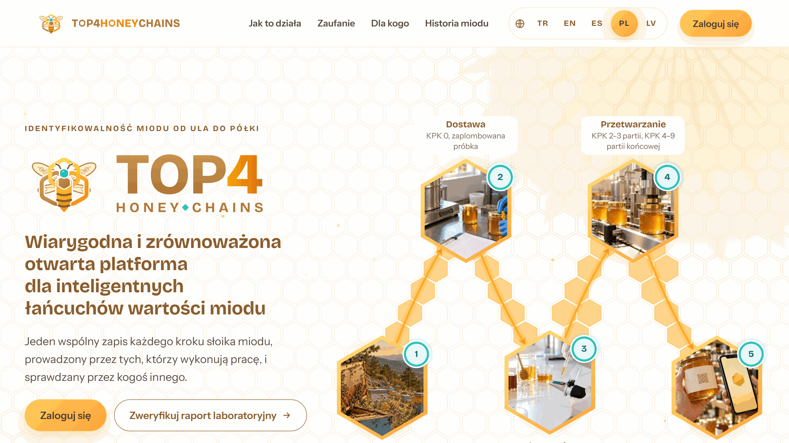

## Do czego służy platforma {#sec-purpose}

Platforma powstała w międzynarodowym projekcie badawczym TOP4HoneyChains („Trustable and Sustainable Open Platform for Smart Honey Value Chains”). Projekt realizują w ramach ICT-AGRI-FOOD ERA-NET Cofund (konkurs 2022) uczelnie, instytuty badawcze i firmy z czterech krajów: Turcji, Polski, Łotwy i Argentyny. Jest finansowany z programu badań naukowych i innowacji Unii Europejskiej „Horyzont 2020” (umowa o dofinansowanie nr 862665) wspólnie z krajowymi agencjami finansującymi krajów partnerskich. Partnerzy i instytucje finansujące są pokazani na dole strony startowej.

Platforma ma trzy cele:

- **Identyfikowalność.** Dla każdego słoika możesz odpowiedzieć na trzy pytania. Skąd pochodzi miód? Czy został sprawdzony? Dokąd trafił?
- **Zaufanie.** Każdy rekord wprowadza jedna osoba, a sprawdza druga ([Zasada czterech oczu](#four-eyes)). Każda zmiana trafia do dziennika audytu, do którego można tylko dopisywać.
- **Przejrzystość dla konsumenta.** Publiczna Historia miodu pokazuje drogę i kontrole jakości miodu prostym językiem, bez publikowania danych osobowych.

Interfejs jest dostępny po angielsku, turecku, hiszpańsku, polsku i łotewsku. Każda osoba wybiera język na stronie.

W tym podręczniku **dane** oznaczają to, co ludzie zapisują na platformie: zmierzone wartości (na przykład wilgotność w %) oraz odpowiedzi na pytania (na przykład Tak lub Nie).

## Droga miodu {#sec-journey}

Miód przechodzi przez pięć etapów: **Pasieka**, **Dostawa**, **Laboratorium**, **Przetwarzanie** i **Półka**. Te same pięć nazw widnieje na stronie startowej i w każdej Historii miodu.

Na każdym etapie dzieją się dwie rzeczy, a ten podręcznik rozdziela je:

- **Czynności**: co ludzie robią z miodem (pozyskują go, dostarczają, analizują, przetwarzają, sprzedają).
- **Rekordy**: co platforma o nim przechowuje i kto może te rekordy tworzyć, odczytywać, aktualizować lub zatwierdzać. Prawa do danych każdej roli wymienia [Tabela](#tbl-crud).

[Tabela](#tbl-journey-activities) pokazuje czynności, a [Tabela](#tbl-journey-records) rekordy.

Table: Droga miodu: co robią ludzie {#tbl-journey-activities}

| Etap | Co ludzie robią z miodem |
| --- | --- |
| Pasieka | Pszczelarz utrzymuje pszczoły w jednej lub kilku pasiekach i pozyskuje miód. |
| Dostawa | Pszczelarz przywozi miód do zakładu w pojemnikach (puszkach, bębnach lub beczkach). W zakładzie każdy pojemnik jest ważony i otwierany. Napełnia się z niego słoik z próbką i słoik z próbką kontrolną, które się plombuje, a pojemnik plombuje się ponownie. |
| Laboratorium | Słoiki z próbkami trafiają do laboratorium analiz żywności. Laboratorium sprawdza każdy słoik przy przyjęciu, przygotowuje próbkę zbiorczą i ją analizuje. |
| Przetwarzanie | Zakład podgrzewa, filtruje, miesza, odstawia, rozlewa, etykietuje i pakuje miód. Miód z jednej lub kilku partii staje się jedną partią końcową. |
| Półka | Partia końcowa jest wysyłana do hurtownika lub detalisty, który ją przechowuje i sprzedaje. Konsument kupuje słoik i skanuje jego kod QR. |

Table: Droga miodu: co zapisuje platforma {#tbl-journey-records}

| Etap | Co zapisuje platforma | Kto zapisuje (pierwsza osoba) | Kto potwierdza lub zatwierdza (druga osoba) |
| --- | --- | --- | --- |
| Pasieka | Pszczelarz, krajowy numer rejestrowy, telefon komórkowy, pasieki z ich ulami i położeniem, stowarzyszenie (opcjonalnie), zgody pszczelarza. | **Specjalista ds. rejestracji pszczelarzy** | Pszczelarz, 6-cyfrowym kodem wysłanym SMS-em. Bez telefonu: pszczelarz podpisuje wydrukowany formularz, a **Specjalista ds. zgodności** sprawdza jego zdjęcie. |
| Dostawa | Dostawa z jednym wierszem na pojemnik: waga, plomby przy przyjęciu, słoik z próbką i słoik z próbką kontrolną wraz z numerami ich plomb oraz nowa plomba. Dostawa staje się partią surowego miodu. Następnie audyt wstępny, KPK 0. | **Pracownik przyjmujący próbki** | Dostawa: pszczelarz, kodem SMS (lub podpisanym formularzem, który sprawdza **Specjalista ds. zgodności**). KPK 0: **Specjalista ds. zapewnienia jakości**. |
| Laboratorium | Kontrola przyjęcia każdego słoika, próbka zbiorcza, wyniki, podpisany raport (PDF) i jego odcisk. Zatwierdzone wyniki stają się KPK 1 partii. | **Analityk** | **Kierownik laboratorium** |
| Przetwarzanie | Arkusz kontrolny każdej partii (KPK 2 i 3), partia końcowa z jej partiami i kilogramami, arkusz kontrolny partii końcowej (KPK 4 do 10), wniosek o ostateczne zatwierdzenie. | **Pracownik** (także **Administrator organizacji** w przypadku partii końcowej i wniosku) | **Specjalista ds. zapewnienia jakości** zatwierdza arkusze i potwierdza ostateczne zatwierdzenie. |
| Półka | Wysyłka, jej odbiór i warunki przechowywania u każdego posiadacza (KPK 10). Historia miodu staje się publiczna, gdy partia końcowa zostanie ostatecznie zatwierdzona. | Pracownik lub Administrator organizacji posiadacza; Pracownik w przypadku rekordu przechowywania | Odbiorca potwierdza wysyłkę. Specjalista ds. zapewnienia jakości odbiorcy zatwierdza rekord przechowywania. |

Etap może się rozpocząć dopiero wtedy, gdy poprzedni etap jest zatwierdzony tam, gdzie jest to wymagane:

- Laboratorium wprowadza i zatwierdza wyniki dopiero po zatwierdzeniu KPK 0 partii.
- Partia może trafić do partii końcowej tylko wtedy, gdy wszystkie jej punkty kontrolne są ukończone (lub nie dotyczą) i zatwierdzone, a w partii pozostał jeszcze miód.
- Partię końcową można ostatecznie zatwierdzić tylko wtedy, gdy każdy punkt kontrolny partii końcowej i jej partii jest zatwierdzony i żadne zdjęcie podpisanego formularza dostawy nie czeka na sprawdzenie.
- Wysłać można tylko ostatecznie zatwierdzoną partię końcową i tylko w ilości, którą posiadasz.

Ostateczne zatwierdzenie blokuje partię końcową i jej partie. Od tej chwili błędną wartość może skorygować tylko dwóch administratorów platformy.

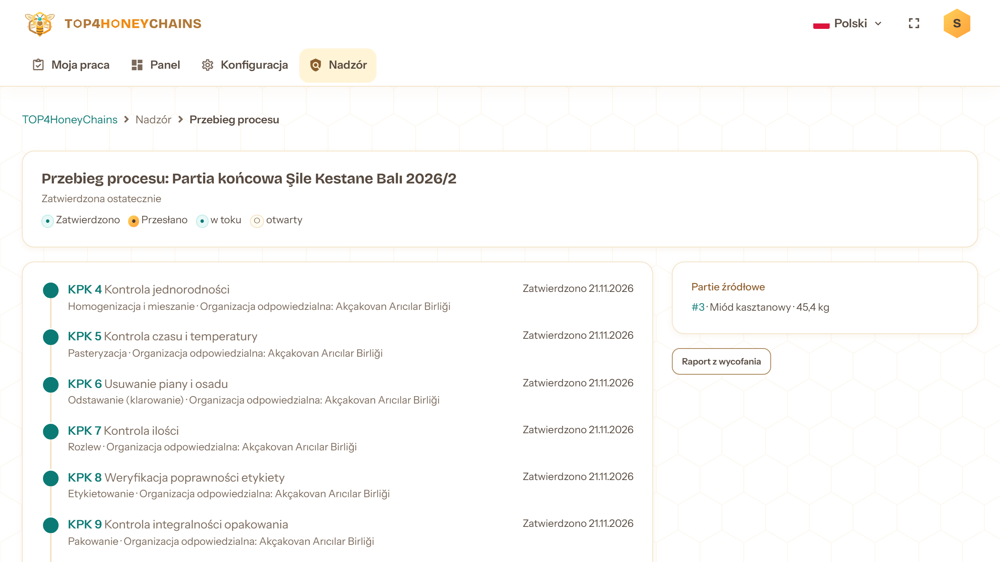

## Dla kogo jest platforma {#sec-audience}

Platforma ma trzy rodzaje kont. **Członkowie** pracują dla organizacji w określonej roli. **Pszczelarz** może mieć osobiste konto w portalu pszczelarza. **Konsument** może założyć bezpłatne konto konsumenta. Odwiedzający nie potrzebują żadnego konta.

Organizacja uczestniczy w łańcuchu dzięki swoim funkcjom, na przykład „Zdolność do przyjmowania i przetwarzania miodu” ([Tabela](#tbl-capabilities)). Osoba pracuje dla organizacji w określonej roli ([Tabela](#tbl-roles)). Jedno konto w jednej organizacji w jednej roli to członkostwo ([Członkostwa](#memberships)).

Table: Dla kogo jest platforma {#tbl-audience}

| Kto | Konto | Czynność w łańcuchu wartości | Na platformie |
| --- | --- | --- | --- |
| Pszczelarz | Reprezentowany przez rekord pszczelarza. Pszczelarz zarejestrowany z telefonem komórkowym otrzymuje też konto w portalu pszczelarza. | Wytwarza miód i dostarcza go do zakładu. | Potwierdza rejestrację i każdą dostawę kodem SMS. W portalu: odczytuje swoje pasieki, dostawy, wyniki laboratoryjne, partie końcowe i strony Historii miodu, podaje cenę oczekiwaną, udziela zgód lub je wycofuje ([Portal pszczelarza](#ch-portal)). |
| Podmiot rejestrujący pszczelarzy (na przykład powiatowa dyrekcja rolnictwa) | Członkowie | Zna pszczelarzy ze swojego obszaru. | Rejestruje pszczelarzy i ich pasieki, przypisuje ich stowarzyszenie, wysyła im dane logowania do portalu. |
| Stowarzyszenie pszczelarzy | Członkowie | Zrzesza pszczelarzy; może też prowadzić zakład. | Za zgodą pszczelarza publikuje publiczną stronę pszczelarza. Z funkcją Przetwarzanie działa jako zakład. |
| Zakład przetwarzający i konfekcjonujący | Członkowie | Przyjmuje, przetwarza, rozlewa i pakuje miód. | Zapisuje dostawy i próbki, KPK 0 oraz KPK 2 do 10, tworzy partie końcowe, zatwierdza je ostatecznie, wysyła je, odpowiada na opinie konsumentów. |
| Laboratorium analiz żywności (akredytowane lub wewnętrzne) | Członkowie | Analizuje próbki miodu. | Przyjmuje słoiki z próbkami, wprowadza wyniki wraz z podpisanym raportem, zatwierdza raport. |
| Hurtownik | Członkowie | Kupuje partie końcowe, przechowuje je i sprzedaje dalej. | Potwierdza wysyłki, zapisuje i zatwierdza przechowywanie (KPK 10), wysyła dalej, odczytuje punkty kontrolne producenta. |
| Detalista | Członkowie | Sprzedaje słoiki konsumentom. | Potwierdza wysyłki, zapisuje i zatwierdza przechowywanie (KPK 10), odczytuje punkty kontrolne producenta. |
| Organ publiczny | Członkowie | Kontroluje łańcuch. | Odczytuje wszystkie rekordy, niczego nie wprowadza. |
| Administrator platformy | Konto administracji platformy | Prowadzi platformę; nie uczestniczy w łańcuchu miodu. | Tworzy i weryfikuje organizacje, dodaje członków, ustala role, uprawnienia i odpowiedzialności za punkty kontrolne, publikuje treści informacji, nadzoruje rekordy i rozstrzyga korekty. Nie wprowadza danych biznesowych. |
| Konsument | Bezpłatne konto konsumenta | Kupuje i je miód. | Wszystko, co może odwiedzający, a także zapisuje miody w **Moje miody**, wysyła opinię producentowi i czyta odpowiedź ([Konto konsumenta](#ch-consumer)). |
| Odwiedzający | Brak | Czyta o miodzie przed zakupem lub po nim. | Odczytuje strony publiczne: Historię miodu z kodu QR, publiczne strony pszczelarzy, **Zweryfikuj raport laboratoryjny** i informacje o danych. |

Każda organizacja ma też osobę w roli **Specjalista ds. zgodności**, która sprawdza dowody (zdjęcia podpisanych formularzy), jakość pobierania próbek i zatwierdzenia oraz obsługuje żądania dotyczące ochrony danych ([Specjalista ds. zgodności](#ch-compliance)).

## Punkty kontrolne {#sec-control-points}

Jakość i bezpieczeństwo miodu są sprawdzane w jedenastu krytycznych punktach kontroli (KPK), od KPK 0 do KPK 10. Metoda pochodzi z HACCP, systemu bezpieczeństwa żywności opartego na analizie zagrożeń i krytycznych punktach kontroli. Każdy punkt kontrolny ma parametry (na przykład temperaturę lub wilgotność). Parametr może mieć limit krytyczny.

Punkty kontrolne 0 do 3 należą do partii surowego miodu, punkty kontrolne 4 do 10 do partii końcowej. [Tabela](#tbl-ccps) pokazuje, kto domyślnie wprowadza i kto zatwierdza każdy punkt kontrolny. Organizacja musi mieć funkcję z kolumny **Organizacja potrzebuje**. Administrator platformy może zmienić te ustawienia domyślne ([Ustal, kto wprowadza i zatwierdza każdy punkt kontrolny](#sec-ccp-responsibilities)).

Table: Krytyczne punkty kontroli i domyślnie odpowiedzialne osoby {#tbl-ccps}

| KPK | Nazwa na ekranie | Etap | Należy do | Organizacja potrzebuje | Wprowadza | Zatwierdza |
| --- | --- | --- | --- | --- | --- | --- |
| KPK 0 | Audyt wstępny | Etap przedprodukcyjny | Partia | Przetwarzanie | **Pracownik przyjmujący próbki** właściciela partii | **Specjalista ds. zapewnienia jakości** właściciela partii |
| KPK 1 | Pobieranie próbek i wstępne badania odbiorcze | Przyjęcie surowego miodu | Partia | Laboratorium | Przepisywany z zatwierdzonego raportu laboratoryjnego (**Analityk**) | **Kierownik laboratorium** (zatwierdzając raport) |
| KPK 2 | Monitorowanie temperatury | Podgrzewanie | Partia | Przetwarzanie | **Pracownik** | **Specjalista ds. zapewnienia jakości** |
| KPK 3 | Kontrola stanu filtra | Filtracja | Partia | Przetwarzanie | **Pracownik** | **Specjalista ds. zapewnienia jakości** |
| KPK 4 | Kontrola jednorodności | Homogenizacja i mieszanie | Partia końcowa | Przetwarzanie | **Pracownik** | **Specjalista ds. zapewnienia jakości** |
| KPK 5 | Kontrola czasu i temperatury | Pasteryzacja | Partia końcowa | Przetwarzanie | **Pracownik** | **Specjalista ds. zapewnienia jakości** |
| KPK 6 | Usuwanie piany i osadu | Odstawanie (klarowanie) | Partia końcowa | Przetwarzanie | **Pracownik** | **Specjalista ds. zapewnienia jakości** |
| KPK 7 | Kontrola ilości | Rozlew | Partia końcowa | Konfekcjonowanie | **Pracownik** | **Specjalista ds. zapewnienia jakości** |
| KPK 8 | Weryfikacja poprawności etykiety | Etykietowanie | Partia końcowa | Konfekcjonowanie | **Pracownik** | **Specjalista ds. zapewnienia jakości** |
| KPK 9 | Kontrola integralności opakowania | Pakowanie | Partia końcowa | Konfekcjonowanie | **Pracownik** | **Specjalista ds. zapewnienia jakości** |
| KPK 10 | Monitorowanie temperatury i wilgotności | Przechowywanie | Partia końcowa | Handel hurtowy, Handel detaliczny lub Konfekcjonowanie | **Pracownik** posiadacza | **Specjalista ds. zapewnienia jakości** posiadacza |

KPK 1 jest ukończony, gdy kierownik laboratorium zatwierdzi raport. Jeśli zakład zapisał w KPK 1 także własne wartości, zatwierdza je specjalista ds. zapewnienia jakości zakładu.

KPK 10 występuje dwukrotnie. Najpierw w partii końcowej, w zakładzie: musi zostać zatwierdzony, zanim partia końcowa zostanie ostatecznie zatwierdzona. Później każdy hurtownik lub detalista, który otrzyma partię końcową, prowadzi własny rekord przechowywania.

Punkt kontrolny, który nie ma zastosowania do danego miodu, można oznaczyć jako **Nie dotyczy**, podając powód. Nadal wymaga on zatwierdzenia. Zmiana dowolnej wartości usuwa istniejące zatwierdzenie, więc rekord wymaga nowego.

## Zasada czterech oczu {#four-eyes}

Każdy rekord na platformie przechodzi przez dwie pary oczu. **Pierwsza osoba** wykonuje pracę i wprowadza dane. **Druga, inna osoba** sprawdza je i zatwierdza lub potwierdza. Nikt nie zatwierdza tego, co sam wprowadził. Dwie osoby znacznie zmniejszają ryzyko błędów i manipulacji. [Tabela](#tbl-four-eyes) pokazuje pierwszą i drugą osobę w każdym przypadku.

Table: Pierwsza i druga osoba każdego rekordu {#tbl-four-eyes}

| Rekord | Pierwsza osoba (wprowadza) | Druga osoba (zatwierdza lub potwierdza) |
| --- | --- | --- |
| Rejestracja pszczelarza | **Specjalista ds. rejestracji pszczelarzy** | Pszczelarz potwierdza kodem SMS. Bez telefonu: **Specjalista ds. zgodności** organizacji rejestrującej sprawdza zdjęcie podpisanego formularza. |
| Dostawa | **Pracownik przyjmujący próbki** | Pszczelarz potwierdza kodem SMS. Bez kodu: **Specjalista ds. zgodności** zakładu sprawdza zdjęcie podpisanego formularza dostawy. |
| KPK 0, arkusz partii (KPK 2 i 3), arkusz partii końcowej (KPK 4 do 10) | **Pracownik przyjmujący próbki** (KPK 0) lub **Pracownik** | **Specjalista ds. zapewnienia jakości** tej samej organizacji |
| Wyniki laboratoryjne (KPK 1) | **Analityk** | **Kierownik laboratorium** |
| Ostateczne zatwierdzenie partii końcowej | **Pracownik** lub **Administrator organizacji** składa wniosek (**Wnioskuj o ostateczne zatwierdzenie**) | **Specjalista ds. zapewnienia jakości** potwierdza go (**Potwierdź i zatwierdź ostatecznie**) |
| Wysyłka | Pracownik lub Administrator organizacji nadawcy | Pracownik lub Administrator organizacji odbiorcy potwierdza odbiór |
| Rekord przechowywania u posiadacza (KPK 10) | **Pracownik** posiadacza | **Specjalista ds. zapewnienia jakości** posiadacza |
| Korekta potwierdzonej dostawy lub zatwierdzonej wartości | Administrator platformy zgłasza ją z podaniem powodu | Drugi administrator platformy ją rozstrzyga |

Zasada „Nikt nie zatwierdza rekordu, który sam wprowadził” i zasada „Wyniki laboratoryjne zawsze zatwierdza druga osoba” to zasady podstawowe ([Zasady podstawowe](#ground-rules)). Są pokazane na stronie **Role i uprawnienia** i żadne ustawienie roli nie może ich zmienić.

Istnieje jeden wyjątek dla bardzo małych organizacji, na przykład stowarzyszenia z jedną osobą odpowiedzialną za jakość. Administrator platformy może przyznać takiej organizacji ustawienie **Wyjątek od zasady czterech oczu**. Jej członkowie mogą wtedy zatwierdzać własne rekordy punktów kontrolnych i potwierdzać własny wniosek o ostateczne zatwierdzenie. Każde takie zatwierdzenie jest oznaczane jako samodzielne i zapisywane w dzienniku audytu. Wyjątek nigdy nie dotyczy wyników laboratoryjnych. Administrator platformy może też zdecydować, że punkt kontrolny w ogóle nie wymaga zatwierdzenia; domyślnie każdy punkt kontrolny go wymaga.

## Co czyta konsument {#sec-consumer-reads}

Konsument skanuje kod QR na słoiku lub otwiera łącze i czyta stronę **Historia miodu** partii końcowej bez logowania. Strona jest taka sama dla wszystkich i pokazuje, w języku wybranym przez czytelnika:

- partię końcową: nazwę, ilość i datę produkcji;
- odznaki: **Zbadane przez akredytowane laboratorium** (lub **Laboratorium wewnętrzne**), **Wszystkie punkty kontrolne zatwierdzone**, **W granicach zweryfikowanych limitów** oraz **Pochodzenie** z udziałem każdego kraju;
- **Droga tego miodu**: pięć etapów z rzeczywistymi datami i liczbami tej partii końcowej;
- **Pochodzenie miodu**: udział miodu według prowincji na mapie, pszczelarzy z imienia i nazwiska (tylko za ich zgodą, w przeciwnym razie neutralnym kodem) oraz łącze do ich publicznej strony pszczelarza, jeśli istnieje;
- **Jakość w skrócie** i **Pełny raport z badań**: wyniki laboratoryjne z ich limitami i łącze do weryfikacji raportu;
- **Kontrole procesu**: punkty kontrolne przetwarzania i konfekcjonowania;
- **Co to jest?** obok wartości: co oznacza parametr i dlaczego jest ważny.

Ocena „w granicach limitu” lub „poza limitem” jest pokazywana tylko dla zweryfikowanych limitów. Przy pozostałych wartościach strona informuje, że limity są jeszcze sprawdzane przez laboratorium partnerskie.

Historia miodu nigdy nie pokazuje numeru telefonu, zdjęcia osoby, dokładnego położenia pasieki, ceny oczekiwanej ani uwagi wpisanej dowolnym tekstem. Mapa pokazuje tylko prowincje.

Na dole, w sekcji **Kupiłeś(-aś) ten miód?**, konsument z bezpłatnym kontem może użyć opcji **Zapisz w Moich miodach** i **Wyślij opinię producentowi**. Opinia trafia do organizacji, która jest właścicielem partii końcowej; organizacja odczytuje tylko kod konsumenta, nigdy jego nazwę użytkownika ani numer telefonu. Rozdziały [Strona Historia miodu](#ch-story) i [Konto konsumenta](#ch-consumer) opisują stronę i konto.

# Funkcje, organizacje i role {#ch-roles}

W TOP4HoneyChains zawsze pracujesz **dla organizacji, w określonej roli**. To, co możesz robić, zależy od trzech rzeczy:

1. **funkcji** Twojej organizacji: co organizacja jest w stanie robić w łańcuchu miodu ([Funkcje](#capabilities));
2. Twojej **roli** w tej organizacji: co robisz w jej ramach ([Role](#role-list));
3. **statusu** Twojej organizacji: dane wprowadza tylko organizacja o statusie **Zweryfikowana**. Organizacje weryfikuje administrator platformy; stowarzyszenia pszczelarzy może zamiast niego weryfikować związek centralny, jeśli platforma jest tak skonfigurowana ([Status organizacji](#org-status)).

Rolę pełnisz dzięki **członkostwu**: jedno konto użytkownika w jednej organizacji w jednej roli ([Członkostwa](#memberships)). Trzy rodzaje kont nie mają członkostwa: konto pszczelarza w portalu pszczelarza, konto konsumenta oraz globalna rola administratora platformy. Niektóre zasady są wbudowane w platformę i żadne ustawienie ich nie wyłącza ([Zasady podstawowe](#ground-rules)).

Ten rozdział rozdziela dwie rzeczy:

- **czynności w łańcuchu wartości**: pracę, którą ludzie wykonują z miodem poza komputerem, taką jak rejestrowanie, dostarczanie, pobieranie próbek, analizowanie, przetwarzanie, konfekcjonowanie, przechowywanie i wysyłanie ([Tabela](#tbl-activities));
- **prawa do danych**: co każda rola może robić z rekordami na platformie: tworzyć, odczytywać, aktualizować, usuwać i zatwierdzać ([Tabela](#tbl-crud)).

## Funkcje {#capabilities}

Funkcja to zdolność organizacji. Mówi, co organizacja **jest w stanie robić** w łańcuchu miodu; role jej członków mówią, która osoba wykonuje pracę. Organizacja ma jedną lub więcej funkcji. Administrator platformy je nadaje i odbiera; sama lista funkcji jest stała. [Tabela](#tbl-capabilities) wymienia je wraz z nazwą na ekranie.

Table: Funkcje: co organizacja jest w stanie robić {#tbl-capabilities}

| Funkcja (na ekranie) | Zdolność | Punkty kontrolne (domyślnie) |
|---|---|---|
| **Stowarzyszenie** | Zdolność do przypisywania swoich członków pszczelarzy, zapisywania ich zgody na publiczną stronę pszczelarza oraz, za zgodą pszczelarza, odczytywania jego cen oczekiwanych. | Brak. KPK 0 tylko wtedy, gdy administrator przypisze KPK 0 stowarzyszeniu pszczelarza. |
| **Przetwarzanie** | Zdolność do przyjmowania i przetwarzania miodu: dostawy, próbki, KPK 0 do 3 partii, KPK 4 do 6 partii końcowej, nowe partie końcowe, ostateczne zatwierdzanie i wysyłki. | KPK 0 do 3 partii (KPK 1 jest wypełniany z raportu laboratoryjnego); KPK 4 do 6 partii końcowej |
| **Konfekcjonowanie** | Zdolność do rozlewu, etykietowania i pakowania miodu, tworzenia partii końcowych, ich ostatecznego zatwierdzania i wysyłania; zapisuje KPK 7 do 9 partii końcowej i przechowywanie KPK 10 w zakładzie. | KPK 7 do 9 partii końcowej, KPK 10 |
| **Laboratorium** | Zdolność do analizowania próbek miodu i wydawania raportów laboratoryjnych jako akredytowane lub wewnętrzne laboratorium analiz żywności. Numer akredytacji i data jej ważności są przechowywane przy tej funkcji. | Brak. Jego zatwierdzony raport wypełnia KPK 1 partii. |
| **Handel hurtowy** | Zdolność do posiadania partii końcowych w obrocie hurtowym, zapisywania ich przechowywania (KPK 10) i wysyłania ich dalej. | KPK 10 |
| **Handel detaliczny** | Zdolność do posiadania partii końcowych przeznaczonych do sprzedaży konsumentom, zapisywania ich przechowywania (KPK 10) i wysyłania ich dalej. | KPK 10 |
| **Rejestracja pszczelarzy** | Zdolność do rejestrowania pszczelarzy i ich pasiek na swoim obszarze, poświadczania ich tożsamości i numeru rejestrowego, przypisywania ich do stowarzyszenia, zapisywania ich zgody i wydawania im danych logowania. | Brak |
| **Związek centralny** | Zdolność do weryfikowania stowarzyszeń pszczelarzy, jeśli platforma jest tak skonfigurowana. | Brak |
| **Organ publiczny** | Zdolność do odczytywania wszystkich partii, partii końcowych i ich punktów kontrolnych jako ministerstwo lub organ kontrolny. Niczego nie wprowadza. | Brak (odczytuje wszystkie) |
| **Pszczelarstwo** | Zdolność do wytwarzania miodu. | Brak |

Niektóre działania sprawdzają oprócz roli także funkcję:

- zapisanie dostawy i pobranie próbek wymagają funkcji **Przetwarzanie**;
- utworzenie partii końcowej (**Nowa partia**), wniosek o ostateczne zatwierdzenie i jego potwierdzenie wymagają funkcji **Przetwarzanie** lub **Konfekcjonowanie**;
- wysłanie i potwierdzenie odebranej wysyłki wymagają funkcji **Przetwarzanie**, **Konfekcjonowanie**, **Handel hurtowy** lub **Handel detaliczny**;
- przyjęcie słoików z próbkami i wprowadzenie wyników laboratoryjnych wymagają funkcji **Laboratorium**;
- strona **Strony pszczelarzy** wymaga funkcji **Stowarzyszenie**;
- strona **Rejestracja pszczelarzy** i rola **Specjalista ds. rejestracji pszczelarzy** wymagają funkcji **Rejestracja pszczelarzy**.

Zakład, który przetwarza, rozlewa i przechowuje własny miód, potrzebuje więc funkcji **Przetwarzanie** i **Konfekcjonowanie**; KPK 10 w zakładzie obejmuje funkcja **Konfekcjonowanie**.

**Pszczelarze to osoby, nie organizacje.** Na platformie pszczelarza reprezentuje **rekord pszczelarza** z jedną lub kilkoma pasiekami. Pszczelarz nie ma członkostwa. Gdy portal pszczelarza jest włączony, pszczelarz może mieć osobiste konto powiązane z tym rekordem ([Portal pszczelarza](#ch-portal)).

**Platforma.** Administrator platformy nie jest funkcją, którą można nadać organizacji. Jest to globalna rola konta użytkownika, przeznaczona dla osób, które prowadzą platformę ([Administracja platformą](#ch-admin)). Własna organizacja platformy ma zastrzeżoną funkcję **Administrator platformy**; żadna inna organizacja nie może jej otrzymać i nie można jej usunąć.

## Czynności w łańcuchu wartości i zapisy na platformie {#activities}

Czynności w łańcuchu wartości ludzie wykonują z miodem poza komputerem. Platforma zapisuje wynik każdej czynności jako dane. [Tabela](#tbl-activities) pokazuje dla każdej funkcji, co robią jej ludzie i co zapisuje platforma.

Table: Czynności w łańcuchu wartości (ludzie) i to, co zapisuje platforma (komputer) {#tbl-activities}

| Funkcja | Czynności w łańcuchu wartości (ludzie, poza komputerem) | Zapisywane na platformie (komputer) |
|---|---|---|
| Pszczelarstwo (pszczelarz) | Utrzymuje pszczoły, pozyskuje miód, dostarcza go w pojemnikach, odczytuje specjaliście kod SMS, ustala cenę oczekiwaną | Rekordy pszczelarza i pasiek; potwierdzenie rejestracji i każdej dostawy (kod SMS); w portalu: cena oczekiwana i własne zgody pszczelarza |
| Rejestracja pszczelarzy | Spotyka się z pszczelarzem, sprawdza dokument tożsamości i wpis w rejestrze, odwiedza lub spisuje pasieki, odczytuje informację o danych | Rekord pszczelarza, jedna lub kilka pasiek, przypisanie do stowarzyszenia, rejestracja (kod SMS lub zdjęcie podpisanego formularza), zgody udzielone przy rejestracji, dane logowania pszczelarza |
| Stowarzyszenie | Informuje członków pszczelarzy, odczytuje im treść zgody, zbiera podpisy | Zgoda na stronę pszczelarza wraz z podpisanym dokumentem; opublikowana strona pszczelarza |
| Przetwarzanie | Przyjmuje dostawy w zaplombowanych pojemnikach, sprawdza lub zakłada plomby, napełnia słoik z próbką i słoik z próbką kontrolną z każdego pojemnika, podgrzewa, filtruje, miesza i odstawia miód, łączy partie w partię końcową | Dostawa z pojemnikami i historią plomb, słoiki z próbkami, KPK 0 i KPK 2 do 6, partia końcowa z jej partiami i ilościami, wniosek o ostateczne zatwierdzenie i jego potwierdzenie, wysyłki |
| Konfekcjonowanie | Rozlewa, etykietuje i pakuje miód, przechowuje go w zakładzie | KPK 7 do 10, partie końcowe, ostateczne zatwierdzanie, wysyłki |
| Laboratorium | Przyjmuje zaplombowane słoiki i sprawdza plombę, etykietę i wieczko, przygotowuje próbkę zbiorczą, analizuje ją, podpisuje raport | Kontrole przyjęcia, próbka zbiorcza, raport laboratoryjny (PDF) i wyniki, które uzupełniają KPK 1 |
| Handel hurtowy, Handel detaliczny | Przyjmuje towar, przechowuje go, sprzedaje lub wysyła dalej | Potwierdzenie odebranej wysyłki, rekord przechowywania (KPK 10), nowe wysyłki, odpowiedzi na opinie konsumentów |
| Związek centralny | Sprawdza stowarzyszenia pszczelarzy | Weryfikacja stowarzyszeń (jeśli jest skonfigurowana) |
| Organ publiczny | Kontroluje | Nic; odczytuje rekordy |

Dwie kolejne grupy korzystają z platformy bez organizacji. **Konsumenci** kupują miód i skanują kod QR na słoiku; jeśli mają konto, platforma zapisuje miody, które zapisali, i opinie, które wysłali. **Odwiedzający** tylko czytają strony publiczne; nic o nich nie jest zapisywane.

Każda organizacja, niezależnie od swoich funkcji, potrzebuje też osoby w roli **Specjalista ds. zgodności**: osoby, która nadzoruje zatwierdzenia, dowody i ochronę danych ([Specjalista ds. zgodności](#ch-compliance)).

## Typy organizacji {#org-types}

Platforma nie ma osobnej listy typów organizacji: typ organizacji to zestaw jej funkcji. [Tabela](#tbl-org-types) pokazuje typowe organizacje.

Table: Typowe organizacje, ich funkcje i role ich członków {#tbl-org-types}

| Organizacja | Funkcje | Typowe role członków |
|---|---|---|
| Urząd rejestrujący pszczelarzy (na przykład powiatowa dyrekcja rolnictwa) | **Rejestracja pszczelarzy** | Administrator organizacji, Specjalista ds. rejestracji pszczelarzy, Specjalista ds. zgodności |
| Stowarzyszenie pszczelarzy | **Stowarzyszenie** | Administrator organizacji, Inspektor terenowy, Specjalista ds. zgodności |
| Zakład przetwarzający lub konfekcjonujący | **Przetwarzanie**, **Konfekcjonowanie** | Administrator organizacji, Pracownik przyjmujący próbki, Pracownik, Specjalista ds. zapewnienia jakości, Specjalista ds. zgodności |
| Laboratorium analiz żywności (akredytowane lub wewnętrzne) | **Laboratorium** | Administrator organizacji, Analityk, Kierownik laboratorium, Specjalista ds. zgodności |
| Hurtownik | **Handel hurtowy** | Administrator organizacji, Pracownik, Specjalista ds. zapewnienia jakości, Specjalista ds. zgodności |
| Detalista | **Handel detaliczny** | Administrator organizacji, Pracownik, Specjalista ds. zapewnienia jakości, Specjalista ds. zgodności |
| Centralny związek pszczelarzy | **Związek centralny** | Administrator organizacji, Specjalista ds. zgodności |
| Ministerstwo lub organ kontrolny | **Organ publiczny** | Administrator organizacji, Specjalista ds. zgodności (obaj tylko do odczytu) |
| Operator platformy | **Administrator platformy** (zastrzeżona) | Administratorzy platformy |

Stowarzyszenie, które prowadzi własny zakład, ma też funkcje **Przetwarzanie** i **Konfekcjonowanie**, a wtedy również role zakładu. W małej organizacji Administrator organizacji może być jednocześnie Specjalistą ds. zgodności dzięki drugiemu członkostwu; zasady czterech oczu nadal obowiązują ([Zasada czterech oczu](#four-eyes)).

### Status organizacji {#org-status}

Nowa organizacja zaczyna ze statusem **Oczekująca**. Administrator platformy sprawdza ją i weryfikuje na stronie organizacji w sekcji **Weryfikacja**:

- **Zweryfikuj** wymaga co najmniej jednego przesłanego dokumentu (na przykład licencji, akredytacji lub dowodu wpisu do rejestru).
- Organizacja weryfikowana po raz pierwszy potrzebuje też aktywnej osoby w roli **Specjalista ds. zgodności**. Organizacja zweryfikowana wcześniej bez takiej osoby wyświetla ostrzeżenie z datą, do której musi ją wskazać; nie jest blokowana.
- **Zażądaj dokumentów** pozostawia organizację w statusie **Oczekująca** i wymaga tekstu, który mówi, jakich dokumentów brakuje.
- **Zawieś** wymaga powodu. **Przywróć** przywraca zawieszonej organizacji status **Zweryfikowana**.

**Administrator organizacji** i **Specjalista ds. zgodności** przesyłają dokumenty, także gdy organizacja ma status **Oczekująca**, ale nie wtedy, gdy ma status **Zawieszona**.

**Związek centralny.** Jeśli platforma jest tak skonfigurowana, **Administrator organizacji** zweryfikowanej organizacji z funkcją **Związek centralny** weryfikuje, zawiesza i przywraca stowarzyszenia pszczelarzy. Administratorzy platformy nie weryfikują wtedy już stowarzyszeń.

[Tabela](#tbl-org-status) wymienia statusy.

Table: Status organizacji i kto go zmienia {#tbl-org-status}

| Status (na ekranie) | Znaczenie | Kto go ustawia |
|---|---|---|
| **Oczekująca** | Nowa organizacja, czeka na weryfikację. Członkowie odczytują rekordy swojej organizacji; Administrator organizacji i Specjalista ds. zgodności przesyłają dokumenty. Nikt nie wprowadza danych procesowych. | Ustawiany, gdy administrator platformy tworzy organizację, lub zachowywany przyciskiem **Zażądaj dokumentów** |
| **Zweryfikowana** | Sprawdzona. Członkowie pracują zgodnie ze swoimi rolami. Tylko zweryfikowana organizacja może przyjąć wysyłkę. | Administrator platformy przyciskiem **Zweryfikuj** lub **Przywróć**; w przypadku stowarzyszeń związek centralny, jeśli jest tak skonfigurowane |
| **Zawieszona** | Weryfikacja cofnięta, z podaniem powodu. Działa jak **Oczekująca** do czasu przywrócenia; nie można przesyłać dokumentów. | Administrator platformy przyciskiem **Zawieś**; w przypadku stowarzyszeń związek centralny, jeśli jest tak skonfigurowane |

## Role {#role-list}

[Tabela](#tbl-roles) to wykaz referencyjny ról. Każda inna tabela w tym podręczniku używa tych samych ról, z tymi samymi skrótami, w tej samej kolejności.

Table: Role {#tbl-roles}

| Nr | Rola (na ekranie) | Skrót | Konto | Typowa osoba | Główna praca |
|---|---|---|---|---|---|
| 1 | **Specjalista ds. rejestracji pszczelarzy** | RO | Członkostwo | Urzędnik rejestrujący | Rejestruje pszczelarzy z jedną lub kilkoma pasiekami i ich stowarzyszeniem, sprawdza numer rejestrowy, wysyła kod SMS pszczelarza, zapisuje informację o danych i zgody, wysyła dane logowania pszczelarza |
| 2 | **Pracownik przyjmujący próbki** | SAO | Członkostwo (członkowie: własne) | Pracownik przyjęć w zakładzie | Zapisuje dostawy z ich zaplombowanymi pojemnikami, wysyła kod SMS pszczelarza, pobiera próbkę z każdego pojemnika, wprowadza KPK 0 |
| 3 | **Analityk** | An | Członkostwo (członkowie: własne) | Analityk laboratoryjny | Przyjmuje słoiki z próbkami (plomba, etykieta i wieczko), przygotowuje próbkę zbiorczą, wprowadza wyniki laboratoryjne i przesyła raport (pierwsza osoba w laboratorium) |
| 4 | **Kierownik laboratorium** | LM | Członkostwo (członkowie: własne) | Kierownik laboratorium | Przyjmuje słoiki z próbkami, zatwierdza lub zwraca raporty laboratoryjne (druga osoba w laboratorium) |
| 5 | **Pracownik** | St | Członkostwo (członkowie: własne) | Pracownik produkcji, rozlewu, hurtu lub handlu detalicznego | Wypełnia arkusze kontrolne (KPK 1 do 10), tworzy partie końcowe, składa wnioski o ostateczne zatwierdzenie, wysyła i potwierdza wysyłki, zapisuje przechowywanie |
| 6 | **Inspektor terenowy** | FI | Członkostwo (członkowie: własne) | Technik terenowy stowarzyszenia | Odczytuje partie i partie końcowe organizacji; wprowadza KPK 0 tylko wtedy, gdy administrator przypisze KPK 0 stowarzyszeniu |
| 7 | **Specjalista ds. zapewnienia jakości** | QAO | Członkostwo (członkowie: własne) | Kierownik ds. jakości, technolog żywności | Zatwierdza rekordy KPK, arkusze kontrolne i rekordy przechowywania, potwierdza ostateczne zatwierdzenie, odpowiada na opinie konsumentów |
| 8 | **Administrator organizacji** | OA | Członkostwo (członkowie: własne) | Kierownik organizacji | Prowadzi dokumenty organizacji, tworzy partie końcowe, składa wnioski o ostateczne zatwierdzenie, wysyła i potwierdza wysyłki, publikuje strony pszczelarzy (stowarzyszenie), odczytuje dostawy, próbki i ceny oczekiwane własnych partii, odpowiada na opinie konsumentów |
| 9 | **Specjalista ds. zgodności** | CO | Członkostwo (członkowie: własne) | Osoba odpowiedzialna za jakość lub ochronę danych | Akceptuje lub odrzuca dowody w postaci zdjęć podpisanych formularzy, ocenia jakość pobierania próbek i zatwierdzenia, prowadzi dane administratora danych, zapisuje żądania osób, których dane dotyczą, i wycofania zgód, odczytuje wpisy audytu organizacji, odpowiada na opinie konsumentów |
| 10 | **Administrator platformy** | PA | Rola globalna | Operator platformy | Konfiguruje organizacje, członków, funkcje, uprawnienia i odpowiedzialności za KPK; odczytuje każdy rekord; zgłasza i rozstrzyga korekty. Nie wprowadza ani nie zatwierdza danych procesowych |
| 11 | **Pszczelarz** | Bk | Konto w portalu | Pszczelarz | Odczytuje własne pasieki, dostawy, próbki, wyniki laboratoryjne, partie końcowe i strony Historii miodu; podaje cenę oczekiwaną; udziela własnych zgód i je wycofuje ([Portal pszczelarza](#ch-portal)) |
| 12 | **Konsument** | Con | Konto konsumenta | Nabywca miodu | Zapisuje miody, wysyła opinię producentowi i czyta odpowiedź ([Konto konsumenta](#ch-consumer)) |
| 13 | **Odwiedzający** | Vis | Bez konta | Każdy | Odczytuje Historię miodu, opublikowaną stronę pszczelarza i stronę **Zweryfikuj raport laboratoryjny** ([Strona Historia miodu](#ch-story)) |

Administrator platformy nie uczestniczy w przebiegu pracy organizacji biznesowej. Administratorzy odczytują każdy rekord, ale **nie wprowadzają ani nie zatwierdzają danych procesowych** (dostaw, danych KPK, wyników laboratoryjnych, partii końcowych, ostatecznych zatwierdzeń, wysyłek, zgód). Gdy zatwierdzone dane są błędne, jeden administrator zgłasza korektę, a drugi ją rozstrzyga. Ekrany wprowadzania danych pszczelarzy, partii i partii końcowych nie znajdują się już w menu administratora; ich strony pozostawiono wyłącznie do korekt.

## Prawa do danych (CRUD) {#crud}

[Tabela](#tbl-crud) pokazuje domyślne prawa do danych każdej roli dla każdego rodzaju rekordu w modelu CRUD: **C** tworzenie, **R** odczyt, **U** aktualizacja, **D** usuwanie oraz **A** zatwierdzanie (osobne prawo). „·” oznacza brak prawa. Litery stoją razem: „CRU” oznacza tworzenie, odczyt i aktualizację. Prawa pszczelarza (Bk) i konsumenta (Con) dotyczą zawsze tylko ich własnych rekordów. Prawa członków (role 1 do 9) dotyczą tylko rekordów pracy ich własnej organizacji: jej własnych partii i partii końcowych, partii końcowych, które posiada, pszczelarzy jej stowarzyszenia, rejestracji jej urzędu. Z wyjątkiem odczytu obowiązują tylko wtedy, gdy organizacja ma status **Zweryfikowana**. [Tabela](#tbl-admin-changeable) wymienia, które z tych praw administrator może zmienić.

Table: Domyślne prawa do danych według roli i rekordu (CRUD + zatwierdzanie) {#tbl-crud}

| Rekord | RO | SAO | An | LM | St | FI | QAO | OA | CO | PA | Bk | Con | Vis |
|---|---|---|---|---|---|---|---|---|---|---|---|---|---|
| Rekord pszczelarza | CRU ¹ | R ² | · | · | R ² | R ² | R ² | R ² | R ² | RU ³ | RU ⁴ | · | R ⁵ |
| Pasieka | CRU ¹ | R ² | · | · | R ² | R ² | R ² | R ² | R ² | RU ³ | R | · | R ⁵ |
| Rejestracja pszczelarza (z przypisaniem do stowarzyszenia) | CR ¹ | · | · | · | · | · | · | · | RA ⁶ | RA ⁶ | A ⁷ | · | · |
| Dane logowania konta użytkownika (członkowie: własne) | C ⁸ | U | U | U | U | U | U | U | U | CRUD ⁸ | U | CUD ⁹ | · |
| Partia surowego miodu (dostawa) | · | CR ¹⁰ | · | · | R | R | R | R | R | RUD ¹¹ | R | R ⁵ | R ⁵ |
| Potwierdzenie dostawy (kod SMS lub zdjęcie podpisanego formularza) | · | CR | · | · | · | · | · | R | RA ⁶ | R | A ⁷ | · | · |
| Pojemnik i jego plomby | · | CR | R | R | R ¹² | R ¹² | R ¹² | R | R | R | R | · | · |
| Słoik z próbką | · | CR | RA ¹³ | RA ¹³ | · | · | · | R | R | R | R | · | · |
| Raport laboratoryjny i wyniki | · | R | CRU ¹⁴ | RA ¹⁴ | R | R | R | R | R | R | R ¹⁵ | R ¹⁵ | R ¹⁵ |
| Rekord KPK (wartości, „Nie dotyczy”) | · | CRUD ¹⁶ | R | R | CRUD ¹⁶ | R ¹⁶ | RA | R | R | R ¹⁷ | · | R ¹⁵ | R ¹⁵ |
| Partia końcowa | · | R | R | R | CR ¹⁸ | R | R ¹⁸ | CR ¹⁸ | R | RUD ¹¹ | R ¹⁹ | R ¹⁵ | R ¹⁵ |
| Ostateczne zatwierdzenie (wniosek, potwierdzenie) | · | · | · | · | C | · | A | C | · | R | · | · | · |
| Wysyłka | · | R ¹² | R ¹² | R ¹² | CRA ²⁰ | R ¹² | R | CRA ²⁰ | R | R | · | · | · |
| Rekord przechowywania u posiadacza (KPK 10) | · | R | R | R | CRUD ¹⁶ | R | RA | R | R | R | · | · | · |
| Cena oczekiwana partii | · | · | · | · | · | · | · | R ²¹ | R ²¹ | R | CR ²¹ | · ²² | · ²² |
| Zgoda pszczelarza | CR ²³ | · | · | · | · | · | · | CRU ²⁴ | U ²³ | R | CRU ²³ | · | R ²⁵ |
| Informacja o danych (treść, wersja) | R | R | R | R | R | R | R | R | R | CR ²⁶ | R | R | R |
| Potwierdzenie informacji (członkowie: własne) | C | C | C | C | C | C | C | C | C | R ²⁷ | CR | C | · |
| Dane administratora danych | R | R | R | R | R | R | R | R | CRU | CRU | R | R ²⁸ | R ²⁸ |
| Ocena jakości pobierania próbek i zatwierdzeń | · | · | · | · | · | · | · | · | CR ²⁹ | · | · | · | · |
| Żądanie osoby, której dane dotyczą | · | · | · | · | · | · | · | · | CRU ²⁹ | · | · | · | · |
| Organizacja (dane, dokumenty, funkcje) | R | R | R | R | R | R | R | RC ³⁰ | RC ³⁰ | CRU A ³¹ | · | · | · |
| Członkostwo (członkowie: własne) | R | R | R | R | R | R | R | R | R | CRU ³² | · | · | · |
| Wpis audytu | · | · | · | · | · | · | · | · | R ³³ | R ³⁴ | · | · | · |
| Konto konsumenta i zapisane miody | · | · | · | · | · | · | · | · | · | RUD ³⁵ | · | CRUD ⁹ | · |
| Opinia konsumenta | · | · | · | · | · | · | RU ³⁶ | RU ³⁶ | RU ³⁶ | R ³⁷ | · | CR ³⁶ | · |

Uwagi:

1. Specjalista ds. rejestracji pszczelarzy rejestruje pszczelarzy dla swojego urzędu i odczytuje tylko rejestracje tego urzędu. Jedna rejestracja może dodać kilka pasiek (**Dodaj pasiekę**) i wybrać stowarzyszenie pszczelarza (**Związek pszczelarzy (opcjonalnie)**); kod SMS pszczelarza obejmuje to wszystko. Poświadczone fakty (tożsamość, numer rejestrowy, telefon) zmieniają się tylko przez nową rejestrację tego samego pszczelarza, potwierdzaną ponownie.
2. Odczyt tylko poprzez rekordy, nad którymi organizacja pracuje (dostawy, arkusze kontrolne, raport z wycofania). Późniejszy posiadacz partii końcowej odczytuje jej dane bez nazwisk pszczelarzy i nazw pasiek. Administrator organizacji stowarzyszenia odczytuje listę swoich członków pszczelarzy na stronie **Strony pszczelarzy**.
3. Administratorzy sprawdzają numery rejestrowe i przypisania do stowarzyszeń w **Konfiguracja > Rejestr pszczelarzy i stowarzyszenia** oraz korygują dane pszczelarzy i pasiek. Pszczelarzy i pasiek nigdy się nie usuwa, tylko dezaktywuje.
4. Pszczelarz zmienia swój telefon komórkowy, język i hasło w sekcji **Konto** w portalu.
5. Tylko na stronach publicznych (Historia miodu ostatecznie zatwierdzonej partii końcowej i opublikowana strona pszczelarza): imię i nazwisko pszczelarza tylko za zgodą, w przeciwnym razie neutralny kod; prowincja pasieki; nigdy współrzędne ani dane kontaktowe ([Zaufanie i prywatność](#ch-trust)).
6. **A** = akceptacja lub odrzucenie dowodu zapisanego za pomocą zdjęcia podpisanego formularza zamiast kodu SMS (rejestracji lub dostawy). Decyduje Specjalista ds. zgodności organizacji, która dokonała zapisu, nigdy osoba, która go wprowadziła. O rejestracjach zapisanych przez administratorów platformy decyduje administrator platformy.
7. **A** pszczelarza to kod SMS, który odczytuje specjaliście. Potwierdza on rejestrację (z każdą pasieką i stowarzyszeniem) lub dostawę (z jej pojemnikami, wagami i numerami plomb).
8. Specjalista ds. rejestracji wysyła dane logowania pszczelarza SMS-em (gdy portal pszczelarza jest włączony). Administratorzy platformy tworzą konta członków z danymi logowania wysyłanymi SMS-em lub z hasłem początkowym, wysyłają nowe dane logowania, odblokowują konta i usuwają konta (nigdy własnego). Nikt nie odczytuje hasła po jego wysłaniu.
9. Konsument tworzy konto, zmienia hasło, język i telefon komórkowy, pobiera swoje dane, zapisuje i usuwa miody oraz usuwa konto. Usunięcie kasuje listę zapisanych miodów i anonimizuje konto; opinie pozostają w organizacji tylko pod pseudonimem.
10. Zapisanie dostawy tworzy partię. Wymaga zweryfikowanej organizacji z funkcją **Przetwarzanie**.
11. Partie i partie końcowe tworzy zakład (dostawa, **Nowa partia**). Administratorzy prowadzą ich dane podstawowe na potrzeby korekt. Fakty dostawy (data, pojemniki, wagi, numery plomb) zmieniają się tylko w drodze korekty dostawy rozstrzygniętej przez drugiego administratora, a pszczelarz jest o niej informowany SMS-em. Gdy partia znajdzie się w ostatecznie zatwierdzonej partii końcowej, nic się już nie zmienia. Partię lub partię końcową można usunąć tylko przed ostatecznym zatwierdzeniem, a partii w użyciu nie można usunąć. Administratorzy nie mogą zatwierdzać ostatecznie.
12. Tylko w raporcie z wycofania.
13. **A** = przyjęcie słoika z próbką po sprawdzeniu plomby, etykiety i wieczka lub jego odrzucenie z podaniem powodu.
14. Analityk tworzy raport, zapisuje go i zmienia, dopóki jest projektem, i przesyła go. Kierownik laboratorium go zatwierdza lub zwraca. Zatwierdzonego raportu nie można zmienić.
15. Tylko zatwierdzone wyniki laboratoryjne i punkty kontrolne ostatecznie zatwierdzonej partii końcowej, w Historii miodu i na stronie **Zweryfikuj raport laboratoryjny**; w przypadku pszczelarza zatwierdzone wyniki jego własnych próbek.
16. Wprowadzanie wartości (C), ich zmiana lub czyszczenie (U, D) i oznaczanie „Nie dotyczy”, dopóki rekord nie zostanie zatwierdzony lub zablokowany. Domyślne role wprowadzające: Pracownik przyjmujący próbki dla KPK 0, Pracownik dla KPK 1 do 10 (KPK 1 jest wypełniany z zatwierdzonego raportu laboratoryjnego). Inspektor terenowy wprowadza KPK 0 tylko wtedy, gdy administrator przypisze KPK 0 stowarzyszeniu.
17. Administratorzy zmieniają zatwierdzone lub zablokowane dane tylko w drodze korekty zgłoszonej przez jednego administratora i rozstrzygniętej przez drugiego.
18. **Nowa partia**: Pracownik i Administrator organizacji z funkcją **Przetwarzanie** lub **Konfekcjonowanie** tworzą partię końcową z własnych partii, których wszystkie punkty kontrolne są ukończone i zatwierdzone. Partia końcowa od razu otrzymuje swoje punkty kontrolne. Zatwierdzenie partii końcowej przez Specjalistę ds. zapewnienia jakości jest potwierdzeniem ostatecznego zatwierdzenia (zob. wiersz Ostateczne zatwierdzenie).
19. Partie końcowe zawierające własny miód pszczelarza: nazwa, udział pszczelarza, status i łącze do Historii miodu. Nigdy nazwiska ani ceny innych pszczelarzy.
20. **C** = wysłanie ostatecznie zatwierdzonej partii końcowej, którą posiada organizacja; **A** = potwierdzenie lub odrzucenie wysyłki, którą organizacja otrzymuje.
21. Pszczelarz podaje cenę oczekiwaną dla każdej dostarczonej partii i zmienia ją (nowy wpis; historia pozostaje), dopóki partia nie znajdzie się w ostatecznie zatwierdzonej partii końcowej. Odczytują ją Administrator organizacji i Specjalista ds. zgodności właściciela partii oraz administratorzy platformy. Administrator organizacji stowarzyszenia odczytuje ją tylko wtedy, gdy pszczelarz udzielił na to zgody. Pracownicy, laboratoria i późniejsi posiadacze nigdy jej nie odczytują.
22. Strony publiczne i raport z wycofania nie pokazują żadnej ceny.
23. Specjalista ds. rejestracji zapisuje zgody udzielone przy rejestracji. Pszczelarz udziela opcjonalnej zgody lub ją wycofuje w portalu (imię i nazwisko na stronach publicznych, wiadomości, ceny dla stowarzyszenia) i może tam wycofać zgodę na stronę pszczelarza. Specjalista ds. zgodności zapisuje wycofanie otrzymane na piśmie lub telefonicznie. Wycofanie działa natychmiast.
24. Tylko stowarzyszenia: zapisanie (C) i wycofanie (U) zgody na publiczną stronę pszczelarza, wraz z podpisanym dokumentem zgody.
25. Opublikowana strona pszczelarza.
26. Treści informacji mają wersje i nigdy nie są edytowane: opublikowanie nowej wersji zastępuje starą.
27. Liczba potwierdzeń każdej wersji informacji.
28. Tak, jak podano w informacji o danych.
29. We własnej sekcji Specjalisty ds. zgodności, **Zgodność** ([Specjalista ds. zgodności](#ch-compliance)).
30. **C** = przesyłanie dokumentów. Funkcje, członków i wyjątek od zasady czterech oczu ustalają tylko administratorzy platformy.
31. Tworzenie, zmiana i weryfikacja organizacji, żądanie dokumentów, zawieszanie i przywracanie ([Status organizacji](#org-status)); nadawanie i odbieranie funkcji (co najmniej jedna pozostaje); ustawianie wyjątku od zasady czterech oczu. Organizacji i dokumentów nigdy się nie usuwa.
32. Dodanie członkostwa i jego odebranie (U); członkostw nigdy się nie usuwa.
33. Wpisy audytu własnej organizacji Specjalisty ds. zgodności.
34. Cały dziennik audytu. Można do niego tylko dopisywać; nikt nie zmienia ani nie usuwa wpisu.
35. Blokowanie i odblokowywanie konta konsumenta, jego usuwanie (z anonimizacją).
36. Jedna opinia na partię końcową i dzień, najwyżej pięć dziennie. Trafia do organizacji, która jest właścicielem partii końcowej i która odczytuje tylko pseudonim konsumenta. Jej Administrator organizacji, Specjalista ds. zapewnienia jakości i Specjalista ds. zgodności oznaczają ją jako przeczytaną, odpowiadają na nią i ją zamykają (U). Konsument czyta odpowiedź. Opinie nigdy nie są publiczne.
37. Tylko zgłoszenia podejrzenia podróbki lub otwartego słoika, w **Moja praca**, tylko do odczytu.

**Kto pobiera pliki dowodowe.** Podpisane formularze dostawy, zdjęcia z rejestracji, dokumenty zgód i dokumenty organizacji pobiera tylko rola, która je zapisuje (Pracownik przyjmujący próbki, Specjalista ds. rejestracji pszczelarzy lub, w przypadku zgód, Administrator organizacji stowarzyszenia), Administrator organizacji i Specjalista ds. zgodności organizacji oraz administratorzy platformy. Inna rola tej samej organizacji widzi komunikat „Nie możesz otworzyć tej strony” (403); inna organizacja widzi „Tej strony tu nie ma” (404). Każde pobranie jest zapisywane w dzienniku audytu.

**Co można usunąć.** Członkowie czyszczą tylko własne dane przed ich zatwierdzeniem: wartości KPK i wartości przechowywania. Raportów laboratoryjnych nigdy się nie usuwa; projekt się zmienia lub zwraca. Konsumenci usuwają własne konto i zapisane miody. Administratorzy usuwają partie i partie końcowe przed ostatecznym zatwierdzeniem, zdjęcia pasiek, dane referencyjne i konta użytkowników (nigdy własnego; konto konsumenta jest anonimizowane). Pszczelarzy, pasiek, organizacji, dokumentów, członkostw, zgód, rejestracji, pojemników, zdarzeń plomb, słoików z próbkami, raportów laboratoryjnych, wysyłek, wpisów cen, informacji, potwierdzeń i wpisów audytu nigdy się nie usuwa.

## Macierz uprawnień {#permission-matrix}

[Tabela](#tbl-permissions) pokazuje domyślne prawa dla każdej **czynności na platformie** (funkcji, takiej jak „zapisanie dostawy”). Uzupełnia prawa do danych z [tabeli](#tbl-crud) i używa tych samych ról w tej samej kolejności. Legenda: **R** odczyt, **C** tworzenie lub wprowadzanie, **A** zatwierdzanie (lub przyjęcie, akceptacja, potwierdzenie), **F** ostateczne zatwierdzenie (wniosek lub potwierdzenie), **·** brak prawa. Kolumna „Wymagana funkcja” podaje funkcję, którą organizacja musi mieć dodatkowo.

Table: Domyślne prawa według czynności na platformie i roli {#tbl-permissions}

| Czynność na platformie | Wymagana funkcja | RO | SAO | An | LM | St | FI | QAO | OA | CO | PA | Bk | Con | Vis |
|---|---|---|---|---|---|---|---|---|---|---|---|---|---|---|
| Rejestracja pszczelarza z pasiekami i stowarzyszeniem | Rejestracja pszczelarzy | C | · | · | · | · | · | · | · | R | R ¹ | A | · | · |
| Wysłanie danych logowania pszczelarza SMS-em | Rejestracja pszczelarzy | C | · | · | · | · | · | · | · | · | C | · | · | · |
| Zapisanie dostawy z pojemnikami, wysłanie kodu SMS | Przetwarzanie | · | C | · | · | · | · | · | R | R | R | A | · | · |
| Pobranie próbek (z każdego pojemnika) | Przetwarzanie (właściciel partii) | · | C | R | R | · | · | · | R | R | R | R | · | · |
| Akceptacja lub odrzucenie zdjęcia podpisanego formularza (rejestracja, dostawa) | Własna organizacja | · | · | · | · | · | · | · | · | A | A ² | · | · | · |
| Wprowadzenie KPK 0 (audyt wstępny) | Przetwarzanie (właściciel partii) | · | C | R | R | R | R | A | R | R | R | · | · | · |
| Przyjęcie słoików z próbkami (plomba, etykieta, wieczko), przygotowanie próbki zbiorczej | Laboratorium | · | · | A | A | · | · | · | · | R | R | · | · | · |
| Wprowadzenie wyników laboratoryjnych, przesłanie raportu | Laboratorium | · | R | C | R | R | R | R | R | R | R | R | R | R |
| Zatwierdzenie lub zwrot raportu laboratoryjnego | Laboratorium | · | R | R | A | R | R | R | R | R | R | R | R | R |
| Arkusz kontrolny partii (KPK 2 i 3) | Przetwarzanie (właściciel partii) | · | R | R | R | C | R | A | R | R | R | · | R | R |
| Utworzenie partii końcowej (**Nowa partia**) | Przetwarzanie lub Konfekcjonowanie | · | · | · | · | C | · | · | C | · | · | · | · | · |
| Arkusz kontrolny partii końcowej, KPK 4 do 6 | Przetwarzanie (właściciel partii końcowej) | · | R | R | R | C | R | A | R | R | R | · | R | R |
| Arkusz kontrolny partii końcowej, KPK 7 do 9 | Konfekcjonowanie (właściciel partii końcowej) | · | R | R | R | C | R | A | R | R | R | · | R | R |
| Przechowywanie KPK 10 w zakładzie | Handel hurtowy, Handel detaliczny lub Konfekcjonowanie (właściciel partii końcowej) | · | R | R | R | C | R | A | R | R | R | · | R | R |
| Wniosek o ostateczne zatwierdzenie | Przetwarzanie lub Konfekcjonowanie (właściciel) | · | · | · | · | F | · | · | F | · | · | · | · | · |
| Potwierdzenie ostatecznego zatwierdzenia | Przetwarzanie lub Konfekcjonowanie (właściciel) | · | · | · | · | · | · | F | · | · | · | · | · | · |
| Wysłanie partii końcowej | Przetwarzanie, Konfekcjonowanie, Handel hurtowy lub Handel detaliczny (posiadacz) | · | · | · | · | C | · | R | C | R | R | · | · | · |
| Potwierdzenie lub odrzucenie odebranej wysyłki | Przetwarzanie, Konfekcjonowanie, Handel hurtowy lub Handel detaliczny (odbiorca) | · | · | · | · | A | · | R | A | R | R | · | · | · |
| Rekord przechowywania KPK 10 u odbiorcy | Handel hurtowy, Handel detaliczny lub Konfekcjonowanie (posiadacz) | · | R | R | R | C | R | A | R | R | R | · | · | · |
| Raport z wycofania (własny zakres) | Brak | · | R | R | R | R | R | R | R | R | R (wszystko) | · | · | · |
| Podanie lub zmiana ceny oczekiwanej | Brak | · | · | · | · | · | · | · | · | · | · | C | · | · |
| Odczyt cen oczekiwanych własnych partii | Przetwarzanie (właściciel partii) | · | · | · | · | · | · | · | R | R | R | R | · | · |
| Zapisanie lub wycofanie zgody na stronę pszczelarza | Stowarzyszenie | · | · | · | · | · | · | · | C | · | R | U ³ | · | · |
| Odczyt cen oczekiwanych członka (za zgodą) | Stowarzyszenie | · | · | · | · | · | · | · | R | · | · | C ³ | · | · |
| Odczyt opinii konsumentów i odpowiedź na nie | Właściciel partii końcowej | · | · | · | · | · | · | C | C | C | R ⁴ | · | · | · |
| Zapisanie miodu, wysłanie opinii | Brak | · | · | · | · | · | · | · | · | · | · | · | C | · |
| Odczyt Historii miodu, weryfikacja raportu laboratoryjnego | Brak | R | R | R | R | R | R | R | R | R | R | R | R | R |
| Zgodność: oceny, żądania osób, których dane dotyczą, kontrole zatwierdzeń | Własna organizacja | · | · | · | · | · | · | · | · | C | · | · | · | · |
| Prowadzenie danych administratora danych | Własna organizacja | R | R | R | R | R | R | R | R | C | C | R | R | R |
| Odczyt wpisów audytu organizacji | Własna organizacja | · | · | · | · | · | · | · | · | R | R (wszystko) | · | · | · |
| Przesyłanie dokumentów organizacji | Własna organizacja | · | · | · | · | · | · | · | C | C | C | · | · | · |
| Publikowanie treści informacji | Brak | · | · | · | · | · | · | · | · | · | C | · | · | · |
| Weryfikacja organizacji, zarządzanie członkami, funkcjami i wyjątkiem | Brak | · | · | · | · | · | · | · | A ⁵ | · | CA ⁵ | · | · | · |
| Weryfikacja numerów rejestrowych pszczelarzy | Brak | · | · | · | · | · | · | · | · | · | A | · | · | · |
| Zmiana uprawnień ról, odpowiedzialności za KPK, limitów, tłumaczeń | Brak | · | · | · | · | · | · | · | · | · | C | · | · | · |
| Zgłoszenie lub rozstrzygnięcie korekty (dane KPK, fakty dostawy) | Brak | · | · | · | · | · | · | · | · | · | CA ⁶ | · | · | · |
| Blokowanie, odblokowywanie lub usuwanie kont użytkowników i konsumentów | Brak | · | · | · | · | · | · | · | · | · | C | · | · | · |
| Odczyt dziennika audytu i raportu przechowywania danych | Brak | · | · | · | · | · | · | · | · | · | R | · | · | · |

1. Rejestracje zapisuje urząd rejestrujący. Administratorzy odczytują każdą rejestrację; strony rejestracji nie ma już w ich menu.
2. W przypadku rejestracji zapisanych przez administratorów platformy.
3. Część pszczelarza: pszczelarz podpisuje dokument zgody i może wycofać zgodę w portalu; zgody na odczyt cen przez stowarzyszenie pszczelarz udziela w portalu.
4. Tylko zgłoszenia podejrzenia podróbki lub otwartego słoika.
5. Tylko Administrator organizacji zweryfikowanego związku centralnego i tylko w odniesieniu do stowarzyszeń pszczelarzy, jeśli platforma jest tak skonfigurowana. Administratorzy platformy nie weryfikują wtedy stowarzyszeń.
6. Dwóch różnych administratorów: jeden zgłasza, drugi rozstrzyga.

Uwagi:

- **Odczyt punktów kontrolnych (R)**: rola odczytuje punkty kontrolne partii i partii końcowych, w których uczestniczy jej organizacja: jako właściciel lub organizacja odpowiedzialna, jako właściciel późniejszego punktu kontrolnego tej samej partii lub partii końcowej, jako właściciel lub późniejszy posiadacz partii końcowej zawierającej daną partię albo jako zweryfikowany organ publiczny. Posiadacz odczytuje punkty kontrolne partii końcowej i jej partii **tylko do odczytu**. Każda inna organizacja widzi komunikat „Nie możesz otworzyć tej strony” (403).
- **KPK 1** jest wypełniany z zatwierdzonego raportu laboratoryjnego. Jego role wprowadzające są używane tylko dla parametrów KPK 1, których raport nie obejmuje.
- **Strony sprawdzają prawo odczytu, nie tylko menu.** Rola bez prawa odczytu strony (na przykład **Wysyłki i zapasy** lub **Strony pszczelarzy**) jest odsyłana z komunikatem, który wymienia role mogące ją otworzyć.
- Administrator może przypisać **KPK 0** stowarzyszeniu pszczelarza zamiast zakładowi (**Konfiguracja > Odpowiedzialności za KPK**, KPK 0, **Stowarzyszenie pszczelarza danej partii**, funkcja **Stowarzyszenie**, rola **Inspektor terenowy**). Nie jest to ustawienie domyślne.

### Co może zmienić administrator {#admin-changeable}

[Tabela](#tbl-admin-changeable) wymienia każde ustawienie, które administrator platformy może zmienić na stronach platformy. Wszystko inne jest stałe: lista ról, lista funkcji i [Zasady podstawowe](#ground-rules). Kilka przełączników ustawia się zamiast tego w konfiguracji serwera (na przykład związek centralny jako weryfikatora stowarzyszeń).

Table: Co może zmienić administrator platformy {#tbl-admin-changeable}

| Ustawienie | Gdzie | Co dokładnie można zmienić |
|---|---|---|
| Uprawnienia ról | **Konfiguracja > Role i uprawnienia**, karta **Uprawnienia ról** | Dla każdej roli: **Wprowadzanie**, **Zatwierdzenie** i **Odczyt** dla każdego punktu kontrolnego; oraz te funkcje: **Przyjęcie partii** (Wprowadzanie, Odczyt), **Próbki (pobranie / przyjęcie w laboratorium)** (Wprowadzanie, Zatwierdzenie, Odczyt), **Wyniki laboratoryjne** (Wprowadzanie, Zatwierdzenie, Odczyt), **Wysyłki (wysłanie / potwierdzenie odbioru)** (Wprowadzanie, Zatwierdzenie, Odczyt), **Strony pszczelarzy (zgoda)** (Wprowadzanie, Odczyt), **Raport z wycofania** (Odczyt), **Tworzenie partii końcowych (Nowa partia końcowa)** (Wprowadzanie), **Zatwierdzanie partii końcowych (wniosek / potwierdzenie)** (Wprowadzanie, Zatwierdzenie), **Rejestracja pszczelarzy** (Wprowadzanie, Odczyt), **Dowód ze zdjęciem podpisu (akceptacja lub odrzucenie)** (Zatwierdzenie), **Ceny oczekiwane przez pszczelarzy** (Odczyt), **Wpisy audytu organizacji** (Odczyt), **Opinie konsumentów** (Wprowadzanie, Odczyt). Każde uprawnienie zachowuje co najmniej jedną rolę. |
| Odpowiedzialności za KPK | **Konfiguracja > Odpowiedzialności za KPK** | Dla każdego punktu kontrolnego: **Organizacja odpowiedzialna** (**Organizacja będąca właścicielem partii / partii końcowej** lub, w przypadku partii, **Stowarzyszenie pszczelarza danej partii**), wymagane funkcje, **Role wprowadzające wartości**, **Role zatwierdzające** oraz to, czy **Wartości wymagają zatwierdzenia przez inną osobę (zasada czterech oczu)**. Zmiany obowiązują natychmiast. |
| Funkcje | **Konfiguracja > Organizacje** (przy tworzeniu organizacji i na jej stronie); **Konfiguracja > Funkcje** | Nadawanie lub odbieranie funkcji (co najmniej jedna pozostaje; **Administrator platformy** jest zastrzeżona). Dla laboratorium: akredytowane lub nie, numer akredytacji i data ważności. |
| Wyjątek od zasady czterech oczu | Strona organizacji, **Wyjątek od zasady czterech oczu** | Dla jednej organizacji: jej członkowie mogą zatwierdzać własne rekordy KPK i rekordy przechowywania oraz potwierdzać własny wniosek o ostateczne zatwierdzenie. Każde takie zatwierdzenie jest oznaczane w dzienniku audytu. Nigdy dla wyników laboratoryjnych ani dowodów. |
| Status organizacji | Strona organizacji, **Weryfikacja** | **Zweryfikuj**, **Zażądaj dokumentów**, **Zawieś**, **Przywróć** ([Status organizacji](#org-status)). |
| Dane administratora danych | Strona organizacji, **Administrator danych** | Nazwa, adres i kontakt organizacji jako administratora danych (prowadzi je też jej Specjalista ds. zgodności). |
| Członkostwa i użytkownicy | Strona organizacji, **Członkowie**; **Konfiguracja > Role i uprawnienia**, karta **Członkowie**; **Nadzór > Użytkownicy** | Dodawanie i odbieranie członkostw; tworzenie użytkowników z danymi logowania wysyłanymi SMS-em lub z hasłem początkowym; wysyłanie nowych danych logowania; odblokowywanie i usuwanie kont; blokowanie, odblokowywanie i usuwanie kont konsumentów. |
| Informacje i treści zgód | **Nadzór > Informacje i treści zgód** | Publikowanie nowej wersji informacji lub treści zgody. |
| Punkty kontrolne, parametry, limity | **Konfiguracja > Dane referencyjne** | Parametry, typy danych, wymagane pytania, limity, „Limity zweryfikowane”. |
| Dane referencyjne i tłumaczenia | **Konfiguracja > Dane referencyjne**; **Konfiguracja > Tłumaczenia danych referencyjnych** | Rodzaje miodu, okresy i inne listy oferowane w formularzach oraz ich nazwy w każdym języku. |
| Rejestr pszczelarzy | **Konfiguracja > Rejestr pszczelarzy i stowarzyszenia** | Weryfikowanie numerów rejestrowych; korygowanie przypisania pszczelarza do stowarzyszenia. |

## Zasady podstawowe {#ground-rules}

Te zasady są wbudowane w platformę. Żadne ustawienie ich nie wyłącza.

- **Dane wprowadzają tylko zweryfikowane organizacje.** Organizacja weryfikowana po raz pierwszy potrzebuje Specjalisty ds. zgodności.
- **Cztery oczy przy rekordach KPK** ([Zasada czterech oczu](#four-eyes)): nikt nie zatwierdza rekordu KPK, w którym wprowadził wartości lub który oznaczył jako „Nie dotyczy”. Na arkuszu kontrolnym Specjalista ds. zapewnienia jakości zatwierdza każdy rekord, na który pozwala ta zasada; rekordy z jego własnymi wartościami są wymienione i pozostawione innej osobie. Wyjątek: administrator platformy może przyznać organizacji ustawienie **Wyjątek od zasady czterech oczu**; każde zatwierdzenie w ramach wyjątku jest oznaczane w dzienniku audytu.
- **Cztery oczy przy wynikach laboratoryjnych, zawsze**: analityk, który wprowadził wyniki, nie może ich zatwierdzić. Nie ma od tego wyjątku.
- **Cztery oczy przy dowodach, zawsze**: zdjęcie podpisanego formularza, które zastępuje kod SMS, akceptuje lub odrzuca Specjalista ds. zgodności organizacji, nigdy osoba, która je zapisała.
- **Cztery oczy przy ostatecznym zatwierdzeniu i rekordach przechowywania**: osoba, która złożyła wniosek o ostateczne zatwierdzenie, nie może go potwierdzić, a osoba, która zapisała rekord przechowywania, nie może go zatwierdzić (chyba że organizacja ma wyjątek).
- **Cztery oczy przy korektach**: administrator, który zgłosił korektę, nie może jej rozstrzygnąć.
- **Kod potwierdza dokładnie to, do czego go wysłano**: kod SMS pszczelarza wiąże rejestrację (z każdą pasieką i stowarzyszeniem) lub dostawę (pojemniki, wagi, rodzaj miodu, próbki, każdy numer plomby). Każda zmiana po wysłaniu unieważnia kod.
- **Fakty dostawy się nie zmieniają**: do pojemników i zdarzeń plomb można tylko dopisywać. Fakty potwierdzonej dostawy zmieniają się tylko w drodze korekty dwóch administratorów, a pszczelarz jest o tym informowany SMS-em.
- **Próbka z każdego pojemnika**: każdy pojemnik otrzymuje własny zaplombowany słoik z próbką i próbkę kontrolną z wieczkiem gwarancyjnym. Laboratorium sprawdza plombę, etykietę i wieczko i odrzuca słoik, jeśli którakolwiek kontrola się nie powiedzie.
- **Każda zmiana usuwa zatwierdzenie**: zmiana danych kasuje istniejące zatwierdzenie. Wartości poza limitami trzeba przy zatwierdzaniu wyraźnie potwierdzić.
- **Wyniki laboratoryjne idą za próbką**: wyniki wprowadza się tylko dla przyjętej próbki i tylko po ukończeniu KPK 0 partii. Zatwierdzonego raportu nie można zmienić.
- **Zakład tworzy własne partie końcowe**: tylko z własnych partii, których wszystkie punkty kontrolne są ukończone i zatwierdzone, i tylko wtedy, gdy pozostał w nich miód.
- **Ostatecznie zatwierdzona oznacza zablokowana**: partię końcową zatwierdza się ostatecznie tylko wtedy, gdy każdy punkt kontrolny partii końcowej i jej partii jest ukończony. Ostatecznie zatwierdzonej partii końcowej i jej partii nie można już zmienić, chyba że w drodze korekty. Nie ma cofnięcia ostatecznego zatwierdzenia.
- **Wysyłki**: tylko ostatecznie zatwierdzone partie końcowe, tylko do innej zweryfikowanej organizacji, najwyżej w posiadanej ilości.
- **Administratorzy platformy mają tylko odczyt** danych procesowych i zmieniają je wyłącznie w drodze korekty dwóch administratorów.
- **Organizacje konfigurują tylko administratorzy**: funkcje, członkostwa i wyjątek.
- **Każde uprawnienie zachowuje co najmniej jedną rolę.**
- **Jedno członkostwo naraz**: praw z dwóch członkostw nigdy się nie łączy.
- **Do dziennika audytu można tylko dopisywać**; nic w nim nie jest zmieniane ani usuwane, a każda zmiana na stronach uprawnień sama jest zapisywana w dzienniku.
- **Ceny należą do pszczelarza**: cenę oczekiwaną podaje tylko pszczelarz i żadna strona publiczna jej nie pokazuje.
- **Konta bez członkostwa pozostają we własnym obszarze**: konto pszczelarza otwiera tylko portal pszczelarza i odczytuje tylko dane swojego pszczelarza; konto konsumenta otwiera tylko strony konsumenta i strony publiczne i nigdy nie może otrzymać roli ani członkostwa.
- **Nazwiska publiczne wymagają zgody**: strony publiczne podają nazwisko pszczelarza tylko przy aktywnej zgodzie na nazwisko; w przeciwnym razie pokazują neutralny kod.
- **Strony pszczelarzy** są publiczne tylko przy aktywnej zgodzie, zweryfikowanym numerze rejestrowym i zweryfikowanym stowarzyszeniu.
- **Opinie konsumentów są prywatne**: trafiają tylko do organizacji, która jest właścicielem partii końcowej i która widzi pseudonim, nigdy nazwisko.

## Członkostwa {#memberships}

**Członkostwo** to jedno konto użytkownika w jednej organizacji w jednej roli. To ono nadaje Ci rolę: bez aktywnego członkostwa konto pracownika nie może otworzyć panelu. Jedna osoba może mieć kilka członkostw:

- w różnych organizacjach, na przykład **Pracownik** w zakładzie i **Inspektor terenowy** w stowarzyszeniu;
- kilka ról w tej samej organizacji, na przykład **Administrator organizacji** i **Specjalista ds. zgodności** w małej organizacji.

Członkostwa dodaje i odbiera administrator platformy ([Dodaj członka](#sec-add-member)). Członkostwo się odbiera, nigdy nie usuwa. Rolę **Specjalista ds. rejestracji pszczelarzy** można nadać tylko w organizacji z funkcją **Rejestracja pszczelarzy**. Konto konsumenta nie może otrzymać członkostwa.

Zawsze pracujesz w **jednym** członkostwie naraz. Menu, zadania w **Moja praca**, rekordy, które możesz odczytać, i działania, które możesz wykonać, zależą od aktywnego członkostwa. Praw nigdy się nie łączy: posiadanie dwóch ról nigdy nie pozwala zatwierdzić danych, które sam wprowadziłeś.

Aby przełączyć się na inne członkostwo:

1. Wybierz wskaźnik roli na górnym pasku: pokazuje organizację i rolę, na przykład „Akçakovan Arıcılar Birliği · Pracownik” ([Poruszaj się po ekranie](#sec-screen)). Lista z nagłówkiem **Twoje role** pokazuje każde aktywne członkostwo; bieżące jest oznaczone.
2. Wybierz inne członkostwo. Platforma otwiera stronę **Moja organizacja** w nowym członkostwie.

Przy dwóch lub więcej członkostwach strona **Moja organizacja** ma też listę **Działaj jako** z przyciskiem **Przełącz**. Wybór obowiązuje do zamknięcia przeglądarki. Potem zaczynasz ponownie w pierwszym członkostwie: w pierwszej organizacji w kolejności alfabetycznej.

Konto pszczelarza w portalu i konto konsumenta nie mają członkostwa ani wskaźnika roli.

# Pierwsze kroki {#ch-start}

Ten rozdział jest dla każdego, kto loguje się na platformie. Po jego lekturze potrafisz się zalogować, potwierdzić informację o danych, poruszać się po ekranie i wylogować.

## Otwórz platformę i wybierz język

Otwórz w przeglądarce adres https://top4honeychains.intalalab.net. Strona startowa objaśnia platformę i ma przyciski **Zaloguj się** i **Zweryfikuj raport laboratoryjny**.

1. Wybierz język za pomocą kodów języków **TR**, **EN**, **ES**, **PL** i **LV** u góry strony. Platforma zapamiętuje Twój wybór w tej przeglądarce.

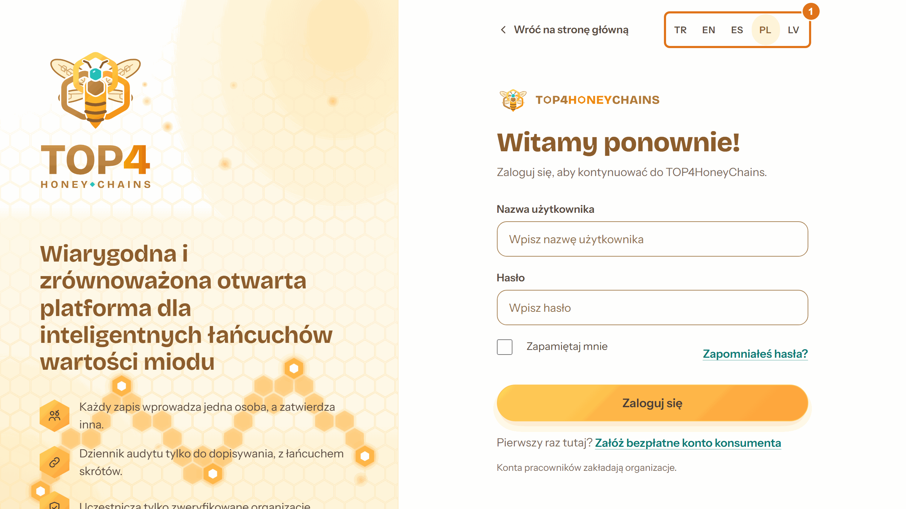

Po zalogowaniu menu języka z flagą znajduje się na górnym pasku.

## Zaloguj się

1. Na stronie startowej wybierz **Zaloguj się**.
2. Wpisz nazwę użytkownika w polu **Nazwa użytkownika**.
3. Wpisz hasło w polu **Hasło**.
4. Wybierz **Zaloguj się**.

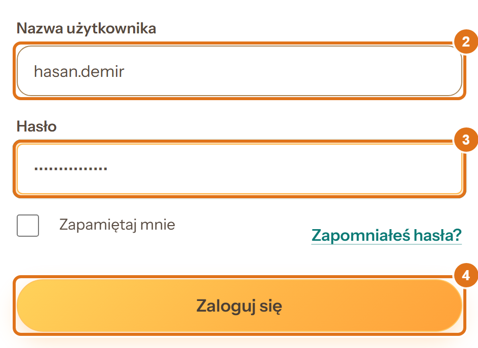

Widzisz stronę **Moja praca**, czyli listę swoich zadań. Pszczelarze widzą swój portal ([Portal pszczelarza](#ch-portal)), a konsumenci stronę **Moje miody** ([Konto konsumenta](#ch-consumer)).

> [!NOTE]
> Konta pracowników tworzą organizacje i administratorzy platformy. Konsumenci zakładają własne konto za pomocą opcji **Załóż bezpłatne konto konsumenta** pod formularzem logowania.

## Zaloguj się po raz pierwszy {#sec-first-sign-in}

Dane logowania otrzymujesz SMS-em: nazwę użytkownika i 10-znakowe hasło tymczasowe wraz z adresem platformy. Hasło tymczasowe jest ważne przez 72 godziny.

1. Zaloguj się nazwą użytkownika i hasłem tymczasowym z SMS-a.
2. Otwiera się strona **Ustaw swoje hasło**. Wpisz nowe hasło w polu **Nowe hasło** i ponownie w polu **Potwierdź hasło**. Użyj co najmniej 10 znaków; hasło nie może być Twoją nazwą użytkownika ani popularnym hasłem.
3. Wybierz **Zaktualizuj hasło**.

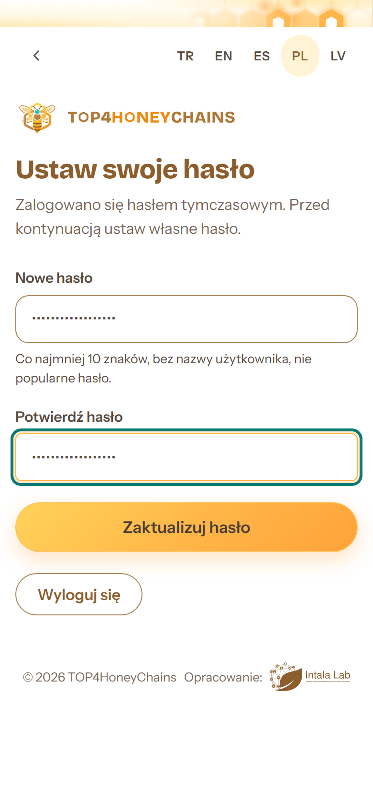

## Potwierdź informację o danych {#sec-notice}

Zanim zaczniesz pracować z danymi osobowymi, potwierdzasz, że zapoznałeś się z informacją o danych. Żółty pasek przypomina Ci o tym, dopóki tego nie zrobisz.

1. Wybierz **Przeczytaj i potwierdź** na żółtym pasku.

   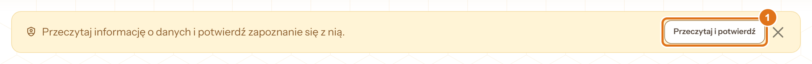

2. Przeczytaj informację i zaznacz **Zapoznałem/zapoznałam się z powyższą informacją.**
3. Wybierz **Potwierdź**.

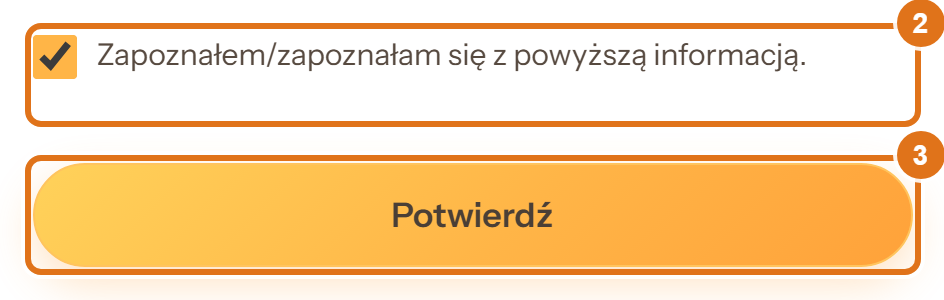

> [!NOTE]
> Role, które podpisują rekordy (Administrator organizacji, Specjalista ds. zgodności, Specjalista ds. rejestracji pszczelarzy, Specjalista ds. zapewnienia jakości, Kierownik laboratorium), potwierdzają informację kodem. Strona pokazuje Twój **Telefon komórkowy**: wybierz **Wyślij kod**, a następnie wpisz kod z SMS-a w polu **Kod z SMS (6 cyfr)**, zanim wybierzesz **Potwierdź**.

## Poruszaj się po ekranie {#sec-screen}

**Moja praca** to Twoja strona startowa i lista zadań. Wszystko, co na Ciebie czeka, pojawia się tam w grupach, na przykład **Wartości do wprowadzenia**, **Wartości do zatwierdzenia**, **Próbki do przyjęcia** lub **Wyniki laboratoryjne do wprowadzenia**. Wybierz pozycję, aby otworzyć stronę, na której wykonujesz pracę. Gdy nic nie czeka, strona pokazuje komunikat **Nic na Ciebie nie czeka.** i strony, które możesz otworzyć.

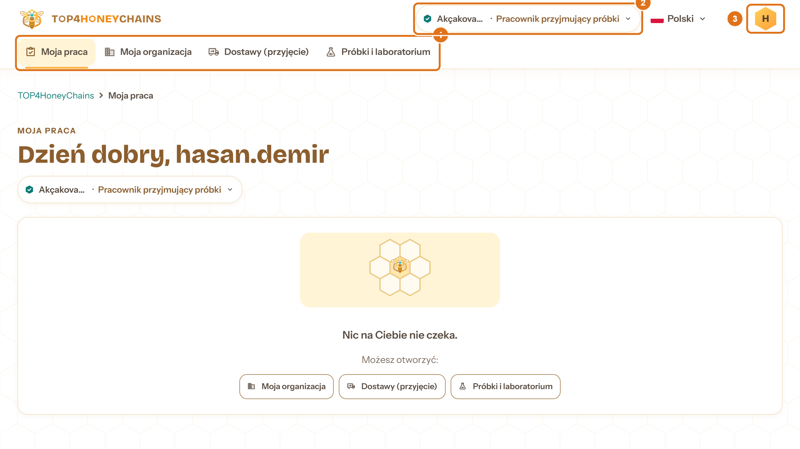

Znaczniki na rysunku pokazują:

1. Menu ze stronami Twojej roli. **Moja praca** i **Moja organizacja** są zawsze dostępne; pozostałe pozycje zależą od Twojej roli i organizacji.
2. Twoją organizację i rolę. Jeśli masz więcej niż jedną rolę, wybierz ten element, aby przełączyć się na inną rolę.
3. Menu użytkownika pod okrągłym przyciskiem z Twoim inicjałem.

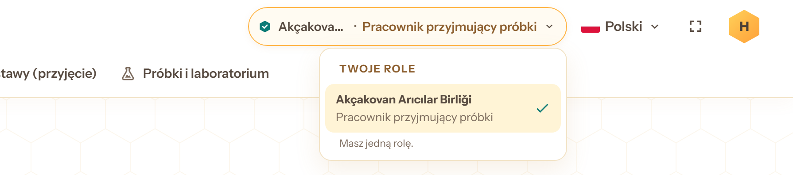 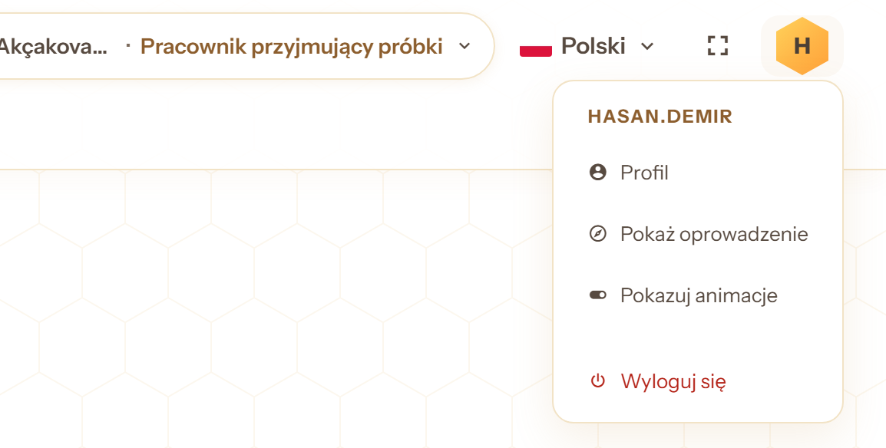

Menu użytkownika ma następujące pozycje:

Table: Części ekranu {#tbl-screen}

| Pozycja | Co robi |
| --- | --- |
| **Profil** | Pokazuje Twoją nazwę użytkownika i pozwala zweryfikować telefon komórkowy oraz zmienić hasło. |
| **Pokaż oprowadzenie** | Ponownie otwiera krótkie oprowadzenie po ekranie. |
| **Pokazuj animacje** | Włącza lub wyłącza krótkie sceny, które pokazują, co robi przycisk. |
| **Wyloguj się** | Wylogowuje Cię. |

## Wyloguj się

Otwórz menu użytkownika i wybierz **Wyloguj się**. Na wspólnym komputerze zawsze wylogowuj się, gdy odchodzisz.

## Obejrzyj oprowadzenie

Gdy po raz pierwszy otwierasz platformę w danej roli, krótkie oprowadzenie pokazuje najważniejsze części ekranu. Wybierz **Następna**, aby przejść dalej, lub **Pomiń**, aby je zamknąć. Możesz otworzyć je ponownie za pomocą opcji **Pokaż oprowadzenie** w menu użytkownika.

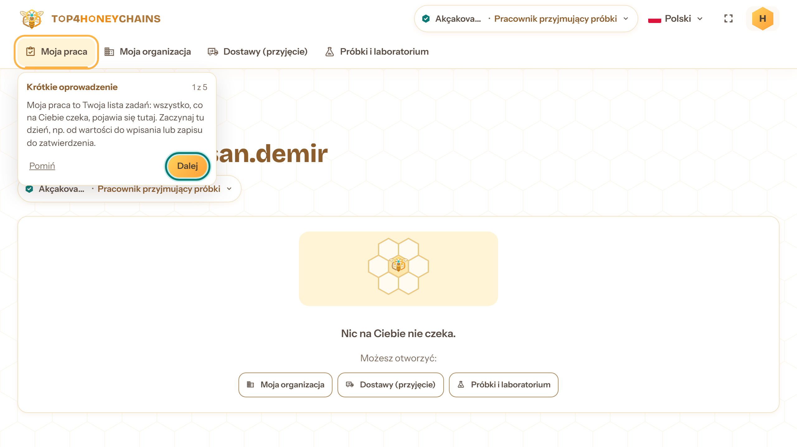

## Zweryfikuj telefon komórkowy

Dzięki zweryfikowanemu telefonowi komórkowemu możesz zresetować zapomniane hasło SMS-em.

1. Otwórz menu użytkownika i wybierz **Profil**.
2. Wpisz swój numer w polu **Numer telefonu** i wybierz **Wyślij kod**.
3. Wpisz kod w polu **Kod z SMS (6 cyfr)** i wybierz **Potwierdź**. Nowy numer jest używany dopiero po wpisaniu kodu, który na niego wysłano.

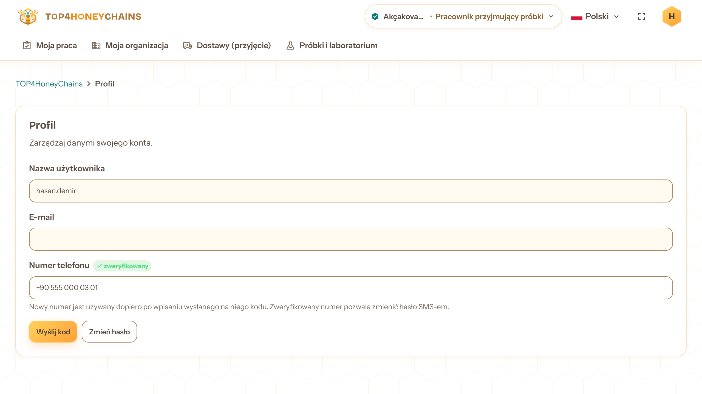

## Zresetuj zapomniane hasło

1. Na stronie logowania wybierz **Zapomniałeś hasła?**.
2. Wpisz nazwę użytkownika w polu **Nazwa użytkownika** i wybierz **Wyślij kod**.

   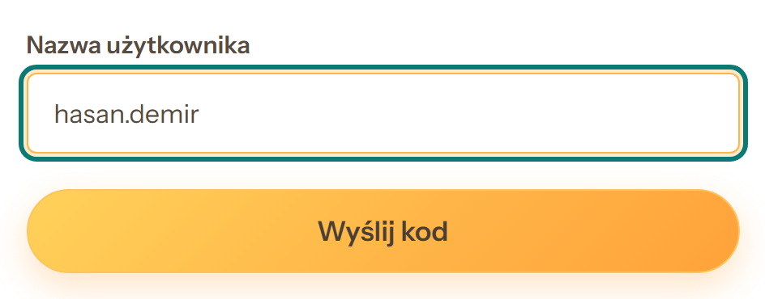

3. Na stronie **Utwórz nowe hasło** wpisz kod z SMS-a w polu **Kod z SMS (6 cyfr)**. Kod jest ważny przez 5 minut.
4. Wpisz nowe hasło w polach **Nowe hasło** i **Potwierdź hasło** i zapisz je.

> [!NOTE]
> Kod jest wysyłany tylko na zweryfikowany telefon komórkowy. Jeśli go nie masz, poproś osobę, która przekazała Ci dane logowania, o wysłanie nowych.

# Specjalista ds. rejestracji pszczelarzy {#ch-ro}

Specjalista ds. rejestracji pszczelarzy powiatowej dyrekcji rejestruje pszczelarzy na platformie. Rejestracja potwierdza trzy rzeczy: krajowy numer rejestrowy, telefon komórkowy pszczelarza (kodem wysłanym na ten telefon) oraz Twoje oświadczenie, że widziałeś dokument tożsamości i wpis w rejestrze.

Table: Zadania specjalisty ds. rejestracji pszczelarzy {#tbl-tasks-ro}

| Zadanie | Gdzie |
| --- | --- |
| Znajdź pszczelarza lub rozpocznij rejestrację | **Rejestracja pszczelarzy** |
| Zarejestruj nowego pszczelarza | **Rejestracja pszczelarzy > Znajdź lub zarejestruj** |
| Dodaj kolejną pasiekę | formularz rejestracji lub strona rejestracji |
| Wyślij dane logowania | strona rejestracji |

## Znajdź pszczelarza lub rozpocznij rejestrację {#sec-find-beekeeper}

Strona **Rejestracja pszczelarzy** zawiera listę pszczelarzy zarejestrowanych przez Twoją organizację.

1. Wybierz **Rejestracja pszczelarzy** w menu.
2. Wpisz numer rejestrowy w polu **Numer rejestrowy (AKS) lub numer gospodarstwa**.
3. Wybierz **Znajdź lub zarejestruj**.

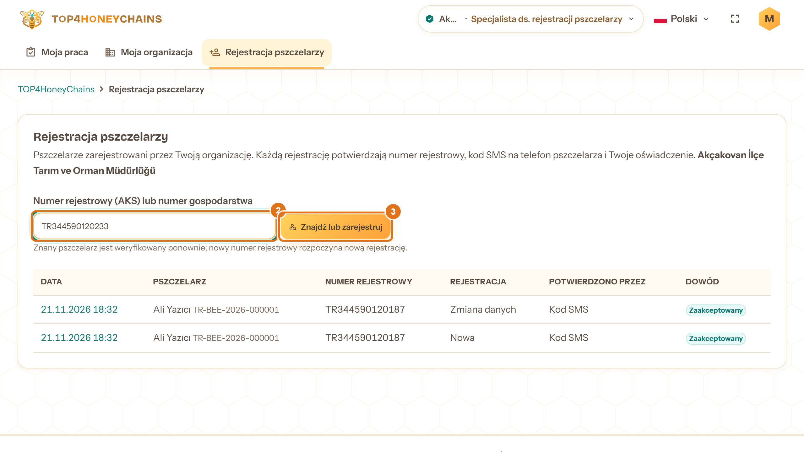

Znany pszczelarz jest weryfikowany ponownie: formularz otwiera się z zapisanymi danymi. Nowy numer rejestrowy rozpoczyna nową rejestrację.

## Zarejestruj nowego pszczelarza

Rób to w obecności pszczelarza, który ma przy sobie dokument tożsamości i telefon komórkowy.

1. Znajdź numer rejestrowy w sposób opisany w części [Znajdź pszczelarza lub rozpocznij rejestrację](#sec-find-beekeeper). Otwiera się formularz **Zarejestruj pszczelarza**.
2. Wypełnij sekcje 1 i 2.

   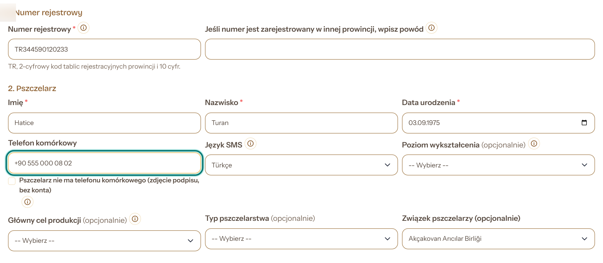

3. W sekcji **3. Pasieka** ustaw położenie pasieki: kliknij mapę lub przeciągnij pinezkę, wybierz **Użyj mojej lokalizacji** albo wpisz wartości w polach **Szerokość geograficzna lokalizacji** i **Długość geograficzna lokalizacji**. Wpisz **Liczba uli**, a następnie **Prowincja**, **Powiat** i **Miejscowość (wieś, płaskowyż, pole)**. Nazwa pasieki powstaje z tych trzech pól, na przykład `İstanbul – Şile – Sofular`.

   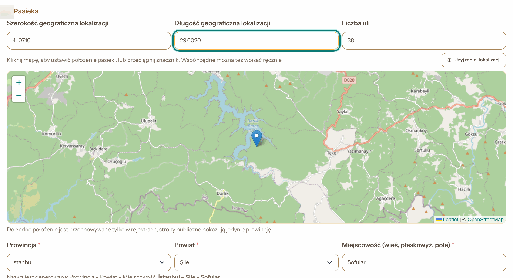

4. Pozwól pszczelarzowi przeczytać informację w sekcji 4 lub przeczytaj ją na głos. Zaznacz zgody, których udziela pszczelarz: imię i nazwisko na stronach publicznych oraz powiadomienia SMS. Obie są opcjonalne.
5. W sekcji **5. Twoje oświadczenie** zaznacz oświadczenie. Zaznacz **Wyślij też pszczelarzowi dane logowania SMS-em**, jeśli pszczelarz ma korzystać z portalu.

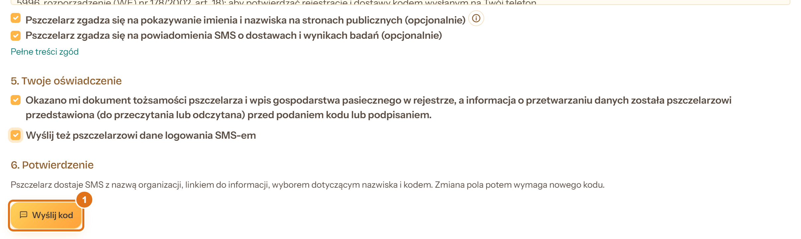

Pola sekcji 1 i 2:

Table: Pola formularza rejestracji {#tbl-reg-fields}

| Pole | Co wpisać | Wymagane |
| --- | --- | --- |
| **Numer rejestrowy** | TR, 2-cyfrowy kod tablic rejestracyjnych prowincji i 10 cyfr | tak |
| **Jeśli numer jest zarejestrowany w innej prowincji, wpisz powód** | tylko wtedy, gdy prowincja rejestru różni się od prowincji Twojej dyrekcji | nie |
| **Imię**, **Nazwisko**, **Data urodzenia** | tak jak w dokumencie tożsamości | tak |
| **Telefon komórkowy** | własny numer pszczelarza; otrzymuje kod i dane logowania | tak, chyba że pszczelarz nie ma telefonu komórkowego |
| **Język SMS** | język wiadomości i portalu pszczelarza | tak |
| **Poziom wykształcenia**, **Główny cel produkcji**, **Typ pszczelarstwa** | odpowiedzi pszczelarza | nie |
| **Związek pszczelarzy (opcjonalnie)** | stowarzyszenie, do którego należy pszczelarz | nie |

> [!NOTE]
> Dokładne położenie pasieki jest przechowywane tylko w rekordach. Strony publiczne pokazują prowincję.

### Potwierdź kodem

1. Wybierz **Wyślij kod**. Pszczelarz otrzymuje SMS z nazwą Twojej organizacji, łączem do informacji o danych, swoim wyborem dotyczącym nazwiska i kodem.
2. Wpisz kod, który odczyta pszczelarz, w polu **Kod z SMS (6 cyfr)**.
3. Wybierz **Potwierdź rejestrację**.

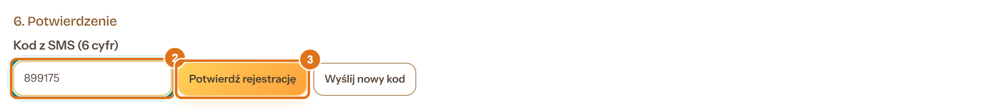

Otwiera się strona rejestracji z komunikatem **Pszczelarz jest zarejestrowany i zweryfikowany.** Pszczelarz ma numer działalności (na przykład `TR-BEE-2026-000002`); dowód ma status **Zaakceptowany**, a numer rejestrowy status **Zweryfikowano**.

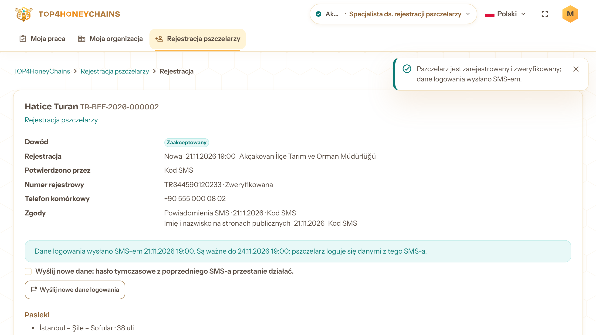

> [!IMPORTANT]
> Zmiana dowolnego pola po wysłaniu kodu unieważnia kod. Wyślij nowy kod za pomocą przycisku **Wyślij nowy kod**.

## Dodaj kolejną pasiekę

Pszczelarz może mieć kilka pasiek. W formularzu dodaj je przed wysłaniem kodu:

1. Wybierz **Dodaj pasiekę** pod pierwszą pasieką. Pojawia się nowy blok **Pasieka 2**.
2. Wypełnij jego współrzędne, ule i miejsce. Mapa ustawia tylko pierwszą pasiekę; współrzędne pozostałych wpisz ręcznie. Wybierz **Usuń**, aby usunąć niepotrzebny blok.

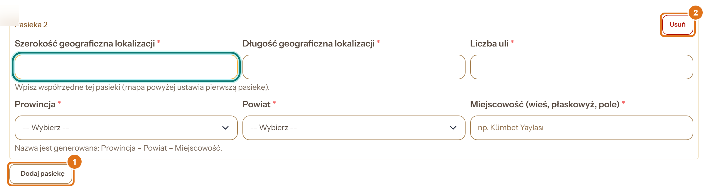

W przypadku zarejestrowanego już pszczelarza otwórz stronę rejestracji i użyj opcji **Dodaj pasiekę** pod sekcją **Pasieki**.

## Wyślij pszczelarzowi dane logowania {#sec-send-signin}

Jeśli zaznaczyłeś **Wyślij też pszczelarzowi dane logowania SMS-em**, dane są wysyłane razem z rejestracją. W przeciwnym razie otwórz stronę rejestracji i wybierz **Wyślij dane logowania SMS-em**. Nazwą użytkownika pszczelarza jest numer działalności.

Aby wysłać nowe dane, zaznacz **Wyślij nowe dane: hasło tymczasowe z poprzedniego SMS-a przestanie działać.** i wybierz **Wyślij nowe dane logowania**.

## Zarejestruj pszczelarza bez telefonu komórkowego {#sec-register-no-phone}

Jeśli pszczelarz nie ma telefonu komórkowego, zaznacz **Pszczelarz nie ma telefonu komórkowego (zdjęcie podpisu, bez konta)**. W sekcji 6 otwórz **SMS niemożliwy: zdjęcie podpisu**, wpisz powód w polu **Dlaczego bez kodu SMS**, użyj opcji **Drukuj formularz**, daj formularz pszczelarzowi do podpisu i prześlij jego zdjęcie w polu **Zdjęcie podpisanego formularza**. Wybierz **Zapisz ze zdjęciem podpisu**. Rejestracja czeka, aż Specjalista ds. zgodności Twojej organizacji zaakceptuje lub odrzuci zdjęcie; nie możesz sam decydować o własnej rejestracji.

# Pracownik przyjmujący próbki: dostawa miodu {#ch-sao}

Pracownik przyjmujący próbki w zakładzie zapisuje każdą dostawę miodu. Każdy pojemnik jest zapisywany wraz z jego plombami, napełnia się z niego słoik z próbką i słoik z próbką kontrolną, które się plombuje, a pszczelarz potwierdza całą dostawę kodem wysłanym SMS-em. Każda dostawa staje się partią surowego miodu Twojej organizacji.

Table: Zadania pracownika przyjmującego próbki {#tbl-tasks-sao}

| Zadanie | Gdzie |
| --- | --- |
| Przeglądaj dostawy | **Dostawy (przyjęcie)** |
| Zarejestruj dostawę miodu | **Dostawy (przyjęcie) > Zarejestruj dostawę** |
| Wydrukuj etykiety | strona dostawy |
| Wprowadź KPK 0 | **Moja praca > Wartości do wprowadzenia** |

## Przeglądaj dostawy

Wybierz **Dostawy (przyjęcie)** w menu. Lista pokazuje każdą partię z jej datą, pasieką, rodzajem miodu, ilością, pochodzeniem i sposobem, w jaki pszczelarz ją potwierdził. **Dostawa** otwiera dostawę, a **Wycofanie** jej raport z wycofania.

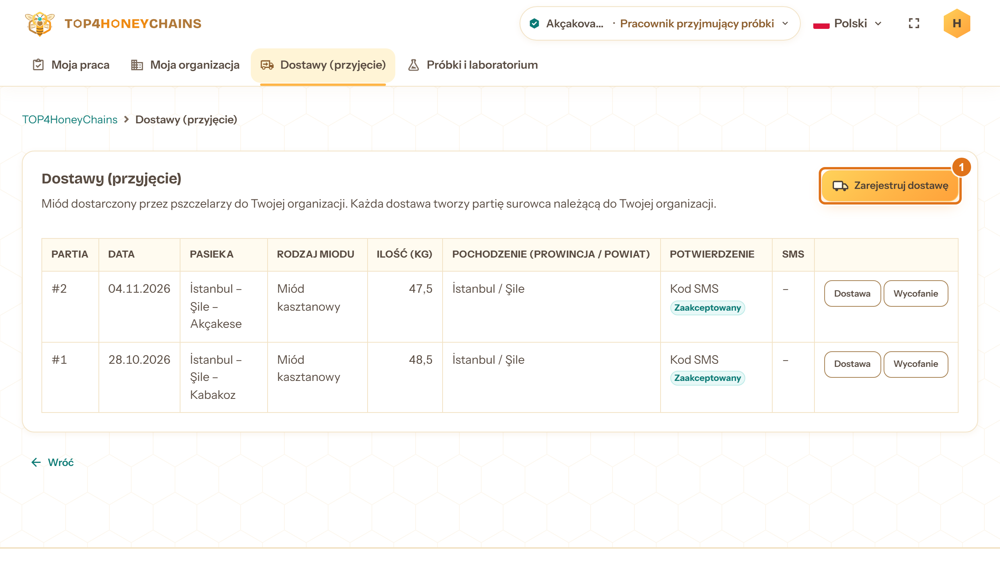

## Zarejestruj dostawę miodu {#sec-record-delivery}

1. Wybierz **Zarejestruj dostawę**.
2. Wpisz numer pszczelarza w polu **Numer działalności lub numer w rejestrze pszczelarza**.
3. Wybierz **Znajdź**.

   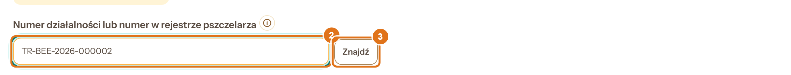

4. Wypełnij sekcję **1. Dostawa**. Lista pasiek pokazuje każdą pasiekę pszczelarza z jej ulami; jeśli pasiek jest więcej, wybierz właściwą.

   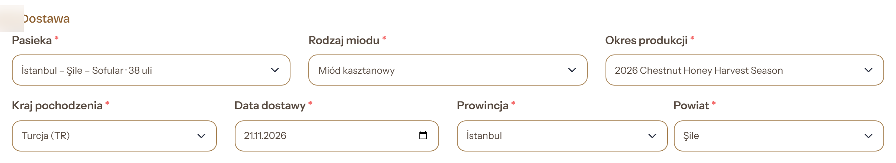

5. W sekcji **2. Pojemniki i próbki** wypełnij jeden wiersz na każdy pojemnik. Wybierz **Dodaj pojemnik** dla każdego kolejnego pojemnika i **Usuń wiersz** dla wiersza, którego nie potrzebujesz.

   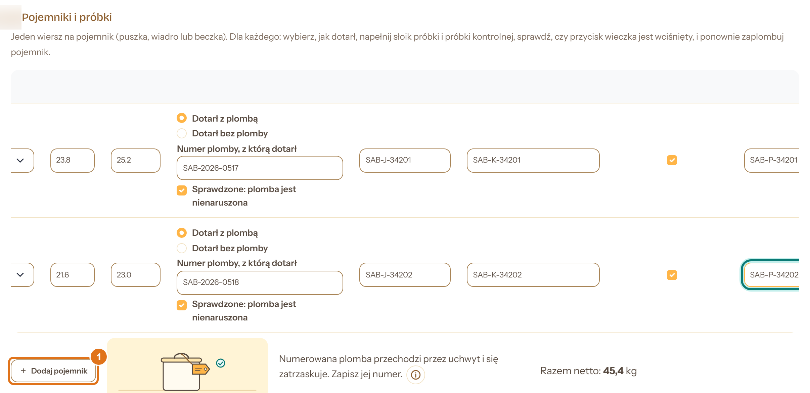

   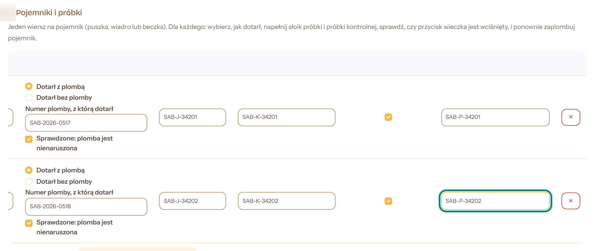

6. W sekcji **3. Laboratorium i próbki kontrolne** wybierz **Laboratorium**, wpisz **Gdzie przechowywane są próbki kontrolne** i datę w polu **Przechowywać do**.

Pola sekcji 1:

Table: Pola dostawy {#tbl-delivery-fields}

| Pole | Co wpisać | Wymagane |
| --- | --- | --- |
| **Pasieka** | skąd pochodzi miód | tak |
| **Rodzaj miodu**, **Okres produkcji** | tak jak dostarczono | tak |
| **Kraj pochodzenia** | kraj pochodzenia miodu | tak |
| **Data dostawy** | dzień dostawy | tak |
| **Prowincja**, **Powiat** | pochodzenie miodu | tak |

Kolumny sekcji 2, jeden wiersz na pojemnik:

Table: Kolumny tabeli Pojemniki i próbki {#tbl-containers}

| Kolumna | Co wpisać |
| --- | --- |
| **Typ** | puszka, wiadro lub bęben |
| **Kg netto**, **Kg brutto** | wagi pojemnika |
| **Przy przyjęciu** | **Dotarł z plombą**: **Numer plomby, z którą dotarł** i zaznacz **Sprawdzone: plomba jest nienaruszona**. **Dotarł bez plomby**: numer z pola **Nowa plomba, założona teraz przy pszczelarzu**. |
| **Plomba słoika** | plomba słoika z próbką napełnionego z tego pojemnika |
| **Plomba próbki kontrolnej** | plomba słoika z próbką kontrolną |
| **Wieczko nienaruszone** | zaznacz, gdy przycisk wieczka słoika jest wciśnięty |
| **Nowa plomba po pobraniu** | plomba, którą zakładasz na pojemnik po pobraniu próbek |

> [!IMPORTANT]
> Każdy numer plomby w dostawie musi być inny.

### Potwierdź dostawę kodem pszczelarza

1. Wybierz **Wyślij kod**. Pszczelarz otrzymuje SMS z datą, pojemnikami, kilogramami, rodzajem miodu, liczbą próbek i kodem.

   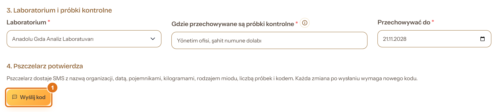

2. Wpisz kod w polu **Kod z SMS (6 cyfr)**. Jeśli pszczelarza nie ma na miejscu, zadzwoń do niego: odczyta kod ze swojego telefonu.
3. Wybierz **Potwierdź dostawę**.

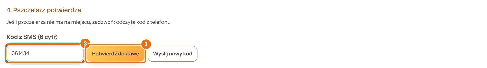

Otwiera się strona dostawy z komunikatem **Dostawa potwierdzona przez pszczelarza i zapisana jako partia #3.** Partia pojawia się teraz na stronie **Moja organizacja**, a jej punkty kontrolne w **Moja praca**.

Jeśli SMS jest niemożliwy, otwórz **SMS niemożliwy: zdjęcie podpisu**, podaj powód, zrób lub prześlij zdjęcie podpisanego formularza dostawy i wybierz **Zapisz ze zdjęciem podpisu**. Sprawdza je Specjalista ds. zgodności.

## Wydrukuj etykiety

Strona dostawy pokazuje każdy pojemnik z jego historią plomb i słoikami z próbkami.

1. Wybierz **Etykiety (arkusz A4)** lub **Etykiety (100 × 50 mm)** w przypadku drukarki etykiet.

   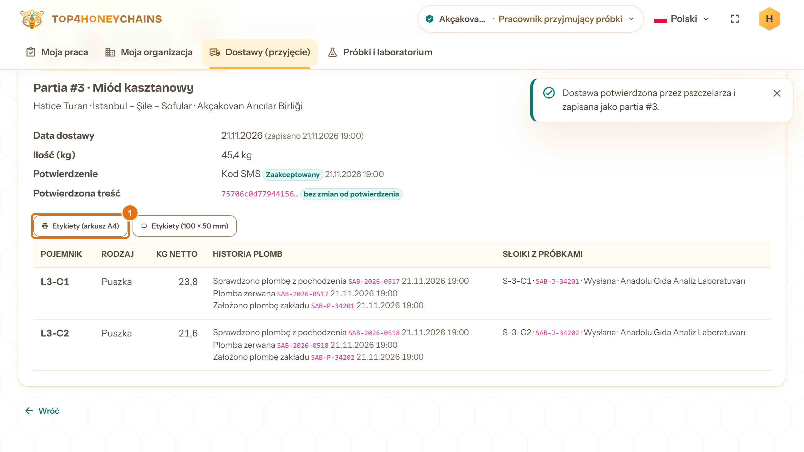

2. Wybierz **Drukuj formularz** i naklej każdą etykietę na jej pojemnik, słoik z próbką i słoik z próbką kontrolną.

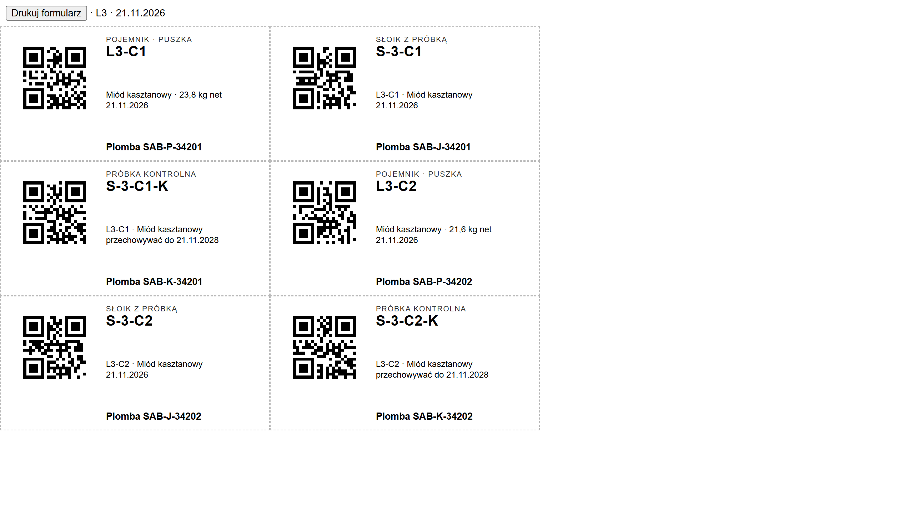

## Wprowadź KPK 0 (audyt wstępny)

KPK 0 zapisuje audyt wstępny dostawy: higienę, wodę, zwalczanie szkodników i przechowywanie u pszczelarza.

1. Otwórz **Moja praca** i wybierz **KPK 0** w grupie **Wartości do wprowadzenia**.

   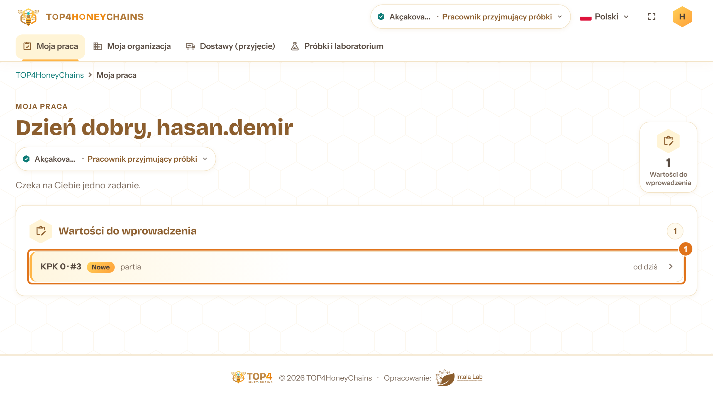

2. Odpowiedz na każde pytanie i w razie potrzeby dodaj uwagi.

   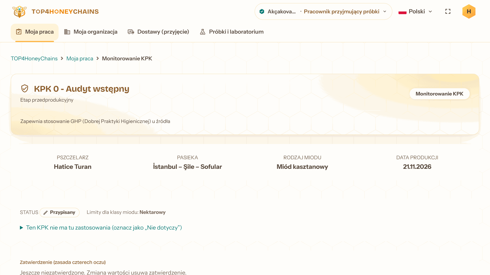

3. Wybierz **Zapisz zapisy monitorowania**.

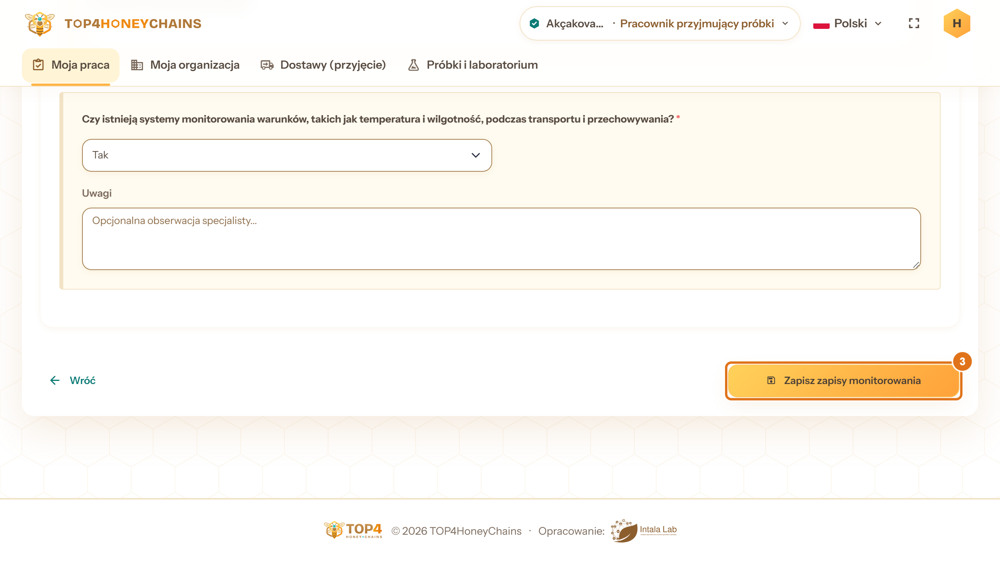

Następnie zatwierdza go Specjalista ds. zapewnienia jakości ([Zatwierdź KPK 0](#sec-approve-ccp0)). **KPK 1** wypełnia zatwierdzony raport laboratorium; nie wprowadzasz go.

> [!TIP]
> Jeśli punkt kontrolny nie ma zastosowania, otwórz **Ten KPK nie ma tu zastosowania (oznacz jako „Nie dotyczy”)** i podaj powód.

# Laboratorium: analityk i kierownik laboratorium {#ch-lab}

Laboratorium sprawdza plombę każdego słoika z próbką przy przyjęciu, przygotowuje próbkę zbiorczą każdej partii, wprowadza wyniki wraz z podpisanym raportem i przekazuje je do zatwierdzenia Kierownikowi laboratorium. Zatwierdzony raport staje się KPK 1 partii.

Table: Zadania w laboratorium {#tbl-tasks-lab}

| Zadanie | Kto | Gdzie |
| --- | --- | --- |
| Przyjmij słoiki z próbkami | Analityk | **Próbki i laboratorium** |
| Utwórz próbkę zbiorczą | Analityk | **Próbki i laboratorium** |
| Wprowadź i prześlij wyniki | Analityk | raport laboratoryjny |
| Zatwierdź lub zwróć raport | Kierownik laboratorium | **Moja praca** |

## Przyjmij słoiki z próbkami

Moja praca wymienia oczekujące słoiki w grupie **Próbki do przyjęcia**.

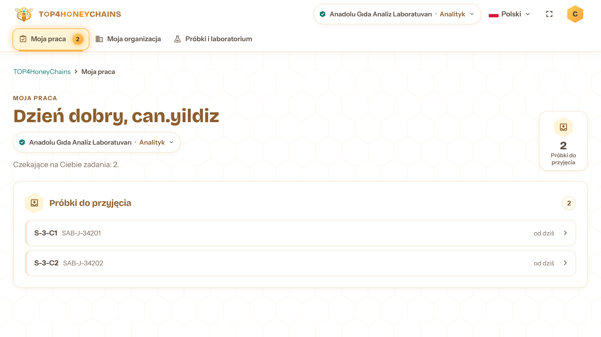

1. Wybierz **Próbki i laboratorium** w menu. Słoiki są wymienione w sekcji **Próbki wysłane do Twojego laboratorium**.
2. Dla każdego słoika odpowiedz na pytania **Numer plomby zgadza się z zapisem**, **Etykieta jest nienaruszona** i **Wieczko nienaruszone (przycisk wciśnięty)**. Jeśli kontrola się nie powiedzie, wpisz powód w polu **Powód, jeśli kontrola się nie powiedzie**.
3. Wybierz **Zapisz przyjęcie**.

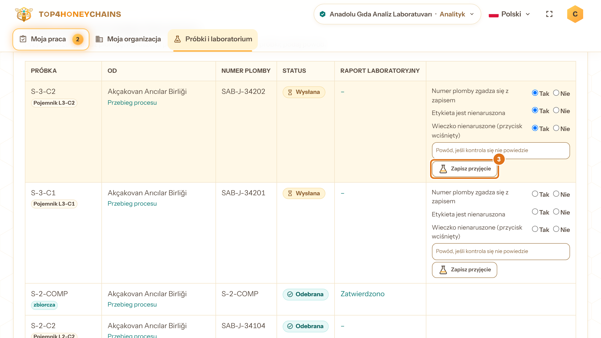

Naruszona plomba powoduje odrzucenie próbki; zakład pobiera wtedy nową próbkę z próbki kontrolnej.

## Utwórz próbkę zbiorczą

Gdy wszystkie słoiki partii dotrą w dobrym stanie, partia pojawia się w sekcji **Partie gotowe do próbki zbiorczej**.

1. Wybierz **Utwórz próbkę zbiorczą** przy partii. Wymieszaj równe części słoików w jedną próbkę zbiorczą; słoiki pozostają zachowane do pojedynczych analiz.

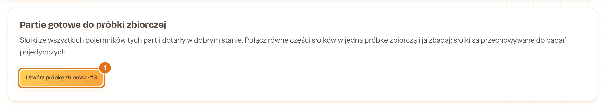

Otwiera się raport laboratoryjny próbki zbiorczej.

## Wprowadź wyniki

1. Wpisz **Numer raportu** i **Data wydania**.
2. Wybierz **Wybierz PDF** i dołącz podpisany raport.
3. Wpisz wartość każdego parametru. Kolumna **Limit** pokazuje limit każdej wartości.
4. Wybierz **Zapisz**.

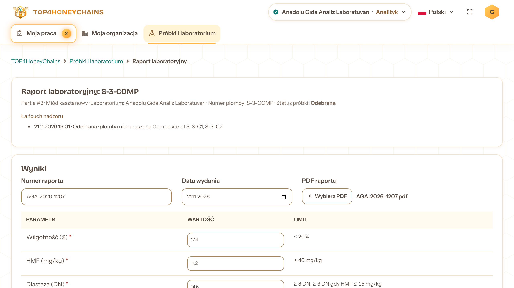

Wiersz **Wprowadzone wartości wymagane** pokazuje, ilu wartości jeszcze brakuje.

## Prześlij raport

Gdy każda wymagana wartość jest zapisana, wybierz **Prześlij do zatwierdzenia**.

1. Wybierz **Prześlij do zatwierdzenia**.

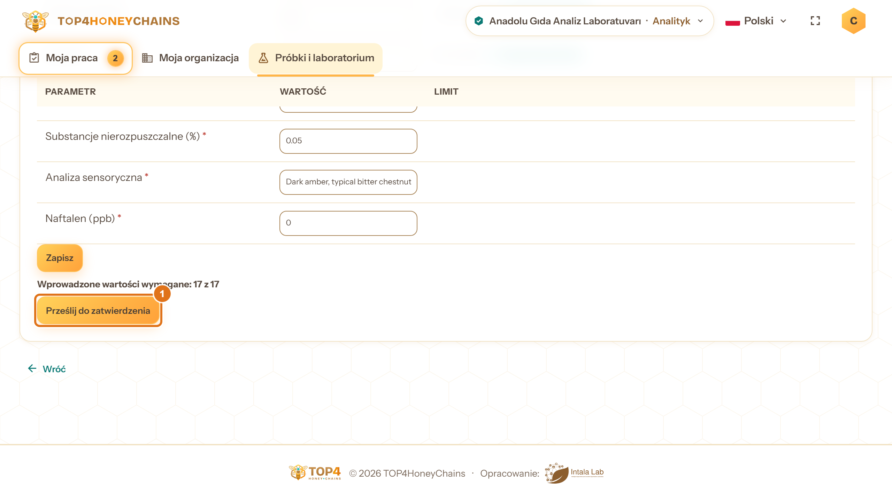

Kierownik laboratorium znajduje raport w **Moja praca**.

## Zatwierdź lub zwróć raport

Kierownik laboratorium sprawdza raport i jego plik PDF.

1. Wybierz **Zatwierdź**. Aby odesłać raport, wpisz powód w polu **powód (w przypadku zwrotu)** i wybierz **Zwróć**.

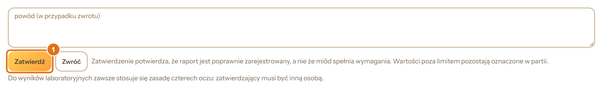

Zatwierdzenie potwierdza, że raport jest zapisany prawidłowo, a nie że miód spełnia wymagania. Wartości poza limitami pozostają oznaczone w partii. Zatwierdzone wyniki wypełniają KPK 1 partii, a raport otrzymuje kod, który każdy może sprawdzić.

## Zweryfikuj raport laboratoryjny {#sec-verify-report}

Każdy może sprawdzić raport bez logowania: otwórz **Zweryfikuj raport laboratoryjny** na stronie startowej, wpisz **Kod raportu** i wybierz **Sprawdź**. Strona pokazuje status, laboratorium, jego akredytację, numer raportu, datę wydania i odcisk SHA-256 pliku raportu.

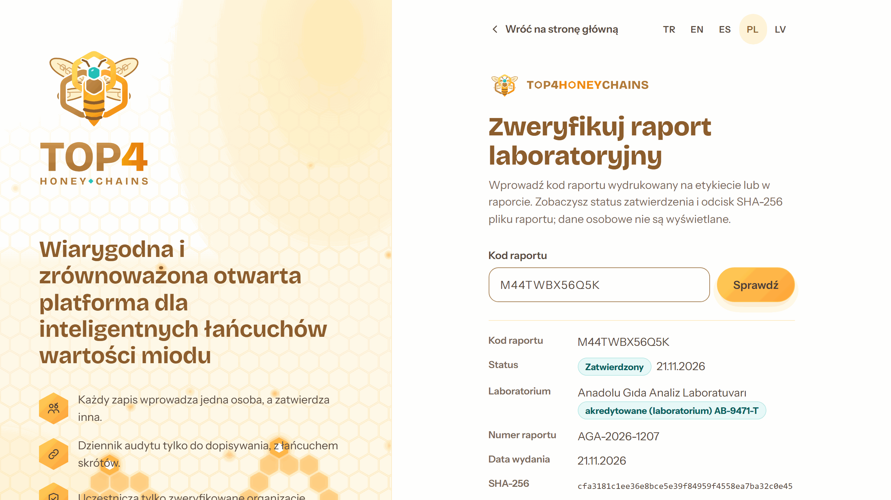

# Pracownik: przetwarzanie i konfekcjonowanie {#ch-staff}

Pracownicy zakładu wypełniają arkusze kontrolne partii i partii końcowych, łączą zatwierdzone partie w partie końcowe, składają wnioski o ostateczne zatwierdzenie partii końcowej i wysyłają miód do innych organizacji.

Table: Zadania pracownika {#tbl-tasks-staff}

| Zadanie | Gdzie |
| --- | --- |
| Przeglądaj swoje partie i partie końcowe | **Moja organizacja** |
| Wypełnij arkusz kontrolny partii | **Moja organizacja > Arkusz kontrolny** |
| Utwórz partię końcową | **Moja organizacja > Nowa partia** |
| Wypełnij arkusz kontrolny partii końcowej | **Moja praca** lub strona partii końcowej |
| Złóż wniosek o ostateczne zatwierdzenie | strona partii końcowej |
| Wyślij miód | **Wysyłki i zapasy** |

## Przeglądaj swoje partie i partie końcowe

**Moja organizacja** pokazuje Twoją organizację, **Partie surowego miodu**, nad którymi pracuje, oraz jej **Partie końcowe**. Każdy punkt kontrolny jest znacznikiem: zielony z ✓ oznacza zatwierdzony, żółty przesłany i oczekujący na zatwierdzenie, szary otwarty, a obramowany nie dotyczy.

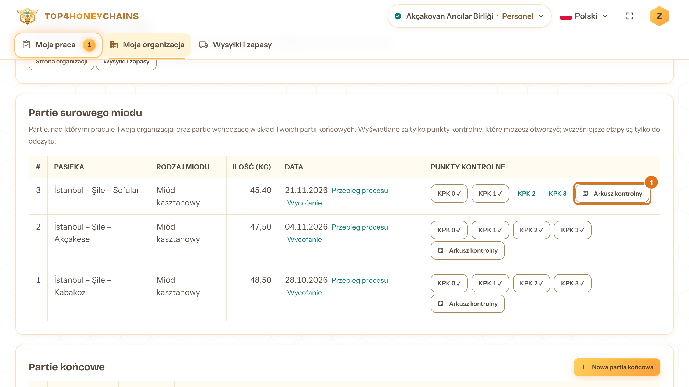

## Wypełnij arkusz kontrolny partii (KPK 2 i 3)

Arkusz kontrolny pokazuje wszystkie punkty kontrolne partii na jednej stronie. Każdy z nich ma własny rekord, status i zatwierdzenie.

1. Wybierz **Arkusz kontrolny** w wierszu partii lub pozycję w **Moja praca**.
2. Wpisz wartości **KPK 2** (podgrzewanie) i **KPK 3** (filtracja).

   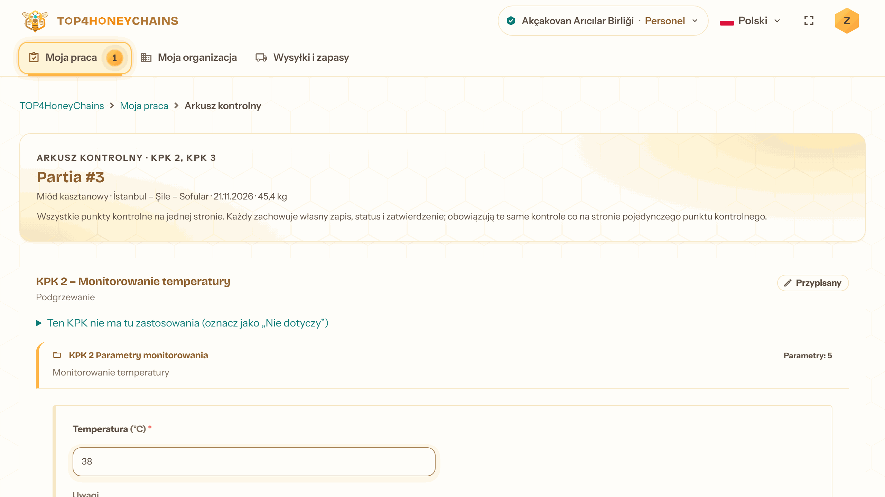

3. Wybierz **Zapisz arkusz**.

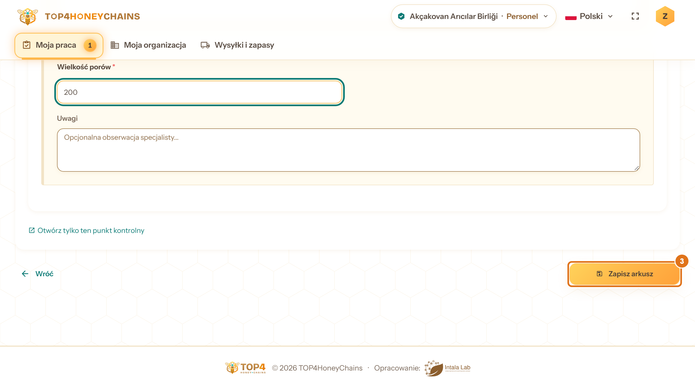

Specjalista ds. zapewnienia jakości zatwierdza arkusz ([Zatwierdź arkusz kontrolny](#sec-approve-sheet)).

> [!TIP]
> **Otwórz tylko ten punkt kontrolny** otwiera jeden punkt kontrolny na osobnej stronie, na przykład aby dołączyć plik.

## Utwórz partię końcową {#sec-new-batch}

Partia jest gotowa do partii końcowej, gdy wszystkie jej punkty kontrolne są ukończone i zatwierdzone.

1. Na stronie **Moja organizacja** wybierz **Nowa partia**.
2. Wpisz **Nazwa partii końcowej**, na przykład `Şile Kestane Balı 2026/2`, i sprawdź **Data produkcji**.
3. Zaznacz **Użyj** przy każdej partii, która wchodzi do partii końcowej, i sprawdź **Kilogramy do tej partii końcowej**.
4. Wybierz **Utwórz partię końcową**.

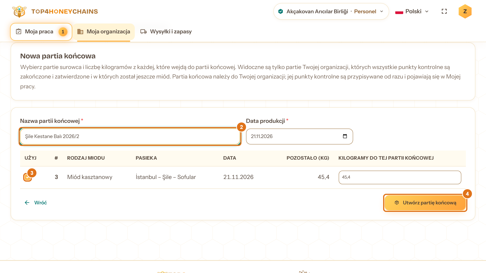

Partia końcowa należy do Twojej organizacji. Jej punkty kontrolne od KPK 4 do KPK 10 od razu pojawiają się w Moja praca.

## Wypełnij arkusz kontrolny partii końcowej (KPK 4 do 10)

Otwórz arkusz kontrolny partii końcowej z **Moja praca** lub za pomocą przycisku **Otwórz arkusz kontrolny** na stronie partii końcowej. Wpisz wartości homogenizacji, pasteryzacji, odstawania, rozlewu, etykietowania, pakowania i przechowywania, a następnie wybierz **Zapisz arkusz**.

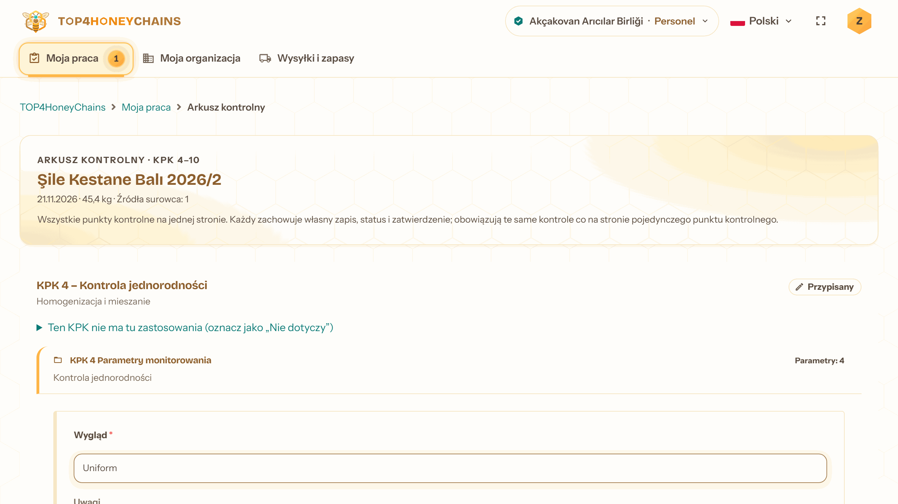

## Złóż wniosek o ostateczne zatwierdzenie {#sec-request-finalizing}

Gdy każdy punkt kontrolny partii końcowej i jej partii jest zatwierdzony, poproś o ostateczne zatwierdzenie partii końcowej.

1. Na stronie partii końcowej wybierz **Wnioskuj o ostateczne zatwierdzenie**.

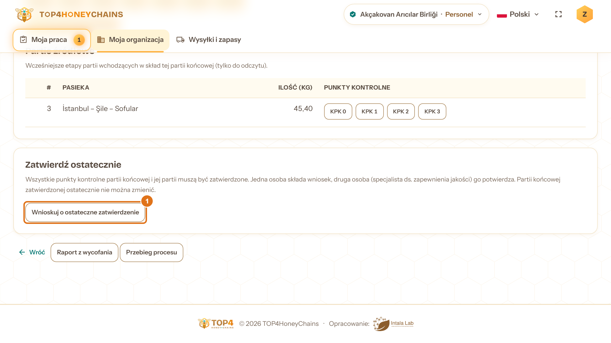

Jeśli czegoś brakuje, strona wymienia to w sekcji **Brakuje przed ostatecznym zatwierdzeniem:**. Specjalista ds. zapewnienia jakości potwierdza wniosek ([Zatwierdź ostatecznie partię końcową](#sec-finalize)).

## Wyślij miód do innej organizacji

1. Wybierz **Wysyłki i zapasy** w menu i wybierz **Wyślij** w wierszu partii końcowej.

   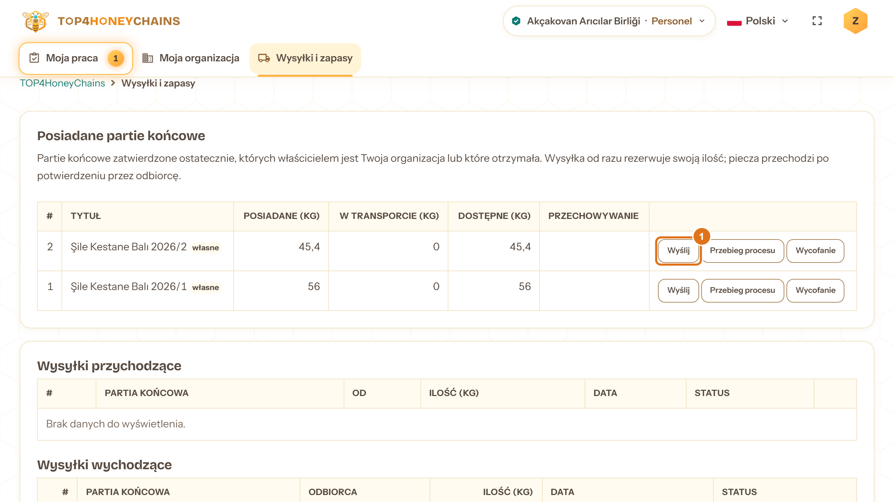

2. Wybierz organizację odbierającą w polu **Na**.
3. Wpisz **Ilość (kg)** i, jeśli to przydatne, **Uwaga**.
4. Wybierz **Wyślij**.

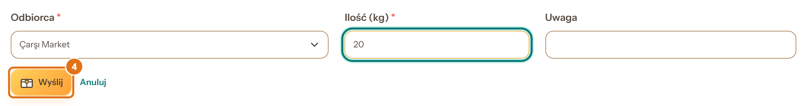

Wysyłka od razu rezerwuje swoją ilość; piecza przechodzi na odbiorcę, gdy potwierdzi on wysyłkę.

# Specjalista ds. zapewnienia jakości {#ch-qao}

Specjalista ds. zapewnienia jakości zatwierdza to, co wprowadzili inni: KPK 0 każdej dostawy, arkusze kontrolne partii i partii końcowych, ostateczne zatwierdzenie partii końcowych oraz, u hurtownika lub detalisty, rekordy przechowywania. Odpowiada też na opinie konsumentów. Nigdy nie zatwierdzasz rekordu, który sam wprowadziłeś.

Table: Zadania specjalisty ds. zapewnienia jakości {#tbl-tasks-qao}

| Zadanie | Gdzie |
| --- | --- |
| Zatwierdź KPK 0 | **Moja praca > Wartości do zatwierdzenia** |
| Zatwierdź arkusz kontrolny | **Moja praca > Wartości do zatwierdzenia** |
| Zatwierdź ostatecznie partię końcową | **Moja praca**, strona partii końcowej |
| Odpowiedz na opinie konsumentów | **Opinie konsumentów** |

## Zatwierdź KPK 0 {#sec-approve-ccp0}

1. Otwórz **Moja praca** i wybierz pozycję w grupie **Wartości do zatwierdzenia**.

   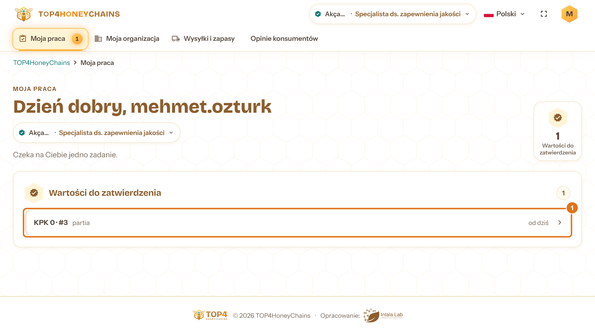

2. Sprawdź wartości i wybierz **Zatwierdź**.

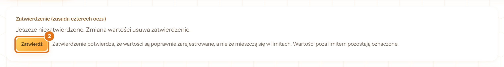

Zatwierdzenie potwierdza, że wartości są zapisane prawidłowo, a nie że mieszczą się w limitach. Jeśli wartość jest poza limitem, strona prosi o jej potwierdzenie przed zatwierdzeniem.

## Zatwierdź arkusz kontrolny {#sec-approve-sheet}

1. Otwórz arkusz kontrolny z **Moja praca**.
2. Sprawdź wartości. W sekcji **Zatwierdź arkusz** strona wymienia punkty kontrolne, które zatwierdzasz; wybierz **Zatwierdź wszystkie wymienione**.

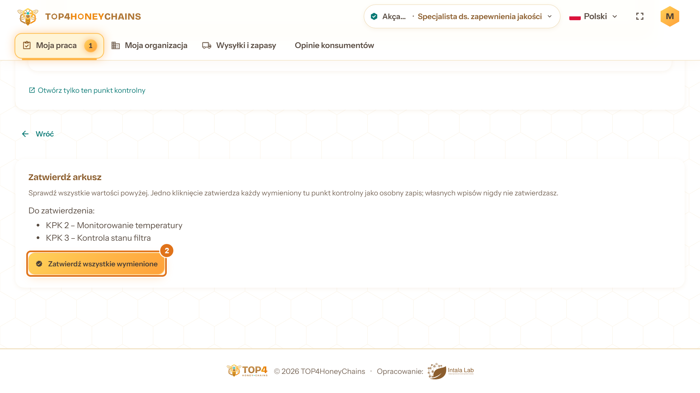

Każdy wymieniony punkt kontrolny jest zatwierdzany jako osobny rekord. Wpisy, które zrobiłeś sam, są wymienione w sekcji **Nie zatwierdzasz:** i wymagają innego specjalisty.

## Zatwierdź ostatecznie partię końcową {#sec-finalize}

Gdy Pracownik złoży wniosek o ostateczne zatwierdzenie, partia końcowa pojawia się w Twojej Moja praca.

1. Otwórz stronę partii końcowej z **Moja praca**.
2. Wybierz **Potwierdź i zatwierdź ostatecznie**.

Partia końcowa jest ostatecznie zatwierdzona i zamknięta. **Otwórz Historię miodu** pokazuje jej stronę publiczną, a **Pobierz kod QR** daje kod QR na etykiety słoików.

> [!WARNING]
> Ostatecznie zatwierdzonej partii końcowej nie można zmienić. Jej dane, skład i punkty kontrolne są zablokowane. Wartość można wtedy zmienić tylko w drodze korekty zatwierdzonej przez dwóch administratorów platformy.

## Odpowiedz na opinie konsumentów {#sec-answer-feedback}

Konsumenci mogą wysłać opinię o miodzie do organizacji, która go wyprodukowała. Odczytujesz tylko kod konsumenta, nigdy jego nazwę użytkownika ani telefon, a opinia nigdy nie jest publiczna.

1. Wybierz **Opinie konsumentów** w menu i otwórz opinię.
2. Wpisz odpowiedź w polu **Twoja odpowiedź dla konsumenta**.
3. Wybierz **Wyślij odpowiedź**.

Konsument czyta odpowiedź na swojej stronie **Moje miody**. Używaj opcji **Oznacz jako przeczytane** i **Zamknij**, aby utrzymać porządek na liście.

# Hurtownik i detalista: przyjmowanie i przechowywanie miodu {#ch-shop}

Pracownicy hurtownika lub detalisty potwierdzają miód, który dociera, i zapisują warunki jego przechowywania (KPK 10). Specjalista ds. zapewnienia jakości tej samej organizacji zatwierdza rekord przechowywania. Rysunki pokazują detalistę; hurtownik pracuje w ten sam sposób.

Table: Zadania u hurtownika lub detalisty {#tbl-tasks-shop}

| Zadanie | Kto | Gdzie |
| --- | --- | --- |
| Potwierdź wysyłkę | Pracownik | **Wysyłki i zapasy** |
| Zapisz warunki przechowywania | Pracownik | **Wysyłki i zapasy > KPK 10** |
| Zatwierdź rekord przechowywania | Specjalista ds. zapewnienia jakości | **Moja praca** |

## Potwierdź wysyłkę

1. Wybierz **Wysyłki i zapasy** w menu. Wysyłka jest wymieniona w sekcji **Wysyłki przychodzące** ze statusem **Oczekująca**.
2. Sprawdź miód i wybierz **Potwierdź odbiór**. Jeśli coś się nie zgadza, wpisz powód w polu **powód (w przypadku odrzucenia)** i wybierz **Odrzuć**.

Partia końcowa jest teraz wymieniona w sekcji **Posiadane partie końcowe**.

## Zapisz warunki przechowywania (KPK 10)

1. Na stronie **Wysyłki i zapasy** wybierz **KPK 10** w kolumnie **Przechowywanie** przy partii końcowej.
2. Wpisz **Temperatura (°C)** i **Wilgotność względna**.
3. Wybierz **Zapisz**.

## Zatwierdź rekord przechowywania

1. Otwórz rekord przechowywania z **Moja praca**.
2. Wybierz **Zatwierdź**.

Historia miodu partii końcowej pokazuje teraz, że detalista ją otrzymał.

# Administrator organizacji {#ch-orgadmin}

Administrator organizacji dba o stronę i dokumenty organizacji, a w stowarzyszeniu pszczelarzy publikuje strony pszczelarzy. W zakładzie Administrator organizacji może też tworzyć partie końcowe, składać wnioski o ostateczne zatwierdzenie i wysyłać miód, tak jak Pracownik ([Pracownik: przetwarzanie i konfekcjonowanie](#ch-staff)). Specjalista ds. zgodności ma własny rozdział ([Specjalista ds. zgodności](#ch-compliance)).

## Przeglądaj stronę i dokumenty swojej organizacji {#sec-org-page}

Wybierz **Moja organizacja**, a następnie **Strona organizacji**. Strona pokazuje status organizacji (**Weryfikacja**), jej **Dokumenty**, **Funkcje**, **Wyjątek od zasady czterech oczu** oraz dane w sekcji **Administrator danych**.

Aby dodać dokument, wybierz plik w sekcji **Dokumenty** i wybierz **Prześlij**. Akceptowane są pliki PDF do 10 MB oraz obrazy JPG, PNG lub WEBP do 8 MB. Członkami i funkcjami zarządzają administratorzy platformy ([Administracja platformą](#ch-admin)).

## Opublikuj stronę pszczelarza (stowarzyszenie) {#sec-beekeeper-page}

Stowarzyszenie może opublikować publiczną stronę każdego swojego członka pszczelarza. Strona jest publikowana tylko przy zapisanej zgodzie i zweryfikowanym numerze rejestrowym; wycofanie zgody natychmiast ją wycofuje z publikacji.

1. Wybierz **Strony pszczelarzy** w menu.
2. Wybierz **Zarejestruj zgodę** w wierszu pszczelarza.
3. Odczytaj pszczelarzowi treść zgody. Zaznacz **Treść zgody została odczytana pszczelarzowi i podpisana.** oraz, jeśli pszczelarz się zgadza, **Pszczelarz zgadza się na wyświetlanie nazwiska (w przeciwnym razie wyświetlany jest neutralny kod)**.
4. Wpisz **Data udzielenia zgody**, dołącz **Podpisany dokument zgody** (lub zrób zdjęcie za pomocą opcji **Aparat**) i zapisz.

Po opublikowaniu **Karta do druku** daje kartę z kodem QR strony, a **Wycofaj zgodę** zdejmuje stronę.

# Specjalista ds. zgodności {#ch-compliance}

Każda organizacja na platformie wyznacza co najmniej jedną osobę w roli **Specjalista ds. zgodności**. Specjalista ds. zgodności nadzoruje, jak organizacja pracuje z platformą i z danymi osobowymi. Nie wprowadzasz dostaw, wartości punktów kontrolnych ani wyników laboratoryjnych; sprawdzasz je. Administrator platformy weryfikuje organizację po raz pierwszy tylko wtedy, gdy ma ona aktywnego Specjalistę ds. zgodności. W małej organizacji **Administrator organizacji** może być jednocześnie Specjalistą ds. zgodności dzięki drugiemu członkostwu (zob. [Członkostwa](#memberships)).

Jako Specjalista ds. zgodności możesz:

- akceptować lub odrzucać zdjęcia podpisanych formularzy, które zastępują kod SMS pszczelarza, w przypadku rejestracji i dostaw Twojej organizacji;
- oceniać jakość pobierania próbek: dostawy potwierdzone zdjęciem podpisanego formularza, próbki odrzucone przez laboratorium i plomby, które okazały się naruszone;
- zapisywać żądania dotyczące danych osobowych i wycofania zgód, które docierają na piśmie, telefonicznie lub osobiście;
- obserwować mechanizm zatwierdzania: rekordy, które zbyt długo czekają na zatwierdzenie, i zatwierdzenia dokonane w ramach wyjątku od zasady czterech oczu;
- prowadzić umowy organizacji i dane jej administratora danych;
- odczytywać wpisy audytu swojej organizacji.

Twoje prawa do danych wynikają z roli (zob. [Tabela](#tbl-crud)). Domyślnie zatwierdzasz dowody w postaci zdjęć podpisanych formularzy, odczytujesz ceny oczekiwane przez pszczelarzy dla partii Twojej organizacji, odczytujesz wpisy audytu organizacji oraz odczytujesz opinie konsumentów o partiach końcowych Twojej organizacji i na nie odpowiadasz. Tworzysz i aktualizujesz dokumenty oraz dane administratora danych swojej organizacji. Tworzysz oceny jakości pobierania próbek i żądania osób, których dane dotyczą; oceny nie można później zmienić ani usunąć. Administrator platformy może zmienić te prawa w **Konfiguracja > Role i uprawnienia**.

Zawsze obowiązują dwie zasady podstawowe (zob. [Zasady podstawowe](#ground-rules)). Nigdy nie decydujesz o pozycji, którą sam zapisałeś: strona pokazuje komunikat **To Ty zapisałeś tę pozycję; ocenia ją inna osoba.** Wyjątek od zasady czterech oczu przyznany organizacji nigdy nie dotyczy Twoich ocen zdjęć podpisanych formularzy.

Twoje menu zawiera pozycję **Zgodność**. Twoje zadania pojawiają się w **Moja praca** w grupach **Sprawdź zdjęcia podpisów**, **Oceny**, **Żądania osób, których dane dotyczą** i **Opinie konsumentów**.

Table: Zadania specjalisty ds. zgodności i gdzie je znaleźć {#tbl-co-tasks}

| Zadanie | Gdzie je znaleźć |
| --- | --- |
| Sprawdź zdjęcie podpisanego formularza rejestracji lub dostawy | **Moja praca > Sprawdź zdjęcia podpisów**; liczba jest też w **Zgodność > Zdjęcia podpisów** |
| Oceń jakość pobierania próbek | **Zgodność > Jakość pobierania próbek**; otwarte pozycje w **Moja praca > Oceny** |
| Zapisz żądanie osoby, której dane dotyczą, i odpowiedz na nie | **Zgodność > Żądania osób, których dane dotyczą**; otwarte żądania w **Moja praca > Żądania osób, których dane dotyczą** |
| Zapisz wycofanie zgody otrzymane na piśmie lub telefonicznie | **Zgodność > Żądania osób, których dane dotyczą > Zapisz żądanie** |
| Sprawdź mechanizm zatwierdzania | **Zgodność > Mechanizm zatwierdzania** |
| Prowadź umowy i dokumenty | **Zgodność > Umowy**, **Dokumenty organizacji** |
| Prowadź dane administratora danych | **Zgodność > Administrator danych**, **Edytuj na stronie organizacji** |
| Odczytaj wpisy audytu organizacji | **Zgodność > Wpisy audytu** |
| Odpowiedz na opinie konsumentów | **Moja praca > Opinie konsumentów** (zob. [Odpowiedz na opinie konsumentów](#sec-answer-feedback)) |

## Sprawdź zdjęcie podpisanego formularza {#co-evidence}

Pszczelarz zwykle potwierdza rejestrację i dostawę 6-cyfrowym kodem z SMS-a. Gdy nie jest to możliwe (brak telefonu komórkowego, brak zasięgu), osoba dokonująca zapisu dołącza zdjęcie formularza podpisanego przez pszczelarza. **Specjalista ds. rejestracji pszczelarzy** robi to przy rejestracji (zob. [Zarejestruj pszczelarza bez telefonu komórkowego](#sec-register-no-phone)), a **Pracownik przyjmujący próbki** przy dostawie (zob. [Zarejestruj dostawę miodu](#sec-record-delivery)). Zdjęcie czeka wtedy na Ciebie.

1. W **Moja praca** otwórz pozycję w grupie **Sprawdź zdjęcia podpisów**. Otwiera ona rejestrację lub dostawę.
2. Otwórz zdjęcie i porównaj je z rekordem:
   - w przypadku rejestracji: tożsamość, numer rejestrowy, wybory pszczelarza i podpis;
   - w przypadku dostawy: pojemniki, wagi i numery plomb.
3. Wybierz **Akceptuj** albo wpisz **Uwaga (wymagana przy odrzuceniu)** i wybierz **Odrzuć**.

To, co dzieje się dalej, zależy od rekordu.

Table: Skutki akceptacji lub odrzucenia zdjęcia podpisanego formularza {#tbl-co-evidence}

| Rekord | Akceptacja | Odrzucenie |
| --- | --- | --- |
| Rejestracja | Numer rejestrowy jest zweryfikowany, a pszczelarz może dostarczać miód. | Numer rejestrowy zostaje odrzucony. Zgody udzielone na tym podpisanym formularzu zostają wycofane. Pszczelarz nie może dostarczać miodu, dopóki nie zostanie zarejestrowany ponownie. |
| Dostawa | Partię można ostatecznie zatwierdzić, gdy jej punkty kontrolne są ukończone. Pszczelarz może podać cenę oczekiwaną. | Partii nie można ostatecznie zatwierdzić. |

Jeśli sam zapisałeś pozycję, nie pojawia się ona w Twojej **Moja praca**, a strona informuje, że decyduje inna osoba. W przypadku rejestracji zapisanych przez samą platformę zdjęcie sprawdza administrator platformy.

> [!NOTE]
> Możesz otworzyć i pobrać zdjęcie, ponieważ jesteś Specjalistą ds. zgodności organizacji, która je przechowuje. Każde pobranie jest zapisywane w dzienniku audytu (zob. [Kody i odciski plików](#trust-codes)).

## Oceń jakość pobierania próbek {#co-quality}

**Zgodność > Jakość pobierania próbek** wymienia trzy rodzaje pozycji Twojej organizacji:

- **dostawa ze zdjęciem**: dostawa potwierdzona zdjęciem podpisanego formularza zamiast kodu SMS;
- **odrzucona próbka**: słoik z próbką odrzucony przez laboratorium przy przyjęciu;
- **naruszona plomba**: plomba pojemnika, która okazała się naruszona.

Pozycje bez oceny są wyświetlane jako pierwsze. Wybierz łącze pozycji, aby otworzyć dostawę lub próbkę.

1. Wybierz **Napisz ocenę** w wierszu.
2. Wybierz **w porządku** lub **ustalenie**.
3. Wpisz **Co sprawdzono i co ustalono**.
4. W przypadku ustalenia wpisz **Podjęte lub zlecone działanie**. Jest ono wymagane przy ustaleniu.
5. Wybierz **Zapisz**.

Każdy tekst może mieć najwyżej 1000 znaków. Zapisanej oceny nie można zmienić ani usunąć. Jeśli później sprawdziłeś pozycję ponownie, napisz nową ocenę; wiersz pokazuje wtedy każdą ocenę z jej datą.

## Obsłuż żądanie osoby, której dane dotyczą {#co-requests}

Ludzie mogą pytać o swoje dane osobowe. Strona oferuje pięć rodzajów żądań: **dostęp**, **sprostowanie**, **usunięcie**, **sprzeciw** i **wycofanie zgody**. Pszczelarz z kontem w portalu wycofuje lub udziela zgody bezpośrednio tam, ze skutkiem natychmiastowym (zob. [Zarządzaj zgodami i kontem](#sec-portal-consents)). Tutaj zapisujesz żądania, które docierają do organizacji w inny sposób: listem, telefonicznie lub podczas wizyty.

1. Wybierz **Zgodność**, przejdź do **Żądania osób, których dane dotyczą** i wybierz **Zapisz żądanie**.
2. Wypełnij formularz (zob. [Tabela](#tbl-co-request)).
3. Wybierz **Zapisz**. Komunikat brzmi: **Żądanie zapisane; odpowiedź w ciągu 30 dni.**

Table: Pola żądania osoby, której dane dotyczą {#tbl-co-request}

| Pole | Co wpisać | Wymagane |
| --- | --- | --- |
| **Osoba, której dane dotyczą** | Imię i nazwisko osoby, która składa żądanie (najwyżej 200 znaków) | Tak |
| **Numer pszczelarza (jeśli dotyczy)** | Numer działalności pszczelarza. Musi istnieć na platformie. | Tylko przy wycofaniu zgody |
| **Żądanie** | **dostęp**, **sprostowanie**, **usunięcie**, **sprzeciw** lub **wycofanie zgody** | Tak |
| **Zgoda do wycofania** | Zgoda, którą pszczelarz wycofuje | Tylko przy wycofaniu zgody |
| **Przyjął(ęła)** | Jak dotarło żądanie, na przykład „list” lub „telefon” (najwyżej 50 znaków) | Tak |
| **Odebrana** | Data otrzymania żądania. Nie może być z przyszłości. | Tak |
| **Czego dotyczy** | Żądanie Twoimi słowami (najwyżej 1000 znaków) | Tak |

Lista pokazuje najpierw otwarte żądania, z datą w kolumnie **Odebrana** i terminem w kolumnie **Odpowiedź do**. Termin odpowiedzi przypada 30 dni po dacie otrzymania, zgodnie z tureckim prawem ochrony danych (KVKK), które wskazuje ekran. Przekroczony termin jest pokazywany na czerwono. W innych krajach partnerskich sprawdź termin wynikający z prawa krajowego; zgodnie z RODO (GDPR) wynosi on jeden miesiąc.

Po udzieleniu odpowiedzi osobie wpisz w wierszu **Udzielona odpowiedź** i wybierz **udzielono odpowiedzi** lub **odmówiono**. Zamkniętego żądania nie można ponownie otworzyć.

> [!NOTE]
> Platforma zapisuje żądanie i jego termin. Samo żądanie realizujesz Ty: na przykład zbierasz dane w odpowiedzi na żądanie dostępu albo prosisz administratora platformy o sprostowanie lub usunięcie (zob. [Co dzieje się dalej](#co-next)).

## Zapisz wycofanie zgody otrzymane na piśmie lub telefonicznie {#co-withdrawal}

Pszczelarz może wycofać zgodę listownie, telefonicznie lub osobiście, na przykład gdy nie ma konta w portalu. Wycofanie działa od chwili, gdy je zapiszesz.

1. Wybierz **Zapisz żądanie**.
2. W polu **Żądanie** wybierz **wycofanie zgody**.
3. Wpisz **Numer pszczelarza (jeśli dotyczy)**. Tutaj jest on wymagany.
4. Wybierz **Zgoda do wycofania**: **Moje imię i nazwisko na stronach publicznych**, **Wiadomości o moich dostawach i wynikach**, **Moje stowarzyszenie może widzieć moje ceny** lub **Moja publiczna strona pszczelarza**.
5. Wypełnij pola **Osoba, której dane dotyczą**, **Przyjął(ęła)**, **Odebrana** i **Czego dotyczy**, a następnie wybierz **Zapisz**.

Platforma natychmiast wycofuje aktywną zgodę i zamyka żądanie ze statusem **udzielono odpowiedzi** oraz z uwagą, że zgoda została wycofana (lub że nie było aktywnej zgody). Skutek jest natychmiastowy: Historia miodu pokazuje neutralny kod zamiast nazwiska, stowarzyszenie przestaje odczytywać ceny albo strona pszczelarza zostaje zdjęta (zob. [Informacje o danych, zgody i administrator danych](#trust-notices)).

## Sprawdź mechanizm zatwierdzania {#co-approvals}

Zasada czterech oczu oznacza, że jedna osoba wprowadza rekord, a druga go zatwierdza (zob. [Zasada czterech oczu](#four-eyes)). Administrator platformy może zwolnić małą organizację z tej zasady, tak aby jej członkowie mogli zatwierdzać własne rekordy punktów kontrolnych i ostatecznie zatwierdzać własne partie końcowe. Wyjątek nigdy nie dotyczy wyników laboratoryjnych. Platforma oznacza każde zatwierdzenie dokonane w ramach wyjątku.

**Zgodność > Mechanizm zatwierdzania** wymienia dla partii i partii końcowych Twojej organizacji:

- rekordy punktów kontrolnych partii i partii końcowych, rekordy przechowywania (KPK 10) i wnioski o ostateczne zatwierdzenie, które czekają na zatwierdzenie dłużej niż 7 dni („czeka od …”);
- zatwierdzenia i ostateczne zatwierdzenia dokonane w ramach wyjątku od zasady czterech oczu („zatwierdzone przez tę samą osobę (wyłączenie czterech oczu)”).

Każdy wiersz podaje partię lub partię końcową, punkt kontrolny (lub **Zatwierdź ostatecznie**) i powód, dla którego jest wymieniony. Wybierz wiersz, aby otworzyć rekord. Samodzielne zatwierdzenia są wymieniane jako pierwsze.

W sekcji **Kto co wprowadza i zatwierdza** strona pokazuje dla każdego obszaru pracy, które role wprowadzają, zatwierdzają i odczytują rekordy. Jest to konfiguracja całej platformy. Prowadzi ją administrator platformy; zwróć się do niego o zmianę (zob. [Ustal, kto wprowadza i zatwierdza każdy punkt kontrolny](#sec-ccp-responsibilities)).

> [!TIP]
> Rekord, który zbyt długo czeka, zwykle oznacza, że nikt w roli zatwierdzającej nie jest dostępny. Porozmawiaj z osobą w roli **Administrator organizacji** lub poproś administratora platformy o dodanie członka w tej roli.

## Prowadź umowy i dokumenty {#co-agreements}

**Zgodność > Umowy** wymienia umowy powierzenia przetwarzania danych i umowy dostaw organizacji, od najnowszych, z datą przesłania. Wybierz nazwę pliku, aby go otworzyć.

Aby dodać umowę:

1. Wybierz **Dokumenty organizacji**. Strona organizacji otwiera się w sekcji **Dokumenty**.
2. Wybierz rodzaj **Umowa powierzenia przetwarzania danych** lub **Umowa dostaw**.
3. Wybierz plik i wybierz **Prześlij**.

W tym samym miejscu przesyła się pozostałe dokumenty organizacji (**Licencja**, **Akredytacja**, **Zaświadczenie podatkowe**, **Dowód wpisu do rejestru**, **Inne**), tak jak robi to **Administrator organizacji** (zob. [Przeglądaj stronę i dokumenty swojej organizacji](#sec-org-page)). Dokumenty są przechowywane wraz z ich odciskiem SHA-256. Zawieszona organizacja nie może przesyłać dokumentów.

## Prowadź dane administratora danych {#co-controller}

Każda organizacja jest administratorem danych osobowych, które zapisuje. Jej dane są podane w informacji o danych, którą czytają ludzie. **Zgodność > Administrator danych** pokazuje nazwę prawną i kontakt.

1. Wybierz **Edytuj na stronie organizacji**.
2. W sekcji **Administrator danych** wpisz **Nazwa prawna**, **Kontakt (e-mail lub telefon)**, **Adres** oraz, jeśli dotyczy, numer rejestracji **VERBİS**.
3. Wybierz **Zapisz**.

Tylko Ty i administratorzy platformy możecie zmieniać te dane. Strona organizacji oznacza je jako **brak**, dopóki nie zostanie wpisana nazwa prawna. **Informacja o danych** otwiera publiczną informację o danych, która wskazuje Twoją organizację jako administratora danych. Pszczelarze znajdują te dane w portalu w sekcji **Kto przechowuje Twoje dane**.

## Odczytaj wpisy audytu organizacji {#co-audit}

**Zgodność > Wpisy audytu** pokazuje 200 najnowszych wpisów zapisanych przez członków Twojej organizacji podczas pracy dla niej: **Data**, **Użytkownik** i **Zmiana** (działanie i rekord, którego dotyczy). Lista jest tylko do odczytu. Pełny dziennik audytu ze starymi i nowymi wartościami uzyskasz od administratora platformy (zob. [Dziennik audytu i jego łańcuch skrótów](#trust-audit)).

## Co dzieje się dalej {#co-next}

Twoje oceny przekazują pracę innym:

- Po zaakceptowaniu rejestracji **Pracownik przyjmujący próbki** może zapisywać dostawy pszczelarza. Po zaakceptowaniu zdjęcia dostawy **Specjalista ds. zapewnienia jakości** może ostatecznie zatwierdzić partię końcową z tą partią ([Zatwierdź ostatecznie partię końcową](#sec-finalize)).
- Po odrzuceniu **Specjalista ds. rejestracji pszczelarzy** rejestruje pszczelarza ponownie albo partia pozostaje poza każdą ostatecznie zatwierdzoną partią końcową.
- Ustalenie z działaniem trafia do osoby w roli **Administrator organizacji** lub do administratora platformy, który koryguje zablokowane rekordy ([Zapisy, które się nie zmieniają](#trust-locked)) oraz zmienia członków, role, uprawnienia i wyjątek od zasady czterech oczu.

# Portal pszczelarza {#ch-portal}

Portal pszczelarza jest przygotowany z myślą o telefonie. Dzięki niemu pszczelarze śledzą swoje dostawy, podają cenę oczekiwaną, czytają wyniki laboratoryjne i zarządzają swoimi zgodami. Specjalista ds. rejestracji wysyła dane logowania SMS-em ([Wyślij pszczelarzowi dane logowania](#sec-send-signin)); pierwsze logowanie przebiega tak, jak opisano w części [Zaloguj się po raz pierwszy](#sec-first-sign-in).

## Odczytaj stronę startową

Po zalogowaniu pszczelarz widzi stronę **Start**: dostawy, partie końcowe z jego miodem, ostatnią dostawę i ostatni wynik laboratoryjny. **Do zrobienia** wymienia dostawy bez ceny. Menu zawiera pozycje **Start**, **Moje dostawy**, **Próbki i laboratorium**, **Partie z moim miodem**, **Moje strony Honey Story**, **Moje pasieki**, **Prywatność i zgody** oraz **Konto**. Łącza języków i **Wyloguj się** znajdują się u góry.

## Podaj swoją cenę

1. Wybierz **Moje dostawy**. Każda dostawa pokazuje rodzaj miodu, ilość, potwierdzenie i każdy pojemnik z jego historią plomb.
2. W sekcji **Cena oczekiwana** wpisz **Cena za kg** i **Waluta** oraz **Uwaga (opcjonalnie)**.
3. Wybierz **Podaj cenę** i potwierdź kwotę łączną.

 

Możesz zmienić cenę za pomocą przycisku **Zmień cenę**, dopóki partia nie znajdzie się w ostatecznie zatwierdzonej partii końcowej. **Historia cen** pokazuje Twoje wcześniejsze ceny.

## Przeglądaj wyniki badań, partie końcowe i strony Historii miodu

**Próbki i laboratorium** pokazuje każdy słoik z próbką z Twoich dostaw. Wartości laboratoryjne pojawiają się, gdy laboratorium zatwierdzi swój raport. **Partie z moim miodem** pokazuje Twój udział w każdej partii końcowej, a **Moje strony Honey Story** otwiera ich strony publiczne.

## Zarządzaj zgodami i kontem {#sec-portal-consents}

**Prywatność i zgody** wymienia Twoje zgody: imię i nazwisko na stronach publicznych, wiadomości o dostawach i wynikach oraz to, czy Twoje stowarzyszenie może odczytywać Twoje ceny. Wybierz **Wycofaj** lub **Udziel**; zmiana działa natychmiast.

**Konto** pozwala zmienić telefon komórkowy (**Nowy numer**, **Wyślij kod**), **Język** i hasło (**Obecne hasło**, **Nowe hasło**, **Powtórz nowe hasło**, **Zmień hasło**).

 

# Strona Historia miodu {#ch-story}

Historia miodu to publiczna strona ostatecznie zatwierdzonej partii końcowej. Konsument otwiera ją, skanując telefonem kod QR na słoiku; konto nie jest potrzebne.

## Górna część strony

Górna część pokazuje nazwę partii końcowej, organizację, która ją wyprodukowała, ilość miodu, liczbę pszczelarzy i datę produkcji. Odznaki poniżej informują, czy miód został **Zbadane przez akredytowane laboratorium** i czy **Wszystkie punkty kontrolne zatwierdzone**, a także podają pochodzenie i kod raportu laboratoryjnego.

## Droga tego miodu

Pięć etapów pokazuje drogę miodu: **Pasieka**, **Dostawa**, **Laboratorium**, **Przetwarzanie** i **Półka**, każdy z datą. **Zobacz szczegóły** otwiera część strony, która dotyczy danego etapu.

 

## Skąd pochodzi miód

**Pochodzenie miodu** pokazuje, ile miodu pochodzi z każdego źródła, a mapa pokazuje prowincje. Dokładne położenie pasiek nigdy nie jest publikowane. **Skład źródłowy** wymienia pszczelarzy, z imieniem i nazwiskiem tylko wtedy, gdy się na to zgodzili.

## Wyniki laboratoryjne i kontrole procesu

**Jakość w skrócie** pokazuje najważniejsze wartości. **Pełny raport z badań** grupuje wszystkie wartości: **Świeżość**, **Dojrzałość i autentyczność**, **Profil cukrów i czystość** oraz pozostałości. **Sprawdź raport** sprawdza raport na stronie weryfikacji. **Kontrole procesu** wymienia każdy punkt kontrolny zapisany dla tego miodu.

 

> [!NOTE]
> Dopóki limity wartości są jeszcze sprawdzane przez laboratorium partnerskie, wartości są pokazywane bez oceny „w normie / poza normą”.

## Zapisz miód lub napisz do producenta

Na dole opcje **Zapisz w Moich miodach** i **Wyślij opinię producentowi** są przeznaczone dla konsumentów z bezpłatnym kontem ([Konto konsumenta](#ch-consumer)). **Sprawdź raport** otwiera stronę weryfikacji.

# Konto konsumenta {#ch-consumer}

Bezpłatne konto konsumenta pozwala przechowywać kupione miody, wysyłać opinie producentowi i czytać odpowiedzi. Historia miodu pozostaje otwarta dla wszystkich bez konta.

## Załóż konto

1. W Historii miodu lub na stronie logowania wybierz **Załóż bezpłatne konto konsumenta**.
2. Wybierz **Nazwa użytkownika** o długości od 3 do 40 znaków: liter, cyfr, kropek, łączników lub podkreśleń. Nie używaj swojego prawdziwego imienia i nazwiska ani adresu e-mail.
3. Wpisz dwukrotnie **Hasło**, wybierz **Język** i, jeśli chcesz, **Telefon komórkowy (opcjonalnie)**.
4. Zaznacz **Mam ukończone 18 lat.** oraz **Przeczytałem(-am) i akceptuję: Informacja o prywatności dla konsumentów**.
5. Wybierz **Załóż konto**.

> [!NOTE]
> Ze zweryfikowanym telefonem możesz zresetować zapomniane hasło kodem SMS. Bez telefonu zapomnianego hasła nie można odzyskać. Platforma nigdy nie wysyła e-maili.

## Zapisz miód

1. W Historii miodu wybierz **Zapisz w Moich miodach**.
2. Wybierz ponownie **Zapisz w Moich miodach**, aby potwierdzić.

Tylko Ty widzisz swoje zapisane miody. Platforma nie zapisuje, które historie otwierasz.

## Wyślij opinię producentowi

1. W Historii miodu wybierz **Wyślij opinię producentowi**.
2. Wybierz, czego dotyczy opinia, na przykład **Smak lub zapach** lub **Podejrzenie podróbki lub otwarty słoik**.
3. Napisz wiadomość, najwyżej 1000 znaków, bez danych osobowych.
4. Wybierz **Wyślij opinię**.

 

Producent widzi tylko Twój kod, nigdy Twojej nazwy użytkownika ani telefonu.

## Przeczytaj odpowiedź i zarządzaj kontem

**Moje miody** wymienia Twoje **Zapisane miody** i **Moje opinie** wraz z sekcją **Odpowiedź producenta**. **Konto** pokazuje Twój kod i pozwala zmienić telefon, język i hasło. **Pobierz moje dane** daje wszystko, co platforma przechowuje o Twoim koncie, a **Usuń moje konto na zawsze** usuwa je po wpisaniu hasła.

 

# Administracja platformą {#ch-admin}

Administratorzy platformy konfigurują organizacje i ich członków, ustalają, kto wprowadza i zatwierdza każdy punkt kontrolny, oraz nadzorują rekordy. Nie wprowadzają danych biznesowych. Ich menu zawiera pozycje **Moja praca**, **Panel**, **Konfiguracja** i **Nadzór**.

Table: Zadania administratora platformy {#tbl-tasks-admin}

| Zadanie | Gdzie |
| --- | --- |
| Śledź łańcuch | **Panel** |
| Utwórz i zweryfikuj organizację, dodaj członków | **Konfiguracja > Organizacje** |
| Role i uprawnienia | **Konfiguracja > Role i uprawnienia** |
| Kto wprowadza i zatwierdza każdy punkt kontrolny | **Konfiguracja > Odpowiedzialności za KPK** |
| Użytkownicy i dane logowania | **Nadzór > Użytkownicy** |
| Rejestry, dziennik audytu, korekty | **Nadzór** |
| Informacje, tłumaczenia, dane referencyjne | **Nadzór > Informacje i treści zgód**, **Konfiguracja** |

## Śledź łańcuch w panelu

**Panel** pokazuje liczby łańcucha i to, co czeka na każdym etapie. Wybierz etap, aby zobaczyć jego listę. Liczby odświeżają się co 5 minut.

## Utwórz i zweryfikuj organizację

1. Wybierz **Konfiguracja > Organizacje**, a następnie **Nowa organizacja**.

   

2. Wpisz **Nazwa wyświetlana** oraz, jeśli są znane, **Nazwa prawna**, **NIP**, **Prowincja** i **Powiat**. Zaznacz **Funkcje**; w przypadku laboratorium wpisz jego akredytację.
3. Wybierz **Utwórz**. Organizacja zaczyna ze statusem **Oczekująca** i może wprowadzać dane dopiero po weryfikacji na podstawie dokumentów.

   

4. Otwórz organizację przyciskiem **Otwórz**. Prześlij jej dokumenty i dodaj Specjalistę ds. zgodności, a następnie wybierz **Zweryfikuj** w sekcji **Weryfikacja**. Z podaniem powodu możliwe są też **Zażądaj dokumentów** i **Zawieś**.

## Dodaj członka {#sec-add-member}

Na stronie organizacji, w sekcji **Członkowie**, wpisz **Nazwa istniejącego użytkownika** lub utwórz nowego użytkownika (**nazwa użytkownika**, **Telefon komórkowy**, **E-mail (opcjonalnie)**). Wybierz **Rola w organizacji** i wybierz **Dodaj członka**. **Konfiguracja > Role i uprawnienia** pokazuje wszystkich członków wszystkich organizacji, uprawnienia każdej roli i funkcje każdej organizacji.

> [!NOTE]
> Każda zmiana na tych stronach jest zapisywana w dzienniku audytu.

## Ustal, kto wprowadza i zatwierdza każdy punkt kontrolny {#sec-ccp-responsibilities}

**Konfiguracja > Odpowiedzialności za KPK** pokazuje dla każdego punktu kontrolnego organizację odpowiedzialną, funkcje, role wprowadzające wartości i role zatwierdzające. Wybierz **Edytuj**, aby je zmienić. Zmiany obowiązują natychmiast.

## Zarządzaj użytkownikami i danymi logowania

**Nadzór > Użytkownicy** wymienia wszystkie konta: pracowników, pszczelarzy i konsumentów. **Dodaj nowego użytkownika** tworzy konto; **Wyślij logowanie SMS** wysyła nowe dane logowania; **Zresetuj hasło** ustawia nowe hasło; **Usuń** usuwa konto.

## Nadzoruj rejestry {#sec-oversee}

**Nadzór > Rejestry** pokazuje partie i partie końcowe każdej organizacji, tylko do odczytu. **Nadzór > Dziennik audytu** pokazuje każdą zmianę; można do niego tylko dopisywać, a **Zweryfikuj łańcuch skrótów** sprawdza, czy żaden wpis nie został zmieniony ani usunięty. **Nadzór > Korekty** wymienia korekty wartości: wartość zmienia się tylko wtedy, gdy drugi administrator zatwierdzi korektę.

## Informacje, tłumaczenia i dane referencyjne {#sec-notices}

**Nadzór > Informacje i treści zgód** wymienia wersje informacji o danych i treści zgód. Tekstów nigdy nie zmienia się po opublikowaniu: zamiast tego wybierz **Opublikuj nową wersję**. **Konfiguracja > Dane referencyjne** zawiera listy oferowane w formularzach (rodzaje miodu, okresy, punkty kontrolne i ich parametry), a **Konfiguracja > Tłumaczenia danych referencyjnych** ich nazwy w pięciu językach.

## Inne zadania administracyjne {#sec-admin-more}

Poniższe części opisują pozostałe zadania administratora platformy. [Tabela](#tbl-admin-more) pokazuje, gdzie zaczyna się każde z nich.

Table: Gdzie zaczynają się zadania administracyjne {#tbl-admin-more}

| Zadanie | Gdzie |
| --- | --- |
| Zmiana statusu organizacji, jej funkcji, wyjątku, administratora danych i członków | **Konfiguracja > Organizacje**, a następnie **Otwórz** |
| Zmiana uprawnień roli | **Konfiguracja > Role i uprawnienia**, karta **Uprawnienia ról** |
| Zmiana tego, kto wprowadza i zatwierdza punkt kontrolny | **Konfiguracja > Odpowiedzialności za KPK** |
| Punkty kontrolne, parametry i limity | **Konfiguracja > Dane referencyjne** |
| Rodzaje miodu, okresy produkcji i listy dotyczące pszczelarzy | **Konfiguracja > Dane referencyjne** |
| Nazwy w pięciu językach | **Konfiguracja > Tłumaczenia danych referencyjnych** |
| Numery rejestrowe i stowarzyszenia pszczelarzy | **Konfiguracja > Rejestr pszczelarzy i stowarzyszenia** |
| Korekty | **Nadzór > Korekty** oraz **Moja praca** |
| Raport z wycofania | **Nadzór > Rejestry**, a następnie **Przebieg procesu** |
| Informacje i treści zgód | **Nadzór > Informacje i treści zgód** |
| Przechowywanie danych | **Nadzór > Przechowywanie danych** |
| Dziennik audytu | **Nadzór > Dziennik audytu** |

## Zmień status organizacji {#sec-admin-org-status}

Zmień status, gdy organizacja jest gotowa do pracy, gdy jej dokumenty są niekompletne lub gdy musi przestać wprowadzać dane. [Tabela](#tbl-admin-status-actions) wymienia przyciski; same statusy wyjaśnia [Tabela](#tbl-org-status).

Table: Przyciski statusu na stronie organizacji {#tbl-admin-status-actions}

| Przycisk | Widoczny przy statusie | Wymaga | Nowy status |
| --- | --- | --- | --- |
| **Zweryfikuj** | Oczekująca | Co najmniej jednego przesłanego dokumentu. Organizacja weryfikowana po raz pierwszy potrzebuje też aktywnego Specjalisty ds. zgodności. | Zweryfikowana |
| **Zażądaj dokumentów** | Oczekująca | Uwagi, która mówi, jakich dokumentów brakuje | Oczekująca (żądanie jest zapisywane) |
| **Zawieś** | Zweryfikowana | Powodu | Zawieszona |
| **Przywróć** | Zawieszona | Niczego więcej | Zweryfikowana |

1. Wybierz **Konfiguracja > Organizacje**.
2. Wybierz **Otwórz** obok organizacji.
3. W sekcji **Weryfikacja** wpisz powód lub uwagę w polu tekstowym. Powód jest wymagany przy zawieszeniu i przy żądaniu dokumentów; może mieć najwyżej 500 znaków.
4. Wybierz **Zweryfikuj**, **Zażądaj dokumentów**, **Zawieś** lub **Przywróć**.

Strona pokazuje komunikat „Status organizacji: Zweryfikowana.” (lub Zawieszona) albo „Zażądano dokumentów.”. Zmiana pojawia się w historii w sekcji **Weryfikacja** z datą, starym i nowym statusem oraz powodem, a także w dzienniku audytu.

Zawieszona organizacja zachowuje wszystkie swoje dane, ale jej członkowie nie mogą wprowadzać nowych danych, dopóki jej nie przywrócisz.

> [!NOTE]
> Konfiguracja serwera może sprawić, że weryfikatorem stowarzyszeń pszczelarzy będzie związek centralny, a nie administrator platformy (zob. [Ustawienia w konfiguracji serwera](#sec-admin-settings)). Stowarzyszenia nie pojawiają się wtedy w Twojej **Moja praca**, a ich strona odrzuca Twoje zmiany statusu.

## Dodaj lub usuń funkcję {#sec-admin-capability}

Dodaj funkcję, gdy organizacja podejmuje nową pracę w łańcuchu, na przykład gdy gospodarstwo pszczelarskie zaczyna konfekcjonować i sprzedawać własny miód. Funkcje objaśnia [Tabela](#tbl-capabilities).

1. Otwórz organizację (**Konfiguracja > Organizacje**, a następnie **Otwórz**).
2. W sekcji **Funkcje** wybierz funkcję z listy.
3. W przypadku laboratorium zaznacz **akredytowane (laboratorium)**, jeśli jest akredytowane, i wpisz **nr akredytacji** oraz datę, do której akredytacja jest ważna. Laboratorium akredytowane wymaga numeru.
4. Wybierz **Dodaj funkcję**.

Strona pokazuje komunikat „Dodano funkcję ….”. Aby usunąć funkcję, wybierz **Usuń** obok niej. Organizacja zachowuje co najmniej jedną funkcję. Zanim usuniesz funkcję Rejestracja pszczelarzy, odbierz członkostwa jej specjalistów ds. rejestracji pszczelarzy.

Aby zmienić funkcje wielu organizacji naraz, użyj karty **Funkcje organizacji** w **Konfiguracja > Role i uprawnienia**: zaznacz funkcje w wierszu organizacji i wybierz **Zapisz** w tym wierszu. **Konfiguracja > Funkcje** pokazuje dla każdej funkcji, co umożliwia, które punkty kontrolne jej wymagają i które organizacje ją mają. Sama lista funkcji jest stała.

## Przyznaj lub usuń wyjątek od zasady czterech oczu {#sec-admin-four-eyes-exemption}

Przyznaj wyjątek tylko bardzo małej organizacji, która ma jedną osobę odpowiedzialną za jakość, na przykład jednoosobowemu stowarzyszeniu. Zwykle obowiązuje [zasada czterech oczu](#four-eyes): nikt nie zatwierdza rekordu, który sam wprowadził.

1. Otwórz organizację.
2. W sekcji **Wyjątek od zasady czterech oczu** odczytaj bieżące ustawienie (**zwolniona** lub **bez zwolnienia**).
3. Wybierz **Przyznaj zwolnienie** (lub **Usuń zwolnienie**).

Przy wyjątku członek może zatwierdzić rekord punktu kontrolnego, który sam zapisał. Każde takie zatwierdzenie jest oznaczane w dzienniku audytu jako `SelfApproved`, a Specjalista ds. zgodności organizacji odczytuje je w kontrolach zatwierdzeń. Wyjątek nigdy nie dotyczy wyników laboratoryjnych. Ustawić go może tylko administrator platformy.

## Odbierz członkostwo {#sec-admin-revoke}

Odbierz członkostwo, gdy osoba odchodzi z organizacji lub zmienia rolę. Członkostwo to jedno konto użytkownika w jednej organizacji w jednej roli (zob. [Członkostwa](#memberships)); jego odebranie nie usuwa konta ani innych członkostw tej osoby.

1. Otwórz organizację.
2. W sekcji **Członkowie** znajdź osobę i rolę.
3. Wybierz **Cofnij** i potwierdź.

Strona pokazuje komunikat „Członkostwo zostało odebrane.”. Osoba zostaje wylogowana na każdym urządzeniu i nie może już działać dla organizacji w tej roli. Jej wcześniejsze rekordy zachowują jej nazwisko. Nie możesz odebrać własnego członkostwa w organizacji platformy.

Karta **Członkowie** w **Konfiguracja > Role i uprawnienia** wymienia członkostwa wszystkich organizacji i ma ten sam przycisk **Cofnij**. Jej formularz **Dodaj** dodaje członkostwo istniejącemu użytkownikowi.

## Zapisz administratora danych organizacji {#sec-admin-data-controller}

Każda organizacja jest administratorem danych osobowych, które zapisuje, a jej informacja o danych go wskazuje. Uzupełnij te dane, zanim organizacja rozpocznie pracę; pole pokazuje **brak**, dopóki są puste.

1. Otwórz organizację.
2. W sekcji **Administrator danych** wpisz **Nazwa prawna**, **Kontakt (e-mail lub telefon)** i **Adres**.
3. Wybierz **Zapisz**.

Strona pokazuje komunikat „Zapisano dane administratora.”. Specjalista ds. zgodności organizacji również może aktualizować te dane.

## Zmień uprawnienia roli {#sec-admin-role-rights}

Zmień uprawnienia roli, gdy organizacje potrzebują innego podziału pracy, na przykład gdy Pracownik zakładu ma też odczytywać wyniki laboratoryjne. Uprawnienia dotyczą tej roli w każdej organizacji. [Tabela](#tbl-permissions) pokazuje uprawnienia, z którymi platforma startuje.

1. Wybierz **Konfiguracja > Role i uprawnienia**.
2. Wybierz kartę **Uprawnienia ról**.
3. Wybierz rolę w polu **Rola**. Strona pokazuje jej uprawnienia.
4. Zaznacz lub odznacz pola w kolumnach **Wprowadzanie**, **Zatwierdzenie** i **Odczyt**. Kreska oznacza, że dane uprawnienie nie istnieje dla tej funkcji.
5. Wybierz **Zapisz**.

Strona pokazuje komunikat „Uprawnienia roli … zapisane; obowiązują od razu.”. Członkowie tej roli otrzymują nowe uprawnienia przy następnym otwarciu strony.

Wiersze to punkty kontrolne (po jednym wierszu) i funkcje wymienione w [tabeli](#tbl-admin-functions).

Table: Funkcje na karcie Uprawnienia ról {#tbl-admin-functions}

| Funkcja | Uprawnienia na karcie | Czego dotyczy uprawnienie |
| --- | --- | --- |
| **Przyjęcie partii** | Wprowadzanie, Odczyt | Zapisywanie dostaw miodu |
| **Próbki (pobranie / przyjęcie w laboratorium)** | Wprowadzanie, Zatwierdzenie, Odczyt | Pobieranie słoików z próbkami i ich przyjmowanie w laboratorium |
| **Wyniki laboratoryjne** | Wprowadzanie, Zatwierdzenie, Odczyt | Wprowadzanie i zatwierdzanie wyników raportu laboratoryjnego |
| **Wysyłki (wysłanie / potwierdzenie odbioru)** | Wprowadzanie, Zatwierdzenie, Odczyt | Wysyłanie miodu do innej organizacji i potwierdzanie jego odbioru |
| **Strony pszczelarzy (zgoda)** | Wprowadzanie, Odczyt | Publikowanie stron pszczelarzy za zgodą pszczelarza |
| **Raport z wycofania** | Odczyt | Odczyt raportu z wycofania |
| **Tworzenie partii końcowych (Nowa partia końcowa)** | Wprowadzanie | Tworzenie partii końcowych z własnych partii organizacji |
| **Zatwierdzanie partii końcowych (wniosek / potwierdzenie)** | Wprowadzanie, Zatwierdzenie | Wniosek (wprowadzanie) i potwierdzenie (zatwierdzenie) ostatecznego zatwierdzenia partii końcowej |
| **Rejestracja pszczelarzy** | Wprowadzanie, Odczyt | Rejestrowanie pszczelarzy |
| **Dowód ze zdjęciem podpisu (akceptacja lub odrzucenie)** | Zatwierdzenie | Akceptacja lub odrzucenie zdjęcia podpisanego formularza użytego zamiast kodu SMS |
| **Ceny oczekiwane przez pszczelarzy** | Odczyt | Odczyt cen, których oczekują pszczelarze |
| **Wpisy audytu organizacji** | Odczyt | Odczyt wpisów audytu własnej organizacji |
| **Opinie konsumentów** | Wprowadzanie, Odczyt | Odczyt opinii konsumentów i odpowiadanie na nie |

Niektóre zasady obowiązują niezależnie od tego, co zaznaczysz:

- Każde uprawnienie zachowuje co najmniej jedną rolę. Jeśli zmiana pozostawiłaby uprawnienie bez roli, nic nie zostaje zapisane, a strona podaje to uprawnienie („Każde uprawnienie wymaga co najmniej jednej roli; …”).
- Uprawnienia wprowadzania i zatwierdzania punktu kontrolnego to to samo ustawienie co w **Odpowiedzialności za KPK** (zob. [Zmień, kto wprowadza i zatwierdza punkt kontrolny](#sec-admin-ccp-resp)). Organizacja potrzebuje też funkcji wymaganej przez punkt kontrolny.
- Pole **Zasady podstawowe (nie można ich wyłączyć):** u góry strony wymienia zasady, których żadne ustawienie nie zmienia (zob. [Zasady podstawowe](#ground-rules)).

## Zmień, kto wprowadza i zatwierdza punkt kontrolny {#sec-admin-ccp-resp}

Zmień odpowiedzialność za punkt kontrolny, gdy pracę ma wykonywać inna organizacja lub rola, na przykład gdy audyt wstępny (KPK 0) przeprowadza stowarzyszenie pszczelarza, a nie zakład. Przegląd opisuje część [Ustal, kto wprowadza i zatwierdza każdy punkt kontrolny](#sec-ccp-responsibilities).

1. Wybierz **Konfiguracja > Odpowiedzialności za KPK**.
2. Wybierz **Edytuj** w wierszu punktu kontrolnego.
3. W polu **Organizacja odpowiedzialna** wybierz **Organizacja będąca właścicielem partii / partii końcowej** lub **Stowarzyszenie pszczelarza danej partii**.
4. W sekcji **Funkcje** zaznacz funkcje, które musi mieć organizacja odpowiedzialna.
5. W sekcji **Role wprowadzające wartości** zaznacz co najmniej jedną rolę.
6. Zaznacz **Wartości wymagają zatwierdzenia przez inną osobę (zasada czterech oczu)**, jeśli wartości muszą być zatwierdzane, i zaznacz co najmniej jedną rolę w sekcji **Role zatwierdzające**.
7. Wybierz **Zapisz**.

Strona pokazuje komunikat „Zapisano; zmiana obowiązuje od razu.”. Jeśli brakuje wyboru, strona mówi którego, na przykład „Wybierz co najmniej jedną rolę zatwierdzającą lub wyłącz zatwierdzanie.”.

Przykład: aby przypisać KPK 0 stowarzyszeniom, wybierz **Stowarzyszenie pszczelarza danej partii**, zaznacz funkcję stowarzyszenia i zaznacz **Inspektor terenowy** w sekcji **Role wprowadzające wartości**.

## Edytuj punkt kontrolny {#sec-admin-ccp-edit}

Edytuj punkt kontrolny, gdy zmienia się jego opis lub gdy jego odpowiedzi tekstowe mają (albo nie mają już) pojawiać się w Historii miodu. Punkty kontrolne wymienia [Tabela](#tbl-ccps).

1. Wybierz **Konfiguracja > Dane referencyjne**, a następnie **Krytyczne Punkty Kontrolne**.
2. Wybierz **Edytuj** obok punktu kontrolnego.
3. Zmień pola wymienione w [tabeli](#tbl-admin-ccp-fields).
4. Wybierz **Zaktualizuj**.

Table: Pola punktu kontrolnego {#tbl-admin-ccp-fields}

| Pole | Co wpisać |
| --- | --- |
| **Etap przetwarzania** | Etap procesu, na przykład „Wirowanie” |
| **Kod KPK** | Kod, na przykład KPK 4 |
| **Dotyczy** | **Partia surowego miodu** lub **Partia końcowa**: ten punkt kontrolny jest oferowany tylko partiom albo tylko partiom końcowym |
| **Pokazuj wartości tekstowe na publicznej stronie Historia miodu** | Pozostaw wyłączone, gdy odpowiedzi mogą zawierać dane osobowe lub nazwy miejsc, na przykład w audycie terenowym u pszczelarza. Odpowiedzi Tak/Nie i liczby są pokazywane zawsze; pliki nigdy. |
| **Tytuł** | Nazwa punktu kontrolnego |
| **Uzasadnienie krytyczności** | Dlaczego ten etap jest krytyczny |

> [!IMPORTANT]
> Nowy punkt kontrolny (**Dodaj nowy KPK**) potrzebuje też wiersza w **Odpowiedzialności za KPK**; do tego czasu nikt nie może go wprowadzać.

## Edytuj parametr {#sec-admin-parameter}

Parametr to jedna wartość lub pytanie punktu kontrolnego, na przykład wilgotność w KPK 1. Edytuj parametr, gdy zmienia się jego jednostka, typ lub domyślne limity.

1. Wybierz **Konfiguracja > Dane referencyjne**, a następnie **Parametry**.
2. Wybierz **Edytuj** obok parametru.
3. Zmień pola wymienione w [tabeli](#tbl-admin-parameter-fields).
4. Wybierz **Zaktualizuj**.

Table: Pola parametru {#tbl-admin-parameter-fields}

| Pole | Co wpisać | Wymagane |
| --- | --- | --- |
| **Krytyczny punkt kontroli** | Punkt kontrolny, do którego należy parametr | Tak |
| **Nazwa parametru** | Nazwa wyświetlana w formularzach | Tak |
| **Kategoria parametru** | Grupa, do której należy parametr | Nie |
| **Jednostka** | Na przykład °C, %, ppm | Nie |
| **Typ danych** | **Liczba**, **Tak / Nie**, **Tekst** lub **Plik (np. raport laboratoryjny)** | Tak |
| **Minimum**, **Maksimum** | Domyślne limity dla każdego rodzaju miodu; pozostaw puste, jeśli limitu nie ma | Nie |
| **Wymagany do ukończenia KPK** | Zaznacz, jeśli punktu kontrolnego nie można ukończyć bez tej wartości | Nie |
| **Wymagane tylko, gdy to pytanie…** / **…ma odpowiedź** | Sprawia, że parametr jest wymagany tylko wtedy, gdy inne pytanie Tak / Nie ma podaną odpowiedź | Nie |
| **Uwaga do limitu**, **Źródło limitu** | Uwaga do limitu i jego źródło, na przykład kodeks żywnościowy | Nie |
| **Limity zweryfikowane (wyświetlane publicznie)** | Zob. [Oznacz limity parametru jako zweryfikowane](#sec-admin-limits-verified) | Nie |

Lista parametrów pokazuje dla każdego z nich typ i limity, oznaczenie **do weryfikacji** przy limitach jeszcze niezweryfikowanych oraz przyciski **Treść** (objaśnienie i film pokazywane przy parametrze) i **Limity**.

## Ustaw limity parametru {#sec-admin-limits}

Ustaw szczególne limity, gdy wartość ma dla niektórych miodów inne limity, na przykład inny limit wilgotności dla miodu spadziowego lub sosnowego.

1. Wybierz **Konfiguracja > Dane referencyjne**, a następnie **Parametry**.
2. Wybierz **Limity** obok parametru. Strona pokazuje domyślne limity i już ustawione limity szczególne.
3. W sekcji **Dodaj limit** wybierz **Klasa miodu** lub rodzaj miodu (**lub rodzaj miodu**). Pozostaw oba pola puste, aby limit dotyczył każdej klasy.
4. Jeśli limit obowiązuje tylko pod pewnym warunkiem, wybierz drugi parametr w polu **Tylko jeśli ten parametr** i wpisz wartość w polu **wynosi <=**.
5. Jeśli limit dotyczy sumy dwóch wartości, wybierz drugi parametr w polu **Suma z**. Aby dodatkowo sprawdzić proporcję dwóch wartości, wybierz go w polu **Proporcja do (dodatkowa kontrola)**. Limit używa sumy albo proporcji, nie obu naraz.
6. Wpisz **Min.**, **Maks.** lub obie wartości oraz, jeśli to przydatne, **Uwaga**.
7. Wybierz **Dodaj limit**.

Strona pokazuje komunikat „Limit został dodany.”. **Usuń** obok wiersza usuwa go („Limit został usunięty.”).

Który limit obowiązuje:

- Wiersz dla rodzaju miodu partii ma pierwszeństwo przed wierszem dla jego klasy miodu, a ten przed wierszem dla każdej klasy.
- Wiersz, którego warunek jest spełniony, ma pierwszeństwo przed wierszem bez warunku.
- Wiersze proporcji to dodatkowe kontrole, które również muszą zostać spełnione.

Raport laboratoryjny, strona punktu kontrolnego i Historia miodu pokazują tylko główny limit, który dotyczy danego miodu. Lista parametrów pokazuje każdy wiersz wraz z jego zakresem.

> [!IMPORTANT]
> Zmiana limitu nie powoduje ponownego przeliczenia już zapisanych wyników.

## Oznacz limity parametru jako zweryfikowane {#sec-admin-limits-verified}

Oznacz limity jako zweryfikowane, gdy potwierdzi je laboratorium partnerskie lub właściwy organ. Do tego czasu strony publiczne nie informują, czy wartość mieści się w limitach.

1. Otwórz parametr przyciskiem **Edytuj** (zob. [Edytuj parametr](#sec-admin-parameter)).
2. Zaznacz **Limity zweryfikowane (wyświetlane publicznie)**.
3. Wybierz **Zaktualizuj**.

Od tej chwili Historia miodu i strona pszczelarza pokazują przy każdej wartości tego parametru, czy mieści się ona w limitach, czy poza nimi. W przypadku parametru, którego limity nie są zweryfikowane:

- panel oznacza limit jako **do weryfikacji**;
- Historia miodu pokazuje wartość bez oceny i informuje: „Limity tych wartości są jeszcze weryfikowane przez laboratorium partnerskie, dlatego wartości są pokazane bez oceny „w normie / poza normą”.”

## Utrzymuj listy formularzy {#sec-admin-reference}

Formularze oferują stałe listy, takie jak rodzaje miodu. Dodaj wartość, gdy formularze potrzebują nowej, i popraw wartość, gdy jej nazwa jest błędna. **Konfiguracja > Dane referencyjne** grupuje listy ([Tabela](#tbl-admin-reference)).

Table: Listy w Danych referencyjnych {#tbl-admin-reference}

| Grupa | Lista | Co zawiera |
| --- | --- | --- |
| **Miód** | **Rodzaje Miodu** | Nazwa, opis i klasa miodu używana dla limitów |
| **Miód** | **Okresy Produkcji Surowego Miodu** | Nazwa, data początkowa i data końcowa okresu produkcji |
| **Pszczelarze** | **Poziomy Edukacji** | Opcje poziomu wykształcenia pszczelarza |
| **Pszczelarze** | **Główne cele produkcji** | Opcje głównego celu produkcji pszczelarza |
| **Pszczelarze** | **Typy Pszczelarstwa** | Opcje typu pszczelarstwa |
| **Krytyczne Punkty Kontrolne** | **Krytyczne Punkty Kontrolne**, **Kategorie Parametrów**, **Parametry** | Zob. [Edytuj punkt kontrolny](#sec-admin-ccp-edit) i [Edytuj parametr](#sec-admin-parameter) |

Aby dodać rodzaj miodu:

1. Wybierz **Konfiguracja > Dane referencyjne**, a następnie **Rodzaje Miodu**.
2. Wybierz **Dodaj nowego**.
3. Wpisz **Nazwa rodzaju miodu** oraz, jeśli to przydatne, **Opis**.
4. Wybierz **Klasa miodu dla limitów KPK**: **Nektarowy (kwiatowy)**, **Spadziowy** lub **Sosnowy (spadziowy)**. Bez klasy obowiązują tylko limity dla każdej klasy.
5. Wybierz **Zapisz**.

Pozostałe listy działają tak samo: **Dodaj nowego**, **Edytuj** i **Usuń**. Wartości używanej przez rekord nie można usunąć; strona pokazuje wtedy komunikat „Ten rekord jest używany i nie można go usunąć.”. Zamiast tego popraw jej nazwę.

Prowincje, powiaty i jednostki nie są listami, które prowadzisz: prowincje i powiaty są wbudowane, a jednostka jest polem każdego parametru.

Po dodaniu wartości wpisz jej nazwy w pozostałych językach (zob. [Przetłumacz listy](#sec-admin-translations)).

## Przetłumacz listy {#sec-admin-translations}

Listy i punkty kontrolne są przechowywane w jednym języku bazowym. Wpisz ich nazwy w pięciu językach, aby każdy użytkownik i każdy odwiedzający Historię miodu czytał je we własnym języku.

1. Wybierz **Konfiguracja > Tłumaczenia danych referencyjnych**.
2. Na pierwszej liście wybierz, co chcesz przetłumaczyć, na przykład **Rodzaje miodu**, **Krytyczne punkty kontroli**, **Parametry**, **Limity parametrów**, **Objaśnienia parametrów**, **Role w organizacji**, **Funkcje organizacji** lub **Kraje**.
3. Na drugiej liście wybierz pole, na przykład **Tytuł**, **Nazwa**, **Opis** lub **Uwaga do limitu**.
4. Wypełnij puste pola obok pola **Tekst bazowy**, po jednej kolumnie na język.
5. Wybierz **Zapisz**.

Strona pokazuje komunikat „Zapisano tłumaczenia: ….”. Puste pole zastępowane jest tekstem angielskim, a w razie jego braku tekstem bazowym.

## Zweryfikuj numer rejestrowy pszczelarza {#sec-admin-registry}

Każdy pszczelarz ma numer w krajowym rejestrze pszczelarskim. Specjalista ds. rejestracji wpisuje go przy rejestracji. Gdy pszczelarz potwierdzi rejestrację kodem SMS, numer od razu uznaje się za zweryfikowany. Gdy zamiast tego użyto zdjęcia podpisanego formularza, numer pozostaje oczekujący, dopóki Specjalista ds. zgodności organizacji rejestrującej nie zaakceptuje zdjęcia.

Wykonaj to zadanie, gdy numer rejestrowy trzeba wpisać lub zmienić później, wraz z dokumentem potwierdzającym, albo gdy **Moja praca** pokazuje **Numery w rejestrze do weryfikacji**.

Aby wpisać numer:

1. Wybierz **Konfiguracja > Rejestr pszczelarzy i stowarzyszenia**.
2. Wybierz **Otwórz** obok pszczelarza.
3. W sekcji **Weryfikacja w rejestrze** wpisz **Numer**: TR, kod prowincji od 01 do 81 i 10 cyfr, na przykład TR061234567890.
4. Dołącz dokument potwierdzający (wydruk lub zdjęcie wpisu w rejestrze).
5. Wybierz **Prześlij**.

Strona pokazuje komunikat „Przesłano; oczekuje na administratora platformy.”. Wniosek pojawia się w **Moja praca** w grupie **Numery w rejestrze do weryfikacji**.

Aby rozstrzygnąć wniosek:

1. Wybierz pozycję w grupie **Numery w rejestrze do weryfikacji** w **Moja praca** (lub otwórz pszczelarza jak wyżej).
2. Otwórz **Dowód** i porównaj go z polem **Numer**.
3. Wybierz **Zweryfikuj** albo wpisz powód w polu **powód (w przypadku odrzucenia)** i wybierz **Odrzuć**.

Strona pokazuje komunikat „Numer w rejestrze został zweryfikowany.” lub „Wniosek został odrzucony.”. Każda decyzja jest zapisywana w dzienniku audytu.

## Zmień stowarzyszenie pszczelarza {#sec-admin-association}

Specjalista ds. rejestracji wybiera stowarzyszenie pszczelarza w formularzu rejestracji. Zmieniaj je tutaj tylko wtedy, gdy pszczelarz przechodzi do innego stowarzyszenia lub gdy wybór był błędny.

1. Wybierz **Konfiguracja > Rejestr pszczelarzy i stowarzyszenia**.
2. Wybierz **Otwórz** obok pszczelarza.
3. W polu **Stowarzyszenie** wybierz zweryfikowaną organizację z funkcją stowarzyszenia lub **(brak)**.
4. Wybierz **Zapisz**.

Strona pokazuje komunikat „Stowarzyszenie zostało zapisane.”. Wcześniejsze stowarzyszenie pozostaje w historii. Stowarzyszenie zapisuje dane w imieniu pszczelarza, na przykład audyt wstępny, gdy odpowiada za KPK 0.

## Zgłoś korektę wartości punktu kontrolnego {#sec-admin-correction-request}

Zgłoś korektę, gdy zatwierdzona, zablokowana lub ostatecznie zatwierdzona wartość jest błędna, a organizacja nie może już jej zmienić. Administratorzy platformy nie edytują danych biznesowych; wartość zmienia się dopiero wtedy, gdy drugi administrator zatwierdzi korektę (zob. [Zasada czterech oczu](#four-eyes)).

1. Wybierz **Nadzór > Rejestry** i znajdź partię lub partię końcową (karta **Partie końcowe** lub **Partie surowego miodu**).
2. Wybierz **Przebieg procesu**, a następnie kod punktu kontrolnego. Z poziomu **Arkusz kontrolny** użyj opcji **Otwórz tylko ten punkt kontrolny**.
3. W polu **Korekty** wybierz parametr.
4. Wpisz nową wartość: **liczba** albo tekst w polu **lub tekst**.
5. Wpisz **Powód**.
6. Wybierz **Złóż wniosek**.

Strona pokazuje komunikat „Zgłoszono korektę; musi ją zatwierdzić inny administrator platformy.”. Wniosek pojawia się w **Nadzór > Korekty** oraz w **Moja praca** pozostałych administratorów w grupie **Korekty do rozstrzygnięcia**. Wartości plikowych nie można korygować w ten sposób. Ostatecznie zatwierdzony rekord jest korygowany bez odblokowywania.

## Rozstrzygnij korektę {#sec-admin-correction-decide}

Rozstrzygnij korektę zgłoszoną przez innego administratora. Nie możesz rozstrzygnąć własnego wniosku.

1. Wybierz **Nadzór > Korekty** (lub pozycję w grupie **Korekty do rozstrzygnięcia** w **Moja praca**).
2. Przeczytaj pola **Rekord**, **Parametr**, **Stara wartość**, **Nowa wartość**, **Powód** i **Wnioskujący**.
3. Wybierz **Zatwierdź i zastosuj** albo wpisz uwagę w polu **uwaga (wymagana przy odrzuceniu)** i wybierz **Odrzuć**.

Strona pokazuje komunikat „Korekta została zastosowana.” lub „Korekta została odrzucona.”. Zarówno wniosek, jak i decyzja są zapisywane w dzienniku audytu.

## Skoryguj fakty dostawy {#sec-admin-delivery-correction}

Koryguj fakty potwierdzonej dostawy tylko w przypadku błędu w rekordzie, na przykład błędnego numeru plomby lub wagi. Pszczelarz potwierdził te fakty kodem, dlatego oryginał pozostaje czytelny, a pszczelarz jest informowany SMS-em.

1. Wybierz **Nadzór > Rejestry**, kartę **Partie surowego miodu**, i wybierz **Przebieg procesu** obok partii.
2. Wybierz **Raport z wycofania**, a następnie **Dostawa** obok partii.
3. W sekcji **Korekty tej dostawy** wybierz **Zgłoś korektę**.
4. Zmień błędne pola: **Data dostawy** oraz dla każdego pojemnika jego **Typ**, **Kg netto**, **Kg brutto** i plomby (**Przy przyjęciu**, **Plomba słoika**, **Plomba próbki kontrolnej**, **Nowa plomba po pobraniu**).
5. Wpisz **Powód**.
6. Wybierz **Wyślij zgłoszenie**.

Strona pokazuje komunikat „Korekta zgłoszona; musi ją potwierdzić inny administrator platformy.”. Następnie widzisz: „To Ty zgłosiłeś tę korektę; potwierdza ją inny administrator platformy.”. Korekta nigdy nie dodaje ani nie usuwa pojemników.

Aby ją rozstrzygnąć, drugi administrator:

1. Wybiera pozycję w grupie **Korekty do rozstrzygnięcia** w **Moja praca**.
2. Porównuje kolumny **Pierwotnie** i **Po korekcie**.
3. Wybiera **Potwierdź i zastosuj** albo wpisuje **Uwaga (wymagana przy odrzuceniu)** i wybiera **Odrzuć**.

Strona pokazuje komunikat „Korekta zastosowana; pszczelarz dostał SMS.” lub „Korekta została odrzucona.”. Jeśli dostawa zmieniła się po zgłoszeniu, korekta zostaje odrzucona i trzeba ją zgłosić ponownie. Dziennik audytu zapisuje każdy zmieniony wiersz.

## Otwórz raport z wycofania {#sec-admin-recall}

Otwórz raport z wycofania, gdy trzeba prześledzić partię końcową lub partię, na przykład po ustaleniu laboratorium lub po zgłoszeniu przez konsumenta podejrzenia podróbki.

1. Wybierz **Nadzór > Rejestry** i znajdź partię końcową lub partię.
2. Wybierz **Przebieg procesu**.
3. Wybierz **Raport z wycofania**.

Raport ma trzy części:

- **W górę łańcucha: partie, pszczelarze i formularze dostawy**: partie, pasieki, pszczelarze i dostawy; w przypadku dostaw z pojemnikami każdy pojemnik z jego historią plomb, słoikami z próbkami, sekcją **Wyniki laboratoryjne dla każdego pojemnika** oraz informacją, czy **Potwierdzona treść** jest **bez zmian od potwierdzenia**.
- **Partie końcowe**: partie końcowe, w których użyto miodu, z właścicielem i ilością.
- **W dół łańcucha: wysyłki**: wysyłki i **Obecni posiadacze** wraz z ilością, którą posiada każdy z nich.

Jako administrator platformy odczytujesz każdą część. Członek organizacji odczytuje tylko to, co może odczytać jego organizacja, a raport podaje liczbę ukrytych wierszy. Ceny nigdy nie trafiają do raportu. Wybierz **Drukuj**, aby go wydrukować, lub **CSV**, aby pobrać go jako plik arkusza kalkulacyjnego.

## Opublikuj nową wersję informacji lub treści zgody {#sec-admin-notice}

Opublikuj nową wersję, gdy zmienia się informacja o danych, treść zgody, warunki korzystania lub oświadczenie urzędnika albo gdy zespół ochrony danych zatwierdzi projekt. Tekstów nigdy nie zmienia się po opublikowaniu.

1. Wybierz **Nadzór > Informacje i treści zgód**. Lista pokazuje każdy tekst z kolumnami **Rodzaj**, **Dla**, **Organizacja**, **Wersja**, **Język**, datą w kolumnie **Opublikowano** i liczbą osób w kolumnie **Akceptacje**.
2. Wybierz **Nowa wersja** obok tekstu (formularz zaczyna się od tego tekstu) lub **Opublikuj nową wersję** dla nowego tekstu.
3. Wypełnij pola wymienione w [tabeli](#tbl-admin-notice-fields).
4. Zaznacz **Projekt (jeszcze niezatwierdzony przez zespół ochrony danych)**, dopóki tekst nie jest zatwierdzony. Odznacz to pole dla zatwierdzonego tekstu.
5. Wybierz **Opublikuj**.

Table: Pola informacji {#tbl-admin-notice-fields}

| Pole | Co wpisać | Wymagane |
| --- | --- | --- |
| **Rodzaj** | **Informacja o danych**, **Treść zgody**, **Warunki korzystania** lub **Oświadczenie urzędnika** | Tak |
| **Dla** | **Pszczelarze**, **Użytkownicy**, **Wszyscy** lub **Konsumenci** | Tak |
| **Organizacja** | TOP4HoneyChains w przypadku własnego tekstu platformy lub organizacja, do której należy tekst | Tak |
| **Cel zgody** | W przypadku treści zgody: **Imię i nazwisko na stronach publicznych** lub **Powiadomienia SMS** | W przypadku treści zgody |
| **Wersja** | Nazwa wersji, najwyżej 40 znaków, na przykład 2026-12 | Tak |
| **Język** | Język tego tekstu; publikuj jedną wersję na język | Tak |
| **Treść** | Pełny tekst | Tak |

Strona pokazuje komunikat „Opublikowano; poprzednia wersja tego tekstu została wycofana.”. Opublikowanie wycofuje bieżący tekst tego samego rodzaju, odbiorców, organizacji, celu i języka. Osoby, które zaakceptowały wcześniejszą wersję, są proszone o zaakceptowanie nowej. Projekt ma oznaczenie **PROJEKT** wszędzie tam, gdzie ludzie go czytają. Strona publiczna `/privacy` pokazuje bieżące informacje.

> [!TIP]
> Tej samej nazwy wersji nie można opublikować dwa razy w jednym języku. Przy każdej zmianie wybierz nową nazwę wersji.

## Sprawdź raport przechowywania danych {#sec-admin-retention}

Sprawdź raport, zanim zostanie podjęta decyzja o pierwszym uruchomieniu przechowywania, a potem od czasu do czasu. Pokazuje on, jak długo platforma przechowuje każdy rodzaj danych i ile wierszy przekroczyło swój okres.

1. Wybierz **Nadzór > Przechowywanie danych**.
2. Odczytaj status: **Wyłączone: o pierwszym uruchomieniu decyduje właściciel** lub **Uruchamianie przechowywania włączone** oraz **Ostatnie uruchomienie:**.
3. Odczytaj wiersze opisane w [tabeli](#tbl-retention): **Dane**, **Przechowywane**, **Następnie**, **Starsze niż**, **Wiersze** i **Uruchomienie** (**zmienia te wiersze** lub **tylko liczy (decyzja O-14)**).
4. Wybierz **Raport przebiegu próbnego (CSV)**, aby pobrać liczby dla właściciela.

Raport jest przebiegiem próbnym: liczy i niczego nie zmienia. Gdy właściciel zatwierdzi pierwsze uruchomienie, a operator serwera je włączy, strona pokazuje przycisk **Uruchom przechowywanie teraz**:

1. Zaznacz **Właściciel zatwierdził to uruchomienie (usuwa i czyści dane, nie można go cofnąć).**
2. Wybierz **Uruchom przechowywanie teraz**.

Strona pokazuje, ile kodów usunięto, ile wiadomości SMS wyczyszczono i ile cen usunięto, a uruchomienie jest zapisywane w dzienniku audytu. Comiesięczne uruchamianie można włączyć dopiero po pierwszym uruchomieniu ręcznym.

> [!WARNING]
> Uruchomienia przechowywania nie można cofnąć. Uruchamiaj je tylko za pisemną zgodą właściciela.

## Przeszukaj dziennik audytu {#sec-admin-audit}

Przeszukaj dziennik audytu, aby ustalić, kto co zmienił i kiedy, na przykład przed rozstrzygnięciem korekty lub gdy organizacja pyta o zatwierdzenie. Do dziennika można tylko dopisywać: nic w nim nie jest zmieniane ani usuwane.

1. Wybierz **Nadzór > Dziennik audytu**.
2. Zawęź listę: wybierz rodzaj rekordu (lub **wszystkie encje**) i wpisz **Akcja**, **nazwa użytkownika** lub oznaczenie, takie jak `SelfApproved`.
3. Wybierz **Filtruj**.
4. Odczytaj wiersze: **Kiedy**, **Kto**, **Akcja**, **Rekord** i **Zmiany**. Wybierz **Pokaż surowe dane**, aby odczytać wartości **Stara** i **Nowa** w postaci zapisanej.
5. Używaj przycisków **Starsze** i **Nowsze**, aby przechodzić między stronami po 50 wpisów.

Oznaczenia, których możesz szukać, to między innymi `SelfApproved` (zatwierdzenie w ramach wyjątku od zasady czterech oczu) i `ControlSheet` (zatwierdzenie udzielone na arkuszu kontrolnym).

## Sprawdź kompletność dziennika audytu {#sec-admin-audit-verify}

Sprawdź dziennik audytu przed inspekcją lub audytem albo zawsze, gdy masz wątpliwości, czy jest nienaruszony. Każdy wpis zawiera odcisk (skrót) poprzedniego wpisu, więc zmieniony lub usunięty wpis przerywa łańcuch.

1. Wybierz **Nadzór > Dziennik audytu**.
2. Wybierz **Zweryfikuj łańcuch skrótów**.

Strona pokazuje komunikat „Łańcuch skrótów: Wszystkie wiersze (…) zostały poprawnie zweryfikowane.”. Jeśli wpis został zmieniony lub usunięty, zamiast tego podaje pierwszy przerwany wiersz, na przykład „Łańcuch skrótów: Wiersz … został zmieniony po zapisaniu.”. Przerwany łańcuch natychmiast zgłoś operatorowi platformy i właścicielowi.

Więcej o dzienniku audytu znajdziesz w rozdziale [Zaufanie i prywatność](#ch-trust).

## Ustawienia w konfiguracji serwera {#sec-admin-settings}

Niektóre zachowania ustawia się w konfiguracji serwera, a nie w panelu. Nie możesz ich zmienić sam; zmienia je operator serwera na prośbę właściciela. [Tabela](#tbl-admin-settings) wymienia, co administrator powinien wiedzieć. Ten podręcznik opisuje platformę z włączonymi czterema pierwszymi funkcjami.

Table: Ustawienia w konfiguracji serwera {#tbl-admin-settings}

| Ustawienie (nazwa) | O czym decyduje | Domyślnie |
| --- | --- | --- |
| Model organizacji (`Features:OrgRoleModel`) | Organizacje, członkostwa, role oraz menu **Konfiguracja** i **Nadzór** | Wyłączone |
| Dostawy z pojemnikami (`Features:CustodyIntake`) | Dostawy w zaplombowanych pojemnikach ze słoikiem z próbką z każdego pojemnika | Wyłączone |
| Portal pszczelarza (`Features:BeekeeperAccounts`) | Pszczelarze mogą otrzymywać dane logowania i korzystać z portalu | Wyłączone |
| Konta konsumentów (`Features:ConsumerAccounts`) | Konsumenci mogą zakładać konto, zapisywać miody i wysyłać opinie | Wyłączone |
| Weryfikator stowarzyszeń (`OrgModel:AssociationVerifier`) | Czy stowarzyszenia pszczelarzy weryfikuje administrator platformy (`PlatformAdmin`), czy związek centralny (`CentralAssociation`) | Administrator platformy |
| Wymagane potwierdzenie informacji (`Notices:Enforce`) | Wyłączone: baner prosi użytkowników o potwierdzenie informacji. Włączone: panel pozostaje zamknięty, dopóki jej nie potwierdzą. | Wyłączone |
| Role potwierdzające kodem SMS (`Notices:SmsConfirmRoles`) | Które role potwierdzają informację kodem SMS zamiast kliknięciem | Administrator organizacji, Specjalista ds. zgodności, Specjalista ds. rejestracji pszczelarzy, Specjalista ds. zapewnienia jakości, Kierownik laboratorium |
| Nazwiska publiczne starszych pszczelarzy (`PublicNames:LegacyMode`) | Czy Historia miodu pokazuje neutralny kod, dopóki pszczelarz zarejestrowany przed wprowadzeniem procedury rejestracji nie udzieli zgody na nazwisko | Neutralny kod do czasu udzielenia zgody |
| Analiza laboratoryjna (`Lab:AnalysisMode`) | Czy laboratorium analizuje próbkę zbiorczą ze słoików pojemników, czy każdy słoik osobno | Próbka zbiorcza |
| Uruchamianie przechowywania (`Retention:ApplyEnabled`, `Retention:Schedule`) | Czy pojawia się przycisk **Uruchom przechowywanie teraz** i czy po pierwszym uruchomieniu następuje uruchamianie comiesięczne | Wyłączone, wyłączone |
| Okres przejściowy dla Specjalisty ds. zgodności (`Compliance:GraceStart`, `Compliance:GraceDays`) | Ile dni mają organizacje zweryfikowane przed uruchomieniem produkcyjnym na wskazanie Specjalisty ds. zgodności | 60 dni |
| Resetowanie hasła (`Account:PasswordResetChannel`) | Czy zapomniane hasło resetuje się kodem SMS, czy e-mailem | SMS |
| Dostawca SMS i dzienny limit (`Sms:Provider`, `Sms:DailyLimit`, `Sms:AllowedCountries`) | Który dostawca wysyła SMS-y, ile części wiadomości może zostać wysłanych dziennie i do jakich krajów. Po osiągnięciu limitu wysyłane są już tylko resety haseł i potwierdzenia dostaw. | Wiadomości tylko zapisywane w dzienniku, niewysyłane |

Dane logowania dostawcy SMS i inne sekrety przechowuje operator; nigdy nie pojawiają się w panelu.

# Zaufanie i prywatność {#ch-trust}

Ten rozdział wyjaśnia, jak platforma chroni swoje rekordy przed zmianą i jak obchodzi się z danymi osobowymi. Jest przeznaczony dla wszystkich, którzy pracują z platformą, oraz dla każdego, kto chce wiedzieć, dlaczego stronom publicznym można ufać.

## Dziennik audytu i jego łańcuch skrótów {#trust-audit}

Każda zmiana rekordu biznesowego jest zapisywana w dzienniku audytu w tym samym kroku co sama zmiana: każde zapisanie, zatwierdzenie, ostateczne zatwierdzenie, wysyłka i korekta. Platforma zapisuje też wpisy dotyczące logowań, zmian użytkowników i uprawnień, weryfikacji, pobrań plików dowodowych oraz uruchomień zadania przechowywania. Wyjątkiem są konta konsumentów: w przypadku opinii dziennik przechowuje tylko numery, nigdy danych konsumenta (zob. [Konta konsumentów i pseudonimy](#trust-consumers)).

Administratorzy platformy odczytują dziennik w **Nadzór > Dziennik audytu**. Specjalista ds. zgodności odczytuje najnowsze wpisy własnej organizacji na stronie **Zgodność** (zob. [Odczytaj wpisy audytu organizacji](#co-audit)).

Table: Co pokazuje każdy wiersz dziennika audytu {#tbl-audit-columns}

| Kolumna | Co pokazuje |
| --- | --- |
| **Kiedy** | Czas lokalny; wskaż go, aby odczytać czas UTC |
| **Kto** | Nazwę użytkownika i organizację |
| **Akcja** | Na przykład Create, Update, Approve, Finalize, Verify, Login, Download, z oznaczeniami takimi jak `SelfApproved` |
| **Rekord** | Który rekord się zmienił, z łączem, jeśli istnieje jego strona |
| **Zmiany** | Każde zmienione pole jako starą i nową wartość, z nazwą pola w Twoim języku |
| **Skrót** | Pierwsze znaki odcisku wiersza |

**Pokaż surowe dane** otwiera zapisane wartości dokładnie w takiej postaci, w jakiej je zapisano. Aby zawęzić listę, wybierz typ rekordu, akcję, nazwę użytkownika lub oznaczenie (**flaga, np. SelfApproved**) i wybierz **Filtruj**.

### Łańcuch skrótów

Do dziennika audytu można tylko dopisywać. Platforma odrzuca każdą próbę zmiany lub usunięcia wiersza, nawet przez administratora. Każdy wiersz zawiera odcisk SHA-256 obliczony z jego własnej treści i z odcisku poprzedniego wiersza. Wiersze tworzą więc łańcuch: zmiana jednego wiersza psuje odcisk każdego kolejnego wiersza.

**Zweryfikuj łańcuch skrótów** przelicza cały łańcuch od pierwszego wiersza.

- „Łańcuch skrótów: Wszystkie wiersze (…) zostały poprawnie zweryfikowane.” oznacza, że żaden wiersz nie został zmieniony ani usunięty.
- W przeciwnym razie komunikat podaje pierwszy wiersz, który nie pasuje: „Wiersz … został zmieniony po zapisaniu.” lub „Wiersz … nie wskazuje na poprzedni wiersz.”

Dziennik audytu jest przechowywany przez 10 lat i nigdy nie jest zmieniany przez zadanie przechowywania (zob. [Jak długo przechowywane są dane](#trust-retention)).

## Zapisy, które się nie zmieniają {#trust-locked}

Niektórych rekordów nigdy się nie edytuje. Zmiana jest zapisywana jako nowy rekord, dzięki czemu historia pozostaje czytelna.

Table: Rekordy zablokowane lub takie, do których można tylko dopisywać {#tbl-locked}

| Rekord | Zasada |
| --- | --- |
| Dziennik audytu, historia plomb pojemników, oceny jakości pobierania próbek, rejestracje, ceny oczekiwane, wydane dane logowania, wiadomości SMS, informacje o danych i ich potwierdzenia | Można tylko dopisywać. Nowa cena, nowe zdarzenie plomby lub nowa wersja informacji to nowy wiersz. |
| Pojemniki i fakty potwierdzonej dostawy (data, wagi, numery plomb) | Zablokowane od chwili zapisania. Zmienia je tylko korekta dwóch administratorów platformy; stara i nowa treść wraz z ich odciskami są zachowywane, a pszczelarz otrzymuje informacyjny SMS. |
| Zatwierdzony rekord punktu kontrolnego | Zachowuje zatwierdzenie tylko dopóty, dopóki jego wartości się nie zmieniają. Zmieniony rekord wymaga nowego zatwierdzenia. |
| Wyniki laboratoryjne z zatwierdzonego raportu | Stają się wartościami KPK 1 partii i nie można ich edytować. |
| Ostatecznie zatwierdzona partia końcowa i jej partie | Zablokowane. Wartość zmienia się tylko w drodze korekty zatwierdzonej przez drugiego administratora platformy; korekta nigdy nie odblokowuje partii końcowej. |

Administratorzy platformy wyświetlają korekty w **Nadzór > Korekty** (zob. [Nadzoruj rejestry](#sec-oversee)). Osoba, która zgłasza korektę, nigdy jej nie zatwierdza.

## Kody i odciski plików {#trust-codes}

### Kody SMS

Pszczelarz potwierdza rejestrację i dostawę 6-cyfrowym kodem otrzymanym SMS-em. Użytkownicy w rolach podpisujących (**Administrator organizacji**, **Specjalista ds. zgodności**, **Specjalista ds. rejestracji pszczelarzy**, **Specjalista ds. zapewnienia jakości**, **Kierownik laboratorium**) potwierdzają w ten sam sposób informację o danych (zob. [Potwierdź informację o danych](#sec-notice)). Te same kody potwierdzają nowy numer telefonu komórkowego i reset hasła.

- Kod jest ważny przez 5 minut i można go wpisać 3 razy.
- Platforma przechowuje tylko kluczowany odcisk kodu, nigdy sam kod. Kody w zapisanych treściach SMS-ów są maskowane.
- Każdy kod jest powiązany z odciskiem (skrótem treści) dokładnie tej treści, którą potwierdza: w przypadku dostawy organizacji, daty, pojemników, wag, rodzaju miodu, próbek i każdego numeru plomby. Zmiana czegokolwiek po wysłaniu kodu unieważnia kod.
- Gdy SMS jest niemożliwy, kod zastępuje zdjęcie podpisanego formularza, a Specjalista ds. zgodności organizacji je akceptuje lub odrzuca (zob. [Sprawdź zdjęcie podpisanego formularza](#co-evidence)).

### Pliki i ich odciski

Formularze dostawy, zdjęcia z rejestracji, pliki PDF raportów laboratoryjnych, dokumenty organizacji, dowody wpisu do rejestru i dokumenty zgód są przechowywane poza publiczną częścią serwera WWW, pod losową nazwą i wraz z odciskiem SHA-256. Przesyłane pliki są sprawdzane na podstawie zawartości, nie tylko nazwy: PDF do 10 MB albo JPG, PNG lub WEBP do 8 MB.

Pliki dowodowe pobierają tylko rola, która je zapisuje, **Specjalista ds. zgodności** i **Administrator organizacji** organizacji oraz administratorzy platformy. Inna rola tej samej organizacji otrzymuje odmowę; inna organizacja nie dowiaduje się nawet, że plik istnieje. Każde pobranie jest zapisywane w dzienniku audytu wraz z nazwą pliku.

### Zweryfikuj raport laboratoryjny po kodzie

Gdy **Kierownik laboratorium** zatwierdza raport, platforma najpierw sprawdza, czy zapisany plik PDF nadal odpowiada swojemu odciskowi. Następnie każdy może sprawdzić raport na publicznej stronie **Zweryfikuj raport laboratoryjny**: wpisz **Kod raportu** wydrukowany na etykiecie lub na raporcie i wybierz **Sprawdź**. Wyszukiwane są tylko zatwierdzone raporty. Strona pokazuje laboratorium i jego akredytację, numer raportu, datę i odcisk SHA-256, nigdy partię ani pszczelarza. W sekcji **Porównaj plik PDF z tym odciskiem (plik pozostaje na Twoim urządzeniu)** możesz wybrać plik PDF: przeglądarka oblicza jego odcisk i informuje **Plik jest zgodny z zatwierdzonym raportem.** lub **Plik NIE jest zgodny z tym raportem.** Plik nigdy nie jest przesyłany na serwer (zob. [Zweryfikuj raport laboratoryjny](#sec-verify-report)).

## Informacje o danych, zgody i administrator danych {#trust-notices}

### Informacje o danych

Platforma publikuje informacje o danych dla użytkowników, pszczelarzy i konsumentów. Informacja mówi, jak przetwarzane są dane osobowe, w jakim celu, jak długo są przechowywane i kto jest administratorem danych.

- Użytkownicy potwierdzają informację platformy i informację każdej organizacji, dla której pracują (zob. [Potwierdź informację o danych](#sec-notice)). Żółty pasek przypomina im o tym, dopóki tego nie zrobią. Obecnie przypomnienie nie blokuje pracy; platformę można ustawić tak, by najpierw wymagała potwierdzenia.
- Pszczelarze czytają swoją informację przy rejestracji i potwierdzają ją kodem SMS lub na podpisanym formularzu.
- Konsumenci akceptują informację dla konsumentów przy zakładaniu konta.

Informacje mają wersje i nigdy nie są zmieniane po opublikowaniu. Nowa wersja ponownie prosi wszystkich o potwierdzenie, a wcześniejsze potwierdzenia pozostają jako dowód. Tekst, którego zespół ochrony danych jeszcze nie zatwierdził, ma oznaczenie **PROJEKT**. Administratorzy platformy publikują nowe wersje w **Nadzór > Informacje i treści zgód** (zob. [Informacje, tłumaczenia i dane referencyjne](#sec-notices)). Strona publiczna **Prywatność i zgoda** pokazuje bieżące informacje każdemu, bez logowania.

### Administrator danych

Każda organizacja jest administratorem danych, które zapisuje. Jej nazwa prawna, kontakt i adres są podane w jej informacji o danych. Specjalista ds. zgodności organizacji lub administrator platformy prowadzi je na stronie organizacji (zob. [Prowadź dane administratora danych](#co-controller)). Pszczelarz odczytuje w portalu, w sekcji **Kto przechowuje Twoje dane**, które organizacje przechowują jego dane.

### Zgody

Wszystko, co wykracza poza potrzeby pracy, jest opcjonalne i pytane osobno.

Table: Opcjonalne zgody pszczelarza {#tbl-consents}

| Zgoda (tak jak nazywa ją portal) | Na co pozwala | Bez niej |
| --- | --- | --- |
| **Moje imię i nazwisko na stronach publicznych** | Historia miodu pokazuje imię i nazwisko pszczelarza. | Pokazywany jest neutralny kod. |
| **Wiadomości o moich dostawach i wynikach** | Informacyjne SMS-y oprócz kodów potwierdzających. | Wysyłane są tylko kody. |
| **Moje stowarzyszenie może widzieć moje ceny** | Stowarzyszenie pszczelarza odczytuje ceny oczekiwane. | Stowarzyszenie nie odczytuje żadnych cen. |
| **Moja publiczna strona pszczelarza** | Stowarzyszenie publikuje publiczną stronę pszczelarza. | Żadna strona nie jest publikowana. |

Zgody udziela się przy rejestracji (potwierdzonej kodem SMS lub podpisanym formularzem), w portalu albo, w przypadku strony pszczelarza, za pośrednictwem stowarzyszenia z podpisanym dokumentem (zob. [Opublikuj stronę pszczelarza (stowarzyszenie)](#sec-beekeeper-page)). Wycofanie działa natychmiast: w portalu, przez stowarzyszenie w przypadku strony pszczelarza lub przez Specjalistę ds. zgodności, gdy wycofanie przychodzi listem lub telefonicznie (zob. [Zapisz wycofanie zgody otrzymane na piśmie lub telefonicznie](#co-withdrawal)).

### Żądania dotyczące danych osobowych

Żądania dostępu, sprostowania, usunięcia lub sprzeciwu trafiają do Specjalisty ds. zgodności organizacji, który je zapisuje i odpowiada w ciągu 30 dni (zob. [Obsłuż żądanie osoby, której dane dotyczą](#co-requests)).

## Co może odczytać każdy {#trust-public}

Istnieją trzy rodzaje stron publicznych: Historia miodu partii końcowej (zob. [Strona Historia miodu](#ch-story)), strona pszczelarza publikowana przez stowarzyszenie oraz **Zweryfikuj raport laboratoryjny**. Pokazują one tylko zatwierdzone i zweryfikowane informacje.

Table: Co strony publiczne pokazują i czego nigdy nie pokazują {#tbl-public}

| Temat | Co odczytuje każdy | Czego nigdy się nie pokazuje |
| --- | --- | --- |
| Miejsce | Prowincja każdego źródła, obliczona na serwerze z położenia pasieki; strona pszczelarza podaje też powiat. Mapa koloruje prowincje, nigdy punkty. | Współrzędne pasiek, dokładne położenie |
| Ludzie | Imię i nazwisko pszczelarza tylko przy aktywnej zgodzie na nazwisko, w przeciwnym razie neutralny kod. Nazwy pasiek i opisy zdjęć wpisane ręcznie tylko tam, gdzie nazwisko może być pokazane, w przeciwnym razie „Pasieka w …” z prowincją. | Numery telefonów, daty urodzenia, zdjęcia osób, nazwy użytkowników platformy, dane kontaktowe (kontakt odbywa się przez stowarzyszenie) |
| Dane | Wartości laboratoryjne i wartości punktów kontrolnych; ocena „w granicach limitu” lub „poza limitem” tylko przy zweryfikowanych limitach. Odpowiedzi tekstowe i pliki tylko tam, gdzie administrator na to pozwolił w przypadku punktu kontrolnego, którego odpowiedzi nie zawierają danych osobowych. | Niezatwierdzone wartości, dokumenty |
| Raporty | Tylko zatwierdzone raporty: kod, laboratorium, akredytacja, data, odcisk | Partia i pszczelarz, których dotyczy raport |
| Ceny | Nic | Ceny oczekiwane, w żadnym momencie |
| Zdjęcia | Tylko zdjęcia pasiek, które dostarczyły miód do partii końcowej, bez zapisanych metadanych | Pozycja GPS, dane aparatu |

Historia miodu istnieje tylko dla ostatecznie zatwierdzonej partii końcowej. Strona pszczelarza istnieje tylko wtedy, gdy pszczelarz jest aktywny, jego numer rejestrowy i stowarzyszenie są zweryfikowane, a zgoda udzielona temu stowarzyszeniu jest aktywna.

Pszczelarze zarejestrowani przed wprowadzeniem procedury zgód są pokazywani za pomocą swojego kodu, dopóki nie udzielą zgody na nazwisko. Platformę można zamiast tego ustawić tak, aby zachowywała ich nazwisko do czasu ponownej rejestracji.

## Jak długo przechowywane są dane {#trust-retention}

Każdy rodzaj danych ma okres przechowywania. Administratorzy platformy odczytują okresy w **Nadzór > Przechowywanie danych** (zob. [Administracja platformą](#ch-admin)).

Table: Okresy przechowywania i to, co dzieje się potem {#tbl-retention}

| Dane | Przechowywane | Następnie | Uruchomienie obecnie |
| --- | --- | --- | --- |
| Kody jednorazowe | 30 dni | Usuwane (przechowywano tylko odciski); kod, który dowodzi rekordu, pozostaje przy nim | Zmienia te wiersze |
| Wiadomości SMS | 1 rok | Numer i treść usuwane, liczby zachowywane | Zmienia te wiersze |
| Ceny oczekiwane | 5 lat | Usuwane | Zmienia te wiersze |
| Partie, dostawy, pojemniki, próbki, raporty laboratoryjne, partie końcowe | 5 lat od najpóźniejszej daty minimalnej trwałości partii końcowej z daną partią (data partii końcowej + 2 lata) lub od dostawy | Powiązanie z pszczelarzem pseudonimizowane; dane produktu zachowywane | Tylko liczy |
| Tożsamość pszczelarza (pszczelarze nieaktywni) | Dopóki jest aktywny, potem okres jego partii | Pseudonimizowana | Tylko liczy |
| Zdjęcia dowodowe (podpisane formularze dostawy) | Tak długo jak rekord, którego dowodzą | Usuwane, odcisk zachowywany | Tylko liczy |
| Zgody i potwierdzenia informacji | Tak długo jak powiązane dane, plus 3 lata jako dowód | Usuwane | Tylko liczy |
| Konta użytkowników byłych członków | 2 lata od zakończenia ostatniego członkostwa | Anonimizowane; wpisy audytu zachowują tylko numer użytkownika | Tylko liczy |
| Konta konsumentów i ich zapisane miody | 2 lata od ostatniego logowania | Usuwane tak, jakby zrobił to konsument: konto anonimizowane, opinie zachowywane pod pseudonimem | Tylko liczy |
| Zamknięte opinie konsumentów | 3 lata od zamknięcia | Usuwane | Tylko liczy |
| Dziennik audytu | 10 lat | Bez zmian (można tylko dopisywać) | Tylko liczy |

Partie końcowe nie mają daty minimalnej trwałości, więc zastępuje ją data partii końcowej plus 2 lata; rzeczywisty okres przydatności potwierdza producent.

Strona **Przechowywanie danych** to przebieg próbny: liczy wiersze, które przekroczyły swój okres, i niczego nie zmienia. **Raport przebiegu próbnego (CSV)** pobiera liczby. Uruchamianie przechowywania jest wyłączone: strona pokazuje **Wyłączone: o pierwszym uruchomieniu decyduje właściciel**. Gdy właściciel je włączy, administrator platformy rozpoczyna uruchomienie przyciskiem **Uruchom przechowywanie teraz** po potwierdzeniu, że właściciel je zatwierdził. Uruchamianie comiesięczne może nastąpić dopiero po pierwszym uruchomieniu ręcznym. Uruchomienie zmienia wtedy tylko trzy pierwsze rodzaje danych z [tabeli](#tbl-retention). Pozostałe zasady są tylko liczone, dopóki właściciel nie zdecyduje, jak tworzone są pseudonimy. Każde uruchomienie jest zapisywane w dzienniku audytu.

## Konta konsumentów i pseudonimy {#trust-consumers}

Konsument może założyć bezpłatne konto, aby zapisywać miody, wysyłać opinie producentowi i czytać odpowiedzi (zob. [Konto konsumenta](#ch-consumer)). Historia miodu jest taka sama dla wszystkich: do jej odczytu nie trzeba się logować, a strona nie zmienia się dla zalogowanego konsumenta.

Konto jest zbudowane zgodnie z zasadą minimalizacji danych:

- **Bez nazwiska, bez e-maila.** Wystarczą nazwa użytkownika, hasło i potwierdzenie ukończenia 18 lat. Telefon komórkowy jest opcjonalny; sprawdza się go kodem SMS i umożliwia on reset hasła.
- **Pseudonim.** Każde konto otrzymuje kod, na przykład `C-7F3K2Q`, pokazywany w sekcji **Twój kod**. Producenci odczytują tylko ten kod, nigdy nazwy użytkownika ani telefonu.
- **Opinie są prywatne.** Trafiają tylko do organizacji, która jest właścicielem partii końcowej, nigdy na stronę publiczną. Dziennik audytu przechowuje dla nich tylko numery.
- **Zapisywanie jest świadome.** Platforma przechowuje tylko miody, które konsument zapisze; nie zapisuje, które historie zostały otwarte.
- **Moje dane.** **Pobierz moje dane** daje konto, zapisane miody i opinie wraz z odpowiedziami w postaci pliku JSON.
- **Usunięcie.** **Usuń moje konto** usuwa konto i zapisane miody oraz kasuje nazwę użytkownika i telefon. Opinie pozostają u producenta wyłącznie pod kodem.

Konsumenci nie mają roli ani członkostwa: konta konsumenta nigdy nie można dodać do organizacji, a ma ono dostęp tylko do własnych stron i stron publicznych.

# Problemy i pytania {#ch-problems}

### Moje konto jest zablokowane

Po 5 błędnych hasłach konto zostaje zablokowane na 15 minut. Poczekaj i spróbuj ponownie lub zwróć się do administratora platformy.

### Hasło tymczasowe nie działa

Jest ważne przez 72 godziny. Strona pokazuje komunikat **Hasło tymczasowe wygasło. Poproś o nowe dane logowania.** Poproś osobę, która wysłała Ci dane logowania, o wysłanie nowych.

### Zalogowałem się, ale widzę komunikat To konto nie ma jeszcze dostępu do panelu

Twoje konto nie jest jeszcze członkiem żadnej organizacji. Poproś administratora platformy o dodanie Cię.

### Kod z SMS-a jest odrzucany

Kod jest ważny przez 5 minut i tylko dla danych, dla których został wysłany. Jeśli po wysłaniu kodu zmieniłeś pole, strona pokazuje komunikat **Dane zmieniły się po wysłaniu kodu. Wyślij nowy kod.** Między dwoma kodami czekasz minutę (**Poczekaj minutę przed wysłaniem nowego kodu.**). Po zbyt wielu błędnych kodach czekasz 15 minut.

### Brakuje pozycji menu lub zadania

Menu zależy od Twojej roli, od funkcji Twojej organizacji i od jej weryfikacji. Przełącz się na właściwą rolę za pomocą wskaźnika roli u góry. Jeśli Twoja organizacja nie jest jeszcze zweryfikowana, w Moja praca nic nie czeka.

### Wartość jest poza limitem

Możesz ją zapisać. Przy zatwierdzaniu strona prosi Specjalistę ds. zapewnienia jakości o potwierdzenie wartości poza limitami; pozostają one oznaczone w rekordzie.

### Moja partia nie pojawia się w Nowa partia

Partia jest wymieniona tylko wtedy, gdy wszystkie jej punkty kontrolne są ukończone i zatwierdzone, a pozostał w niej jeszcze miód.

### Dostawa jest odrzucana z powodu plomb

Każdy numer plomby w dostawie musi być inny.

### Muszę zmienić ostatecznie zatwierdzoną partię końcową

Ostatecznie zatwierdzona partia końcowa jest zablokowana. Błędną wartość koryguje się tylko w drodze korekty zgłoszonej i zatwierdzonej przez dwóch administratorów platformy.

### Plik jest odrzucany

Dokumentami organizacji mogą być pliki PDF do 10 MB lub obrazy JPG, PNG albo WEBP do 8 MB.

### Zapomniałem hasła i nie mam zweryfikowanego telefonu

Poproś osobę, która przekazała Ci dane logowania, o wysłanie nowych. Konsumenci bez telefonu nie mogą odzyskać konta.

### Nie mogę się zalogować: strona pokazuje Nieprawidłowa nazwa użytkownika lub hasło

Wpisz nazwę użytkownika w polu **Nazwa użytkownika**, a nie adres e-mail, i sprawdź hasło. Po 5 błędnych hasłach konto zostaje zablokowane na 15 minut. Administrator platformy może je odblokować wcześniej. Jeśli zapomniałeś hasła, wybierz **Zapomniałeś hasła?**.

### Widzę komunikat Nie możesz otworzyć tej strony

Twoja rola lub organizacja nie może otworzyć tej strony lub tego rekordu. W przypadku punktu kontrolnego innej organizacji jest to oczekiwane, chyba że Twoja organizacja posiada tę partię końcową: wtedy możesz go odczytać, ale nie zmienić. Przełącz się na właściwą rolę za pomocą wskaźnika roli u góry lub zwróć się do administratora organizacji.

### Widzę komunikat Tej strony tu nie ma

Adres jest błędny lub rekord nie istnieje. Historia miodu istnieje dopiero po ostatecznym zatwierdzeniu partii końcowej.

### Strona pokazuje Tylko do odczytu

Przeczytaj powód po słowach **Tylko do odczytu**. Typowe powody: Twoja organizacja nie jest jeszcze zweryfikowana, za ten punkt kontrolny odpowiada inna organizacja lub rola, nie posiadasz już nic z tej partii końcowej albo partia końcowa jest ostatecznie zatwierdzona i zablokowana.

### Moja organizacja nie jest zweryfikowana

**Administrator organizacji** lub **Specjalista ds. zgodności** przesyła dokument (licencję, akredytację, dowód wpisu do rejestru) na stronie organizacji. Następnie administrator platformy weryfikuje organizację. Pierwsza weryfikacja wymaga też aktywnego członka w roli **Specjalista ds. zgodności**. Do tego czasu nikt w organizacji nie może wprowadzać danych.

### Laboratorium nie może wprowadzić wyników: KPK 0 nie jest ukończony

Strona pokazuje komunikat **KPK 0 (audyt wstępny) tej partii nie jest jeszcze zakończony; wyniki badań wprowadza się i zatwierdza dopiero po nim.** KPK 0 wprowadza pracownik przyjmujący próbki w zakładzie, a zatwierdza go specjalista ds. zapewnienia jakości zakładu.

### Nie mogę zatwierdzić: strona wspomina o zasadzie czterech oczu

Wprowadziłeś wartości tego rekordu lub oznaczyłeś go jako **Nie dotyczy**, więc musi go zatwierdzić inna osoba. Wyniki laboratoryjne: osoba, która je wprowadziła, nigdy ich nie zatwierdza. Jeśli Twoja organizacja ma tylko jedną osobę odpowiedzialną za jakość, zapytaj administratora platformy o ustawienie **Wyjątek od zasady czterech oczu** ([Zasada czterech oczu](#four-eyes)).

### Przycisk Wnioskuj o ostateczne zatwierdzenie jest wyszarzony

Przeczytaj listę w sekcji **Brakuje przed ostatecznym zatwierdzeniem:**. Wymienia ona każdy punkt kontrolny partii końcowej i jej partii, który nie jest jeszcze zatwierdzony, w tym KPK 10 w zakładzie. Wymienia też dostawę, której zdjęcie podpisanego formularza czeka na Specjalistę ds. zgodności lub zostało odrzucone. Dostawę potwierdzoną zdjęciem podpisanego formularza można ostatecznie zatwierdzić dopiero wtedy, gdy Specjalista ds. zgodności zakładu zaakceptuje zdjęcie.

### Zmieniłem wartość i zatwierdzenie zniknęło

Tak ma być. Zmieniony rekord wymaga nowego zatwierdzenia przez drugą osobę.

### Zatwierdzona wartość jest błędna

Dopóki partia końcowa nie jest ostatecznie zatwierdzona, osoba, która wprowadziła wartość, zmienia ją, a specjalista ds. zapewnienia jakości zatwierdza ją ponownie. Wyników laboratoryjnych nie można zmienić w ten sposób: pochodzą z zatwierdzonego raportu. Po ostatecznym zatwierdzeniu lub w przypadku wyników laboratoryjnych zwróć się do administratora platformy: jeden administrator zgłasza korektę z powodem, drugi ją rozstrzyga.

### Strona pszczelarza nie jest publiczna

Wszystkie te warunki muszą być spełnione: pszczelarz jest aktywny, numer rejestrowy jest zweryfikowany, stowarzyszenie pszczelarza jest zweryfikowane, a stowarzyszenie zapisało zgodę pszczelarza na stronę publiczną. Wycofana zgoda natychmiast zdejmuje stronę.

### Pracuję dla dwóch organizacji

Przełączaj się za pomocą wskaźnika roli na górnym pasku. Pokazuje on organizację i rolę, w której teraz pracujesz. Twój wybór jest zachowywany do zamknięcia przeglądarki.

### Pszczelarz nie otrzymał kodu SMS

Sprawdź numer telefonu, poczekaj minutę i wybierz **Wyślij nowy kod**. Jeśli SMS jest niemożliwy, użyj podpisanego formularza ([Zarejestruj pszczelarza bez telefonu komórkowego](#sec-register-no-phone)). Rekord czeka wtedy na Specjalistę ds. zgodności.

### Dostawa pokazuje komunikat Brak aktywnego pszczelarza o tym numerze.

Pszczelarz nie jest jeszcze zarejestrowany lub został zarejestrowany z podpisanym formularzem, którego zdjęcia Specjalista ds. zgodności jeszcze nie zaakceptował. Zwróć się do specjalisty ds. rejestracji pszczelarzy.

### Laboratorium odrzuciło słoik

Pobierz nowy słoik z tego samego pojemnika. Na stronie dostawy wybierz **Otwórz, pobierz i zaplombuj ponownie**. Pojemnik jest otwierany, pobiera się z niego próbkę i ponownie się go plombuje, a obie plomby pozostają w jego historii plomb.

### Weryfikacja raportu laboratoryjnego pokazuje Brak raportu o tym kodzie.

Sprawdź 12-znakowy kod raportu. Zweryfikować można tylko zatwierdzone raporty. Zapytaj laboratorium, czy raport jest zatwierdzony.

### Historia miodu pokazuje kod zamiast imienia i nazwiska pszczelarza

Pszczelarz nie udzielił zgody na pokazywanie nazwiska na stronach publicznych. Pszczelarz może jej udzielić w każdej chwili w portalu pszczelarza, w sekcji zgód.

### Animacje mi przeszkadzają

Wyłącz **Pokazuj animacje** w menu awatara w prawym górnym rogu. W portalu pszczelarza i na koncie konsumenta przełącznik znajduje się na stronie konta.

# Słowniczek {-}

Table: Terminy używane w tym podręczniku {#tbl-glossary}

| Termin | Znaczenie |
| --- | --- |
| Akredytowane laboratorium | Laboratorium, którego numer akredytacji i data jej ważności są zapisane na platformie. Historia miodu pokazuje wtedy **Zbadane przez akredytowane laboratorium**. |
| Cena oczekiwana | Cena za kg, której pszczelarz oczekuje za dostarczoną partię. Odczytują ją Administrator organizacji i Specjalista ds. zgodności właściciela partii, administratorzy platformy oraz, za zgodą pszczelarza, jego stowarzyszenie. Nigdy nie jest publiczna. |
| Dziennik audytu | Zapis każdej zmiany, logowania i zatwierdzenia. Można do niego tylko dopisywać; każdy wpis jest połączony łańcuchem z poprzednim, więc zmiana byłaby widoczna. |
| Partia końcowa | Miód z jednej lub kilku partii, przetworzony i zapakowany razem. Jest ostatecznie zatwierdzana i otrzymuje Historię miodu oraz kod QR. |
| Pszczelarz (rekord) | Każdego pszczelarza reprezentuje na platformie rekord pszczelarza. Pszczelarz może też mieć konto w portalu pszczelarza, które nie ma członkostwa. |
| Strona pszczelarza | Publiczna strona pszczelarza, publikowana przez stowarzyszenie za zgodą pszczelarza. |
| Portal pszczelarza | Własny obszar pszczelarza (**Mój obszar pszczelarza**): pasieki, dostawy, wyniki laboratoryjne, partie końcowe, strony Historii miodu, ceny oczekiwane i zgody. |
| Rejestracja pszczelarza | Zarejestrowanie pszczelarza i jego pasiek przez Specjalistę ds. rejestracji pszczelarzy, potwierdzone kodem SMS pszczelarza lub podpisanym formularzem. |
| Numer działalności | Numer pszczelarza na platformie, na przykład TR-BEE-2026-000002. Jest to też nazwa użytkownika pszczelarza. |
| Funkcja | Rodzaj pracy, którą organizacja może wykonywać w łańcuchu, na przykład przetwarzanie, laboratorium lub handel detaliczny. |
| KPK | Krytyczny punkt kontroli: kontrola jakości miodu na jednym etapie, od KPK 0 do KPK 10. |
| Próbka zbiorcza | Jedna próbka wymieszana ze słoików z próbkami partii, analizowana przez laboratorium. |
| Zgoda | Zgoda pszczelarza lub konsumenta na opcjonalne wykorzystanie jego danych, na przykład imienia i nazwiska na stronach publicznych. Można ją wycofać w każdej chwili. |
| Pojemnik | Puszka, bęben lub beczka z dostawy. Każdy pojemnik jest zapisywany z wagą netto i plombami i daje własny słoik z próbką. |
| Odcisk treści | Kod obliczony z potwierdzonej rejestracji lub dostawy. Pokazuje, czy rekord pozostał bez zmian od potwierdzenia. |
| Arkusz kontrolny | Wszystkie punkty kontrolne partii lub partii końcowej na jednej stronie. |
| Próbka kontrolna | Drugi zaplombowany słoik z każdego pojemnika, przechowywany w zakładzie do późniejszej kontroli. |
| Limit krytyczny | Minimum, maksimum lub obie wartości dopuszczalne dla parametru. |
| Piecza | Informacja o tym, kto posiada towar. Piecza przechodzi na odbiorcę, gdy potwierdzi on wysyłkę. |
| Dane | To, co ludzie zapisują na platformie: zmierzone wartości i odpowiedzi na pytania. |
| Administrator danych | Organizacja odpowiedzialna za dane osobowe, które zapisuje, wskazana w jej informacji o danych. |
| Prawa do danych | Co rola może robić z danym rodzajem rekordu na platformie: tworzyć, odczytywać, aktualizować, usuwać i zatwierdzać ([Tabela](#tbl-crud)). |
| Żądanie osoby, której dane dotyczą | Żądanie osoby dotyczące jej danych osobowych (dostęp, sprostowanie, usunięcie, sprzeciw, wycofanie zgody). Odpowiedź udzielana jest w ciągu 30 dni. |
| Korekta dostawy | Zmiana faktów potwierdzonej dostawy. Jeden administrator platformy ją zgłasza, drugi rozstrzyga, a pszczelarz jest informowany SMS-em. |
| Ostateczne zatwierdzenie | Zablokowanie partii końcowej, gdy wszystkie jej punkty kontrolne są zatwierdzone. Ostatecznie zatwierdzonej partii końcowej nie można zmienić. |
| Laboratorium analiz żywności | Laboratorium, które analizuje próbki miodu, akredytowane lub wewnętrzne. Jego Analityk wprowadza wyniki, a Kierownik laboratorium je zatwierdza. |
| Wyjątek od zasady czterech oczu | Ustawienie dla bardzo małej organizacji, które pozwala jej członkom zatwierdzać własne rekordy punktów kontrolnych. Każde takie zatwierdzenie jest oznaczane w dzienniku audytu. Nigdy dla wyników laboratoryjnych. |
| Zasada czterech oczu | Każdy rekord wprowadza jedna osoba, a zatwierdza lub potwierdza druga, inna osoba ([Zasada czterech oczu](#four-eyes)). |
| Zasady podstawowe | Zasady, których żadne ustawienie roli nie może wyłączyć, pokazane na stronie **Role i uprawnienia**. |
| HACCP | Analiza zagrożeń i krytyczne punkty kontroli (Hazard Analysis and Critical Control Points): metoda zapewnienia bezpieczeństwa żywności, z której pochodzą punkty kontrolne. |
| Posiadacz | Organizacja, która posiada ilość partii końcowej po potwierdzonej wysyłce. |
| Historia miodu | Publiczna strona ostatecznie zatwierdzonej partii końcowej, otwierana kodem QR na słoiku. |
| Laboratorium wewnętrzne | Laboratorium należące do organizacji, która jest właścicielem partii. |
| Raport laboratoryjny | Podpisany raport laboratorium (PDF i wartości) wraz z jego publicznym 12-znakowym kodem raportu. |
| Partia | Surowy miód z jednej dostawy. |
| Członkostwo | Jedno konto użytkownika w jednej organizacji w jednej roli. Jedna osoba może mieć kilka członkostw, także kilka w tej samej organizacji. |
| Moja praca | Twoja strona startowa i lista zadań. |
| Neutralny kod | Kod pokazywany na stronach publicznych zamiast imienia i nazwiska pszczelarza, gdy brak zgody na pokazywanie nazwiska. |
| Nie dotyczy | Oznaczenie punktu kontrolnego, który nie ma zastosowania do danego miodu, wraz z powodem. Nadal wymaga zatwierdzenia. |
| Organizacja | Dyrekcja, stowarzyszenie, zakład, laboratorium, hurtownik, detalista lub sama platforma, uczestniczące w łańcuchu dzięki swoim funkcjom. |
| Parametr | Jedna pozycja danych zapisywana w punkcie kontrolnym, na przykład wilgotność lub temperatura. |
| Informacja o danych | Tekst, który mówi, jak przetwarzane są dane osobowe i kto jest administratorem danych. Ma wersje; opublikowanej wersji nigdy się nie zmienia. |
| Odczyt | Prawo do otwierania i odczytywania rekordów bez ich zmieniania. |
| Raport z wycofania | Zestawienie wszystkiego, co znajduje się w górę łańcucha (partie, dostawy, raporty) i w dół łańcucha (wysyłki, posiadacze) od partii końcowej lub partii. |
| Numer rejestrowy (AKS) | Numer pszczelarza w krajowym rejestrze. |
| Przechowywanie danych | Jak długo przechowywany jest każdy rodzaj danych. Uruchamianie usuwania jest wyłączone, dopóki właściciel platformy go nie zatwierdzi. |
| Rola | To, co osoba robi dla organizacji, na przykład Analityk lub Specjalista ds. zapewnienia jakości. |
| Plomba | Numerowana plomba na pojemniku lub słoiku. Każdy numer plomby jest używany jeden raz. |
| Zdarzenie plomby | Jeden krok w historii plomb pojemnika lub słoika: sprawdzenie przy przyjęciu, założenie plomby zakładu, otwarcie do pobrania próbki, ponowne zaplombowanie. Zdarzenia plomb można tylko dopisywać. |
| Zdjęcie podpisanego formularza | Zdjęcie formularza podpisanego przez pszczelarza, używane, gdy kod SMS jest niemożliwy. Specjalista ds. zgodności je akceptuje lub odrzuca. |
| Kod SMS | 6-cyfrowy kod wysyłany SMS-em, który potwierdza dokładnie tę treść, dla której został wysłany. Jest ważny przez 5 minut. |
| Wieczko gwarancyjne | Wieczko słoika z próbką z przyciskiem, który wyskakuje po otwarciu słoika. Przycisk musi być wciśnięty, gdy słoik jest plombowany i gdy jest przyjmowany. |
| Zweryfikowany limit | Limit potwierdzony w ramach projektu. Tylko zweryfikowane limity dają w Historii miodu ocenę „w granicach limitu” lub „poza limitem”. |
| W granicach limitu / Poza limitem | Porównanie wartości z jej limitem krytycznym. Wartości poza limitem można zapisać; Specjalista ds. zapewnienia jakości potwierdza je przy zatwierdzaniu i pozostają one oznaczone. |
| Najgorsza wartość | Gdy słoiki są analizowane pojedynczo: wartość partii dla każdego parametru, czyli wartość pojemnika najdalej poza limitem lub najbliższa limitowi. |
