# Bu kılavuz hakkında {-}

Bu kılavuz, TOP4HoneyChains platformuyla çalışan herkes içindir: müdürlüklerin ve arıcılar birliklerinin çalışanları, balı işleyen ve paketleyen tesisler, laboratuvarlar, toptancılar ve perakendeciler, platform yöneticileri, kendi alanını kullanan arıcılar ve bir kavanozun hikâyesini okuyan tüketiciler.

Bölümler balın yolculuğunu izler. [Bir bakışta platform](#ch-glance) platformu birkaç sayfada anlatır, [Yetenekler, kurumlar ve roller](#ch-roles) kimin neyi yapabileceğini açıklar. [Başlarken](#ch-start) herkesin attığı ilk adımları gösterir. Rol bölümleri, balın insanların elinden geçtiği sırayla gelir: kayıt, teslimat, laboratuvar, işleme ve paketleme, onay, toptancılar ve perakendeciler, kurumun yönetimi ve Uyum Sorumlusu. Ardından arıcılar ve tüketiciler için bölümler, [Platform yönetimi](#ch-admin) ve [Güven ve gizlilik](#ch-trust) gelir. [Sorunlar ve sorular](#ch-problems) sık karşılaşılan sorunları yanıtlar; kılavuz bir sözlükle biter.

Önce [Başlarken](#ch-start) bölümünü, sonra kendi rolünüzün bölümünü okuyun.

### Yazım kuralları

- Düğme, menü ve alan adları ekranda göründükleri gibi **kalın** yazılır.
- Bir menüdeki yol **Menü > Öğe** biçiminde yazılır.
- Adımlar numaralıdır. Bir resimde numaralı bir işaret varsa bu numara, o denetimi kullanan adımın numarasıdır.
- Yazdığınız metin şöyle gösterilir: `TR-BEE-2026-000002`.
- Şekiller ve tablolar numaralıdır. "Tablo 3" gibi bir gönderme, o tabloya giden bir bağlantıdır.

Resimlerdeki kişiler, kurumlar, arıcılar ve değerler örnek verilerdir: kişi ve kurum adlarının hepsi uydurmadır. Yalnızca arılıkların köyleri ve ilçeleri gerçek yerlerdir.

# Bir bakışta platform {#ch-glance}

TOP4HoneyChains, balı arıcının arılığından perakendecinin rafına kadar izleyen bir web platformudur. Her adımın tek ve ortak bir kaydını tutar: işi kim yaptı, ne ölçüldü ve kim kontrol etti. Sonunda kavanozdaki QR kod, partinin herkese açık **Bal Hikâyesi** sayfasını açar; böylece herkes balın nereden geldiğini ve laboratuvarın ne bulduğunu okuyabilir.

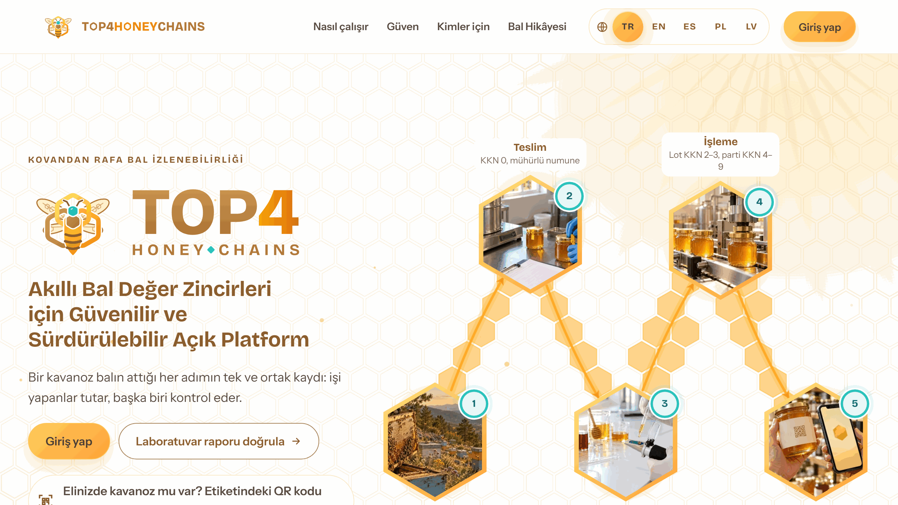

## Platform ne işe yarar {#sec-purpose}

Platform, TOP4HoneyChains ("Trustable and Sustainable Open Platform for Smart Honey Value Chains") uluslararası araştırma projesinde geliştirildi. Proje, ICT-AGRI-FOOD ERA-NET Cofund (2022 ortak çağrısı) kapsamında dört ülkedeki üniversiteler, araştırma enstitüleri ve şirketler tarafından yürütülmektedir: Türkiye, Polonya, Letonya ve Arjantin. Proje, Avrupa Birliği'nin Horizon 2020 araştırma ve yenilik programı (hibe sözleşmesi No 862665) ile ortak ülkelerin ulusal fon kuruluşları tarafından birlikte desteklenmektedir. Ortaklar ve destekçiler başlangıç sayfasının en altında gösterilir.

Platformun üç amacı vardır:

- **İzlenebilirlik.** Her kavanoz için üç soruyu yanıtlayabilirsiniz. Bal nereden geliyor? Kontrol edildi mi? Nereye gitti?
- **Güven.** Her kayıt bir kişi tarafından girilir ve ikinci bir kişi tarafından kontrol edilir ([Dört göz ilkesi](#four-eyes)). Her değişiklik, yalnızca eklenebilen bir denetim kaydına yazılır.
- **Tüketici için şeffaflık.** Herkese açık Bal Hikâyesi, balın yolculuğunu ve kalite kontrollerini kişisel veri yayımlamadan, sade bir dille gösterir.

Arayüz İngilizce, Türkçe, İspanyolca, Lehçe ve Letonca kullanılabilir. Herkes dili sayfada kendisi seçer.

Bu kılavuzda **veri**, insanların platforma kaydettiği şeyler demektir: ölçülen değerler (örneğin % nem) ve sorulara verilen yanıtlar (örneğin Evet veya Hayır).

## Balın yolculuğu {#sec-journey}

Bal beş duraktan geçer: **Arılık**, **Teslim**, **Laboratuvar**, **İşleme** ve **Raf**. Aynı beş ad başlangıç sayfasında ve her Bal Hikâyesi sayfasında görünür.

Her durakta iki şey olur ve bu kılavuz bunları birbirinden ayırır:

- **Faaliyetler**: insanların balla yaptığı işler (hasat etmek, teslim etmek, analiz etmek, işlemek, satmak).
- **Kayıtlar**: platformun bal hakkında sakladığı bilgiler ve bu kayıtları kimin oluşturabileceği, okuyabileceği, güncelleyebileceği veya onaylayabileceği. Her rolün veri hakları [Tablo](#tbl-crud) içinde listelenir.

[Tablo](#tbl-journey-activities) faaliyetleri, [Tablo](#tbl-journey-records) kayıtları gösterir.

Table: Balın yolculuğu: insanların yaptıkları {#tbl-journey-activities}

| Durak | İnsanların balla yaptıkları |
| --- | --- |
| Arılık | Arıcı bir veya daha fazla arılıkta arı tutar ve balı hasat eder. |
| Teslim | Arıcı balı kaplar içinde (teneke, varil veya fıçı) bir tesise getirir. Tesiste her kap tartılır ve açılır. Kaptan bir numune kavanozu ve bir şahit numune kavanozu doldurulup mühürlenir, kap yeniden mühürlenir. |
| Laboratuvar | Numune kavanozları bir gıda analiz laboratuvarına gider. Laboratuvar her kavanozu gelişte kontrol eder, bir karışım numunesi hazırlar ve analiz eder. |
| İşleme | Tesis balı ısıtır, süzer, karıştırır, dinlendirir, doldurur, etiketler ve paketler. Bir veya daha fazla lotun balı bir parti olur. |
| Raf | Parti bir toptancıya veya perakendeciye sevk edilir; o da partiyi depolar ve satar. Tüketici bir kavanoz satın alır ve QR kodunu tarar. |

Table: Balın yolculuğu: platformun kaydettikleri {#tbl-journey-records}

| Durak | Platformun kaydettikleri | Kim kaydeder (birinci kişi) | Kim teyit eder veya onaylar (ikinci kişi) |
| --- | --- | --- | --- |
| Arılık | Arıcı, ulusal kayıt numarası, cep telefonu, kovanları ve yeriyle arılıklar, birlik (isteğe bağlı), arıcının rızaları. | **Arıcı Kayıt Görevlisi** | Arıcı, SMS ile gönderilen 6 haneli bir kodla. Telefonu yoksa: arıcı basılı bir formu imzalar ve **Uyum Sorumlusu** formun fotoğrafını inceler. |
| Teslim | Her kap için bir satır içeren bir teslimat: ağırlık, gelişteki mühürler, mühür numaralarıyla numune kavanozu ve şahit numune kavanozu ve yeni mühür. Teslimat bir ham bal lotu olur. Ardından ön denetim, KKN 0. | **Numune kabul sorumlusu** | Teslimatı: arıcı, SMS koduyla (veya **Uyum Sorumlusu**'nun incelediği imzalı bir formla). KKN 0'ı: bir **Kalite Güvence Sorumlusu**. |
| Laboratuvar | Her kavanozun kabul kontrolü, karışım numunesi, sonuçlar, imzalı rapor (PDF) ve parmak izi. Onaylanan sonuçlar lotun KKN 1'i olur. | **Analist** | **Laboratuvar müdürü** |
| İşleme | Her lotun kontrol formu (KKN 2 ve 3), lotları ve kilogramlarıyla parti, partinin kontrol formu (KKN 4 ile 10 arası), kesinleştirme talebi. | **Çalışan** (parti ve talep için **Kurum yöneticisi** de) | **Kalite Güvence Sorumlusu** formları onaylar ve kesinleştirmeyi onaylar. |
| Raf | Sevkiyat, teslim alınması ve partiyi elinde bulunduran her kurumdaki depolama koşulları (KKN 10). Parti kesinleştirildiğinde Bal Hikâyesi herkese açılır. | Partiyi elinde bulunduran kurumun Çalışanı veya Kurum yöneticisi; depolama kaydı için Çalışan | Alıcı sevkiyatı teyit eder. Alıcının bir Kalite Güvence Sorumlusu depolama kaydını onaylar. |

Bir adım, ancak ondan önceki adım gerektiği yerde onaylandığında başlayabilir:

- Laboratuvar sonuçları ancak lotun KKN 0'ı onaylandıktan sonra girer ve onaylar.
- Bir lot bir partiye ancak bütün kontrol noktaları tamamlanmış (veya uygulanamaz) ve onaylanmışsa ve içinde hâlâ bal kalmışsa girebilir.
- Bir parti ancak partinin ve lotlarının her kontrol noktası onaylanmışsa ve incelenmeyi bekleyen imzalı teslimat fotoğrafı yoksa kesinleştirilebilir.
- Yalnızca kesinleştirilmiş bir parti sevk edilebilir ve yalnızca elinizdeki miktar kadar.

Kesinleştirme partiyi ve lotlarını kilitler. Bundan sonra yanlış bir değer yalnızca iki platform yöneticisi tarafından düzeltilir.

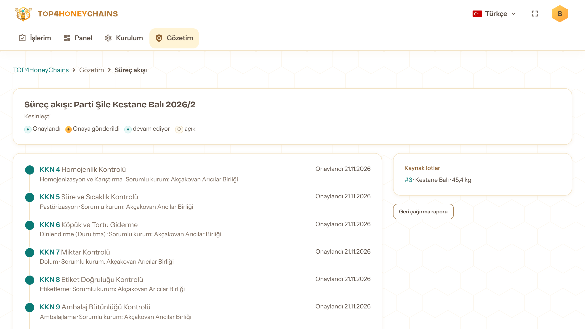

## Platform kimler için {#sec-audience}

Platformda üç tür hesap vardır. **Üyeler** bir kurum için bir rolde çalışır. Bir **arıcı**, arıcı alanı için kişisel bir hesaba sahip olabilir. Bir **tüketici** ücretsiz bir tüketici hesabı oluşturabilir. Ziyaretçilerin hiçbir hesaba ihtiyacı yoktur.

Bir kurum zincire yetenekleri aracılığıyla katılır, örneğin "Balı teslim alıp işleyebilir" ([Tablo](#tbl-capabilities)). Bir kişi bir kurum için bir rolde çalışır ([Tablo](#tbl-roles)). Tek bir kurumda tek bir roldeki tek bir hesaba üyelik denir ([Üyelikler](#memberships)).

Table: Platform kimler için {#tbl-audience}

| Kim | Hesap | Değer zincirindeki faaliyeti | Platformda |
| --- | --- | --- | --- |
| Arıcı | Bir Arıcı kaydı ile temsil edilir. Cep telefonuyla kaydedilen arıcının arıcı alanı için bir hesabı da olur. | Balı üretir ve bir tesise teslim eder. | Kaydını ve her teslimatı bir SMS koduyla teyit eder. Arıcı alanında: arılıklarını, teslimatlarını, laboratuvar sonuçlarını, partilerini ve Bal Hikâyesi sayfalarını okur, istenen fiyatı girer, rıza verir veya geri çeker ([Arıcı alanı](#ch-portal)). |
| Arıcı kayıt kurumu (örneğin bir ilçe tarım müdürlüğü) | Üyeler | Bölgesindeki arıcıları tanır. | Arıcıları ve arılıklarını kaydeder, birliklerini bağlar, arıcı alanı giriş bilgilerini gönderir. |
| Arıcılar birliği | Üyeler | Arıcıları bir araya getirir; bir tesis de işletebilir. | Arıcının rızasıyla herkese açık bir arıcı sayfası yayımlar. İşleme yeteneğiyle bir tesis gibi çalışır. |
| İşleme ve paketleme tesisi | Üyeler | Balı teslim alır, işler, doldurur ve paketler. | Teslimatları ve numuneleri, KKN 0'ı ve KKN 2 ile 10 arasını kaydeder, partiler oluşturur, kesinleştirir, sevk eder, tüketici geri bildirimlerini yanıtlar. |
| Gıda analiz laboratuvarı (akredite veya kurum içi) | Üyeler | Bal numunelerini analiz eder. | Numune kavanozlarını teslim alır, sonuçları imzalı raporla girer, raporu onaylar. |
| Toptancı | Üyeler | Partileri satın alır, depolar ve satar. | Sevkiyatları teyit eder, depolamayı (KKN 10) kaydeder ve onaylar, sevk eder, üreticinin kontrol noktalarını okur. |
| Perakendeci | Üyeler | Kavanozları tüketicilere satar. | Sevkiyatları teyit eder, depolamayı (KKN 10) kaydeder ve onaylar, üreticinin kontrol noktalarını okur. |
| Kamu otoritesi | Üyeler | Zinciri denetler. | Tüm kayıtları okur, hiçbir şey girmez. |
| Platform yöneticisi | Bir platform yönetimi hesabı | Platformu işletir; bal zincirinde yer almaz. | Kurumları oluşturur ve doğrular, üye ekler, rolleri, yetkileri ve kontrol noktası sorumluluklarını belirler, aydınlatma metinlerini yayımlar, kayıtları gözetir ve düzeltmelere karar verir. İş verisi girmez. |
| Tüketici | Ücretsiz bir tüketici hesabı | Balı satın alır ve tüketir. | Bir ziyaretçinin yapabildiği her şeyi yapar; ayrıca balları **Ballarım** listesine kaydeder, üreticiye geri bildirim gönderir ve yanıtı okur ([Tüketici hesabı](#ch-consumer)). |
| Ziyaretçi | Yok | Balı satın almadan önce veya sonra onun hakkında okur. | Herkese açık sayfaları okur: QR koddan açılan Bal Hikâyesi, herkese açık arıcı sayfaları, **Laboratuvar raporu doğrula** ve aydınlatma metinleri. |

Her kurumun ayrıca kanıtları (imzalı fotoğrafları), numune alma kalitesini ve onayları inceleyen ve kişisel verilerin korunmasına ilişkin başvuruları yürüten bir **Uyum Sorumlusu** vardır ([Uyum Sorumlusu](#ch-compliance)).

## Kontrol noktaları {#sec-control-points}

Balın kalitesi ve güvenliği, KKN 0 ile KKN 10 arasındaki on bir kritik kontrol noktasında (KKN) kontrol edilir. Yöntem, gıda güvenliğinde tehlike analizi ve kritik kontrol noktaları sistemi olan HACCP'den gelir. Her kontrol noktasının parametreleri vardır (örneğin sıcaklık veya nem). Bir parametrenin kritik limiti olabilir.

0 ile 3 arasındaki kontrol noktaları ham bal lotuna, 4 ile 10 arasındakiler partiye aittir. [Tablo](#tbl-ccps), her kontrol noktasını varsayılan olarak kimin girdiğini ve kimin onayladığını gösterir. Kurumun **Kurumun ihtiyacı** sütunundaki yeteneğe sahip olması gerekir. Bir platform yöneticisi bu varsayılanları değiştirebilir ([Her kontrol noktasını kimin girip onaylayacağına karar verin](#sec-ccp-responsibilities)).

Table: Kritik kontrol noktaları ve varsayılan sorumlular {#tbl-ccps}

| KKN | Ekrandaki adı | Aşama | Ait olduğu kayıt | Kurumun ihtiyacı | Giren | Onaylayan |
| --- | --- | --- | --- | --- | --- | --- |
| KKN 0 | Ön Denetim | Üretim Öncesi | Lot | İşleme | Lot sahibinin **Numune kabul sorumlusu** | Lot sahibinin **Kalite Güvence Sorumlusu** |
| KKN 1 | Numune Alma ve Ön Kabul Testleri | Ham Bal Kabulü | Lot | Laboratuvar | Onaylanan laboratuvar raporundan yazılır (**Analist**) | **Laboratuvar müdürü** (raporu onaylayarak) |
| KKN 2 | Sıcaklık İzleme | Isıtma | Lot | İşleme | **Çalışan** | **Kalite Güvence Sorumlusu** |
| KKN 3 | Filtre Durumu Kontrolü | Süzme | Lot | İşleme | **Çalışan** | **Kalite Güvence Sorumlusu** |
| KKN 4 | Homojenlik Kontrolü | Homojenizasyon ve Karıştırma | Parti | İşleme | **Çalışan** | **Kalite Güvence Sorumlusu** |
| KKN 5 | Süre ve Sıcaklık Kontrolü | Pastörizasyon | Parti | İşleme | **Çalışan** | **Kalite Güvence Sorumlusu** |
| KKN 6 | Köpük ve Tortu Giderme | Dinlendirme (Durultma) | Parti | İşleme | **Çalışan** | **Kalite Güvence Sorumlusu** |
| KKN 7 | Miktar Kontrolü | Dolum | Parti | Paketleme | **Çalışan** | **Kalite Güvence Sorumlusu** |
| KKN 8 | Etiket Doğruluğu Kontrolü | Etiketleme | Parti | Paketleme | **Çalışan** | **Kalite Güvence Sorumlusu** |
| KKN 9 | Ambalaj Bütünlüğü Kontrolü | Ambalajlama | Parti | Paketleme | **Çalışan** | **Kalite Güvence Sorumlusu** |
| KKN 10 | Sıcaklık ve Nem İzleme | Depolama | Parti | Toptan Satış, Perakende veya Paketleme | Partiyi elinde bulunduran kurumun **Çalışan**'ı | Partiyi elinde bulunduran kurumun **Kalite Güvence Sorumlusu** |

KKN 1, laboratuvar müdürü raporu onayladığında tamamlanır. Tesis KKN 1'e kendi değerlerini de kaydettiyse, tesisin bir Kalite Güvence Sorumlusu bunu onaylar.

KKN 10 iki kez görünür. İlk olarak tesisteki partide: parti kesinleştirilmeden önce onaylanmalıdır. Daha sonra partiyi teslim alan her toptancı veya perakendeci kendi depolama kaydını tutar.

Bu bala uygulanmayan bir kontrol noktası, bir gerekçeyle **Uygulanamaz** olarak işaretlenebilir. Yine de onay gerekir. Herhangi bir değeri değiştirmek mevcut onayı kaldırır; kaydın yeniden onaylanması gerekir.

## Dört göz ilkesi {#four-eyes}

Platformdaki her kayıt iki çift gözden geçer. **Birinci kişi** işi yapar ve veriyi girer. **İkinci, farklı bir kişi** kaydı kontrol eder ve onaylar veya teyit eder. Hiç kimse kendi girdiğini onaylamaz. İki kişi, hata ve manipülasyon olasılığını çok azaltır. [Tablo](#tbl-four-eyes) her durumda birinci ve ikinci kişiyi gösterir.

Table: Her kaydın birinci ve ikinci kişisi {#tbl-four-eyes}

| Kayıt | Birinci kişi (girer) | İkinci kişi (onaylar veya teyit eder) |
| --- | --- | --- |
| Arıcı kaydı | **Arıcı Kayıt Görevlisi** | Arıcı SMS koduyla teyit eder. Telefonu yoksa: kaydı yapan kurumun **Uyum Sorumlusu** imzalı formun fotoğrafını inceler. |
| Teslimat | **Numune kabul sorumlusu** | Arıcı SMS koduyla teyit eder. Kod yoksa: tesisin **Uyum Sorumlusu** imzalı teslimat formunun fotoğrafını inceler. |
| KKN 0, lot formu (KKN 2 ve 3), parti formu (KKN 4 ile 10 arası) | **Numune kabul sorumlusu** (KKN 0) veya **Çalışan** | Aynı kurumun **Kalite Güvence Sorumlusu** |
| Laboratuvar sonuçları (KKN 1) | **Analist** | **Laboratuvar müdürü** |
| Bir partiyi kesinleştirme | **Çalışan** veya **Kurum yöneticisi** talep eder (**Kesinleştirme talep et**) | **Kalite Güvence Sorumlusu** onaylar (**Onayla ve kesinleştir**) |
| Sevkiyat | Gönderenin Çalışanı veya Kurum yöneticisi | Alıcının Çalışanı veya Kurum yöneticisi teslim almayı teyit eder |
| Partiyi elinde bulunduran bir kurumdaki depolama kaydı (KKN 10) | Partiyi elinde bulunduran kurumun **Çalışan**'ı | Partiyi elinde bulunduran kurumun **Kalite Güvence Sorumlusu** |
| Teyit edilmiş bir teslimatın veya onaylanmış bir değerin düzeltilmesi | Bir platform yöneticisi gerekçesiyle talep eder | İkinci bir platform yöneticisi karar verir |

"Hiç kimse kendi girdiği kaydı onaylamaz" kuralı ve "Laboratuvar sonuçlarını her zaman ikinci bir kişi onaylar" kuralı temel kurallardır ([Temel kurallar](#ground-rules)). **Roller ve yetkiler** sayfasında gösterilirler ve hiçbir rol ayarı bunları değiştiremez.

Çok küçük kurumlar için bir istisna vardır, örneğin tek bir kalite sorumlusu olan bir birlik. Bir platform yöneticisi böyle bir kuruma **Dört göz muafiyeti** verebilir. Bu durumda üyeleri kendi kontrol noktası kayıtlarını onaylayabilir ve kendi kesinleştirme taleplerini onaylayabilir. Bu tür her onay kendi kendine onaylanmış olarak işaretlenir ve denetim kaydına yazılır. Muafiyet laboratuvar sonuçları için hiçbir zaman geçerli değildir. Bir platform yöneticisi ayrıca bir kontrol noktasının hiç onay gerektirmediğine karar verebilir; varsayılan olarak her kontrol noktası onay gerektirir.

## Tüketici neyi okur {#sec-consumer-reads}

Tüketici kavanozdaki QR kodu tarar veya bağlantıyı açar ve oturum açmadan partinin **Bal Hikâyesi** sayfasını okur. Sayfa herkes için aynıdır ve okuyucunun seçtiği dilde şunları gösterir:

- parti: adı, miktarı ve üretim tarihi;
- rozetler: **Akredite laboratuvarda test edildi** (veya **Kurum içi laboratuvar**), **Tüm kontrol noktaları onaylı**, **Doğrulanmış limitler içinde** ve her ülkenin payıyla **Menşe**;
- **Bu balın yolculuğu**: bu partinin gerçek tarihleri ve sayılarıyla beş durak;
- **Balın Kaynakları**: balın illere göre payı bir harita üzerinde, arıcılar adlarıyla (yalnızca rızaları varsa, yoksa nötr bir kodla) ve varsa herkese açık arıcı sayfalarına bir bağlantı;
- **Bir bakışta kalite** ve **Laboratuvar raporunun tamamı**: limitleriyle laboratuvar sonuçları ve raporu doğrulamak için bir bağlantı;
- **Süreç kontrolleri**: işleme ve paketlemenin kontrol noktaları;
- bir değerin yanında **Bu nedir?**: parametrenin ne anlama geldiği ve neden önemli olduğu.

Limit içinde veya limit dışında hükmü yalnızca doğrulanmış limitler için gösterilir. Diğer değerler için sayfa, limitlerin henüz bir ortak laboratuvar tarafından kontrol edildiğini söyler.

Bal Hikâyesi hiçbir zaman bir telefon numarası, bir kişinin fotoğrafı, bir arılığın tam konumu, istenen fiyat veya serbest metinli bir not göstermez. Harita yalnızca illeri gösterir.

En altta, **Bu balı aldınız mı?** başlığı altında, ücretsiz hesabı olan bir tüketici **Ballarıma kaydet** ve **Üreticiye geri bildirim gönder** seçeneklerini kullanabilir. Geri bildirim partinin sahibi olan kuruma gider; kurum yalnızca tüketicinin kodunu okur, kullanıcı adını veya telefon numarasını asla okumaz. [Bal Hikâyesi sayfası](#ch-story) ve [Tüketici hesabı](#ch-consumer) bölümleri sayfayı ve hesabı anlatır.

# Yetenekler, kurumlar ve roller {#ch-roles}

TOP4HoneyChains üzerinde her zaman **bir kurum için, bir rolde** çalışırsınız. Neyi yapabileceğinizi üç şey belirler:

1. kurumunuzun **yetenekleri**: kurumun bal zincirinde neyi yapabildiği ([Yetenekler](#capabilities));
2. o kurumdaki **rolünüz**: kurumun içinde ne iş yaptığınız ([Roller](#role-list));
3. kurumunuzun **durumu**: yalnızca **Doğrulandı** durumundaki bir kurum veri girer. Kurumları bir platform yöneticisi doğrular; platform buna göre yapılandırılmışsa arıcılar birliklerini bunun yerine bir merkez birlik doğrulayabilir ([Kurum durumu](#org-status)).

Bir rolü bir **üyelik** aracılığıyla taşırsınız: tek bir kurumda tek bir roldeki tek bir kullanıcı hesabı ([Üyelikler](#memberships)). Üç tür hesabın üyeliği yoktur: arıcının arıcı alanı hesabı, tüketicinin hesabı ve platform yöneticisinin genel rolü. Bazı kurallar platformun içine yerleşiktir ve hiçbir ayar bunları kapatamaz ([Temel kurallar](#ground-rules)).

Bu bölüm iki şeyi birbirinden ayırır:

- **değer zinciri faaliyetleri**: insanların bilgisayardan uzakta balla yaptığı işler; örneğin kayıt, teslimat, numune alma, analiz, işleme, paketleme, depolama ve sevkiyat ([Tablo](#tbl-activities));
- **veri hakları**: her rolün platformdaki kayıtlarla neler yapabileceği: oluşturma, okuma, güncelleme, silme ve onaylama ([Tablo](#tbl-crud)).

## Yetenekler {#capabilities}

Yetenek, bir kurumun sahip olduğu bir beceridir. Kurumun bal zincirinde neyi **yapabildiğini** söyler; üyelerinin rolleri ise işi hangi kişinin yaptığını söyler. Bir kurumun bir veya daha fazla yeteneği vardır. Yetenekleri bir platform yöneticisi verir ve kaldırır; yeteneklerin listesi ise sabittir. [Tablo](#tbl-capabilities) yetenekleri ekrandaki adlarıyla listeler.

Table: Yetenekler: bir kurumun yapabildikleri {#tbl-capabilities}

| Yetenek (ekranda) | Beceri | Kontrol noktaları (varsayılan) |
|---|---|---|
| **Birlik** | Üye arıcılarını bağlayabilir, herkese açık arıcı sayfası için rızalarını kaydedebilir ve bir arıcının rızasıyla o arıcının istediği fiyatları okuyabilir. | Yok. KKN 0 yalnızca bir yönetici KKN 0'ı arıcının birliğine verirse. |
| **İşleme** | Balı teslim alıp işleyebilir: teslimatlar, numuneler, lot KKN 0 ile 3 arası, parti KKN 4 ile 6 arası, yeni partiler, kesinleştirme ve sevkiyatlar. | Lot KKN 0 ile 3 arası (KKN 1 laboratuvar raporundan doldurulur); parti KKN 4 ile 6 arası |
| **Paketleme** | Balı doldurabilir, etiketleyebilir ve paketleyebilir, partiler oluşturabilir, kesinleştirebilir ve sevk edebilir; parti KKN 7 ile 9 arasını ve tesisteki KKN 10 depolamayı kaydeder. | Parti KKN 7 ile 9 arası, KKN 10 |
| **Laboratuvar** | Akredite veya kurum içi bir gıda analiz laboratuvarı olarak bal numunelerini analiz edebilir ve laboratuvar raporu düzenleyebilir. Akreditasyon numarası ve geçerlilik tarihi bu yetenekte tutulur. | Yok. Onaylanan raporu lot KKN 1'i doldurur. |
| **Toptan Satış** | Partileri toptan satış için elinde tutabilir, depolamalarını (KKN 10) kaydedebilir ve sevk edebilir. | KKN 10 |
| **Perakende** | Partileri tüketiciye satış için elinde tutabilir, depolamalarını (KKN 10) kaydedebilir ve sevk edebilir. | KKN 10 |
| **Arıcı kaydı** | Bölgesindeki arıcıları ve arılıklarını kaydedebilir, kimliklerini ve kayıt numaralarını doğrulayabilir, onları birliklerine bağlayabilir, rızalarını kaydedebilir ve giriş bilgilerini verebilir. | Yok |
| **Merkez Birlik** | Platform bu şekilde yapılandırılmışsa arıcılar birliklerini doğrulayabilir. | Yok |
| **Kamu Otoritesi** | Bakanlık veya denetim kuruluşu olarak tüm lotları, partileri ve kontrol noktalarını okuyabilir. Hiçbir şey girmez. | Yok (hepsini okur) |
| **Arıcılık İşletmesi** | Bal üretebilir. | Yok |

Bazı işlemler rolün yanında yeteneği de kontrol eder:

- teslimat kaydetmek ve numune almak **İşleme** gerektirir;
- parti oluşturmak (**Yeni parti**), kesinleştirme talep etmek ve onaylamak **İşleme** veya **Paketleme** gerektirir;
- sevk etmek ve teslim alınan bir sevkiyatı teyit etmek **İşleme**, **Paketleme**, **Toptan Satış** veya **Perakende** gerektirir;
- numune kavanozlarını teslim almak ve laboratuvar sonuçlarını girmek **Laboratuvar** gerektirir;
- **Arıcı sayfaları** **Birlik** gerektirir;
- **Arıcı kaydı** ve **Arıcı Kayıt Görevlisi** rolü, **Arıcı kaydı** yeteneğini gerektirir.

Bu nedenle kendi balını işleyen, dolduran ve depolayan bir tesisin **İşleme** ve **Paketleme** yeteneklerine ihtiyacı vardır; tesisteki KKN 10'u **Paketleme** kapsar.

**Arıcılar kurum değil, kişidir.** Platformda bir arıcı, bir veya daha fazla arılığı olan bir **Arıcı kaydı** ile temsil edilir. Arıcının üyeliği yoktur. Arıcı alanı açıksa arıcının bu kayda bağlı kişisel bir hesabı olabilir ([Arıcı alanı](#ch-portal)).

**Platform.** Platform yöneticisi, bir kuruma verebileceğiniz bir yetenek değildir. Platformu işleten kişiler için bir kullanıcı hesabının genel rolüdür ([Platform yönetimi](#ch-admin)). Platformun kendi kurumu, ayrılmış **Platform yönetimi** yeteneğini taşır; başka hiçbir kurum bu yeteneği alamaz ve yetenek kaldırılamaz.

## Değer zinciri faaliyetleri ve platform kayıtları {#activities}

Değer zinciri faaliyetlerini insanlar balla, bilgisayardan uzakta yapar. Platform her faaliyetin sonucunu veri olarak kaydeder. [Tablo](#tbl-activities), her yetenek için insanların ne yaptığını ve platformun ne kaydettiğini gösterir.

Table: Değer zinciri faaliyetleri (insanlar) ve platformun kaydettikleri (bilgisayar) {#tbl-activities}

| Yetenek | Değer zinciri faaliyetleri (insanlar, bilgisayardan uzakta) | Platformda kaydedilenler (bilgisayar) |
|---|---|---|
| Arıcılık İşletmesi (arıcı) | Arı tutar, bal hasat eder, balı kaplar içinde teslim eder, SMS kodunu görevliye okur, istenen fiyata karar verir | Arıcı ve arılık kayıtları; kaydın ve her teslimatın teyidi (SMS kodu); arıcı alanında: istenen fiyat ve arıcının kendi rızaları |
| Arıcı kaydı | Arıcıyla görüşür, kimlik belgesini ve kayıt bilgisini kontrol eder, arılıkları ziyaret eder veya listeler, aydınlatma metnini okur | Arıcı kaydı, bir veya daha fazla arılık, birlik bağlantısı, kayıt (SMS kodu veya imzalı fotoğraf), kayıtta verilen rızalar, arıcının giriş bilgileri |
| Birlik | Üye arıcıları bilgilendirir, rıza metnini onlara okur, imza toplar | İmzalı belgeyle arıcı sayfası rızası; yayımlanan arıcı sayfası |
| İşleme | Mühürlü kaplardaki teslimatları teslim alır, mühürleri kontrol eder veya takar, her kaptan bir numune kavanozu ve bir şahit numune kavanozu doldurur, balı ısıtır, süzer, karıştırır ve dinlendirir, lotları bir partide birleştirir | Kaplar ve mühür geçmişiyle teslimat, numune kavanozları, KKN 0 ve KKN 2 ile 6 arası, lotları ve miktarlarıyla parti, kesinleştirme talebi ve onayı, sevkiyatlar |
| Paketleme | Balı doldurur, etiketler ve paketler, tesiste depolar | KKN 7 ile 10 arası, partiler, kesinleştirme, sevkiyatlar |
| Laboratuvar | Mühürlü kavanozları teslim alır ve mührü, etiketi ve kapağı kontrol eder, karışım numunesini hazırlar, analiz eder, raporu imzalar | Kabul kontrolleri, karışım numunesi, laboratuvar raporu (PDF) ve KKN 1'i tamamlayan sonuçlar |
| Toptan Satış, Perakende | Malları teslim alır, depolar, satar veya sevk eder | Teslim alınan sevkiyatın teyidi, depolama kaydı (KKN 10), yeni sevkiyatlar, tüketici geri bildirimlerine yanıtlar |
| Merkez Birlik | Arıcılar birliklerini kontrol eder | Birliklerin doğrulanması (yapılandırılmışsa) |
| Kamu Otoritesi | Denetler | Hiçbir şey; kayıtları okur |

İki grup daha platformu bir kurum olmadan kullanır. **Tüketiciler** bal satın alır ve kavanozdaki QR kodu tarar; hesapları varsa platform kaydettikleri balları ve gönderdikleri geri bildirimleri kaydeder. **Ziyaretçiler** yalnızca herkese açık sayfaları okur; onlar hakkında hiçbir şey kaydedilmez.

Yetenekleri ne olursa olsun her kurumun ayrıca bir **Uyum Sorumlusu**'na ihtiyacı vardır: onayları, kanıtları ve kişisel verilerin korunmasını gözeten kişi ([Uyum Sorumlusu](#ch-compliance)).

## Kurum türleri {#org-types}

Platformda ayrı bir kurum türleri listesi yoktur: bir kurumun türü, sahip olduğu yeteneklerin bütünüdür. [Tablo](#tbl-org-types) tipik kurumları gösterir.

Table: Tipik kurumlar, yetenekleri ve üyelerinin rolleri {#tbl-org-types}

| Kurum | Yetenekler | Üyelerinin tipik rolleri |
|---|---|---|
| Arıcı kayıt ofisi (örneğin bir ilçe tarım müdürlüğü) | **Arıcı kaydı** | Kurum yöneticisi, Arıcı Kayıt Görevlisi, Uyum Sorumlusu |
| Arıcılar birliği | **Birlik** | Kurum yöneticisi, Saha denetçisi, Uyum Sorumlusu |
| İşleme tesisi veya paketleyici | **İşleme**, **Paketleme** | Kurum yöneticisi, Numune kabul sorumlusu, Çalışan, Kalite Güvence Sorumlusu, Uyum Sorumlusu |
| Gıda analiz laboratuvarı (akredite veya kurum içi) | **Laboratuvar** | Kurum yöneticisi, Analist, Laboratuvar müdürü, Uyum Sorumlusu |
| Toptancı | **Toptan Satış** | Kurum yöneticisi, Çalışan, Kalite Güvence Sorumlusu, Uyum Sorumlusu |
| Perakendeci | **Perakende** | Kurum yöneticisi, Çalışan, Kalite Güvence Sorumlusu, Uyum Sorumlusu |
| Merkez arıcılar birliği | **Merkez Birlik** | Kurum yöneticisi, Uyum Sorumlusu |
| Bakanlık veya denetim kuruluşu | **Kamu Otoritesi** | Kurum yöneticisi, Uyum Sorumlusu (ikisi de salt okunur) |
| Platform işletmecisi | **Platform yönetimi** (ayrılmış) | Platform yöneticileri |

Kendi tesisini işleten bir birliğin **İşleme** ve **Paketleme** yetenekleri de vardır; o zaman bir tesisin rolleri de olur. Küçük bir kurumda Kurum yöneticisi, ikinci bir üyelikle Uyum Sorumlusu da olabilir; dört göz kuralları yine geçerlidir ([Dört göz ilkesi](#four-eyes)).

### Kurum durumu {#org-status}

Yeni bir kurum **Bekliyor** durumunda başlar. Bir platform yöneticisi kurumu kontrol eder ve kurum sayfasında **Doğrulama** altında doğrular:

- **Doğrula** için en az bir yüklenmiş belge gerekir (örneğin bir ruhsat, bir akreditasyon veya bir kayıt kanıtı).
- İlk kez doğrulanan bir kurumun ayrıca etkin bir **Uyum Sorumlusu** olmalıdır. Daha önce Uyum Sorumlusu olmadan doğrulanmış bir kurum, bir Uyum Sorumlusu ataması gereken tarihi gösteren bir uyarı görür; engellenmez.
- **Belge iste** kurumu **Bekliyor** durumunda tutar ve hangi belgelerin eksik olduğunu söyleyen bir metin gerektirir.
- **Askıya al** bir gerekçe gerektirir. **Yeniden etkinleştir** askıya alınmış bir kurumu yeniden **Doğrulandı** yapar.

Belgeleri **Kurum yöneticisi** ve **Uyum Sorumlusu** yükler; kurum **Bekliyor** durumundayken de yükleyebilirler, ama **Askıda** iken yükleyemezler.

**Merkez Birlik.** Platform buna göre yapılandırılmışsa **Merkez Birlik** yeteneği olan doğrulanmış bir kurumun **Kurum yöneticisi** arıcılar birliklerini doğrular, askıya alır ve yeniden etkinleştirir. Bu durumda platform yöneticileri birlikleri artık doğrulamaz.

[Tablo](#tbl-org-status) durumları listeler.

Table: Kurum durumu ve durumu kimin değiştirdiği {#tbl-org-status}

| Durum (ekranda) | Anlamı | Kim belirler |
|---|---|---|
| **Bekliyor** | Yeni kurum, doğrulanmayı bekliyor. Üyeler kendi kurumlarının kayıtlarını okur; Kurum yöneticisi ve Uyum Sorumlusu belge yükler. Kimse iş akışı verisi girmez. | Bir platform yöneticisi kurumu oluşturduğunda belirlenir veya **Belge iste** ile korunur |
| **Doğrulandı** | Kontrol edildi. Üyeler rollerine göre çalışır. Yalnızca doğrulanmış bir kurum sevkiyat teslim alabilir. | **Doğrula** veya **Yeniden etkinleştir** ile bir platform yöneticisi; birlikler için, yapılandırılmışsa merkez birlik |
| **Askıda** | Doğrulama bir gerekçeyle geri alındı. Yeniden etkinleştirilene kadar **Bekliyor** gibi çalışır; belge yüklenemez. | **Askıya al** ile bir platform yöneticisi; birlikler için, yapılandırılmışsa merkez birlik |

## Roller {#role-list}

[Tablo](#tbl-roles), rollerin başvuru listesidir. Bu kılavuzdaki diğer bütün tablolar aynı rolleri, aynı kısa adlarla ve aynı sırayla kullanır.

Table: Roller {#tbl-roles}

| No. | Rol (ekranda) | Kısa | Hesap | Tipik kişi | Ana işi |
|---|---|---|---|---|---|
| 1 | **Arıcı Kayıt Görevlisi** | AKG | Üyelik | Kayıt görevlisi | Arıcıları bir veya daha fazla arılık ve birlikleriyle kaydeder, kayıt numarasını kontrol eder, arıcının SMS kodunu gönderir, aydınlatma metnini ve rızaları kaydeder, arıcının giriş bilgilerini gönderir |
| 2 | **Numune kabul sorumlusu** | NKS | Üyelik (üyeler: kendilerininki) | Tesisteki kabul görevlisi | Teslimatları mühürlü kaplarıyla kaydeder, arıcının SMS kodunu gönderir, her kaptan numune alır, KKN 0'ı girer |
| 3 | **Analist** | An | Üyelik (üyeler: kendilerininki) | Laboratuvar analisti | Numune kavanozlarını teslim alır (mühür, etiket ve kapak), karışım numunesini hazırlar, laboratuvar sonuçlarını girer ve raporu gönderir (laboratuvardaki birinci kişi) |
| 4 | **Laboratuvar müdürü** | LM | Üyelik (üyeler: kendilerininki) | Laboratuvarın yöneticisi | Numune kavanozlarını teslim alır, laboratuvar raporlarını onaylar veya geri gönderir (laboratuvardaki ikinci kişi) |
| 5 | **Çalışan** | Çal | Üyelik (üyeler: kendilerininki) | Üretim, dolum, toptan satış veya perakende çalışanı | Kontrol formlarını doldurur (KKN 1 ile 10 arası), parti oluşturur, kesinleştirme talep eder, sevk eder ve sevkiyatları teyit eder, depolamayı kaydeder |
| 6 | **Saha denetçisi** | SD | Üyelik (üyeler: kendilerininki) | Bir birliğin saha teknisyeni | Kurumun lotlarını ve partilerini okur; KKN 0'ı yalnızca bir yönetici KKN 0'ı birliğe verirse girer |
| 7 | **Kalite Güvence Sorumlusu** | KGS | Üyelik (üyeler: kendilerininki) | Kalite yöneticisi, gıda mühendisi | KKN kayıtlarını, kontrol formlarını ve depolama kayıtlarını onaylar, kesinleştirmeyi onaylar, tüketici geri bildirimlerini yanıtlar |
| 8 | **Kurum yöneticisi** | KY | Üyelik (üyeler: kendilerininki) | Kurumun yöneticisi | Kurumun belgelerini tutar, parti oluşturur, kesinleştirme talep eder, sevk eder ve sevkiyatları teyit eder, arıcı sayfalarını yayımlar (birlik), kendi lotlarının teslimatlarını, numunelerini ve istenen fiyatlarını okur, tüketici geri bildirimlerini yanıtlar |
| 9 | **Uyum Sorumlusu** | US | Üyelik (üyeler: kendilerininki) | Kalite veya kişisel verilerin korunması sorumlusu | İmzalı fotoğraf kanıtlarını kabul veya reddeder, numune alma kalitesini ve onayları inceler, veri sorumlusu bilgilerini tutar, ilgili kişi başvurularını ve rıza geri çekmelerini kaydeder, kurumun denetim kayıtlarını okur, tüketici geri bildirimlerini yanıtlar |
| 10 | **Platform yöneticisi** | PY | Genel rol | Platform işletmecisi | Kurumları, üyeleri, yetenekleri, hakları ve KKN sorumluluklarını ayarlar; her kaydı okur; düzeltme talep eder ve düzeltmelere karar verir. İş akışı verisi girmez ve onaylamaz |
| 11 | **Arıcı** | Ar | Arıcı alanı hesabı | Arıcı | Kendi arılıklarını, teslimatlarını, numunelerini, laboratuvar sonuçlarını, partilerini ve Bal Hikâyesi sayfalarını okur; istenen fiyatı girer; kendi rızalarını verir ve geri çeker ([Arıcı alanı](#ch-portal)) |
| 12 | **Tüketici** | Tük | Tüketici hesabı | Bal alıcısı | Balları kaydeder, üreticiye geri bildirim gönderir ve yanıtı okur ([Tüketici hesabı](#ch-consumer)) |
| 13 | **Ziyaretçi** | Zi | Hesap yok | Herkes | Bal Hikâyesi'ni, yayımlanmış bir arıcı sayfasını ve **Laboratuvar raporu doğrula** sayfasını okur ([Bal Hikâyesi sayfası](#ch-story)) |

Bir platform yöneticisi, bir iş kurumunun iş akışında yer almaz. Yöneticiler her kaydı okur ama **iş akışı verisi girmez ve onaylamaz** (teslimatlar, KKN verileri, laboratuvar sonuçları, partiler, kesinleştirme, sevkiyatlar, rızalar). Onaylanmış veri yanlışsa bir yönetici düzeltme talep eder, ikinci bir yönetici karar verir. Arıcılar, lotlar ve partiler için veri giriş ekranları artık yöneticinin menüsünde değildir; sayfaları yalnızca düzeltmeler için tutulur.

## Veri hakları (CRUD) {#crud}

[Tablo](#tbl-crud), her rolün her kayıt türü üzerindeki varsayılan veri haklarını CRUD modelinde gösterir: **C** oluşturma, **R** okuma, **U** güncelleme, **D** silme ve **A** onaylama (ayrı bir hak). "·" hak yok demektir. Harfler bitişik yazılır: "CRU" oluşturma, okuma ve güncelleme demektir. Arıcının (Ar) ve tüketicinin (Tük) hakları her zaman yalnızca kendi kayıtlarıyla ilgilidir. Üyelerin (1 ile 9 arası roller) hakları yalnızca kendi kurumlarının işine ait kayıtlar için geçerlidir: kendi lotları ve partileri, elinde tuttuğu partiler, birliğinin arıcıları, ofisinin kayıtları. Okuma dışında bu haklar yalnızca kurum **Doğrulandı** durumundayken geçerlidir. [Tablo](#tbl-admin-changeable), bu haklardan hangilerini bir yöneticinin değiştirebileceğini listeler.

Table: Rol ve kayıt başına varsayılan veri hakları (CRUD + Onay) {#tbl-crud}

| Kayıt | AKG | NKS | An | LM | Çal | SD | KGS | KY | US | PY | Ar | Tük | Zi |
|---|---|---|---|---|---|---|---|---|---|---|---|---|---|
| Arıcı kaydı | CRU ¹ | R ² | · | · | R ² | R ² | R ² | R ² | R ² | RU ³ | RU ⁴ | · | R ⁵ |
| Arılık | CRU ¹ | R ² | · | · | R ² | R ² | R ² | R ² | R ² | RU ³ | R | · | R ⁵ |
| Arıcı kaydı işlemi (birlik bağlantısıyla) | CR ¹ | · | · | · | · | · | · | · | RA ⁶ | RA ⁶ | A ⁷ | · | · |
| Bir kullanıcı hesabının giriş bilgileri (üyeler: kendilerininki) | C ⁸ | U | U | U | U | U | U | U | U | CRUD ⁸ | U | CUD ⁹ | · |
| Ham bal lotu (teslimat) | · | CR ¹⁰ | · | · | R | R | R | R | R | RUD ¹¹ | R | R ⁵ | R ⁵ |
| Teslimat teyidi (SMS kodu veya imzalı fotoğraf) | · | CR | · | · | · | · | · | R | RA ⁶ | R | A ⁷ | · | · |
| Kap ve mühürleri | · | CR | R | R | R ¹² | R ¹² | R ¹² | R | R | R | R | · | · |
| Numune kavanozu | · | CR | RA ¹³ | RA ¹³ | · | · | · | R | R | R | R | · | · |
| Laboratuvar raporu ve sonuçları | · | R | CRU ¹⁴ | RA ¹⁴ | R | R | R | R | R | R | R ¹⁵ | R ¹⁵ | R ¹⁵ |
| KKN kaydı (değerler, "Uygulanamaz") | · | CRUD ¹⁶ | R | R | CRUD ¹⁶ | R ¹⁶ | RA | R | R | R ¹⁷ | · | R ¹⁵ | R ¹⁵ |
| Parti | · | R | R | R | CR ¹⁸ | R | R ¹⁸ | CR ¹⁸ | R | RUD ¹¹ | R ¹⁹ | R ¹⁵ | R ¹⁵ |
| Kesinleştirme (talep, onay) | · | · | · | · | C | · | A | C | · | R | · | · | · |
| Sevkiyat | · | R ¹² | R ¹² | R ¹² | CRA ²⁰ | R ¹² | R | CRA ²⁰ | R | R | · | · | · |
| Partiyi elinde bulunduran kurumdaki depolama kaydı (KKN 10) | · | R | R | R | CRUD ¹⁶ | R | RA | R | R | R | · | · | · |
| Bir lotun istenen fiyatı | · | · | · | · | · | · | · | R ²¹ | R ²¹ | R | CR ²¹ | · ²² | · ²² |
| Arıcı rızası | CR ²³ | · | · | · | · | · | · | CRU ²⁴ | U ²³ | R | CRU ²³ | · | R ²⁵ |
| Aydınlatma metni (metin, sürüm) | R | R | R | R | R | R | R | R | R | CR ²⁶ | R | R | R |
| Aydınlatma metninin kabulü (üyeler: kendilerininki) | C | C | C | C | C | C | C | C | C | R ²⁷ | CR | C | · |
| Veri sorumlusu bilgileri | R | R | R | R | R | R | R | R | CRU | CRU | R | R ²⁸ | R ²⁸ |
| Numune alma kalitesi ve onay incelemesi | · | · | · | · | · | · | · | · | CR ²⁹ | · | · | · | · |
| İlgili kişi başvurusu | · | · | · | · | · | · | · | · | CRU ²⁹ | · | · | · | · |
| Kurum (bilgiler, belgeler, yetenekler) | R | R | R | R | R | R | R | RC ³⁰ | RC ³⁰ | CRU A ³¹ | · | · | · |
| Üyelik (üyeler: kendilerininki) | R | R | R | R | R | R | R | R | R | CRU ³² | · | · | · |
| Denetim kaydı girdisi | · | · | · | · | · | · | · | · | R ³³ | R ³⁴ | · | · | · |
| Tüketici hesabı ve kayıtlı ballar | · | · | · | · | · | · | · | · | · | RUD ³⁵ | · | CRUD ⁹ | · |
| Tüketici geri bildirimi | · | · | · | · | · | · | RU ³⁶ | RU ³⁶ | RU ³⁶ | R ³⁷ | · | CR ³⁶ | · |

Notlar:

1. Bir Arıcı Kayıt Görevlisi arıcıları kendi ofisi için kaydeder ve yalnızca o ofisin kayıtlarını okur. Tek bir kayıt birden çok arılık ekleyebilir (**Arılık ekle**) ve arıcının birliğini seçebilir (**Arıcılar birliği (isteğe bağlı)**); arıcının SMS kodu bunların hepsini kapsar. Doğrulanan bilgiler (kimlik, kayıt numarası, telefon) yalnızca aynı arıcının yeniden teyit edilen yeni bir kaydıyla değişir.
2. Yalnızca kurumun üzerinde çalıştığı kayıtlar aracılığıyla okunur (teslimatlar, kontrol formları, geri çağırma raporu). Partiyi sonradan elinde bulunduran kurum verilerini arıcı ve arılık adları olmadan okur. Bir birliğin Kurum yöneticisi, üye arıcılarının listesini **Arıcı sayfaları** altında okur.
3. Yöneticiler kayıt numaralarını ve birlik bağlantılarını **Kurulum > Arıcı kaydı ve birlikler** altında kontrol eder ve arıcı ve arılık verilerini düzeltir. Arıcılar ve arılıklar hiçbir zaman silinmez, yalnızca pasifleştirilir.
4. Arıcı kendi cep telefonunu, dilini ve şifresini arıcı alanında **Hesap** altında değiştirir.
5. Yalnızca herkese açık sayfalarda (kesinleştirilmiş bir partinin Bal Hikâyesi ve yayımlanmış bir arıcı sayfası): arıcının adı yalnızca rızasıyla, yoksa nötr bir kod; arılığın ili; hiçbir zaman koordinatlar veya iletişim bilgileri değil ([Güven ve gizlilik](#ch-trust)).
6. **A** = SMS kodu yerine imzalı fotoğrafla kaydedilen kanıtı (bir kayıt veya bir teslimat) kabul veya reddetmek. Kaydı yapan kurumun Uyum Sorumlusu karar verir, kaydı giren kişi asla vermez. Platform yöneticilerinin kaydettiği kayıtlar için bir platform yöneticisi karar verir.
7. Arıcının **A** hakkı, görevliye okuduğu SMS kodudur. Kodu, kaydı (her arılık ve birlikle birlikte) veya teslimatı (kapları, ağırlıkları ve mühür numaralarıyla birlikte) teyit eder.
8. Kayıt görevlisi arıcının giriş bilgilerini SMS ile gönderir (arıcı alanı açıkken). Platform yöneticileri üyelerin hesaplarını SMS ile giriş bilgileri veya bir ilk şifreyle oluşturur, yeni giriş bilgileri gönderir, hesapların kilidini açar ve hesapları siler (kendi hesaplarını asla). Gönderildikten sonra bir şifreyi hiç kimse okuyamaz.
9. Tüketici hesabı oluşturur, şifresini, dilini ve cep telefonunu değiştirir, verilerini indirir, balları kaydeder ve kaldırır ve hesabı siler. Silme işlemi kayıtlı listeyi kaldırır ve hesabı anonim hâle getirir; geri bildirimler yalnızca takma adla kurumda kalır.
10. Bir teslimatı kaydetmek lotu oluşturur. **İşleme** yeteneği olan doğrulanmış bir kurum gerekir.
11. Lotları ve partileri tesis oluşturur (teslimat, **Yeni parti**). Yöneticiler ana verilerini düzeltmeler için tutar. Teslimat bilgileri (tarih, kaplar, ağırlıklar, mühür numaraları) yalnızca ikinci bir yöneticinin karar verdiği bir teslimat düzeltmesiyle değişir ve arıcı SMS ile bilgilendirilir. Bir lot kesinleştirilmiş bir partiye girdikten sonra hiçbir şey değişmez. Bir lot veya parti yalnızca kesinleştirmeden önce silinebilir ve kullanımdaki bir lot silinemez. Yöneticiler kesinleştiremez.
12. Yalnızca geri çağırma raporunda.
13. **A** = numune kavanozunu mührü, etiketi ve kapağı kontrol ettikten sonra teslim almak veya bir gerekçeyle reddetmek.
14. Analist raporu oluşturur, taslak olduğu sürece kaydeder ve değiştirir ve gönderir. Laboratuvar müdürü raporu onaylar veya geri gönderir. Onaylanmış bir rapor değiştirilemez.
15. Yalnızca onaylanmış laboratuvar sonuçları ve kesinleştirilmiş bir partinin kontrol noktaları, Bal Hikâyesi'nde ve **Laboratuvar raporu doğrula** sayfasında; arıcı için kendi numunelerinin onaylanmış sonuçları.
16. Kayıt onaylanana veya kilitlenene kadar değer girmek (C), değiştirmek veya silmek (U, D) ve "Uygulanamaz" olarak işaretlemek. Varsayılan giriş rolleri: KKN 0 için Numune kabul sorumlusu, KKN 1 ile 10 arası için Çalışan (KKN 1 onaylanan laboratuvar raporundan doldurulur). Saha denetçisi KKN 0'ı yalnızca bir yönetici KKN 0'ı birliğe verirse girer.
17. Yöneticiler onaylanmış veya kilitlenmiş verileri yalnızca bir yöneticinin talep ettiği ve ikincisinin karar verdiği bir düzeltmeyle değiştirir.
18. **Yeni parti**: **İşleme** veya **Paketleme** yeteneği olan bir kurumun Çalışanı ve Kurum yöneticisi, bütün kontrol noktaları tamamlanmış ve onaylanmış kendi lotlarından bir parti oluşturur. Parti kontrol noktalarını hemen alır. Kalite Güvence Sorumlusu'nun partiyi onaylaması kesinleştirme onayıdır (bkz. Kesinleştirme satırı).
19. Arıcının kendi balını içeren partiler: adı, arıcının payı, durumu ve Bal Hikâyesi bağlantısı. Diğer arıcıların adları veya fiyatları asla gösterilmez.
20. **C** = kurumun elinde tuttuğu kesinleştirilmiş bir partiyi sevk etmek; **A** = kurumun teslim aldığı bir sevkiyatı teyit etmek veya reddetmek.
21. Arıcı teslim ettiği her lot için bir istenen fiyat girer ve lot kesinleştirilmiş bir partiye girene kadar fiyatı değiştirir (yeni bir giriş; geçmiş kalır). Lot sahibinin Kurum yöneticisi ve Uyum Sorumlusu ve platform yöneticileri fiyatı okur. Bir birliğin Kurum yöneticisi fiyatı yalnızca arıcı buna rıza verdiyse okur. Çalışanlar, laboratuvarlar ve partiyi sonradan elinde bulunduran kurumlar fiyatı hiçbir zaman okumaz.
22. Herkese açık sayfalar ve geri çağırma raporu hiçbir fiyat göstermez.
23. Kayıt görevlisi kayıtta verilen rızaları kaydeder. Arıcı isteğe bağlı bir rızayı (herkese açık sayfalarda ad, mesajlar, birlik için fiyatlar) arıcı alanında verir veya geri çeker ve arıcı sayfası rızasını orada geri çekebilir. Uyum Sorumlusu kâğıt üzerinde veya telefonla gelen bir geri çekmeyi kaydeder. Geri çekme hemen geçerli olur.
24. Yalnızca birlikler: herkese açık bir arıcı sayfası için rızayı imzalı rıza belgesiyle kaydetmek (C) ve geri çekmek (U).
25. Yayımlanmış arıcı sayfası.
26. Aydınlatma metinleri sürümlüdür ve hiçbir zaman düzenlenmez: yeni bir sürüm yayımlamak eskisinin yerini alır.
27. Her aydınlatma metni sürümü için kabul sayısı.
28. Aydınlatma metninde belirtildiği şekilde.
29. Uyum Sorumlusu'nun kendi bölümünde, **Uyum** ([Uyum Sorumlusu](#ch-compliance)).
30. **C** = belge yüklemek. Yetenekleri, üyeleri ve dört göz muafiyetini yalnızca platform yöneticileri belirler.
31. Kurum oluşturmak, değiştirmek ve doğrulamak, belge istemek, askıya almak ve yeniden etkinleştirmek ([Kurum durumu](#org-status)); yetenek vermek ve kaldırmak (en az biri kalır); dört göz muafiyetini belirlemek. Kurumlar ve belgeler hiçbir zaman silinmez.
32. Üyelik eklemek ve iptal etmek (U); üyelikler hiçbir zaman silinmez.
33. Uyum Sorumlusu'nun kendi kurumunun denetim kayıtları.
34. Denetim kaydının tamamı. Kayda yalnızca ekleme yapılabilir; hiç kimse bir girdiyi değiştiremez veya silemez.
35. Bir tüketici hesabını kilitlemek ve kilidini açmak, silmek (anonim hâle getirilir).
36. Parti ve gün başına bir geri bildirim, günde en çok beş. Geri bildirim, partinin sahibi olan kuruma gider; kurum yalnızca tüketicinin takma adını okur. Kurumun Kurum yöneticisi, Kalite Güvence Sorumlusu ve Uyum Sorumlusu geri bildirimi okundu olarak işaretler, yanıtlar ve kapatır (U). Tüketici yanıtı okur. Geri bildirim hiçbir zaman herkese açık değildir.
37. Yalnızca sahte olduğundan şüphelenilen veya açılmış kavanoz bildirimleri, **İşlerim** içinde, salt okunur.

**Kanıt dosyalarını kim indirir.** İmzalı teslimat formları, kayıt fotoğrafları, rıza belgeleri ve kurum belgeleri yalnızca onları kaydeden rol (Numune kabul sorumlusu, Arıcı Kayıt Görevlisi veya rızalar için birliğin Kurum yöneticisi), kurumun Kurum yöneticisi ve Uyum Sorumlusu ve platform yöneticileri tarafından indirilir. Aynı kurumun başka bir rolü "Bu sayfayı açamazsınız" (403) iletisini alır; başka bir kurum "Bu sayfa bulunamadı" (404) iletisini alır. Her indirme denetim kaydına yazılır.

**Neler silinebilir.** Üyeler yalnızca kendi verilerini onaylanmadan önce temizler: KKN değerleri ve depolama değerleri. Laboratuvar raporları hiçbir zaman silinmez; bir taslak değiştirilir veya geri gönderilir. Tüketiciler kendi hesaplarını siler ve kayıtlı balları kaldırır. Yöneticiler kesinleştirmeden önce lotları ve partileri, arılık fotoğraflarını, referans verilerini ve kullanıcı hesaplarını siler (kendi hesaplarını asla; bir tüketici hesabı anonim hâle getirilir). Arıcılar, arılıklar, kurumlar, belgeler, üyelikler, rızalar, kayıtlar, kaplar, mühür kayıtları, numune kavanozları, laboratuvar raporları, sevkiyatlar, fiyat girişleri, aydınlatma metinleri, kabuller ve denetim kayıtları hiçbir zaman silinmez.

## Yetki matrisi {#permission-matrix}

[Tablo](#tbl-permissions), her **platformdaki faaliyet** (örneğin "teslimat kaydetmek" gibi bir işlev) için varsayılan hakları gösterir. [Tablo](#tbl-crud) içindeki veri haklarını tamamlar ve aynı rolleri aynı sırayla kullanır. Açıklama: **R** okuma, **C** oluşturma veya girme, **A** onaylama (veya teslim alma, kabul etme, teyit etme), **F** kesinleştirme (talep veya onay), **·** hak yok. "Gereken yetenek" sütunu, kurumun ayrıca sahip olması gereken yeteneği belirtir.

Table: Platform faaliyeti ve rol başına varsayılan haklar {#tbl-permissions}

| Platformdaki faaliyet | Gereken yetenek | AKG | NKS | An | LM | Çal | SD | KGS | KY | US | PY | Ar | Tük | Zi |
|---|---|---|---|---|---|---|---|---|---|---|---|---|---|---|
| Bir arıcıyı arılıkları ve birliğiyle kaydetmek | Arıcı kaydı | C | · | · | · | · | · | · | · | R | R ¹ | A | · | · |
| Bir arıcının giriş bilgilerini SMS ile göndermek | Arıcı kaydı | C | · | · | · | · | · | · | · | · | C | · | · | · |
| Kaplarıyla bir teslimat kaydetmek, SMS kodunu göndermek | İşleme | · | C | · | · | · | · | · | R | R | R | A | · | · |
| Numune almak (her kaptan bir tane) | İşleme (lot sahibi) | · | C | R | R | · | · | · | R | R | R | R | · | · |
| İmzalı bir fotoğrafı kabul veya reddetmek (kayıt, teslimat) | Kendi kurumu | · | · | · | · | · | · | · | · | A | A ² | · | · | · |
| KKN 0'ı (ön denetim) girmek | İşleme (lot sahibi) | · | C | R | R | R | R | A | R | R | R | · | · | · |
| Numune kavanozlarını teslim almak (mühür, etiket, kapak), karışım numunesini hazırlamak | Laboratuvar | · | · | A | A | · | · | · | · | R | R | · | · | · |
| Laboratuvar sonuçlarını girmek, raporu göndermek | Laboratuvar | · | R | C | R | R | R | R | R | R | R | R | R | R |
| Bir laboratuvar raporunu onaylamak veya geri göndermek | Laboratuvar | · | R | R | A | R | R | R | R | R | R | R | R | R |
| Lot kontrol formu (KKN 2 ve 3) | İşleme (lot sahibi) | · | R | R | R | C | R | A | R | R | R | · | R | R |
| Parti oluşturmak (**Yeni parti**) | İşleme veya Paketleme | · | · | · | · | C | · | · | C | · | · | · | · | · |
| Parti kontrol formu, KKN 4 ile 6 arası | İşleme (parti sahibi) | · | R | R | R | C | R | A | R | R | R | · | R | R |
| Parti kontrol formu, KKN 7 ile 9 arası | Paketleme (parti sahibi) | · | R | R | R | C | R | A | R | R | R | · | R | R |
| Tesiste KKN 10 depolama | Toptan Satış, Perakende veya Paketleme (parti sahibi) | · | R | R | R | C | R | A | R | R | R | · | R | R |
| Kesinleştirme talep etmek | İşleme veya Paketleme (sahip) | · | · | · | · | F | · | · | F | · | · | · | · | · |
| Kesinleştirmeyi onaylamak | İşleme veya Paketleme (sahip) | · | · | · | · | · | · | F | · | · | · | · | · | · |
| Bir partiyi sevk etmek | İşleme, Paketleme, Toptan Satış veya Perakende (elinde bulunduran) | · | · | · | · | C | · | R | C | R | R | · | · | · |
| Teslim alınan bir sevkiyatı teyit etmek veya reddetmek | İşleme, Paketleme, Toptan Satış veya Perakende (alıcı) | · | · | · | · | A | · | R | A | R | R | · | · | · |
| Alıcıdaki KKN 10 depolama kaydı | Toptan Satış, Perakende veya Paketleme (elinde bulunduran) | · | R | R | R | C | R | A | R | R | R | · | · | · |
| Geri çağırma raporu (kendi kapsamı) | Yok | · | R | R | R | R | R | R | R | R | R (tümü) | · | · | · |
| İstenen fiyatı girmek veya değiştirmek | Yok | · | · | · | · | · | · | · | · | · | · | C | · | · |
| Kendi lotlarının istenen fiyatlarını okumak | İşleme (lot sahibi) | · | · | · | · | · | · | · | R | R | R | R | · | · |
| Arıcı sayfası rızasını kaydetmek veya geri çekmek | Birlik | · | · | · | · | · | · | · | C | · | R | U ³ | · | · |
| Bir üyenin istenen fiyatlarını okumak (rızayla) | Birlik | · | · | · | · | · | · | · | R | · | · | C ³ | · | · |
| Tüketici geri bildirimlerini okumak ve yanıtlamak | Partinin sahibi | · | · | · | · | · | · | C | C | C | R ⁴ | · | · | · |
| Bir balı kaydetmek, geri bildirim göndermek | Yok | · | · | · | · | · | · | · | · | · | · | · | C | · |
| Bal Hikâyesi'ni okumak, bir laboratuvar raporunu doğrulamak | Yok | R | R | R | R | R | R | R | R | R | R | R | R | R |
| Uyum: incelemeler, ilgili kişi başvuruları, onay kontrolleri | Kendi kurumu | · | · | · | · | · | · | · | · | C | · | · | · | · |
| Veri sorumlusu bilgilerini tutmak | Kendi kurumu | R | R | R | R | R | R | R | R | C | C | R | R | R |
| Kurumun denetim kayıtlarını okumak | Kendi kurumu | · | · | · | · | · | · | · | · | R | R (tümü) | · | · | · |
| Kurum belgelerini yüklemek | Kendi kurumu | · | · | · | · | · | · | · | C | C | C | · | · | · |
| Aydınlatma metinlerini yayımlamak | Yok | · | · | · | · | · | · | · | · | · | C | · | · | · |
| Kurumları doğrulamak, üyeleri, yetenekleri ve muafiyeti yönetmek | Yok | · | · | · | · | · | · | · | A ⁵ | · | CA ⁵ | · | · | · |
| Arıcı kayıt numaralarını doğrulamak | Yok | · | · | · | · | · | · | · | · | · | A | · | · | · |
| Rol yetkilerini, KKN sorumluluklarını, limitleri, çevirileri değiştirmek | Yok | · | · | · | · | · | · | · | · | · | C | · | · | · |
| Bir düzeltme talep etmek veya düzeltmeye karar vermek (KKN verileri, teslimat bilgileri) | Yok | · | · | · | · | · | · | · | · | · | CA ⁶ | · | · | · |
| Kullanıcı ve tüketici hesaplarını kilitlemek, kilidini açmak veya silmek | Yok | · | · | · | · | · | · | · | · | · | C | · | · | · |
| Denetim kaydını ve veri saklama raporunu okumak | Yok | · | · | · | · | · | · | · | · | · | R | · | · | · |

1. Kayıtları kayıt ofisi yapar. Yöneticiler her kaydı okur; kayıt sayfası artık onların menüsünde değildir.
2. Platform yöneticilerinin yaptığı kayıtlar için.
3. Arıcının payı: arıcı rıza belgesini imzalar ve rızayı arıcı alanında geri çekebilir; birliğin fiyatları okuması için rızayı arıcı alanında verir.
4. Yalnızca sahte olduğundan şüphelenilen veya açılmış kavanoz bildirimleri.
5. Yalnızca doğrulanmış bir merkez birliğin Kurum yöneticisi, yalnızca arıcılar birlikleri için ve platform buna göre yapılandırılmışsa. Bu durumda platform yöneticileri birlikleri doğrulamaz.
6. İki farklı yönetici: biri talep eder, diğeri karar verir.

Notlar:

- **Kontrol noktalarını okuma (R)**: bir rol, kurumunun yer aldığı lotların ve partilerin kontrol noktalarını okur: sahip veya sorumlu kurum olarak, aynı lotun veya partinin sonraki bir kontrol noktasının sahibi olarak, lotu içeren bir partinin sahibi veya partiyi sonradan elinde bulunduran kurum olarak ya da doğrulanmış bir kamu otoritesi olarak. Partiyi elinde bulunduran bir kurum, partinin ve lotlarının kontrol noktalarını **salt okunur** olarak okur. Diğer her kurum "Bu sayfayı açamazsınız" (403) iletisini alır.
- **KKN 1** onaylanan laboratuvar raporundan doldurulur. Giriş rolleri yalnızca raporun kapsamadığı KKN 1 parametreleri için kullanılır.
- **Sayfalar yalnızca menüyü değil, okuma hakkını da kontrol eder.** Bir sayfanın okuma hakkı olmayan bir rol (örneğin **Sevkiyatlar ve stok** veya **Arıcı sayfaları**), sayfayı açabilecek rolleri belirten bir iletiyle geri gönderilir.
- Yönetici **KKN 0**'ı tesis yerine arıcının birliğine verebilir (**Kurulum > KKN sorumlulukları**, KKN 0, **Lotun arıcısının birliği**, **Birlik** yeteneği, **Saha denetçisi** rolü). Bu varsayılan değildir.

### Bir yönetici neleri değiştirebilir {#admin-changeable}

[Tablo](#tbl-admin-changeable), bir platform yöneticisinin platformun sayfalarında değiştirebileceği her ayarı listeler. Geri kalan her şey sabittir: roller listesi, yetenekler listesi ve [Temel kurallar](#ground-rules). Birkaç anahtar bunun yerine sunucu yapılandırmasında belirlenir (örneğin birliklerin doğrulayıcısı olarak merkez birlik).

Table: Bir platform yöneticisinin değiştirebilecekleri {#tbl-admin-changeable}

| Ayar | Nerede | Tam olarak ne değiştirilebilir |
|---|---|---|
| Rol yetkileri | **Kurulum > Roller ve yetkiler**, **Rol yetkileri** sekmesi | Her rol için: her kontrol noktası için **Giriş**, **Onayla** ve **Okuma**; ve şu işlevler: **Teslim alma** (Giriş, Okuma), **Numuneler (alma / laboratuvarda teslim alma)** (Giriş, Onayla, Okuma), **Laboratuvar sonuçları** (Giriş, Onayla, Okuma), **Sevkiyatlar (gönderme / teslimi onaylama)** (Giriş, Onayla, Okuma), **Arıcı sayfaları (rıza)** (Giriş, Okuma), **Geri çağırma raporu** (Okuma), **Parti oluşturma (Yeni parti)** (Giriş), **Parti kesinleştirme (talep / onay)** (Giriş, Onayla), **Arıcı kaydı** (Giriş, Okuma), **İmzalı fotoğraf kanıtı (kabul veya ret)** (Onayla), **Arıcıların istediği fiyatlar** (Okuma), **Kurumun denetim kaydı** (Okuma), **Tüketici geri bildirimleri** (Giriş, Okuma). Her hakta en az bir rol kalır. |
| KKN sorumlulukları | **Kurulum > KKN sorumlulukları** | Her kontrol noktası için: **Sorumlu kurum** (**Lotun / partinin sahibi kurum** veya lotlar için **Lotun arıcısının birliği**), gerektirdiği yetenekler, **Değer giren roller**, **Onaylayan roller** ve **Değerler başka bir kişinin onayını gerektirir (dört göz)** seçeneği. Değişiklikler hemen geçerli olur. |
| Yetenekler | **Kurulum > Kurumlar** (kurum oluştururken ve kurum sayfasında); **Kurulum > Yetenekler** | Yetenek vermek veya kaldırmak (en az biri kalır; **Platform yönetimi** ayrılmıştır). Bir laboratuvar için: akredite olup olmadığı, akreditasyon numarası ve geçerlilik tarihi. |
| Dört göz muafiyeti | Kurum sayfası, **Dört göz muafiyeti** | Tek bir kurum için: üyeleri kendi KKN kayıtlarını ve depolama kayıtlarını onaylayabilir ve kendi kesinleştirme taleplerini onaylayabilir. Bu tür her onay denetim kaydında işaretlenir. Laboratuvar sonuçları veya kanıtlar için asla. |
| Kurum durumu | Kurum sayfası, **Doğrulama** | **Doğrula**, **Belge iste**, **Askıya al**, **Yeniden etkinleştir** ([Kurum durumu](#org-status)). |
| Veri sorumlusu bilgileri | Kurum sayfası, **Veri sorumlusu** | Kurumun veri sorumlusu olarak adı, adresi ve iletişim bilgileri (Uyum Sorumlusu da tutar). |
| Üyelikler ve kullanıcılar | Kurum sayfası, **Üyeler**; **Kurulum > Roller ve yetkiler**, **Üyeler** sekmesi; **Gözetim > Kullanıcılar** | Üyelik eklemek ve iptal etmek; SMS ile giriş bilgileri veya ilk şifreyle kullanıcı oluşturmak; yeni giriş bilgileri göndermek; hesapların kilidini açmak ve hesapları silmek; tüketici hesaplarını kilitlemek, kilidini açmak ve silmek. |
| Aydınlatma ve rıza metinleri | **Gözetim > Aydınlatma ve rıza metinleri** | Bir aydınlatma veya rıza metninin yeni sürümünü yayımlamak. |
| Kontrol noktaları, parametreler, limitler | **Kurulum > Referans veriler** | Parametreler, veri türleri, zorunlu sorular, limitler, "Limitler doğrulandı". |
| Referans veriler ve çeviriler | **Kurulum > Referans veriler**; **Kurulum > Referans verisi çevirileri** | Bal türleri, dönemler ve formların sunduğu diğer listeler ve bunların her dildeki adları. |
| Arıcı kaydı | **Kurulum > Arıcı kaydı ve birlikler** | Kayıt numaralarını doğrulamak; bir arıcının birlik bağlantısını düzeltmek. |

## Temel kurallar {#ground-rules}

Bu kurallar platformun içine yerleşiktir. Hiçbir ayar bunları kapatamaz.

- **Yalnızca doğrulanmış kurumlar veri girer.** İlk kez doğrulanan bir kurumun bir Uyum Sorumlusu olmalıdır.
- **KKN kayıtlarında dört göz** ([Dört göz ilkesi](#four-eyes)): hiç kimse, değer girdiği veya "Uygulanamaz" olarak işaretlediği bir KKN kaydını onaylamaz. Bir kontrol formunda Kalite Güvence Sorumlusu bu kuralın izin verdiği her kaydı onaylar; kendi değerlerini içeren kayıtlar listelenir ve başka bir kişiye bırakılır. İstisna: bir platform yöneticisi bir kuruma **Dört göz muafiyeti** verebilir; bu muafiyetle yapılan her onay denetim kaydında işaretlenir.
- **Laboratuvar sonuçlarında her zaman dört göz**: sonuçları giren analist onları onaylayamaz. Muafiyet yoktur.
- **Kanıtlarda her zaman dört göz**: bir SMS kodunun yerini tutan imzalı bir fotoğrafı, onu kaydeden kişi değil, kurumun Uyum Sorumlusu kabul veya reddeder.
- **Kesinleştirmede ve depolama kayıtlarında dört göz**: kesinleştirmeyi talep eden kişi onu onaylayamaz ve bir depolama kaydını giren kişi onu onaylayamaz (kurumun muafiyeti yoksa).
- **Düzeltmelerde dört göz**: bir düzeltmeyi talep eden yönetici ona karar veremez.
- **Bir kod tam olarak gönderildiği şeyi teyit eder**: arıcının SMS kodu kaydı (her arılık ve birlikle birlikte) veya teslimatı (kaplar, ağırlıklar, bal türü, numuneler, her mühür numarası) bağlar. Gönderdikten sonraki her değişiklik kodu geçersiz kılar.
- **Teslimat bilgileri değişmez**: kaplara ve mühür kayıtlarına yalnızca ekleme yapılabilir. Teyit edilmiş bir teslimatın bilgileri yalnızca iki yöneticinin yaptığı bir düzeltmeyle değişir ve arıcı SMS ile bilgilendirilir.
- **Her kaptan bir numune**: her kap, emniyet halkalı kapaklı, kendi mühürlü numune kavanozunu ve şahit numunesini alır. Laboratuvar mührü, etiketi ve kapağı kontrol eder ve herhangi bir kontrol başarısız olursa kavanozu reddeder.
- **Her değişiklik onayı kaldırır**: veriyi değiştirmek mevcut bir onayı siler. Limitlerinin dışındaki değerler onaylanırken açıkça teyit edilmelidir.
- **Laboratuvar sonuçları numuneyi izler**: sonuçlar yalnızca teslim alınmış bir numune için ve yalnızca lotun KKN 0'ı tamamlandıktan sonra girilir. Onaylanmış bir rapor değiştirilemez.
- **Tesis kendi partilerini oluşturur**: yalnızca bütün kontrol noktaları tamamlanmış ve onaylanmış kendi lotlarından ve yalnızca içlerinde bal kalmışsa.
- **Kesinleştirilmiş, kilitli demektir**: bir parti ancak partinin ve lotlarının her kontrol noktası tamamlandığında kesinleştirilir. Kesinleştirilmiş bir parti ve lotları, bir düzeltme dışında artık değiştirilemez. "Kesinleştirmeyi geri alma" yoktur.
- **Sevkiyatlar**: yalnızca kesinleştirilmiş partiler, yalnızca doğrulanmış başka bir kuruma, en çok eldeki miktar kadar.
- **Platform yöneticileri** iş akışı verilerinde **salt okunurdur** ve bu verileri yalnızca iki yöneticili düzeltmeyle değiştirir.
- **Kurumları yalnızca yöneticiler yapılandırır**: yetenekler, üyelikler ve muafiyet.
- **Her hakta en az bir rol kalır.**
- **Aynı anda tek üyelik**: iki üyeliğin hakları hiçbir zaman birleştirilmez.
- **Denetim kaydına yalnızca ekleme yapılabilir**; içindeki hiçbir şey değiştirilmez veya silinmez ve yetki sayfalarındaki her değişikliğin kendisi de kaydedilir.
- **Fiyatlar arıcınındır**: istenen fiyatı yalnızca arıcı girer ve hiçbir herkese açık sayfa onu göstermez.
- **Üyeliği olmayan hesaplar kendi alanlarında kalır**: bir arıcı hesabı yalnızca arıcı alanını açar ve yalnızca kendi arıcısının verilerini okur; bir tüketici hesabı yalnızca tüketici sayfalarını ve herkese açık sayfaları açar ve hiçbir zaman bir rol veya üyelik alamaz.
- **Herkese açık adlar rıza gerektirir**: herkese açık sayfalar bir arıcının adını yalnızca etkin bir ad rızası varsa gösterir; yoksa nötr bir kod gösterir.
- **Arıcı sayfaları** yalnızca etkin bir rıza, doğrulanmış bir kayıt numarası ve doğrulanmış bir birlik varsa herkese açıktır.
- **Tüketici geri bildirimi gizlidir**: yalnızca partinin sahibi olan kuruma gider; kurum bir takma ad görür, asla bir ad görmez.

## Üyelikler {#memberships}

**Üyelik**, tek bir kurumda tek bir roldeki tek bir kullanıcı hesabıdır. Size rolü veren üyeliktir: etkin bir üyelik olmadan bir çalışan hesabı paneli açamaz. Bir kişinin birden çok üyeliği olabilir:

- farklı kurumlarda, örneğin bir tesiste **Çalışan** ve bir birlikte **Saha denetçisi**;
- aynı kurumda birden çok rol, örneğin küçük bir kurumda **Kurum yöneticisi** ve **Uyum Sorumlusu**.

Üyelikleri bir platform yöneticisi ekler ve iptal eder ([Üye ekleyin](#sec-add-member)). Bir üyelik iptal edilir, hiçbir zaman silinmez. **Arıcı Kayıt Görevlisi** rolü yalnızca **Arıcı kaydı** yeteneği olan bir kurumda verilebilir. Bir tüketici hesabı üyelik alamaz.

Her zaman aynı anda **tek** bir üyelikte çalışırsınız. Menü, **İşlerim** içindeki görevler, okuyabildiğiniz kayıtlar ve yapabileceğiniz işlemlerin hepsi etkin üyeliğe göre belirlenir. Haklar hiçbir zaman birleştirilmez: iki role sahip olmak, kendi girdiğiniz veriyi onaylamanıza asla izin vermez.

Başka bir üyeliğe geçmek için:

1. Üst çubuktaki rol etiketini seçin: kurumu ve rolü gösterir, örneğin "Akçakovan Arıcılar Birliği · Çalışan" ([Ekranda yolunuzu bulun](#sec-screen)). **Rolleriniz** başlıklı bir liste her etkin üyeliği gösterir; geçerli olan işaretlidir.
2. Başka bir üyelik seçin. Platform yeni üyelikte **Kurumum** sayfasını açar.

İki veya daha fazla üyeliğiniz varsa **Kurumum** sayfasında ayrıca **Geçiş yap** düğmesiyle bir **Şu rolle çalış** listesi bulunur. Seçim tarayıcıyı kapatana kadar geçerlidir. Sonra yeniden ilk üyeliğinizde başlarsınız: alfabetik sırada ilk kurum.

Bir arıcının arıcı alanı hesabının ve bir tüketici hesabının üyeliği ve rol etiketi yoktur.

# Başlarken {#ch-start}

Bu bölüm platformda oturum açan herkes içindir. Bölümün sonunda oturum açabilir, aydınlatma metnini onaylayabilir, ekranda yolunuzu bulabilir ve oturumu kapatabilirsiniz.

## Platformu açın ve dili seçin

Tarayıcınızda https://top4honeychains.intalalab.net adresini açın. Başlangıç sayfası platformu anlatır ve **Giriş yap** ile **Laboratuvar raporu doğrula** düğmelerini içerir.

1. Sayfanın üstündeki **TR**, **EN**, **ES**, **PL** ve **LV** dil kodlarıyla dilinizi seçin. Platform seçiminizi bu tarayıcıda hatırlar.

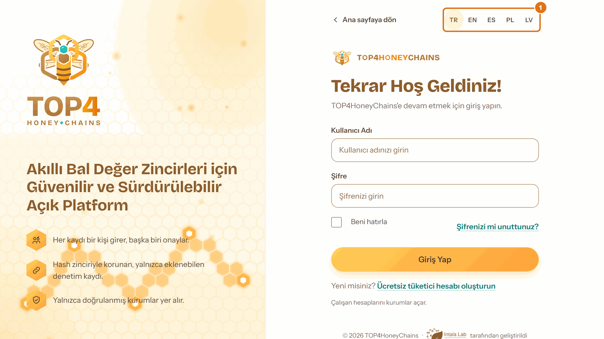

Oturum açtıktan sonra bayraklı dil menüsü üst çubukta bulunur.

## Oturum açın

1. Başlangıç sayfasında **Giriş yap** seçin.
2. Kullanıcı adınızı **Kullanıcı Adı** alanına girin.
3. Şifrenizi **Şifre** alanına girin.
4. **Giriş Yap** seçin.

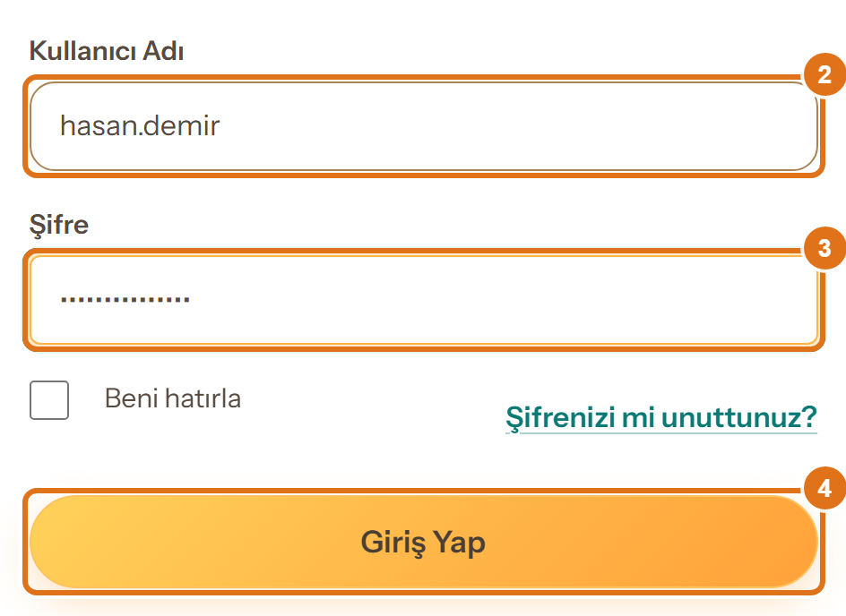

Görev listeniz olan **İşlerim** sayfasını görürsünüz. Arıcılar kendi alanlarını ([Arıcı alanı](#ch-portal)), tüketiciler **Ballarım** sayfasını ([Tüketici hesabı](#ch-consumer)) görür.

> [!NOTE]
> Çalışan hesaplarını kurumlar ve platform yöneticileri açar. Tüketiciler kendi hesaplarını giriş formunun altındaki **Ücretsiz tüketici hesabı oluşturun** ile oluşturur.

## İlk kez oturum açın {#sec-first-sign-in}

Giriş bilgileriniz SMS ile gelir: kullanıcı adınız ve 10 karakterlik geçici bir şifre, platformun adresiyle birlikte. Geçici şifre 72 saat geçerlidir.

1. SMS'teki kullanıcı adı ve geçici şifreyle oturum açın.
2. **Şifrenizi belirleyin** sayfası açılır. Yeni şifrenizi **Yeni Şifre** alanına ve yeniden **Şifreyi onaylayın** alanına girin. En az 10 karakter kullanın; kullanıcı adınızı ve yaygın bir şifreyi kullanmayın.
3. **Şifreyi Güncelle** seçin.

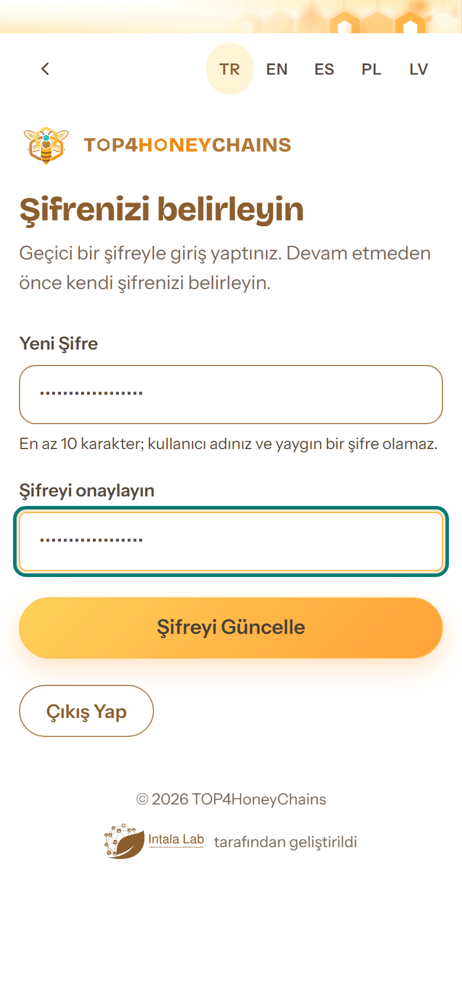

## Aydınlatma metnini onaylayın {#sec-notice}

Kişisel verilerle çalışmadan önce aydınlatma metnini okuduğunuzu onaylarsınız. Onaylayana kadar sarı bir çubuk size bunu hatırlatır.

1. Sarı çubukta **Oku ve onayla** seçin.

   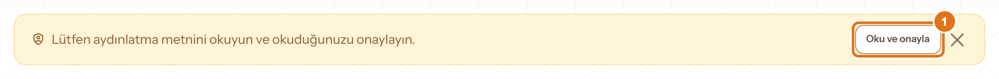

2. Metni okuyun ve **Yukarıdaki aydınlatma metnini okudum.** kutusunu işaretleyin.
3. **Onayla** seçin.

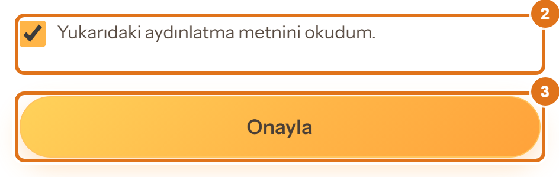

> [!NOTE]
> Kayıt imzalayan roller (Kurum yöneticisi, Uyum Sorumlusu, Arıcı Kayıt Görevlisi, Kalite Güvence Sorumlusu, Laboratuvar müdürü) metni bir kodla onaylar. Sayfa **Cep telefonu** numaranızı gösterir: **Kod gönder** seçin, sonra **Onayla** seçmeden önce SMS'teki kodu **SMS'teki kod (6 hane)** alanına yazın.

## Ekranda yolunuzu bulun {#sec-screen}

**İşlerim** başlangıç sayfanız ve görev listenizdir. Sizi bekleyen her şey orada gruplar hâlinde görünür, örneğin **Girilecek değerler**, **Onaylanacak değerler**, **Teslim alınacak numuneler** veya **Girilecek laboratuvar sonuçları**. İşi yapacağınız sayfayı açmak için bir öğe seçin. Bekleyen bir şey yoksa sayfa **Sizi bekleyen bir iş yok.** der ve açabileceğiniz sayfaları gösterir.

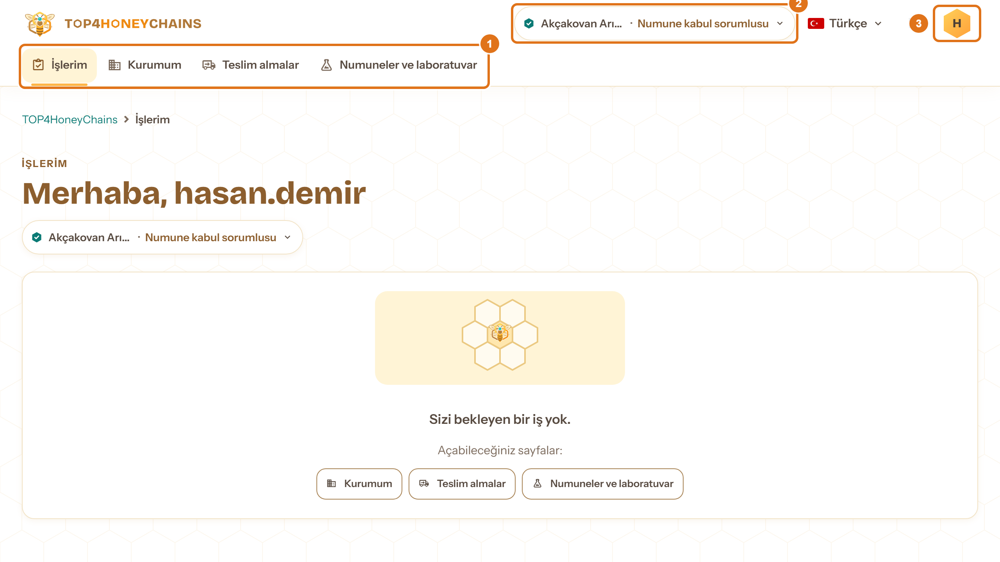

Resimdeki işaretler şunları gösterir:

1. Rolünüzün sayfalarını içeren menü. **İşlerim** ve **Kurumum** her zaman oradadır; diğer öğeler rolünüze ve kurumunuza bağlıdır.
2. Kurumunuz ve rolünüz. Birden fazla rolünüz varsa başka bir role geçmek için bunu seçin.
3. Baş harfinizin bulunduğu yuvarlak düğmenin altındaki kullanıcı menüsü.

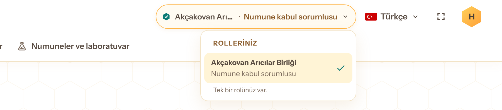 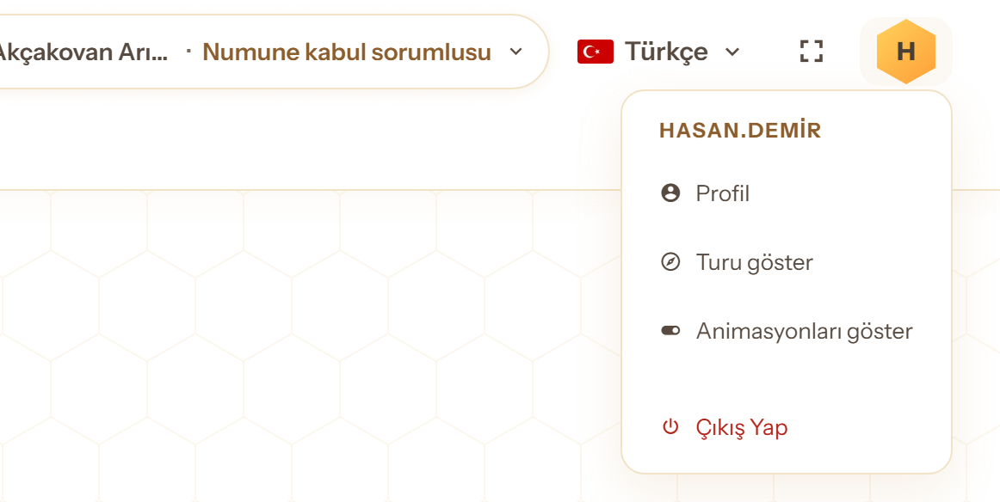

Kullanıcı menüsünde şu öğeler vardır:

Table: Ekranın bölümleri {#tbl-screen}

| Öğe | Ne yapar |
| --- | --- |
| **Profil** | Kullanıcı adınızı gösterir; cep telefonunuzu doğrulamanızı ve şifrenizi değiştirmenizi sağlar. |
| **Turu göster** | Ekranın kısa turunu yeniden açar. |
| **Animasyonları göster** | Bir düğmenin ne yaptığını gösteren kısa sahneleri açar veya kapatır. |
| **Çıkış Yap** | Oturumunuzu kapatır. |

## Oturumu kapatın

Kullanıcı menüsünü açın ve **Çıkış Yap** seçin. Ortak kullanılan bir bilgisayarda ayrılırken her zaman oturumu kapatın.

## Turu izleyin

Platformu bir rolde ilk kez açtığınızda kısa bir tur ekranın en önemli bölümlerini gösterir. Devam etmek için **Sonraki**, kapatmak için **Turu atla** seçin. Turu kullanıcı menüsündeki **Turu göster** ile yeniden açabilirsiniz.

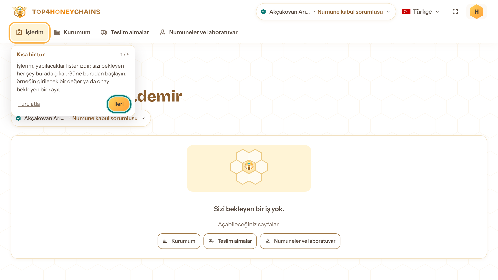

## Cep telefonunuzu doğrulayın

Doğrulanmış bir cep telefonuyla unutulan bir şifreyi SMS ile sıfırlayabilirsiniz.

1. Kullanıcı menüsünü açın ve **Profil** seçin.
2. Numaranızı **Telefon Numarası** alanına girin ve **Kod gönder** seçin.
3. Kodu **SMS'teki kod (6 hane)** alanına yazın ve **Onayla** seçin. Yeni bir numara, ancak ona gönderilen kodu girdikten sonra kullanılır.

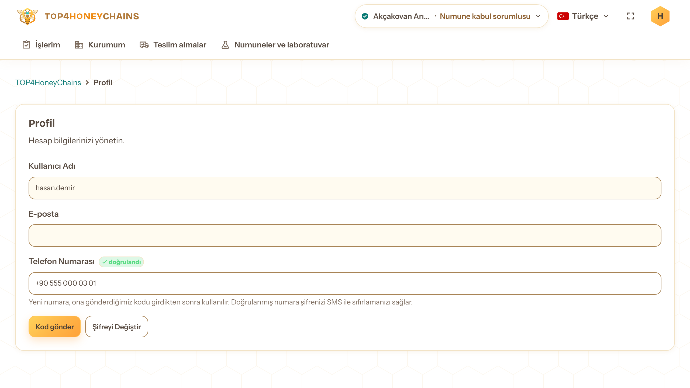

## Unutulan bir şifreyi sıfırlayın

1. Giriş sayfasında **Şifrenizi mi unuttunuz?** seçin.
2. Kullanıcı adınızı **Kullanıcı Adı** alanına girin ve **Kod gönder** seçin.

   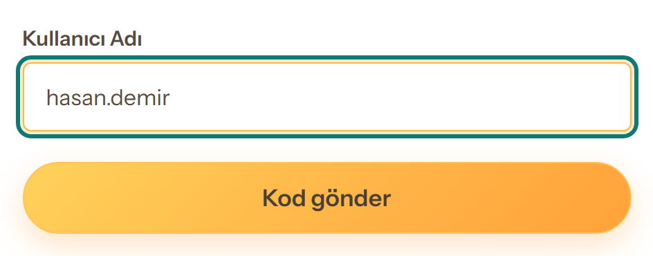

3. **Yeni Şifre Oluştur** sayfasında SMS'teki kodu **SMS'teki kod (6 hane)** alanına yazın. Kod 5 dakika geçerlidir.
4. Yeni şifrenizi **Yeni Şifre** ve **Şifreyi onaylayın** alanlarına girin ve kaydedin.

> [!NOTE]
> Kod yalnızca doğrulanmış bir cep telefonuna gönderilir. Doğrulanmış telefonunuz yoksa giriş bilgilerinizi veren kişiden yenilerini göndermesini isteyin.

# Arıcı Kayıt Görevlisi {#ch-ro}

Bir ilçe müdürlüğünün Arıcı Kayıt Görevlisi arıcıları platforma kaydeder. Bir kayıt üç şeyi teyit eder: ulusal kayıt numarasını, arıcının cep telefonunu (telefona gönderilen bir kodla) ve kimlik belgesini ve kayıt bilgisini gördüğünüze dair beyanınızı.

Table: Arıcı Kayıt Görevlisinin görevleri {#tbl-tasks-ro}

| Görev | Nerede |
| --- | --- |
| Bir arıcıyı bulmak veya kayıt başlatmak | **Arıcı kaydı** |
| Yeni bir arıcıyı kaydetmek | **Arıcı kaydı > Bul veya kaydet** |
| Başka bir arılık eklemek | kayıt formu veya kayıt sayfası |
| Giriş bilgilerini göndermek | kayıt sayfası |

## Bir arıcıyı bulun veya kayıt başlatın {#sec-find-beekeeper}

**Arıcı kaydı** sayfası, kurumunuzun kaydettiği arıcıları listeler.

1. Menüde **Arıcı kaydı** seçin.
2. Kayıt numarasını **Kayıt numarası (AKS) veya işletme numarası** alanına girin.
3. **Bul veya kaydet** seçin.

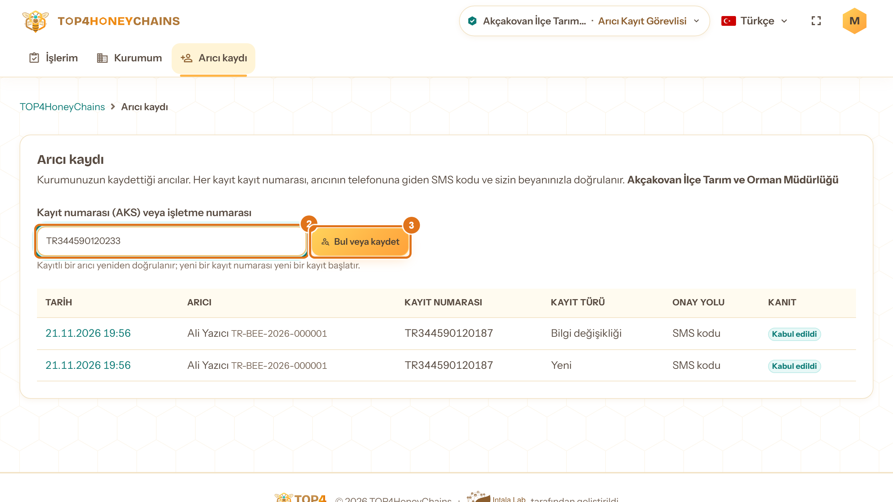

Bilinen bir arıcı yeniden doğrulanır: form kayıtlı bilgilerle açılır. Yeni bir kayıt numarası yeni bir kayıt başlatır.

## Yeni bir arıcıyı kaydedin

Bunu, arıcı kimlik belgesi ve cep telefonuyla karşınızdayken yapın.

1. Kayıt numarasını [Bir arıcıyı bulun veya kayıt başlatın](#sec-find-beekeeper) bölümünde anlatıldığı gibi bulun. **Arıcı kaydet** formu açılır.
2. Bölüm 1 ve 2'yi doldurun.

   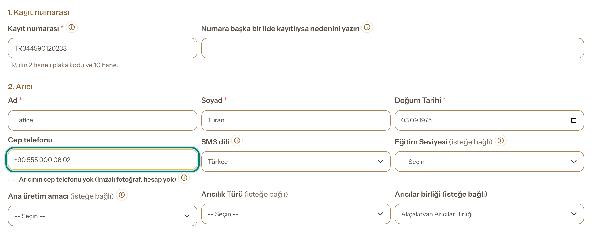

3. **3. Arılık** bölümünde arılığın konumunu belirleyin: haritaya tıklayın veya iğneyi sürükleyin, **Konumumu kullan** seçin ya da **Konum Enlemi** ve **Konum Boylamı** değerlerini yazın. **Kovan Sayısı**, ardından **İl**, **İlçe** ve **Mevki (köy, yayla, tarla)** girin. Arılığın başlığı bu üçünden oluşur, örneğin `İstanbul – Şile – Sofular`.

   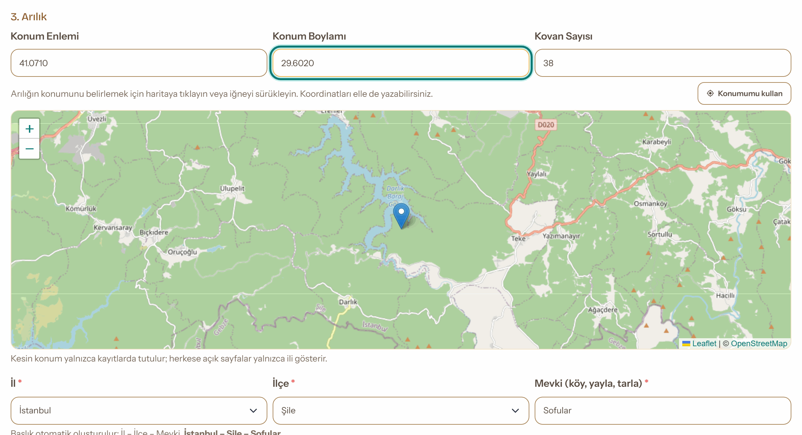

4. Arıcının 4. bölümdeki aydınlatma metnini okumasını sağlayın veya metni yüksek sesle okuyun. Arıcının verdiği rızaları işaretleyin: herkese açık sayfalarda ad ve SMS bildirimleri. İkisi de isteğe bağlıdır.
5. **5. Beyanınız** bölümünde beyanı işaretleyin. Arıcı kendi alanını kullanacaksa **Arıcıya giriş bilgilerini de SMS ile gönder** kutusunu işaretleyin.

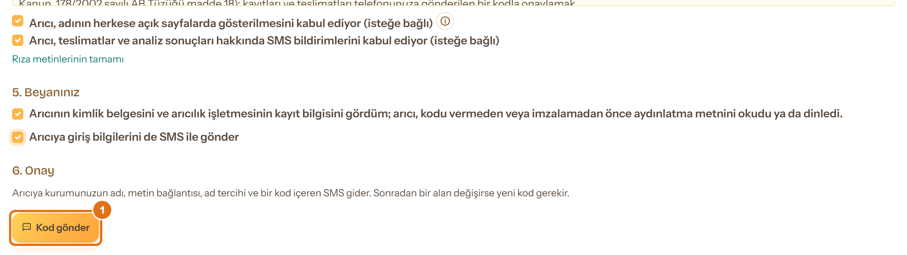

Bölüm 1 ve 2'nin alanları:

Table: Kayıt formunun alanları {#tbl-reg-fields}

| Alan | Ne girilir | Zorunlu |
| --- | --- | --- |
| **İşletme kayıt numarası** | TR, ilin 2 haneli plaka kodu ve 10 hane | evet |
| **Numara başka bir ilde kayıtlıysa nedenini yazın** | yalnızca kayıt ili müdürlüğünüzün ilinden farklıysa | hayır |
| **Ad**, **Soyad**, **Doğum Tarihi** | kimlik belgesindeki gibi | evet |
| **Cep telefonu** | arıcının kendi numarası; kodu ve giriş bilgilerini alır | evet, arıcının cep telefonu yoksa hayır |
| **SMS dili** | arıcının mesajlarının ve arıcı alanının dili | evet |
| **Eğitim Seviyesi**, **Ana üretim amacı**, **Arıcılık Türü** | arıcının yanıtları | hayır |
| **Arıcılar birliği (isteğe bağlı)** | arıcının üyesi olduğu birlik | hayır |

> [!NOTE]
> Arılığın tam konumu yalnızca kayıtlarda tutulur. Herkese açık sayfalar ili gösterir.

### Kodla teyit edin

1. **Kod gönder** seçin. Arıcı; kurumunuzun adını, aydınlatma metnine bir bağlantıyı, ad tercihini ve bir kodu içeren bir SMS alır.
2. Arıcının okuduğu kodu **SMS'teki kod (6 hane)** alanına yazın.
3. **Kaydı onayla** seçin.

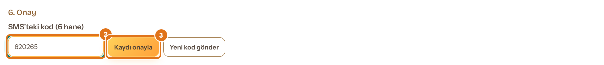

Kayıt sayfası **Arıcı kaydedildi ve doğrulandı** iletisiyle açılır. Arıcının bir işletme numarası vardır (örneğin `TR-BEE-2026-000002`); kanıt **Kabul** ve kayıt numarası **Doğrulandı** durumundadır.

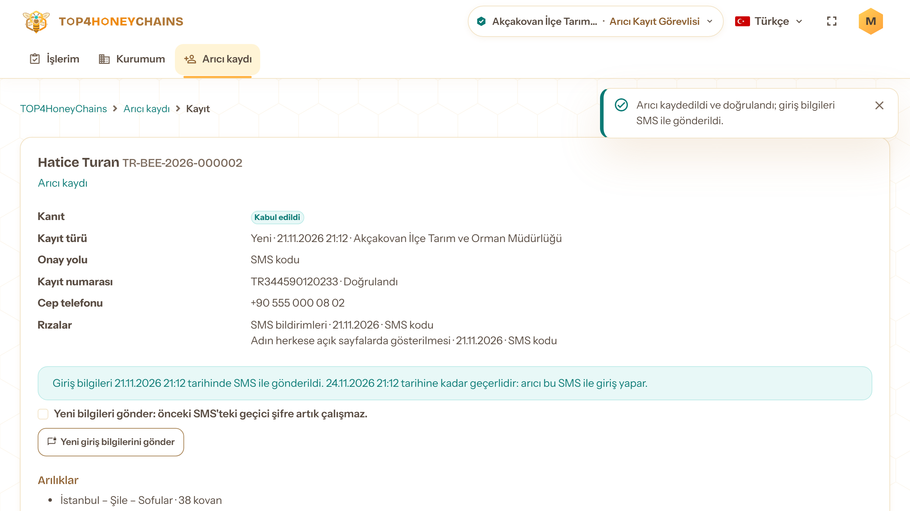

> [!IMPORTANT]
> Kodu gönderdikten sonra herhangi bir alanı değiştirmek kodu geçersiz kılar. **Yeni kod gönder** ile yeni bir kod gönderin.

## Başka bir arılık ekleyin

Bir arıcının birden çok arılığı olabilir. Formda bunları kodu göndermeden önce ekleyin:

1. İlk arılığın altında **Arılık ekle** seçin. Yeni bir **Arılık 2** bloğu görünür.
2. Koordinatlarını, kovanlarını ve yerini doldurun. Harita yalnızca ilk arılığı belirler; diğerlerinin koordinatlarını yazın. İhtiyacınız olmayan bir bloğu silmek için **Kaldır** seçin.

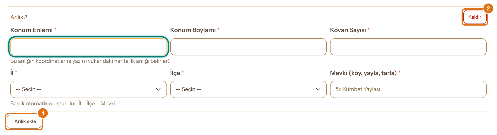

Kayıtlı bir arıcı için kayıt sayfasını açın ve **Arılıklar** altındaki **Arılık ekle** düğmesini kullanın.

## Arıcıya giriş bilgilerini gönderin {#sec-send-signin}

**Arıcıya giriş bilgilerini de SMS ile gönder** kutusunu işaretlediyseniz bilgiler kayıtla birlikte gönderilir. Aksi hâlde kayıt sayfasını açın ve **Giriş bilgilerini SMS ile gönder** seçin. Arıcının kullanıcı adı işletme numarasıdır.

Yeni bilgiler göndermek için **Yeni bilgileri gönder: önceki SMS'teki geçici şifre artık çalışmaz.** kutusunu işaretleyin ve **Yeni giriş bilgilerini gönder** seçin.

## Cep telefonu olmayan bir arıcıyı kaydedin {#sec-register-no-phone}

Arıcının cep telefonu yoksa **Arıcının cep telefonu yok (imzalı fotoğraf, hesap yok)** kutusunu işaretleyin. 6. bölümde **SMS mümkün değil: imzalı fotoğraf** kısmını açın, gerekçeyi **SMS kodu neden kullanılamıyor** alanına yazın, **Formu yazdır** düğmesini kullanın, formu arıcıya imzalatın ve fotoğrafını **İmzalı formun fotoğrafı** alanına yükleyin. **İmzalı fotoğrafla kaydet** seçin. Kayıt, kurumunuzun Uyum Sorumlusu fotoğrafı kabul veya reddedene kadar bekler; kendi kaydınız hakkında karar veremezsiniz.

# Numune kabul sorumlusu: bal teslimatı {#ch-sao}

Bir tesisin Numune kabul sorumlusu her bal teslimatını kaydeder. Her kap mühürleriyle kaydedilir, kaptan bir numune kavanozu ve bir şahit numune kavanozu doldurulup mühürlenir ve arıcı teslimatın tamamını SMS ile gönderilen bir kodla teyit eder. Her teslimat, kurumunuzun bir ham bal lotu olur.

Table: Numune kabul sorumlusunun görevleri {#tbl-tasks-sao}

| Görev | Nerede |
| --- | --- |
| Teslimatları görmek | **Teslim almalar** |
| Bir bal teslimatını kaydetmek | **Teslim almalar > Teslim al** |
| Etiketleri yazdırmak | teslimat sayfası |
| KKN 0'ı girmek | **İşlerim > Girilecek değerler** |

## Teslimatları görün

Menüde **Teslim almalar** seçin. Liste her lotu tarihi, arılığı, bal türü, miktarı, menşei ve arıcının teslimatı nasıl teyit ettiğiyle gösterir. **Teslim** bir teslimatı, **Geri çağırma** onun geri çağırma raporunu açar.

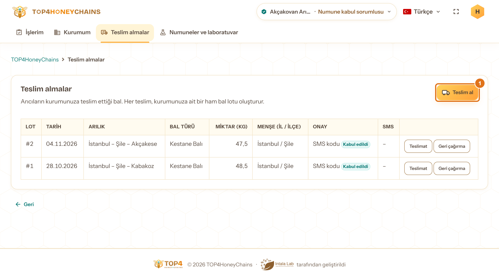

## Bir bal teslimatını kaydedin {#sec-record-delivery}

1. **Teslim al** seçin.
2. Arıcının numarasını **Arıcı işletme veya kayıt numarası** alanına girin.
3. **Bul** seçin.

   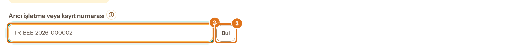

4. **1. Teslimat** bölümünü doldurun. Arılık listesi arıcının her arılığını kovanlarıyla gösterir; birden fazla arılık varsa doğru olanı seçin.

   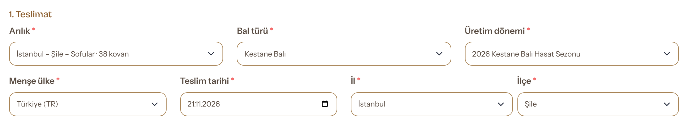

5. **2. Kaplar ve numuneler** bölümünde her kap için bir satır doldurun. Her ek kap için **Kap ekle**, ihtiyacınız olmayan bir satır için **Satırı kaldır** seçin.

   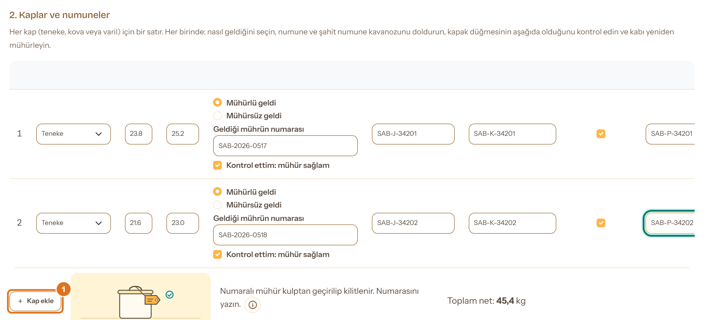

   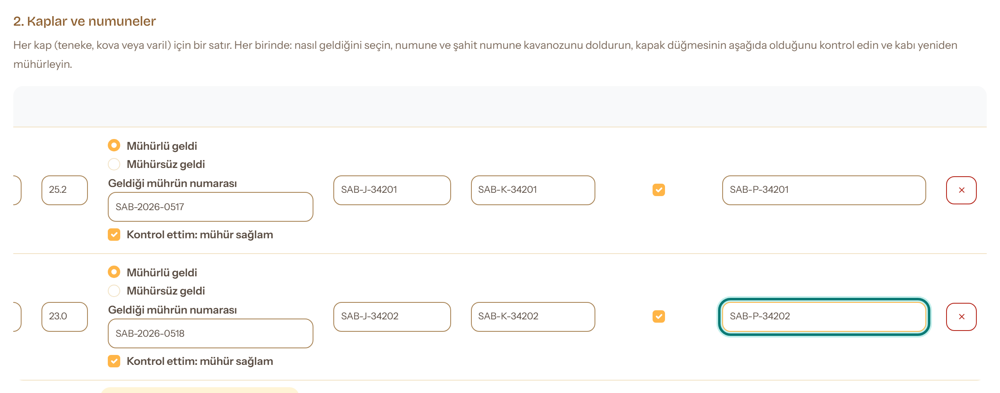

6. **3. Laboratuvar ve şahit numuneler** bölümünde **Laboratuvar** seçin, **Şahit numunelerin saklandığı yer** alanını yazın ve tarihi **Saklama süresi sonu** alanına girin.

Bölüm 1'in alanları:

Table: Bir teslimatın alanları {#tbl-delivery-fields}

| Alan | Ne girilir | Zorunlu |
| --- | --- | --- |
| **Arılık** | balın geldiği yer | evet |
| **Bal türü**, **Üretim dönemi** | teslim edildiği gibi | evet |
| **Menşe ülke** | balın ülkesi | evet |
| **Teslim tarihi** | teslimatın günü | evet |
| **İl**, **İlçe** | balın menşei | evet |

Bölüm 2'nin sütunları, her kap için bir satır:

Table: Kaplar ve numuneler tablosunun sütunları {#tbl-containers}

| Sütun | Ne girilir |
| --- | --- |
| **Tür** | teneke, kova veya varil |
| **Net kg**, **Brüt kg** | kabın ağırlıkları |
| **Gelişte** | **Mühürlü geldi**: **Geldiği mührün numarası**, ardından **Kontrol ettim: mühür sağlam** kutusunu işaretleyin. **Mühürsüz geldi**: **Arıcının önünde şimdi takılan yeni mühür** numarası. |
| **Kavanoz mührü** | bu kaptan doldurulan numune kavanozunun mührü |
| **Şahit numune mührü** | şahit numune kavanozunun mührü |
| **Kapak sağlam** | kavanoz kapağının düğmesi aşağıdaysa işaretleyin |
| **Numuneden sonra yeni mühür** | numuneleri aldıktan sonra kaba taktığınız mühür |

> [!IMPORTANT]
> Teslimatın her mühür numarası farklı olmalıdır.

### Teslimatı arıcının koduyla teyit edin

1. **Kod gönder** seçin. Arıcı tarihi, kapları, kilogramları, bal türünü, numune sayısını ve bir kodu içeren bir SMS alır.

   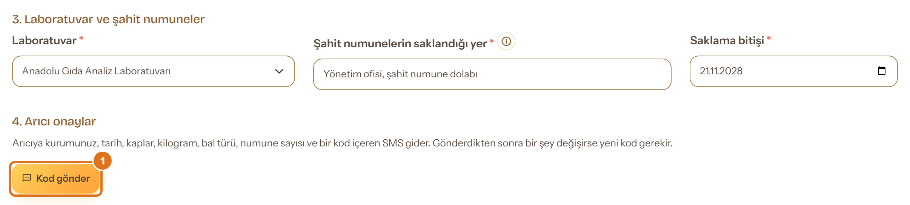

2. Kodu **SMS'teki kod (6 hane)** alanına yazın. Arıcı orada değilse onu arayın: kodu telefonundan okur.
3. **Teslimatı onayla** seçin.

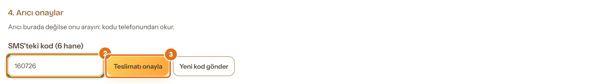

Teslimat sayfası **Teslimat arıcı tarafından onaylandı ve #3 numaralı lot olarak kaydedildi.** iletisiyle açılır. Lot artık **Kurumum** sayfasında, kontrol noktaları ise **İşlerim** sayfasında görünür.

SMS mümkün değilse **SMS mümkün değil: imzalı fotoğraf** kısmını açın, gerekçeyi yazın, imzalı teslimat formunun fotoğrafını çekin veya yükleyin ve **İmzalı fotoğrafla kaydet** seçin. Fotoğrafı Uyum Sorumlusu inceler.

## Etiketleri yazdırın

Teslimat sayfası her kabı mühür geçmişi ve numune kavanozlarıyla gösterir.

1. **Etiketler (A4 sayfa)** veya etiket yazıcısı için **Etiketler (100 × 50 mm)** seçin.

   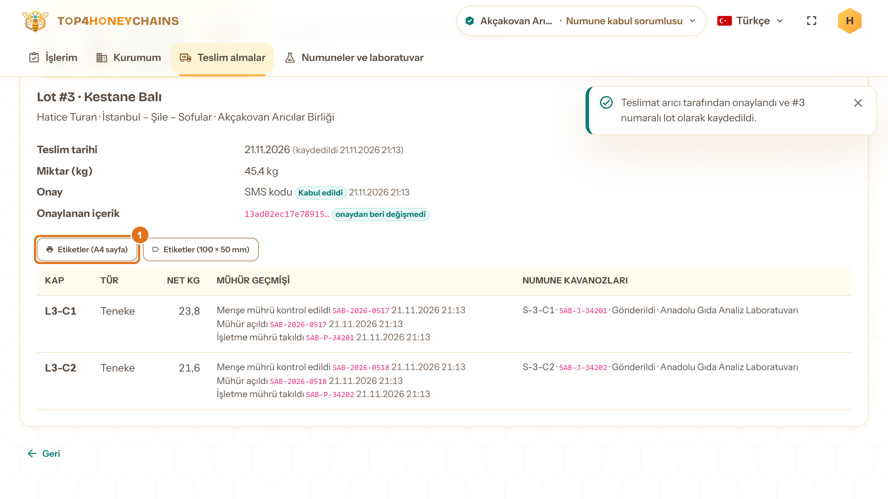

2. **Formu yazdır** seçin ve her etiketi kendi kabına, numune kavanozuna ve şahit numune kavanozuna yapıştırın.

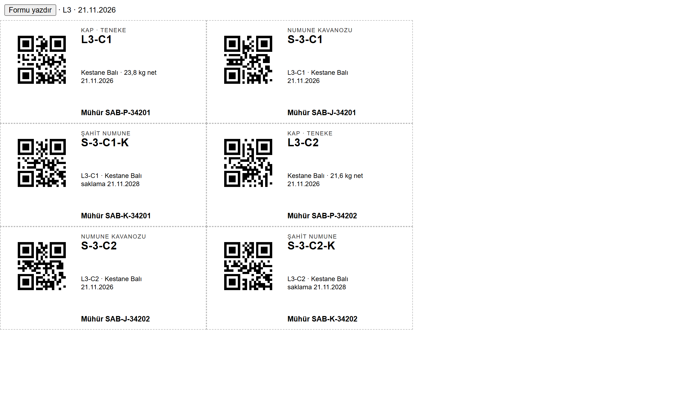

## KKN 0'ı (ön denetim) girin

KKN 0, teslimatın ön denetimini kaydeder: arıcıdaki hijyen, su, zararlı mücadelesi ve depolama.

1. **İşlerim** sayfasını açın ve **Girilecek değerler** altında **KKN 0** seçin.

   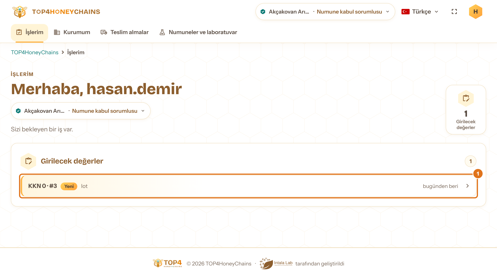

2. Her soruyu yanıtlayın ve yararlı olduğu yerlerde not ekleyin.

   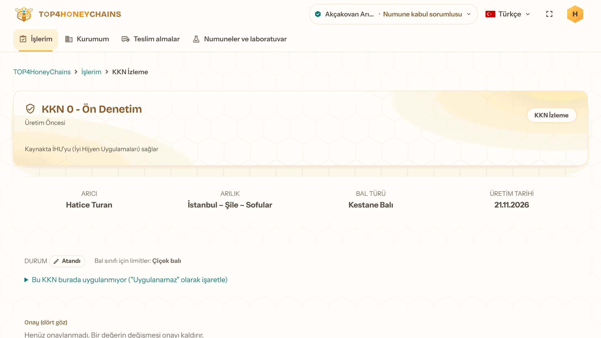

3. **İzleme Kayıtlarını Kaydet** seçin.

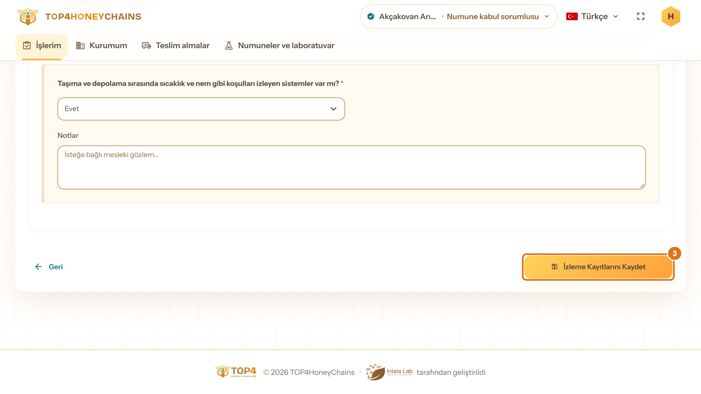

Ardından Kalite Güvence Sorumlusu kaydı onaylar ([KKN 0'ı onaylayın](#sec-approve-ccp0)). **KKN 1**, laboratuvarın onaylanmış raporuyla doldurulur; siz girmezsiniz.

> [!TIP]
> Bir kontrol noktası uygulanmıyorsa **Bu KKN burada uygulanmıyor ("Uygulanamaz" olarak işaretle)** kısmını açın ve gerekçeyi yazın.

# Laboratuvar: analist ve laboratuvar müdürü {#ch-lab}

Laboratuvar her numune kavanozunun mührünü gelişte kontrol eder, her lotun bir karışım numunesini hazırlar, sonuçları imzalı raporla girer ve Laboratuvar müdürüne onaylatır. Onaylanan rapor lotun KKN 1'i olur.

Table: Laboratuvardaki görevler {#tbl-tasks-lab}

| Görev | Kim | Nerede |
| --- | --- | --- |
| Numune kavanozlarını teslim almak | Analist | **Numuneler ve laboratuvar** |
| Karışım numunesini hazırlamak | Analist | **Numuneler ve laboratuvar** |
| Sonuçları girmek ve göndermek | Analist | laboratuvar raporu |
| Bir raporu onaylamak veya geri göndermek | Laboratuvar müdürü | **İşlerim** |

## Numune kavanozlarını teslim alın

İşlerim sayfası bekleyen kavanozları **Teslim alınacak numuneler** altında listeler.

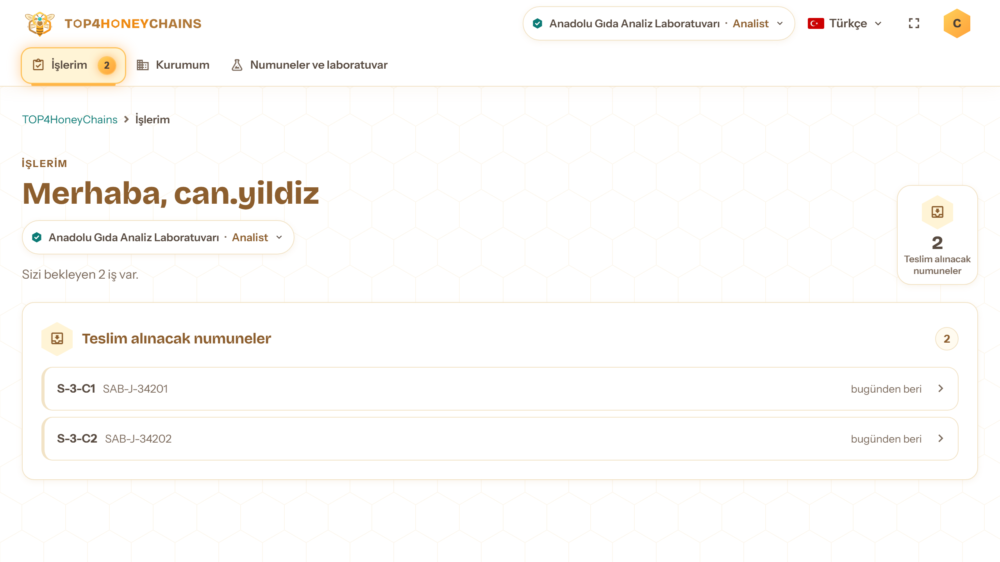

1. Menüde **Numuneler ve laboratuvar** seçin. Kavanozlar **Laboratuvarınıza gelen numuneler** altında listelenir.
2. Her kavanoz için **Mühür numarası kayıtla aynı**, **Etiket sağlam** ve **Kapak sağlam (düğme aşağıda)** sorularını yanıtlayın. Bir kontrol başarısız olursa gerekçeyi **Bir kontrol başarısızsa gerekçe** alanına yazın.
3. **Kabulü kaydet** seçin.

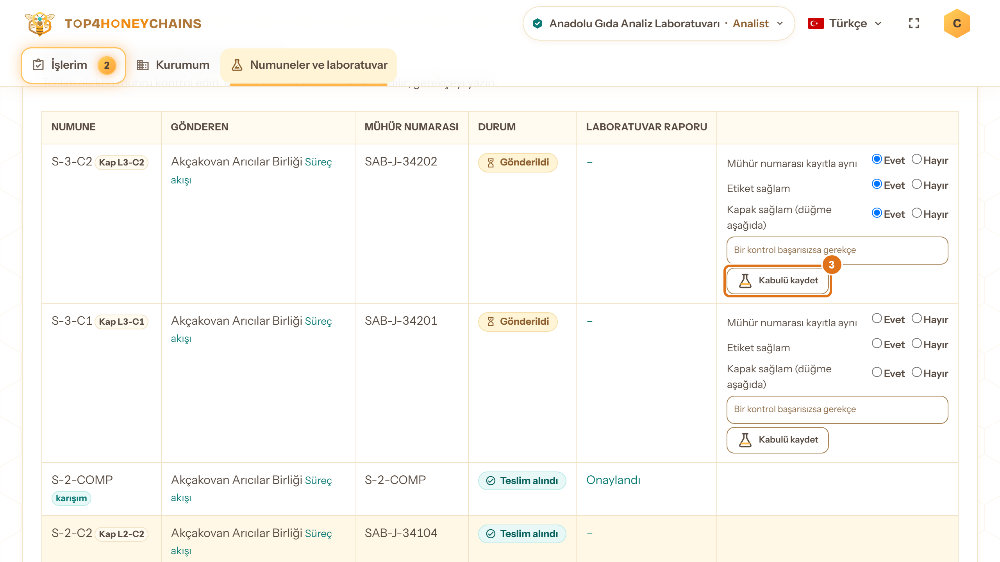

Kırık bir mühür numuneyi reddeder; tesis bu durumda şahit numuneden yeni bir numune alır.

## Karışım numunesini hazırlayın

Bir lotun bütün kavanozları sorunsuz geldiğinde lot **Karışım numunesine hazır lotlar** altında listelenir.

1. Lot için **Karışım numunesini oluştur** seçin. Kavanozlardan eşit miktarları tek bir karışım numunesinde karıştırın; kavanozlar tek tek analizler için saklanır.

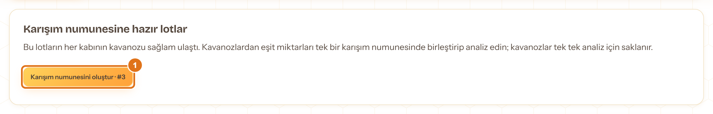

Karışım numunesinin laboratuvar raporu açılır.

## Sonuçları girin

1. **Rapor numarası** ve **Düzenleme tarihi** girin.
2. **PDF seç** seçin ve imzalı raporu ekleyin.
3. Her parametrenin değerini girin. **Limit** sütunu her değerin limitini gösterir.
4. **Kaydet** seçin.

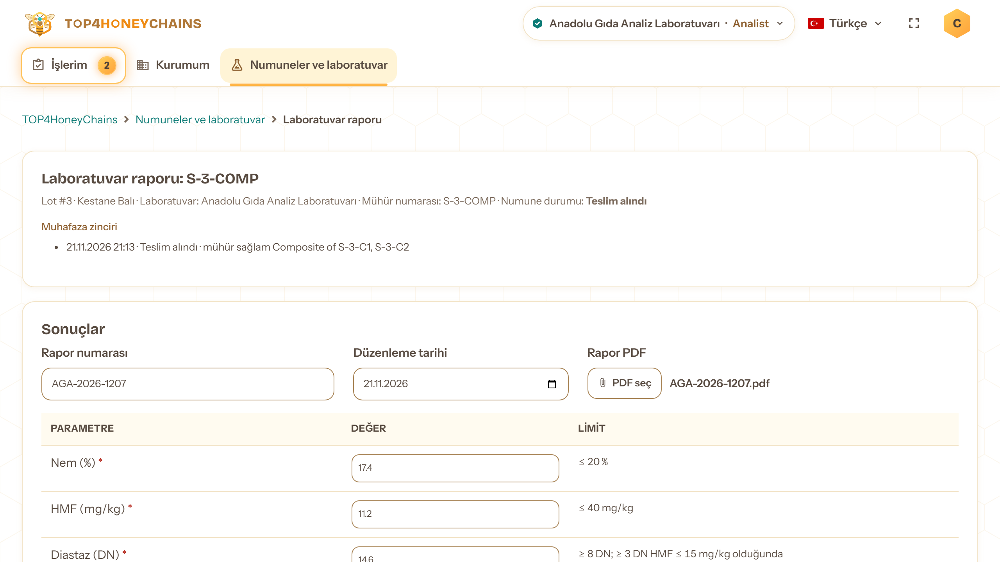

**Girilen zorunlu değer** satırı kaç değerin hâlâ eksik olduğunu gösterir.

## Raporu gönderin

Her zorunlu değer kaydedildiğinde **Onaya gönder** seçin.

1. **Onaya gönder** seçin.

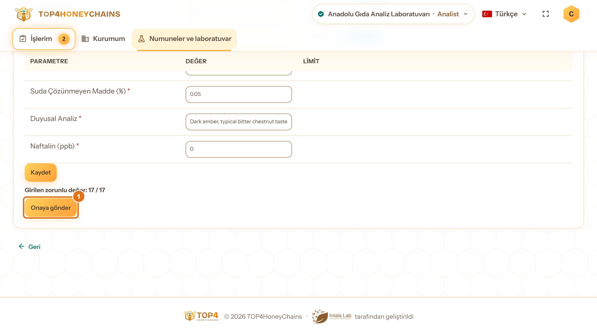

Laboratuvar müdürü raporu **İşlerim** sayfasında bulur.

## Bir raporu onaylayın veya geri gönderin

Laboratuvar müdürü raporu ve PDF dosyasını kontrol eder.

1. **Onayla** seçin. Geri göndermek için gerekçeyi **gerekçe (geri göndermek için)** alanına yazın ve **Geri gönder** seçin.

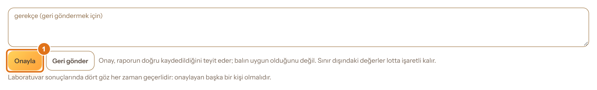

Onaylamak, raporun doğru kaydedildiğini teyit eder; balın uygun olduğunu değil. Limitlerinin dışındaki değerler lotta işaretli kalır. Onaylanan sonuçlar lotun KKN 1'ini doldurur ve rapor, herkesin kontrol edebileceği bir kod alır.

## Bir laboratuvar raporunu doğrulayın {#sec-verify-report}

Herkes bir raporu oturum açmadan kontrol edebilir: başlangıç sayfasında **Laboratuvar raporu doğrula** sayfasını açın, **Rapor kodu** girin ve **Sorgula** seçin. Sayfa durumu, laboratuvarı, akreditasyonunu, rapor numarasını, düzenleme tarihini ve rapor dosyasının SHA-256 parmak izini gösterir.

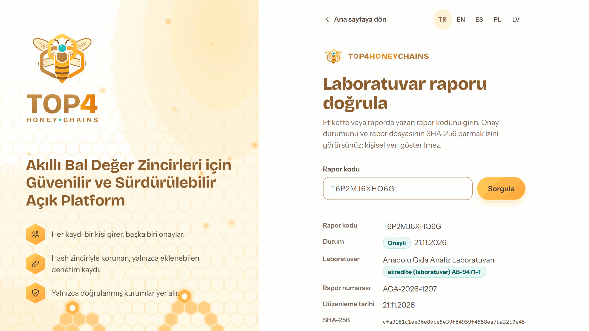

# Çalışan: işleme ve paketleme {#ch-staff}

Bir tesisin çalışanları lotların ve partilerin kontrol formlarını doldurur, onaylanmış lotları partilerde birleştirir, bir partinin kesinleştirilmesini talep eder ve balı diğer kurumlara sevk eder.

Table: Çalışanın görevleri {#tbl-tasks-staff}

| Görev | Nerede |
| --- | --- |
| Lotlarınızı ve partilerinizi görmek | **Kurumum** |
| Bir lotun kontrol formunu doldurmak | **Kurumum > Kontrol formu** |
| Parti oluşturmak | **Kurumum > Yeni parti** |
| Bir partinin kontrol formunu doldurmak | **İşlerim** veya parti sayfası |
| Kesinleştirme talep etmek | parti sayfası |
| Bal sevk etmek | **Sevkiyatlar ve stok** |

## Lotlarınızı ve partilerinizi görün

**Kurumum** sayfası kurumunuzu, üzerinde çalıştığı **Ham bal lotları** ve **Partiler** listesini gösterir. Her kontrol noktası bir etikettir: ✓ işaretli yeşil onaylanmış, sarı gönderilmiş ve onay bekliyor, gri açık, yalnızca çerçeveli uygulanamaz demektir.

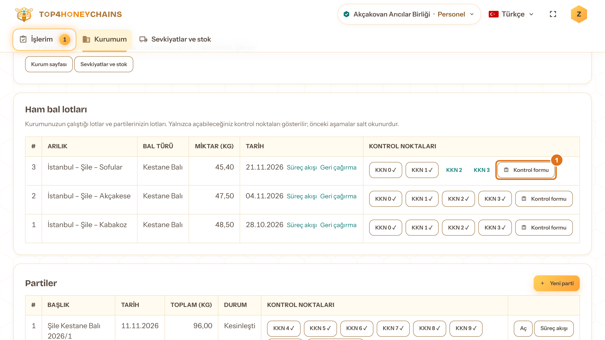

## Bir lotun kontrol formunu doldurun (KKN 2 ve 3)

Kontrol formu bir lotun bütün kontrol noktalarını tek sayfada gösterir. Her biri kendi kaydını, durumunu ve onayını korur.

1. Lotun satırında **Kontrol formu** veya **İşlerim** içindeki öğeyi seçin.
2. **KKN 2** (ısıtma) ve **KKN 3** (süzme) değerlerini girin.

   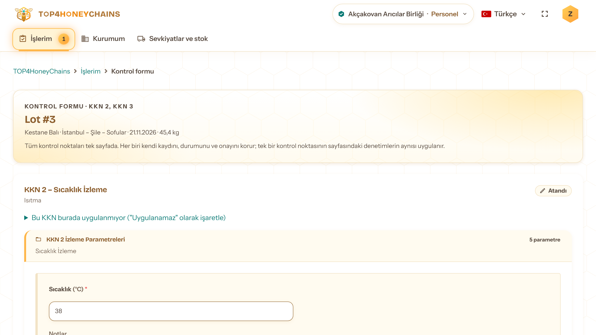

3. **Formu kaydet** seçin.

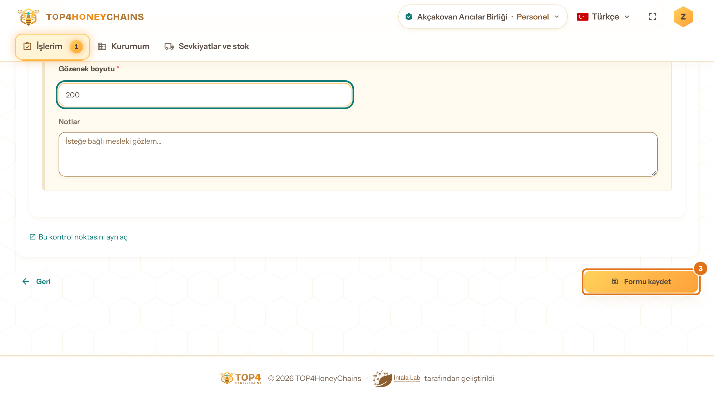

Formu Kalite Güvence Sorumlusu onaylar ([Bir kontrol formunu onaylayın](#sec-approve-sheet)).

> [!TIP]
> **Bu kontrol noktasını ayrı aç**, bir kontrol noktasını kendi sayfasında açar; örneğin bir dosya eklemek için.

## Parti oluşturun {#sec-new-batch}

Bütün kontrol noktaları tamamlanmış ve onaylanmış bir lot partiye hazırdır.

1. **Kurumum** sayfasında **Yeni parti** seçin.
2. **Parti adı** girin, örneğin `Şile Kestane Balı 2026/2`, ve **Üretim Tarihi** değerini kontrol edin.
3. Partiye giren her lot için **Kullan** kutusunu işaretleyin ve **Bu partiye giren kilogram** değerini kontrol edin.
4. **Partiyi oluştur** seçin.

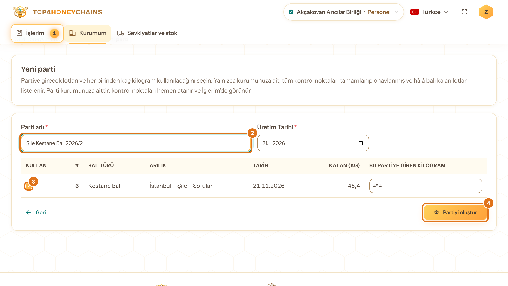

Parti kurumunuza aittir. KKN 4 ile KKN 10 arasındaki kontrol noktaları hemen İşlerim sayfasında görünür.

## Bir partinin kontrol formunu doldurun (KKN 4 ile 10 arası)

Partinin kontrol formunu **İşlerim** sayfasından veya parti sayfasındaki **Kontrol formunu aç** ile açın. Homojenizasyon, pastörizasyon, dinlendirme, dolum, etiketleme, ambalajlama ve depolama değerlerini girin, sonra **Formu kaydet** seçin.

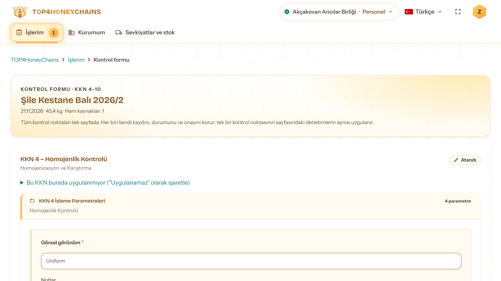

## Kesinleştirme talep edin {#sec-request-finalizing}

Partinin ve lotlarının her kontrol noktası onaylandığında partinin kesinleştirilmesini isteyin.

1. Parti sayfasında **Kesinleştirme talep et** seçin.

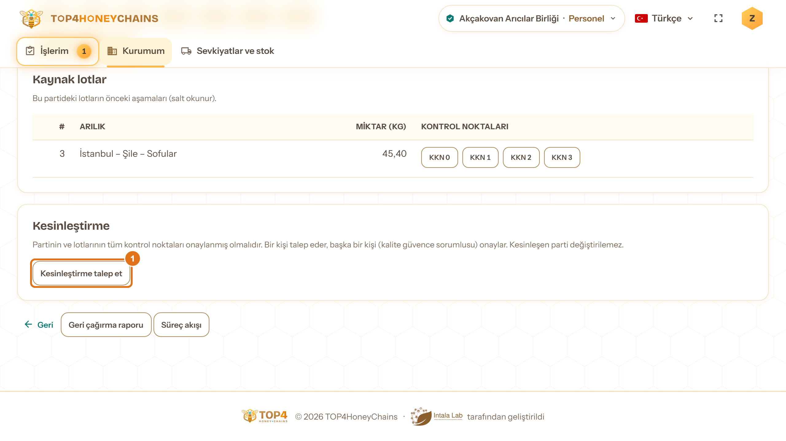

Bir şey eksikse sayfa onu **Kesinleştirmeden önce eksik olanlar:** altında listeler. Talebi Kalite Güvence Sorumlusu onaylar ([Bir partiyi kesinleştirin](#sec-finalize)).

## Başka bir kuruma bal sevk edin

1. Menüde **Sevkiyatlar ve stok** seçin ve partinin satırında **Sevk et** seçin.

   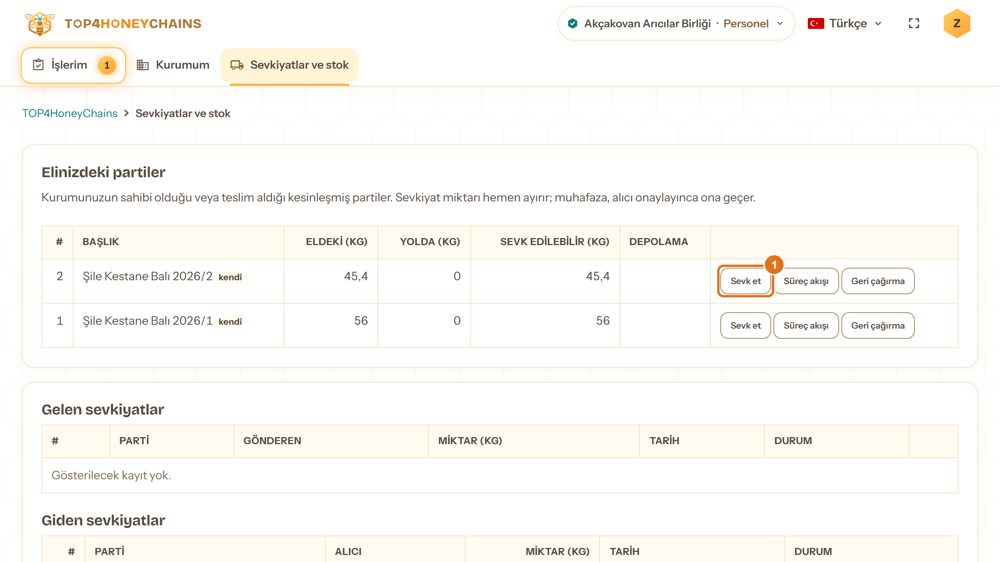

2. Alıcı kurumu **Alıcı** alanında seçin.
3. **Miktar (kg)** ve gerekirse bir **Not** girin.
4. **Sevk et** seçin.

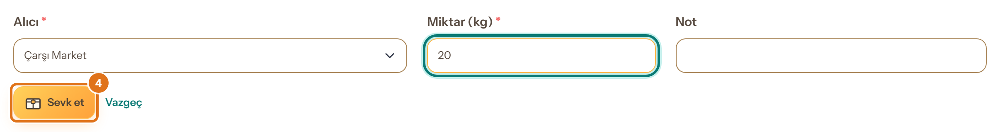

Bir sevkiyat miktarını hemen ayırır; muhafaza, alıcı sevkiyatı teyit ettiğinde el değiştirir.

# Kalite Güvence Sorumlusu {#ch-qao}

Kalite Güvence Sorumlusu başkalarının girdiklerini onaylar: her teslimatın KKN 0'ını, lotların ve partilerin kontrol formlarını, partilerin kesinleştirilmesini ve bir toptancıda veya perakendecide depolama kayıtlarını. Sorumlu ayrıca tüketici geri bildirimlerini yanıtlar. Kendi girdiğiniz bir kaydı hiçbir zaman onaylamazsınız.

Table: Kalite Güvence Sorumlusunun görevleri {#tbl-tasks-qao}

| Görev | Nerede |
| --- | --- |
| KKN 0'ı onaylamak | **İşlerim > Onaylanacak değerler** |
| Bir kontrol formunu onaylamak | **İşlerim > Onaylanacak değerler** |
| Bir partiyi kesinleştirmek | **İşlerim**, parti sayfası |
| Tüketici geri bildirimlerini yanıtlamak | **Tüketici geri bildirimleri** |

## KKN 0'ı onaylayın {#sec-approve-ccp0}

1. **İşlerim** sayfasını açın ve **Onaylanacak değerler** altındaki öğeyi seçin.

   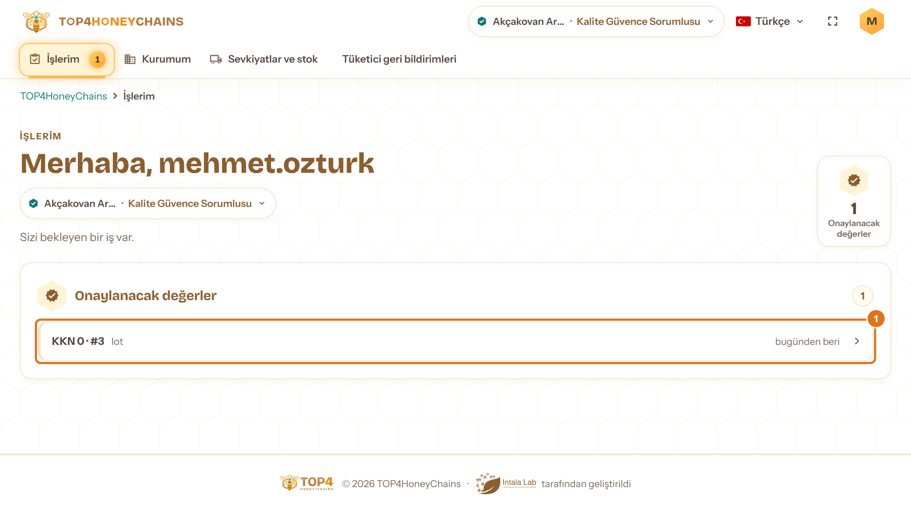

2. Değerleri kontrol edin ve **Onayla** seçin.

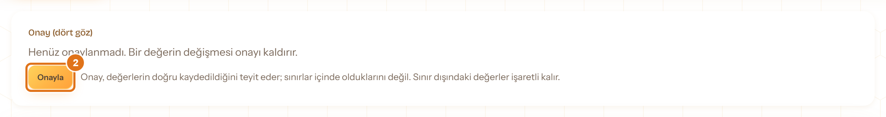

Onaylamak, değerlerin doğru kaydedildiğini teyit eder; limitlerinin içinde olduklarını değil. Bir değer limitinin dışındaysa sayfa, onaylamadan önce onu teyit etmenizi ister.

## Bir kontrol formunu onaylayın {#sec-approve-sheet}

1. Kontrol formunu **İşlerim** sayfasından açın.
2. Değerleri kontrol edin. Sayfa, **Formu onayla** altında onaylayacağınız kontrol noktalarını listeler; **Listelenenlerin hepsini onayla** seçin.

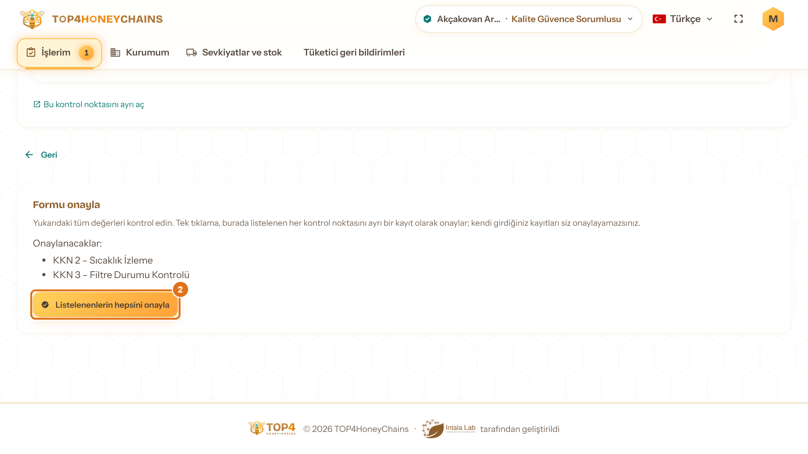

Listelenen her kontrol noktası ayrı bir kayıt olarak onaylanır. Kendi yaptığınız girişler **Sizin onaylamadıklarınız:** altında listelenir ve başka bir sorumlu gerektirir.

## Bir partiyi kesinleştirin {#sec-finalize}

Çalışan kesinleştirme talep ettikten sonra parti İşlerim sayfanızda görünür.

1. Parti sayfasını **İşlerim** sayfasından açın.
2. **Onayla ve kesinleştir** seçin.

Parti kesinleştirilir ve mühürlenir. **Bal Hikâyesini aç** herkese açık sayfasını gösterir, **QR'ı indir** ise kavanoz etiketleri için QR kodu verir.

> [!WARNING]
> Kesinleştirilmiş bir parti değiştirilemez. Verileri, bileşimi ve kontrol noktaları kilitlidir. Bundan sonra bir değer yalnızca iki platform yöneticisinin onayladığı bir düzeltmeyle değiştirilebilir.

## Tüketici geri bildirimlerini yanıtlayın {#sec-answer-feedback}

Tüketiciler bir bal hakkında, onu üreten kuruma geri bildirim gönderebilir. Yalnızca tüketicinin kodunu okursunuz, kullanıcı adını veya telefonunu asla okumazsınız; geri bildirim hiçbir zaman herkese açık değildir.

1. Menüde **Tüketici geri bildirimleri** seçin ve geri bildirimi açın.
2. Yanıtınızı **Tüketiciye yanıtınız** alanına yazın.
3. **Yanıtı gönder** seçin.

Tüketici yanıtı **Ballarım** sayfasında okur. Listeyi düzenli tutmak için **Okundu olarak işaretle** ve **Kapat** düğmelerini kullanın.

# Toptancı ve perakendeci: balı teslim alma ve depolama {#ch-shop}

Bir toptancının veya perakendecinin çalışanları gelen balı teyit eder ve depolama koşullarını (KKN 10) kaydeder. Aynı kurumun Kalite Güvence Sorumlusu depolama kaydını onaylar. Resimler bir perakendeciyi gösterir; toptancı da aynı şekilde çalışır.

Table: Bir toptancıdaki veya perakendecideki görevler {#tbl-tasks-shop}

| Görev | Kim | Nerede |
| --- | --- | --- |
| Bir sevkiyatı teyit etmek | Çalışan | **Sevkiyatlar ve stok** |
| Depolama koşullarını kaydetmek | Çalışan | **Sevkiyatlar ve stok > KKN 10** |
| Depolama kaydını onaylamak | Kalite Güvence Sorumlusu | **İşlerim** |

## Bir sevkiyatı teyit edin

1. Menüde **Sevkiyatlar ve stok** seçin. Sevkiyat **Gelen sevkiyatlar** altında **Bekliyor** olarak listelenir.
2. Balı kontrol edin ve **Teslimi onayla** seçin. Bir sorun varsa gerekçeyi **gerekçe (reddetmek için)** alanına yazın ve **Reddet** seçin.

Parti artık **Elinizdeki partiler** altında listelenir.

## Depolama koşullarını kaydedin (KKN 10)

1. **Sevkiyatlar ve stok** sayfasında partinin **Depolama** sütunundaki **KKN 10** seçin.
2. **Sıcaklık (°C)** ve **Bağıl Nem** değerlerini girin.
3. **Kaydet** seçin.

## Depolama kaydını onaylayın

1. Depolama kaydını **İşlerim** sayfasından açın.
2. **Onayla** seçin.

Partinin Bal Hikâyesi artık perakendecinin partiyi teslim aldığını gösterir.

# Kurum yöneticisi {#ch-orgadmin}

Kurum yöneticisi kurumun sayfasını ve belgelerini yönetir ve bir arıcılar birliğinde arıcı sayfalarını yayımlar. Bir tesiste Kurum yöneticisi, Çalışan gibi parti oluşturabilir, kesinleştirme talep edebilir ve bal sevk edebilir ([Çalışan: işleme ve paketleme](#ch-staff)). Uyum Sorumlusu'nun ayrı bir bölümü vardır ([Uyum Sorumlusu](#ch-compliance)).

## Kurumunuzun sayfasını ve belgelerini görün {#sec-org-page}

**Kurumum**, ardından **Kurum sayfası** seçin. Sayfa kurumun durumunu (**Doğrulama**), **Belgeler**, **Yetenekler**, **Dört göz muafiyeti** ve **Veri sorumlusu** bilgilerini gösterir.

Belge eklemek için **Belgeler** altında dosyayı seçin ve **Yükle** seçin. 10 MB'a kadar PDF dosyaları ve 8 MB'a kadar JPG, PNG veya WEBP resimleri kabul edilir. Üyeleri ve yetenekleri platform yöneticileri yönetir ([Platform yönetimi](#ch-admin)).

## Bir arıcı sayfası yayımlayın (birlik) {#sec-beekeeper-page}

Bir birlik her üye arıcı için herkese açık bir sayfa yayımlayabilir. Sayfa yalnızca kaydedilmiş bir rıza ve doğrulanmış bir kayıt numarasıyla yayımlanır; rızanın geri çekilmesi sayfayı hemen yayından kaldırır.

1. Menüde **Arıcı sayfaları** seçin.
2. Arıcının satırında **Rıza kaydet** seçin.
3. Rıza metnini arıcıya okuyun. **Rıza metni arıcıya okundu ve imzalandı.** kutusunu ve arıcı kabul ederse **Arıcı adının gösterilmesine onay veriyor (aksi halde nötr bir kod gösterilir)** kutusunu işaretleyin.
4. **Rıza tarihi** girin, **İmzalı rıza belgesi** dosyasını ekleyin (veya **Kamera** ile çekin) ve kaydedin.

Sayfa yayımlandıktan sonra **Yazdırılabilir kart** sayfanın QR koduyla bir kart verir, **Rızayı geri çek** ise sayfayı yayından kaldırır.

# Uyum Sorumlusu {#ch-compliance}

Platformdaki her kurum en az bir **Uyum Sorumlusu** atar. Uyum Sorumlusu, kurumun platformla ve kişisel verilerle nasıl çalıştığını gözetir. Teslimat, kontrol noktası değeri veya laboratuvar sonucu girmezsiniz; bunları incelersiniz. Bir platform yöneticisi bir kurumu ilk kez ancak kurumun etkin bir Uyum Sorumlusu varsa doğrular. Küçük bir kurumda **Kurum yöneticisi** ikinci bir üyelikle Uyum Sorumlusu da olabilir (bkz. [Üyelikler](#memberships)).

Uyum Sorumlusu olarak şunları yapabilirsiniz:

- kurumunuzun kayıtları ve teslimatları için arıcının SMS kodunun yerini tutan imzalı fotoğrafları kabul veya reddetmek;
- numune alma kalitesini incelemek: imzalı fotoğrafla teyit edilen teslimatlar, laboratuvarın reddettiği numuneler ve kırık bulunan mühürler;
- kişisel verilerle ilgili, kâğıt üzerinde, telefonla veya yüz yüze gelen başvuruları ve rıza geri çekmelerini kaydetmek;
- onay mekanizmasını izlemek: onay için çok uzun bekleyen kayıtlar ve dört göz muafiyetiyle yapılan onaylar;
- kurumun sözleşmelerini ve veri sorumlusu bilgilerini tutmak;
- kurumunuzun denetim kayıtlarını okumak.

Veri haklarınız rolünüzden gelir (bkz. [Tablo](#tbl-crud)). Varsayılan olarak imzalı fotoğraf kanıtlarını onaylar, kurumunuzun lotları için arıcıların istediği fiyatları okur, kurumun denetim kayıtlarını okur ve kurumunuzun partileri hakkındaki tüketici geri bildirimlerini okuyup yanıtlarsınız. Kurumunuzun belgelerini ve veri sorumlusu bilgilerini oluşturur ve güncellersiniz. Numune alma kalitesi incelemeleri ve ilgili kişi başvuruları oluşturursunuz; bir inceleme sonradan değiştirilemez veya silinemez. Bir platform yöneticisi bu hakları **Kurulum > Roller ve yetkiler** altında değiştirebilir.

İki temel kural her zaman geçerlidir (bkz. [Temel kurallar](#ground-rules)). Kendi kaydettiğiniz bir öğe hakkında hiçbir zaman karar vermezsiniz: sayfa **Bu kaydı siz girdiniz; başka biri inceler.** der. Ayrıca bir kurumun dört göz muafiyeti, imzalı fotoğraflarla ilgili incelemeleriniz için hiçbir zaman geçerli değildir.

Menünüzde **Uyum** görünür. Görevleriniz **İşlerim** sayfasında **İmzalı fotoğrafları incele**, **İncelemeler**, **İlgili kişi başvuruları** ve **Tüketici geri bildirimleri** altında görünür.

Table: Uyum Sorumlusunun görevleri ve nerede bulunacakları {#tbl-co-tasks}

| Görev | Nerede bulunur |
| --- | --- |
| Bir kaydın veya teslimatın imzalı fotoğrafını incelemek | **İşlerim > İmzalı fotoğrafları incele**; sayı ayrıca **Uyum > İmzalı fotoğraflar** altındadır |
| Numune alma kalitesini incelemek | **Uyum > Numune alma kalitesi**; açık öğeler **İşlerim > İncelemeler** altında |
| Bir ilgili kişi başvurusunu kaydetmek ve yanıtlamak | **Uyum > İlgili kişi başvuruları**; açık başvurular **İşlerim > İlgili kişi başvuruları** altında |
| Kâğıt üzerinde veya telefonla gelen bir rıza geri çekmesini kaydetmek | **Uyum > İlgili kişi başvuruları > Başvuru kaydet** |
| Onay mekanizmasını kontrol etmek | **Uyum > Onay mekanizması** |
| Sözleşmeleri ve belgeleri tutmak | **Uyum > Sözleşmeler**, **Kurumun belgeleri** |
| Veri sorumlusu bilgilerini tutmak | **Uyum > Veri sorumlusu**, **Kurum sayfasında düzenle** |
| Kurumun denetim kayıtlarını okumak | **Uyum > Denetim kaydı** |
| Tüketici geri bildirimlerini yanıtlamak | **İşlerim > Tüketici geri bildirimleri** (bkz. [Tüketici geri bildirimlerini yanıtlayın](#sec-answer-feedback)) |

## İmzalı bir fotoğrafı inceleyin {#co-evidence}

Arıcı bir kaydı ve bir teslimatı normalde SMS ile gelen 6 haneli bir kodla teyit eder. Bu mümkün değilse (cep telefonu yok, şebeke yok) kaydı giren görevli, arıcının imzaladığı formun fotoğrafını ekler. Bunu kayıtta **Arıcı Kayıt Görevlisi** (bkz. [Cep telefonu olmayan bir arıcıyı kaydedin](#sec-register-no-phone)), teslimatta **Numune kabul sorumlusu** yapar (bkz. [Bir bal teslimatını kaydedin](#sec-record-delivery)). Fotoğraf bundan sonra sizi bekler.

1. **İşlerim** sayfasında **İmzalı fotoğrafları incele** altındaki bir öğeyi açın. Öğe kaydı veya teslimatı açar.
2. Fotoğrafı açın ve kayıtla karşılaştırın:
   - bir kayıt için: kimlik, kayıt numarası, arıcının tercihleri ve imza;
   - bir teslimat için: kaplar, ağırlıklar ve mühür numaraları.
3. **Kabul et** seçin veya bir **Not (ret için zorunlu)** yazın ve **Reddet** seçin.

Bundan sonrası kayda bağlıdır.

Table: İmzalı bir fotoğrafı kabul etmenin veya reddetmenin sonuçları {#tbl-co-evidence}

| Kayıt | Kabul et | Reddet |
| --- | --- | --- |
| Kayıt | Kayıt numarası doğrulanır ve arıcı bal teslim edebilir. | Kayıt numarası reddedilir. Bu imzalı formda verilen rızalar geri çekilir. Arıcı yeniden kaydedilene kadar teslimat yapamaz. |
| Teslimat | Kontrol noktaları tamamlandığında lot kesinleştirilebilir. Arıcı istenen fiyatı girebilir. | Lot kesinleştirilemez. |

Öğeyi kendiniz kaydettiyseniz öğe **İşlerim** sayfanızda görünmez ve sayfa başka birinin karar vereceğini söyler. Platformun kendisinin kaydettiği kayıtlar için fotoğrafı bir platform yöneticisi inceler.

> [!NOTE]
> Fotoğrafı, onu tutan kurumun Uyum Sorumlusu olduğunuz için açabilir ve indirebilirsiniz. Her indirme denetim kaydına yazılır (bkz. [Kodlar ve dosya parmak izleri](#trust-codes)).

## Numune alma kalitesini inceleyin {#co-quality}

**Uyum > Numune alma kalitesi** kurumunuz için üç tür öğeyi listeler:

- **fotoğrafla teslimat**: SMS kodu yerine imzalı bir fotoğrafla teyit edilen bir teslimat;
- **reddedilen numune**: laboratuvarın kabulde reddettiği bir numune kavanozu;
- **kırık mühür**: kırık bulunan bir kap mührü.

İncelemesi olmayan öğeler önce gelir. Teslimatı veya numuneyi açmak için öğenin bağlantısını seçin.

1. Satırda **İnceleme yaz** seçin.
2. **uygun** veya **bulgu** seçin.
3. **Neyi kontrol ettiniz ve ne buldunuz** alanını yazın.
4. Bir bulgu için **Alınan veya istenen önlem** alanını yazın. Bir bulgu için zorunludur.
5. **Kaydet** seçin.

Her metin en çok 1000 karakter içerebilir. Kaydedilmiş bir inceleme değiştirilemez veya silinemez. Öğeyi daha sonra yeniden kontrol ettiyseniz yeni bir inceleme yazın; satır bu durumda her incelemeyi tarihiyle gösterir.

## Bir ilgili kişi başvurusunu yürütün {#co-requests}

Kişiler kişisel verileri hakkında başvuruda bulunabilir. Sayfa beş tür başvuru sunar: **erişim**, **düzeltme**, **silme**, **itiraz** ve **onay geri çekme**. Arıcı alanı hesabı olan bir arıcı bir rızayı orada hemen geri çeker veya verir (bkz. [Rızalarınızı ve hesabınızı yönetin](#sec-portal-consents)). Burada, kuruma başka bir yoldan ulaşan başvuruları kaydedersiniz: bir mektup, bir telefon görüşmesi veya bir ziyaret.

1. **Uyum** seçin, **İlgili kişi başvuruları** bölümüne gidin ve **Başvuru kaydet** seçin.
2. Formu doldurun (bkz. [Tablo](#tbl-co-request)).
3. **Kaydet** seçin. İleti **Başvuru kaydedildi; 30 gün içinde yanıtlanmalıdır.** der.

Table: Bir ilgili kişi başvurusunun alanları {#tbl-co-request}

| Alan | Ne girilir | Zorunlu |
| --- | --- | --- |
| **İlgili kişi** | Başvuran kişinin adı (en çok 200 karakter) | Evet |
| **Arıcı numarası (arıcıysa)** | Arıcının işletme numarası. Platformda kayıtlı olmalıdır. | Yalnızca onay geri çekme için |
| **Başvuru** | **erişim**, **düzeltme**, **silme**, **itiraz** veya **onay geri çekme** | Evet |
| **Geri çekilecek onay** | Arıcının geri çektiği rıza | Yalnızca onay geri çekme için |
| **Geliş yolu** | Başvurunun nasıl geldiği, örneğin "mektup" veya "telefon" (en çok 50 karakter) | Evet |
| **Alındı** | Başvurunun geldiği tarih. Gelecekte olamaz. | Evet |
| **Ne isteniyor** | Başvuru kendi sözlerinizle (en çok 1000 karakter) | Evet |

Liste önce açık başvuruları, **Alındı** tarihi ve **Son yanıt tarihi** ile gösterir. Yanıt tarihi, geliş tarihinden 30 gün sonradır; bu, ekranın belirttiği Türk kişisel verileri koruma kanununun (KVKK) süresidir. Süresi geçmiş bir tarih kırmızı gösterilir. Diğer ortak ülkelerde kendi ulusal kanununuzun süresini kontrol edin; GDPR kapsamında süre bir aydır.

Kişiye yanıt verdiğinizde satıra **Verilen yanıt** bilgisini yazın ve **yanıtlandı** veya **reddedildi** seçin. Kapatılmış bir başvuru yeniden açılamaz.

> [!NOTE]
> Platform başvuruyu ve son tarihini kaydeder. Başvurunun gereğini siz yerine getirirsiniz: örneğin bir erişim başvurusu için verileri toplarsınız veya bir platform yöneticisinden düzeltme ya da silme istersiniz (bkz. [Bundan sonra ne olur](#co-next)).

## Kâğıt üzerinde veya telefonla gelen bir rıza geri çekmesini kaydedin {#co-withdrawal}

Bir arıcı, örneğin arıcı alanı hesabı olmayan bir arıcı, bir rızayı mektupla, telefonla veya yüz yüze geri çekebilir. Geri çekme, siz kaydettiğiniz anda geçerli olur.

1. **Başvuru kaydet** seçin.
2. **Başvuru** alanında **onay geri çekme** seçin.
3. **Arıcı numarası (arıcıysa)** alanını girin. Burada zorunludur.
4. **Geri çekilecek onay** seçin: **Herkese açık sayfalarda adım**, **Teslimatlarım ve sonuçlarım hakkında mesajlar**, **Birliğim fiyatlarımı görebilir** veya **Herkese açık arıcı sayfam**.
5. **İlgili kişi**, **Geliş yolu**, **Alındı** ve **Ne isteniyor** alanlarını doldurun ve **Kaydet** seçin.

Platform etkin rızayı hemen geri çeker ve başvuruyu, rızanın geri çekildiği (veya etkin bir rıza olmadığı) notuyla **yanıtlandı** olarak kapatır. Etki anında olur: Bal Hikâyesi ad yerine nötr kodu gösterir, birlik fiyatları okumayı bırakır veya arıcı sayfası yayından kaldırılır (bkz. [Aydınlatma metinleri, rızalar ve veri sorumlusu](#trust-notices)).

## Onay mekanizmasını kontrol edin {#co-approvals}

Dört göz ilkesi, bir kişinin bir kaydı girmesi ve ikinci bir kişinin onu onaylaması demektir (bkz. [Dört göz](#four-eyes)). Bir platform yöneticisi küçük bir kurumu muaf tutabilir; böylece üyeleri kendi kontrol noktası kayıtlarını onaylayabilir ve kendi partilerini kesinleştirebilir. Muafiyet laboratuvar sonuçları için hiçbir zaman geçerli değildir. Platform muafiyetle yapılan her onayı işaretler.

**Uyum > Onay mekanizması** kurumunuzun lotları ve partileri için şunları listeler:

- 7 günden uzun süredir onay bekleyen lot ve parti kontrol noktası kayıtları, depolama kayıtları (KKN 10) ve kesinleştirme talepleri ("… tarihinden beri bekliyor");
- dört göz muafiyetiyle yapılan onaylar ve kesinleştirmeler ("aynı kişi tarafından onaylandı (dört göz muafiyeti)").

Her satır lotu veya partiyi, kontrol noktasını (veya **Kesinleştir**) ve listelenme nedenini belirtir. Kaydı açmak için satırı seçin. Kendi kendine onaylar önce listelenir.

**Kim neyi girer ve onaylar** altında sayfa, her iş alanı için hangi rollerin kayıt girdiğini, onayladığını ve okuduğunu gösterir. Bu, bütün platformun yapılandırmasıdır. Onu platform yöneticisi yönetir; bir değişiklik için ondan isteyin (bkz. [Her kontrol noktasını kimin girip onaylayacağına karar verin](#sec-ccp-responsibilities)).

> [!TIP]
> Çok uzun bekleyen bir kayıt genellikle onaylayan rolde kimsenin bulunmadığı anlamına gelir. **Kurum yöneticisi** ile konuşun veya bir platform yöneticisinden o rolde bir üye eklemesini isteyin.

## Sözleşmeleri ve belgeleri tutun {#co-agreements}

**Uyum > Sözleşmeler**, kurumun veri işleme sözleşmelerini ve tedarik sözleşmelerini en yeniden başlayarak yükleme tarihiyle listeler. Açmak için bir dosya adını seçin.

Sözleşme eklemek için:

1. **Kurumun belgeleri** seçin. Kurum sayfası **Belgeler** bölümünde açılır.
2. **Veri işleme sözleşmesi** veya **Tedarik sözleşmesi** türünü seçin.
3. Dosyayı seçin ve **Yükle** seçin.

Aynı yer, **Kurum yöneticisi**nin yaptığı gibi kurumun diğer belgelerini de alır (**Ruhsat**, **Akreditasyon**, **Vergi levhası**, **Kayıt kanıtı**, **Diğer**) (bkz. [Kurumunuzun sayfasını ve belgelerini görün](#sec-org-page)). Belgeler SHA-256 parmak izleriyle saklanır. Askıya alınmış bir kurum belge yükleyemez.

## Veri sorumlusu bilgilerini tutun {#co-controller}

Her kurum, kaydettiği kişisel verilerin veri sorumlusudur. Bilgileri, insanların okuduğu aydınlatma metninde belirtilir. **Uyum > Veri sorumlusu** resmî unvanı ve iletişim bilgisini gösterir.

1. **Kurum sayfasında düzenle** seçin.
2. **Veri sorumlusu** altında **Resmî unvan**, **İletişim (e-posta veya telefon)**, **Adres** ve gerekiyorsa **VERBİS** kayıt numarasını girin.
3. **Kaydet** seçin.

Bu bilgileri yalnızca siz ve platform yöneticileri değiştirebilir. Kurum sayfası, bir resmî unvan girilene kadar bilgileri **eksik** olarak işaretler. **Aydınlatma metni**, kurumunuzu veri sorumlusu olarak belirten herkese açık aydınlatma metnini açar. Arıcılar bu bilgileri kendi alanlarında **Verilerinizi kimler tutuyor** altında bulur.

## Kurumun denetim kayıtlarını okuyun {#co-audit}

**Uyum > Denetim kaydı**, kurumunuzun üyelerinin kurum için çalışırken yazdığı son 200 girdiyi gösterir: **Tarih**, **Kullanıcı** ve **Değişiklik** (işlem ve ilgili kayıt). Liste salt okunurdur. Eski ve yeni değerleriyle tam denetim kaydı için bir platform yöneticisine başvurun (bkz. [Denetim kaydı ve hash zinciri](#trust-audit)).

## Bundan sonra ne olur {#co-next}

İncelemeleriniz işi başkalarına devreder:

- Bir kaydı kabul ettikten sonra **Numune kabul sorumlusu** arıcının teslimatlarını kaydedebilir. Bir teslimat fotoğrafını kabul ettikten sonra **Kalite Güvence Sorumlusu** o lotu içeren bir partiyi kesinleştirebilir ([Bir partiyi kesinleştirin](#sec-finalize)).
- Bir retten sonra **Arıcı Kayıt Görevlisi** arıcıyı yeniden kaydeder veya lot hiçbir kesinleştirilmiş partiye girmez.
- Önlem içeren bir bulgu, **Kurum yöneticisi**ne veya kilitli kayıtları düzelten ([Değişmeyen kayıtlar](#trust-locked)) ve üyeleri, rolleri, hakları ve dört göz muafiyetini değiştiren bir platform yöneticisine gider.

# Arıcı alanı {#ch-portal}

Arıcı alanı telefon için tasarlanmıştır. Arıcılar bu alanda teslimatlarını izler, istedikleri fiyatı girer, laboratuvar sonuçlarını okur ve rızalarını yönetir. Giriş bilgilerini kayıt görevlisi SMS ile gönderir ([Arıcıya giriş bilgilerini gönderin](#sec-send-signin)); ilk oturum açma [İlk kez oturum açın](#sec-first-sign-in) bölümünde anlatıldığı gibi işler.

## Başlangıç sayfasını okuyun

Oturum açtıktan sonra arıcı **Ana Sayfa** sayfasını görür: teslimatlar, balının bulunduğu partiler, son teslimat ve son laboratuvar sonucu. **Yapılacaklar** fiyatı girilmemiş teslimatları listeler. Menüde **Ana Sayfa**, **Teslimatlarım**, **Numuneler ve laboratuvar**, **Balımın olduğu partiler**, **Bal Hikâyesi sayfalarım**, **Arılıklarım**, **Gizlilik ve onaylar** ve **Hesap** bulunur. Dil bağlantıları ve **Çıkış Yap** en üsttedir.

## Fiyatınızı girin

1. **Teslimatlarım** seçin. Her teslimat bal türünü, miktarı, teyidi ve her kabı mühür geçmişiyle gösterir.
2. **İstenen fiyat** altında **Kilogram fiyatı** ve **Para birimi** ile isterseniz bir **Not (isteğe bağlı)** girin.
3. **Fiyat gir** seçin ve toplamı onaylayın.

 

Lot kesinleştirilmiş bir partiye girene kadar fiyatı **Fiyatı değiştir** ile değiştirebilirsiniz. **Fiyat geçmişi** önceki fiyatlarınızı gösterir.

## Laboratuvar sonuçlarını, partileri ve Bal Hikâyesi sayfalarını görün

**Numuneler ve laboratuvar** teslimatlarınızın her numune kavanozunu gösterir. Laboratuvar değerleri, laboratuvar raporunu onayladıktan sonra görünür. **Balımın olduğu partiler** her partideki payınızı gösterir, **Bal Hikâyesi sayfalarım** ise partilerin herkese açık sayfalarını açar.

## Rızalarınızı ve hesabınızı yönetin {#sec-portal-consents}

**Gizlilik ve onaylar** rızalarınızı listeler: herkese açık sayfalarda adınız, teslimatlar ve sonuçlar hakkında mesajlar ve birliğinizin fiyatlarınızı okuyup okuyamayacağı. **Geri çek** veya **Onay ver** seçin; değişiklik hemen geçerli olur.

**Hesap** cep telefonunuzu (**Yeni numara**, **Kod gönder**), **Dil** ayarınızı ve şifrenizi (**Mevcut şifre**, **Yeni şifre**, **Yeni şifre (tekrar)**, **Şifreyi değiştir**) değiştirmenizi sağlar.

 

# Bal Hikâyesi sayfası {#ch-story}

Bal Hikâyesi, kesinleştirilmiş bir partinin herkese açık sayfasıdır. Tüketici sayfayı kavanozdaki QR kodu telefonla tarayarak açar; hesap gerekmez.

## Sayfanın üst kısmı

Üst kısım partinin adını, onu üreten kurumu, bal miktarını, arıcı sayısını ve üretim tarihini gösterir. Altındaki rozetler, balın **Akredite laboratuvarda test edildi** olup olmadığını ve **Tüm kontrol noktaları onaylı** olup olmadığını, menşei ve laboratuvar raporunun kodunu gösterir.

## Bu balın yolculuğu

Beş adım balın yolunu gösterir: **Arılık**, **Teslim**, **Laboratuvar**, **İşleme** ve **Raf**, her biri tarihiyle. **Ayrıntıları görün**, sayfanın o adıma ait bölümünü açar.

 

## Bal nereden geliyor

**Balın Kaynakları** her kaynaktan ne kadar bal geldiğini gösterir, harita ise illeri gösterir. Arılıkların tam konumları hiçbir zaman yayımlanmaz. **Kaynak Bileşimi** arıcıları, adlarını yalnızca kabul ettilerse göstererek listeler.

## Laboratuvar sonuçları ve süreç kontrolleri

**Bir bakışta kalite** en önemli değerleri gösterir. **Laboratuvar raporunun tamamı** bütün değerleri gruplar: **Tazelik**, **Olgunluk ve doğallık**, **Şeker profili ve saflık** ve kalıntılar. **… raporunu doğrula** raporu doğrulama sayfasında kontrol eder. **Süreç kontrolleri** bal için kaydedilen her kontrol noktasını listeler.

 

> [!NOTE]
> Değerlerin limitleri hâlâ bir ortak laboratuvar tarafından kontrol edilirken değerler, limit içinde veya dışında hükmü olmadan gösterilir.

## Balı kaydedin veya üreticiye yazın

En altta **Ballarıma kaydet** ve **Üreticiye geri bildirim gönder**, ücretsiz hesabı olan tüketiciler içindir ([Tüketici hesabı](#ch-consumer)). **Rapor doğrula** doğrulama sayfasını açar.

# Tüketici hesabı {#ch-consumer}

Ücretsiz bir tüketici hesabı, satın aldığınız balları saklamanızı, üreticiye geri bildirim göndermenizi ve yanıtları okumanızı sağlar. Bal Hikâyesi hesabı olmayan herkese açık kalır.

## Hesap oluşturun

1. Bal Hikâyesi'nde veya giriş sayfasında **Ücretsiz tüketici hesabı oluşturun** seçin.
2. Harf, rakam, nokta, kısa çizgi veya alt çizgiden oluşan, 3 ile 40 karakter arasında bir **Kullanıcı Adı** seçin. Gerçek adınızı veya e-posta adresinizi kullanmayın.
3. **Şifre** alanını iki kez girin, **Dil** seçin ve isterseniz bir **Cep telefonu (isteğe bağlı)** girin.
4. **18 yaşında veya daha büyüğüm.** ve **Okudum ve kabul ediyorum: Tüketiciler için aydınlatma metni** kutularını işaretleyin.
5. **Hesap oluştur** seçin.

> [!NOTE]
> Doğrulanmış bir telefonla unutulan bir şifreyi SMS koduyla sıfırlayabilirsiniz. Telefon olmadan unutulan bir şifre kurtarılamaz. Platform hiçbir zaman e-posta göndermez.

## Bir balı kaydedin

1. Bal Hikâyesi'nde **Ballarıma kaydet** seçin.
2. Onaylamak için yeniden **Ballarıma kaydet** seçin.

Kayıtlı ballarınızı yalnızca siz görürsünüz. Platform hangi hikâyeleri açtığınızı kaydetmez.

## Üreticiye geri bildirim gönderin

1. Bal Hikâyesi'nde **Üreticiye geri bildirim gönder** seçin.
2. Konusunu seçin, örneğin **Tat veya koku** veya **Sahte olabilir veya kavanoz açılmış**.
3. Mesajınızı kişisel veri olmadan, en çok 1000 karakterle yazın.
4. **Geri bildirim gönder** seçin.

 

Üretici yalnızca kodunuzu görür, kullanıcı adınızı veya telefonunuzu asla görmez.

## Yanıtı okuyun ve hesabınızı yönetin

**Ballarım** sayfası **Kayıtlı ballar** listenizi ve **Üreticinin yanıtı** ile birlikte **Geri bildirimlerim** listenizi gösterir. **Hesap** kodunuzu gösterir ve telefonunuzu, dilinizi ve şifrenizi değiştirmenizi sağlar. **Verilerimi indir** platformun hesabınız hakkında tuttuğu her şeyi verir; **Hesabımı kalıcı olarak sil** ise şifrenizi girdikten sonra hesabı siler.

 

# Platform yönetimi {#ch-admin}

Platform yöneticileri kurumları ve üyelerini ayarlar, her kontrol noktasını kimin girip onaylayacağına karar verir ve kayıtları gözetir. İş verisi girmezler. Menülerinde **İşlerim**, **Panel**, **Kurulum** ve **Gözetim** bulunur.

Table: Platform yöneticisinin görevleri {#tbl-tasks-admin}

| Görev | Nerede |
| --- | --- |
| Zinciri izlemek | **Panel** |
| Bir kurum oluşturmak ve doğrulamak, üye eklemek | **Kurulum > Kurumlar** |
| Roller ve haklar | **Kurulum > Roller ve yetkiler** |
| Her kontrol noktasını kimin girip onaylayacağı | **Kurulum > KKN sorumlulukları** |
| Kullanıcılar ve giriş bilgileri | **Gözetim > Kullanıcılar** |
| Kayıtlar, denetim kaydı, düzeltmeler | **Gözetim** |
| Aydınlatma metinleri, çeviriler, referans veriler | **Gözetim > Aydınlatma ve rıza metinleri**, **Kurulum** |

## Zinciri panelde izleyin

**Panel** zincirin rakamlarını ve her adımda neyin beklediğini gösterir. Listesini görmek için bir adım seçin. Rakamlar 5 dakikada bir yenilenir.

## Bir kurum oluşturun ve doğrulayın

1. **Kurulum > Kurumlar**, ardından **Yeni kurum** seçin.

   

2. **Görünen ad** ve biliniyorsa **Resmî unvan**, **Vergi numarası**, **İl** ve **İlçe** girin. **Yetenekler** kutularını işaretleyin; bir laboratuvar için akreditasyonunu girin.
3. **Oluştur** seçin. Kurum **Bekliyor** durumunda başlar ve ancak belgelerle doğrulandıktan sonra veri girebilir.

   

4. Kurumu **Aç** ile açın. Belgelerini yükleyin ve bir Uyum Sorumlusu ekleyin, sonra **Doğrulama** altında **Doğrula** seçin. Bir gerekçeyle **Belge iste** ve **Askıya al** da mümkündür.

## Üye ekleyin {#sec-add-member}

Kurumun sayfasında, **Üyeler** altında bir **Mevcut kullanıcı adı** girin veya yeni bir kullanıcı oluşturun (**kullanıcı adı**, **Cep telefonu**, **E-posta (isteğe bağlı)**). **Kurum rolü** seçin ve **Üye ekle** seçin. **Kurulum > Roller ve yetkiler** bütün kurumların bütün üyelerini, her rolün haklarını ve her kurumun yeteneklerini gösterir.

> [!NOTE]
> Bu sayfalardaki her değişiklik denetim kaydına yazılır.

## Her kontrol noktasını kimin girip onaylayacağına karar verin {#sec-ccp-responsibilities}

**Kurulum > KKN sorumlulukları**, her kontrol noktası için sorumlu kurumu, yetenekleri, değer giren rolleri ve onaylayan rolleri gösterir. Değiştirmek için **Düzenle** seçin. Değişiklikler hemen geçerli olur.

## Kullanıcıları ve giriş bilgilerini yönetin

**Gözetim > Kullanıcılar** bütün hesapları listeler: çalışanlar, arıcılar ve tüketiciler. **Yeni Kullanıcı Ekle** bir hesap oluşturur; **Girişi SMS ile gönder** yeni giriş bilgileri gönderir; **Şifreyi Sıfırla** yeni bir şifre belirler; **Sil** bir hesabı kaldırır.

## Kayıtları gözetin {#sec-oversee}

**Gözetim > Kayıtlar** her kurumun lotlarını ve partilerini salt okunur olarak gösterir. **Gözetim > Denetim kaydı** her değişikliği gösterir; kayda yalnızca ekleme yapılabilir ve **Hash zincirini doğrula** hiçbir girdinin değiştirilmediğini veya kaldırılmadığını kontrol eder. **Gözetim > Düzeltmeler** değer düzeltmelerini listeler: bir değer ancak ikinci bir yönetici düzeltmeyi onayladığında değişir.

## Aydınlatma metinleri, çeviriler ve referans veriler {#sec-notices}

**Gözetim > Aydınlatma ve rıza metinleri** aydınlatma metinlerinin ve rıza metinlerinin sürümlerini listeler. Metinler yayımlandıktan sonra hiçbir zaman değiştirilmez: bunun yerine **Yeni sürüm yayımla** seçin. **Kurulum > Referans veriler** formların sunduğu listeleri (bal türleri, dönemler, kontrol noktaları ve parametreleri), **Kurulum > Referans verisi çevirileri** ise bunların beş dildeki adlarını tutar.

## Diğer yönetim görevleri {#sec-admin-more}

Aşağıdaki bölümler bir platform yöneticisinin kalan görevlerini anlatır. [Tablo](#tbl-admin-more) her birinin nereden başladığını gösterir.

Table: Yönetim görevlerinin başladığı yerler {#tbl-admin-more}

| Görev | Nerede |
| --- | --- |
| Bir kurumun durumunu, yeteneklerini, muafiyetini, veri sorumlusunu ve üyelerini değiştirmek | **Kurulum > Kurumlar**, ardından **Aç** |
| Bir rolün haklarını değiştirmek | **Kurulum > Roller ve yetkiler**, **Rol yetkileri** sekmesi |
| Bir kontrol noktasını kimin girip onaylayacağını değiştirmek | **Kurulum > KKN sorumlulukları** |
| Kontrol noktaları, parametreler ve limitler | **Kurulum > Referans veriler** |
| Bal türleri, üretim dönemleri ve arıcı listeleri | **Kurulum > Referans veriler** |
| Beş dildeki adlar | **Kurulum > Referans verisi çevirileri** |
| Arıcıların kayıt numaraları ve birlikleri | **Kurulum > Arıcı kaydı ve birlikler** |
| Düzeltmeler | **Gözetim > Düzeltmeler** ve **İşlerim** |
| Geri çağırma raporu | **Gözetim > Kayıtlar**, ardından **Süreç akışı** |
| Aydınlatma ve rıza metinleri | **Gözetim > Aydınlatma ve rıza metinleri** |
| Veri saklama | **Gözetim > Veri saklama** |
| Denetim kaydı | **Gözetim > Denetim kaydı** |

## Bir kurumun durumunu değiştirin {#sec-admin-org-status}

Bir kurum çalışmaya hazır olduğunda, belgeleri eksik olduğunda veya veri girmeyi bırakması gerektiğinde durumunu değiştirin. [Tablo](#tbl-admin-status-actions) düğmeleri listeler; durumların kendisi [Tablo](#tbl-org-status) içinde açıklanır.

Table: Bir kurumun sayfasındaki durum düğmeleri {#tbl-admin-status-actions}

| Düğme | Görüldüğü durum | Gerektirdiği | Yeni durum |
| --- | --- | --- | --- |
| **Doğrula** | Bekliyor | En az bir yüklenmiş belge. İlk kez doğrulanan bir kurumun ayrıca etkin bir Uyum Sorumlusu olmalıdır. | Doğrulandı |
| **Belge iste** | Bekliyor | Hangi belgelerin eksik olduğunu söyleyen bir not | Bekliyor (istek kaydedilir) |
| **Askıya al** | Doğrulandı | Bir gerekçe | Askıda |
| **Yeniden etkinleştir** | Askıda | Başka bir şey gerekmez | Doğrulandı |

1. **Kurulum > Kurumlar** seçin.
2. Kurumun yanındaki **Aç** seçin.
3. **Doğrulama** altında gerekçeyi veya notu metin kutusuna yazın. Askıya almak ve belge istemek için gerekçe zorunludur; en çok 500 karakter olabilir.
4. **Doğrula**, **Belge iste**, **Askıya al** veya **Yeniden etkinleştir** seçin.

Sayfa "Kurumun durumu artık: Doğrulandı." (veya Askıda) ya da "Belgeler istendi." gösterir. Değişiklik, **Doğrulama** altındaki geçmişte tarih, eski ve yeni durum ve gerekçeyle ve denetim kaydında görünür.

Askıya alınmış bir kurum bütün verilerini korur, ama siz yeniden etkinleştirene kadar üyeleri yeni veri giremez.

> [!NOTE]
> Sunucu yapılandırması, arıcılar birliklerinin doğrulayıcısı olarak platform yöneticisi yerine merkez birliği belirleyebilir (bkz. [Sunucu yapılandırmasındaki ayarlar](#sec-admin-settings)). Bu durumda birlikler **İşlerim** sayfanızda görünmez ve sayfaları durum değişikliklerinizi reddeder.

## Yetenek ekleyin veya kaldırın {#sec-admin-capability}

Bir kurum zincirde yeni bir işe başladığında yetenek ekleyin; örneğin kendi balını paketleyip satmaya başlayan bir arıcılık işletmesi. Yetenekler [Tablo](#tbl-capabilities) içinde açıklanır.

1. Kurumu açın (**Kurulum > Kurumlar**, ardından **Aç**).
2. **Yetenekler** altında listeden yeteneği seçin.
3. Bir laboratuvar için, akrediteyse **akredite (laboratuvar)** kutusunu işaretleyin ve **akreditasyon no.** ile akreditasyonun geçerli olduğu son tarihi girin. Akredite bir laboratuvarın numarası olmalıdır.
4. **Yetenek ekle** seçin.

Sayfa "… yeteneği eklendi." gösterir. Bir yeteneği kaldırmak için yanındaki **Kaldır** seçin. Bir kurumun en az bir yeteneği kalır. Arıcı kaydı yeteneğini kaldırmadan önce arıcı kayıt görevlilerinin üyeliklerini iptal edin.

Birçok kurumun yeteneklerini birden değiştirmek için **Kurulum > Roller ve yetkiler** altındaki **Kurum yetkinlikleri** sekmesini kullanın: kurumun satırında yetenekleri işaretleyin ve o satırda **Kaydet** seçin. **Kurulum > Yetenekler** her yetenek için neyi mümkün kıldığını, hangi kontrol noktalarının ona ihtiyaç duyduğunu ve hangi kurumların ona sahip olduğunu gösterir. Yeteneklerin listesi sabittir.

## Dört göz muafiyetini verin veya kaldırın {#sec-admin-four-eyes-exemption}

Muafiyeti yalnızca tek bir kalite sorumlusu olan çok küçük bir kuruma verin, örneğin tek kişilik bir birliğe. Normalde [dört göz ilkesi](#four-eyes) geçerlidir: hiç kimse kendi girdiği bir kaydı onaylamaz.

1. Kurumu açın.
2. **Dört göz muafiyeti** altında geçerli ayarı okuyun (**muaf** veya **muaf değil**).
3. **Muafiyet ver** (veya **Muafiyeti kaldır**) seçin.

Muafiyetle bir üye, kendi kaydettiği bir kontrol noktası kaydını onaylayabilir. Bu tür her onay denetim kaydında `SelfApproved` olarak işaretlenir ve kurumun Uyum Sorumlusu bunu onay kontrollerinde okur. Muafiyet laboratuvar sonuçları için hiçbir zaman geçerli değildir. Muafiyeti yalnızca bir platform yöneticisi belirleyebilir.

## Bir üyeliği iptal edin {#sec-admin-revoke}

Bir kişi kurumdan ayrıldığında veya rol değiştirdiğinde üyeliğini iptal edin. Üyelik, tek bir kurumda tek bir roldeki tek bir kullanıcı hesabıdır (bkz. [Üyelikler](#memberships)); iptal etmek hesabı veya kişinin diğer üyeliklerini silmez.

1. Kurumu açın.
2. **Üyeler** altında kişiyi ve rolü bulun.
3. **İptal et** seçin ve onaylayın.

Sayfa "Üyelik iptal edildi." gösterir. Kişinin her cihazdaki oturumu kapatılır ve kişi artık o rolde kurum adına işlem yapamaz. Önceki kayıtları adını korur. Platform kurumundaki kendi üyeliğinizi iptal edemezsiniz.

**Kurulum > Roller ve yetkiler** altındaki **Üyeler** sekmesi bütün kurumların üyeliklerini listeler ve aynı **İptal et** düğmesini içerir. Sekmenin **Ekle** formu mevcut bir kullanıcı için üyelik ekler.

## Bir kurumun veri sorumlusunu kaydedin {#sec-admin-data-controller}

Her kurum kaydettiği kişisel verilerin veri sorumlusudur ve aydınlatma metni kurumu bu sıfatla belirtir. Kurum çalışmaya başlamadan önce bu bilgileri doldurun; bilgiler boşken kutu **eksik** gösterir.

1. Kurumu açın.
2. **Veri sorumlusu** altında **Resmî unvan**, **İletişim (e-posta veya telefon)** ve **Adres** girin.
3. **Kaydet** seçin.

Sayfa "Veri sorumlusu bilgileri kaydedildi." gösterir. Kurumun Uyum Sorumlusu da bu bilgileri güncel tutabilir.

## Bir rolün haklarını değiştirin {#sec-admin-role-rights}

Kurumlar farklı bir iş bölümüne ihtiyaç duyduğunda bir rolün haklarını değiştirin; örneğin bir tesisin Çalışanı laboratuvar sonuçlarını da okumalıysa. Haklar o rol için her kurumda geçerlidir. [Tablo](#tbl-permissions) platformun başlangıçtaki haklarını gösterir.

1. **Kurulum > Roller ve yetkiler** seçin.
2. **Rol yetkileri** sekmesini seçin.
3. **Rol** alanında rolü seçin. Sayfa rolün haklarını gösterir.
4. **Giriş**, **Onayla** ve **Okuma** sütunlarındaki kutuları işaretleyin veya işaretlerini kaldırın. Kısa çizgi, o işlev için hakkın bulunmadığı anlamına gelir.
5. **Kaydet** seçin.

Sayfa "… yetkileri kaydedildi; hemen geçerli." gösterir. O rolün üyeleri yeni haklarını bir sonraki sayfada alır.

Satırlar kontrol noktaları (her biri için bir satır) ve [Tablo](#tbl-admin-functions) içindeki işlevlerdir.

Table: Rol yetkileri sekmesindeki işlevler {#tbl-admin-functions}

| İşlev | Sekmedeki haklar | Hakkın kapsadığı |
| --- | --- | --- |
| **Teslim alma** | Giriş, Okuma | Bal teslimatlarını kaydetmek |
| **Numuneler (alma / laboratuvarda teslim alma)** | Giriş, Onayla, Okuma | Numune kavanozlarını almak ve laboratuvarda teslim almak |
| **Laboratuvar sonuçları** | Giriş, Onayla, Okuma | Bir laboratuvar raporunun sonuçlarını girmek ve onaylamak |
| **Sevkiyatlar (gönderme / teslimi onaylama)** | Giriş, Onayla, Okuma | Başka bir kuruma bal göndermek ve teslim alındığını teyit etmek |
| **Arıcı sayfaları (rıza)** | Giriş, Okuma | Arıcının rızasıyla arıcı sayfaları yayımlamak |
| **Geri çağırma raporu** | Okuma | Geri çağırma raporunu okumak |
| **Parti oluşturma (Yeni parti)** | Giriş | Kurumun kendi lotlarından parti oluşturmak |
| **Parti kesinleştirme (talep / onay)** | Giriş, Onayla | Bir partinin kesinleştirilmesini talep etmek (giriş) ve onaylamak (onay) |
| **Arıcı kaydı** | Giriş, Okuma | Arıcıları kaydetmek |
| **İmzalı fotoğraf kanıtı (kabul veya ret)** | Onayla | SMS kodu yerine kullanılan imzalı bir fotoğrafı kabul veya reddetmek |
| **Arıcıların istediği fiyatlar** | Okuma | Arıcıların istediği fiyatları okumak |
| **Kurumun denetim kaydı** | Okuma | Kendi kurumunun denetim kayıtlarını okumak |
| **Tüketici geri bildirimleri** | Giriş, Okuma | Tüketici geri bildirimlerini okumak ve yanıtlamak |

Ne işaretlerseniz işaretleyin bazı kurallar geçerlidir:

- Her hakta en az bir rol kalır. Bir değişiklik bir hakkı rolsüz bırakacaksa hiçbir şey kaydedilmez ve sayfa o hakkı belirtir ("Her yetkinin en az bir rolü olmalı; …").
- Bir kontrol noktasının giriş ve onay hakları, **KKN sorumlulukları** içindeki ayarla aynıdır (bkz. [Bir kontrol noktasını kimin girip onaylayacağını değiştirin](#sec-admin-ccp-resp)). Kurumun ayrıca kontrol noktasının gerektirdiği yeteneğe sahip olması gerekir.
- Sayfanın üstündeki **Temel kurallar (kapatılamaz):** kutusu, hiçbir ayarın değiştiremediği kuralları listeler (bkz. [Temel kurallar](#ground-rules)).

## Bir kontrol noktasını kimin girip onaylayacağını değiştirin {#sec-admin-ccp-resp}

İşi başka bir kurum veya rol yapmalıysa bir kontrol noktasının sorumluluğunu değiştirin; örneğin ön denetimi (KKN 0) tesis yerine arıcının birliği yapıyorsa. Genel bakış [Her kontrol noktasını kimin girip onaylayacağına karar verin](#sec-ccp-responsibilities) bölümünde anlatılır.

1. **Kurulum > KKN sorumlulukları** seçin.
2. Kontrol noktasının satırında **Düzenle** seçin.
3. **Sorumlu kurum** alanında **Lotun / partinin sahibi kurum** veya **Lotun arıcısının birliği** seçin.
4. **Yetenekler** altında sorumlu kurumun sahip olması gereken yetenekleri işaretleyin.
5. **Değer giren roller** altında en az bir rol işaretleyin.
6. Değerlerin onaylanması gerekiyorsa **Değerler başka bir kişinin onayını gerektirir (dört göz)** kutusunu işaretleyin ve **Onaylayan roller** altında en az bir rol işaretleyin.
7. **Kaydet** seçin.

Sayfa "Kaydedildi; değişiklik hemen geçerli." gösterir. Bir seçim eksikse sayfa hangisi olduğunu söyler, örneğin "En az bir onaylayan rol seçin veya onayı kapatın.".

Örnek: KKN 0'ı birliklere vermek için **Lotun arıcısının birliği** seçin, bir birliğin yeteneğini işaretleyin ve **Değer giren roller** altında **Saha denetçisi** işaretleyin.

## Bir kontrol noktasını düzenleyin {#sec-admin-ccp-edit}

Açıklaması değiştiğinde veya serbest metin yanıtlarının Bal Hikâyesi'nde görünmesi (ya da artık görünmemesi) gerektiğinde bir kontrol noktasını düzenleyin. Kontrol noktaları [Tablo](#tbl-ccps) içinde listelenir.

1. **Kurulum > Referans veriler**, ardından **Kritik Kontrol Noktaları** seçin.
2. Kontrol noktasının yanındaki **Düzenle** seçin.
3. [Tablo](#tbl-admin-ccp-fields) içindeki alanları değiştirin.
4. **Güncelle** seçin.

Table: Bir kontrol noktasının alanları {#tbl-admin-ccp-fields}

| Alan | Ne girilir |
| --- | --- |
| **İşlem Adımı** | Sürecin adımı, örneğin "Süzme" |
| **KKN Kodu** | Kod, örneğin KKN 4 |
| **Uygulandığı yer** | **Ham bal lotu** veya **Parti**: bu kontrol noktası yalnızca lotlara veya yalnızca partilere sunulur |
| **Serbest metin değerlerini herkese açık Bal Hikâyesi sayfasında göster** | Yanıtlar kişisel veri veya yer bilgisi içerebiliyorsa kapalı bırakın, örneğin arıcıdaki bir saha denetimi. Evet/Hayır yanıtları ve sayılar her zaman gösterilir; dosyalar hiçbir zaman. |
| **Başlık** | Kontrol noktasının adı |
| **Kritiklik Gerekçesi** | Bu adımın neden kritik olduğu |

> [!IMPORTANT]
> Yeni bir kontrol noktası (**Yeni KKN Ekle**) ayrıca **KKN sorumlulukları** içinde bir satır gerektirir; o zamana kadar kimse ona değer giremez.

## Bir parametreyi düzenleyin {#sec-admin-parameter}

Parametre, bir kontrol noktasının tek bir değeri veya sorusudur, örneğin KKN 1'deki nem. Birimi, türü veya varsayılan limitleri değiştiğinde bir parametreyi düzenleyin.

1. **Kurulum > Referans veriler**, ardından **Parametreler** seçin.
2. Parametrenin yanındaki **Düzenle** seçin.
3. [Tablo](#tbl-admin-parameter-fields) içindeki alanları değiştirin.
4. **Güncelle** seçin.

Table: Bir parametrenin alanları {#tbl-admin-parameter-fields}

| Alan | Ne girilir | Zorunlu |
| --- | --- | --- |
| **Kritik Kontrol Noktası** | Parametrenin ait olduğu kontrol noktası | Evet |
| **Parametre Adı** | Formlarda gösterilen ad | Evet |
| **Parametre Kategorisi** | Parametrenin ait olduğu grup | Hayır |
| **Birim** | Örneğin °C, %, ppm | Hayır |
| **Veri türü** | **Sayı**, **Evet / Hayır**, **Metin** veya **Dosya (ör. laboratuvar raporu)** | Evet |
| **En küçük**, **En büyük** | Her bal türü için varsayılan limitler; limit yoksa boş bırakın | Hayır |
| **KKN'nin tamamlanması için zorunlu** | Kontrol noktası bu değer olmadan tamamlanamıyorsa işaretleyin | Hayır |
| **Yalnızca şu soru…** / **…şöyle yanıtlanırsa** | Parametreyi yalnızca başka bir Evet / Hayır sorusu belirtilen yanıtı aldığında zorunlu yapar | Hayır |
| **Limit notu**, **Limit kaynağı** | Limit hakkında bir not ve limitin nereden geldiği, örneğin bir gıda kodeksi | Hayır |
| **Limitler doğrulandı (herkese açık gösterilir)** | Bkz. [Bir parametrenin limitlerini doğrulanmış olarak işaretleyin](#sec-admin-limits-verified) | Hayır |

Parametre listesi her parametre için türünü ve limitlerini, henüz doğrulanmamış limitler için **doğrulanacak** işaretini ve **İçerik** (parametreyle birlikte gösterilen açıklama ve video) ile **Limitler** düğmelerini gösterir.

## Bir parametrenin limitlerini belirleyin {#sec-admin-limits}

Bir değerin bazı ballar için başka limitleri varsa özel limitler belirleyin; örneğin salgı balı veya çam balı için farklı bir nem limiti.

1. **Kurulum > Referans veriler**, ardından **Parametreler** seçin.
2. Parametrenin yanındaki **Limitler** seçin. Sayfa varsayılan limitleri ve önceden belirlenmiş özel limitleri gösterir.
3. **Limit ekle** altında bir **Bal sınıfı** veya bir bal türü (**veya bal türü**) seçin. Her sınıf için geçerli bir limit için ikisini de boş bırakın.
4. Limit yalnızca bir koşulla geçerliyse diğer parametreyi **Yalnızca şu parametre** alanında seçin ve değeri **<= ise** alanına girin.
5. Limit iki değerin toplamı için geçerliyse diğer parametreyi **Şununla toplam** alanında seçin. İki değerin oranının ek kontrolü için onu **Oran (ek kontrol)** alanında seçin. Bir limit toplamı veya oranı kullanır, ikisini birden değil.
6. **En az**, **En çok** veya ikisini ve yararlıysa bir **Not** girin.
7. **Limit ekle** seçin.

Sayfa "Limit eklendi." gösterir. Bir satırın yanındaki **Kaldır** onu kaldırır ("Limit kaldırıldı.").

Hangi limit geçerlidir:

- Lotun bal türü için bir satır, bal sınıfı için bir satırdan önce gelir; o da her sınıf için bir satırdan önce gelir.
- Koşulu sağlanan bir satır, koşulsuz bir satırdan önce gelir.
- Oran satırları, ayrıca geçilmesi gereken ek kontrollerdir.

Bir laboratuvar raporu, bir kontrol noktası sayfası ve Bal Hikâyesi yalnızca bala uygulanan ana limiti gösterir. Parametre listesi her satırı kapsamıyla gösterir.

> [!IMPORTANT]
> Bir limiti değiştirdiğinizde önceden kaydedilmiş sonuçlar yeniden hesaplanmaz.

## Bir parametrenin limitlerini doğrulanmış olarak işaretleyin {#sec-admin-limits-verified}

Bir ortak laboratuvar veya yetkili makam limitleri teyit ettiğinde limitleri doğrulanmış olarak işaretleyin. O zamana kadar herkese açık sayfalar bir değerin limitleri içinde olup olmadığını söylemez.

1. Parametreyi **Düzenle** ile açın (bkz. [Bir parametreyi düzenleyin](#sec-admin-parameter)).
2. **Limitler doğrulandı (herkese açık gösterilir)** kutusunu işaretleyin.
3. **Güncelle** seçin.

Bundan sonra Bal Hikâyesi ve arıcı sayfası, bu parametrenin her değeri için değerin limitleri içinde mi dışında mı olduğunu gösterir. Limitleri doğrulanmamış bir parametre için:

- panel limiti **doğrulanacak** olarak işaretler;
- Bal Hikâyesi değeri hükümsüz gösterir ve şunu söyler: "Bu değerlerin sınırları henüz ortak laboratuvar tarafından doğrulanıyor; bu nedenle değerler sınır içi/dışı yorumu olmadan gösterilir."

## Formların listelerini yönetin {#sec-admin-reference}

Formlar, bal türleri gibi sabit listeler sunar. Formların yeni bir değere ihtiyacı olduğunda bir değer ekleyin, adı yanlış olduğunda bir değeri düzeltin. **Kurulum > Referans veriler** listeleri gruplar ([Tablo](#tbl-admin-reference)).

Table: Referans veriler altındaki listeler {#tbl-admin-reference}

| Grup | Liste | Neleri tutar |
| --- | --- | --- |
| **Bal** | **Bal Türleri** | Başlık, açıklama ve limitler için kullanılan bal sınıfı |
| **Bal** | **Ham Bal Üretim Dönemleri** | Bir üretim döneminin başlığı, başlangıç tarihi ve bitiş tarihi |
| **Arıcılar** | **Eğitim Seviyeleri** | Arıcının eğitim seviyesi seçenekleri |
| **Arıcılar** | **Ana üretim amaçları** | Arıcının ana üretim amacı seçenekleri |
| **Arıcılar** | **Arıcılık Türleri** | Arıcılık türü seçenekleri |
| **Kritik Kontrol Noktaları** | **Kritik Kontrol Noktaları**, **Parametre Kategorileri**, **Parametreler** | Bkz. [Bir kontrol noktasını düzenleyin](#sec-admin-ccp-edit) ve [Bir parametreyi düzenleyin](#sec-admin-parameter) |

Bir bal türü eklemek için:

1. **Kurulum > Referans veriler**, ardından **Bal Türleri** seçin.
2. **Yeni ekle** seçin.
3. **Bal Türü Adı** ve yararlıysa **Açıklama** girin.
4. **KKN limitleri için bal sınıfı** seçin: **Çiçek balı**, **Salgı balı** veya **Çam balı (salgı)**. Sınıf olmadan yalnızca her sınıf için geçerli limitler uygulanır.
5. **Kaydet** seçin.

Diğer listeler de aynı şekilde çalışır: **Yeni ekle**, **Düzenle** ve **Sil**. Bir kaydın kullandığı bir değer silinemez; sayfa bu durumda "Bu kayıt kullanımda olduğu için silinemez." der. Bunun yerine adını düzeltin.

İller, ilçeler ve birimler sizin yönettiğiniz listeler değildir: iller ve ilçeler yerleşiktir, birim ise her parametrenin bir alanıdır.

Bir değer ekledikten sonra diğer dillerdeki adlarını girin (bkz. [Listeleri çevirin](#sec-admin-translations)).

## Listeleri çevirin {#sec-admin-translations}

Listeler ve kontrol noktaları tek bir temel dilde saklanır. Her kullanıcının ve Bal Hikâyesi'nin her ziyaretçisinin onları kendi dilinde okuması için adlarını beş dilde girin.

1. **Kurulum > Referans verisi çevirileri** seçin.
2. İlk listede neyi çevireceğinizi seçin, örneğin **Bal türleri**, **Kritik kontrol noktaları**, **Parametreler**, **Parametre limitleri**, **Parametre açıklamaları**, **Kurum rolleri**, **Kurum yetkinlikleri** veya **Ülkeler**.
3. İkinci listede alanı seçin, örneğin **Başlık**, **Ad**, **Açıklama** veya **Limit notu**.
4. **Temel metin** yanındaki boş alanları doldurun; her dil için bir sütun vardır.
5. **Kaydet** seçin.

Sayfa "… çeviri kaydedildi." gösterir. Boş bir alan önce İngilizceye, sonra temel metne döner.

## Bir arıcının kayıt numarasını doğrulayın {#sec-admin-registry}

Her arıcının ulusal arıcılık kayıt sisteminde bir numarası vardır. Kayıt görevlisi bu numarayı kayıtta girer. Arıcı kaydı SMS koduyla teyit ettiğinde numara hemen doğrulanmış sayılır. Bunun yerine imzalı bir fotoğraf kullanıldığında numara, kaydı yapan kurumun Uyum Sorumlusu fotoğrafı kabul edene kadar beklemede kalır.

Bu görevi, bir kayıt numarasının sonradan bir kanıt belgesiyle girilmesi veya değiştirilmesi gerektiğinde ya da **İşlerim** sayfası **Doğrulanacak kayıt numaraları** gösterdiğinde kullanın.

Bir numara girmek için:

1. **Kurulum > Arıcı kaydı ve birlikler** seçin.
2. Arıcının yanındaki **Aç** seçin.
3. **Kayıt doğrulama** altında **Numara** girin: TR, 01 ile 81 arasında bir il kodu ve 10 hane, örneğin TR061234567890.
4. Kanıt belgesini ekleyin (kayıt bilgisinin bir çıktısı veya fotoğrafı).
5. **Gönder** seçin.

Sayfa "Gönderildi; platform yöneticisi bekleniyor." gösterir. Talep **İşlerim** sayfasında **Doğrulanacak kayıt numaraları** altında görünür.

Bir talebe karar vermek için:

1. **İşlerim** sayfasında **Doğrulanacak kayıt numaraları** altındaki öğeyi seçin (veya arıcıyı yukarıdaki gibi açın).
2. **Kanıt** belgesini açın ve **Numara** ile karşılaştırın.
3. **Doğrula** seçin veya gerekçeyi **gerekçe (reddetmek için)** alanına yazın ve **Reddet** seçin.

Sayfa "Kayıt numarası doğrulandı." veya "Talep reddedildi." gösterir. Her karar denetim kaydına yazılır.

## Bir arıcının birliğini değiştirin {#sec-admin-association}

Kayıt görevlisi arıcının birliğini kayıt formunda seçer. Birliği burada yalnızca arıcı başka bir birliğe geçtiğinde veya seçim yanlış olduğunda değiştirin.

1. **Kurulum > Arıcı kaydı ve birlikler** seçin.
2. Arıcının yanındaki **Aç** seçin.
3. **Birlik** alanında birlik yeteneği olan doğrulanmış bir kurumu veya **(yok)** seçin.
4. **Kaydet** seçin.

Sayfa "Birlik kaydedildi." gösterir. Önceki birlik geçmişte kalır. Birlik arıcı adına veri kaydeder; örneğin KKN 0'dan sorumluysa ön denetimi.

## Bir kontrol noktası değerinin düzeltilmesini talep edin {#sec-admin-correction-request}

Onaylanmış, kilitlenmiş veya kesinleştirilmiş bir değer yanlışsa ve kurum onu artık değiştiremiyorsa bir düzeltme talep edin. Platform yöneticileri iş verilerini düzenlemez; bir değer ancak ikinci bir yönetici düzeltmeyi onayladığında değişir (bkz. [Dört göz ilkesi](#four-eyes)).

1. **Gözetim > Kayıtlar** seçin ve lotu veya partiyi bulun (**Partiler** veya **Ham bal lotları** sekmesi).
2. **Süreç akışı**, ardından kontrol noktasının kodunu seçin. Bir **Kontrol formu** üzerinden **Bu kontrol noktasını ayrı aç** düğmesini kullanın.
3. **Düzeltmeler** kutusunda parametreyi seçin.
4. Yeni değeri girin: bir **sayı** veya **veya metin** alanında metin.
5. **Gerekçe** girin.
6. **Talep et** seçin.

Sayfa "Düzeltme talep edildi; başka bir platform yöneticisinin onaylaması gerekir." gösterir. Talep **Gözetim > Düzeltmeler** altında ve diğer yöneticilerin **İşlerim** sayfasında **Karar bekleyen düzeltmeler** altında görünür. Dosya değerleri bu yolla düzeltilemez. Kesinleştirilmiş bir kayıt, kilidi açılmadan düzeltilir.

## Bir düzeltmeye karar verin {#sec-admin-correction-decide}

Başka bir yöneticinin talep ettiği bir düzeltmeye karar verin. Kendi talebinize karar veremezsiniz.

1. **Gözetim > Düzeltmeler** (veya **İşlerim** sayfasında **Karar bekleyen düzeltmeler** altındaki öğeyi) seçin.
2. **Kayıt**, **Parametre**, **Eski değer**, **Yeni değer**, **Gerekçe** ve **Talep eden** bilgilerini okuyun.
3. **Onayla ve uygula** seçin veya **not (reddetmek için zorunlu)** alanına bir not yazın ve **Reddet** seçin.

Sayfa "Düzeltme uygulandı." veya "Düzeltme reddedildi." gösterir. Hem talep hem karar denetim kaydına yazılır.

## Bir teslimatın bilgilerini düzeltin {#sec-admin-delivery-correction}

Teyit edilmiş bir teslimatın bilgilerini yalnızca kayıttaki bir hata için düzeltin; örneğin yanlış bir mühür numarası veya ağırlık. Arıcı bu bilgileri bir kodla teyit ettiği için özgün kayıt okunabilir kalır ve arıcı SMS ile bilgilendirilir.

1. **Gözetim > Kayıtlar**, **Ham bal lotları** sekmesini seçin ve lotun yanındaki **Süreç akışı** seçin.
2. **Geri çağırma raporu**, ardından lotun yanındaki **Teslim** seçin.
3. **Bu teslimatın düzeltmeleri** altında **Düzeltme iste** seçin.
4. Yanlış olan alanları değiştirin: **Teslim tarihi** ve her kap için **Tür**, **Net kg**, **Brüt kg** ve mühürler (**Gelişte**, **Kavanoz mührü**, **Şahit numune mührü**, **Numuneden sonra yeni mühür**).
5. **Gerekçe** yazın.
6. **İsteği gönder** seçin.

Sayfa "Düzeltme istendi; başka bir platform yöneticisi onaylamalıdır." gösterir. Ardından "Bu düzeltmeyi siz istediniz; başka bir platform yöneticisi onaylar." iletisini okursunuz. Bir düzeltmeyle hiçbir zaman kap eklenmez veya kaldırılmaz.

Karar vermek için ikinci bir yönetici:

1. **İşlerim** sayfasında **Karar bekleyen düzeltmeler** altındaki öğeyi seçer.
2. **Özgün** ve **Düzeltilmiş** değerleri karşılaştırır.
3. **Onayla ve uygula** seçer veya bir **Not (reddetmek için gerekli)** yazar ve **Reddet** seçer.

Sayfa "Düzeltme uygulandı; arıcıya SMS ile bilgi verildi." veya "Düzeltme reddedildi." gösterir. Teslimat talepten sonra değiştiyse düzeltme reddedilir ve yeniden talep edilmelidir. Denetim kaydı değişen her satırı kaydeder.

## Geri çağırma raporunu açın {#sec-admin-recall}

Bir partinin veya lotun izinin sürülmesi gerektiğinde geri çağırma raporunu açın; örneğin bir laboratuvar bulgusundan veya bir tüketicinin sahte olduğundan şüphelendiği bir bildirimden sonra.

1. **Gözetim > Kayıtlar** seçin ve partiyi veya lotu bulun.
2. **Süreç akışı** seçin.
3. **Geri çağırma raporu** seçin.

Rapor üç bölümden oluşur:

- **Kaynak: lotlar, arıcılar ve teslim formları**: lotlar, arılıklar, arıcılar ve teslimatlar; kaplı teslimatlar için her kap mühür geçmişi, numune kavanozları, **Kap başına laboratuvar değerleri** ve **Onaylanan içerik** bilgisinin **onaydan beri değişmedi** olup olmadığıyla birlikte.
- **Partiler**: balı kullanan partiler, sahibi ve miktarıyla.
- **Sevkiyatlar**: sevkiyatlar ve her birinin elindeki miktarla birlikte **Şu an partiyi elinde bulunduran kurumlar**.

Platform yöneticisi olarak her bölümü okursunuz. Bir kurumun üyesi yalnızca kurumun okuyabildiklerini okur ve rapor gizli satırları sayar. Fiyatlar hiçbir zaman raporda yer almaz. Yazdırmak için **Yazdır**, tablo dosyası olarak indirmek için **CSV** seçin.

## Bir aydınlatma veya rıza metninin yeni sürümünü yayımlayın {#sec-admin-notice}

Bir aydınlatma metni, bir rıza metni, kullanım koşulları veya görevli beyanı değiştiğinde ya da kişisel verilerin korunması birimi bir taslağı onayladığında yeni bir sürüm yayımlayın. Metinler yayımlandıktan sonra hiçbir zaman değiştirilmez.

1. **Gözetim > Aydınlatma ve rıza metinleri** seçin. Liste her metni **Tür**, **Kimin için**, **Kurum**, **Sürüm**, **Dil**, **Yayımlanma** tarihi ve kaç kişinin metni **Kabul** ettiğiyle gösterir.
2. Metnin yanındaki **Yeni sürüm** (form o metinle başlar) veya yeni bir metin için **Yeni sürüm yayımla** seçin.
3. [Tablo](#tbl-admin-notice-fields) içindeki alanları doldurun.
4. Metin onaylanmamışken **Taslak (henüz KVKK birimince onaylanmadı)** kutusunu işaretleyin. Onaylanmış metin için işareti kaldırın.
5. **Yayımla** seçin.

Table: Bir aydınlatma metninin alanları {#tbl-admin-notice-fields}

| Alan | Ne girilir | Zorunlu |
| --- | --- | --- |
| **Tür** | **Aydınlatma metni**, **Açık rıza metni**, **Kullanım koşulları** veya **Görevli beyanı** | Evet |
| **Kimin için** | **Arıcılar**, **Kullanıcılar**, **Herkes** veya **Tüketiciler** | Evet |
| **Kurum** | Platformun kendi metni için TOP4HoneyChains veya metnin ait olduğu kurum | Evet |
| **Rıza amacı** | Bir rıza metni için: **Adın herkese açık sayfalarda gösterilmesi** veya **SMS bildirimleri** | Rıza metni için |
| **Sürüm** | Sürüm için en çok 40 karakterlik bir ad, örneğin 2026-12 | Evet |
| **Dil** | Bu metnin dili; her dil için bir sürüm yayımlayın | Evet |
| **Metin** | Metnin tamamı | Evet |

Sayfa "Metin yayımlandı; bu metnin önceki sürümü yürürlükten kaldırıldı." gösterir. Yayımlamak, aynı tür, hedef kitle, kurum, amaç ve dildeki geçerli metni yürürlükten kaldırır. Önceki bir sürümü kabul etmiş kişilerden yenisini kabul etmeleri istenir. Bir taslak, okunduğu her yerde **TASLAK** işaretini gösterir. Herkese açık `/privacy` sayfası geçerli aydınlatma metinlerini gösterir.

> [!TIP]
> Aynı sürüm adı aynı dilde iki kez yayımlanamaz. Her değişiklik için yeni bir sürüm adı seçin.

## Veri saklama raporunu kontrol edin {#sec-admin-retention}

İlk saklama çalıştırmasına karar verilmeden önce ve sonrasında zaman zaman raporu kontrol edin. Rapor, platformun her veri türünü ne kadar süre sakladığını ve kaç satırın süresini doldurduğunu gösterir.

1. **Gözetim > Veri saklama** seçin.
2. Durumu okuyun: **Kapalı: ilk çalıştırma sahibin kararıdır** veya **Saklama çalıştırması açık** ve **Son çalıştırma:**.
3. [Tablo](#tbl-retention) içindeki satırları okuyun: **Veri**, **Saklama süresi**, **Sonra**, **Şu tarihten eski**, **Satır** ve **Çalıştırma** (**bu satırları değiştirir** veya **yalnızca sayar (karar O-14)**).
4. Sayıları sahibe iletmek üzere indirmek için **Deneme raporu (CSV)** seçin.

Rapor bir deneme çalıştırmasıdır: sayar ve hiçbir şeyi değiştirmez. Sahip ilk çalıştırmayı onayladığında ve sunucunun işletmecisi onu açtığında sayfa **Saklamayı şimdi çalıştır** düğmesini gösterir:

1. **Bu çalıştırmayı sahip onayladı (verileri siler ve temizler, geri alınamaz).** kutusunu işaretleyin.
2. **Saklamayı şimdi çalıştır** seçin.

Sayfa kaç kodun silindiğini, kaç SMS mesajının temizlendiğini ve kaç fiyatın silindiğini gösterir; çalıştırma denetim kaydına yazılır. Aylık çalıştırma ancak elle yapılan ilk çalıştırmadan sonra açılabilir.

> [!WARNING]
> Bir saklama çalıştırması geri alınamaz. Yalnızca sahibin yazılı onayıyla çalıştırın.

## Denetim kaydında arama yapın {#sec-admin-audit}

Kimin neyi ne zaman değiştirdiğini bulmak için denetim kaydında arama yapın; örneğin bir düzeltmeye karar vermeden önce veya bir kurum bir onay hakkında soru sorduğunda. Kayda yalnızca ekleme yapılabilir: içindeki hiçbir şey değiştirilmez veya silinmez.

1. **Gözetim > Denetim kaydı** seçin.
2. Listeyi daraltın: kayıt türünü (veya **tüm tablolar**) seçin ve bir **İşlem**, bir **kullanıcı adı** veya `SelfApproved` gibi bir işaret girin.
3. **Filtrele** seçin.
4. Satırları okuyun: **Ne zaman**, **Kim**, **İşlem**, **Kayıt** ve **Değişiklikler**. **Eski** ve **Yeni** değerleri saklandıkları gibi okumak için **Ham veriyi göster** seçin.
5. 50 girdilik sayfalar arasında geçmek için **Daha eski** ve **Daha yeni** düğmelerini kullanın.

Arayabileceğiniz işaretler arasında `SelfApproved` (dört göz muafiyetiyle verilen bir onay) ve `ControlSheet` (bir kontrol formunda verilen bir onay) vardır.

## Denetim kaydının eksiksiz olduğunu kontrol edin {#sec-admin-audit-verify}

Bir denetimden veya teftişten önce ya da kaydın bozulmadığından şüphe ettiğinizde denetim kaydını kontrol edin. Her girdi kendisinden önceki girdinin parmak izini (hash) tutar; bu yüzden değiştirilen veya kaldırılan bir girdi zinciri kırar.

1. **Gözetim > Denetim kaydı** seçin.
2. **Hash zincirini doğrula** seçin.

Sayfa "Hash zinciri: … satırın tümü doğrulandı." gösterir. Bir girdi değiştirilmiş veya kaldırılmışsa bunun yerine ilk kırık satırı belirtir, örneğin "Hash zinciri: … numaralı satır yazıldıktan sonra değiştirilmiş.". Kırık bir zinciri hemen platformun işletmecisine ve sahibine bildirin.

Denetim kaydı hakkında daha fazlası [Güven ve gizlilik](#ch-trust) bölümündedir.

## Sunucu yapılandırmasındaki ayarlar {#sec-admin-settings}

Bazı davranışlar panelde değil, sunucu yapılandırmasında belirlenir. Bunları kendiniz değiştiremezsiniz; sunucunun işletmecisi sahibin isteğiyle değiştirir. [Tablo](#tbl-admin-settings) bir yöneticinin bilmesi gerekenleri listeler. Bu kılavuz platformu, en üstteki dört özellik açık olarak anlatır.

Table: Sunucu yapılandırmasındaki ayarlar {#tbl-admin-settings}

| Ayar (adı) | Neye karar verir | Varsayılan |
| --- | --- | --- |
| Kurum modeli (`Features:OrgRoleModel`) | Kurumlar, üyelikler, roller ve **Kurulum** ile **Gözetim** menüleri | Kapalı |
| Kaplı teslimatlar (`Features:CustodyIntake`) | Her kaptan bir numune kavanozu alınan, mühürlü kaplardaki teslimatlar | Kapalı |
| Arıcı alanı (`Features:BeekeeperAccounts`) | Arıcılar giriş bilgileri alabilir ve arıcı alanını kullanabilir | Kapalı |
| Tüketici hesapları (`Features:ConsumerAccounts`) | Tüketiciler hesap oluşturabilir, bal kaydedebilir ve geri bildirim gönderebilir | Kapalı |
| Birliklerin doğrulayıcısı (`OrgModel:AssociationVerifier`) | Arıcılar birliklerini platform yöneticisinin (`PlatformAdmin`) mi yoksa merkez birliğin (`CentralAssociation`) mi doğruladığı | Platform yöneticisi |
| Aydınlatma metni onayı zorunlu (`Notices:Enforce`) | Kapalı: bir çubuk kullanıcılardan metni onaylamalarını ister. Açık: kullanıcılar onaylayana kadar panel kapalı kalır. | Kapalı |
| SMS koduyla onaylayan roller (`Notices:SmsConfirmRoles`) | Hangi rollerin aydınlatma metnini bir tıklama yerine SMS koduyla onayladığı | Kurum yöneticisi, Uyum Sorumlusu, Arıcı Kayıt Görevlisi, Kalite Güvence Sorumlusu, Laboratuvar müdürü |
| Eski arıcıların herkese açık adları (`PublicNames:LegacyMode`) | Kayıt işleminden önce kaydedilmiş bir arıcı ad rızası verene kadar Bal Hikâyesi'nin nötr bir kod gösterip göstermediği | Rızaya kadar nötr kod |
| Laboratuvar analizi (`Lab:AnalysisMode`) | Laboratuvarın kapların kavanozlarından bir karışımı mı yoksa her kavanozu mu analiz ettiği | Karışım |
| Saklama çalıştırması (`Retention:ApplyEnabled`, `Retention:Schedule`) | **Saklamayı şimdi çalıştır** düğmesinin görünüp görünmediği ve ilk çalıştırmayı aylık bir çalıştırmanın izleyip izlemediği | Kapalı, kapalı |
| Uyum Sorumlusu geçiş süresi (`Compliance:GraceStart`, `Compliance:GraceDays`) | Canlıya geçişten önce doğrulanmış kurumların bir Uyum Sorumlusu atamak için kaç günü olduğu | 60 gün |
| Şifre sıfırlama (`Account:PasswordResetChannel`) | Unutulan bir şifrenin SMS koduyla mı yoksa e-postayla mı sıfırlandığı | SMS |
| SMS sağlayıcısı ve günlük limit (`Sms:Provider`, `Sms:DailyLimit`, `Sms:AllowedCountries`) | SMS'i hangi sağlayıcının gönderdiği, günde kaç mesaj parçasının ve hangi ülkelere gidebileceği. Limitten sonra yalnızca şifre sıfırlamaları ve teslimat teyitleri gönderilmeye devam eder. | Mesajlar gönderilmez, yalnızca kaydedilir |

SMS sağlayıcısının giriş bilgileri ve diğer gizli bilgiler işletmeci tarafından tutulur ve hiçbir zaman panelde görünmez.

# Güven ve gizlilik {#ch-trust}

Bu bölüm, platformun kayıtlarını değişikliğe karşı nasıl koruduğunu ve kişisel verileri nasıl işlediğini açıklar. Platformla çalışan herkes ve herkese açık sayfalara neden güvenilebileceğini öğrenmek isteyen herkes içindir.

## Denetim kaydı ve hash zinciri {#trust-audit}

Bir iş kaydındaki her değişiklik, değişikliğin kendisiyle aynı adımda denetim kaydına yazılır: her kaydetme, onay, kesinleştirme, sevkiyat ve düzeltme. Platform ayrıca oturum açmalar, kullanıcı ve yetki değişiklikleri, doğrulamalar, kanıt dosyası indirmeleri ve saklama işinin çalıştırmaları için girdiler yazar. Tüketici hesapları istisnadır: geri bildirimler için kayıt yalnızca sayıları tutar, tüketicinin verilerini asla tutmaz (bkz. [Tüketici hesapları ve takma adlar](#trust-consumers)).

Platform yöneticileri kaydı **Gözetim > Denetim kaydı** altında okur. Bir Uyum Sorumlusu kendi kurumunun son girdilerini **Uyum** sayfasında okur (bkz. [Kurumun denetim kayıtlarını okuyun](#co-audit)).

Table: Denetim kaydının her satırının gösterdikleri {#tbl-audit-columns}

| Sütun | Gösterdiği |
| --- | --- |
| **Ne zaman** | Yerel saat; UTC saatini okumak için üzerine gelin |
| **Kim** | Kullanıcı adı ve kurum |
| **İşlem** | Örneğin Oluştur, Güncelle, Onayla, Kesinleştir, Doğrula, Giriş, İndirme; `SelfApproved` gibi işaretlerle |
| **Kayıt** | Hangi kaydın değiştiği; bir sayfası varsa bağlantıyla |
| **Değişiklikler** | Değişen her alan, eski ve yeni değeriyle; alan adı sizin dilinizde |
| **Hash** | Satırın parmak izinin ilk karakterleri |

**Ham veriyi göster**, saklanan değerleri tam yazıldıkları gibi açar. Listeyi daraltmak için bir kayıt türü, bir işlem, bir kullanıcı adı veya bir işaret (**işaret, ör. SelfApproved**) seçin ve **Filtrele** seçin.

### Hash zinciri

Denetim kaydına yalnızca ekleme yapılabilir. Platform, bir yönetici tarafından bile olsa bir satırı değiştirme veya silme girişimlerinin hepsini reddeder. Her satır, kendi içeriğinden ve önceki satırın parmak izinden hesaplanan bir SHA-256 parmak izi tutar. Böylece satırlar bir zincir oluşturur: bir satırı değiştirmek, ondan sonraki her satırın parmak izini bozar.

**Hash zincirini doğrula** bütün zinciri ilk satırdan başlayarak yeniden hesaplar.

- "Hash zinciri: … satırın tümü doğrulandı." hiçbir satırın değiştirilmediği veya kaldırılmadığı anlamına gelir.
- Aksi hâlde ileti uymayan ilk satırı belirtir: "… numaralı satır yazıldıktan sonra değiştirilmiş." veya "… numaralı satır önceki satıra bağlanmıyor."

Denetim kaydı 10 yıl saklanır ve saklama işi onu hiçbir zaman değiştirmez (bkz. [Veriler ne kadar süre saklanır](#trust-retention)).

## Değişmeyen kayıtlar {#trust-locked}

Bazı kayıtlar hiçbir zaman düzenlenmez. Bir değişiklik yeni bir kayıt olarak yazılır; böylece geçmiş okunabilir kalır.

Table: Kilitli olan veya yalnızca ekleme yapılabilen kayıtlar {#tbl-locked}

| Kayıt | Kural |
| --- | --- |
| Denetim kaydı, kapların mühür geçmişi, numune alma kalitesi incelemeleri, kayıtlar, istenen fiyatlar, verilen giriş bilgileri, SMS mesajları, aydınlatma metinleri ve kabulleri | Yalnızca ekleme yapılabilir. Yeni bir fiyat, yeni bir mühür kaydı veya yeni bir metin sürümü yeni bir satırdır. |
| Kaplar ve teyit edilmiş bir teslimatın bilgileri (tarih, ağırlıklar, mühür numaraları) | Kaydedildikten sonra kilitlidir. Bunları yalnızca iki platform yöneticisinin yaptığı bir düzeltme değiştirir; eski ve yeni içerik ve parmak izleri saklanır ve arıcı bilgilendirme SMS'i alır. |
| Onaylanmış bir kontrol noktası kaydı | Onayını yalnızca değerleri aynı kaldıkça korur. Değişen bir kayıt yeni bir onay gerektirir. |
| Onaylanmış bir rapordaki laboratuvar sonuçları | Lotun KKN 1 değerleri olur ve düzenlenemez. |
| Kesinleştirilmiş bir parti ve lotları | Kilitlidir. Bir değer yalnızca ikinci bir platform yöneticisinin onayladığı bir düzeltmeyle değişir; düzeltme partinin kilidini hiçbir zaman açmaz. |

Platform yöneticileri düzeltmeleri **Gözetim > Düzeltmeler** altında listeler (bkz. [Kayıtları gözetin](#sec-oversee)). Bir düzeltmeyi talep eden kişi onu hiçbir zaman onaylamaz.

## Kodlar ve dosya parmak izleri {#trust-codes}

### SMS kodları

Arıcı bir kaydı ve bir teslimatı SMS ile aldığı 6 haneli bir kodla teyit eder. İmzalayan rollerdeki kullanıcılar (**Kurum yöneticisi**, **Uyum Sorumlusu**, **Arıcı Kayıt Görevlisi**, **Kalite Güvence Sorumlusu**, **Laboratuvar müdürü**) aydınlatma metnini aynı şekilde onaylar (bkz. [Aydınlatma metnini onaylayın](#sec-notice)). Aynı kodlar yeni bir cep telefonu numarasını ve bir şifre sıfırlamayı da teyit eder.

- Bir kod 5 dakika geçerlidir ve 3 kez denenebilir.
- Platform kodun kendisini değil, yalnızca anahtarlı bir parmak izini saklar. Saklanan SMS metinlerindeki kodlar maskelenir.
- Her kod, tam olarak teyit ettiği içeriğin bir parmak izine (içerik hash'i) bağlıdır: bir teslimat için kurum, tarih, kaplar, ağırlıklar, bal türü, numuneler ve her mühür numarası. Kod gönderildikten sonra herhangi bir şeyi değiştirmek kodu geçersiz kılar.
- SMS mümkün olmayan yerlerde kodun yerini imzalı bir fotoğraf alır ve kurumun Uyum Sorumlusu onu kabul veya reddeder (bkz. [İmzalı bir fotoğrafı inceleyin](#co-evidence)).

### Dosyalar ve parmak izleri

Teslimat formları, kayıt fotoğrafları, laboratuvar raporu PDF'leri, kurum belgeleri, kayıt kanıtları ve rıza belgeleri web sunucusunun herkese açık kısmının dışında, rastgele bir adla ve SHA-256 parmak izleriyle saklanır. Yüklemeler yalnızca dosya adına göre değil, içeriklerine göre kontrol edilir: 10 MB'a kadar PDF veya 8 MB'a kadar JPG, PNG ya da WEBP.

Kanıt dosyalarını yalnızca onları kaydeden rol, kurumun **Uyum Sorumlusu** ve **Kurum yöneticisi** ve platform yöneticileri indirir. Aynı kurumun başka bir rolü reddedilir; başka bir kurum dosyanın var olduğunu bile öğrenmez. Her indirme dosya adıyla birlikte denetim kaydına yazılır.

### Bir laboratuvar raporunu koduyla doğrulayın

Bir **Laboratuvar müdürü** bir raporu onayladığında platform önce saklanan PDF'nin hâlâ parmak iziyle uyuştuğunu kontrol eder. Bundan sonra herkes raporu herkese açık **Laboratuvar raporu doğrula** sayfasında kontrol edebilir: etikette veya raporda basılı **Rapor kodu** girin ve **Sorgula** seçin. Yalnızca onaylanmış raporlar bulunur. Sayfa laboratuvarı ve akreditasyonunu, rapor numarasını, tarihi ve SHA-256 parmak izini gösterir; lotu veya arıcıyı asla göstermez. **Bir PDF dosyasını bu parmak izle karşılaştırın (dosya cihazınızdan çıkmaz)** altında bir PDF seçebilirsiniz: tarayıcı dosyanın parmak izini hesaplar ve **Dosya onaylı raporla aynı.** veya **Dosya bu raporla UYUŞMUYOR.** der. Dosya hiçbir zaman yüklenmez (bkz. [Bir laboratuvar raporunu doğrulayın](#sec-verify-report)).

## Aydınlatma metinleri, rızalar ve veri sorumlusu {#trust-notices}

### Aydınlatma metinleri

Platform kullanıcılar, arıcılar ve tüketiciler için aydınlatma metinleri yayımlar. Bir aydınlatma metni, kişisel verilerin nasıl ve hangi amaçla işlendiğini, ne kadar süre saklandığını ve veri sorumlusunun kim olduğunu söyler.

- Kullanıcılar platformun aydınlatma metnini ve çalıştıkları her kurumun aydınlatma metnini onaylar (bkz. [Aydınlatma metnini onaylayın](#sec-notice)). Onaylayana kadar sarı bir çubuk onlara bunu hatırlatır. Şu anda hatırlatma işi engellemez; platform, önce onayı zorunlu kılacak şekilde ayarlanabilir.
- Arıcılar kendi aydınlatma metinlerini kayıtta okur ve SMS kodlarıyla veya imzalı formda onaylar.
- Tüketiciler hesap oluştururken tüketici aydınlatma metnini kabul eder.

Aydınlatma metinleri sürümlüdür ve yayımlandıktan sonra hiçbir zaman değiştirilmez. Yeni bir sürüm herkese yeniden sorulur ve önceki kabuller kanıt olarak kalır. Kişisel verilerin korunması biriminin henüz onaylamadığı bir metin **TASLAK** işaretini taşır. Platform yöneticileri yeni sürümleri **Gözetim > Aydınlatma ve rıza metinleri** altında yayımlar (bkz. [Aydınlatma metinleri, çeviriler ve referans veriler](#sec-notices)). Herkese açık **Gizlilik ve rıza** sayfası geçerli aydınlatma metinlerini herkese, oturum açmadan gösterir.

### Veri sorumlusu

Her kurum kaydettiği verilerin veri sorumlusudur. Resmî unvanı, iletişim bilgisi ve adresi aydınlatma metninde belirtilir. Kurumun Uyum Sorumlusu veya bir platform yöneticisi bunları kurum sayfasında tutar (bkz. [Veri sorumlusu bilgilerini tutun](#co-controller)). Bir arıcı, verilerini hangi kurumların tuttuğunu arıcı alanında **Verilerinizi kimler tutuyor** altında okur.

### Rızalar

İşin gerektirdiğinin ötesindeki her şey isteğe bağlıdır ve ayrıca sorulur.

Table: Arıcının isteğe bağlı rızaları {#tbl-consents}

| Rıza (arıcı alanındaki adıyla) | Neye izin verir | Rıza yoksa |
| --- | --- | --- |
| **Herkese açık sayfalarda adım** | Bal Hikâyesi arıcının adını gösterir. | Nötr bir kod gösterilir. |
| **Teslimatlarım ve sonuçlarım hakkında mesajlar** | Teyit kodlarının yanında bilgilendirme SMS'leri. | Yalnızca kodlar gönderilir. |
| **Birliğim fiyatlarımı görebilir** | Arıcının birliği istenen fiyatları okur. | Birlik hiçbir fiyat okumaz. |
| **Herkese açık arıcı sayfam** | Birlik arıcı için herkese açık bir sayfa yayımlar. | Hiçbir sayfa yayımlanmaz. |

Rıza kayıtta (SMS koduyla veya imzalı formla teyit edilerek), arıcı alanında veya arıcı sayfası için birlik tarafından imzalı bir belgeyle verilir (bkz. [Bir arıcı sayfası yayımlayın (birlik)](#sec-beekeeper-page)). Geri çekme hemen geçerli olur: arıcı alanında, arıcı sayfası için birlik tarafından veya mektupla ya da telefonla geldiğinde Uyum Sorumlusu tarafından (bkz. [Kâğıt üzerinde veya telefonla gelen bir rıza geri çekmesini kaydedin](#co-withdrawal)).

### Kişisel verilerle ilgili başvurular

Erişim, düzeltme, silme veya itiraz başvuruları, onları kaydeden ve 30 gün içinde yanıtlayan kurumun Uyum Sorumlusu'na gider (bkz. [Bir ilgili kişi başvurusunu yürütün](#co-requests)).

## Herkesin okuyabildikleri {#trust-public}

Üç tür herkese açık sayfa vardır: bir partinin Bal Hikâyesi (bkz. [Bal Hikâyesi sayfası](#ch-story)), bir birliğin yayımladığı arıcı sayfası ve **Laboratuvar raporu doğrula**. Bu sayfalar yalnızca onaylanmış ve doğrulanmış bilgileri gösterir.

Table: Herkese açık sayfaların gösterdikleri ve asla göstermedikleri {#tbl-public}

| Konu | Herkesin okuduğu | Asla gösterilmeyen |
| --- | --- | --- |
| Yer | Her kaynağın ili, sunucuda arılığın konumundan hesaplanır; arıcı sayfası ilçeyi de belirtir. Harita illeri renklendirir, asla nokta göstermez. | Arılık koordinatları, tam konumlar |
| Kişiler | Arıcının adı yalnızca etkin bir ad rızası varsa, yoksa nötr bir kod. Elle yazılan arılık başlıkları ve fotoğraf açıklamaları yalnızca adın gösterilebildiği yerlerde, yoksa ille birlikte "… ilindeki arılık". | Telefon numaraları, doğum tarihleri, kişilerin fotoğrafları, platformdaki kullanıcı adları, iletişim bilgileri (iletişim birlik üzerinden kurulur) |
| Veriler | Laboratuvar ve kontrol noktası değerleri; limit içinde veya dışında hükmü yalnızca doğrulanmış limitler için. Serbest metin yanıtları ve dosyalar yalnızca bir yöneticinin, yanıtları kişisel veri içermeyen bir kontrol noktası için izin verdiği yerlerde. | Onaylanmamış değerler, belgeler |
| Raporlar | Yalnızca onaylanmış raporlar: kod, laboratuvar, akreditasyon, tarih, parmak izi | Bir raporun lotu ve arıcısı |
| Fiyatlar | Hiçbir şey | İstenen fiyatlar, hiçbir zaman |
| Fotoğraflar | Yalnızca partiye bal veren arılıkların fotoğrafları, saklanan meta verileri olmadan | GPS konumu, kamera verileri |

Bal Hikâyesi yalnızca kesinleştirilmiş bir parti için vardır. Bir arıcı sayfası yalnızca arıcı etkin olduğu, kayıt numarası ve birlik doğrulanmış olduğu ve o birliğin rızası etkin olduğu sürece vardır.

Rıza işleminden önce kaydedilmiş arıcılar, ad rızası verene kadar kodlarıyla gösterilir. Platform bunun yerine, bu arıcılar yeniden kaydedilene kadar adlarını gösterecek şekilde ayarlanabilir.

## Veriler ne kadar süre saklanır {#trust-retention}

Her veri türünün bir saklama süresi vardır. Platform yöneticileri süreleri **Gözetim > Veri saklama** altında okur (bkz. [Platform yönetimi](#ch-admin)).

Table: Saklama süreleri ve sonrasında olanlar {#tbl-retention}

| Veri | Saklama süresi | Sonra | Bugünkü çalıştırma |
| --- | --- | --- | --- |
| Tek kullanımlık kodlar | 30 gün | Silinir (yalnızca parmak izleri saklanmıştı); bir kaydı kanıtlayan kod o kayıtla kalır | Bu satırları değiştirir |
| SMS mesajları | 1 yıl | Numara ve metin kaldırılır, sayılar korunur | Bu satırları değiştirir |
| İstenen fiyatlar | 5 yıl | Silinir | Bu satırları değiştirir |
| Lotlar, teslimatlar, kaplar, numuneler, laboratuvar raporları, partiler | Lotu içeren bir partinin en geç son tüketim tarihinden (parti tarihi + 2 yıl) veya teslimattan 5 yıl sonra | Arıcıyla bağlantı takma adlandırılır; ürün verileri korunur | Yalnızca sayar |
| Arıcı kimliği (etkin olmayan arıcılar) | Etkin olduğu sürece, sonra lotlarının süresi | Takma adlandırılır | Yalnızca sayar |
| Kanıt fotoğrafları (imzalı teslimat formları) | Kanıtladıkları kayıt kadar | Silinir, parmak izi korunur | Yalnızca sayar |
| Rızalar ve aydınlatma metni kabulleri | İlgili veriler kadar, artı kanıt olarak 3 yıl | Silinir | Yalnızca sayar |
| Eski üyelerin kullanıcı hesapları | Son üyelik bittikten 2 yıl sonrasına kadar | Anonim hâle getirilir; denetim kayıtlarında yalnızca kullanıcının numarası kalır | Yalnızca sayar |
| Tüketici hesapları ve kayıtlı balları | Son oturum açmadan 2 yıl sonrasına kadar | Tüketicinin silmesi gibi silinir: hesap anonim hâle getirilir, geri bildirim takma adla korunur | Yalnızca sayar |
| Kapatılmış tüketici geri bildirimleri | Kapatıldıktan 3 yıl sonrasına kadar | Silinir | Yalnızca sayar |
| Denetim kaydı | 10 yıl | Değiştirilmez (yalnızca ekleme yapılabilir) | Yalnızca sayar |

Partilerin son tüketim tarihi yoktur; bu yüzden onun yerine parti tarihi artı 2 yıl kullanılır; gerçek raf ömrünü üretici teyit eder.

**Veri saklama** sayfası bir deneme çalıştırmasıdır: süresi dolan satırları sayar ve hiçbir şeyi değiştirmez. **Deneme raporu (CSV)** sayıları indirir. Saklama çalıştırması kapalıdır: sayfa **Kapalı: ilk çalıştırma sahibin kararıdır** gösterir. Sahip çalıştırmayı açtığında bir platform yöneticisi, sahibin onayladığını teyit ettikten sonra çalıştırmayı **Saklamayı şimdi çalıştır** ile başlatır. Aylık bir çalıştırma ancak elle yapılan ilk çalıştırmadan sonra gelebilir. Çalıştırma bu durumda yalnızca [Tablo](#tbl-retention) içindeki ilk üç veri türünü değiştirir. Diğer kurallar, sahip takma adların nasıl oluşturulacağına karar verene kadar yalnızca sayılır. Her çalıştırma denetim kaydına yazılır.

## Tüketici hesapları ve takma adlar {#trust-consumers}

Bir tüketici balları kaydetmek, üreticiye geri bildirim göndermek ve yanıtları okumak için ücretsiz bir hesap oluşturabilir (bkz. [Tüketici hesabı](#ch-consumer)). Bal Hikâyesi herkes için aynı kalır: okumak için oturum açmak gerekmez ve sayfa oturum açmış bir tüketici için değişmez.

Hesap veri en aza indirme ilkesine göre tasarlanmıştır:

- **Ad yok, e-posta yok.** Bir kullanıcı adı, bir şifre ve 18 yaşında veya daha büyük olunduğunun teyidi yeterlidir. Cep telefonu isteğe bağlıdır; bir SMS koduyla kontrol edilir ve şifre sıfırlamaya olanak verir.
- **Takma ad.** Her hesap, **Kodunuz** altında gösterilen `C-7F3K2Q` gibi bir kod alır. Üreticiler yalnızca bu kodu okur, kullanıcı adını veya telefonu asla okumaz.
- **Geri bildirim gizlidir.** Yalnızca partinin sahibi olan kuruma gider, asla herkese açık bir sayfaya gitmez. Denetim kaydı onun için yalnızca sayıları tutar.
- **Kaydetmek açık bir işlemdir.** Platform yalnızca tüketicinin kaydettiği balları tutar; hangi hikâyelerin açıldığını kaydetmez.
- **Verilerim.** **Verilerimi indir**, hesabı, kayıtlı balları ve yanıtlarıyla geri bildirimleri bir JSON dosyası olarak verir.
- **Silme.** **Hesabımı sil**, hesabı ve kayıtlı balları siler ve kullanıcı adını ve telefonu kaldırır. Geri bildirimler yalnızca kodla üreticide kalır.

Tüketicilerin rolü ve üyeliği yoktur: bir tüketici hesabı hiçbir zaman bir kuruma eklenemez ve yalnızca kendi sayfalarına ve herkese açık sayfalara ulaşır.

# Sorunlar ve sorular {#ch-problems}

### Hesabım kilitlendi

5 yanlış şifreden sonra hesap 15 dakika kilitlenir. Bekleyin ve yeniden deneyin veya platform yöneticinize başvurun.

### Geçici şifre çalışmıyor

Geçici şifre 72 saat geçerlidir. Sayfa **Geçici şifrenin süresi doldu. Yeni giriş bilgileri isteyin.** der. Giriş bilgilerinizi gönderen kişiden yenilerini göndermesini isteyin.

### Oturum açtım ama Bu hesabın henüz panele erişimi yok iletisini görüyorum

Hesabınız henüz bir kurumun üyesi değil. Bir platform yöneticisinden sizi eklemesini isteyin.

### SMS'teki kod reddediliyor

Bir kod 5 dakika ve yalnızca gönderildiği bilgiler için geçerlidir. Kodu gönderdikten sonra bir alanı değiştirdiyseniz sayfa **Kod gönderildikten sonra bilgiler değişti. Yeni bir kod gönderin.** der. İki kod arasında bir dakika beklersiniz (**Yeni kod göndermeden önce bir dakika bekleyin.**). Çok sayıda yanlış koddan sonra 15 dakika beklersiniz.

### Bir menü öğesi veya görev eksik

Menü rolünüze, kurumunuzun yeteneklerine ve doğrulanma durumuna bağlıdır. Üstteki rol etiketiyle doğru role geçin. Kurumunuz henüz doğrulanmadıysa İşlerim sayfasında hiçbir şey beklemez.

### Bir değer limitinin dışında

Değeri kaydedebilirsiniz. Onaylarken sayfa Kalite Güvence Sorumlusu'ndan limitlerinin dışındaki değerleri teyit etmesini ister; değerler kayıtta işaretli kalır.

### Lotum Yeni parti sayfasında görünmüyor

Bir lot yalnızca bütün kontrol noktaları tamamlanmış ve onaylanmışsa ve içinde hâlâ bal kalmışsa listelenir.

### Teslimat mühürler yüzünden reddediliyor

Teslimatın her mühür numarası farklı olmalıdır.

### Kesinleştirilmiş bir partiyi değiştirmem gerekiyor

Kesinleştirilmiş bir parti kilitlidir. Yanlış bir değer yalnızca iki platform yöneticisinin talep edip onayladığı bir düzeltmeyle düzeltilir.

### Bir dosya reddediliyor

Bir kurumun belgeleri 10 MB'a kadar PDF dosyaları veya 8 MB'a kadar JPG, PNG ya da WEBP resimleri olabilir.

### Şifremi unuttum ve doğrulanmış telefonum yok

Giriş bilgilerinizi veren kişiden yenilerini göndermesini isteyin. Telefonu olmayan tüketiciler hesaplarını kurtaramaz.

### Oturum açamıyorum: sayfa Kullanıcı adı veya şifre hatalı diyor

**Kullanıcı Adı** alanına e-posta adresinizi değil, kullanıcı adınızı girin ve şifreyi kontrol edin. 5 yanlış şifreden sonra hesap 15 dakika kilitlenir. Bir platform yöneticisi kilidi daha önce açabilir. Şifreyi unuttuysanız **Şifrenizi mi unuttunuz?** seçin.

### Bu sayfayı açamazsınız iletisini görüyorum

Rolünüz veya kurumunuz bu sayfayı veya bu kaydı açamıyor olabilir. Başka bir kurumun kontrol noktası için bu beklenen bir durumdur; kurumunuz o partiyi elinde tutmuyorsa. Elinde tutuyorsa kontrol noktasını okursunuz ama değiştiremezsiniz. Üstteki rol etiketiyle doğru role geçin veya kurum yöneticinize başvurun.

### Bu sayfa bulunamadı iletisini görüyorum

Adres yanlıştır veya kayıt yoktur. Bal Hikâyesi ancak parti kesinleştirildikten sonra vardır.

### Sayfa Salt okunur diyor

**Salt okunur** ifadesinden sonraki nedeni okuyun. Tipik nedenler: kurumunuz henüz doğrulanmadı, bu kontrol noktasından başka bir kurum veya rol sorumlu, bu partiden elinizde artık hiç yok veya parti kesinleştirildi ve kilitlendi.

### Kurumum doğrulanmadı

**Kurum yöneticisi** veya **Uyum Sorumlusu** kurum sayfasına bir belge (ruhsat, akreditasyon, kayıt kanıtı) yükler. Ardından bir platform yöneticisi kurumu doğrular. İlk doğrulama ayrıca **Uyum Sorumlusu** rolünde etkin bir üye gerektirir. O zamana kadar kurumda kimse veri giremez.

### Laboratuvar sonuç giremiyor: KKN 0 tamamlanmadı

Sayfa **Bu lotun KKN 0 (ön denetim) aşaması henüz tamamlanmadı; laboratuvar sonuçları ancak bundan sonra girilip onaylanabilir.** der. KKN 0'ı tesisin numune kabul sorumlusu girer ve tesisin bir Kalite Güvence Sorumlusu onaylar.

### Onaylayamıyorum: sayfa dört gözden söz ediyor

Bu kayda değer girdiniz veya onu **Uygulanamaz** olarak işaretlediniz; bu yüzden başka bir kişinin onaylaması gerekir. Laboratuvar sonuçları: onları giren kişi hiçbir zaman onaylamaz. Kurumunuzda tek bir kalite sorumlusu varsa bir platform yöneticisine **Dört göz muafiyeti** hakkında danışın ([Dört göz ilkesi](#four-eyes)).

### Kesinleştirme talep et düğmesi gri

**Kesinleştirmeden önce eksik olanlar:** altındaki listeyi okuyun. Liste, partinin ve lotlarının henüz onaylanmamış her kontrol noktasını, tesisteki KKN 10 dahil, belirtir. İmzalı fotoğrafı Uyum Sorumlusu'nu bekleyen veya reddedilmiş bir teslimatı da belirtir. İmzalı fotoğrafla teyit edilmiş bir teslimat, ancak tesisin Uyum Sorumlusu fotoğrafı kabul ettikten sonra kesinleştirilebilir.

### Bir değeri değiştirdim ve onay kayboldu

Bu bilerek böyle yapılmıştır. Değişen bir kayıt, ikinci bir kişinin yeni bir onayını gerektirir.

### Onaylanmış bir değer yanlış

Parti kesinleştirilmediği sürece değeri giren kişi onu değiştirir ve bir Kalite Güvence Sorumlusu yeniden onaylar. Laboratuvar sonuçları bu yolla değiştirilemez: onaylanmış rapordan gelirler. Kesinleştirmeden sonra veya laboratuvar sonuçları için bir platform yöneticisine başvurun: bir yönetici düzeltmeyi gerekçesiyle talep eder, ikincisi karar verir.

### Arıcı sayfası herkese açık değil

Şunların hepsi doğru olmalıdır: arıcı etkin, kayıt numarası doğrulanmış, arıcının birliği doğrulanmış ve birlik arıcının herkese açık sayfa rızasını kaydetmiş. Geri çekilen bir rıza sayfayı hemen kaldırır.

### İki kurum için çalışıyorum

Üst çubuktaki rol etiketiyle geçiş yapın. Etiket şu anda çalıştığınız kurumu ve rolü gösterir. Seçiminiz tarayıcıyı kapatana kadar korunur.

### Arıcıya SMS kodu gelmedi

Telefon numarasını kontrol edin, bir dakika bekleyin ve **Yeni kod gönder** seçin. SMS mümkün değilse imzalı formu kullanın ([Cep telefonu olmayan bir arıcıyı kaydedin](#sec-register-no-phone)). Kayıt bu durumda Uyum Sorumlusu'nu bekler.

### Teslimat Bu numarayla etkin bir arıcı yok. diyor

Arıcı henüz kaydedilmedi veya fotoğrafını Uyum Sorumlusu'nun henüz kabul etmediği imzalı bir formla kaydedildi. Arıcı kayıt görevlisine başvurun.

### Laboratuvar bir kavanozu reddetti

Aynı kaptan yeni bir kavanoz alın. Teslimat sayfasında **Aç, numune al ve yeniden mühürle** seçin. Kap açılır, numune alınır ve yeniden mühürlenir; iki mühür de kabın mühür geçmişinde kalır.

<!-- pagebreak -->

### Laboratuvar raporu doğrula sayfası Bu kodla rapor yok. diyor

12 karakterlik rapor kodunu kontrol edin. Yalnızca onaylanmış raporlar doğrulanabilir. Laboratuvara raporun onaylanıp onaylanmadığını sorun.

### Bal Hikâyesi arıcının adı yerine bir kod gösteriyor

Arıcı, adının herkese açık sayfalarda gösterilmesine rıza vermedi. Arıcı bu rızayı istediği zaman arıcı alanında, rızalar altında verebilir.

### Animasyonlar beni rahatsız ediyor

Sağ üstteki avatar menüsünde **Animasyonları göster** seçeneğini kapatın. Arıcı alanında ve tüketici hesabında bu anahtar hesap sayfasındadır.

# Sözlük {-}

Table: Bu kılavuzda kullanılan terimler {#tbl-glossary}

| Terim | Anlamı |
| --- | --- |
| Akredite laboratuvar | Akreditasyon numarası ve geçerlilik tarihi platformda kayıtlı olan bir laboratuvar. Bal Hikâyesi bu durumda **Akredite laboratuvarda test edildi** gösterir. |
| İstenen fiyat | Bir arıcının teslim ettiği bir lot için istediği kilogram fiyatı. Fiyatı lot sahibinin Kurum yöneticisi ve Uyum Sorumlusu, platform yöneticileri ve arıcının rızasıyla arıcının birliği okur. Hiçbir zaman herkese açık değildir. |
| Denetim kaydı | Her değişikliğin, oturum açmanın ve onayın kaydı. Yalnızca ekleme yapılabilir; her girdi bir öncekine zincirle bağlıdır, bu yüzden bir değişiklik ortaya çıkar. |
| Parti | Birlikte işlenen ve paketlenen, bir veya daha fazla lottan gelen bal. Kesinleştirilir ve bir Bal Hikâyesi ile bir QR kod alır. |
| Arıcı (kaydı) | Her arıcı platformda bir Arıcı kaydı ile temsil edilir. Bir arıcının, üyelik içermeyen bir arıcı alanı hesabı da olabilir. |
| Arıcı sayfası | Bir arıcının, birliğin arıcının rızasıyla yayımladığı herkese açık sayfası. |
| Arıcı alanı | Arıcının kendi alanı (**Arıcı alanım**): arılıklar, teslimatlar, laboratuvar sonuçları, partiler, Bal Hikâyesi sayfaları, istenen fiyatlar ve rızalar. |
| Arıcı kaydı | Bir arıcının ve arılıklarının bir Arıcı Kayıt Görevlisi tarafından kaydedilmesi; arıcının SMS koduyla veya imzalı bir formla teyit edilir. |
| İşletme numarası | Arıcının platformdaki numarası, örneğin TR-BEE-2026-000002. Aynı zamanda arıcının kullanıcı adıdır. |
| Yetenek | Bir kurumun zincirde yapabileceği iş türü, örneğin işleme, laboratuvar veya perakende. |
| KKN | Kritik kontrol noktası: balın kalitesinin bir aşamada kontrol edilmesi, KKN 0 ile KKN 10 arası. |
| Karışım numunesi | Bir lotun numune kavanozlarından karıştırılan ve laboratuvarın analiz ettiği tek bir numune. |
| Rıza | Arıcının veya tüketicinin, verilerinin isteğe bağlı bir kullanımına verdiği onay; örneğin adının herkese açık sayfalarda gösterilmesi. Her zaman geri çekilebilir. |
| Kap | Bir teslimattaki teneke, varil veya fıçı. Her kap net ağırlığı ve mühürleriyle kaydedilir ve kendi numune kavanozunu verir. |
| İçerik parmak izi | Teyit edilmiş bir kayıttan veya teslimattan hesaplanan bir kod. Kaydın teyitten beri değişmediğini gösterir. |
| Kontrol formu | Bir lotun veya partinin bütün kontrol noktaları tek sayfada. |
| Şahit numune | Her kabın, sonraki bir kontrol için tesiste saklanan ikinci mühürlü kavanozu. |
| Kritik limit | Bir parametre için izin verilen en küçük değer, en büyük değer veya ikisi. |
| Muhafaza | Malların kimin elinde olduğu. Muhafaza, alıcı bir sevkiyatı teyit ettiğinde el değiştirir. |
| Veri | İnsanların platforma kaydettiği şeyler: ölçülen değerler ve sorulara verilen yanıtlar. |
| Veri sorumlusu | Kaydettiği kişisel verilerden sorumlu olan ve aydınlatma metninde belirtilen kurum. |
| Veri hakları | Bir rolün platformdaki bir kayıt türüyle yapabildikleri: oluşturma, okuma, güncelleme, silme ve onaylama ([Tablo](#tbl-crud)). |
| İlgili kişi başvurusu | Bir kişinin kişisel verileri hakkındaki başvurusu (erişim, düzeltme, silme, itiraz, rıza geri çekme). 30 gün içinde yanıtlanır. |
| Teslimat düzeltmesi | Teyit edilmiş bir teslimatın bilgilerinde yapılan değişiklik. Bir platform yöneticisi talep eder, ikincisi karar verir ve arıcı SMS ile bilgilendirilir. |
| Kesinleştirme | Bütün kontrol noktaları onaylandığında bir partiyi kilitlemek. Kesinleştirilmiş bir parti değiştirilemez. |
| Gıda analiz laboratuvarı | Bal numunelerini analiz eden, akredite veya kurum içi laboratuvar. Analisti sonuçları girer, Laboratuvar müdürü onaylar. |
| Dört göz muafiyeti | Çok küçük bir kurumun üyelerinin kendi kontrol noktası kayıtlarını onaylamasına izin veren bir ayar. Bu tür her onay denetim kaydında işaretlenir. Laboratuvar sonuçları için asla. |
| Dört göz ilkesi | Her kayıt bir kişi tarafından girilir ve ikinci, farklı bir kişi tarafından onaylanır veya teyit edilir ([Dört göz ilkesi](#four-eyes)). |
| Temel kurallar | Hiçbir rol ayarının kapatamadığı, **Roller ve yetkiler** sayfasında gösterilen kurallar. |
| HACCP | Hazard Analysis and Critical Control Points: kontrol noktalarının dayandığı gıda güvenliği yöntemi. |
| Partiyi elinde bulunduran kurum | Teyit edilmiş bir sevkiyattan sonra bir partinin bir miktarını elinde tutan kurum. |
| Bal Hikâyesi | Kesinleştirilmiş bir partinin, kavanozdaki QR kodla açılan herkese açık sayfası. |
| Kurum içi laboratuvar | Lotun sahibi olan kuruma ait bir laboratuvar. |
| Laboratuvar raporu | Laboratuvarın imzalı raporu (PDF ve değerler) ve herkese açık 12 karakterlik rapor kodu. |
| Lot | Bir teslimatın ham balı. |
| Üyelik | Tek bir kurumda tek bir roldeki tek bir kullanıcı hesabı. Bir kişinin birden çok üyeliği olabilir, aynı kurumda da birden çok. |
| İşlerim | Başlangıç sayfanız ve görev listeniz. |
| Nötr kod | Adın gösterilmesine rıza yoksa herkese açık sayfalarda arıcının adı yerine gösterilen kod. |
| Uygulanamaz | Bu bala uygulanmayan bir kontrol noktasının, gerekçesiyle birlikte işareti. Yine de onay gerekir. |
| Kurum | Yetenekleri aracılığıyla zincire katılan bir müdürlük, birlik, tesis, laboratuvar, toptancı, perakendeci veya platformun kendisi. |
| Parametre | Bir kontrol noktasında kaydedilen tek bir veri öğesi, örneğin nem veya sıcaklık. |
| Aydınlatma metni | Kişisel verilerin nasıl işlendiğini ve veri sorumlusunun kim olduğunu söyleyen metin. Sürümleri vardır; yayımlanmış bir sürüm hiçbir zaman değiştirilmez. |
| Okuma | Kayıtları değiştirmeden açma ve okuma hakkı. |
| Geri çağırma raporu | Bir partinin veya lotun kaynağındaki (lotlar, teslimatlar, raporlar) ve sonrasındaki (sevkiyatlar, partiyi elinde bulunduran kurumlar) her şeyin listesi. |
| Kayıt numarası (AKS) | Arıcının ulusal kayıt sistemindeki numarası. |
| Saklama | Her veri türünün ne kadar süre saklandığı. Silme çalıştırması, platform sahibi onaylayana kadar kapalıdır. |
| Rol | Bir kişinin bir kurum için yaptığı iş, örneğin Analist veya Kalite Güvence Sorumlusu. |
| Mühür | Bir kaptaki veya kavanozdaki numaralı mühür. Her mühür numarası bir kez kullanılır. |
| Mühür kaydı | Bir kabın veya kavanozun mühür geçmişindeki bir adım: gelişte kontrol edildi, tesis mührü takıldı, numune için açıldı, yeniden mühürlendi. Mühür kayıtlarına yalnızca ekleme yapılabilir. |
| İmzalı fotoğraf | SMS kodu mümkün olmadığında kullanılan, arıcının imzaladığı bir formun fotoğrafı. Uyum Sorumlusu kabul veya reddeder. |
| SMS kodu | SMS ile gönderilen ve tam olarak gönderildiği içeriği teyit eden 6 haneli bir kod. 5 dakika geçerlidir. |
| Emniyet halkalı kapak | Kavanoz açıldığında yukarı kalkan bir düğmesi olan numune kavanozu kapağı. Kavanoz mühürlenirken ve teslim alınırken düğme aşağıda olmalıdır. |
| Doğrulanmış limit | Proje tarafından teyit edilmiş bir limit. Bal Hikâyesi'nde yalnızca doğrulanmış limitler limit içinde veya dışında hükmü verir. |
| Limit içinde / Limit dışında | Bir değerin kritik limitiyle karşılaştırılması. Limit dışındaki değerler kaydedilebilir; Kalite Güvence Sorumlusu onaylarken bunları teyit eder ve değerler işaretli kalır. |
| En olumsuz değer | Kavanozlar tek tek analiz edildiğinde lotun her parametre için değeri: limitinin en çok dışında kalan veya limitine en yakın kap değeri. |
