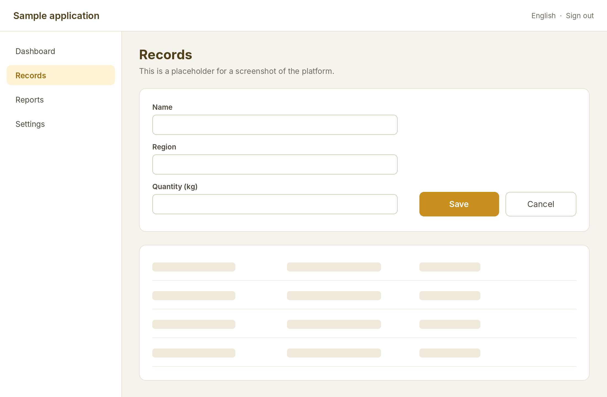
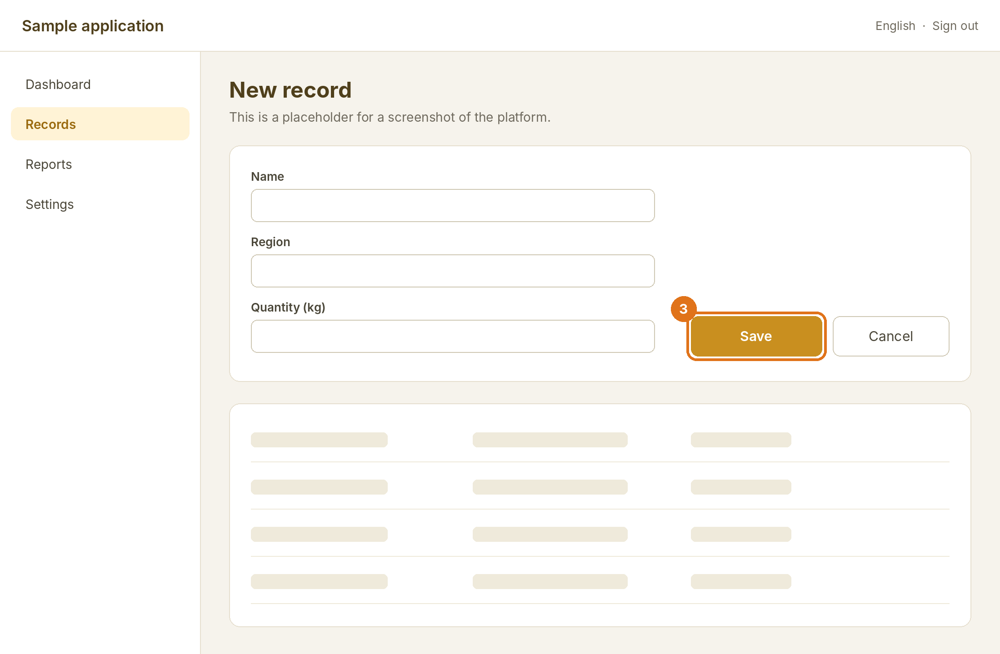
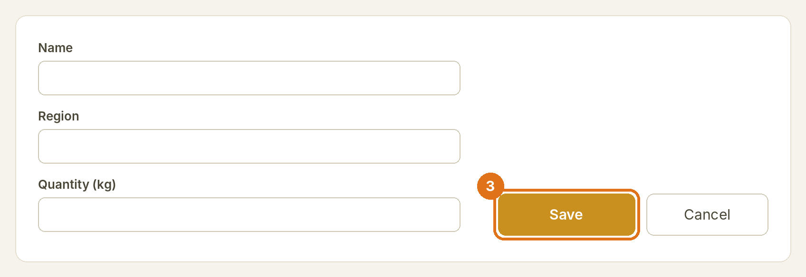
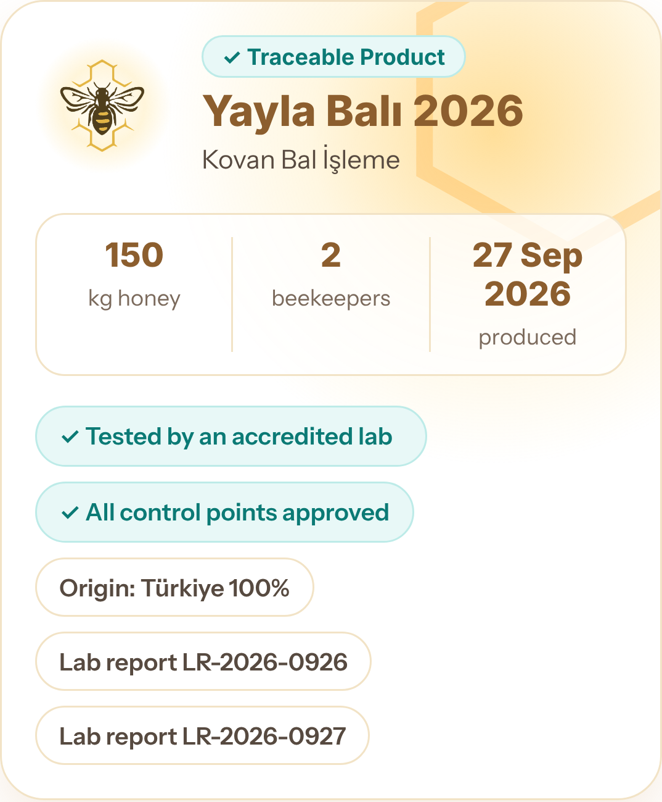
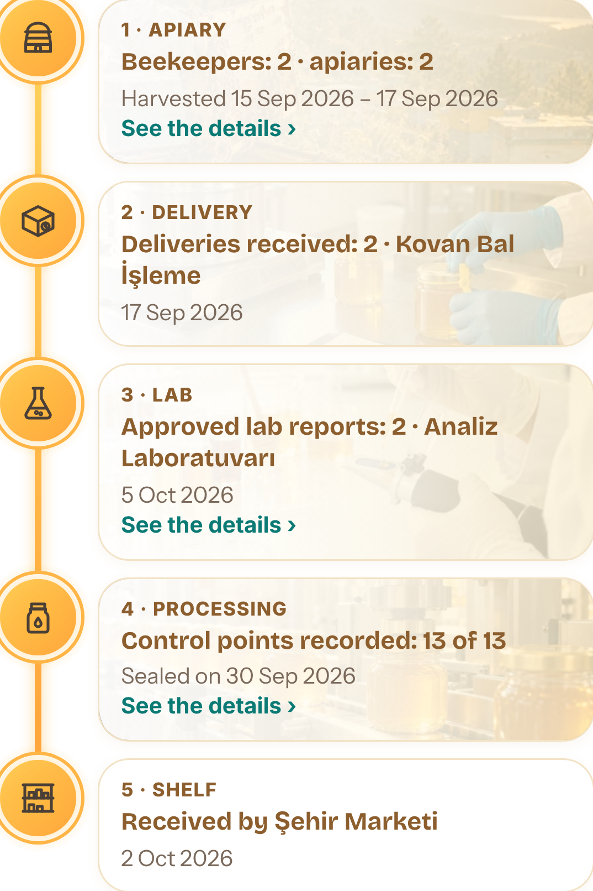

# About this sample {-}

This file is a sample. It shows every building block of the manual template so that the layout can be checked before the real text is written. Replace all of it with the real manual; keep only the block of settings at the top of the file.

A chapter title that ends with `{-}` has no number. All other chapters and their sections are numbered automatically, and the contents table, the numbers of figures and tables and the last page with the partners and supporters are added by the build. [Table](#tbl-roles) shows how a table gets its number and caption, and [Figure](#fig-home) how a picture does.

# Getting started

A chapter opens with one or two sentences that say who the chapter is for and what the reader will be able to do at the end of it.

## Open the platform

1. Open **https://top4honeychains.intalalab.net** in your browser.
2. Choose your language in the top right corner. The platform is available in English, Turkish, Spanish, Polish and Latvian.
3. Select **Sign in**.

> [!NOTE]
> Names of buttons, menus and fields are written in bold, exactly as they appear on the screen in the language of the manual.

## Complete a form

A numbered step can carry its own picture. The marked control in the picture has the number of the step.

1. Open **Records** in the menu on the left.
2. Fill in **Name**, **Region** and **Quantity (kg)**.
3. Select **Save**.

   

4. Check that the new record is in the list:
   - the status is **Draft** until it is approved,
   - the date is the day of entry.

> [!TIP]
> A cropped picture is shown at the same scale as a full page, so the text in it stays the same size.

# Reference

## Tables {#tables}

A caption line starting with `Table:` stands right above the table. The build numbers it, and a link to its id prints the number: [Table](#tbl-roles).

Table: Roles and how they sign in {#tbl-roles}

| Role | Signs in with | Main tasks |
| --- | --- | --- |
| First role | E-mail and password | Enters records and follows their status |
| Second role | E-mail and password | Checks and approves records |
| Visitor | No account needed | Reads the public page behind the QR code |

A table with many columns, such as a matrix of rights, is set in smaller type. Footnote marks can follow a value.

Table: Data rights per role (C create, R read, U update, D delete, A approve) {#tbl-rights}

| Record | OA | St | SAO | QAO | An | LM | RO | CO | PA | Bk | Pub |
| --- | --- | --- | --- | --- | --- | --- | --- | --- | --- | --- | --- |
| Beekeeper | R ¹ | R ¹ | R ¹ | R ¹ | – | – | C R U | R ¹ | C R U ² | R (self) | R ³ |
| Raw honey lot | R | R | C R ⁴ | R | – | – | – | R | C R U D ⁵ | R (own) | R ³ |
| Lab report and results | R | R | R | R | C R U D | R A | – | R | R | R (own) | R |
| Batch | R | R | R | R A | R | R | – | R | C R U D | R | R ³ |

¹ Only the records of the organisation's own work. ² Corrections need a second administrator. ³ Only after the batch is finalized. ⁴ Only for its own plant. ⁵ Only through a correction.

## Notes and warnings

There are four boxes. A note and a tip are shown in the first chapter. The other two are for the rare cases below.

> [!IMPORTANT]
> Use this box for a rule the reader must not miss, for example a step that cannot be undone.

> [!WARNING]
> Use this box when a mistake would lose data or block another person's work.

### A smaller heading

Use the third level for a short group of paragraphs inside a section. It has no number and is not listed in the contents table.

## Words to type and links

Text that the reader types is written like this: `LOT-2026-0142`. A link looks like this: [top4honeychains.intalalab.net](https://top4honeychains.intalalab.net).

## Pictures of narrow screens

A caption can also stand on its own line below a picture, starting with `Figure:`. Links to a section use the section's id: see [Tables](#tables).

A picture taken on a phone-sized screen is given a width, so that it does not fill the page.

Figure: The Honey Story page on a phone {#fig-story}

Two or three pictures written on one line stand side by side.

 
